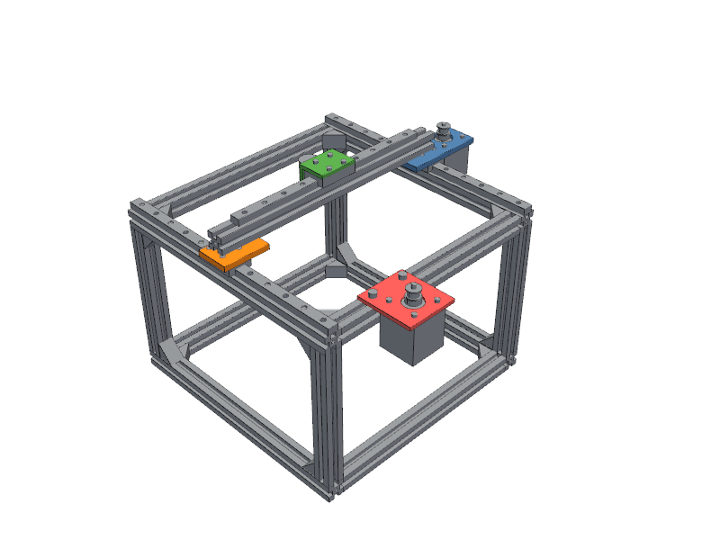
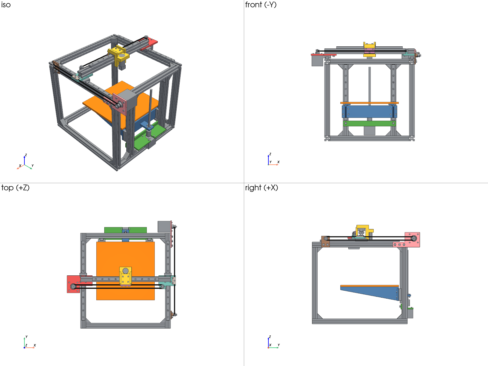

# mechloop

A verification loop for AI-driven mechanical design. An agent writes code-CAD
(build123d), `mechloop` runs simulation-based verifiers on it, and the agent
revises until everything passes: **CAD → verifiers → more CAD**.



## What it checks

| Verifier | What it does | Engine |
|---|---|---|
| geometry | Solid validity, envelope, mass, executable requirements | OpenCASCADE |
| interference | Exact overlap volume for every part pair, required clearances, floating parts, parts that touch but are not fastened, thread engagement | OpenCASCADE |
| ratings | Force available from the actual motor and transmission, guide block loads, bill of materials | catalog data |
| motion | Collisions through full joint travel; guide run-off; belt routing; force needed for the stated speed and acceleration; forward simulation of a motion program with force-limited drives | trimesh/FCL + OpenCASCADE, MuJoCo |
| assemblability | Finds a straight-line assembly order by disassembly; checks driver access to every screw at the moment it is installed | trimesh/FCL + OpenCASCADE |
| fea | Linear static stress and deflection for parts and bonded assemblies, natural frequencies, with reaction balance, load-area and mesh-refinement checks | Gmsh + CalculiX |
| requirements | The brief's acceptance tests, evaluated last with every metric available | |

Off-the-shelf parts (steppers, MGN rails and carriages, 2020 extrusion, GT2
pulleys, lead screws, bearings, screws, corner brackets) come from a typed
catalog with mass, ratings and interfaces: `python -m mechloop catalog`.

## Use

```bash
uv venv .venv && uv pip install -p .venv -e . pytest
apt-get install -y calculix-ccx libglu1-mesa libgl1 libxrender1 libosmesa6 libegl1
.venv/bin/python -m mechloop verify examples/gantry.py     # JSON on stdout, exit 0 = all pass
.venv/bin/python -m pytest                                   # includes fault-injection tests
```

Outputs land in `out/<design>/`: `report.json`, `views.png`, `motion.gif`,
`simulation.gif`, a STEP file and `history.jsonl` (one line per loop iteration).

`AGENT.md` is the instruction file for an agent using the loop.

## Designs taken through the loop

| Design | Parts | Who designed it | What the verifiers caught along the way |
|---|---|---|---|
| `examples/motor_bracket.py` | 9 | written directly | factor of safety 1.14 and 6.5 mm deflection (fixed with gussets); later, motor screws with 1 mm of thread |
| `examples/gantry.py` | 103 | written directly, belts added by an agent | hotend crashing into the frame, screws buried under the beam, 20 unfastened parts, nozzle stiffness 40 N/mm against a 150 N/mm target, 16 screws with too little thread |
| `designs/z_axis.py` | 86 | agent, from `AGENT.md` | bed screws with 2 mm of thread; curved-face FEA selection (a harness bug, since fixed) |
| `designs/pan_tilt.py` | 41 | agent, from `AGENT.md` | none in its own runs (see caveat) |
| `designs/printer.py` | 154 | agent, not allowed to read the verifier code | tool plate too soft at the real nozzle tip; 14 short thread engagements; both axes missing belts |



Caveat: the agents avoided most collisions by working out the layout by hand
before the first run, and two of them read the verifier source. Most of what
the verifiers caught, they caught after a check was added or tightened.

## How much to trust a pass

`tests/test_fault_injection.py` breaks the passing gantry eleven different ways
and requires the matching verifier to catch each one. The FEA kit is checked
against beam theory in `tests/test_fea.py`. Known gaps are in `STATUS.md`; the
main ones are no contact or bolt-preload FEA, no tolerance analysis, no closed
kinematic loops, and catalog ratings that are typical class values, not vendor data.
