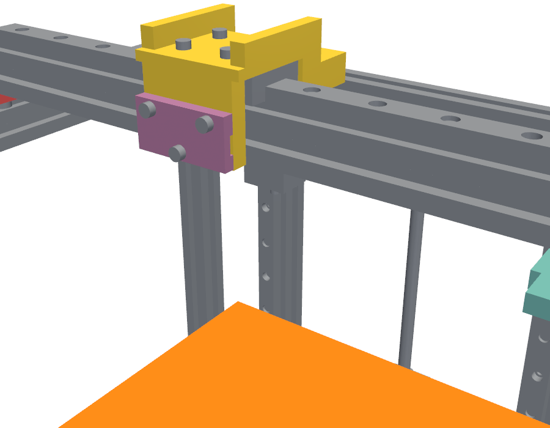
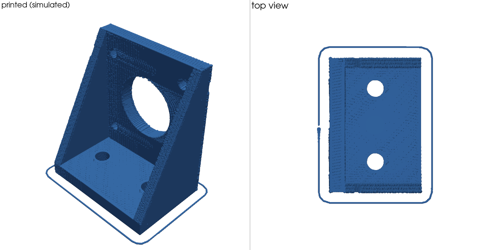

# mechloop

A verification loop for AI-driven mechanical design. An agent writes code-CAD
(build123d), `mechloop` runs simulation-based verifiers on it, and the agent
revises until everything passes: **CAD → verifiers → more CAD**.


## What it checks

| Verifier | What it does | Engine |
|---|---|---|
| geometry | Solid validity, envelope, mass, executable requirements | OpenCASCADE |
| interference | Exact overlap volume for every part pair, required clearances, floating parts, parts that touch but are not fastened, thread engagement | OpenCASCADE |
| ratings | Force available from the actual motor and transmission, guide block loads, bill of materials | catalog data |
| motion | Collisions through full joint travel; guide run-off; belt routing; force needed for the stated speed and acceleration; forward simulation of a motion program with force-limited drives | trimesh/FCL + OpenCASCADE, MuJoCo |
| assemblability | Finds a straight-line assembly order by disassembly; checks driver access to every screw at the moment it is installed | trimesh/FCL + OpenCASCADE |
| fea | Linear static stress and deflection for parts and bonded assemblies, natural frequencies, with reaction balance, load-area and mesh-refinement checks | Gmsh + CalculiX |
| tolerance | 3,000 simulated builds with process tolerances: screw patterns, fits, nozzle gap and bed level against declared adjustment, rail parallelism and lead-screw binding | NumPy least squares |
| manufacture | Stock thickness, set-ups and sharp inside corners for each custom part | OpenCASCADE |
| subsystems | Endstops struck at end of travel, cable lengths over travel, extruder, fan and electronics present | |
| electrical | Everything wired to a compatible port, off-the-shelf parts only (no custom PCB), power budget, wire ampacity and voltage drop, stepper torque at speed from V, R, L and back-EMF, heaters by thermal simulation with Klipper's control laws and injected faults, mains fuse and earth, looms against the CAD over the travel; writes the wiring table and `printer.cfg` (see `docs/ELECTRICAL.md`) | NumPy lumped models |
| requirements | The brief's acceptance tests, evaluated last with every metric available | |

Off-the-shelf parts (steppers, MGN rails and carriages, 2020 extrusion, GT2
pulleys, lead screws, bearings, screws, corner brackets) come from a typed
catalog with mass, ratings and interfaces: `python -m mechloop catalog`.

## Use

```bash
uv venv .venv && uv pip install -p .venv -e . pytest
apt-get install -y calculix-ccx libglu1-mesa libgl1 libxrender1 libosmesa6 libegl1
.venv/bin/python -m mechloop verify examples/gantry.py     # JSON on stdout, exit 0 = all pass
.venv/bin/python -m pytest                                   # includes fault-injection tests
```

Outputs land in `out/<design>/`: `report.json`, `views.png`, `motion.gif`,
`simulation.gif`, a STEP file and `history.jsonl` (one line per loop iteration).

`AGENT.md` is the instruction file for an agent using the loop.

## Designs taken through the loop

| Design | Parts | Who designed it | What the verifiers caught along the way |
|---|---|---|---|
| `examples/motor_bracket.py` | 9 | written directly | factor of safety 1.14 and 6.5 mm deflection (fixed with gussets); later, motor screws with 1 mm of thread |
| `examples/gantry.py` | 103 | written directly, belts added by an agent | hotend crashing into the frame, screws buried under the beam, 20 unfastened parts, nozzle stiffness 40 N/mm against a 150 N/mm target, 16 screws with too little thread |
| `designs/z_axis.py` | 86 | agent, from `AGENT.md` | bed screws with 2 mm of thread; curved-face FEA selection (a harness bug, since fixed) |
| `designs/pan_tilt.py` | 41 | agent, from `AGENT.md` | none in its own runs (see caveat) |
| `designs/printer.py` | 154 | agent, not allowed to read the verifier code | tool plate too soft at the real nozzle tip; 14 short thread engagements; both axes missing belts |
| `designs/printer_v3.py` | 225 | agent, redesigned for buildability | 20 errors in v2 under the tolerance, adjustment, binding, manufacture and subsystem checks; see `docs/BUILDABILITY.md` |


Caveat: the agents avoided most collisions by working out the layout by hand
before the first run, and two of them read the verifier source. Most of what
the verifiers caught, they caught after a check was added or tightened.

## Digital twin: printing on the simulated printer

`python -m mechloop print designs/printer.py examples/motor_bracket.py:bracket`
slices a part with PrusaSlicer, plans the motion the way printer firmware does
(look-ahead, per-axis limits, junction deviation), runs it on the machine's own
dynamics (axis masses from the CAD, motor torque curves, open-loop steppers that can
lose steps), lays material down where the simulated nozzle actually went, and
compares each layer with the intended part.




| Run (`designs/print_runs.py`) | Result |
|---|---|
| 20 mm cube, 0.2 mm layers | passes: 15 min print, outline 98.9% match, average outline offset under 0.02 mm, nozzle lag up to 0.27 mm along the path (belt stretch) |
| Motor bracket, 0.3 mm layers | passes: 43 min print, 15.6 g, outline 97.1% match, largest unsupported gap 3 mm |
| What-if: 25x acceleration, motor current at 30% | fails as it should: both X and Y lose steps, layers displaced up to 16 mm (`docs/twin/layer_shift_printed.png`) |

The first twin run found that the printer, which passed every static check, could
not print at all: the bed stopped 1 mm short of the nozzle, so the first layer
was unreachable. The brief had allowed that gap.

Modelled: real slicer G-code, firmware-style planning, stepper torque-angle
dynamics and step loss, gravity on the Z axis, extruder lag, bead width from
extruded volume, machine collisions over every pose of the print, bridges over
thin air. Not modelled: heat (melting, cooling, warping, bed adhesion, sag),
pressure advance, stringing, position-dependent stiffness. Belt stretch is modelled from
an assumed belt stiffness; rail friction, extruder lag and damping are assumed values
in `PrinterMap`.

### Evaluating the printer and the twin

`python designs/evaluate_printer.py` runs the whole evaluation in simulation in about
8 minutes: a seven-part benchmark suite, a speed/acceleration envelope, bed and height
coverage, robustness to assumed values, injected machine faults, design variants, a
sensitivity ranking, and a reality check against documented Voron 2.4 measurements.
Results and caveats are in [`docs/EVALUATION.md`](docs/EVALUATION.md);
`tests/test_twin_validation.py` holds the tests of the twin itself.

### Simulation in the design loop

For a printer, `mechloop verify` now includes the twin (the design must print a test cube on its
own simulated machine, with frame stiffness taken from its own FEA), and `mechloop score` gives
numbers to improve: resonance, sideways error, highest clean acceleration, benchmark time, mass,
cost. `mechloop assemble` simulates building any design: build order, whether each part stays put
when you let go, turning the assembly, tools, a time estimate, written instructions and an
animation. Two agent trials that used these as objectives are in
[`docs/IMPROVEMENT_TRIALS.md`](docs/IMPROVEMENT_TRIALS.md).

## How much to trust a pass

`tests/test_fault_injection.py` breaks the passing gantry eleven different ways
and requires the matching verifier to catch each one. The FEA kit is checked
against beam theory in `tests/test_fea.py`. Known gaps are in `STATUS.md`; the
main ones are no contact or bolt-preload FEA, no tolerance analysis, no closed
kinematic loops, and catalog ratings that are typical class values, not vendor data.
