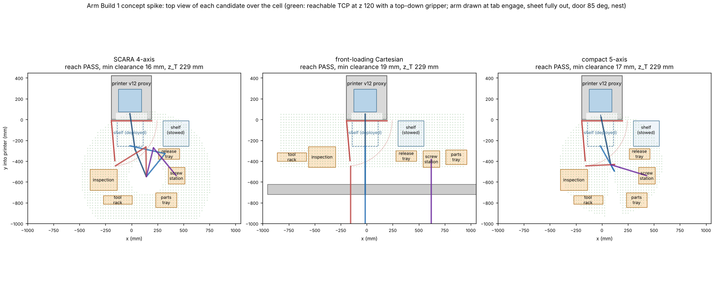

# Arm Build 1 concept spike: decisive tests 1 and 2 on three skeleton arms

Status: design research, 2026-11-21 (ARM_SCOPE.md section 12, steps 1-3). Nothing is bought or built. All three arms
are exploratory skeletons. Every number is **sourced** (named) or an **estimate (est.) / assumption**, and prices are
est. single-unit figures from 02_actuators.md. The results come from est. stiffness and noise inputs, and the rotary
arms land close to their limits, so read them as **what each candidate needs to pass**, not as predictions of a built
arm. Tests 3, 4 and 5 have to confirm them.

## 1. Headline

| | SCARA 4-axis | Front-loading Cartesian | Compact 5-axis |
|---|---|---|---|
| **Test 1: reach and clearance** (all required poses, >= 15 mm, joint margin >= 5) | **PASS**, min clearance 16.2 mm (link2 to the door at 85 deg) | **PASS**, 19.5 mm (ram to the door) | **PASS**, 17.4 mm (forearm to the door); uses a 30 deg tilted hook for the in-printer sheet poses |
| Straight sheet pull (need >= 240; 310 puts the sheet fully on the shelf) | >= 420 mm | >= 420 mm | >= 420 mm |
| Door open / close (pin in a free-edge loop, 0-85 deg) | yes | yes | yes |
| Optional 45 deg tilted presentation | no (flip fixture instead) | no | yes |
| Optimised geometry | L1 285, L2 346 mm; base (142, -550); Z carriage 205-431 mm (column ~510 mm tall) | X stroke 1,775 mm (beam ~2.1 m); ram stroke 526 mm, ram 776 mm long, cantilever to 666 mm; Z stroke 226 mm | shoulder 109 mm above the bench, L2 250, L3 279 mm, wrist 60 mm; base (85, -435) |
| Bed transfer height chosen | 229 mm (bed fully down) | 229 | 229 |
| **Test 2: 3 sigma, assembly poses** (lateral, limit 0.2 mm) | **0.115 mm** | **0.057 mm** | **0.133 mm** |
| **Test 2: 3 sigma, sheet poses** (3D, limit 1 mm) | **0.50 mm** | **0.78 mm** | **0.42 mm** |
| What it needs to pass with 10 % margin | 21-bit output encoders (MT6835) on theta1 and theta2; angular-contact bearings in aluminium housings; 80 x 40 x 3 Al link cores (link1 torsion dominates) | printer-class parts: closed-loop NEMA17 on 9 mm GT2 belts (X, Y ram), T8 leadscrew Z, 40 x 40 x 2 Al ram | MT6835 on base, shoulder and elbow outputs; a **belt-reduced wrist pitch with its own MT6835** (a Dynamixel wrist fails at 0.68 mm); Al 60 x 30 link cores |
| Allowed joint / axis repeatability (all budget joints at once, assembly class) | +/-0.015 deg | +/-0.13 mm | +/-0.016 deg |
| Actuation, est. | $435 | $579 | $568 |
| Whole cell, est. (actuation + ARM_SCOPE budget-table midpoints) | **~$2,210** | **~$2,280** | **~$2,340** |
| Recommendation | **drop** (reasons in section 7) | **keep: lead** | **keep: generality hedge** |

Figures: [top view of each candidate over the cell](arm_spike/workspace_top.png) and
[error per candidate and joint recipe](arm_spike/error_budget.png). Data:
`mechloop/data/arm/task_poses.json`, `mechloop/data/arm/spike_results.json`. Code: `mechloop/arm/` (rerun with
`.venv/bin/python -m mechloop.arm.spike`, ~3-5 min). Tests: `tests/test_arm_kinematics.py`. Cell design:
`designs/arm_cell.py`.

## 2. Method

### 2.1 Cell model (step 1)

`mechloop/arm/cell.py` holds every number. `designs/arm_cell.py` turns it into a mechloop `Design` made of boxes
(`exploratory = True`, every box marked `meta.placeholder`; no printer file is imported). The cell frame has x to the
right, y into the printer and z up. Its origin is on the bench under the centre of the printer frame's front face.

| Item | Value | Source / label |
|---|---|---|
| Printer envelope | 388 x 419.5 x 475.9 mm; frame 35.5 mm above the bench on its feet | PRINTER_V12.md |
| Front opening, clear width | **300 mm** (side-wall inner faces at x = +/-150) | printer_v12.py constants FX = 340 and WALL_X = FX/2 - 20, read as text (never imported). 01 estimated 348 (388 - 40), so the real opening is **48 mm narrower** |
| Front opening, height | z 55.5 to 419.5 above the bench | printer_v12.py FZ = 394, top rail's top face at FZ + 10 (read) |
| Bed (sheet top) transfer range | 229 to 409 mm above the bench | nozzle tip 373.45 above the frame bottom (printer_v12.py duct comment) plus the feet; Z travel 180 (PRINTER_V12.md) |
| Sheet | 220 x 220; centre 184.5 mm inside the front face at x = -15.5; front edge y 74.5, rear edge 294.5; plate front 64.5 | BED_CX, BED_CY, SHEET, PLATE (read); front face at printer y = -180 from FY/2 (est. reading) |
| Grip tab | 24.5 mm forward of the sheet edge, 30 mm wide, 6 mm hole 7 mm from its tip (TCP at y = 57) | assumption: the owner adopted a tab; its geometry is ours |
| Parked toolhead | box over y >= 232, z >= 394 (nozzle tip at 409) | est., from the nozzle's Y reach in PRINTER_V12 |
| E-stop head | x -235..-196, y -35..112, z 316..356 | PRINTER_V12.md ("left of the post, head at z 300, 35 mm proud of the front"); x extent est. |
| V13 door | front panel hinged on the **left** post (axis at x -194, y -10), 388 mm wide, full height, 3 mm polycarbonate, **door stop at 85 deg** | front panel and polycarbonate from V13_IDEAS.md; hinge side, width and stop are assumptions (past about 85 deg a left-hinged door meets the v12 e-stop head) |
| Door handle | loop with a vertical axis on a 50 mm stand-off at the free edge, z 200; the arm drops a pin into it, and a person uses the same loop | assumption, chosen for the arm |
| Sheet shelf | 250 x 243 mm at bed height in front of the opening; **stowable**: slides 440 mm to the right | assumption, forced by the door (section 4) |
| Stations (placeholders) | inspection stage 260 x 200 x 80 h; tool rack 280 x 80 x 150 h (4 slots at 70 mm pitch); parts tray 200 x 140 x 40 h; screw station 160 x 160 x 100 h; release tray 200 x 100 x 60 h | est. |
| Station layouts | "ring" around a rotary base (SCARA, 5-axis) and "row" along the bench (Cartesian), since floor space is not a constraint; both keep clear of the door sweep and of both shelf positions | assumption; positions in `cell.LAYOUTS` |

### 2.2 Task poses (step 2)

`mechloop/data/arm/task_poses.json` is generated by `mechloop/arm/poses.py` and holds 23 poses and paths over stages
A-D, each with payload, force on the tool, accuracy class, approach direction and the cell states in which it happens.
Every task is worked **top-down** (tool axis -z):

- the sheet through a pin in the tab hole;
- the door and the shelf through a pin in a loop;
- assembly by vertical insertion.

An arm that can pitch its tool may also work the sheet poses with the tool tilted 30 deg or horizontal (a hook rather
than a straight pin). One optional pose presents a part tilted 45 deg to a side camera. It scores generality and is not
pass/fail.

| Id | Stage | Task | Payload kg | Force on the tool, N (est.) | Class | Approach |
|---|---|---|---|---|---|---|
| A0_door_open | A | pin in the free-edge loop, arc 0 -> 85 deg (closing is the reverse) | 0.2 | 20 latch break-away, then 5, against the arc | sheet | down into the loop |
| A0_shelf_deploy | A | pull the shelf 440 mm into place (stowing is the reverse) | 0.2 | 10 drawer friction | sheet | down into the loop |
| A1 / A2 | A | approach 25 mm above the tab; pin into the tab hole | 0.2 | - | sheet | down, or tilted hook |
| A3_peel | A | lift the front edge 8 mm off the magnet | 1.0 | 15 down (01) | sheet | up |
| A4_pull_240 | A | straight pull 240 mm at bed height (test 1 minimum) | 1.0 | 20 back (01) | sheet | -y |
| A5_pull_full | A | continue to 310 mm: rear edge 15 mm clear of the frame, sheet fully on the shelf | 1.0 | 20 | sheet | -y |
| A6_flex | A | lift the tab end 35 mm against the shelf's clamp | 1.0 | 15 down | sheet | up |
| A7 / A8 | A | push the sheet back 310 mm; nudge it against the rear and left pins | 0.4 | 15; 10 diagonal | sheet | +y; (-x, +y) |
| B1 | B | pick a released part off the sheet on the shelf | 0.5 | 5 | sheet | down |
| B2 x2 | B | pick from the release tray (loose parts, located by camera) | 0.5 | 5 | sheet | down |
| B3 x2 | B | place a part on the inspection stage (+/-1 mm, +/-2 deg) | 0.5 | 5 | sheet | down |
| B4 (optional) | B | present a part tilted 45 deg to a side camera | 0.5 | - | sheet | tilted |
| C1 x2 | C | pick a printed part from a kinematic pocket | 1.0 | 20 | assembly | down |
| C2 / C3 / C4 | C | part into the nest; M3 nut into its printed pocket; drive the screw (0.4-1.2 N·m reaction) | 1.0 / 0.2 / 0.3 | 20 axial (+1.2 N·m) | assembly | down |
| D1 x2 | D | pick or place a tool in the first and last rack slot | 0.5 | 30 | assembly | down |

As the brief asks, every assembly pose is evaluated at 0.2 kg and at 1 kg, each with 20 N axial. The tool rack is held
to the assembly class even though a kinematic coupling captures +/-0.5-1 mm (01).

### 2.3 Skeleton arms (`mechloop/arm/candidates.py`)

| | SCARA 4-axis | Front-loading Cartesian | Compact 5-axis |
|---|---|---|---|
| Joints | theta1 and theta2 (vertical axes), Z carriage on a column, roll | X along the bench, Z on a mast, Y ram (40 x 40 tube) into the printer, roll | base yaw, shoulder, elbow, wrist pitch, roll |
| Optimised | base x, y; L1; L2 (the Z stroke follows from the poses) | the X rail's y line (the strokes follow from the poses) | base x, y; shoulder height; L2; L3 |
| Fixed (est.) | link2 hangs 45 mm under link1; flange 25 mm under link2; capsule radii 30 / 27, column 40 | mast (r 38) at X - 65; ram r 29; X beam r 50 on the bench | wrist pitch axis to flange 60 mm (XL430-class roll stage); capsule radii 50 / 32 / 28 / 26 |
| Tools (est.) | hook pin 70 mm (r 14), gripper 110 mm (r 30), screwdriver 130 mm (r 25), flange to TCP | same | same |

### 2.4 Test 1: reach and clearance sweep (`mechloop/arm/reach.py`)

Every pose and path point is checked: paths every 10 mm, the door every 5 deg, the shelf every 22 mm. Each check
covers:

- closed-form IK;
- joint limits, with a margin of at least 5 deg (5 mm for linear axes);
- capsule-to-obstacle clearance of at least 15 mm against the printer proxy, bed, parked toolhead, e-stop, the door at
  its current angle, the shelf at its current position, and the stations.

Each check runs in every cell state the task can happen in:

- sheet tasks: door open, shelf deployed;
- station tasks: door closed;
- release tray: both.

The tool may touch only what the task works on, and its last 25 mm are not checked. A path must stay on one IK branch.
It fails if the base joint swings more than 30 deg between samples (a path through the base axis).

The optimiser runs a random search and then a shrinking local search, with a fixed seed. It minimises a size cost:

| Candidate | Size cost |
|---|---|
| SCARA | L1 + L2 + 0.3 x Z stroke |
| Cartesian | X stroke + 2 x ram stroke + 0.5 x Z stroke |
| 5-axis | L2 + L3 + 0.3 x shoulder height |

The constraint is that every required pose passes. The search runs over the free parameters and the bed transfer
height (229-305 mm). The longest straight pull is then searched from the tab in 10 mm steps, up to 420 mm.

### 2.5 Test 2: tool-point error Monte Carlo (`mechloop/arm/accuracy.py`)

At each pose (up to 12 points per path) and in each load case:

> TCP error = random joint errors through the Jacobian + deterministic deflection from the change of load

The load change is measured from the taught state (0.2 kg tool, no contact) to the task.

- **Random, per joint:**
  - servo dither of +/- 1 encoder count (uniform);
  - encoder noise (normal);
  - backlash with a random side, where the loop does not close on the joint output.
- **Deterministic:**
  - transmission windup, where the loop closes only on the motor encoder;
  - beams split into 12 segments (bending about both axes, plus torsion) for links, column, mast and ram;
  - bearing and guide tilt springs;
  - belt stretch on linear axes;
  - Z leadscrew axial compliance.
- **Metric:** "3 sigma" is the 99.73rd percentile of the error magnitude over 3,000 samples.
  - At assembly poses it is **lateral (xy)**. Insertion is vertical, but a vertical push that tilts the arm still moves
    the tool tip sideways through the tool's length.
  - At sheet poses it is 3D.
  - The worst pose and load case in each class is reported.
- **Selection:** the cheapest configuration whose worst case is at most 0.9 x the limit in both classes (10 % design
  margin).
- **Not modelled:**
  - thermal drift;
  - encoder non-linearity and eccentricity (both repeatable, removed by teaching or calibration);
  - dynamics and settling;
  - creep of printed parts;
  - tool and coupling compliance.
- **Assumed:** an output-encoder loop with integral action holds its static position to +/- 1 count.

Joint options (02_actuators.md section 6; est. unless a source is named):

| Option | Resolution / play | Stiffness at the output | Cost est. |
|---|---|---|---|
| Closed-loop NEMA17 (StepperOnline 17HS24-2104-ME1K, 4,000 CPR) + MKS SERVO42D | 360 / (4,000 x ratio) per count | - | $49 (02) |
| 2-stage belt reduction 12:1 (GT2 + HTD 15 mm) | backlash 0.03 deg (est.) | 1,000 N·m/rad (own calc; 02 gives 100-500) | $90 incl. motor and driver |
| Printed 2-stage capstan 25:1 (recipe A) | zero backlash | 10,000 N·m/rad (est.) | $105 incl. motor and driver |
| Strain wave StepperOnline HSS-14-50 + closed-loop NEMA17 (recipe C) | 20 arcsec | 5,000 N·m/rad (est.) | $300 (02) |
| ams AS5047P output encoder | 14-bit, 0.022 deg; noise 0.011 deg (est.) | the loop closes on the output | $16 (02) |
| MagnTek MT6835 output encoder | 21-bit; noise 0.003 deg (est., **to measure**) | " | $25 (chip $5-10 + board, est.) |
| RLS AksIM-2 | 20-bit; noise 0.0008 deg (est.) | " | $220 ($150-300, 02) |
| ROBOTIS Dynamixel XL430 / XM430 (wrist) | 12-bit, 0.088 deg; backlash 0.25 deg (02 est. 0.25-0.3) | 100 / 200 N·m/rad (raised P gain, est.) | $50 / $310 (02) |
| Belt axis (Cartesian X, Y) | 0.01 mm per count; 0.005 mm noise (est.) | 9 mm GT2, EA 30 kN (est.) | $70 |
| T8 leadscrew + anti-backlash nut (Z) | 0.002 mm per count; 0.01 mm play (est.) | 20 N/µm axial (est.) | $60 |
| Joint bearing tilt stiffness | printed housing with a deep-groove pair: 20 N·m/mrad; aluminium housing with an angular-contact pair: 100 N·m/mrad | est. | +$30 per joint (est.) |
| Link sections | Al tube 60 x 30 x 2 (EI 1.1e10 / 3.7e9 N·mm², GJ 3.2e9); Al 80 x 40 x 3; printed PETG box 60 x 30 x 3 (EI 4.5e8, as in 01) | tube formulas, E 69 / 2 GPa | structure line of the budget |

The tests check:

- FK/IK round trips;
- Jacobians against finite differences;
- a known-answer encoder case: 14-bit encoder at 500 mm gives 0.19 mm, the table value in 02;
- a known-answer cantilever case: the segment springs reproduce F L³ / 3EI, 0.084 mm for the 40 x 40 tube at 400 mm
  under 20 N, as in 01;
- that every station sits outside the door sweep.

## 3. Results

### 3.1 Test 1: reach and clearance

All three candidates pass every required pose. Each candidate's tightest spots, in mm:

| Pose (limiting pair) | SCARA | Cartesian | 5-axis |
|---|---|---|---|
| Door arc 0-85 deg | **16.2** (link2-door) | **19.5** (ram-door) | **17.4** (forearm-door) |
| Tab approach, 25 mm above | 43.5 (link2 to the top rail) | 41.5 (ram to the top rail) | 20.7 (upper arm to the shelf guides; 30 deg hook) |
| Pull 240 / full 310 | 60.5 / 72 | 58.5 / 70 | 26 / 48 |
| Tightest station pose | 31.2 (release tray: link2 to the stowed shelf) | 33.2 (inspection: tool to the rack) | 27.0 (release tray: forearm to the shelf) |
| Smallest joint margin | 5.0 deg (door) | 10 mm (stroke ends) | 11.8 deg (tray, rack) |
| Optional tilted presentation | cannot | cannot | passes (133 mm) |

What test 1 showed:

- **The window under the top rail decides the transfer height.**
  - Everything enters between the sheet and the top-rail underside (z 419.5).
  - All three optimised to the lowest bed position: z_T = 229, giving a 190 mm window.
  - The SCARA and Cartesian stack a vertical tool (70 mm), a flange and a 60 mm link or ram, which fits with about
    40 mm to spare.
  - The 5-axis with a vertical pin misses by 7.5 mm, because the wrist pitch axis sits 60 mm above the flange. It enters
    with the tool tilted 30 deg, a hook rather than a straight pin. Fitting a vertical pin needs a wrist 15 mm shorter
    or an approach height of 15 mm.
- **The door is the tightest task for every candidate.**
  - It works only because the handle is a loop on a 50 mm stand-off at the free edge, and the arm stays on the free-edge
    side of the panel throughout.
  - With the 25 mm stand-off tried first, the Cartesian's ram hit the door's end at 85 deg.
  - A handle on the door's face would make the arm reach round the panel at large angles.
- **Pull length is not a constraint:**
  - all three pull at least 420 mm in a straight line;
  - 240 mm leaves the sheet's rear 84 mm still on the bed, so **310 mm** is the pull that puts the sheet fully on the
    shelf (the task list uses both).
- **Base placement:**
  - the SCARA column and the 5-axis base must sit outside the door's sweep, more than about 470 mm from the hinge in the
    swept sector;
  - this pushes them about 450-550 mm in front of the printer;
  - the SCARA then needs 631 mm of reach, against 500 mm in the 01 proposal.

### 3.2 Test 2: error Monte Carlo

Worst 3 sigma per class, per configuration (selected rows; the full grid of 96 SCARA, 2 Cartesian and 120 5-axis
configurations is in `spike_results.json`):

| Candidate | Configuration | Assembly (lateral) mm | Sheet (3D) mm | Actuation $ est. |
|---|---|---|---|---|
| SCARA | belt, motor encoder only, printed bearings, Al 60 x 30 | 0.91 | 3.9 | 325 |
| SCARA | belt + AS5047P | 0.53 | 1.26 | 357 |
| SCARA | belt + MT6835, printed bearings | 0.29 | 1.11 | 375 |
| SCARA | belt + MT6835, metal bearings, Al 60 x 30 | 0.196 (no margin) | 0.63 | 435 |
| SCARA | **belt + MT6835, metal bearings, Al 80 x 40 x 3** | **0.115** | **0.50** | **435** |
| SCARA | belt + MT6835, metal bearings, printed PETG links | 3.2 | 6.4 | 435 |
| Cartesian | **belts + T8 Z, ram Al 40 x 40 x 2** | **0.057** | **0.78** | **579** |
| Cartesian | ram Al 60 x 30 x 2 (60 deep) | 0.050 | 0.55 | 579 |
| 5-axis | motor encoders only, XL430 wrist | 0.94 | 4.0 | 428 |
| 5-axis | MT6835 proximal, XL430 wrist | 0.68 | 3.65 | 503 |
| 5-axis | MT6835 proximal, XM430 wrist | 0.68 | 2.07 | 763 |
| 5-axis | MT6835 proximal, belt + AS5047P wrist pitch | 0.188 (no margin) | 0.43 | 559 |
| 5-axis | **MT6835 proximal, belt + MT6835 wrist pitch** | **0.133** | **0.42** | **568** |
| 5-axis | MT6835 proximal, strain-wave wrist, metal bearings | 0.105 | 0.43 | 843 |
| 5-axis | MT6835 proximal, belt + AS5047P wrist, printed PETG links | 1.34 | 3.25 | 649 |

What dominates (the worst pose of the chosen configuration, `breakdown` in the JSON):

- **SCARA:**
  - At assembly (worst: tool-rack slot, 0.2 kg + 20 N), the lateral error was 0.196 mm with 60 x 30 links. Of that,
    0.11 mm was **link1 torsion**: the vertical push acts off link1's axis through link2, and the twist swings the
    hanging tool sideways. Joints add 0.07 + 0.05 mm.
  - The 80 x 40 x 3 link cuts the total to 0.115 at no extra actuation cost.
  - At the sheet peel: column bending, column foot, Z carriage and theta1 tilt, about 0.1-0.16 mm each.
- **Cartesian:**
  - At assembly, mostly the encoders' and belts' random 0.024 mm, plus 0.02 mm of ram bending.
  - At sheet poses, the peel at full ram extension: ram bending 0.43, mast 0.13, Z carriage 0.12 mm.
  - It is far inside both limits.
- **5-axis:**
  - With an XL430 on the wrist pitch, its 0.25 deg backlash over the 130 mm wrist-to-tool distance gives about 0.6 mm
    alone. **No smart servo fits on the wrist pitch**; it needs the same treatment as the proximal joints.
  - With a belt + AS5047P wrist pitch, the random part still dominates (0.16 mm, mostly that joint).
  - With an MT6835 on the wrist pitch, the random part drops to 0.06 mm, and deflection leads at the screw station
    (1 kg + 20 N + 1.2 N·m): 0.085 mm, from upper-arm bending and shoulder and elbow bearing tilt.
  - Deflection stays small because the pitch joints' output encoders correct the in-plane windup.
- **Printed-only links (PETG box) fail everywhere** (1.3-3.5 mm). The DG-01 arm exception allows printed load-bearing
  parts, but long links need aluminium cores with printed joints and housings, as 01 section 4.3 expected.
- **14-bit encoders (AS5047P) fail on both rotary arms.** One count at 600 mm is 0.23 mm. 21-bit-class output encoders
  are the price of entry for 0.2 mm, as 02 section 1.2 said.

**Joint repeatability budget.** This is the largest +/-e of uniform random error that can sit on all the listed joints
at once, with the configuration's deflection, while every assembly pose still passes:

| Candidate (joints) | Assembly 0.2 mm | Sheet 1 mm |
|---|---|---|
| SCARA (theta1, theta2), chosen configuration | +/-0.015 deg (+/-0.008 with 60 x 30 links) | +/-0.054 deg |
| Cartesian (X, Y ram) | +/-0.13 mm | +/-0.43 mm |
| 5-axis (yaw, shoulder, elbow, wrist pitch) | +/-0.016 deg | +/-0.046 deg |

The SCARA was also checked at test 3's proposed pass of +/-0.02 deg: it gives 0.26 mm at the assembly poses (a fail).
**Test 3's pass line should be tightened to about 0.015 deg** for the rotary arms at the 0.2 mm target.

**If test 4 finds a 0.5 mm insertion window**, which the owner's note says would make printed rotary joints viable, the
cheapest passing configurations change:

- SCARA: belt + MT6835 with printed bearings and an 80 x 40 link, $375 (0.20 / 0.98 mm; sheet margin thin);
- 5-axis: AS5047P on every joint, with a belt-reduced wrist pitch, $532 (0.38 / 0.83 mm);
- Cartesian: unchanged.

## 4. Cell findings (worth knowing whichever arm is chosen)

1. **The door and the sheet shelf cannot both be fixed.**
   - A full-width hinged front door sweeps everything within about 413 mm of its hinge in front of the printer.
   - That is exactly where a shelf at bed height has to be.
   - The spike resolves it with a stowable shelf: a 440 mm slide to the right, pulled out by the arm after it opens the
     door. That adds a mechanism and two tasks.
   - Alternatives for the V13 enclosure, for the owner: a lift-off or sliding front panel, a bi-fold door (which halves
     the sweep but still crosses the shelf), or the shelf folding into the door's swept zone only when the door is open.
2. **The front opening is 300 mm clear, not 348.** The sheet (220) plus pin tools fits; a wide-jaw gripper inside the
   printer has 40 mm a side.
3. **A left-hinged V13 door meets the v12 e-stop head past about 85-90 deg.** Either fit a door stop at 85 deg (assumed
   here) or hinge the door on the right. The latter moves the stowed shelf to the left, where the e-stop and the
   inspection station are.
4. **Transfer at the lowest bed position.**
   - With the bed fully down, the window under the top rail is 190 mm.
   - A 180 mm print still clears the top rail as the sheet slides out.
   - The front purge line (owner decision) and tall prints near the front edge sit within about 25 mm of the arm's pin
     and link inside the printer. They are **not** modelled as obstacles yet.
5. **The gap ahead of the plate.** As the sheet leaves, it spans 64.5 mm from the plate front to the frame plus 12 mm to
   the shelf, with no support. Its own-weight sag over that span is about 0.3 mm (01's 8 mm at 220 mm, scaled by L⁴),
   more with a print on it. Test 5 should include this gap.
6. **The Cartesian's ram overhangs the bench.** At the stations nearest the X beam, the 776 mm ram's tail reaches about
   560 mm in front of the beam. The bench must be about 1.75 m deep from that tail to the printer's rear, or the ram
   made telescopic (two stages). Floor space is not a constraint, but bench depth is a real purchase.

## 5. Scored comparison against the stage targets

Scores are 1-5, with 5 best. Weights follow the stages: A and C dominate, and the twin and control effort matters
because the loop must run on the arm. The scoring is a judgement on the evidence above, not a computed result.

| Criterion | Weight | SCARA | Cartesian | 5-axis |
|---|---|---|---|---|
| A: reach and clearance robustness (door, window, shelf) | 15 % | 4 (16 mm; vertical pin fits) | 4 (19.5 mm) | 3 (17.4 mm; needs a tilted hook in the printer) |
| A: sheet accuracy (limit 1 mm) | 10 % | 4 (0.50) | 3 (0.78) | 5 (0.42) |
| C: assembly accuracy and margin (limit 0.2 mm) | 25 % | 3 (0.115 with 21-bit encoders, metal bearings, deep links; +/-0.015 deg joints) | 5 (0.057 with printer-class parts) | 3 (0.133 with four 21-bit encoders; +/-0.016 deg joints) |
| B/D generality (tilted presentation, flipping, hook approaches) | 10 % | 2 | 2 | 5 |
| Cost (actuation) | 10 % | 5 ($435) | 4 ($579) | 4 ($568) |
| Control and twin effort | 15 % | 3 (host IK, 4 joints) | 5 (Klipper native, the printer twin reused) | 2 (host IK, 5 joints, gravity on 3) |
| Bench fit | 5 % | 4 | 2 (2.1 m beam, ram overhang) | 5 |
| Risk still unproven | 10 % | 3 (printed belt joints at 0.015 deg) | 5 (printer-proven parts) | 2 (gravity-loaded printed capstans: creep, brake, 0.016 deg) |
| **Weighted** | | **3.40** | **4.10** | **3.35** |

## 6. What each candidate needs

| | SCARA (if revived) | Front-loading Cartesian | Compact 5-axis |
|---|---|---|---|
| Geometry | L1 285, L2 346 mm; column ~510 mm, Z stroke 226 mm; base 550 mm in front of the printer | X stroke 1,775 mm on a ~2.1 m beam with 2 x MGN15 rails; Z mast stroke 226 mm; Y ram 776 mm long (stroke 526 mm, cantilever up to 666 mm) | shoulder 109 mm above the bench, L2 250, L3 279 mm, wrist pitch to flange 60 mm; base 435 mm in front of the printer |
| Motors (class) | 2 x closed-loop NEMA17 (17HS24-2104-ME1K + SERVO42D) on 12:1 two-stage belts (01: ~3 N·m needed at theta1); NEMA17 + T8 on Z; XL430 roll | 3 x closed-loop NEMA17 (X and ram on 9 mm GT2, Z on T8); XL430 roll; a printer-class Klipper board | base: NEMA17 + 12:1 belt; shoulder and elbow: NEMA17 + printed 25:1 capstan (recipe A, ~14 N·m; the shoulder needs about 9-14 N·m at this reach and 1 kg, so add 02's counterbalance spring and a brake motor); wrist pitch: NEMA17-class + belt (a NEMA14 class suffices: about 1.3 N·m); XL430 roll |
| Encoders | MT6835 (21-bit) on theta1 and theta2 outputs | motor encoders only | MT6835 on the yaw, shoulder, elbow **and wrist pitch** outputs |
| Bearings / structure | angular-contact pairs in aluminium housings at theta1 and theta2; Al 80 x 40 x 3 link cores (torsion); 60 x 60 x 3 column | 40 x 40 x 2 ram (60 x 30 if the sheet margin matters); 60 x 60 x 3 mast | Al 60 x 30 x 2 link cores; printed housings pass (metal improves the margin) |
| Actuation, est. | $435 | $579 (rails at $60/m est.) | $568 |
| Whole cell, est. (ARM_SCOPE budget table) | ~$2,210 (table: $1,450-3,150) | ~$2,280 (table: $1,550-3,350) | ~$2,340 (table, recipe A: $1,500-3,050) |

All three sit inside the owner's "a few thousand dollars or less". The rest-of-cell lines (structure, controllers and
arm computer, end effectors, perception, safety, stations) are the midpoints of the ARM_SCOPE section 11 ranges and
dominate the total (about $1,700-1,800).

## 7. Recommendation

- **Keep the front-loading Cartesian, as the lead.**
  - It passes both tests with the most margin: 0.057 mm at assembly poses, about 3.5 times inside 0.2.
  - It uses only parts the printer already proves.
  - It runs on Klipper, so `twin/firmware.py` and the printer's twin carry over and the loop can start soonest.
  - Its costs are a 2.1 m beam, a deep bench (or a telescopic ram), and no tilted approaches.
- **Keep the compact 5-axis, as the generality hedge.**
  - It is the only candidate that does the tilted presentation and tilted hook approaches.
  - It has the best sheet accuracy (0.42 mm).
  - It matches the owner's likely route (Moveo/DEXTER layout, capstan long joints).
  - It passes 0.2 mm only with four 21-bit output encoders and a belt-reduced wrist pitch; a Dynamixel wrist fails.
  - Its joints must reach +/-0.016 deg, which is test 3's job.
- **Drop the SCARA.**
  - In this cell its distinctive strengths no longer count:
    - floor space is not a constraint, so its footprint advantage over the Cartesian is not needed;
    - its gravity-free joints still need the same 21-bit encoders and 0.015 deg repeatability as the 5-axis, plus metal
      bearing housings and deep links;
    - it gains none of the 5-axis's generality.
  - It also has the tightest door clearance (16 mm) and a 510 mm column in front of the printer.
  - **Revive it** if either of these happens:
    - the bench cannot take the Cartesian's beam and ram overhang;
    - test 3 shows that printed capstans creep or slip under constant gravity load while belt joints pass (the SCARA's
      rotary joints carry no gravity).

## 8. What the physical tests must confirm

| Test | What this spike assumed | Pass line derived here |
|---|---|---|
| **3. Single printed joint repeatability** (5-axis elbow first: NEMA17 + printed 25:1 capstan + MT6835 on the output, 400 mm arm, dial indicator, 100 bidirectional approaches at 0.2 and 1 kg) | MT6835 noise 0.003 deg; the output loop holds +/- 1 count with integral action; tilt stiffness of a printed bearing housing 20 N·m/mrad | **<= +/-0.016 deg** at the output (tighter than the 0.02 deg proposed in ARM_SCOPE); measured tilt stiffness >= 20 N·m/mrad; creep of the printed capstan under 24 h of gravity load (no number assumed) |
| 3b. Wrist pitch joint (belt 12:1 + MT6835) | same as above | <= +/-0.016 deg; shows whether a smart servo can stay (it cannot on these numbers) |
| **4. Insertion window** (the printer as a precise Cartesian robot) | 0.2 mm (provisional) | the largest offset with >= 98 % success. At >= 0.5 mm, AS5047P-class encoders and printed bearings pass on the 5-axis ($532); at <= 0.15 mm, only the Cartesian keeps margin |
| **5. Sheet peel / pull / reseat** (hand jig + force gauge) | peel 15 N, pull 20 N, flex 15 N, reseat push 15 N | the peel sets the worst sheet-class error for all three (0.42-0.78 mm at 15 N + 0.8 kg); a measured peel above about 30 N would push the Cartesian ram past 1 mm. Also: reseat >= 98 % on the pins, the sheet bridging the 64.5 + 12 mm gap, and the tab geometry |
| 6. Link stiffness (beam model now, FEA later) | tube formulas, est. joint and guide springs | 80 x 40 x 3 link1 for any SCARA (torsion); 60 x 30 x 2 cores for the 5-axis; Cartesian ram 40 x 40 x 2 |
| 7. Control bring-up | the output-encoder loop is stiff statically; the stepper plus output-encoder dual loop has no limit cycle | twin vs measured TCP within 0.5 mm; static hold under 20 N within 1 count |

## 9. Open issues and limits of this spike

- **Inputs are est.** Encoder noise, transmission and bearing stiffness, belt EA and guide stiffness all drive the
  results. The rotary arms pass with only 10-35 % margin, so a 30 % change in a dominant input flips them.
- **Door and shelf design are proposals for the V13 enclosure:** hinge side, an 85 deg stop, the free-edge loop on a
  50 mm stand-off at z 200, and a stowable shelf. If the enclosure changes, re-run test 1.
- **The two station layouts differ** (ring vs row), each suiting its arm. A layout tuned per candidate could change the
  Cartesian's X stroke and ram length.
- **The optimiser minimises size**, so every result sits at 15-20 mm minimum clearance. Detailed design should add
  margin for build tolerance and cable runs.
- **Not modelled:**
  - prints and the purge line as obstacles;
  - cable routing;
  - dynamics and cycle time;
  - thermal drift;
  - camera sight lines;
  - tool and coupling compliance;
  - creep;
  - the 5-axis shoulder's static torque against the capstan's rating (estimated above, not checked).
- **The cell design `designs/arm_cell.py` is boxes only**, for display and for the future `arm_kinematics` verifier.
  Only its geometry verifier has been run. It is exploratory and not buildable.
- **Next step** (ARM_SCOPE section 12 step 4): turn `reach.py` and `accuracy.py` into the `arm_kinematics` and
  `arm_accuracy` verifiers, then run tests 3-5.
