# Fabrication drawings: printer_v10

Generated by `tools/build_package.py` from `designs/printer_v10.py` (md5 `f32b1c5928489ecb38c87b0a82126a21`) and `out/printer_v10/report.json` (written 2026-11-18 22:01:23, md5 `14de541aabe9`). Do not edit: change the design, re-run verify, re-run the generator.

> **Simulated design. Nothing has been built.** See [OPEN_ITEMS.md](OPEN_ITEMS.md) before spending money.

37 custom parts: 5 printed, 32 sheet. One sheet per part in `drawings/` (SVG and PDF; all sheets in `drawings/printer_v10_drawings.pdf`), a STEP file per part in `cad/` **in the drawing's own coordinates** (the hole table's X, Y, Z are the STEP's X, Y, Z), a DXF of the flat profile per sheet part in `dxf/` (same origin), an STL per printed part in `stl/` already turned to its print orientation.

## What is automatic and what a person must add

Automatic, from the design's geometry and fasteners: three orthographic views and an isometric, overall dimensions, the datum scheme, a table of every round hole and round-ended slot (position, size, depth, counterbore, what it is for, which pattern it belongs to), the tolerance block, the critical-feature list, the files.

**Not automatic. A person must add or check before release:**

- Dimensions of everything that is not a round hole or a slot: outline steps, cut-outs, windows, pockets, nut slots, inside radii. They are in the STEP / DXF only; the sheet says so.
- The datum scheme is geometric (bounding edges of the plan view). On L-shaped or notched parts choose functional datums and re-reference the table.
- Surface finish, edge condition beyond the general deburr note, plating or paint (none is in the model: every steel part is bare).
- Hole labels are placed by rule and can sit on top of each other on dense patterns; the table is authoritative.
- Thread class, tap depth beyond 'through', and any geometric tolerance frames (the block gives plus/minus values, not GD&T).
- A drawing check by someone who has made parts: these sheets have not been reviewed by a person.

## Tolerances: where the numbers come from

`mechloop/tolerance/process.py` holds, per process, the standard deviations the tolerance verifier built its 3000 simulated machines with. The sheets hold the fabricator to +/-2 standard deviations of the same figures, so a batch of parts inside the drawing tolerance is the population that was simulated. A part AT the limit everywhere is worse than what was simulated: the limits are not a licence to sit on them.

| Process | Position to datums | Within one pattern | Size | Hole diameter as made | Mating-face flatness | Model sd (pos / pattern / hole) |
|---|---|---|---|---|---|---|
| sheet | +/-0.16 | +/-0.08 | +/-0.10 % | drawn +0.00 +/-0.08 | 0.20 | 0.08 / 0.04 / 0.04 |
| extrusion | +/-0.30 | +/-0.20 | +/-0.20 % | drawn +0.00 +/-0.06 | 0.10 | 0.15 / 0.1 / 0.03 |
| printed | +/-0.24 | +/-0.10 | +/-0.30 % | drawn -0.15 +/-0.14 | 0.20 | 0.12 / 0.05 / 0.07 |

The model's own comment calls these 'typical shop figures, deliberately a little pessimistic' and recalled class values: confirm them with the shop that quotes.

## Printing

- Printer assumed by the manufacture verifier: build volume (220.0, 220.0, 220.0), nozzle 0.4 mm, layer 0.2 (the verifier default: the design does not declare one) mm.
- Orientation: pinned per part in the design (`print_up`), listed below; the STL is already turned so the bed face is on Z = 0.
- Walls and infill: **not declared by the design.** The verifier's mass and time estimate used: estimate: 1.2 mm walls, 20% infill, 5 mm3/s, no support material counted.
- **The FEA load cases treat every printed part as solid, isotropic material.** A part printed at 20 % infill is not the part that was analysed. For the parts with a load case (), print solid or accept that the factor of safety is unverified.
- No threads in plastic, no heat-set inserts: every screw in a printed part runs into a steel nut (captive pockets and slots are in the models).
- Printed clearance holes are drawn at ISO 273 medium + 0.2 mm FDM allowance (M2.5 3.1, M3 3.6, M4 4.7, M5 5.7, M6 6.8; +0.3 and a teardrop or flat top for a hole whose axis lies in the build plane): vertical holes print undersize. Starting values: print a coupon of M3 holes 3.4 to 3.8 in 0.1 mm steps on the printer that will make the parts, then set the allowance and the slicer's hole compensation (docs/DESIGN_GUIDELINES.md). Bearing seats and insert pockets are drawn to their own figures.

## Parts

| Part | Process | Material | X x Y x Z mm | Mass kg | Holes / slots | Critical features | Same or mirror-image geometry | Files |
|---|---|---|---|---|---|---|---|---|
| carriage_plate_left | sheet | aluminium 6061 | 97.4 x 50 x 1.6 | 0.017 | 6 / 0 | 4 | carriage_plate_right, carriage_plate_rear | [svg](drawings/carriage_plate_left.svg) [pdf](drawings/carriage_plate_left.pdf) [dxf](dxf/carriage_plate_left.dxf) [step](cad/carriage_plate_left.step) |
| carriage_plate_right | sheet | aluminium 6061 | 97.4 x 50 x 1.6 | 0.017 | 6 / 0 | 4 | carriage_plate_left, carriage_plate_rear | [svg](drawings/carriage_plate_right.svg) [pdf](drawings/carriage_plate_right.pdf) [dxf](dxf/carriage_plate_right.dxf) [step](cad/carriage_plate_right.step) |
| carriage_plate_rear | sheet | aluminium 6061 | 97.4 x 50 x 1.6 | 0.017 | 6 / 0 | 4 | carriage_plate_left, carriage_plate_right | [svg](drawings/carriage_plate_rear.svg) [pdf](drawings/carriage_plate_rear.pdf) [dxf](dxf/carriage_plate_rear.dxf) [step](cad/carriage_plate_rear.step) |
| z_deck | sheet | aluminium 6061 | 281.8 x 270.8 x 3.18 | 0.651 | 14 / 1 | 0 | - | [svg](drawings/z_deck.svg) [pdf](drawings/z_deck.pdf) [dxf](dxf/z_deck.dxf) [step](cad/z_deck.step) |
| nut_plate | sheet | aluminium 6061 | 66.1 x 64 x 6.35 | 0.067 | 5 / 0 | 0 | nut_plate_fl, nut_plate_fr | [svg](drawings/nut_plate.svg) [pdf](drawings/nut_plate.pdf) [dxf](dxf/nut_plate.dxf) [step](cad/nut_plate.step) |
| nut_keeper | sheet | aluminium 6061 | 50 x 36 x 3.18 | 0.013 | 3 / 0 | 0 | nut_keeper_fl, nut_keeper_fr | [svg](drawings/nut_keeper.svg) [pdf](drawings/nut_keeper.pdf) [dxf](dxf/nut_keeper.dxf) [step](cad/nut_keeper.step) |
| nut_plate_fl | sheet | aluminium 6061 | 66.1 x 64 x 6.35 | 0.067 | 5 / 0 | 0 | nut_plate, nut_plate_fr | [svg](drawings/nut_plate_fl.svg) [pdf](drawings/nut_plate_fl.pdf) [dxf](dxf/nut_plate_fl.dxf) [step](cad/nut_plate_fl.step) |
| nut_keeper_fl | sheet | aluminium 6061 | 50 x 36 x 3.18 | 0.013 | 3 / 0 | 0 | nut_keeper, nut_keeper_fr | [svg](drawings/nut_keeper_fl.svg) [pdf](drawings/nut_keeper_fl.pdf) [dxf](dxf/nut_keeper_fl.dxf) [step](cad/nut_keeper_fl.step) |
| nut_plate_fr | sheet | aluminium 6061 | 66.1 x 64 x 6.35 | 0.067 | 5 / 0 | 0 | nut_plate, nut_plate_fl | [svg](drawings/nut_plate_fr.svg) [pdf](drawings/nut_plate_fr.pdf) [dxf](dxf/nut_plate_fr.dxf) [step](cad/nut_plate_fr.step) |
| nut_keeper_fr | sheet | aluminium 6061 | 50 x 36 x 3.18 | 0.013 | 3 / 0 | 0 | nut_keeper, nut_keeper_fl | [svg](drawings/nut_keeper_fr.svg) [pdf](drawings/nut_keeper_fr.pdf) [dxf](dxf/nut_keeper_fr.dxf) [step](cad/nut_keeper_fr.step) |
| bed_plate | sheet | cast aluminium tooling plate (MIC-6 class), faces as supplied | 241 x 241 x 12.7 | 3.065* | 3 / 0 | 0 | - | [svg](drawings/bed_plate.svg) [pdf](drawings/bed_plate.pdf) [dxf](dxf/bed_plate.dxf) [step](cad/bed_plate.step) |
| z_motor_plate | sheet | aluminium 6061 | 71.99 x 44 x 6.35 | 0.035 | 7 / 0 | 4 | z_motor_plate_fl, z_motor_plate_fr | [svg](drawings/z_motor_plate.svg) [pdf](drawings/z_motor_plate.pdf) [dxf](dxf/z_motor_plate.dxf) [step](cad/z_motor_plate.step) |
| z_motor_plate_fl | sheet | aluminium 6061 | 71.99 x 44 x 6.35 | 0.035 | 7 / 0 | 4 | z_motor_plate, z_motor_plate_fr | [svg](drawings/z_motor_plate_fl.svg) [pdf](drawings/z_motor_plate_fl.pdf) [dxf](dxf/z_motor_plate_fl.dxf) [step](cad/z_motor_plate_fl.step) |
| z_motor_plate_fr | sheet | aluminium 6061 | 71.99 x 44 x 6.35 | 0.035 | 7 / 0 | 4 | z_motor_plate, z_motor_plate_fl | [svg](drawings/z_motor_plate_fr.svg) [pdf](drawings/z_motor_plate_fr.pdf) [dxf](dxf/z_motor_plate_fr.dxf) [step](cad/z_motor_plate_fr.step) |
| y_plate_left | sheet | aluminium 6061 | 74.43 x 52.5 x 4.75 | 0.031 | 4 / 6 | 4 | - | [svg](drawings/y_plate_left.svg) [pdf](drawings/y_plate_left.pdf) [dxf](dxf/y_plate_left.dxf) [step](cad/y_plate_left.step) |
| y_plate_right | sheet | aluminium 6061 | 74.43 x 73.5 x 4.75 | 0.036 | 4 / 8 | 6 | - | [svg](drawings/y_plate_right.svg) [pdf](drawings/y_plate_right.pdf) [dxf](dxf/y_plate_right.dxf) [step](cad/y_plate_right.step) |
| tool_plate | sheet | aluminium 6061 | 65 x 50.9 x 3.18 | 0.023 | 10 / 0 | 4 | - | [svg](drawings/tool_plate.svg) [pdf](drawings/tool_plate.pdf) [dxf](dxf/tool_plate.dxf) [step](cad/tool_plate.step) |
| tool_plate_rear | sheet | aluminium 6061 | 65 x 46 x 4.75 | 0.030 | 6 / 0 | 4 | - | [svg](drawings/tool_plate_rear.svg) [pdf](drawings/tool_plate_rear.pdf) [dxf](dxf/tool_plate_rear.dxf) [step](cad/tool_plate_rear.step) |
| probe_mount | printed | ABS | 37 x 21.69 x 52.05 | 0.007 | 3 / 0 | 1 | - | [svg](drawings/probe_mount.svg) [pdf](drawings/probe_mount.pdf) [step](cad/probe_mount.step) [stl](stl/probe_mount.stl) |
| part_duct | printed | ABS | 47 x 33.3 x 30 | 0.010 | 6 / 0 | 0 | - | [svg](drawings/part_duct.svg) [pdf](drawings/part_duct.pdf) [step](cad/part_duct.step) [stl](stl/part_duct.stl) |
| x_belt_bracket | sheet | aluminium 5052-H32 | 31 x 30 x 12.6 | 0.007 | 6 / 0 | 0 | - | [svg](drawings/x_belt_bracket.svg) [pdf](drawings/x_belt_bracket.pdf) [dxf](dxf/x_belt_bracket.dxf) [step](cad/x_belt_bracket.step) |
| x_belt_clamp | sheet | aluminium 6061 | 30 x 22.5 x 2.03 | 0.003 | 4 / 0 | 0 | - | [svg](drawings/x_belt_clamp.svg) [pdf](drawings/x_belt_clamp.pdf) [dxf](dxf/x_belt_clamp.dxf) [step](cad/x_belt_clamp.step) |
| x_motor_mount | sheet | aluminium 6061 | 72 x 65.3 x 3.17 | 0.031 | 7 / 0 | 5 | - | [svg](drawings/x_motor_mount.svg) [pdf](drawings/x_motor_mount.pdf) [dxf](dxf/x_motor_mount.dxf) [step](cad/x_motor_mount.step) |
| x_idler_mount | sheet | aluminium 5052-H32 | 61 x 52.5 x 22 | 0.032 | 3 / 0 | 1 | - | [svg](drawings/x_idler_mount.svg) [pdf](drawings/x_idler_mount.pdf) [dxf](dxf/x_idler_mount.dxf) [step](cad/x_idler_mount.step) |
| x_tension_anchor | sheet | aluminium 5052-H32 | 34 x 30 x 22 | 0.011 | 3 / 0 | 0 | - | [svg](drawings/x_tension_anchor.svg) [pdf](drawings/x_tension_anchor.pdf) [dxf](dxf/x_tension_anchor.dxf) [step](cad/x_tension_anchor.step) |
| y_motor_mount | sheet | stainless steel 304 | 100 x 55.08 x 22 | 0.057 | 7 / 0 | 5 | y_motor_mount_l | [svg](drawings/y_motor_mount.svg) [pdf](drawings/y_motor_mount.pdf) [dxf](dxf/y_motor_mount.dxf) [step](cad/y_motor_mount.step) |
| y_tension_anchor | sheet | aluminium 5052-H32 | 34 x 22 x 20 | 0.008 | 3 / 0 | 0 | y_tension_anchor_l | [svg](drawings/y_tension_anchor.svg) [pdf](drawings/y_tension_anchor.pdf) [dxf](dxf/y_tension_anchor.dxf) [step](cad/y_tension_anchor.step) |
| y_idler_mount | sheet | stainless steel 304 | 77.87 x 41.08 x 1.88 | 0.026 | 3 / 0 | 1 | y_idler_mount_l | [svg](drawings/y_idler_mount.svg) [pdf](drawings/y_idler_mount.pdf) [dxf](dxf/y_idler_mount.dxf) [step](cad/y_idler_mount.step) |
| y_motor_mount_l | sheet | stainless steel 304 | 100 x 55.08 x 22 | 0.057 | 7 / 0 | 5 | y_motor_mount | [svg](drawings/y_motor_mount_l.svg) [pdf](drawings/y_motor_mount_l.pdf) [dxf](dxf/y_motor_mount_l.dxf) [step](cad/y_motor_mount_l.step) |
| y_tension_anchor_l | sheet | aluminium 5052-H32 | 34 x 22 x 20 | 0.008 | 3 / 0 | 0 | y_tension_anchor | [svg](drawings/y_tension_anchor_l.svg) [pdf](drawings/y_tension_anchor_l.pdf) [dxf](dxf/y_tension_anchor_l.dxf) [step](cad/y_tension_anchor_l.step) |
| y_idler_mount_l | sheet | stainless steel 304 | 77.87 x 41.08 x 1.88 | 0.026 | 3 / 0 | 1 | y_idler_mount | [svg](drawings/y_idler_mount_l.svg) [pdf](drawings/y_idler_mount_l.pdf) [dxf](dxf/y_idler_mount_l.dxf) [step](cad/y_idler_mount_l.step) |
| y_endstop_mount | sheet | aluminium 5052-H32 | 36.5 x 33.37 x 18.49 | 0.010 | 4 / 0 | 2 | - | [svg](drawings/y_endstop_mount.svg) [pdf](drawings/y_endstop_mount.pdf) [dxf](dxf/y_endstop_mount.dxf) [step](cad/y_endstop_mount.step) |
| mains_cover_relay | printed | PETG | 42 x 33 x 29.4 | 0.009 | 2 / 0 | 0 | - | [svg](drawings/mains_cover_relay.svg) [pdf](drawings/mains_cover_relay.pdf) [step](cad/mains_cover_relay.step) [stl](stl/mains_cover_relay.stl) |
| mains_cover_psu | printed | PETG | 139 x 17 x 32.86 | 0.011 | 2 / 0 | 0 | - | [svg](drawings/mains_cover_psu.svg) [pdf](drawings/mains_cover_psu.pdf) [step](cad/mains_cover_psu.step) [stl](stl/mains_cover_psu.stl) |
| electronics_tray | sheet | aluminium 6061 | 340 x 223 x 3.18 | 0.623 | 23 / 0 | 0 | - | [svg](drawings/electronics_tray.svg) [pdf](drawings/electronics_tray.pdf) [dxf](dxf/electronics_tray.dxf) [step](cad/electronics_tray.step) |
| inlet_panel | sheet | aluminium 6061 | 94 x 80 x 2.54 | 0.042 | 6 / 0 | 0 | - | [svg](drawings/inlet_panel.svg) [pdf](drawings/inlet_panel.pdf) [dxf](dxf/inlet_panel.dxf) [step](cad/inlet_panel.step) |
| mains_cover_inlet | printed | PETG | 54 x 32 x 70 | 0.017 | 2 / 0 | 0 | - | [svg](drawings/mains_cover_inlet.svg) [pdf](drawings/mains_cover_inlet.pdf) [step](cad/mains_cover_inlet.step) [stl](stl/mains_cover_inlet.stl) |

\* mass includes a payload mass declared on the part in the design. For flat sheet a mirror-image part is the same cut part turned over: one DXF serves both.

## Purchased parts that need work

none found

- Every extrusion: saw-cut square to the lengths in BOM.md; deburr the ends.

### carriage_plate_left

- Quantity 1. aluminium 6061; sheet; 97.4 x 50 x 1.6 mm; 0.017 kg. Same size, volume and hole list as carriage_plate_right, carriage_plate_rear (same or mirror-image part: compare before sharing a file).
- Sheet 1.6 mm, laser cut, flat (no bends), through-cut only. Flat size [97.4, 50.0] mm, cut length 412.0 mm, 7 pierces (report). DXF written here: {'LINE': 12, 'ARC': 12, 'CIRCLE': 6}, cut length 412.1 mm, extent (97.4, 50.0).
- Threads: none. Inserts and clinch nuts: none. Reaming: none.
- Drawing note, not yet in the model: Deburr; break all sharp edges 0.2-0.5 mm; outside profile corners R1 min unless dimensioned.
- **Needs more than the general tolerance, or rests on an assumption:**
  - **Patterns b, c, d, e** (guide block / motor): hole to hole +/-0.08 mm is the figure the screw-pattern check used (tighter than the +/-0.16 mm position tolerance); radial clearance on the screws 0.20 mm. Cut all holes of a pattern in one set-up.

| ID | Kind | Axis | X | Y | Z | Dia / width | Slot length | Depth | Counterbore (dia x depth, from) | Function | Screws | On its axis | Pattern | Critical |
|---|---|---|---|---|---|---|---|---|---|---|---|---|---|---|
| H1 | hole | Z | 87.4 | 9 | 0.8 | 5.5 | - | through | - | clearance M5 | carriage_plate_left_bolt_1 (SHCS-M5x8) | - | a: carriage_plate_left_bolt_1_washer, sq_left | - |
| H2 | hole | Z | 13.7 | 15 | 0.8 | 3.4 | - | through | - | clearance M3 | z_carriage_left_screw_0 (SHCS-M3x5) | - | b: z_carriage_left, z_carriage_left_screw_0_washer | locates guide block z_carriage_left |
| H3 | hole | Z | 33.7 | 15 | 0.8 | 3.4 | - | through | - | clearance M3 | z_carriage_left_screw_2 (SHCS-M3x5) | - | c: z_carriage_left, z_carriage_left_screw_2_washer | locates guide block z_carriage_left |
| H4 | hole | Z | 13.7 | 35 | 0.8 | 3.4 | - | through | - | clearance M3 | z_carriage_left_screw_1 (SHCS-M3x5) | - | d: z_carriage_left, z_carriage_left_screw_1_washer | locates guide block z_carriage_left |
| H5 | hole | Z | 33.7 | 35 | 0.8 | 3.4 | - | through | - | clearance M3 | z_carriage_left_screw_3 (SHCS-M3x5) | - | e: z_carriage_left, z_carriage_left_screw_3_washer | locates guide block z_carriage_left |
| H6 | hole | Z | 87.4 | 41 | 0.8 | 5.5 | - | through | - | clearance M5 | carriage_plate_left_bolt_0 (SHCS-M5x8) | - | f: carriage_plate_left_bolt_0_washer, sq_left | - |

### carriage_plate_right

- Quantity 1. aluminium 6061; sheet; 97.4 x 50 x 1.6 mm; 0.017 kg. Same size, volume and hole list as carriage_plate_left, carriage_plate_rear (same or mirror-image part: compare before sharing a file).
- Sheet 1.6 mm, laser cut, flat (no bends), through-cut only. Flat size [97.4, 50.0] mm, cut length 412.0 mm, 7 pierces (report). DXF written here: {'LINE': 12, 'ARC': 12, 'CIRCLE': 6}, cut length 412.1 mm, extent (97.4, 50.0).
- Threads: none. Inserts and clinch nuts: none. Reaming: none.
- Drawing note, not yet in the model: Deburr; break all sharp edges 0.2-0.5 mm; outside profile corners R1 min unless dimensioned.
- **Needs more than the general tolerance, or rests on an assumption:**
  - **Patterns b, c, d, e** (guide block / motor): hole to hole +/-0.08 mm is the figure the screw-pattern check used (tighter than the +/-0.16 mm position tolerance); radial clearance on the screws 0.20 mm. Cut all holes of a pattern in one set-up.

| ID | Kind | Axis | X | Y | Z | Dia / width | Slot length | Depth | Counterbore (dia x depth, from) | Function | Screws | On its axis | Pattern | Critical |
|---|---|---|---|---|---|---|---|---|---|---|---|---|---|---|
| H1 | hole | Z | 87.4 | 9 | 0.8 | 5.5 | - | through | - | clearance M5 | carriage_plate_right_bolt_0 (SHCS-M5x8) | - | a: carriage_plate_right_bolt_0_washer, sq_right | - |
| H2 | hole | Z | 13.7 | 15 | 0.8 | 3.4 | - | through | - | clearance M3 | z_carriage_right_screw_1 (SHCS-M3x5) | - | b: z_carriage_right, z_carriage_right_screw_1_washer | locates guide block z_carriage_right |
| H3 | hole | Z | 33.7 | 15 | 0.8 | 3.4 | - | through | - | clearance M3 | z_carriage_right_screw_3 (SHCS-M3x5) | - | c: z_carriage_right, z_carriage_right_screw_3_washer | locates guide block z_carriage_right |
| H4 | hole | Z | 13.7 | 35 | 0.8 | 3.4 | - | through | - | clearance M3 | z_carriage_right_screw_0 (SHCS-M3x5) | - | d: z_carriage_right, z_carriage_right_screw_0_washer | locates guide block z_carriage_right |
| H5 | hole | Z | 33.7 | 35 | 0.8 | 3.4 | - | through | - | clearance M3 | z_carriage_right_screw_2 (SHCS-M3x5) | - | e: z_carriage_right, z_carriage_right_screw_2_washer | locates guide block z_carriage_right |
| H6 | hole | Z | 87.4 | 41 | 0.8 | 5.5 | - | through | - | clearance M5 | carriage_plate_right_bolt_1 (SHCS-M5x8) | - | f: carriage_plate_right_bolt_1_washer, sq_right | - |

### carriage_plate_rear

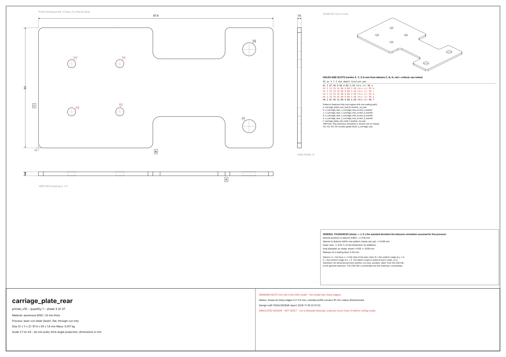

- Quantity 1. aluminium 6061; sheet; 97.4 x 50 x 1.6 mm; 0.017 kg. Same size, volume and hole list as carriage_plate_left, carriage_plate_right (same or mirror-image part: compare before sharing a file).
- Sheet 1.6 mm, laser cut, flat (no bends), through-cut only. Flat size [97.4, 50.0] mm, cut length 412.0 mm, 7 pierces (report). DXF written here: {'LINE': 12, 'ARC': 12, 'CIRCLE': 6}, cut length 412.1 mm, extent (97.4, 50.0).
- Threads: none. Inserts and clinch nuts: none. Reaming: none.
- Drawing note, not yet in the model: Deburr; break all sharp edges 0.2-0.5 mm; outside profile corners R1 min unless dimensioned.
- **Needs more than the general tolerance, or rests on an assumption:**
  - **Patterns b, c, d, e** (guide block / motor): hole to hole +/-0.08 mm is the figure the screw-pattern check used (tighter than the +/-0.16 mm position tolerance); radial clearance on the screws 0.20 mm. Cut all holes of a pattern in one set-up.

| ID | Kind | Axis | X | Y | Z | Dia / width | Slot length | Depth | Counterbore (dia x depth, from) | Function | Screws | On its axis | Pattern | Critical |
|---|---|---|---|---|---|---|---|---|---|---|---|---|---|---|
| H1 | hole | Z | 87.4 | 9 | 0.8 | 5.5 | - | through | - | clearance M5 | carriage_plate_rear_bolt_0 (SHCS-M5x8) | - | a: carriage_plate_rear_bolt_0_washer, sq_rear | - |
| H2 | hole | Z | 13.7 | 15 | 0.8 | 3.4 | - | through | - | clearance M3 | z_carriage_rear_screw_1 (SHCS-M3x5) | - | b: z_carriage_rear, z_carriage_rear_screw_1_washer | locates guide block z_carriage_rear |
| H3 | hole | Z | 33.7 | 15 | 0.8 | 3.4 | - | through | - | clearance M3 | z_carriage_rear_screw_3 (SHCS-M3x5) | - | c: z_carriage_rear, z_carriage_rear_screw_3_washer | locates guide block z_carriage_rear |
| H4 | hole | Z | 13.7 | 35 | 0.8 | 3.4 | - | through | - | clearance M3 | z_carriage_rear_screw_0 (SHCS-M3x5) | - | d: z_carriage_rear, z_carriage_rear_screw_0_washer | locates guide block z_carriage_rear |
| H5 | hole | Z | 33.7 | 35 | 0.8 | 3.4 | - | through | - | clearance M3 | z_carriage_rear_screw_2 (SHCS-M3x5) | - | e: z_carriage_rear, z_carriage_rear_screw_2_washer | locates guide block z_carriage_rear |
| H6 | hole | Z | 87.4 | 41 | 0.8 | 5.5 | - | through | - | clearance M5 | carriage_plate_rear_bolt_1 (SHCS-M5x8) | - | f: carriage_plate_rear_bolt_1_washer, sq_rear | - |

### z_deck

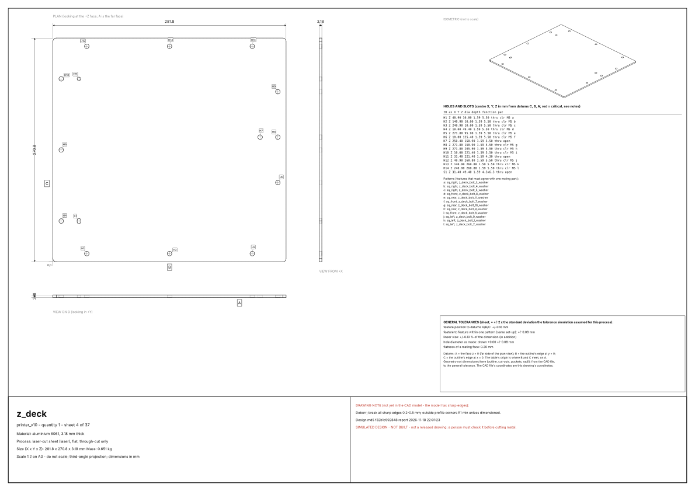

- Quantity 1. aluminium 6061; sheet; 281.8 x 270.8 x 3.18 mm; 0.651 kg.
- Sheet 3.17 mm, laser cut, flat (no bends), through-cut only. Flat size [281.8, 270.8] mm, cut length 1354.0 mm, 16 pierces (report). DXF written here: {'LINE': 6, 'ARC': 6, 'CIRCLE': 14}, cut length 1354.0 mm, extent (281.8, 270.8).
- Threads: none. Inserts and clinch nuts: none. Reaming: none.
- Drawing note, not yet in the model: Deburr; break all sharp edges 0.2-0.5 mm; outside profile corners R1 min unless dimensioned.

| ID | Kind | Axis | X | Y | Z | Dia / width | Slot length | Depth | Counterbore (dia x depth, from) | Function | Screws | On its axis | Pattern | Critical |
|---|---|---|---|---|---|---|---|---|---|---|---|---|---|---|
| H1 | hole | Z | 40.9 | 10 | 1.59 | 5.5 | - | through | - | clearance M5 | z_deck_bolt_3 (SHCS-M5x10) | - | a: sq_right, z_deck_bolt_3_washer | - |
| H2 | hole | Z | 140.9 | 10 | 1.59 | 5.5 | - | through | - | clearance M5 | z_deck_bolt_4 (SHCS-M5x10) | - | b: sq_right, z_deck_bolt_4_washer | - |
| H3 | hole | Z | 240.9 | 10 | 1.59 | 5.5 | - | through | - | clearance M5 | z_deck_bolt_5 (SHCS-M5x10) | - | c: sq_right, z_deck_bolt_5_washer | - |
| H4 | hole | Z | 10 | 49.4 | 1.59 | 5.5 | - | through | - | clearance M5 | z_deck_bolt_8 (SHCS-M5x10) | - | d: sq_front, z_deck_bolt_8_washer | - |
| H5 | hole | Z | 271.8 | 95.9 | 1.59 | 5.5 | - | through | - | clearance M5 | z_deck_bolt_11 (SHCS-M5x10) | - | e: sq_rear, z_deck_bolt_11_washer | - |
| H6 | hole | Z | 10 | 135.4 | 1.59 | 5.5 | - | through | - | clearance M5 | z_deck_bolt_7 (SHCS-M5x10) | - | f: sq_front, z_deck_bolt_7_washer | - |
| H7 | hole | Z | 250.4 | 150.9 | 1.59 | 5.5 | - | through | - | hole (no screw or part on its axis in the model) | - | - | - | - |
| H8 | hole | Z | 271.8 | 150.9 | 1.59 | 5.5 | - | through | - | clearance M5 | z_deck_bolt_10 (SHCS-M5x10) | - | g: sq_rear, z_deck_bolt_10_washer | - |
| H9 | hole | Z | 271.8 | 205.9 | 1.59 | 5.5 | - | through | - | clearance M5 | z_deck_bolt_9 (SHCS-M5x10) | - | h: sq_rear, z_deck_bolt_9_washer | - |
| H10 | hole | Z | 10 | 221.4 | 1.59 | 5.5 | - | through | - | clearance M5 | z_deck_bolt_6 (SHCS-M5x10) | - | i: sq_front, z_deck_bolt_6_washer | - |
| H11 | hole | Z | 31.4 | 221.4 | 1.59 | 4.3 | - | through | - | hole (no screw or part on its axis in the model) | - | - | - | - |
| H12 | hole | Z | 40.9 | 260.8 | 1.59 | 5.5 | - | through | - | clearance M5 | z_deck_bolt_0 (SHCS-M5x10) | - | j: sq_left, z_deck_bolt_0_washer | - |
| H13 | hole | Z | 140.9 | 260.8 | 1.59 | 5.5 | - | through | - | clearance M5 | z_deck_bolt_1 (SHCS-M5x10) | - | k: sq_left, z_deck_bolt_1_washer | - |
| H14 | hole | Z | 240.9 | 260.8 | 1.59 | 5.5 | - | through | - | clearance M5 | z_deck_bolt_2 (SHCS-M5x10) | - | l: sq_left, z_deck_bolt_2_washer | - |
| S1 | slot | Z | 31.4 | 49.4 | 1.59 | 4.3 | 6.3 | through | - | hole (no screw or part on its axis in the model) | - | - | - | - |

### nut_plate

- Quantity 1. aluminium 6061; sheet; 66.1 x 64 x 6.35 mm; 0.067 kg. Same size, volume and hole list as nut_plate_fl, nut_plate_fr (same or mirror-image part: compare before sharing a file).
- Sheet 6.35 mm, laser cut, flat (no bends), through-cut only. Flat size [66.1, 64.0] mm, cut length 381.0 mm, 6 pierces (report). DXF written here: {'LINE': 6, 'ARC': 6, 'CIRCLE': 4}, cut length 381.5 mm, extent (66.1, 64.0).
- Threads: none. Inserts and clinch nuts: none. Reaming: none.
- Drawing note, not yet in the model: Deburr; break all sharp edges 0.2-0.5 mm; outside profile corners R1 min unless dimensioned.
- **Needs more than the general tolerance, or rests on an assumption:**
  - Report, manufacture `hole_smaller_than_thickness`: 4 hole(s) or cut-out(s) narrower than the 6.35 mm sheet (smallest 4.80 mm at [-17.6, 170.0, 135.6]): they cut, but taper and lose accuracy.

| ID | Kind | Axis | X | Y | Z | Dia / width | Slot length | Depth | Counterbore (dia x depth, from) | Function | Screws | On its axis | Pattern | Critical |
|---|---|---|---|---|---|---|---|---|---|---|---|---|---|---|
| H1 | hole | Z | 10 | 12 | 3.18 | 5.5 | - | through | - | clearance M5 | nut_plate_bolt_1 (SHCS-M5x10) | - | a: nut_plate_bolt_1_washer, sq_rear | - |
| H2 | hole | Z | 44.6 | 14.4 | 3.18 | 4.8 | - | through | - | clearance M3 | nut_keeper_bolt_1 (SHCS-M3x20) | - | b: nut_keeper, nut_keeper_bolt_1_nwasher, nut_keeper_bolt_1_washer | - |
| H3 | hole | Z | 44.6 | 32 | 3.17 | 16.6 | - | through | - | clearance M2.5 | nut_pin (SHCS-M2.5x16) | leadscrew (TR8x2-INTEGRAL-17E19S1684AB4-330RA-CUT258) | c: z_nut | - |
| H4 | hole | Z | 44.6 | 49.6 | 3.18 | 4.8 | - | through | - | clearance M3 | nut_keeper_bolt_0 (SHCS-M3x20) | - | d: nut_keeper, nut_keeper_bolt_0_nwasher, nut_keeper_bolt_0_washer | - |
| H5 | hole | Z | 10 | 52 | 3.18 | 5.5 | - | through | - | clearance M5 | nut_plate_bolt_0 (SHCS-M5x10) | - | e: nut_plate_bolt_0_washer, sq_rear | - |

### nut_keeper

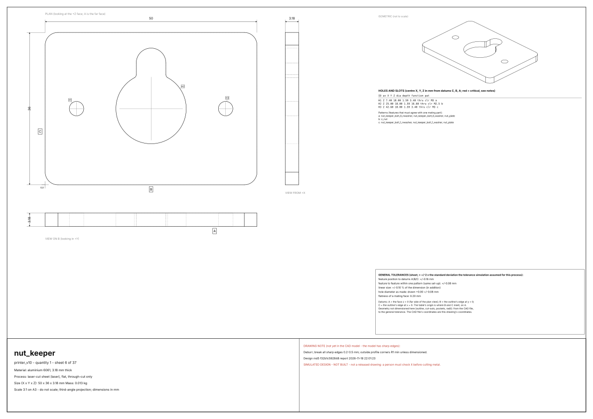

- Quantity 1. aluminium 6061; sheet; 50 x 36 x 3.18 mm; 0.013 kg. Same size, volume and hole list as nut_keeper_fl, nut_keeper_fr (same or mirror-image part: compare before sharing a file).
- Sheet 3.17 mm, laser cut, flat (no bends), through-cut only. Flat size [50.0, 36.0] mm, cut length 250.0 mm, 4 pierces (report). DXF written here: {'LINE': 6, 'ARC': 8, 'CIRCLE': 2}, cut length 250.5 mm, extent (50.0, 36.0).
- Threads: none. Inserts and clinch nuts: none. Reaming: none.
- Drawing note, not yet in the model: Deburr; break all sharp edges 0.2-0.5 mm; outside profile corners R1 min unless dimensioned.

| ID | Kind | Axis | X | Y | Z | Dia / width | Slot length | Depth | Counterbore (dia x depth, from) | Function | Screws | On its axis | Pattern | Critical |
|---|---|---|---|---|---|---|---|---|---|---|---|---|---|---|
| H1 | hole | Z | 7.4 | 18 | 1.59 | 3.4 | - | through | - | clearance M3 | nut_keeper_bolt_0 (SHCS-M3x20) | - | a: nut_keeper_bolt_0_nwasher, nut_keeper_bolt_0_washer, nut_plate | - |
| H2 | hole | Z | 25 | 18 | 1.59 | 16.6 | - | through | - | clearance M2.5 | nut_pin (SHCS-M2.5x16) | leadscrew (TR8x2-INTEGRAL-17E19S1684AB4-330RA-CUT258) | b: z_nut | - |
| H3 | hole | Z | 42.6 | 18 | 1.59 | 3.4 | - | through | - | clearance M3 | nut_keeper_bolt_1 (SHCS-M3x20) | - | c: nut_keeper_bolt_1_nwasher, nut_keeper_bolt_1_washer, nut_plate | - |

### nut_plate_fl

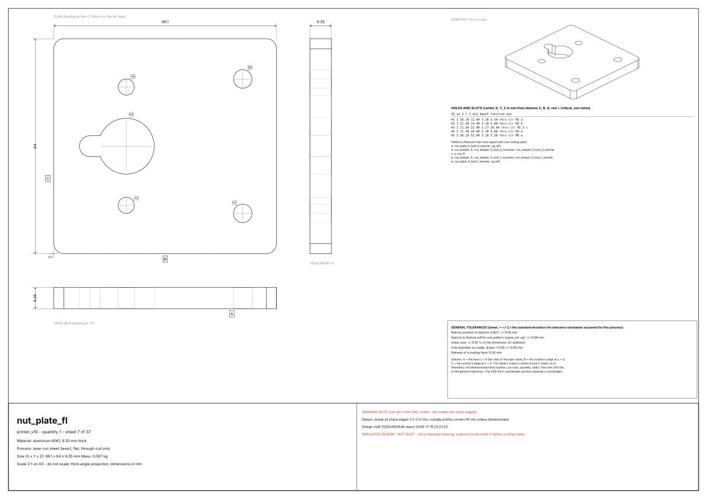

- Quantity 1. aluminium 6061; sheet; 66.1 x 64 x 6.35 mm; 0.067 kg. Same size, volume and hole list as nut_plate, nut_plate_fr (same or mirror-image part: compare before sharing a file).
- Sheet 6.35 mm, laser cut, flat (no bends), through-cut only. Flat size [66.1, 64.0] mm, cut length 381.0 mm, 6 pierces (report). DXF written here: {'LINE': 6, 'ARC': 6, 'CIRCLE': 4}, cut length 381.5 mm, extent (66.1, 64.0).
- Threads: none. Inserts and clinch nuts: none. Reaming: none.
- Drawing note, not yet in the model: Deburr; break all sharp edges 0.2-0.5 mm; outside profile corners R1 min unless dimensioned.
- **Needs more than the general tolerance, or rests on an assumption:**
  - Report, manufacture `hole_smaller_than_thickness`: 4 hole(s) or cut-out(s) narrower than the 6.35 mm sheet (smallest 4.80 mm at [-160.0, -118.6, 135.6]): they cut, but taper and lose accuracy.

| ID | Kind | Axis | X | Y | Z | Dia / width | Slot length | Depth | Counterbore (dia x depth, from) | Function | Screws | On its axis | Pattern | Critical |
|---|---|---|---|---|---|---|---|---|---|---|---|---|---|---|
| H1 | hole | Z | 56.1 | 12 | 3.18 | 5.5 | - | through | - | clearance M5 | nut_plate_fl_bolt_0 (SHCS-M5x10) | - | a: nut_plate_fl_bolt_0_washer, sq_left | - |
| H2 | hole | Z | 21.5 | 14.4 | 3.18 | 4.8 | - | through | - | clearance M3 | nut_keeper_fl_bolt_0 (SHCS-M3x20) | - | b: nut_keeper_fl, nut_keeper_fl_bolt_0_nwasher, nut_keeper_fl_bolt_0_washer | - |
| H3 | hole | Z | 21.5 | 32 | 3.17 | 16.6 | - | through | - | clearance M2.5 | nut_pin_fl (SHCS-M2.5x16) | leadscrew_fl (TR8x2-INTEGRAL-17E19S1684AB4-330RA-CUT258) | c: z_nut_fl | - |
| H4 | hole | Z | 21.5 | 49.6 | 3.18 | 4.8 | - | through | - | clearance M3 | nut_keeper_fl_bolt_1 (SHCS-M3x20) | - | d: nut_keeper_fl, nut_keeper_fl_bolt_1_nwasher, nut_keeper_fl_bolt_1_washer | - |
| H5 | hole | Z | 56.1 | 52 | 3.18 | 5.5 | - | through | - | clearance M5 | nut_plate_fl_bolt_1 (SHCS-M5x10) | - | e: nut_plate_fl_bolt_1_washer, sq_left | - |

### nut_keeper_fl

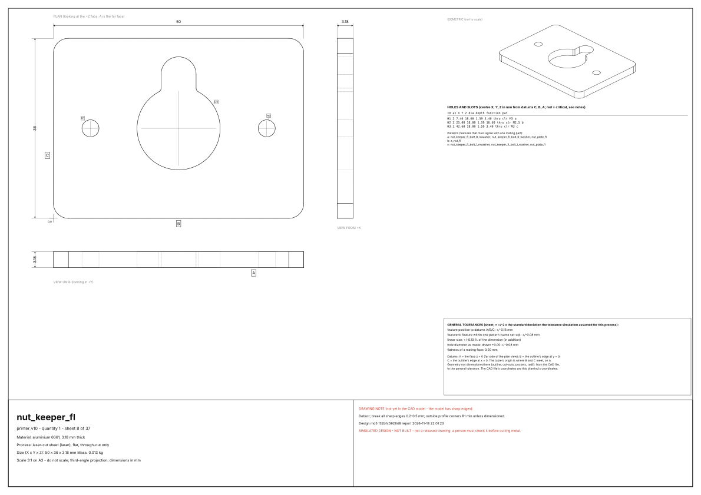

- Quantity 1. aluminium 6061; sheet; 50 x 36 x 3.18 mm; 0.013 kg. Same size, volume and hole list as nut_keeper, nut_keeper_fr (same or mirror-image part: compare before sharing a file).
- Sheet 3.17 mm, laser cut, flat (no bends), through-cut only. Flat size [50.0, 36.0] mm, cut length 250.0 mm, 4 pierces (report). DXF written here: {'LINE': 6, 'ARC': 8, 'CIRCLE': 2}, cut length 250.5 mm, extent (50.0, 36.0).
- Threads: none. Inserts and clinch nuts: none. Reaming: none.
- Drawing note, not yet in the model: Deburr; break all sharp edges 0.2-0.5 mm; outside profile corners R1 min unless dimensioned.

| ID | Kind | Axis | X | Y | Z | Dia / width | Slot length | Depth | Counterbore (dia x depth, from) | Function | Screws | On its axis | Pattern | Critical |
|---|---|---|---|---|---|---|---|---|---|---|---|---|---|---|
| H1 | hole | Z | 7.4 | 18 | 1.59 | 3.4 | - | through | - | clearance M3 | nut_keeper_fl_bolt_0 (SHCS-M3x20) | - | a: nut_keeper_fl_bolt_0_nwasher, nut_keeper_fl_bolt_0_washer, nut_plate_fl | - |
| H2 | hole | Z | 25 | 18 | 1.59 | 16.6 | - | through | - | clearance M2.5 | nut_pin_fl (SHCS-M2.5x16) | leadscrew_fl (TR8x2-INTEGRAL-17E19S1684AB4-330RA-CUT258) | b: z_nut_fl | - |
| H3 | hole | Z | 42.6 | 18 | 1.59 | 3.4 | - | through | - | clearance M3 | nut_keeper_fl_bolt_1 (SHCS-M3x20) | - | c: nut_keeper_fl_bolt_1_nwasher, nut_keeper_fl_bolt_1_washer, nut_plate_fl | - |

### nut_plate_fr

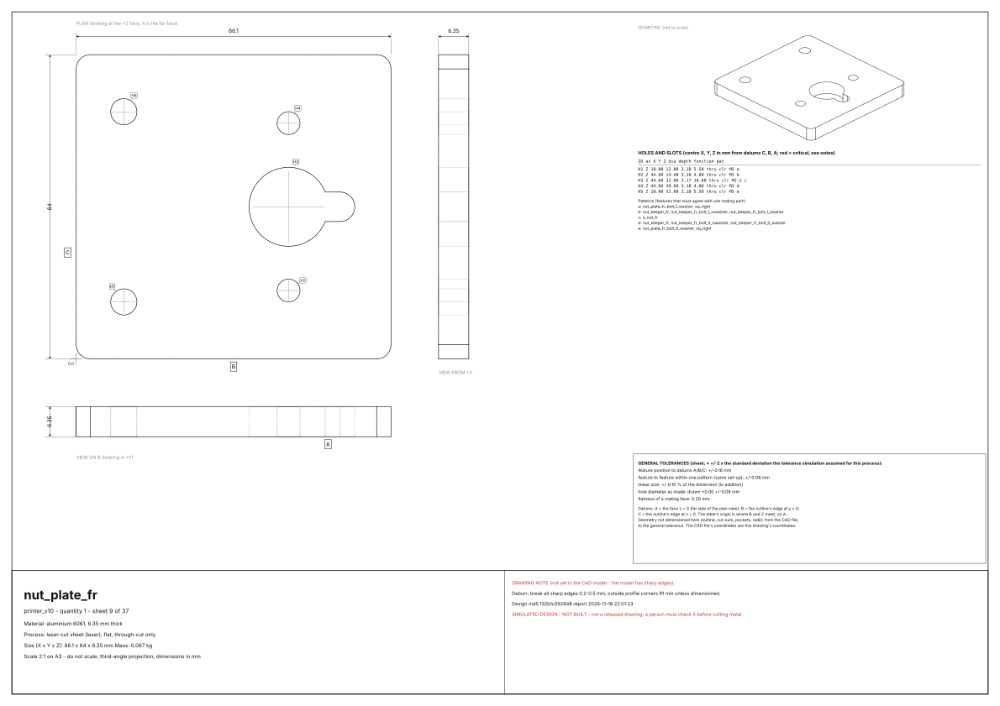

- Quantity 1. aluminium 6061; sheet; 66.1 x 64 x 6.35 mm; 0.067 kg. Same size, volume and hole list as nut_plate, nut_plate_fl (same or mirror-image part: compare before sharing a file).
- Sheet 6.35 mm, laser cut, flat (no bends), through-cut only. Flat size [66.1, 64.0] mm, cut length 381.0 mm, 6 pierces (report). DXF written here: {'LINE': 6, 'ARC': 6, 'CIRCLE': 4}, cut length 381.5 mm, extent (66.1, 64.0).
- Threads: none. Inserts and clinch nuts: none. Reaming: none.
- Drawing note, not yet in the model: Deburr; break all sharp edges 0.2-0.5 mm; outside profile corners R1 min unless dimensioned.
- **Needs more than the general tolerance, or rests on an assumption:**
  - Report, manufacture `hole_smaller_than_thickness`: 4 hole(s) or cut-out(s) narrower than the 6.35 mm sheet (smallest 4.80 mm at [160.0, -83.4, 135.6]): they cut, but taper and lose accuracy.

| ID | Kind | Axis | X | Y | Z | Dia / width | Slot length | Depth | Counterbore (dia x depth, from) | Function | Screws | On its axis | Pattern | Critical |
|---|---|---|---|---|---|---|---|---|---|---|---|---|---|---|
| H1 | hole | Z | 10 | 12 | 3.18 | 5.5 | - | through | - | clearance M5 | nut_plate_fr_bolt_1 (SHCS-M5x10) | - | a: nut_plate_fr_bolt_1_washer, sq_right | - |
| H2 | hole | Z | 44.6 | 14.4 | 3.18 | 4.8 | - | through | - | clearance M3 | nut_keeper_fr_bolt_1 (SHCS-M3x20) | - | b: nut_keeper_fr, nut_keeper_fr_bolt_1_nwasher, nut_keeper_fr_bolt_1_washer | - |
| H3 | hole | Z | 44.6 | 32 | 3.17 | 16.6 | - | through | - | clearance M2.5 | nut_pin_fr (SHCS-M2.5x16) | leadscrew_fr (TR8x2-INTEGRAL-17E19S1684AB4-330RA-CUT258) | c: z_nut_fr | - |
| H4 | hole | Z | 44.6 | 49.6 | 3.18 | 4.8 | - | through | - | clearance M3 | nut_keeper_fr_bolt_0 (SHCS-M3x20) | - | d: nut_keeper_fr, nut_keeper_fr_bolt_0_nwasher, nut_keeper_fr_bolt_0_washer | - |
| H5 | hole | Z | 10 | 52 | 3.18 | 5.5 | - | through | - | clearance M5 | nut_plate_fr_bolt_0 (SHCS-M5x10) | - | e: nut_plate_fr_bolt_0_washer, sq_right | - |

### nut_keeper_fr

- Quantity 1. aluminium 6061; sheet; 50 x 36 x 3.18 mm; 0.013 kg. Same size, volume and hole list as nut_keeper, nut_keeper_fl (same or mirror-image part: compare before sharing a file).
- Sheet 3.17 mm, laser cut, flat (no bends), through-cut only. Flat size [50.0, 36.0] mm, cut length 250.0 mm, 4 pierces (report). DXF written here: {'LINE': 6, 'ARC': 8, 'CIRCLE': 2}, cut length 250.5 mm, extent (50.0, 36.0).
- Threads: none. Inserts and clinch nuts: none. Reaming: none.
- Drawing note, not yet in the model: Deburr; break all sharp edges 0.2-0.5 mm; outside profile corners R1 min unless dimensioned.

| ID | Kind | Axis | X | Y | Z | Dia / width | Slot length | Depth | Counterbore (dia x depth, from) | Function | Screws | On its axis | Pattern | Critical |
|---|---|---|---|---|---|---|---|---|---|---|---|---|---|---|
| H1 | hole | Z | 7.4 | 18 | 1.59 | 3.4 | - | through | - | clearance M3 | nut_keeper_fr_bolt_1 (SHCS-M3x20) | - | a: nut_keeper_fr_bolt_1_nwasher, nut_keeper_fr_bolt_1_washer, nut_plate_fr | - |
| H2 | hole | Z | 25 | 18 | 1.59 | 16.6 | - | through | - | clearance M2.5 | nut_pin_fr (SHCS-M2.5x16) | leadscrew_fr (TR8x2-INTEGRAL-17E19S1684AB4-330RA-CUT258) | b: z_nut_fr | - |
| H3 | hole | Z | 42.6 | 18 | 1.59 | 3.4 | - | through | - | clearance M3 | nut_keeper_fr_bolt_0 (SHCS-M3x20) | - | c: nut_keeper_fr_bolt_0_nwasher, nut_keeper_fr_bolt_0_washer, nut_plate_fr | - |

### bed_plate

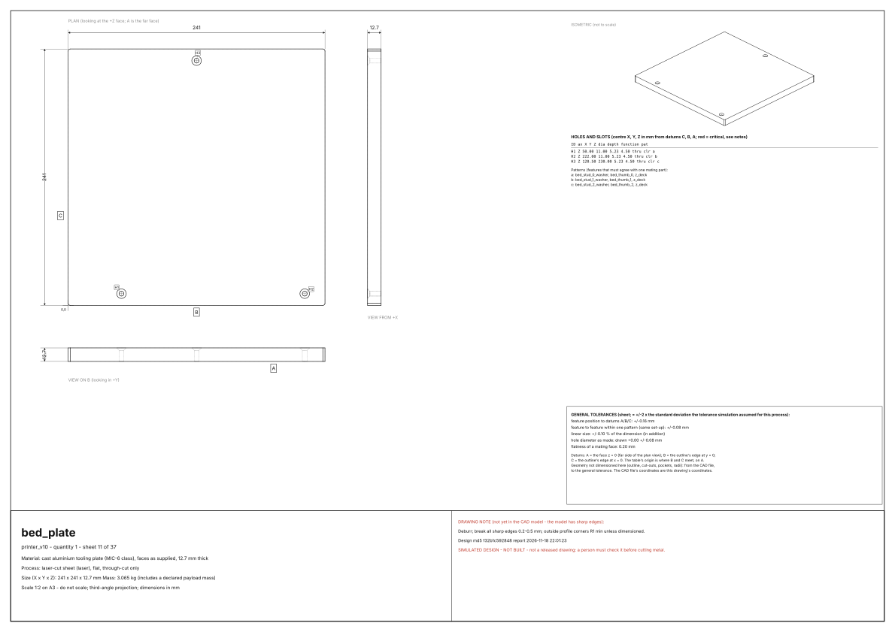

- Quantity 1. cast aluminium tooling plate (MIC-6 class), faces as supplied; sheet; 241 x 241 x 12.7 mm; 3.065 kg.
- Sheet 12.7 mm, laser cut, flat (no bends), through-cut only. Flat size [241.0, 241.0] mm, cut length 1045.0 mm, 4 pierces (report). DXF written here: {'LINE': 4, 'ARC': 4, 'CIRCLE': 3}, cut length 1045.0 mm, extent (241.0, 241.0).
- Threads: none. Inserts and clinch nuts: none. Reaming: none.
- Drawing note, not yet in the model: Deburr; break all sharp edges 0.2-0.5 mm; outside profile corners R1 min unless dimensioned.
- **Needs more than the general tolerance, or rests on an assumption:**
  - Report, manufacture `secondary_op_countersink`: 3 countersink(s): a second operation after cutting (model plain through holes in the cut file).
  - Report, manufacture `hole_smaller_than_thickness`: 3 hole(s) or cut-out(s) narrower than the 12.7 mm sheet (smallest 8.96 mm at [-15.5, 114.0, 185.1]): they cut, but taper and lose accuracy.
  - Report, manufacture `hole_too_close_to_edge`: 3 hole(s) with less than 12.7 mm of material to the edge (least 6.52 mm at [-86.0, -105.0, 185.1]): the web overheats and distorts, and tears if the part is bent or loaded.

| ID | Kind | Axis | X | Y | Z | Dia / width | Slot length | Depth | Counterbore (dia x depth, from) | Function | Screws | On its axis | Pattern | Critical |
|---|---|---|---|---|---|---|---|---|---|---|---|---|---|---|
| H1 | hole | Z | 50 | 11 | 5.23 | 4.5 | - | through | - | clearance  | bed_stud_0 (FHCS-M4x40) | - | a: bed_stud_0_washer, bed_thumb_0, z_deck | - |
| H2 | hole | Z | 222 | 11 | 5.23 | 4.5 | - | through | - | clearance  | bed_stud_1 (FHCS-M4x40) | - | b: bed_stud_1_washer, bed_thumb_1, z_deck | - |
| H3 | hole | Z | 120.5 | 230 | 5.23 | 4.5 | - | through | - | clearance  | bed_stud_2 (FHCS-M4x40) | - | c: bed_stud_2_washer, bed_thumb_2, z_deck | - |

### z_motor_plate

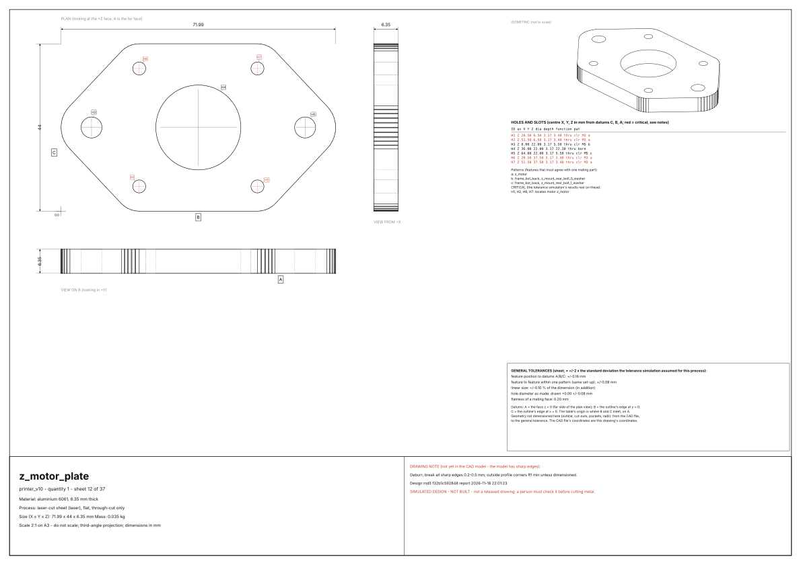

- Quantity 1. aluminium 6061; sheet; 71.99 x 44 x 6.35 mm; 0.035 kg. Same size, volume and hole list as z_motor_plate_fl, z_motor_plate_fr (same or mirror-image part: compare before sharing a file).
- Sheet 6.35 mm, laser cut, flat (no bends), through-cut only. Flat size [72.0, 44.0] mm, cut length 334.0 mm, 8 pierces (report). DXF written here: {'LINE': 46, 'ARC': 34, 'CIRCLE': 7}, cut length 334.1 mm, extent (71.99, 44.0).
- Threads: none. Inserts and clinch nuts: none. Reaming: none.
- Drawing note, not yet in the model: Deburr; break all sharp edges 0.2-0.5 mm; outside profile corners R1 min unless dimensioned.
- **Needs more than the general tolerance, or rests on an assumption:**
  - **Patterns a** (guide block / motor): hole to hole +/-0.08 mm is the figure the screw-pattern check used (tighter than the +/-0.16 mm position tolerance); radial clearance on the screws 0.20 mm. Cut all holes of a pattern in one set-up.
  - This part places a pulley or idler: its thickness and flatness are in the belt-plane result (x_belt: 94.2% of builds within 1 mm, +/-0.43%; y_belt: 98.5% of builds within 1 mm, +/-0.22%; y_belt_l: 98.7% of builds within 1 mm, +/-0.21%).
  - Report, manufacture `hole_smaller_than_thickness`: 6 hole(s) or cut-out(s) narrower than the 6.35 mm sheet (smallest 3.40 mm at [-15.5, 154.5, 81.17]): they cut, but taper and lose accuracy.
  - Report, manufacture `hole_too_close_to_edge`: 6 hole(s) with less than 6.35 mm of material to the edge (least 4.78 mm at [15.5, 185.5, 81.17]): the web overheats and distorts, and tears if the part is bent or loaded.
  - Report, manufacture `holes_too_close`: 4 pair(s) of holes or cut-outs with too little material between them (least 9.07 mm at [-7.75, 162.25, 81.17], wanted 12.7 mm = 2 x thickness).

| ID | Kind | Axis | X | Y | Z | Dia / width | Slot length | Depth | Counterbore (dia x depth, from) | Function | Screws | On its axis | Pattern | Critical |
|---|---|---|---|---|---|---|---|---|---|---|---|---|---|---|
| H1 | hole | Z | 20.5 | 6.5 | 3.17 | 3.4 | - | through | - | clearance M3 | z_motor_screw_0 (SHCS-M3x10) | - | a: z_motor | locates motor z_motor |
| H2 | hole | Z | 51.5 | 6.5 | 3.17 | 3.4 | - | through | - | clearance M3 | z_motor_screw_2 (SHCS-M3x10) | - | a: z_motor | locates motor z_motor |
| H3 | hole | Z | 8 | 22 | 3.17 | 5.5 | - | through | - | clearance M5 | z_mount_rear_bolt_0 (SHCS-M5x70) | - | b: frame_bot_back, z_mount_rear_bolt_0_washer | - |
| H4 | hole | Z | 36 | 22 | 3.17 | 22.3 | - | through | - | bore / opening | - | leadscrew (TR8x2-INTEGRAL-17E19S1684AB4-330RA-CUT258) | - | - |
| H5 | hole | Z | 64 | 22 | 3.17 | 5.5 | - | through | - | clearance M5 | z_mount_rear_bolt_1 (SHCS-M5x70) | - | c: frame_bot_back, z_mount_rear_bolt_1_washer | - |
| H6 | hole | Z | 20.5 | 37.5 | 3.17 | 3.4 | - | through | - | clearance M3 | z_motor_screw_1 (SHCS-M3x10) | - | a: z_motor | locates motor z_motor |
| H7 | hole | Z | 51.5 | 37.5 | 3.17 | 3.4 | - | through | - | clearance M3 | z_motor_screw_3 (SHCS-M3x10) | - | a: z_motor | locates motor z_motor |

### z_motor_plate_fl

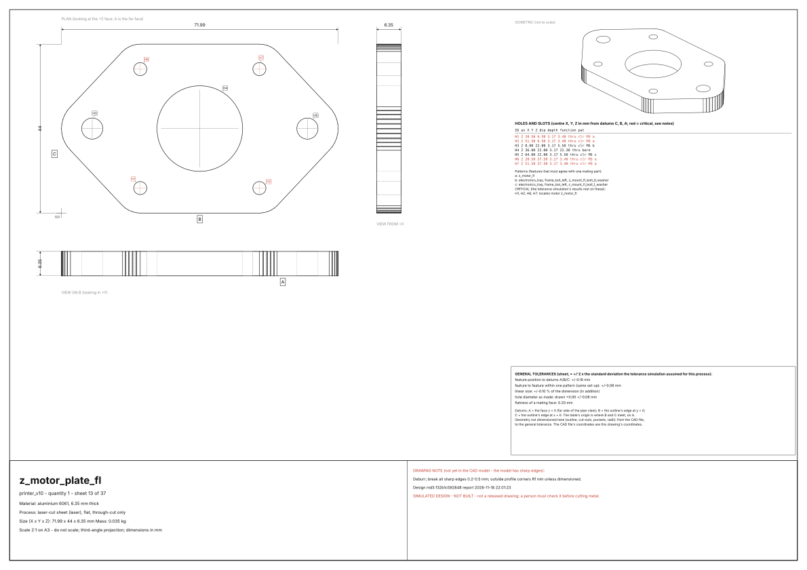

- Quantity 1. aluminium 6061; sheet; 71.99 x 44 x 6.35 mm; 0.035 kg. Same size, volume and hole list as z_motor_plate, z_motor_plate_fr (same or mirror-image part: compare before sharing a file).
- Sheet 6.35 mm, laser cut, flat (no bends), through-cut only. Flat size [72.0, 44.0] mm, cut length 334.0 mm, 8 pierces (report). DXF written here: {'LINE': 46, 'ARC': 34, 'CIRCLE': 7}, cut length 334.1 mm, extent (71.99, 44.0).
- Threads: none. Inserts and clinch nuts: none. Reaming: none.
- Drawing note, not yet in the model: Deburr; break all sharp edges 0.2-0.5 mm; outside profile corners R1 min unless dimensioned.
- **Needs more than the general tolerance, or rests on an assumption:**
  - **Patterns a** (guide block / motor): hole to hole +/-0.08 mm is the figure the screw-pattern check used (tighter than the +/-0.16 mm position tolerance); radial clearance on the screws 0.20 mm. Cut all holes of a pattern in one set-up.
  - This part places a pulley or idler: its thickness and flatness are in the belt-plane result (x_belt: 94.2% of builds within 1 mm, +/-0.43%; y_belt: 98.5% of builds within 1 mm, +/-0.22%; y_belt_l: 98.7% of builds within 1 mm, +/-0.21%).
  - Report, manufacture `hole_smaller_than_thickness`: 6 hole(s) or cut-out(s) narrower than the 6.35 mm sheet (smallest 3.40 mm at [-175.5, -116.5, 81.17]): they cut, but taper and lose accuracy.
  - Report, manufacture `hole_too_close_to_edge`: 6 hole(s) with less than 6.35 mm of material to the edge (least 4.78 mm at [-175.5, -116.5, 81.17]): the web overheats and distorts, and tears if the part is bent or loaded.
  - Report, manufacture `holes_too_close`: 4 pair(s) of holes or cut-outs with too little material between them (least 9.07 mm at [-167.75, -108.75, 81.17], wanted 12.7 mm = 2 x thickness).

| ID | Kind | Axis | X | Y | Z | Dia / width | Slot length | Depth | Counterbore (dia x depth, from) | Function | Screws | On its axis | Pattern | Critical |
|---|---|---|---|---|---|---|---|---|---|---|---|---|---|---|
| H1 | hole | Z | 20.5 | 6.5 | 3.17 | 3.4 | - | through | - | clearance M3 | z_motor_fl_screw_2 (SHCS-M3x10) | - | a: z_motor_fl | locates motor z_motor_fl |
| H2 | hole | Z | 51.5 | 6.5 | 3.17 | 3.4 | - | through | - | clearance M3 | z_motor_fl_screw_3 (SHCS-M3x10) | - | a: z_motor_fl | locates motor z_motor_fl |
| H3 | hole | Z | 8 | 22 | 3.17 | 5.5 | - | through | - | clearance M5 | z_mount_fl_bolt_0 (SHCS-M5x70) | - | b: electronics_tray, frame_bot_left, z_mount_fl_bolt_0_washer | - |
| H4 | hole | Z | 36 | 22 | 3.17 | 22.3 | - | through | - | bore / opening | - | leadscrew_fl (TR8x2-INTEGRAL-17E19S1684AB4-330RA-CUT258) | - | - |
| H5 | hole | Z | 64 | 22 | 3.17 | 5.5 | - | through | - | clearance M5 | z_mount_fl_bolt_1 (SHCS-M5x70) | - | c: electronics_tray, frame_bot_left, z_mount_fl_bolt_1_washer | - |
| H6 | hole | Z | 20.5 | 37.5 | 3.17 | 3.4 | - | through | - | clearance M3 | z_motor_fl_screw_0 (SHCS-M3x10) | - | a: z_motor_fl | locates motor z_motor_fl |
| H7 | hole | Z | 51.5 | 37.5 | 3.17 | 3.4 | - | through | - | clearance M3 | z_motor_fl_screw_1 (SHCS-M3x10) | - | a: z_motor_fl | locates motor z_motor_fl |

### z_motor_plate_fr

- Quantity 1. aluminium 6061; sheet; 71.99 x 44 x 6.35 mm; 0.035 kg. Same size, volume and hole list as z_motor_plate, z_motor_plate_fl (same or mirror-image part: compare before sharing a file).
- Sheet 6.35 mm, laser cut, flat (no bends), through-cut only. Flat size [72.0, 44.0] mm, cut length 334.0 mm, 8 pierces (report). DXF written here: {'LINE': 46, 'ARC': 34, 'CIRCLE': 7}, cut length 334.1 mm, extent (71.99, 44.0).
- Threads: none. Inserts and clinch nuts: none. Reaming: none.
- Drawing note, not yet in the model: Deburr; break all sharp edges 0.2-0.5 mm; outside profile corners R1 min unless dimensioned.
- **Needs more than the general tolerance, or rests on an assumption:**
  - **Patterns a** (guide block / motor): hole to hole +/-0.08 mm is the figure the screw-pattern check used (tighter than the +/-0.16 mm position tolerance); radial clearance on the screws 0.20 mm. Cut all holes of a pattern in one set-up.
  - This part places a pulley or idler: its thickness and flatness are in the belt-plane result (x_belt: 94.2% of builds within 1 mm, +/-0.43%; y_belt: 98.5% of builds within 1 mm, +/-0.22%; y_belt_l: 98.7% of builds within 1 mm, +/-0.21%).
  - Report, manufacture `hole_smaller_than_thickness`: 6 hole(s) or cut-out(s) narrower than the 6.35 mm sheet (smallest 3.40 mm at [144.5, -116.5, 81.17]): they cut, but taper and lose accuracy.
  - Report, manufacture `hole_too_close_to_edge`: 6 hole(s) with less than 6.35 mm of material to the edge (least 4.78 mm at [175.5, -116.5, 81.17]): the web overheats and distorts, and tears if the part is bent or loaded.
  - Report, manufacture `holes_too_close`: 4 pair(s) of holes or cut-outs with too little material between them (least 9.07 mm at [152.25, -108.75, 81.17], wanted 12.7 mm = 2 x thickness).

| ID | Kind | Axis | X | Y | Z | Dia / width | Slot length | Depth | Counterbore (dia x depth, from) | Function | Screws | On its axis | Pattern | Critical |
|---|---|---|---|---|---|---|---|---|---|---|---|---|---|---|
| H1 | hole | Z | 20.5 | 6.5 | 3.17 | 3.4 | - | through | - | clearance M3 | z_motor_fr_screw_2 (SHCS-M3x10) | - | a: z_motor_fr | locates motor z_motor_fr |
| H2 | hole | Z | 51.5 | 6.5 | 3.17 | 3.4 | - | through | - | clearance M3 | z_motor_fr_screw_3 (SHCS-M3x10) | - | a: z_motor_fr | locates motor z_motor_fr |
| H3 | hole | Z | 8 | 22 | 3.17 | 5.5 | - | through | - | clearance M5 | z_mount_fr_bolt_0 (SHCS-M5x70) | - | b: electronics_tray, frame_bot_right, z_mount_fr_bolt_0_washer | - |
| H4 | hole | Z | 36 | 22 | 3.17 | 22.3 | - | through | - | bore / opening | - | leadscrew_fr (TR8x2-INTEGRAL-17E19S1684AB4-330RA-CUT258) | - | - |
| H5 | hole | Z | 64 | 22 | 3.17 | 5.5 | - | through | - | clearance M5 | z_mount_fr_bolt_1 (SHCS-M5x70) | - | c: electronics_tray, frame_bot_right, z_mount_fr_bolt_1_washer | - |
| H6 | hole | Z | 20.5 | 37.5 | 3.17 | 3.4 | - | through | - | clearance M3 | z_motor_fr_screw_0 (SHCS-M3x10) | - | a: z_motor_fr | locates motor z_motor_fr |
| H7 | hole | Z | 51.5 | 37.5 | 3.17 | 3.4 | - | through | - | clearance M3 | z_motor_fr_screw_1 (SHCS-M3x10) | - | a: z_motor_fr | locates motor z_motor_fr |

### y_plate_left

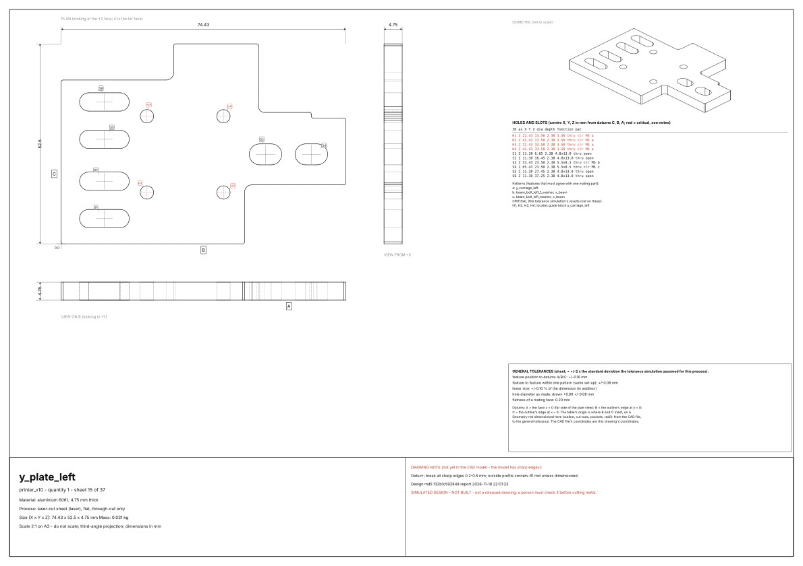

- Quantity 1. aluminium 6061; sheet; 74.43 x 52.5 x 4.75 mm; 0.031 kg.
- Sheet 4.75 mm, laser cut, flat (no bends), through-cut only. Flat size [74.4, 52.5] mm, cut length 466.0 mm, 11 pierces (report). DXF written here: {'LINE': 24, 'ARC': 24, 'CIRCLE': 4}, cut length 466.0 mm, extent (74.43, 52.5).
- Threads: none. Inserts and clinch nuts: none. Reaming: none.
- Drawing note, not yet in the model: Deburr; break all sharp edges 0.2-0.5 mm; outside profile corners R1 min unless dimensioned.
- **Needs more than the general tolerance, or rests on an assumption:**
  - **Patterns a** (guide block / motor): hole to hole +/-0.08 mm is the figure the screw-pattern check used (tighter than the +/-0.16 mm position tolerance); radial clearance on the screws 0.25 mm. Cut all holes of a pattern in one set-up.
  - Report, manufacture `hole_smaller_than_thickness`: 4 hole(s) or cut-out(s) narrower than the 4.75 mm sheet (smallest 3.50 mm at [-170.0, -51.61, 419.38]): they cut, but taper and lose accuracy.
  - Report, manufacture `hole_too_close_to_edge`: 3 hole(s) with less than 4.75 mm of material to the edge (least 3.35 mm at [-181.13, -27.86, 419.38]): the web overheats and distorts, and tears if the part is bent or loaded.
  - Report, manufacture `holes_too_close`: 3 pair(s) of holes or cut-outs with too little material between them (least 3.48 mm at [-175.56, -50.14, 419.38], wanted 4.75 mm = 1 x thickness).

| ID | Kind | Axis | X | Y | Z | Dia / width | Slot length | Depth | Counterbore (dia x depth, from) | Function | Screws | On its axis | Pattern | Critical |
|---|---|---|---|---|---|---|---|---|---|---|---|---|---|---|
| H1 | hole | Z | 22.43 | 13.5 | 2.38 | 3.5 | - | through | - | clearance M3 | y_plate_left_screw_0 (SHCS-M3x8) | - | a: y_carriage_left | locates guide block y_carriage_left |
| H2 | hole | Z | 42.43 | 13.5 | 2.38 | 3.5 | - | through | - | clearance M3 | y_plate_left_screw_2 (SHCS-M3x8) | - | a: y_carriage_left | locates guide block y_carriage_left |
| H3 | hole | Z | 22.43 | 33.5 | 2.38 | 3.5 | - | through | - | clearance M3 | y_plate_left_screw_1 (SHCS-M3x8) | - | a: y_carriage_left | locates guide block y_carriage_left |
| H4 | hole | Z | 42.43 | 33.5 | 2.38 | 3.5 | - | through | - | clearance M3 | y_plate_left_screw_3 (SHCS-M3x8) | - | a: y_carriage_left | locates guide block y_carriage_left |
| S1 | slot | Z | 11.3 | 6.65 | 2.38 | 4.8 | 13 | through | - | hole (no screw or part on its axis in the model) | - | - | - | - |
| S2 | slot | Z | 11.3 | 16.45 | 2.38 | 4.8 | 13 | through | - | hole (no screw or part on its axis in the model) | - | - | - | - |
| S3 | slot | Z | 53.43 | 23.5 | 2.38 | 5.5 | 8.5 | through | - | clearance M5 | beam_bolt_left_1 (SHCS-M5x10) | - | b: beam_bolt_left_1_washer, x_beam | - |
| S4 | slot | Z | 65.43 | 23.5 | 2.38 | 5.5 | 8.5 | through | - | clearance M5 | beam_bolt_left (SHCS-M5x10) | - | c: beam_bolt_left_washer, x_beam | - |
| S5 | slot | Z | 11.3 | 27.45 | 2.38 | 4.8 | 13 | through | - | hole (no screw or part on its axis in the model) | - | - | - | - |
| S6 | slot | Z | 11.3 | 37.25 | 2.38 | 4.8 | 13 | through | - | hole (no screw or part on its axis in the model) | - | - | - | - |

### y_plate_right

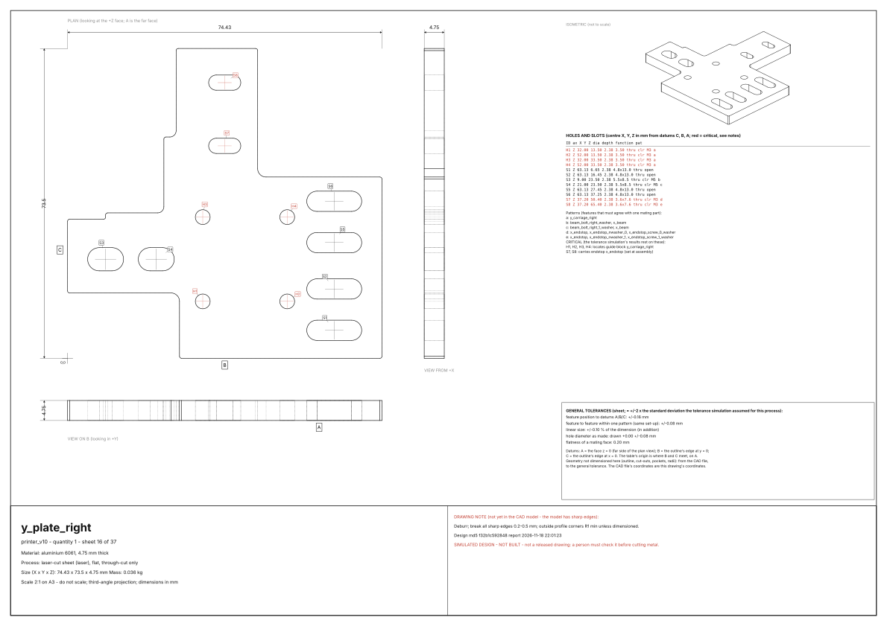

- Quantity 1. aluminium 6061; sheet; 74.43 x 73.5 x 4.75 mm; 0.036 kg.
- Sheet 4.75 mm, laser cut, flat (no bends), through-cut only. Flat size [74.4, 73.5] mm, cut length 546.0 mm, 13 pierces (report). DXF written here: {'LINE': 30, 'ARC': 30, 'CIRCLE': 4}, cut length 545.8 mm, extent (74.43, 73.5).
- Threads: none. Inserts and clinch nuts: none. Reaming: none.
- Drawing note, not yet in the model: Deburr; break all sharp edges 0.2-0.5 mm; outside profile corners R1 min unless dimensioned.
- **Needs more than the general tolerance, or rests on an assumption:**
  - **Patterns a** (guide block / motor): hole to hole +/-0.08 mm is the figure the screw-pattern check used (tighter than the +/-0.16 mm position tolerance); radial clearance on the screws 0.25 mm. Cut all holes of a pattern in one set-up.
  - Report, manufacture `hole_smaller_than_thickness`: 6 hole(s) or cut-out(s) narrower than the 4.75 mm sheet (smallest 3.50 mm at [150.0, -51.61, 419.38]): they cut, but taper and lose accuracy.
  - Report, manufacture `hole_too_close_to_edge`: 5 hole(s) with less than 4.75 mm of material to the edge (least 3.35 mm at [181.13, -27.86, 419.38]): the web overheats and distorts, and tears if the part is bent or loaded.
  - Report, manufacture `holes_too_close`: 3 pair(s) of holes or cut-outs with too little material between them (least 3.48 mm at [175.56, -50.14, 419.38], wanted 4.75 mm = 1 x thickness).

| ID | Kind | Axis | X | Y | Z | Dia / width | Slot length | Depth | Counterbore (dia x depth, from) | Function | Screws | On its axis | Pattern | Critical |
|---|---|---|---|---|---|---|---|---|---|---|---|---|---|---|
| H1 | hole | Z | 32 | 13.5 | 2.38 | 3.5 | - | through | - | clearance M3 | y_plate_right_screw_0 (SHCS-M3x8) | - | a: y_carriage_right | locates guide block y_carriage_right |
| H2 | hole | Z | 52 | 13.5 | 2.38 | 3.5 | - | through | - | clearance M3 | y_plate_right_screw_2 (SHCS-M3x8) | - | a: y_carriage_right | locates guide block y_carriage_right |
| H3 | hole | Z | 32 | 33.5 | 2.38 | 3.5 | - | through | - | clearance M3 | y_plate_right_screw_1 (SHCS-M3x8) | - | a: y_carriage_right | locates guide block y_carriage_right |
| H4 | hole | Z | 52 | 33.5 | 2.38 | 3.5 | - | through | - | clearance M3 | y_plate_right_screw_3 (SHCS-M3x8) | - | a: y_carriage_right | locates guide block y_carriage_right |
| S1 | slot | Z | 63.13 | 6.65 | 2.38 | 4.8 | 13 | through | - | hole (no screw or part on its axis in the model) | - | - | - | - |
| S2 | slot | Z | 63.13 | 16.45 | 2.38 | 4.8 | 13 | through | - | hole (no screw or part on its axis in the model) | - | - | - | - |
| S3 | slot | Z | 9 | 23.5 | 2.38 | 5.5 | 8.5 | through | - | clearance M5 | beam_bolt_right (SHCS-M5x10) | - | b: beam_bolt_right_washer, x_beam | - |
| S4 | slot | Z | 21 | 23.5 | 2.38 | 5.5 | 8.5 | through | - | clearance M5 | beam_bolt_right_1 (SHCS-M5x10) | - | c: beam_bolt_right_1_washer, x_beam | - |
| S5 | slot | Z | 63.13 | 27.45 | 2.38 | 4.8 | 13 | through | - | hole (no screw or part on its axis in the model) | - | - | - | - |
| S6 | slot | Z | 63.13 | 37.25 | 2.38 | 4.8 | 13 | through | - | hole (no screw or part on its axis in the model) | - | - | - | - |
| S7 | slot | Z | 37.2 | 50.4 | 2.38 | 3.6 | 7.6 | through | - | clearance M3 | x_endstop_screw_0 (SHCS-M3x16) | - | d: x_endstop, x_endstop_nwasher_0, x_endstop_screw_0_washer | carries endstop x_endstop (set at assembly) |
| S8 | slot | Z | 37.2 | 65.4 | 2.38 | 3.6 | 7.6 | through | - | clearance M3 | x_endstop_screw_1 (SHCS-M3x16) | - | e: x_endstop, x_endstop_nwasher_1, x_endstop_screw_1_washer | carries endstop x_endstop (set at assembly) |

### tool_plate

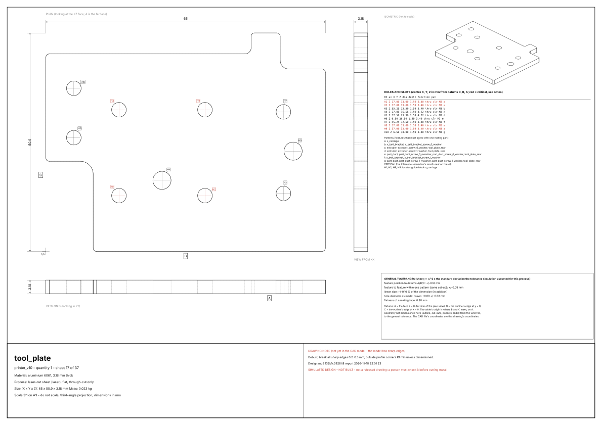

- Quantity 1. aluminium 6061; sheet; 65 x 50.9 x 3.18 mm; 0.023 kg.
- Sheet 3.17 mm, laser cut, flat (no bends), through-cut only. Flat size [65.0, 50.9] mm, cut length 339.0 mm, 11 pierces (report). DXF written here: {'LINE': 10, 'ARC': 10, 'CIRCLE': 10}, cut length 338.6 mm, extent (65.0, 50.9).
- Threads: none. Inserts and clinch nuts: none. Reaming: none.
- Drawing note, not yet in the model: Deburr; break all sharp edges 0.2-0.5 mm; outside profile corners R1 min unless dimensioned.
- **Needs more than the general tolerance, or rests on an assumption:**
  - **Patterns a** (guide block / motor): hole to hole +/-0.08 mm is the figure the screw-pattern check used (tighter than the +/-0.16 mm position tolerance); radial clearance on the screws 0.20 mm. Cut all holes of a pattern in one set-up.
  - Report, manufacture `holes_too_close`: 2 pair(s) of holes or cut-outs with too little material between them (least 5.61 mm at [4.93, -17.03, 436.38], wanted 6.35 mm = 2 x thickness).

| ID | Kind | Axis | X | Y | Z | Dia / width | Slot length | Depth | Counterbore (dia x depth, from) | Function | Screws | On its axis | Pattern | Critical |
|---|---|---|---|---|---|---|---|---|---|---|---|---|---|---|
| H1 | hole | Z | 17 | 13 | 1.59 | 3.4 | - | through | - | clearance M3 | tool_screw_0 (SHCS-M3x6) | - | a: x_carriage | locates guide block x_carriage |
| H2 | hole | Z | 37 | 13 | 1.59 | 3.4 | - | through | - | clearance M3 | tool_screw_2 (SHCS-M3x6) | - | a: x_carriage | locates guide block x_carriage |
| H3 | hole | Z | 55.25 | 13.5 | 1.59 | 3.4 | - | through | - | clearance M3 | x_belt_bracket_screw_0 (SHCS-M3x10) | - | b: x_belt_bracket, x_belt_bracket_screw_0_washer | - |
| H4 | hole | Z | 27 | 16.56 | 1.59 | 4.22 | - | through | - | clearance M3 | extruder_screw_0 (SHCS-M3x50) | - | c: extruder, extruder_screw_0_washer, tool_plate_rear | - |
| H5 | hole | Z | 57.5 | 23.36 | 1.59 | 4.22 | - | through | - | clearance M3 | extruder_screw_1 (SHCS-M3x50) | x_belt_bracket (custom) | d: extruder, extruder_screw_1_washer, tool_plate_rear | - |
| H6 | hole | Z | 6.5 | 26.5 | 1.59 | 3.4 | - | through | - | clearance M3 | part_duct_screw_0 (SHCS-M3x16) | - | e: part_duct, part_duct_screw_0_nwasher, part_duct_screw_0_washer, tool_plate_rear | - |
| H7 | hole | Z | 55.25 | 32.5 | 1.59 | 3.4 | - | through | - | clearance M3 | x_belt_bracket_screw_1 (SHCS-M3x10) | - | f: x_belt_bracket, x_belt_bracket_screw_1_washer | - |
| H8 | hole | Z | 17 | 33 | 1.59 | 3.4 | - | through | - | clearance M3 | tool_screw_1 (SHCS-M3x6) | - | a: x_carriage | locates guide block x_carriage |
| H9 | hole | Z | 37 | 33 | 1.59 | 3.4 | - | through | - | clearance M3 | tool_screw_3 (SHCS-M3x6) | - | a: x_carriage | locates guide block x_carriage |
| H10 | hole | Z | 6.5 | 38 | 1.59 | 3.4 | - | through | - | clearance M3 | part_duct_screw_1 (SHCS-M3x16) | - | g: part_duct, part_duct_screw_1_nwasher, part_duct_screw_1_washer, tool_plate_rear | - |

### tool_plate_rear

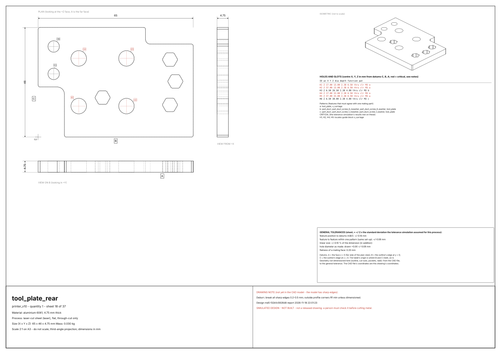

- Quantity 1. aluminium 6061; sheet; 65 x 46 x 4.75 mm; 0.030 kg.
- Sheet 4.75 mm, laser cut, flat (no bends), through-cut only. Flat size [65.0, 46.0] mm, cut length 406.0 mm, 11 pierces (report). DXF written here: {'LINE': 32, 'ARC': 32, 'CIRCLE': 6}, cut length 405.9 mm, extent (65.0, 46.0).
- Threads: none. Inserts and clinch nuts: none. Reaming: none.
- Drawing note, not yet in the model: Deburr; break all sharp edges 0.2-0.5 mm; outside profile corners R1 min unless dimensioned.
- **Needs more than the general tolerance, or rests on an assumption:**
  - **Patterns a** (guide block / motor): hole to hole +/-0.08 mm is the figure the screw-pattern check used (tighter than the +/-0.16 mm position tolerance); radial clearance on the screws 1.75 mm. Cut all holes of a pattern in one set-up.
  - Report, manufacture `hole_too_close_to_edge`: 5 hole(s) with less than 4.75 mm of material to the edge (least 2.75 mm at [-10.0, -13.06, 397.0]): the web overheats and distorts, and tears if the part is bent or loaded.
  - Report, manufacture `holes_too_close`: 7 pair(s) of holes or cut-outs with too little material between them (least 5.98 mm at [12.5, -13.06, 391.75], wanted 9.5 mm = 2 x thickness).

| ID | Kind | Axis | X | Y | Z | Dia / width | Slot length | Depth | Counterbore (dia x depth, from) | Function | Screws | On its axis | Pattern | Critical |
|---|---|---|---|---|---|---|---|---|---|---|---|---|---|---|
| H1 | hole | Z | 17 | 13 | 2.38 | 6.5 | - | through | - | clearance M3 | tool_screw_0 (SHCS-M3x6) | - | a: tool_plate, x_carriage | locates guide block x_carriage |
| H2 | hole | Z | 37 | 13 | 2.38 | 6.5 | - | through | - | clearance M3 | tool_screw_2 (SHCS-M3x6) | - | a: tool_plate, x_carriage | locates guide block x_carriage |
| H3 | hole | Z | 6.5 | 26.5 | 2.38 | 4.8 | - | through | - | clearance M3 | part_duct_screw_0 (SHCS-M3x16) | - | b: part_duct, part_duct_screw_0_nwasher, part_duct_screw_0_washer, tool_plate | - |
| H4 | hole | Z | 17 | 33 | 2.38 | 6.5 | - | through | - | clearance M3 | tool_screw_1 (SHCS-M3x6) | - | a: tool_plate, x_carriage | locates guide block x_carriage |
| H5 | hole | Z | 37 | 33 | 2.38 | 6.5 | - | through | - | clearance M3 | tool_screw_3 (SHCS-M3x6) | - | a: tool_plate, x_carriage | locates guide block x_carriage |
| H6 | hole | Z | 6.5 | 38 | 2.38 | 4.8 | - | through | - | clearance M3 | part_duct_screw_1 (SHCS-M3x16) | - | c: part_duct, part_duct_screw_1_nwasher, part_duct_screw_1_washer, tool_plate | - |

### probe_mount

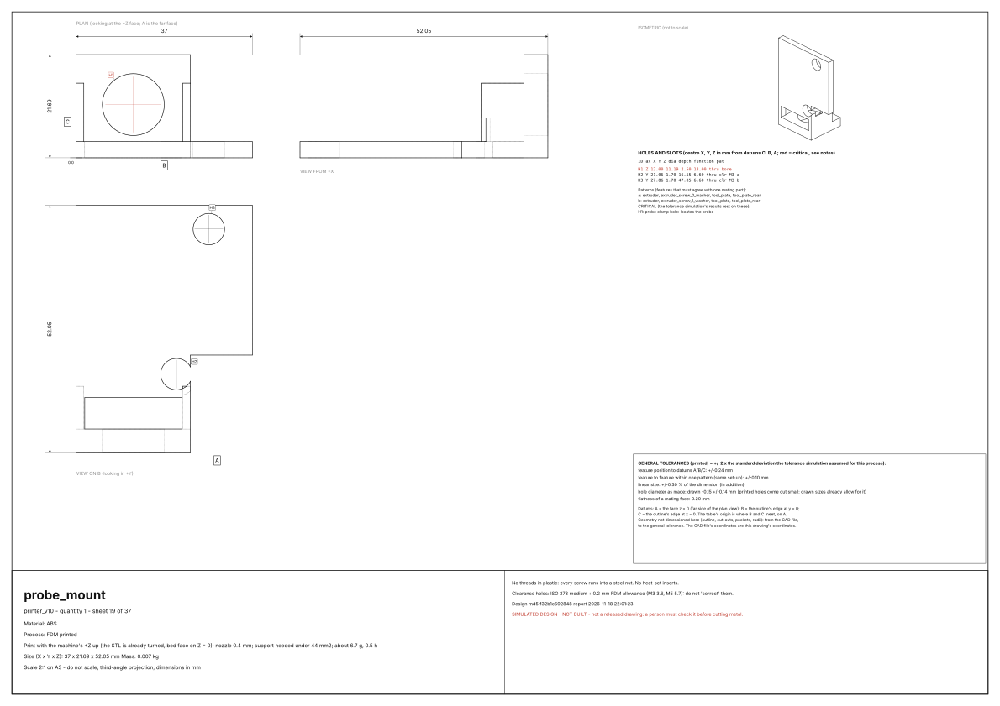

- Quantity 1. ABS; printed; 37 x 21.69 x 52.05 mm; 0.007 kg.
- Print with the machine's **+Z** direction up (STL already turned). Support needed under 44.0 mm2; longest bridge 20.4 mm; bed contact 0.71; thinnest wall 0.03 mm; 6.7 g, 0.5 h (estimate). Holes opening on the bed face: 1 (first-layer squash makes them tight).
- Threads: none. Inserts and clinch nuts: none. Reaming: none.

| ID | Kind | Axis | X | Y | Z | Dia / width | Slot length | Depth | Counterbore (dia x depth, from) | Function | Screws | On its axis | Pattern | Critical |
|---|---|---|---|---|---|---|---|---|---|---|---|---|---|---|
| H1 | hole | Z | 12 | 11.19 | 2.5 | 13 | - | through | - | bore / opening | - | bed_probe (PROBE-OMRON-E2E-X5ME1) | - | probe clamp hole: locates the probe |
| H2 | hole | Y | 21.06 | 1.7 | 16.55 | 6.6 | - | through | - | clearance M3 | extruder_screw_0 (SHCS-M3x50) | - | a: extruder, extruder_screw_0_washer, tool_plate, tool_plate_rear | - |
| H3 | hole | Y | 27.86 | 1.7 | 47.05 | 6.6 | - | through | - | clearance M3 | extruder_screw_1 (SHCS-M3x50) | - | b: extruder, extruder_screw_1_washer, tool_plate, tool_plate_rear | - |

### part_duct

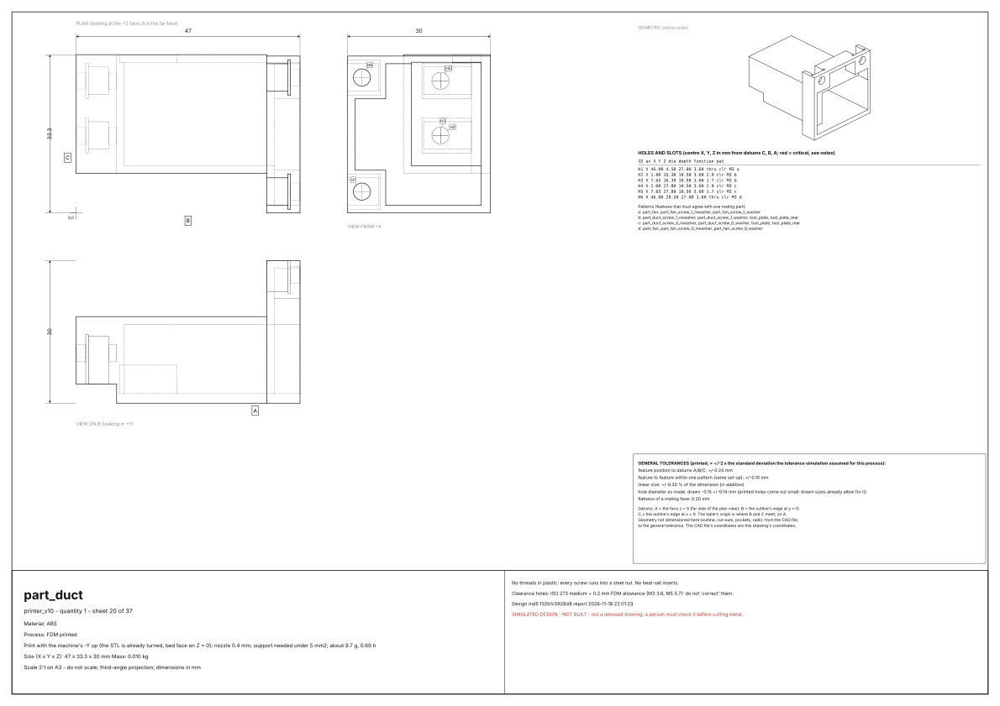

- Quantity 1. ABS; printed; 47 x 33.3 x 30 mm; 0.010 kg.
- Print with the machine's **-Y** direction up (STL already turned). Support needed under 5.0 mm2; longest bridge 26.4 mm; bed contact 0.22; thinnest wall 0.8 mm; 9.7 g, 0.69 h (estimate). Holes opening on the bed face: 2 (first-layer squash makes them tight).
- Threads: none. Inserts and clinch nuts: none. Reaming: none.

| ID | Kind | Axis | X | Y | Z | Dia / width | Slot length | Depth | Counterbore (dia x depth, from) | Function | Screws | On its axis | Pattern | Critical |
|---|---|---|---|---|---|---|---|---|---|---|---|---|---|---|
| H1 | hole | X | 46 | 4.5 | 27 | 3.6 | - | through | - | clearance M3 | part_fan_screw_1 (SHCS-M3x18) | - | a: part_fan, part_fan_screw_1_nwasher, part_fan_screw_1_washer | - |
| H2 | hole | X | 1 | 16.3 | 10.5 | 3.6 | - | 2 | - | clearance M3 | part_duct_screw_1 (SHCS-M3x16) | - | b: part_duct_screw_1_nwasher, part_duct_screw_1_washer, tool_plate, tool_plate_rear | - |
| H3 | hole | X | 7.65 | 16.3 | 10.5 | 3.6 | - | 1.7 | - | clearance M3 | part_duct_screw_1 (SHCS-M3x16) | - | b: part_duct_screw_1_nwasher, part_duct_screw_1_washer, tool_plate, tool_plate_rear | - |
| H4 | hole | X | 1 | 27.8 | 10.5 | 3.6 | - | 2 | - | clearance M3 | part_duct_screw_0 (SHCS-M3x16) | - | c: part_duct_screw_0_nwasher, part_duct_screw_0_washer, tool_plate, tool_plate_rear | - |
| H5 | hole | X | 7.65 | 27.8 | 10.5 | 3.6 | - | 1.7 | - | clearance M3 | part_duct_screw_0 (SHCS-M3x16) | - | c: part_duct_screw_0_nwasher, part_duct_screw_0_washer, tool_plate, tool_plate_rear | - |
| H6 | hole | X | 46 | 28.5 | 27 | 3.6 | - | through | - | clearance M3 | part_fan_screw_0 (SHCS-M3x18) | - | d: part_fan, part_fan_screw_0_nwasher, part_fan_screw_0_washer | - |

### x_belt_bracket

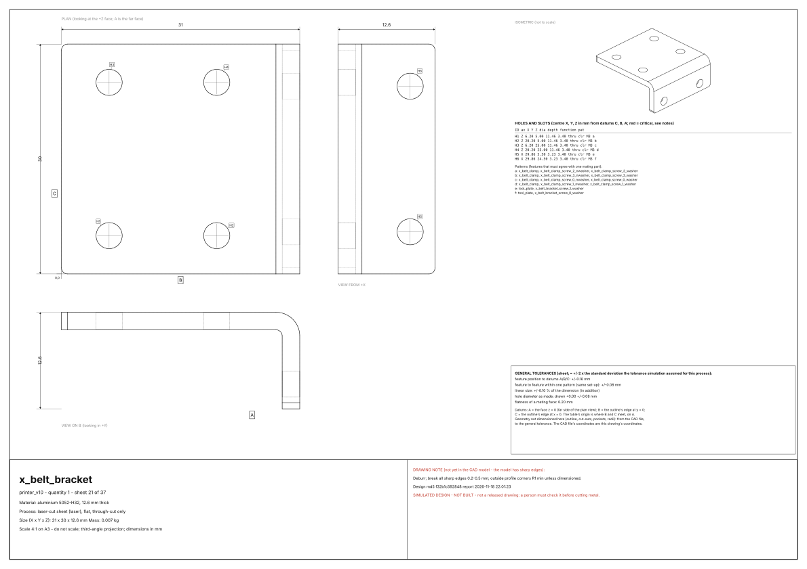

- Quantity 1. aluminium 5052-H32; sheet; 31 x 30 x 12.6 mm; 0.007 kg.
- Sheet 2.29 mm, None cut, flat (no bends), through-cut only. Flat size None mm, cut length None mm, None pierces (report). DXF written here: {'LINE': 4, 'ARC': 2, 'CIRCLE': 4}, cut length 157.8 mm, extent (27.9, 30.0).
- Threads: none. Inserts and clinch nuts: none. Reaming: none.
- Drawing note, not yet in the model: Deburr; break all sharp edges 0.2-0.5 mm; outside profile corners R1 min unless dimensioned.

| ID | Kind | Axis | X | Y | Z | Dia / width | Slot length | Depth | Counterbore (dia x depth, from) | Function | Screws | On its axis | Pattern | Critical |
|---|---|---|---|---|---|---|---|---|---|---|---|---|---|---|
| H1 | hole | Z | 6.2 | 5 | 11.46 | 3.4 | - | through | - | clearance M3 | x_belt_clamp_screw_2 (SHCS-M3x10) | - | a: x_belt_clamp, x_belt_clamp_screw_2_nwasher, x_belt_clamp_screw_2_washer | - |
| H2 | hole | Z | 20.2 | 5 | 11.46 | 3.4 | - | through | - | clearance M3 | x_belt_clamp_screw_3 (SHCS-M3x10) | - | b: x_belt_clamp, x_belt_clamp_screw_3_nwasher, x_belt_clamp_screw_3_washer | - |
| H3 | hole | Z | 6.2 | 25 | 11.46 | 3.4 | - | through | - | clearance M3 | x_belt_clamp_screw_0 (SHCS-M3x10) | - | c: x_belt_clamp, x_belt_clamp_screw_0_nwasher, x_belt_clamp_screw_0_washer | - |
| H4 | hole | Z | 20.2 | 25 | 11.46 | 3.4 | - | through | - | clearance M3 | x_belt_clamp_screw_1 (SHCS-M3x10) | - | d: x_belt_clamp, x_belt_clamp_screw_1_nwasher, x_belt_clamp_screw_1_washer | - |
| H5 | hole | X | 29.86 | 5.5 | 3.23 | 3.4 | - | through | - | clearance M3 | x_belt_bracket_screw_1 (SHCS-M3x10) | - | e: tool_plate, x_belt_bracket_screw_1_washer | - |
| H6 | hole | X | 29.86 | 24.5 | 3.23 | 3.4 | - | through | - | clearance M3 | x_belt_bracket_screw_0 (SHCS-M3x10) | - | f: tool_plate, x_belt_bracket_screw_0_washer | - |

### x_belt_clamp

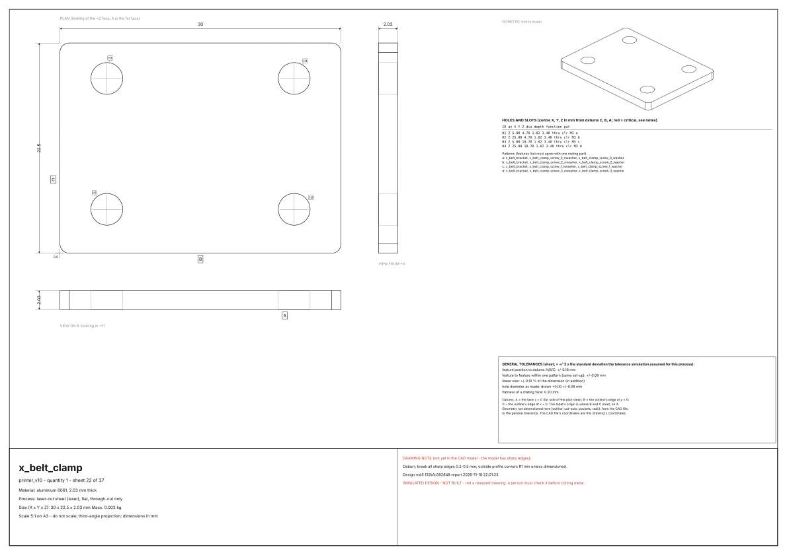

- Quantity 1. aluminium 6061; sheet; 30 x 22.5 x 2.03 mm; 0.003 kg.
- Sheet 2.03 mm, laser cut, flat (no bends), through-cut only. Flat size [30.0, 22.5] mm, cut length 146.0 mm, 5 pierces (report). DXF written here: {'LINE': 4, 'ARC': 4, 'CIRCLE': 4}, cut length 146.0 mm, extent (30.0, 22.5).
- Threads: none. Inserts and clinch nuts: none. Reaming: none.
- Drawing note, not yet in the model: Deburr; break all sharp edges 0.2-0.5 mm; outside profile corners R1 min unless dimensioned.

| ID | Kind | Axis | X | Y | Z | Dia / width | Slot length | Depth | Counterbore (dia x depth, from) | Function | Screws | On its axis | Pattern | Critical |
|---|---|---|---|---|---|---|---|---|---|---|---|---|---|---|
| H1 | hole | Z | 5 | 4.7 | 1.02 | 3.4 | - | through | - | clearance M3 | x_belt_clamp_screw_0 (SHCS-M3x10) | - | a: x_belt_bracket, x_belt_clamp_screw_0_nwasher, x_belt_clamp_screw_0_washer | - |
| H2 | hole | Z | 25 | 4.7 | 1.02 | 3.4 | - | through | - | clearance M3 | x_belt_clamp_screw_2 (SHCS-M3x10) | - | b: x_belt_bracket, x_belt_clamp_screw_2_nwasher, x_belt_clamp_screw_2_washer | - |
| H3 | hole | Z | 5 | 18.7 | 1.02 | 3.4 | - | through | - | clearance M3 | x_belt_clamp_screw_1 (SHCS-M3x10) | - | c: x_belt_bracket, x_belt_clamp_screw_1_nwasher, x_belt_clamp_screw_1_washer | - |
| H4 | hole | Z | 25 | 18.7 | 1.02 | 3.4 | - | through | - | clearance M3 | x_belt_clamp_screw_3 (SHCS-M3x10) | - | d: x_belt_bracket, x_belt_clamp_screw_3_nwasher, x_belt_clamp_screw_3_washer | - |

### x_motor_mount

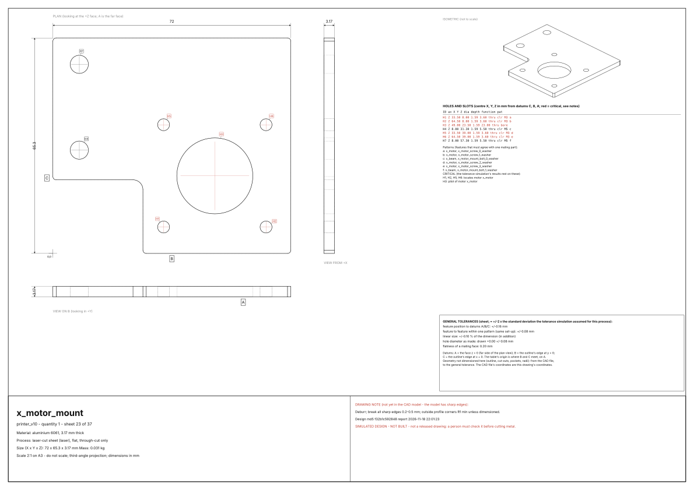

- Quantity 1. aluminium 6061; sheet; 72 x 65.3 x 3.17 mm; 0.031 kg.
- Sheet 3.17 mm, laser cut, flat (no bends), through-cut only. Flat size [72.0, 65.3] mm, cut length 423.0 mm, 8 pierces (report). DXF written here: {'LINE': 6, 'ARC': 6, 'CIRCLE': 7}, cut length 423.2 mm, extent (72.0, 65.3).
- Threads: none. Inserts and clinch nuts: none. Reaming: none.
- Drawing note, not yet in the model: Deburr; break all sharp edges 0.2-0.5 mm; outside profile corners R1 min unless dimensioned.
- **Needs more than the general tolerance, or rests on an assumption:**
  - **Patterns a, b, d, e** (guide block / motor): hole to hole +/-0.08 mm is the figure the screw-pattern check used (tighter than the +/-0.16 mm position tolerance); radial clearance on the screws 0.30 mm. Cut all holes of a pattern in one set-up.
  - This part places a pulley or idler: its thickness and flatness are in the belt-plane result (x_belt: 94.2% of builds within 1 mm, +/-0.43%; y_belt: 98.5% of builds within 1 mm, +/-0.22%; y_belt_l: 98.7% of builds within 1 mm, +/-0.21%).

| ID | Kind | Axis | X | Y | Z | Dia / width | Slot length | Depth | Counterbore (dia x depth, from) | Function | Screws | On its axis | Pattern | Critical |
|---|---|---|---|---|---|---|---|---|---|---|---|---|---|---|
| H1 | hole | Z | 33.5 | 8 | 1.59 | 3.6 | - | through | - | clearance M3 | x_motor_screw_0 (SHCS-M3x8) | - | a: x_motor, x_motor_screw_0_washer | locates motor x_motor |
| H2 | hole | Z | 64.5 | 8 | 1.59 | 3.6 | - | through | - | clearance M3 | x_motor_screw_1 (SHCS-M3x8) | - | b: x_motor, x_motor_screw_1_washer | locates motor x_motor |
| H3 | hole | Z | 49 | 23.5 | 1.59 | 23 | - | through | - | bore / opening | - | x_motor (NEMA17-34) | - | pilot of motor x_motor |
| H4 | hole | Z | 8 | 31.3 | 1.59 | 5.5 | - | through | - | clearance M5 | x_motor_mount_bolt_0 (SHCS-M5x10) | - | c: x_beam, x_motor_mount_bolt_0_washer | - |
| H5 | hole | Z | 33.5 | 39 | 1.59 | 3.6 | - | through | - | clearance M3 | x_motor_screw_2 (SHCS-M3x8) | - | d: x_motor, x_motor_screw_2_washer | locates motor x_motor |
| H6 | hole | Z | 64.5 | 39 | 1.59 | 3.6 | - | through | - | clearance M3 | x_motor_screw_3 (SHCS-M3x8) | - | e: x_motor, x_motor_screw_3_washer | locates motor x_motor |
| H7 | hole | Z | 8 | 57.3 | 1.59 | 5.5 | - | through | - | clearance M5 | x_motor_mount_bolt_1 (SHCS-M5x10) | - | f: x_beam, x_motor_mount_bolt_1_washer | - |

### x_idler_mount

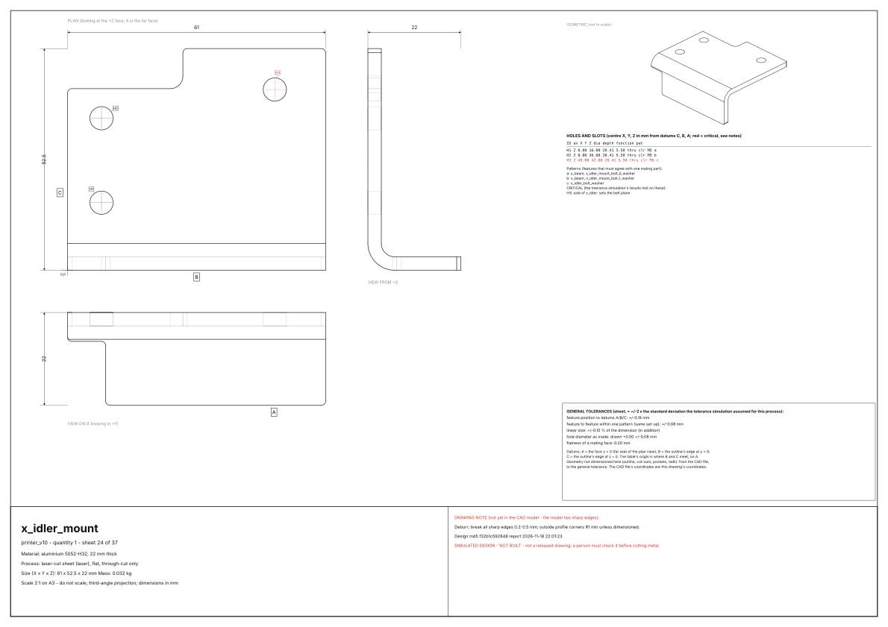

- Quantity 1. aluminium 5052-H32; sheet; 61 x 52.5 x 22 mm; 0.032 kg.
- Sheet 3.17 mm, None cut, flat (no bends), through-cut only. Flat size None mm, cut length None mm, None pierces (report). DXF written here: {'LINE': 6, 'ARC': 4, 'CIRCLE': 3}, cut length 263.6 mm, extent (61.0, 46.14).
- Threads: none. Inserts and clinch nuts: none. Reaming: none.
- Drawing note, not yet in the model: Deburr; break all sharp edges 0.2-0.5 mm; outside profile corners R1 min unless dimensioned.
- **Needs more than the general tolerance, or rests on an assumption:**
  - This part places a pulley or idler: its thickness and flatness are in the belt-plane result (x_belt: 94.2% of builds within 1 mm, +/-0.43%; y_belt: 98.5% of builds within 1 mm, +/-0.22%; y_belt_l: 98.7% of builds within 1 mm, +/-0.21%).

| ID | Kind | Axis | X | Y | Z | Dia / width | Slot length | Depth | Counterbore (dia x depth, from) | Function | Screws | On its axis | Pattern | Critical |
|---|---|---|---|---|---|---|---|---|---|---|---|---|---|---|
| H1 | hole | Z | 8 | 16 | 20.41 | 5.5 | - | through | - | clearance M5 | x_idler_mount_bolt_0 (SHCS-M5x10) | - | a: x_beam, x_idler_mount_bolt_0_washer | - |
| H2 | hole | Z | 8 | 36 | 20.41 | 5.5 | - | through | - | clearance M5 | x_idler_mount_bolt_1 (SHCS-M5x10) | - | b: x_beam, x_idler_mount_bolt_1_washer | - |
| H3 | hole | Z | 49 | 42.8 | 20.41 | 5.5 | - | through | - | clearance M5 | x_idler_bolt (SHCS-M5x35) | - | c: x_idler_bolt_washer | axle of x_idler: sets the belt plane |

### x_tension_anchor

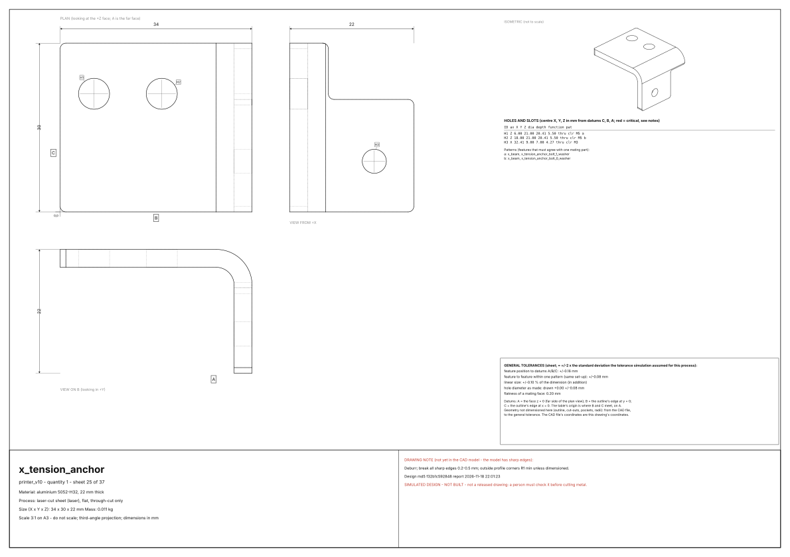

- Quantity 1. aluminium 5052-H32; sheet; 34 x 30 x 22 mm; 0.011 kg.
- Sheet 3.17 mm, None cut, flat (no bends), through-cut only. Flat size None mm, cut length None mm, None pierces (report). DXF written here: {'LINE': 4, 'ARC': 2, 'CIRCLE': 2}, cut length 149.0 mm, extent (27.64, 30.0).
- Threads: none. Inserts and clinch nuts: none. Reaming: none.
- Drawing note, not yet in the model: Deburr; break all sharp edges 0.2-0.5 mm; outside profile corners R1 min unless dimensioned.

| ID | Kind | Axis | X | Y | Z | Dia / width | Slot length | Depth | Counterbore (dia x depth, from) | Function | Screws | On its axis | Pattern | Critical |
|---|---|---|---|---|---|---|---|---|---|---|---|---|---|---|
| H1 | hole | Z | 6 | 21 | 20.41 | 5.5 | - | through | - | clearance M5 | x_tension_anchor_bolt_1 (SHCS-M5x10) | - | a: x_beam, x_tension_anchor_bolt_1_washer | - |
| H2 | hole | Z | 18 | 21 | 20.41 | 5.5 | - | through | - | clearance M5 | x_tension_anchor_bolt_0 (SHCS-M5x10) | - | b: x_beam, x_tension_anchor_bolt_0_washer | - |
| H3 | hole | X | 32.41 | 9 | 7 | 4.27 | - | through | - | clearance M3 | x_tension_screw (SHCS-M3x16) | - | - | - |

### y_motor_mount

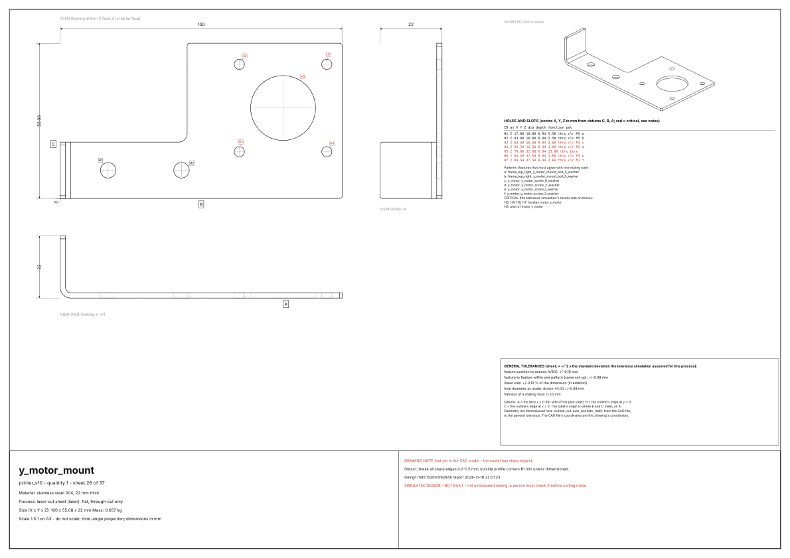

- Quantity 1. stainless steel 304; sheet; 100 x 55.08 x 22 mm; 0.057 kg. Same size, volume and hole list as y_motor_mount_l (same or mirror-image part: compare before sharing a file).
- Sheet 1.88 mm, None cut, flat (no bends), through-cut only. Flat size None mm, cut length None mm, None pierces (report). DXF written here: {'LINE': 4}, cut length 39.8 mm, extent (1.88, 18.0).
- Threads: none. Inserts and clinch nuts: none. Reaming: none.
- Drawing note, not yet in the model: Deburr; break all sharp edges 0.2-0.5 mm; outside profile corners R1 min unless dimensioned.
- **Needs more than the general tolerance, or rests on an assumption:**
  - **Patterns c, d, e, f** (guide block / motor): hole to hole +/-0.08 mm is the figure the screw-pattern check used (tighter than the +/-0.16 mm position tolerance); radial clearance on the screws 0.30 mm. Cut all holes of a pattern in one set-up.
  - This part places a pulley or idler: its thickness and flatness are in the belt-plane result (x_belt: 94.2% of builds within 1 mm, +/-0.43%; y_belt: 98.5% of builds within 1 mm, +/-0.22%; y_belt_l: 98.7% of builds within 1 mm, +/-0.21%).

| ID | Kind | Axis | X | Y | Z | Dia / width | Slot length | Depth | Counterbore (dia x depth, from) | Function | Screws | On its axis | Pattern | Critical |
|---|---|---|---|---|---|---|---|---|---|---|---|---|---|---|
| H1 | hole | Z | 17 | 10 | 0.94 | 5.5 | - | through | - | clearance M5 | y_motor_mount_bolt_0 (SHCS-M5x10) | - | a: frame_top_right, y_motor_mount_bolt_0_washer | - |
| H2 | hole | Z | 43 | 10 | 0.94 | 5.5 | - | through | - | clearance M5 | y_motor_mount_bolt_1 (SHCS-M5x10) | - | b: frame_top_right, y_motor_mount_bolt_1_washer | - |
| H3 | hole | Z | 63.5 | 16.58 | 0.94 | 3.6 | - | through | - | clearance M3 | y_motor_screw_0 (SHCS-M3x6) | - | c: y_motor, y_motor_screw_0_washer | locates motor y_motor |
| H4 | hole | Z | 94.5 | 16.58 | 0.94 | 3.6 | - | through | - | clearance M3 | y_motor_screw_2 (SHCS-M3x6) | - | d: y_motor, y_motor_screw_2_washer | locates motor y_motor |
| H5 | hole | Z | 79 | 32.08 | 0.94 | 23 | - | through | - | bore / opening | - | y_motor (NEMA17-48) | - | pilot of motor y_motor |
| H6 | hole | Z | 63.5 | 47.58 | 0.94 | 3.6 | - | through | - | clearance M3 | y_motor_screw_1 (SHCS-M3x6) | - | e: y_motor, y_motor_screw_1_washer | locates motor y_motor |
| H7 | hole | Z | 94.5 | 47.58 | 0.94 | 3.6 | - | through | - | clearance M3 | y_motor_screw_3 (SHCS-M3x6) | - | f: y_motor, y_motor_screw_3_washer | locates motor y_motor |

### y_tension_anchor

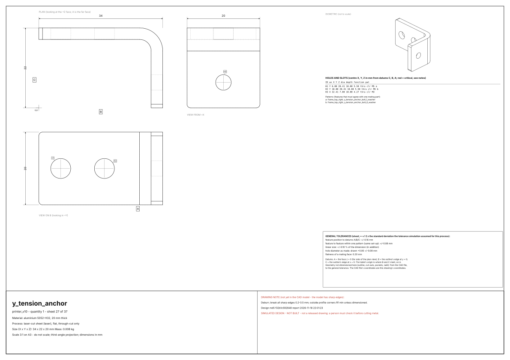

- Quantity 1. aluminium 5052-H32; sheet; 34 x 22 x 20 mm; 0.008 kg. Same size, volume and hole list as y_tension_anchor_l (same or mirror-image part: compare before sharing a file).
- Sheet 3.17 mm, None cut, flat (no bends), through-cut only. Flat size None mm, cut length None mm, None pierces (report). DXF written here: {'LINE': 6, 'ARC': 2}, cut length 103.9 mm, extent (33.0, 21.0).
- Threads: none. Inserts and clinch nuts: none. Reaming: none.
- Drawing note, not yet in the model: Deburr; break all sharp edges 0.2-0.5 mm; outside profile corners R1 min unless dimensioned.

| ID | Kind | Axis | X | Y | Z | Dia / width | Slot length | Depth | Counterbore (dia x depth, from) | Function | Screws | On its axis | Pattern | Critical |
|---|---|---|---|---|---|---|---|---|---|---|---|---|---|---|
| H1 | hole | Y | 6 | 20.41 | 10 | 5.5 | - | through | - | clearance M5 | y_tension_anchor_bolt_1 (SHCS-M5x10) | - | a: frame_top_right, y_tension_anchor_bolt_1_washer | - |
| H2 | hole | Y | 18 | 20.41 | 10 | 5.5 | - | through | - | clearance M5 | y_tension_anchor_bolt_0 (SHCS-M5x10) | - | b: frame_top_right, y_tension_anchor_bolt_0_washer | - |
| H3 | hole | X | 32.41 | 7 | 10 | 4.27 | - | through | - | clearance M3 | y_tension_screw (SHCS-M3x16) | - | - | - |

### y_idler_mount

- Quantity 1. stainless steel 304; sheet; 77.87 x 41.08 x 1.88 mm; 0.026 kg. Same size, volume and hole list as y_idler_mount_l (same or mirror-image part: compare before sharing a file).
- Sheet 1.88 mm, laser cut, flat (no bends), through-cut only. Flat size [77.9, 41.1] mm, cut length 287.0 mm, 4 pierces (report). DXF written here: {'LINE': 6, 'ARC': 6, 'CIRCLE': 3}, cut length 286.7 mm, extent (77.87, 41.08).
- Threads: none. Inserts and clinch nuts: none. Reaming: none.
- Drawing note, not yet in the model: Deburr; break all sharp edges 0.2-0.5 mm; outside profile corners R1 min unless dimensioned.
- **Needs more than the general tolerance, or rests on an assumption:**
  - This part places a pulley or idler: its thickness and flatness are in the belt-plane result (x_belt: 94.2% of builds within 1 mm, +/-0.43%; y_belt: 98.5% of builds within 1 mm, +/-0.22%; y_belt_l: 98.7% of builds within 1 mm, +/-0.21%).

| ID | Kind | Axis | X | Y | Z | Dia / width | Slot length | Depth | Counterbore (dia x depth, from) | Function | Screws | On its axis | Pattern | Critical |
|---|---|---|---|---|---|---|---|---|---|---|---|---|---|---|
| H1 | hole | Z | 19.87 | 10 | 0.94 | 5.5 | - | through | - | clearance M5 | y_idler_mount_bolt_0 (SHCS-M5x10) | - | a: frame_top_right, y_idler_mount_bolt_0_washer | - |
| H2 | hole | Z | 67.87 | 10 | 0.94 | 5.5 | - | through | - | clearance M5 | y_idler_mount_bolt_1 (SHCS-M5x10) | - | b: frame_top_right, y_idler_mount_bolt_1_washer | - |
| H3 | hole | Z | 9 | 32.08 | 0.94 | 5.5 | - | through | - | clearance M5 | y_idler_bolt (SHCS-M5x30) | - | c: y_idler_nwasher, y_idler_spacer, y_idler_spacer_b | axle of y_idler: sets the belt plane |

### y_motor_mount_l

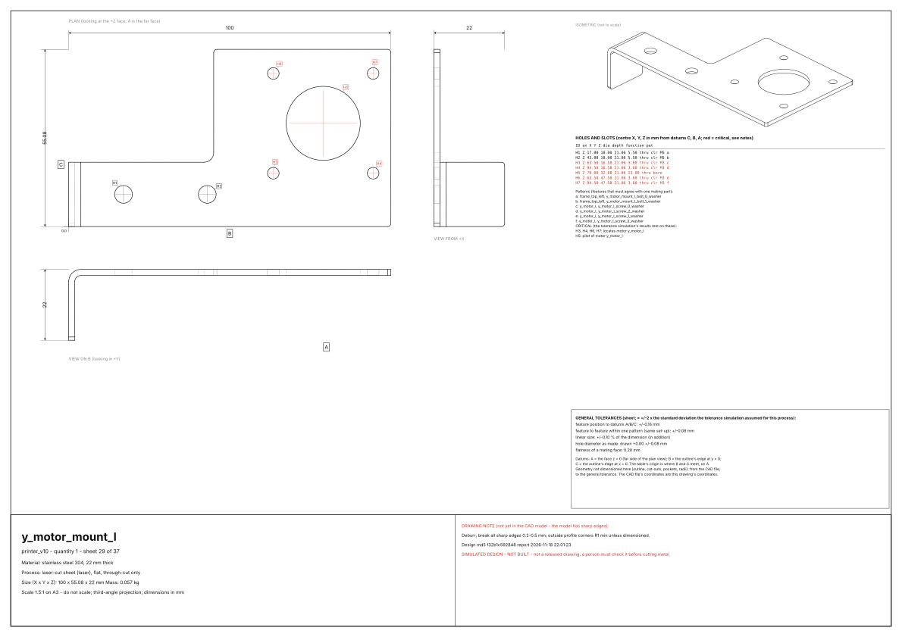

- Quantity 1. stainless steel 304; sheet; 100 x 55.08 x 22 mm; 0.057 kg. Same size, volume and hole list as y_motor_mount (same or mirror-image part: compare before sharing a file).
- Sheet 1.88 mm, None cut, flat (no bends), through-cut only. Flat size None mm, cut length None mm, None pierces (report). DXF written here: {'LINE': 6, 'ARC': 4, 'CIRCLE': 7}, cut length 452.1 mm, extent (96.22, 55.08).
- Threads: none. Inserts and clinch nuts: none. Reaming: none.
- Drawing note, not yet in the model: Deburr; break all sharp edges 0.2-0.5 mm; outside profile corners R1 min unless dimensioned.
- **Needs more than the general tolerance, or rests on an assumption:**
  - **Patterns c, d, e, f** (guide block / motor): hole to hole +/-0.08 mm is the figure the screw-pattern check used (tighter than the +/-0.16 mm position tolerance); radial clearance on the screws 0.30 mm. Cut all holes of a pattern in one set-up.
  - This part places a pulley or idler: its thickness and flatness are in the belt-plane result (x_belt: 94.2% of builds within 1 mm, +/-0.43%; y_belt: 98.5% of builds within 1 mm, +/-0.22%; y_belt_l: 98.7% of builds within 1 mm, +/-0.21%).

| ID | Kind | Axis | X | Y | Z | Dia / width | Slot length | Depth | Counterbore (dia x depth, from) | Function | Screws | On its axis | Pattern | Critical |
|---|---|---|---|---|---|---|---|---|---|---|---|---|---|---|
| H1 | hole | Z | 17 | 10 | 21.06 | 5.5 | - | through | - | clearance M5 | y_motor_mount_l_bolt_0 (SHCS-M5x10) | - | a: frame_top_left, y_motor_mount_l_bolt_0_washer | - |
| H2 | hole | Z | 43 | 10 | 21.06 | 5.5 | - | through | - | clearance M5 | y_motor_mount_l_bolt_1 (SHCS-M5x10) | - | b: frame_top_left, y_motor_mount_l_bolt_1_washer | - |
| H3 | hole | Z | 63.5 | 16.58 | 21.06 | 3.6 | - | through | - | clearance M3 | y_motor_l_screw_0 (SHCS-M3x6) | - | c: y_motor_l, y_motor_l_screw_0_washer | locates motor y_motor_l |
| H4 | hole | Z | 94.5 | 16.58 | 21.06 | 3.6 | - | through | - | clearance M3 | y_motor_l_screw_2 (SHCS-M3x6) | - | d: y_motor_l, y_motor_l_screw_2_washer | locates motor y_motor_l |
| H5 | hole | Z | 79 | 32.08 | 21.06 | 23 | - | through | - | bore / opening | - | y_motor_l (NEMA17-48) | - | pilot of motor y_motor_l |
| H6 | hole | Z | 63.5 | 47.58 | 21.06 | 3.6 | - | through | - | clearance M3 | y_motor_l_screw_1 (SHCS-M3x6) | - | e: y_motor_l, y_motor_l_screw_1_washer | locates motor y_motor_l |
| H7 | hole | Z | 94.5 | 47.58 | 21.06 | 3.6 | - | through | - | clearance M3 | y_motor_l_screw_3 (SHCS-M3x6) | - | f: y_motor_l, y_motor_l_screw_3_washer | locates motor y_motor_l |

### y_tension_anchor_l

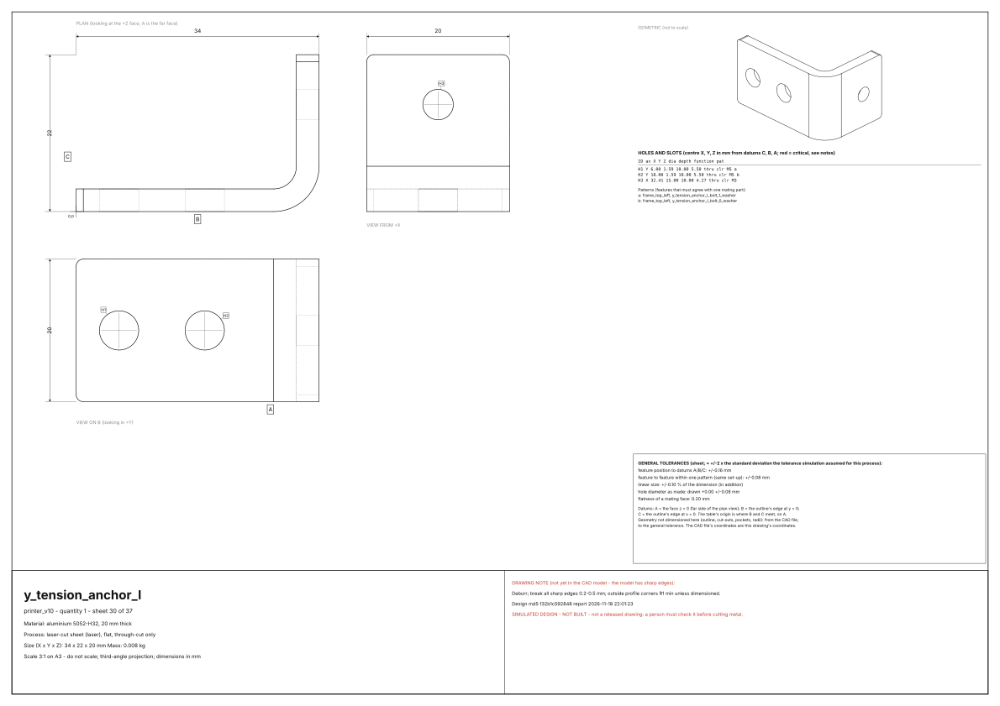

- Quantity 1. aluminium 5052-H32; sheet; 34 x 22 x 20 mm; 0.008 kg. Same size, volume and hole list as y_tension_anchor (same or mirror-image part: compare before sharing a file).
- Sheet 3.17 mm, None cut, flat (no bends), through-cut only. Flat size None mm, cut length None mm, None pierces (report). DXF written here: {'LINE': 6, 'ARC': 2}, cut length 103.9 mm, extent (33.0, 21.0).
- Threads: none. Inserts and clinch nuts: none. Reaming: none.
- Drawing note, not yet in the model: Deburr; break all sharp edges 0.2-0.5 mm; outside profile corners R1 min unless dimensioned.

| ID | Kind | Axis | X | Y | Z | Dia / width | Slot length | Depth | Counterbore (dia x depth, from) | Function | Screws | On its axis | Pattern | Critical |
|---|---|---|---|---|---|---|---|---|---|---|---|---|---|---|
| H1 | hole | Y | 6 | 1.59 | 10 | 5.5 | - | through | - | clearance M5 | y_tension_anchor_l_bolt_1 (SHCS-M5x10) | - | a: frame_top_left, y_tension_anchor_l_bolt_1_washer | - |
| H2 | hole | Y | 18 | 1.59 | 10 | 5.5 | - | through | - | clearance M5 | y_tension_anchor_l_bolt_0 (SHCS-M5x10) | - | b: frame_top_left, y_tension_anchor_l_bolt_0_washer | - |
| H3 | hole | X | 32.41 | 15 | 10 | 4.27 | - | through | - | clearance M3 | y_tension_screw_l (SHCS-M3x16) | - | - | - |

### y_idler_mount_l

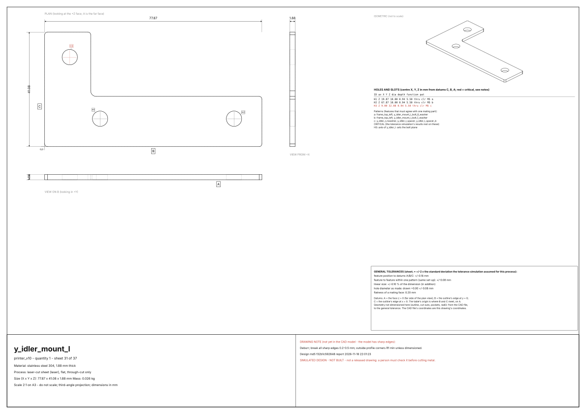

- Quantity 1. stainless steel 304; sheet; 77.87 x 41.08 x 1.88 mm; 0.026 kg. Same size, volume and hole list as y_idler_mount (same or mirror-image part: compare before sharing a file).
- Sheet 1.88 mm, laser cut, flat (no bends), through-cut only. Flat size [77.9, 41.1] mm, cut length 287.0 mm, 4 pierces (report). DXF written here: {'LINE': 6, 'ARC': 6, 'CIRCLE': 3}, cut length 286.7 mm, extent (77.87, 41.08).
- Threads: none. Inserts and clinch nuts: none. Reaming: none.
- Drawing note, not yet in the model: Deburr; break all sharp edges 0.2-0.5 mm; outside profile corners R1 min unless dimensioned.
- **Needs more than the general tolerance, or rests on an assumption:**
  - This part places a pulley or idler: its thickness and flatness are in the belt-plane result (x_belt: 94.2% of builds within 1 mm, +/-0.43%; y_belt: 98.5% of builds within 1 mm, +/-0.22%; y_belt_l: 98.7% of builds within 1 mm, +/-0.21%).

| ID | Kind | Axis | X | Y | Z | Dia / width | Slot length | Depth | Counterbore (dia x depth, from) | Function | Screws | On its axis | Pattern | Critical |
|---|---|---|---|---|---|---|---|---|---|---|---|---|---|---|
| H1 | hole | Z | 19.87 | 10 | 0.94 | 5.5 | - | through | - | clearance M5 | y_idler_mount_l_bolt_0 (SHCS-M5x10) | - | a: frame_top_left, y_idler_mount_l_bolt_0_washer | - |
| H2 | hole | Z | 67.87 | 10 | 0.94 | 5.5 | - | through | - | clearance M5 | y_idler_mount_l_bolt_1 (SHCS-M5x10) | - | b: frame_top_left, y_idler_mount_l_bolt_1_washer | - |
| H3 | hole | Z | 9 | 32.08 | 0.94 | 5.5 | - | through | - | clearance M5 | y_idler_l_bolt (SHCS-M5x30) | - | c: y_idler_l_nwasher, y_idler_l_spacer, y_idler_l_spacer_b | axle of y_idler_l: sets the belt plane |

### y_endstop_mount

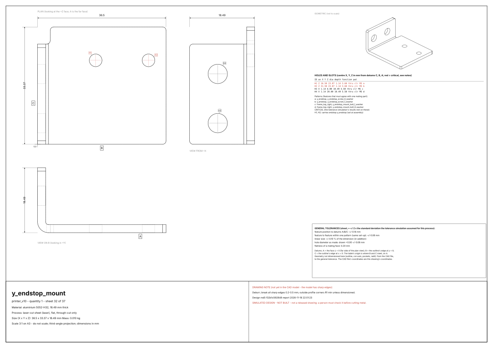

- Quantity 1. aluminium 5052-H32; sheet; 36.5 x 33.37 x 18.49 mm; 0.010 kg.
- Sheet 2.29 mm, None cut, flat (no bends), through-cut only. Flat size None mm, cut length None mm, None pierces (report). DXF written here: {'LINE': 4}, cut length 57.6 mm, extent (2.29, 26.5).
- Threads: none. Inserts and clinch nuts: none. Reaming: none.
- Drawing note, not yet in the model: Deburr; break all sharp edges 0.2-0.5 mm; outside profile corners R1 min unless dimensioned.

| ID | Kind | Axis | X | Y | Z | Dia / width | Slot length | Depth | Counterbore (dia x depth, from) | Function | Screws | On its axis | Pattern | Critical |
|---|---|---|---|---|---|---|---|---|---|---|---|---|---|---|
| H1 | hole | Z | 16.5 | 23.87 | 1.14 | 3.6 | - | through | - | clearance M3 | y_endstop_screw_0 (SHCS-M3x12) | - | a: y_endstop, y_endstop_screw_0_washer | carries endstop y_endstop (set at assembly) |
| H2 | hole | Z | 31.5 | 23.87 | 1.14 | 3.6 | - | through | - | clearance M3 | y_endstop_screw_1 (SHCS-M3x12) | - | b: y_endstop, y_endstop_screw_1_washer | carries endstop y_endstop (set at assembly) |
| H3 | hole | X | 1.14 | 6 | 10.49 | 5.5 | - | through | - | clearance M5 | y_endstop_mount_bolt_1 (SHCS-M5x8) | - | c: frame_top_right, y_endstop_mount_bolt_1_washer | - |
| H4 | hole | X | 1.14 | 20 | 10.49 | 5.5 | - | through | - | clearance M5 | y_endstop_mount_bolt_0 (SHCS-M5x8) | - | d: frame_top_right, y_endstop_mount_bolt_0_washer | - |

### mains_cover_relay

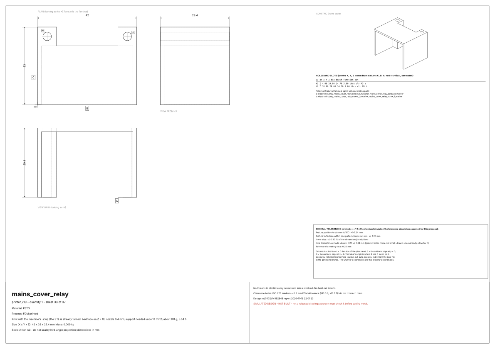

- Quantity 1. PETG; printed; 42 x 33 x 29.4 mm; 0.009 kg.
- Print with the machine's **-Z** direction up (STL already turned). Support needed under 0.0 mm2; longest bridge 0.0 mm; bed contact 1.0; thinnest wall 1.6 mm; 9.0 g, 0.54 h (estimate). Holes opening on the bed face: 2 (first-layer squash makes them tight).
- Threads: none. Inserts and clinch nuts: none. Reaming: none.

| ID | Kind | Axis | X | Y | Z | Dia / width | Slot length | Depth | Counterbore (dia x depth, from) | Function | Screws | On its axis | Pattern | Critical |
|---|---|---|---|---|---|---|---|---|---|---|---|---|---|---|
| H1 | hole | Z | 4 | 29 | 14.7 | 3.6 | - | through | - | clearance M3 | mains_cover_relay_screw_0 (SHCS-M3x40) | - | a: electronics_tray, mains_cover_relay_screw_0_nwasher, mains_cover_relay_screw_0_washer | - |
| H2 | hole | Z | 38 | 29 | 14.7 | 3.6 | - | through | - | clearance M3 | mains_cover_relay_screw_1 (SHCS-M3x40) | - | b: electronics_tray, mains_cover_relay_screw_1_nwasher, mains_cover_relay_screw_1_washer | - |

### mains_cover_psu

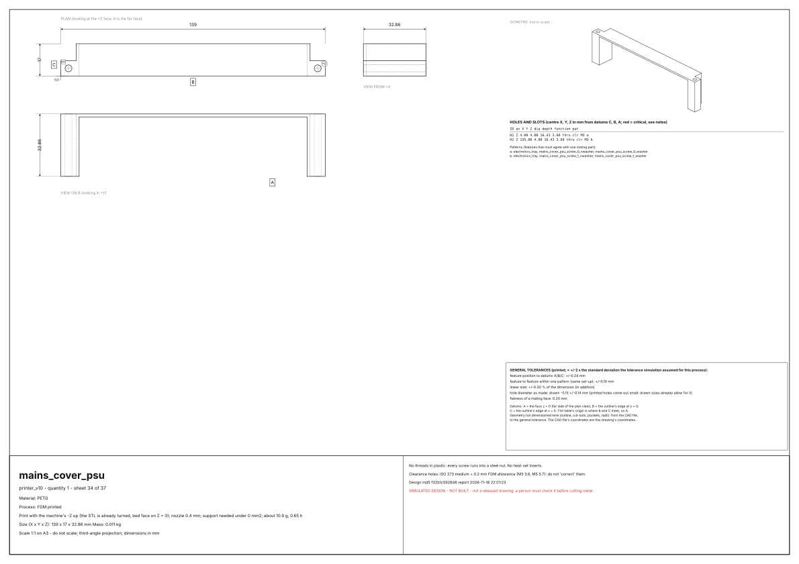

- Quantity 1. PETG; printed; 139 x 17 x 32.86 mm; 0.011 kg.
- Print with the machine's **-Z** direction up (STL already turned). Support needed under 0.0 mm2; longest bridge 0.0 mm; bed contact 1.0; thinnest wall 1.6 mm; 10.9 g, 0.65 h (estimate). Holes opening on the bed face: 2 (first-layer squash makes them tight).
- Threads: none. Inserts and clinch nuts: none. Reaming: none.

| ID | Kind | Axis | X | Y | Z | Dia / width | Slot length | Depth | Counterbore (dia x depth, from) | Function | Screws | On its axis | Pattern | Critical |
|---|---|---|---|---|---|---|---|---|---|---|---|---|---|---|
| H1 | hole | Z | 4 | 4 | 16.43 | 3.6 | - | through | - | clearance M3 | mains_cover_psu_screw_0 (SHCS-M3x45) | - | a: electronics_tray, mains_cover_psu_screw_0_nwasher, mains_cover_psu_screw_0_washer | - |
| H2 | hole | Z | 135 | 4 | 16.43 | 3.6 | - | through | - | clearance M3 | mains_cover_psu_screw_1 (SHCS-M3x45) | - | b: electronics_tray, mains_cover_psu_screw_1_nwasher, mains_cover_psu_screw_1_washer | - |

### electronics_tray

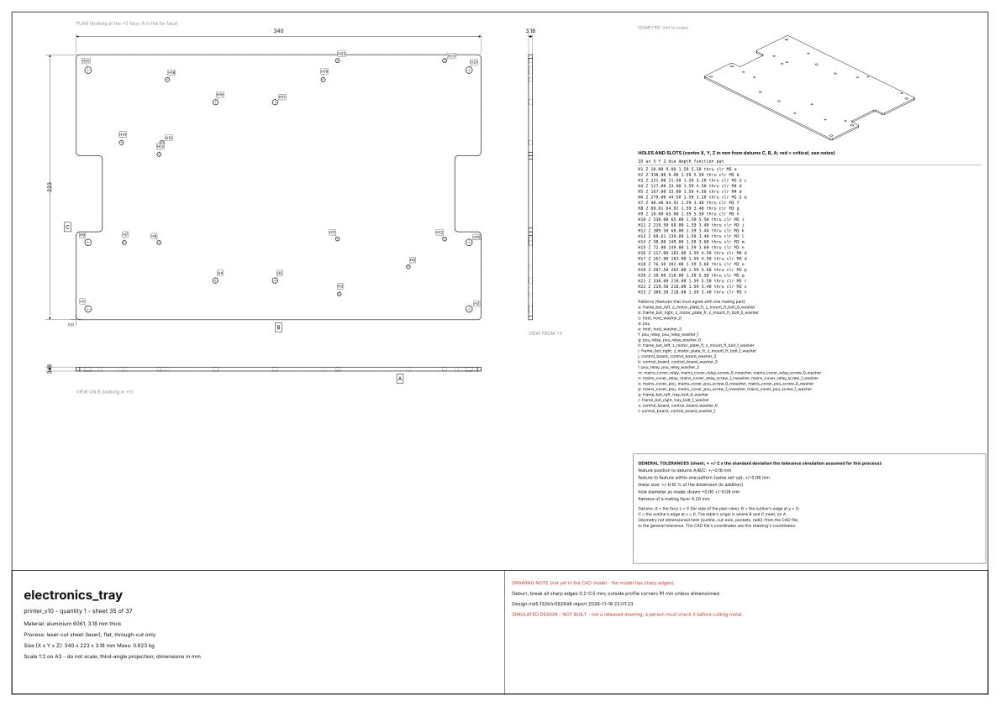

- Quantity 1. aluminium 6061; sheet; 340 x 223 x 3.18 mm; 0.623 kg.
- Sheet 3.17 mm, laser cut, flat (no bends), through-cut only. Flat size [340.0, 223.0] mm, cut length 1499.0 mm, 24 pierces (report). DXF written here: {'LINE': 12, 'ARC': 12, 'CIRCLE': 23}, cut length 1498.9 mm, extent (340.0, 223.0).
- Threads: none. Inserts and clinch nuts: none. Reaming: none.
- Drawing note, not yet in the model: Deburr; break all sharp edges 0.2-0.5 mm; outside profile corners R1 min unless dimensioned.

| ID | Kind | Axis | X | Y | Z | Dia / width | Slot length | Depth | Counterbore (dia x depth, from) | Function | Screws | On its axis | Pattern | Critical |
|---|---|---|---|---|---|---|---|---|---|---|---|---|---|---|
| H1 | hole | Z | 10 | 9 | 1.59 | 5.5 | - | through | - | clearance M5 | z_mount_fl_bolt_0 (SHCS-M5x70) | - | a: frame_bot_left, z_motor_plate_fl, z_mount_fl_bolt_0_washer | - |
| H2 | hole | Z | 330 | 9 | 1.59 | 5.5 | - | through | - | clearance M5 | z_mount_fr_bolt_0 (SHCS-M5x70) | - | b: frame_bot_right, z_motor_plate_fr, z_mount_fr_bolt_0_washer | - |
| H3 | hole | Z | 221 | 21.5 | 1.59 | 3.2 | - | through | - | clearance M2.5 | host_screw_0 (SHCS-M2.5x12) | host_washer_0 (WASHER-M2.5) | c: host, host_washer_0 | - |
| H4 | hole | Z | 117 | 33 | 1.59 | 4.5 | - | through | - | clearance M4 | psu_screw_2 (SHCS-M4x6) | - | d: psu | - |
| H5 | hole | Z | 167 | 33 | 1.59 | 4.5 | - | through | - | clearance M4 | psu_screw_3 (SHCS-M4x6) | - | d: psu | - |
| H6 | hole | Z | 279 | 44.5 | 1.59 | 3.2 | - | through | - | clearance M2.5 | host_screw_3 (SHCS-M2.5x12) | host_washer_3 (WASHER-M2.5) | e: host, host_washer_3 | - |
| H7 | hole | Z | 40.4 | 64.92 | 1.59 | 3.4 | - | through | - | clearance M3 | psu_relay_screw_1 (SHCS-M3x16) | - | f: psu_relay, psu_relay_washer_1 | - |
| H8 | hole | Z | 69.61 | 64.92 | 1.59 | 3.4 | - | through | - | clearance M3 | psu_relay_screw_0 (SHCS-M3x16) | - | g: psu_relay, psu_relay_washer_0 | - |
| H9 | hole | Z | 10 | 65 | 1.59 | 5.5 | - | through | - | clearance M5 | z_mount_fl_bolt_1 (SHCS-M5x70) | - | h: frame_bot_left, z_motor_plate_fl, z_mount_fl_bolt_1_washer | - |
| H10 | hole | Z | 330 | 65 | 1.59 | 5.5 | - | through | - | clearance M5 | z_mount_fr_bolt_1 (SHCS-M5x70) | - | i: frame_bot_right, z_motor_plate_fr, z_mount_fr_bolt_1_washer | - |
| H11 | hole | Z | 219.5 | 68 | 1.59 | 3.4 | - | through | - | clearance M3 | control_board_screw_2 (SHCS-M3x16) | - | j: control_board, control_board_washer_2 | - |
| H12 | hole | Z | 309.5 | 68 | 1.59 | 3.4 | - | through | - | clearance M3 | control_board_screw_3 (SHCS-M3x16) | - | k: control_board, control_board_washer_3 | - |
| H13 | hole | Z | 69.61 | 139.09 | 1.59 | 3.4 | - | through | - | clearance M3 | psu_relay_screw_2 (SHCS-M3x16) | - | l: psu_relay, psu_relay_washer_2 | - |
| H14 | hole | Z | 38 | 149 | 1.59 | 3.6 | - | through | - | clearance M3 | mains_cover_relay_screw_0 (SHCS-M3x40) | - | m: mains_cover_relay, mains_cover_relay_screw_0_nwasher, mains_cover_relay_screw_0_washer | - |
| H15 | hole | Z | 72 | 149 | 1.59 | 3.6 | - | through | - | clearance M3 | mains_cover_relay_screw_1 (SHCS-M3x40) | - | n: mains_cover_relay, mains_cover_relay_screw_1_nwasher, mains_cover_relay_screw_1_washer | - |
| H16 | hole | Z | 117 | 183 | 1.59 | 4.5 | - | through | - | clearance M4 | psu_screw_0 (SHCS-M4x6) | - | d: psu | - |
| H17 | hole | Z | 167 | 183 | 1.59 | 4.5 | - | through | - | clearance M4 | psu_screw_1 (SHCS-M4x6) | - | d: psu | - |
| H18 | hole | Z | 76.5 | 202 | 1.59 | 3.6 | - | through | - | clearance M3 | mains_cover_psu_screw_0 (SHCS-M3x45) | - | o: mains_cover_psu, mains_cover_psu_screw_0_nwasher, mains_cover_psu_screw_0_washer | - |
| H19 | hole | Z | 207.5 | 202 | 1.59 | 3.6 | - | through | - | clearance M3 | mains_cover_psu_screw_1 (SHCS-M3x45) | - | p: mains_cover_psu, mains_cover_psu_screw_1_nwasher, mains_cover_psu_screw_1_washer | - |
| H20 | hole | Z | 10 | 210 | 1.59 | 5.5 | - | through | - | clearance M5 | tray_bolt_0 (SHCS-M5x10) | - | q: frame_bot_left, tray_bolt_0_washer | - |
| H21 | hole | Z | 330 | 210 | 1.59 | 5.5 | - | through | - | clearance M5 | tray_bolt_1 (SHCS-M5x10) | - | r: frame_bot_right, tray_bolt_1_washer | - |
| H22 | hole | Z | 219.5 | 218 | 1.59 | 3.4 | - | through | - | clearance M3 | control_board_screw_0 (SHCS-M3x16) | - | s: control_board, control_board_washer_0 | - |
| H23 | hole | Z | 309.5 | 218 | 1.59 | 3.4 | - | through | - | clearance M3 | control_board_screw_1 (SHCS-M3x16) | - | t: control_board, control_board_washer_1 | - |

### inlet_panel

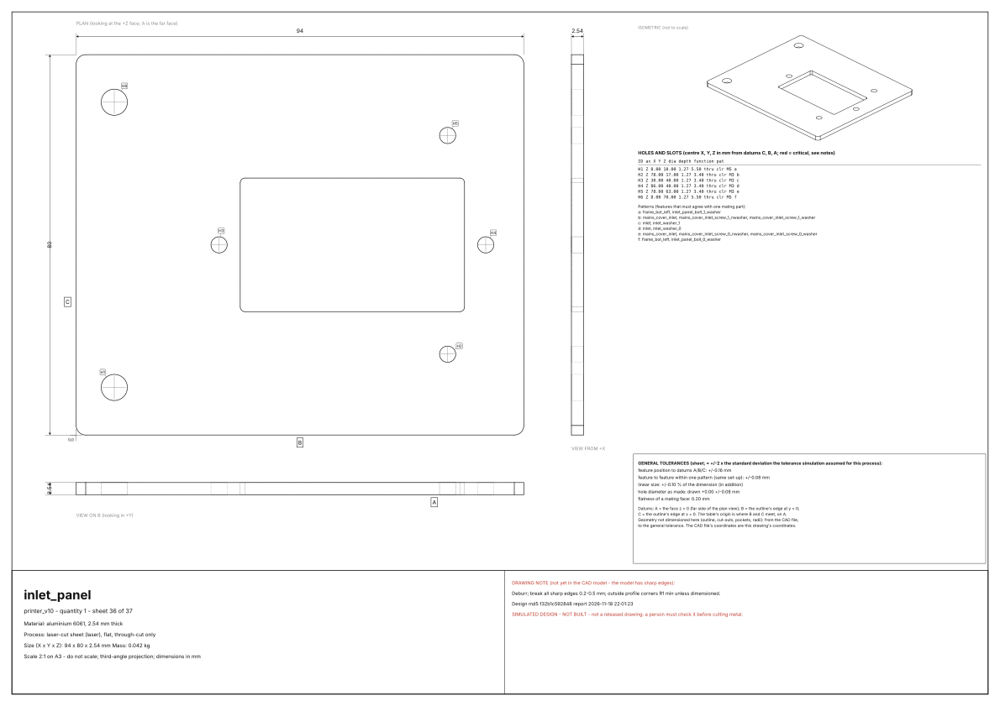

- Quantity 1. aluminium 6061; sheet; 94 x 80 x 2.54 mm; 0.042 kg.
- Sheet 2.54 mm, laser cut, flat (no bends), through-cut only. Flat size [94.0, 80.0] mm, cut length 571.0 mm, 8 pierces (report). DXF written here: {'LINE': 8, 'ARC': 8, 'CIRCLE': 6}, cut length 570.5 mm, extent (94.0, 80.0).
- Threads: none. Inserts and clinch nuts: none. Reaming: none.
- Drawing note, not yet in the model: Deburr; break all sharp edges 0.2-0.5 mm; outside profile corners R1 min unless dimensioned.

| ID | Kind | Axis | X | Y | Z | Dia / width | Slot length | Depth | Counterbore (dia x depth, from) | Function | Screws | On its axis | Pattern | Critical |
|---|---|---|---|---|---|---|---|---|---|---|---|---|---|---|
| H1 | hole | Z | 8 | 10 | 1.27 | 5.5 | - | through | - | clearance M5 | inlet_panel_bolt_1 (SHCS-M5x10) | - | a: frame_bot_left, inlet_panel_bolt_1_washer | - |
| H2 | hole | Z | 78 | 17 | 1.27 | 3.4 | - | through | - | clearance M3 | mains_cover_inlet_screw_1 (SHCS-M3x20) | - | b: mains_cover_inlet, mains_cover_inlet_screw_1_nwasher, mains_cover_inlet_screw_1_washer | - |
| H3 | hole | Z | 30 | 40 | 1.27 | 3.4 | - | through | - | clearance M3 | inlet_screw_1 (SHCS-M3x10) | - | c: inlet, inlet_washer_1 | - |
| H4 | hole | Z | 86 | 40 | 1.27 | 3.4 | - | through | - | clearance M3 | inlet_screw_0 (SHCS-M3x10) | - | d: inlet, inlet_washer_0 | - |
| H5 | hole | Z | 78 | 63 | 1.27 | 3.4 | - | through | - | clearance M3 | mains_cover_inlet_screw_0 (SHCS-M3x20) | - | e: mains_cover_inlet, mains_cover_inlet_screw_0_nwasher, mains_cover_inlet_screw_0_washer | - |
| H6 | hole | Z | 8 | 70 | 1.27 | 5.5 | - | through | - | clearance M5 | inlet_panel_bolt_0 (SHCS-M5x10) | - | f: frame_bot_left, inlet_panel_bolt_0_washer | - |

### mains_cover_inlet

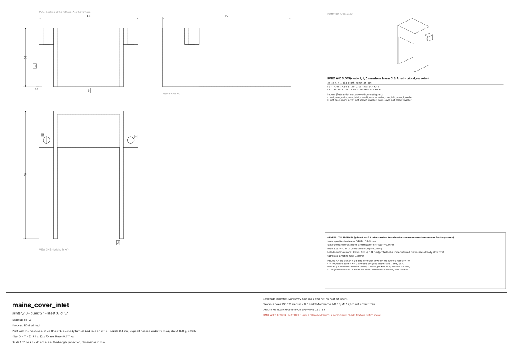

- Quantity 1. PETG; printed; 54 x 32 x 70 mm; 0.017 kg.
- Print with the machine's **-X** direction up (STL already turned). Support needed under 70.0 mm2; longest bridge 0.0 mm; bed contact 0.93; thinnest wall 2.0 mm; 16.9 g, 0.98 h (estimate). Holes opening on the bed face: 0 (first-layer squash makes them tight).
- Threads: none. Inserts and clinch nuts: none. Reaming: none.

| ID | Kind | Axis | X | Y | Z | Dia / width | Slot length | Depth | Counterbore (dia x depth, from) | Function | Screws | On its axis | Pattern | Critical |
|---|---|---|---|---|---|---|---|---|---|---|---|---|---|---|
| H1 | hole | Y | 4 | 27.5 | 54 | 3.6 | - | through | - | clearance M3 | mains_cover_inlet_screw_0 (SHCS-M3x20) | - | a: inlet_panel, mains_cover_inlet_screw_0_nwasher, mains_cover_inlet_screw_0_washer | - |
| H2 | hole | Y | 50 | 27.5 | 54 | 3.6 | - | through | - | clearance M3 | mains_cover_inlet_screw_1 (SHCS-M3x20) | - | b: inlet_panel, mains_cover_inlet_screw_1_nwasher, mains_cover_inlet_screw_1_washer | - |
