# Assembly guide: printer_v12

> **STALE PACKAGE (--force): the report does not describe this design file.** the report is not a pass (errors present)

Generated by `tools/build_package.py` from `designs/printer_v12.py` (md5 `ddbc1d9b2fc8c7acd9200a8153176ba7`) and `out/printer_v12/report.json` (written 2026-11-21 01:49:36, md5 `d9d11a04a123`). Do not edit: change the design, re-run verify, re-run the generator.

> **Simulated design. Nothing has been built.** See [OPEN_ITEMS.md](OPEN_ITEMS.md) before spending money.

884 parts, 271 drawn screws (25 types), tools: 1.5 mm hex key, 2 mm hex key, 2.5 mm hex key, 3 mm hex key, 4 mm hex key, 6 mm hex key. The simulation's time allowance is 171.1 min: a figure for comparing designs. It does not contain the operations listed under 'Not in the simulation' below, which are a large part of the real work.

## Read this first: what this guide is and is not

- **Bench units** below follow the assembly simulation step for step (it found an order with a way in for every part and driver access for every screw).
- **The main assembly does NOT follow the simulation's order.** That order is valid for access but is not one a person can build: 0 of its steps place a unit before anything supports it (it fits the bed carrier at step ? and the frame's posts at steps 214 to 219, the corner brackets last), it turns the machine over 26 times and does 25 operations from below. The cause is in the model: corner brackets on T-slots have no drawn screws, so nothing 'holds' the frame until the end. The stages below re-group the simulation's units into the order a builder uses (frame first). **That stage order has not been run through the access checker.** Each screw's driving direction is given in machine axes so access can be judged before a part is fitted over it. The simulation's own sequence is in `data/assembly_plan.json` and `data/assembly_simulated_order.md`.
- Torque: neither the parts catalogue nor the joint model holds a tightening torque for any screw. Every 'snug' below is the builder's judgement. Printed parts and circuit boards: do not crush.
- Washers: the model has none. See OPEN_ITEMS.md (washer audit) and decide before you start; a washer under a head changes how far the screw reaches (thread engagement was checked without them).
- Directions: front is -Y (the side the bed plate overhangs), right is +X, up is +Z.

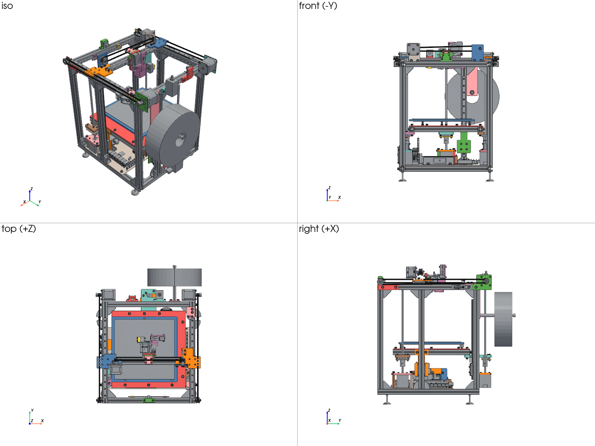

## Not in the simulation (do these; they are not in the step lists or the time)

- T-nuts ARE in the simulation in this design: 53 M5 and 45 M3 drop-in T-nuts, each its own step (put in through the slot's opening before the part that covers it), and 66 corner-bracket screws. All are the drop-in type: none has to be loaded from an extrusion's end.
- Tapping M5 in the extrusion ends listed in BOM.md (cut lengths, end work).
- Pulley set screws (all pulleys), the nyloc nut under each lead-screw nut's pin (leave 0.2 mm slack so the nut can float), the star washer under the earth stud.
- Bonding the heater pad, the thermal cut-off and the magnetic sheet to the plate. Fit the four bed posts and their jam nuts BEFORE the magnetic sheet: it covers their heads.
- Belts: X and Y (thread, fold back in the anchors, tie); the closed Z belt must be laid round the three screw pulleys, the idler and the motor pulley BEFORE the bed carrier is lowered onto the lead-screw nuts (afterwards the carrier is in the way).
- All wiring (WIRING.md), looms, cable ties, the BAT85 diode in the probe lead.
- Deburring every cut and machined part (the model has sharp edges everywhere).

## Bench units

### Bench unit: z_drive_rear

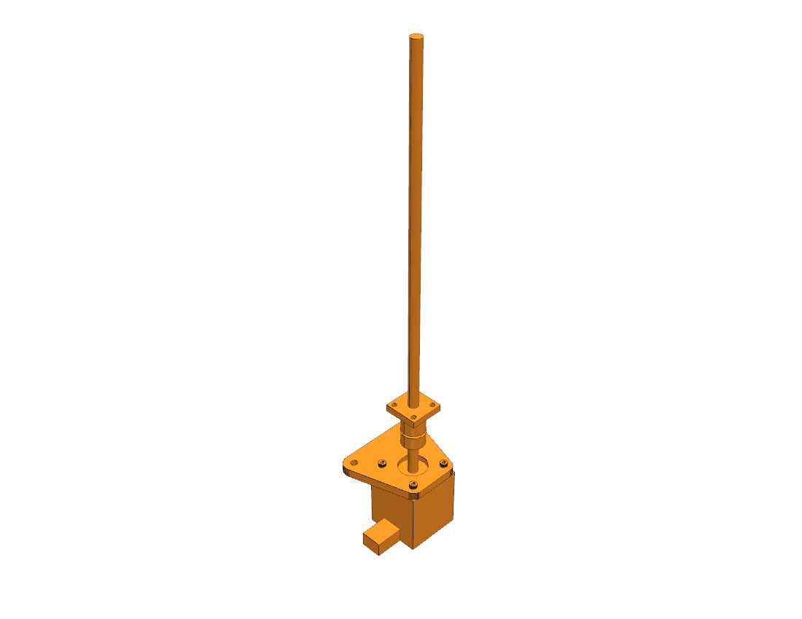

Parts: z_motor_plate, z_motor, leadscrew, z_nut. Screws: 4. Held by hand at 0 steps; turned 0 times. Goes into stage: Z drive: screws and motors (with their supports, pulleys and belt where the design has them).

1. Start with **z_motor** on the bench, on its front (back face up).
2. Fit **z_motor_plate** onto z_motor, from the side. Check: seated flat on z_motor with no gap; all its screws started before any is tightened.
3. Drive 4 x M3x10 from the side with the 2.5 mm hex key: z_motor_screw_3, z_motor_screw_2, z_motor_screw_1, z_motor_screw_0. Snug; no torque figure in the model.
4. Fit **leadscrew** (TR8x2-INTEGRAL-17E19S1684AB4-330RA) onto z_motor, from the side. Check: seated flat on z_motor with no gap; all its screws started before any is tightened.
5. Fit **z_nut** (NUT-T8x2-POM-AB-17E19S1684AB4-A4003) onto leadscrew, from the side. Check: seated flat on leadscrew with no gap; all its screws started before any is tightened.

Before moving on: every screw of the unit is in (4); nothing rocks on a flat surface; moving parts (shaft, idler) turn freely.

### Bench unit: electronics

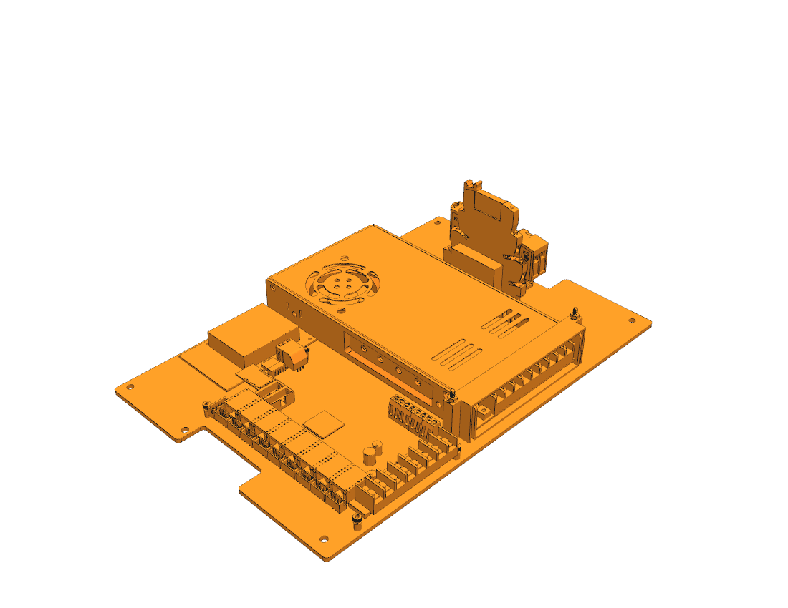

Parts: electronics_tray, din_rail, psu_relay, iface_relay, din_end_0, din_end_1, mains_cover_psu, mains_cover_psu_screw_0_washer, mains_cover_psu_screw_0_nwasher, mains_cover_psu_screw_0_nut, mains_cover_psu_screw_1_washer, mains_cover_psu_screw_1_nwasher, mains_cover_psu_screw_1_nut, psu, control_board, control_board_spacer_0, control_board_washer_0, control_board_nut_0, control_board_spacer_1, control_board_washer_1, control_board_nut_1, control_board_spacer_2, control_board_washer_2, control_board_nut_2, control_board_spacer_3, control_board_washer_3, control_board_nut_3, host, host_spacer_0, host_washer_0, host_nut_0, host_spacer_3, host_washer_3, host_nut_3, din_rail_bolt_0_washer, din_rail_bolt_0_nwasher, din_rail_bolt_0_nut, din_rail_bolt_1_washer, din_rail_bolt_1_nwasher, din_rail_bolt_1_nut. Screws: 14. Held by hand at 19 steps; turned 0 times. Goes into stage: Electronics tray, mains inlet, earth.

1. Start with **psu** on the bench.
2. Fit **electronics_tray** onto psu, from the side. Hold it until fastened (nothing stops it falling). Check: seated flat on psu with no gap; all its screws started before any is tightened.
3. Fit **mains_cover_psu** onto electronics_tray, from above. Hold it until fastened (it rests only on parts that are themselves still loose). Check: seated flat on electronics_tray with no gap; all its screws started before any is tightened.
4. Fit **mains_cover_psu_screw_1_nut** (NUT-M3) onto mains_cover_psu, from above. Hold it until fastened (nothing stops it falling). Check: seated flat on mains_cover_psu with no gap; all its screws started before any is tightened.
5. Fit **mains_cover_psu_screw_1_washer** (WASHER-M3) onto electronics_tray, from the side. Hold it until fastened (it rests only on parts that are themselves still loose). Check: seated flat on electronics_tray with no gap; all its screws started before any is tightened.
6. Fit **mains_cover_psu_screw_1_nwasher** (WASHER-M3) onto mains_cover_psu, mains_cover_psu_screw_1_nut, from the side. Hold it until fastened (it rests only on parts that are themselves still loose). Check: seated flat on mains_cover_psu, mains_cover_psu_screw_1_nut with no gap; all its screws started before any is tightened.
7. Drive 1 x M3x45 from below with the 2.5 mm hex key: mains_cover_psu_screw_1. Snug; no torque figure in the model.
8. Fit **mains_cover_psu_screw_0_nut** (NUT-M3) onto mains_cover_psu, from above. Hold it until fastened (nothing stops it falling). Check: seated flat on mains_cover_psu with no gap; all its screws started before any is tightened.
9. Fit **mains_cover_psu_screw_0_washer** (WASHER-M3) onto electronics_tray, from the side. Hold it until fastened (nothing stops it falling). Check: seated flat on electronics_tray with no gap; all its screws started before any is tightened.
10. Fit **mains_cover_psu_screw_0_nwasher** (WASHER-M3) onto mains_cover_psu, mains_cover_psu_screw_0_nut, from the side. Hold it until fastened (it rests only on parts that are themselves still loose). Check: seated flat on mains_cover_psu, mains_cover_psu_screw_0_nut with no gap; all its screws started before any is tightened.
11. Drive 1 x M3x45 from below with the 2.5 mm hex key: mains_cover_psu_screw_0. Snug; no torque figure in the model.
12. Drive 4 x M4x6 from below with the 3 mm hex key: psu_screw_3, psu_screw_2, psu_screw_1, psu_screw_0. Snug; no torque figure in the model.
13. Fit **control_board_spacer_3** (SPACER-HARWIN-R30-6700694) onto electronics_tray, from above. Check: seated flat on electronics_tray with no gap; all its screws started before any is tightened.
14. Fit **control_board** (CTRL-OCTOPUS-V1.1) onto control_board_spacer_3, from above. Hold it until fastened (it would tip or slide off (centre of mass is 86 mm outside what it rests on)). Check: seated flat on control_board_spacer_3 with no gap; all its screws started before any is tightened.
15. Fit **control_board_nut_3** (NUT-M3) onto electronics_tray, from the side. Check: seated flat on electronics_tray with no gap; all its screws started before any is tightened.
16. Fit **control_board_washer_3** (WASHER-M3) onto control_board_nut_3, electronics_tray, from the side. Check: seated flat on control_board_nut_3, electronics_tray with no gap; all its screws started before any is tightened.
17. Drive 1 x M3x16 from above with the 2.5 mm hex key: control_board_screw_3. Snug; no torque figure in the model.
18. Fit **control_board_spacer_2** (SPACER-HARWIN-R30-6700694) onto control_board, electronics_tray, from the side. Check: seated flat on control_board, electronics_tray with no gap; all its screws started before any is tightened.
19. Fit **control_board_nut_2** (NUT-M3) onto electronics_tray, from the side. Hold it until fastened (nothing stops it falling). Check: seated flat on electronics_tray with no gap; all its screws started before any is tightened.
20. Fit **control_board_washer_2** (WASHER-M3) onto control_board_nut_2, electronics_tray, from the side. Check: seated flat on control_board_nut_2, electronics_tray with no gap; all its screws started before any is tightened.
21. Drive 1 x M3x16 from above with the 2.5 mm hex key: control_board_screw_2. Snug; no torque figure in the model.
22. Fit **control_board_spacer_1** (SPACER-HARWIN-R30-6700694) onto control_board, electronics_tray, from the side. Check: seated flat on control_board, electronics_tray with no gap; all its screws started before any is tightened.
23. Fit **control_board_nut_1** (NUT-M3) onto electronics_tray, from the side. Hold it until fastened (nothing stops it falling). Check: seated flat on electronics_tray with no gap; all its screws started before any is tightened.
24. Fit **control_board_washer_1** (WASHER-M3) onto control_board_nut_1, electronics_tray, from the side. Check: seated flat on control_board_nut_1, electronics_tray with no gap; all its screws started before any is tightened.
25. Drive 1 x M3x16 from above with the 2.5 mm hex key: control_board_screw_1. Snug; no torque figure in the model.
26. Fit **control_board_spacer_0** (SPACER-HARWIN-R30-6700694) onto control_board, electronics_tray, from the side. Check: seated flat on control_board, electronics_tray with no gap; all its screws started before any is tightened.
27. Fit **control_board_nut_0** (NUT-M3) onto electronics_tray, from the side. Hold it until fastened (nothing stops it falling). Check: seated flat on electronics_tray with no gap; all its screws started before any is tightened.
28. Fit **control_board_washer_0** (WASHER-M3) onto control_board_nut_0, electronics_tray, from the side. Check: seated flat on control_board_nut_0, electronics_tray with no gap; all its screws started before any is tightened.
29. Drive 1 x M3x16 from above with the 2.5 mm hex key: control_board_screw_0. Snug; no torque figure in the model.
30. Fit **din_rail** (DIN-RAIL-WAGO-210-112-47) onto electronics_tray, from above. Check: seated flat on electronics_tray with no gap; all its screws started before any is tightened.
31. Fit **din_rail_bolt_1_nut** (NUT-M3) onto electronics_tray, from the side. Hold it until fastened (nothing stops it falling). Check: seated flat on electronics_tray with no gap; all its screws started before any is tightened.
32. Fit **din_rail_bolt_1_washer** (WASHER-M3-LARGE) onto din_rail, from above. Check: seated flat on din_rail with no gap; all its screws started before any is tightened.
33. Fit **din_rail_bolt_1_nwasher** (WASHER-M3-LARGE) onto din_rail_bolt_1_nut, electronics_tray, from the side. Check: seated flat on din_rail_bolt_1_nut, electronics_tray with no gap; all its screws started before any is tightened.
34. Drive 1 x M3x10 from above with the 2.5 mm hex key: din_rail_bolt_1. Snug; no torque figure in the model.
35. Fit **din_rail_bolt_0_nut** (NUT-M3) onto electronics_tray, from the side. Hold it until fastened (nothing stops it falling). Check: seated flat on electronics_tray with no gap; all its screws started before any is tightened.
36. Fit **din_rail_bolt_0_washer** (WASHER-M3-LARGE) onto din_rail, from above. Check: seated flat on din_rail with no gap; all its screws started before any is tightened.
37. Fit **din_rail_bolt_0_nwasher** (WASHER-M3-LARGE) onto din_rail_bolt_0_nut, electronics_tray, from the side. Check: seated flat on din_rail_bolt_0_nut, electronics_tray with no gap; all its screws started before any is tightened.
38. Drive 1 x M3x10 from above with the 2.5 mm hex key: din_rail_bolt_0. Snug; no torque figure in the model.
39. Fit **host_spacer_3** (SPACER-NYLON-M2.5-4x2.7x4) onto electronics_tray, from above. Check: seated flat on electronics_tray with no gap; all its screws started before any is tightened.
40. Fit **host** (HOST-RPI5-8GB-SC1432) onto host_spacer_3, from above. Hold it until fastened (it would tip or slide off (centre of mass is 32 mm outside what it rests on)). Check: seated flat on host_spacer_3 with no gap; all its screws started before any is tightened.
41. Fit **host_nut_3** (NUT-M2.5) onto electronics_tray, from the side. Hold it until fastened (nothing stops it falling). Check: seated flat on electronics_tray with no gap; all its screws started before any is tightened.
42. Fit **host_washer_3** (WASHER-M2.5) onto electronics_tray, host_nut_3, from the side. Check: seated flat on electronics_tray, host_nut_3 with no gap; all its screws started before any is tightened.
43. Drive 1 x M2.5x12 from above with the 2 mm hex key: host_screw_3. Snug; no torque figure in the model.
44. Fit **host_nut_0** (NUT-M2.5) onto electronics_tray, from the side. Hold it until fastened (nothing stops it falling). Check: seated flat on electronics_tray with no gap; all its screws started before any is tightened.
45. Fit **host_spacer_0** (SPACER-NYLON-M2.5-4x2.7x4) onto electronics_tray, host, from the side. Check: seated flat on electronics_tray, host with no gap; all its screws started before any is tightened.
46. Fit **host_washer_0** (WASHER-M2.5) onto electronics_tray, host_nut_0, from the side. Check: seated flat on electronics_tray, host_nut_0 with no gap; all its screws started before any is tightened.
47. Drive 1 x M2.5x12 from above with the 2 mm hex key: host_screw_0. Snug; no torque figure in the model.
48. Fit **psu_relay** (CONTACTOR-FINDER-22.32.0.120.4320) onto din_rail, from above. Check: seated flat on din_rail with no gap; all its screws started before any is tightened.
49. Fit **iface_relay** (PLC-RSC-PHOENIX-1119897) onto din_rail, from above. Hold it until fastened (it would tip or slide off (centre of mass is 13 mm outside what it rests on)). Check: seated flat on din_rail with no gap; all its screws started before any is tightened.
50. Fit **din_end_1** (DIN-ENDSTOP-WAGO-249-117) onto din_rail, from above. Hold it until fastened (it would tip or slide off (no surface underneath it)). Check: seated flat on din_rail with no gap; all its screws started before any is tightened.
51. Fit **din_end_0** (DIN-ENDSTOP-WAGO-249-117) onto din_rail, psu_relay, from above. Check: seated flat on din_rail, psu_relay with no gap; all its screws started before any is tightened.

Before moving on: every screw of the unit is in (14); nothing rocks on a flat surface; moving parts (shaft, idler) turn freely.

### Bench unit: z_drive_fr

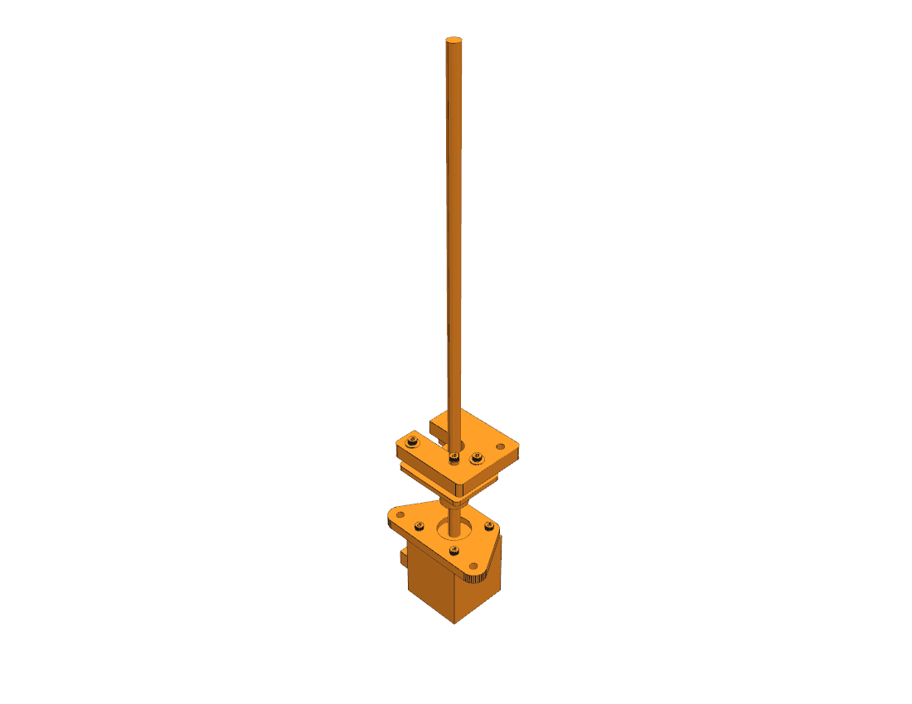

Parts: z_motor_plate_fr, z_motor_fr, leadscrew_fr, z_nut_fr, nut_pin_fr_nut, nut_plate_fr, nut_keeper_fr_spacer_0, nut_keeper_fr_bolt_0_washer, nut_keeper_fr_spacer_1, nut_keeper_fr, nut_keeper_fr_bolt_1_nut, nut_keeper_fr_bolt_0_nut, nut_pin_fr_sleeve, nut_keeper_fr_bolt_1_washer, nut_keeper_fr_bolt_1_nwasher, nut_keeper_fr_bolt_0_nwasher. Screws: 7. Held by hand at 13 steps; turned 0 times. Goes into stage: Z drive: screws and motors (with their supports, pulleys and belt where the design has them).

1. Start with **z_motor_fr** on the bench.
2. Fit **z_motor_plate_fr** onto z_motor_fr, from above. Check: seated flat on z_motor_fr with no gap; all its screws started before any is tightened.
3. Drive 4 x M3x10 from above with the 2.5 mm hex key: z_motor_fr_screw_3, z_motor_fr_screw_2, z_motor_fr_screw_1, z_motor_fr_screw_0. Snug; no torque figure in the model.
4. Fit **leadscrew_fr** (TR8x2-INTEGRAL-17E19S1684AB4-330RA) onto z_motor_fr, from above. Check: seated flat on z_motor_fr with no gap; all its screws started before any is tightened.
5. Fit **z_nut_fr** (NUT-T8x2-POM-AB-17E19S1684AB4-A4003) onto leadscrew_fr, from above. Hold it until fastened (nothing stops it falling). Check: seated flat on leadscrew_fr with no gap; all its screws started before any is tightened.
6. Fit **nut_plate_fr** onto z_nut_fr, from above. Hold it until fastened (it rests only on parts that are themselves still loose). Check: seated flat on z_nut_fr with no gap; all its screws started before any is tightened.
7. Fit **nut_keeper_fr** onto z_nut_fr, from the side. Hold it until fastened (nothing stops it falling). Check: seated flat on z_nut_fr with no gap; all its screws started before any is tightened.
8. Fit **nut_keeper_fr_spacer_1** (SPACER-HARWIN-R30-6200614) onto nut_keeper_fr, nut_plate_fr, from the side. Hold it until fastened (it rests only on parts that are themselves still loose). Check: seated flat on nut_keeper_fr, nut_plate_fr with no gap; all its screws started before any is tightened.
9. Fit **nut_keeper_fr_bolt_1_nut** (NUT-M3) onto nut_keeper_fr, from the side. Hold it until fastened (nothing stops it falling). Check: seated flat on nut_keeper_fr with no gap; all its screws started before any is tightened.
10. Fit **nut_keeper_fr_bolt_1_washer** (WASHER-M3-LARGE) onto nut_plate_fr, from above. Hold it until fastened (it rests only on parts that are themselves still loose). Check: seated flat on nut_plate_fr with no gap; all its screws started before any is tightened.
11. Fit **nut_keeper_fr_bolt_1_nwasher** (WASHER-M3-LARGE) onto nut_keeper_fr, nut_keeper_fr_bolt_1_nut, from the side. Hold it until fastened (it rests only on parts that are themselves still loose). Check: seated flat on nut_keeper_fr, nut_keeper_fr_bolt_1_nut with no gap; all its screws started before any is tightened.
12. Drive 1 x M3x25 from above with the 2.5 mm hex key: nut_keeper_fr_bolt_1. Snug; no torque figure in the model.
13. Fit **nut_keeper_fr_spacer_0** (SPACER-HARWIN-R30-6200614) onto nut_keeper_fr, nut_plate_fr, from the side. Hold it until fastened (it rests only on parts that are themselves still loose). Check: seated flat on nut_keeper_fr, nut_plate_fr with no gap; all its screws started before any is tightened.
14. Fit **nut_keeper_fr_bolt_0_nut** (NUT-M3) onto nut_keeper_fr, from the side. Hold it until fastened (nothing stops it falling). Check: seated flat on nut_keeper_fr with no gap; all its screws started before any is tightened.
15. Fit **nut_keeper_fr_bolt_0_washer** (WASHER-M3-LARGE) onto nut_plate_fr, from above. Hold it until fastened (it rests only on parts that are themselves still loose). Check: seated flat on nut_plate_fr with no gap; all its screws started before any is tightened.
16. Fit **nut_keeper_fr_bolt_0_nwasher** (WASHER-M3-LARGE) onto nut_keeper_fr, nut_keeper_fr_bolt_0_nut, from the side. Hold it until fastened (it rests only on parts that are themselves still loose). Check: seated flat on nut_keeper_fr, nut_keeper_fr_bolt_0_nut with no gap; all its screws started before any is tightened.
17. Drive 1 x M3x25 from above with the 2.5 mm hex key: nut_keeper_fr_bolt_0. Snug; no torque figure in the model.
18. Fit **nut_pin_fr_sleeve** (SPACER-HARWIN-R30-6201014) onto z_nut_fr, from above. Hold it until fastened (it rests only on parts that are themselves still loose). Check: seated flat on z_nut_fr with no gap; all its screws started before any is tightened.
19. Fit **nut_pin_fr_nut** (NUT-M3) onto z_nut_fr, from below. Hold it until fastened (nothing stops it falling). Check: seated flat on z_nut_fr with no gap; all its screws started before any is tightened.
20. Drive 1 x M3x20 from above with the 2.5 mm hex key: nut_pin_fr. Snug; no torque figure in the model.

Before moving on: every screw of the unit is in (7); nothing rocks on a flat surface; moving parts (shaft, idler) turn freely.

### Bench unit: z_drive_fl

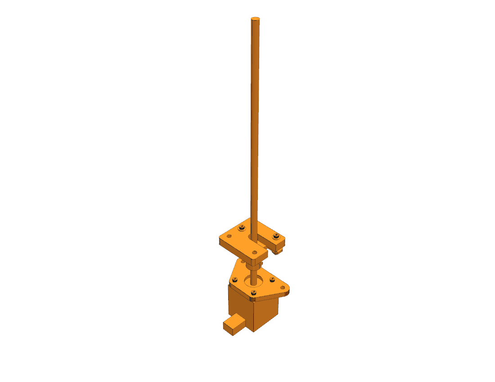

Parts: z_motor_plate_fl, z_motor_fl, leadscrew_fl, z_nut_fl, nut_keeper_fl_bolt_0_nwasher, nut_keeper_fl_bolt_1_nwasher, nut_keeper_fl_bolt_0_washer, nut_keeper_fl, nut_keeper_fl_bolt_1_washer, nut_keeper_fl_bolt_0_nut, nut_keeper_fl_spacer_1, nut_plate_fl, nut_pin_fl_nut, nut_pin_fl_sleeve, nut_keeper_fl_bolt_1_nut, nut_keeper_fl_spacer_0. Screws: 7. Held by hand at 13 steps; turned 0 times. Goes into stage: Z drive: screws and motors (with their supports, pulleys and belt where the design has them).

1. Start with **z_motor_fl** on the bench.
2. Fit **z_motor_plate_fl** onto z_motor_fl, from above. Check: seated flat on z_motor_fl with no gap; all its screws started before any is tightened.
3. Drive 4 x M3x10 from above with the 2.5 mm hex key: z_motor_fl_screw_3, z_motor_fl_screw_2, z_motor_fl_screw_1, z_motor_fl_screw_0. Snug; no torque figure in the model.
4. Fit **leadscrew_fl** (TR8x2-INTEGRAL-17E19S1684AB4-330RA) onto z_motor_fl, from above. Check: seated flat on z_motor_fl with no gap; all its screws started before any is tightened.
5. Fit **z_nut_fl** (NUT-T8x2-POM-AB-17E19S1684AB4-A4003) onto leadscrew_fl, from above. Hold it until fastened (nothing stops it falling). Check: seated flat on leadscrew_fl with no gap; all its screws started before any is tightened.
6. Fit **nut_plate_fl** onto z_nut_fl, from above. Hold it until fastened (it rests only on parts that are themselves still loose). Check: seated flat on z_nut_fl with no gap; all its screws started before any is tightened.
7. Fit **nut_keeper_fl** onto z_nut_fl, from the side. Hold it until fastened (nothing stops it falling). Check: seated flat on z_nut_fl with no gap; all its screws started before any is tightened.
8. Fit **nut_keeper_fl_spacer_1** (SPACER-HARWIN-R30-6200614) onto nut_keeper_fl, nut_plate_fl, from the side. Hold it until fastened (it rests only on parts that are themselves still loose). Check: seated flat on nut_keeper_fl, nut_plate_fl with no gap; all its screws started before any is tightened.
9. Fit **nut_keeper_fl_bolt_1_nut** (NUT-M3) onto nut_keeper_fl, from the side. Hold it until fastened (nothing stops it falling). Check: seated flat on nut_keeper_fl with no gap; all its screws started before any is tightened.
10. Fit **nut_keeper_fl_bolt_1_washer** (WASHER-M3-LARGE) onto nut_plate_fl, from above. Hold it until fastened (it rests only on parts that are themselves still loose). Check: seated flat on nut_plate_fl with no gap; all its screws started before any is tightened.
11. Fit **nut_keeper_fl_bolt_1_nwasher** (WASHER-M3-LARGE) onto nut_keeper_fl, nut_keeper_fl_bolt_1_nut, from the side. Hold it until fastened (it rests only on parts that are themselves still loose). Check: seated flat on nut_keeper_fl, nut_keeper_fl_bolt_1_nut with no gap; all its screws started before any is tightened.
12. Drive 1 x M3x25 from above with the 2.5 mm hex key: nut_keeper_fl_bolt_1. Snug; no torque figure in the model.
13. Fit **nut_keeper_fl_spacer_0** (SPACER-HARWIN-R30-6200614) onto nut_keeper_fl, nut_plate_fl, from the side. Hold it until fastened (it rests only on parts that are themselves still loose). Check: seated flat on nut_keeper_fl, nut_plate_fl with no gap; all its screws started before any is tightened.
14. Fit **nut_keeper_fl_bolt_0_nut** (NUT-M3) onto nut_keeper_fl, from the side. Hold it until fastened (nothing stops it falling). Check: seated flat on nut_keeper_fl with no gap; all its screws started before any is tightened.
15. Fit **nut_keeper_fl_bolt_0_washer** (WASHER-M3-LARGE) onto nut_plate_fl, from above. Hold it until fastened (it rests only on parts that are themselves still loose). Check: seated flat on nut_plate_fl with no gap; all its screws started before any is tightened.
16. Fit **nut_keeper_fl_bolt_0_nwasher** (WASHER-M3-LARGE) onto nut_keeper_fl, nut_keeper_fl_bolt_0_nut, from the side. Hold it until fastened (it rests only on parts that are themselves still loose). Check: seated flat on nut_keeper_fl, nut_keeper_fl_bolt_0_nut with no gap; all its screws started before any is tightened.
17. Drive 1 x M3x25 from above with the 2.5 mm hex key: nut_keeper_fl_bolt_0. Snug; no torque figure in the model.
18. Fit **nut_pin_fl_sleeve** (SPACER-HARWIN-R30-6201014) onto z_nut_fl, from above. Hold it until fastened (it rests only on parts that are themselves still loose). Check: seated flat on z_nut_fl with no gap; all its screws started before any is tightened.
19. Fit **nut_pin_fl_nut** (NUT-M3) onto z_nut_fl, from below. Hold it until fastened (nothing stops it falling). Check: seated flat on z_nut_fl with no gap; all its screws started before any is tightened.
20. Drive 1 x M3x20 from above with the 2.5 mm hex key: nut_pin_fl. Snug; no torque figure in the model.

Before moving on: every screw of the unit is in (7); nothing rocks on a flat surface; moving parts (shaft, idler) turn freely.

### Bench unit: y_drive_l

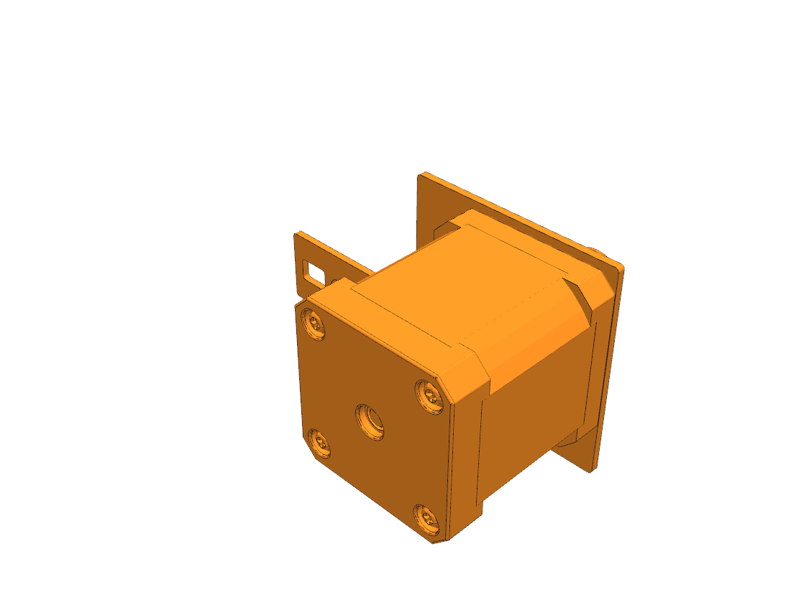

Parts: y_motor_mount_l, y_motor_l, y_pulley_l, y_motor_l_screw_0_washer, y_motor_l_screw_1_washer, y_motor_l_screw_2_washer, y_motor_l_screw_3_washer. Screws: 4. Held by hand at 1 steps; turned 0 times. Goes into stage: Y drives, idlers, tensioners, Y endstop.

1. Start with **y_motor_l** on the bench, on its right side (left side up).
2. Fit **y_motor_mount_l** onto y_motor_l, from above. Check: seated flat on y_motor_l with no gap; all its screws started before any is tightened.
3. Fit **y_motor_l_screw_3_washer** (WASHER-M3) onto y_motor_mount_l, from the side. Check: seated flat on y_motor_mount_l with no gap; all its screws started before any is tightened.
4. Drive 1 x M3x6 from above with the 2.5 mm hex key: y_motor_l_screw_3. Snug; no torque figure in the model.
5. Fit **y_motor_l_screw_2_washer** (WASHER-M3) onto y_motor_mount_l, from above. Check: seated flat on y_motor_mount_l with no gap; all its screws started before any is tightened.
6. Drive 1 x M3x6 from above with the 2.5 mm hex key: y_motor_l_screw_2. Snug; no torque figure in the model.
7. Fit **y_motor_l_screw_1_washer** (WASHER-M3) onto y_motor_mount_l, from the side. Check: seated flat on y_motor_mount_l with no gap; all its screws started before any is tightened.
8. Drive 1 x M3x6 from above with the 2.5 mm hex key: y_motor_l_screw_1. Snug; no torque figure in the model.
9. Fit **y_motor_l_screw_0_washer** (WASHER-M3) onto y_motor_mount_l, from above. Check: seated flat on y_motor_mount_l with no gap; all its screws started before any is tightened.
10. Drive 1 x M3x6 from above with the 2.5 mm hex key: y_motor_l_screw_0. Snug; no torque figure in the model.
11. Fit **y_pulley_l** (GT2-20T-B5-W9) onto y_motor_l, from above. Hold it until fastened (nothing stops it falling). Check: set screws tight on the shaft; on a lead screw the hub rests on the upper bearing's INNER ring and does not touch the outer ring.

Before moving on: every screw of the unit is in (4); nothing rocks on a flat surface; moving parts (shaft, idler) turn freely.

### Bench unit: y_drive

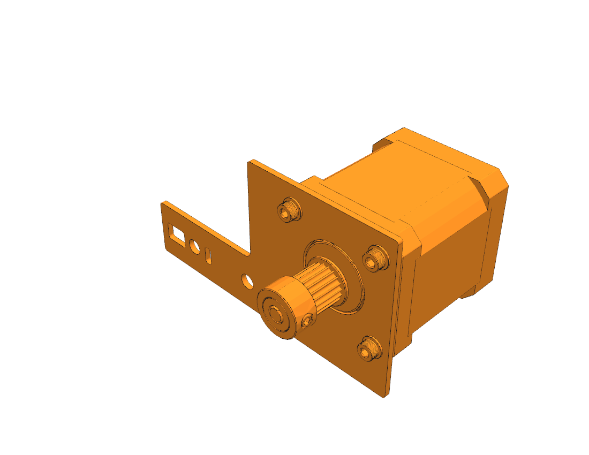

Parts: y_motor_mount, y_motor, y_pulley, y_motor_screw_0_washer, y_motor_screw_1_washer, y_motor_screw_2_washer, y_motor_screw_3_washer. Screws: 4. Held by hand at 1 steps; turned 0 times. Goes into stage: Y drives, idlers, tensioners, Y endstop.

1. Start with **y_motor** on the bench, on its left side (right side up).
2. Fit **y_motor_mount** onto y_motor, from above. Check: seated flat on y_motor with no gap; all its screws started before any is tightened.
3. Fit **y_motor_screw_3_washer** (WASHER-M3) onto y_motor_mount, from the side. Check: seated flat on y_motor_mount with no gap; all its screws started before any is tightened.
4. Drive 1 x M3x6 from above with the 2.5 mm hex key: y_motor_screw_3. Snug; no torque figure in the model.
5. Fit **y_motor_screw_2_washer** (WASHER-M3) onto y_motor_mount, from above. Check: seated flat on y_motor_mount with no gap; all its screws started before any is tightened.
6. Drive 1 x M3x6 from above with the 2.5 mm hex key: y_motor_screw_2. Snug; no torque figure in the model.
7. Fit **y_motor_screw_1_washer** (WASHER-M3) onto y_motor_mount, from the side. Check: seated flat on y_motor_mount with no gap; all its screws started before any is tightened.
8. Drive 1 x M3x6 from above with the 2.5 mm hex key: y_motor_screw_1. Snug; no torque figure in the model.
9. Fit **y_motor_screw_0_washer** (WASHER-M3) onto y_motor_mount, from above. Check: seated flat on y_motor_mount with no gap; all its screws started before any is tightened.
10. Drive 1 x M3x6 from above with the 2.5 mm hex key: y_motor_screw_0. Snug; no torque figure in the model.
11. Fit **y_pulley** (GT2-20T-B5-W9) onto y_motor, from above. Hold it until fastened (nothing stops it falling). Check: set screws tight on the shaft; on a lead screw the hub rests on the upper bearing's INNER ring and does not touch the outer ring.

Before moving on: every screw of the unit is in (4); nothing rocks on a flat surface; moving parts (shaft, idler) turn freely.

### Bench unit: x_drive

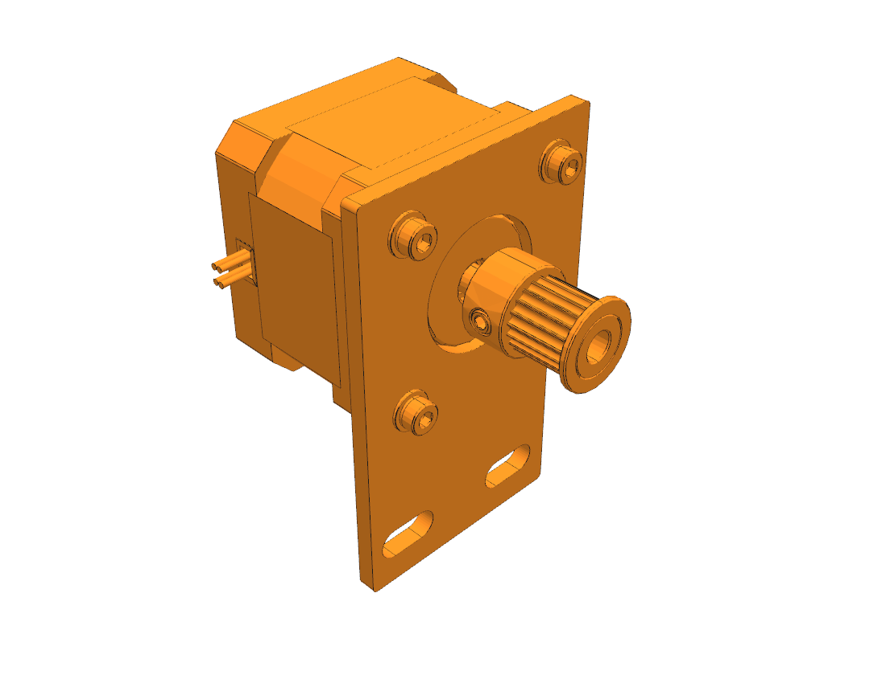

Parts: x_motor_mount, x_motor, x_pulley, x_motor_screw_0_washer, x_motor_screw_1_washer, x_motor_screw_2_washer, x_motor_screw_3_washer. Screws: 4. Held by hand at 1 steps; turned 0 times. Goes into stage: Gantry: Y plates, X beam, X rail, X drive.

1. Start with **x_motor** on the bench, on its front (back face up).
2. Fit **x_motor_mount** onto x_motor, from above. Check: seated flat on x_motor with no gap; all its screws started before any is tightened.
3. Fit **x_motor_screw_3_washer** (WASHER-M3) onto x_motor_mount, from the side. Check: seated flat on x_motor_mount with no gap; all its screws started before any is tightened.
4. Drive 1 x M3x8 from above with the 2.5 mm hex key: x_motor_screw_3. Snug; no torque figure in the model.
5. Fit **x_motor_screw_2_washer** (WASHER-M3) onto x_motor_mount, from the side. Check: seated flat on x_motor_mount with no gap; all its screws started before any is tightened.
6. Drive 1 x M3x8 from above with the 2.5 mm hex key: x_motor_screw_2. Snug; no torque figure in the model.
7. Fit **x_motor_screw_1_washer** (WASHER-M3) onto x_motor_mount, from the side. Check: seated flat on x_motor_mount with no gap; all its screws started before any is tightened.
8. Drive 1 x M3x8 from above with the 2.5 mm hex key: x_motor_screw_1. Snug; no torque figure in the model.
9. Fit **x_motor_screw_0_washer** (WASHER-M3) onto x_motor_mount, from the side. Check: seated flat on x_motor_mount with no gap; all its screws started before any is tightened.
10. Drive 1 x M3x8 from above with the 2.5 mm hex key: x_motor_screw_0. Snug; no torque figure in the model.
11. Fit **x_pulley** (GT2-20T-B5-W9) onto x_motor, from above. Hold it until fastened (nothing stops it falling). Check: set screws tight on the shaft; on a lead screw the hub rests on the upper bearing's INNER ring and does not touch the outer ring.

Before moving on: every screw of the unit is in (4); nothing rocks on a flat surface; moving parts (shaft, idler) turn freely.

### Bench unit: x_idler_unit

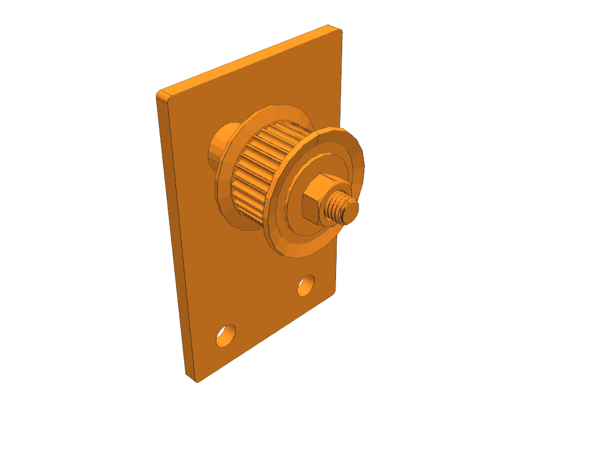

Parts: x_idler_mount, x_idler_spacer, x_idler, x_idler_bolt_washer, x_idler_nut. Screws: 1. Held by hand at 0 steps; turned 0 times. Goes into stage: Gantry: Y plates, X beam, X rail, X drive.

1. Start with **x_idler_mount** on the bench, on its front (back face up).
2. Fit **x_idler_spacer** (MCMASTER-94669A079) onto x_idler_mount, from the side. Check: seated flat on x_idler_mount with no gap; all its screws started before any is tightened.
3. Fit **x_idler** (GT2-IDLER-30T-B5-W9) onto x_idler_spacer, from the side. Check: seated flat on x_idler_spacer with no gap; all its screws started before any is tightened.
4. Fit **x_idler_nut** (NUT-M5-DIN934) onto x_idler, from the side. Check: seated flat on x_idler with no gap; all its screws started before any is tightened.
5. Fit **x_idler_bolt_washer** (WASHER-M5) onto x_idler_mount, from the side. Check: seated flat on x_idler_mount with no gap; all its screws started before any is tightened.
6. Drive 1 x M5x35 from below with the 4 mm hex key: x_idler_bolt. Snug; no torque figure in the model.

Before moving on: every screw of the unit is in (1); nothing rocks on a flat surface; moving parts (shaft, idler) turn freely.

### Bench unit: bed_unit

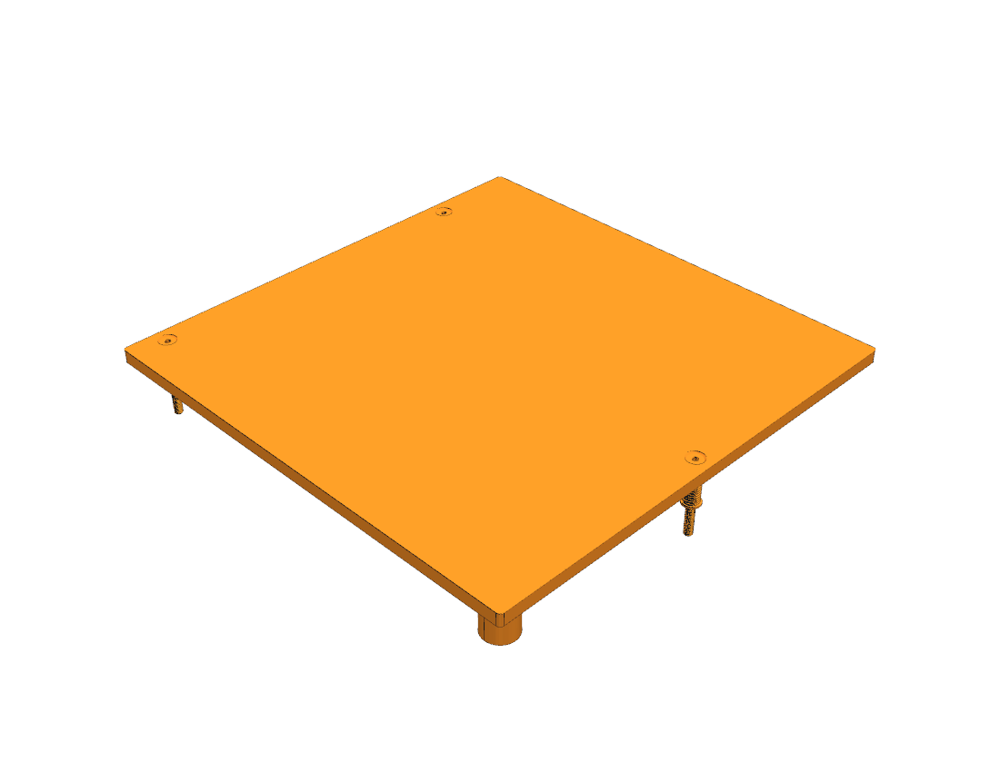

Parts: bed_plate, bed_heater, bed_tco, bed_stud_0_washer, bed_stud_0_nut, bed_spring_0, bed_spring_0_seat, bed_stud_1_washer, bed_stud_1_nut, bed_spring_1, bed_spring_1_seat, bed_stud_2_washer, bed_stud_2_nut, bed_spring_2, bed_spring_2_seat. Screws: 3. Held by hand at 0 steps; turned 0 times. Goes into stage: Bed: tabs, posts, plate, tie, heater, magnet, sheet.

1. Start with **bed_plate** on the bench, upside down.
2. Fit **bed_stud_2_washer** (WASHER-M4) onto bed_plate, from the side. Check: seated flat on bed_plate with no gap; all its screws started before any is tightened.
3. Fit **bed_stud_2_nut** (NUT-M4) onto bed_stud_2_washer, from the side. Check: seated flat on bed_stud_2_washer with no gap; all its screws started before any is tightened.
4. Drive 1 x FHCS-M4x40 from below with the 2.5 mm hex key: bed_stud_2. Snug; no torque figure in the model.
5. Fit **bed_stud_1_washer** (WASHER-M4) onto bed_plate, from the side. Check: seated flat on bed_plate with no gap; all its screws started before any is tightened.
6. Fit **bed_stud_1_nut** (NUT-M4) onto bed_stud_1_washer, from the side. Check: seated flat on bed_stud_1_washer with no gap; all its screws started before any is tightened.
7. Drive 1 x FHCS-M4x40 from below with the 2.5 mm hex key: bed_stud_1. Snug; no torque figure in the model.
8. Fit **bed_stud_0_washer** (WASHER-M4) onto bed_plate, from the side. Check: seated flat on bed_plate with no gap; all its screws started before any is tightened.
9. Fit **bed_stud_0_nut** (NUT-M4) onto bed_stud_0_washer, from the side. Check: seated flat on bed_stud_0_washer with no gap; all its screws started before any is tightened.
10. Drive 1 x FHCS-M4x40 from below with the 2.5 mm hex key: bed_stud_0. Snug; no torque figure in the model.
11. Fit **bed_heater** (HEATER-HYDRA-SQ1451144-210x210-24V-200W) onto bed_plate, from the side. Check: seated flat on bed_plate with no gap; all its screws started before any is tightened.
12. Fit **bed_tco** (THERMOSTAT-CANTHERM-CS712025Y) onto bed_plate, from the side. Check: seated flat on bed_plate with no gap; all its screws started before any is tightened.
13. Fit **bed_spring_2** (SPRING-DIE-DJ-8X20YCS) onto bed_stud_2_nut, from above. Check: seated flat on bed_stud_2_nut with no gap; all its screws started before any is tightened.
14. Fit **bed_spring_1** (SPRING-DIE-DJ-8X20YCS) onto bed_stud_1_nut, from above. Check: seated flat on bed_stud_1_nut with no gap; all its screws started before any is tightened.
15. Fit **bed_spring_0** (SPRING-DIE-DJ-8X20YCS) onto bed_stud_0_nut, from above. Check: seated flat on bed_stud_0_nut with no gap; all its screws started before any is tightened.
16. Fit **bed_spring_2_seat** (WASHER-M4) onto bed_spring_2, from above. Check: seated flat on bed_spring_2 with no gap; all its screws started before any is tightened.
17. Fit **bed_spring_1_seat** (WASHER-M4) onto bed_spring_1, from above. Check: seated flat on bed_spring_1 with no gap; all its screws started before any is tightened.
18. Fit **bed_spring_0_seat** (WASHER-M4) onto bed_spring_0, from above. Check: seated flat on bed_spring_0 with no gap; all its screws started before any is tightened.

Before moving on: every screw of the unit is in (3); nothing rocks on a flat surface; moving parts (shaft, idler) turn freely.

## Main assembly, by stage

### Stage: Frame

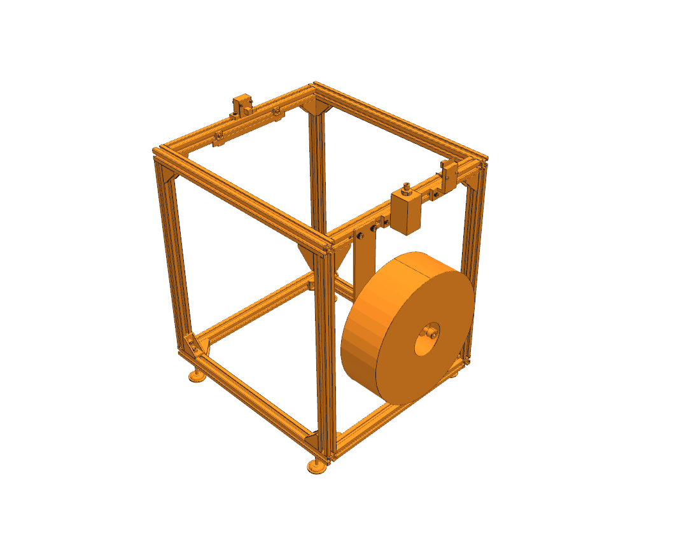

Orange: fitted in this stage. Grey: already there.

| # | Fit | Touches (simulation) | Screws that hold it (count x size, key, direction) | Check before moving on | Sim. step |
|---|---|---|---|---|---|
| 1 | **bracket_10_screw_a_tnut** (HNTP5-5) | frame_bot_right | 1 x CBM5-10 cap screw, 4 mm key, from above, pointing down (-Z), into T-nut (bracket_10_screw_a) | seated flat on frame_bot_right with no gap; all its screws started before any is tightened | 317 |
| 2 | **bracket_11** (HBLFSN5) | bracket_10, frame_bot_right, post_rf | - | seated flat on bracket_10, frame_bot_right with no gap; all its screws started before any is tightened | 284 |
| 3 | **bracket_11_screw_a_tnut** (HNTP5-5) | frame_bot_front | 1 x CBM5-10 cap screw, 4 mm key, from the back, pointing forward (-Y), into T-nut (bracket_11_screw_a) | seated flat on frame_bot_front with no gap; all its screws started before any is tightened | 313 |
| 4 | **bracket_11_screw_tnut** (HNTP5-5) | frame_bot_right | 1 x CBM5-10 cap screw, 4 mm key, from the left, pointing right (+X), into T-nut (bracket_11_screw) | seated flat on frame_bot_right with no gap; all its screws started before any is tightened | 315 |
| 5 | **bracket_14_screw_a_tnut** (HNTP5-5) | frame_bot_right | 1 x CBM5-10 cap screw, 4 mm key, from above, pointing down (-Z), into T-nut (bracket_14_screw_a) | seated flat on frame_bot_right with no gap; all its screws started before any is tightened | 301 |
| 6 | **bracket_15** (HBLFSN5) | frame_bot_back | - | seated flat on frame_bot_back with no gap; all its screws started before any is tightened | 45 |
| 7 | **bracket_15_screw_a_tnut** (HNTP5-5) | frame_bot_back | 1 x CBM5-10 cap screw, 4 mm key, from the front, pointing back (+Y), into T-nut (bracket_15_screw_a) | seated flat on frame_bot_back with no gap; all its screws started before any is tightened | 297 |
| 8 | **bracket_15_screw_tnut** (HNTP5-5) | frame_bot_right | 1 x CBM5-10 cap screw, 4 mm key, from the left, pointing right (+X), into T-nut (bracket_15_screw) | seated flat on frame_bot_right with no gap; all its screws started before any is tightened | 299 |
| 9 | **bracket_2_screw_a_tnut** (HNTP5-5) | frame_bot_left | 1 x CBM5-10 cap screw, 4 mm key, from above, pointing down (-Z), into T-nut (bracket_2_screw_a) | seated flat on frame_bot_left with no gap; all its screws started before any is tightened | 291 |
| 10 | **bracket_3** (HBLFSN5) | bracket_2, frame_bot_left, post_lf | - | seated flat on bracket_2, frame_bot_left with no gap; all its screws started before any is tightened | 283 |
| 11 | **bracket_3_screw_a_tnut** (HNTP5-5) | frame_bot_front | 1 x CBM5-10 cap screw, 4 mm key, from the back, pointing forward (-Y), into T-nut (bracket_3_screw_a) | seated flat on frame_bot_front with no gap; all its screws started before any is tightened | 287 |
| 12 | **bracket_3_screw_tnut** (HNTP5-5) | frame_bot_left | 1 x CBM5-10 cap screw, 4 mm key, from the right, pointing left (-X), into T-nut (bracket_3_screw) | seated flat on frame_bot_left with no gap; all its screws started before any is tightened | 289 |
| 13 | **bracket_6_screw_a_tnut** (HNTP5-5) | frame_bot_left | 1 x CBM5-10 cap screw, 4 mm key, from above, pointing down (-Z), into T-nut (bracket_6_screw_a) | seated flat on frame_bot_left with no gap; all its screws started before any is tightened | 271 |
| 14 | **bracket_7** (HBLFSN5) | frame_bot_back, frame_bot_left | - | seated flat on frame_bot_back, frame_bot_left with no gap; all its screws started before any is tightened | 44 |
| 15 | **bracket_7_screw_a_tnut** (HNTP5-5) | frame_bot_back | 1 x CBM5-10 cap screw, 4 mm key, from the front, pointing back (+Y), into T-nut (bracket_7_screw_a) | seated flat on frame_bot_back with no gap; all its screws started before any is tightened | 267 |
| 16 | **bracket_7_screw_tnut** (HNTP5-5) | frame_bot_left | 1 x CBM5-10 cap screw, 4 mm key, from the right, pointing left (-X), into T-nut (bracket_7_screw) | seated flat on frame_bot_left with no gap; all its screws started before any is tightened | 269 |
| 17 | **foot_left_b** (NFJN5-30) | frame_bot_left | - | seated flat on frame_bot_left with no gap; all its screws started before any is tightened | 710 |
| 18 | **foot_left_b_nut** (NUT-M5-DIN934) | foot_left_b, frame_bot_left | - | seated flat on foot_left_b, frame_bot_left with no gap; all its screws started before any is tightened | 727 |
| 19 | **foot_left_b_tnut** (HNTP5-5) | foot_left_b, frame_bot_left | - | seated flat on foot_left_b, frame_bot_left with no gap; all its screws started before any is tightened | 717 |
| 20 | **foot_left_f** (NFJN5-30) | frame_bot_left | - | seated flat on frame_bot_left with no gap; all its screws started before any is tightened | 709 |
| 21 | **foot_left_f_nut** (NUT-M5-DIN934) | foot_left_f, frame_bot_left | - | seated flat on foot_left_f, frame_bot_left with no gap; all its screws started before any is tightened | 726 |
| 22 | **foot_left_f_tnut** (HNTP5-5) | foot_left_f, frame_bot_left | - | seated flat on foot_left_f, frame_bot_left with no gap; all its screws started before any is tightened | 716 |
| 23 | **foot_right_b** (NFJN5-30) | frame_bot_right | - | seated flat on frame_bot_right with no gap; all its screws started before any is tightened | 708 |
| 24 | **foot_right_b_nut** (NUT-M5-DIN934) | foot_right_b, frame_bot_right | - | seated flat on foot_right_b, frame_bot_right with no gap; all its screws started before any is tightened | 725 |
| 25 | **foot_right_b_tnut** (HNTP5-5) | foot_right_b, frame_bot_right | - | seated flat on foot_right_b, frame_bot_right with no gap; all its screws started before any is tightened | 715 |
| 26 | **foot_right_f** (NFJN5-30) | frame_bot_right | - | seated flat on frame_bot_right with no gap; all its screws started before any is tightened | 707 |
| 27 | **foot_right_f_nut** (NUT-M5-DIN934) | foot_right_f, frame_bot_right | - | seated flat on foot_right_f, frame_bot_right with no gap; all its screws started before any is tightened | 724 |
| 28 | **foot_right_f_tnut** (HNTP5-5) | foot_right_f, frame_bot_right | - | seated flat on foot_right_f, frame_bot_right with no gap; all its screws started before any is tightened | 714 |
| 29 | **frame_bot_back** (EXT2020-300) | frame_bot_left | - | ends flush and square to the neighbouring members (set square on two faces) | 1 |
| 30 | **frame_bot_front** (EXT2020-300) | bracket_10, bracket_11, bracket_2 | - | ends flush and square to the neighbouring members (set square on two faces) | 286 |
| 31 | **frame_bot_left** (EXT2020-373) | - | - | ends flush and square to the neighbouring members (set square on two faces) | 0 |
| 32 | **frame_bot_right** (EXT2020-373) | bracket_15, electronics_tray, frame_bot_back | - | ends flush and square to the neighbouring members (set square on two faces) | 46 |
| 33 | **bracket_10** (HBLFSN5) | frame_bot_right, post_rf | - | seated flat on frame_bot_right, post_rf with no gap; all its screws started before any is tightened | 54 |
| 34 | **bracket_10_screw_tnut** (HNTP5-5) | post_rf | 1 x CBM5-10 cap screw, 4 mm key, from the back, pointing forward (-Y), into T-nut (bracket_10_screw) | seated flat on post_rf with no gap; all its screws started before any is tightened | 55 |
| 35 | **bracket_14** (HBLFSN5) | bracket_15, frame_bot_back, frame_bot_right | - | seated flat on bracket_15, frame_bot_back with no gap; all its screws started before any is tightened | 211 |
| 36 | **bracket_14_screw_tnut** (HNTP5-5) | post_rb | 1 x CBM5-10 cap screw, 4 mm key, from the front, pointing back (+Y), into T-nut (bracket_14_screw) | seated flat on post_rb with no gap; all its screws started before any is tightened | 303 |
| 37 | **bracket_2** (HBLFSN5) | frame_bot_left, post_lf | - | seated flat on frame_bot_left, post_lf with no gap; all its screws started before any is tightened | 72 |
| 38 | **bracket_2_screw_tnut** (HNTP5-5) | post_lf | 1 x CBM5-10 cap screw, 4 mm key, from the back, pointing forward (-Y), into T-nut (bracket_2_screw) | seated flat on post_lf with no gap; all its screws started before any is tightened | 73 |
| 39 | **bracket_6** (HBLFSN5) | bracket_7, frame_bot_back, frame_bot_left | - | seated flat on bracket_7, frame_bot_back with no gap; all its screws started before any is tightened | 217 |
| 40 | **bracket_6_screw_tnut** (HNTP5-5) | post_lb | 1 x CBM5-10 cap screw, 4 mm key, from the front, pointing back (+Y), into T-nut (bracket_6_screw) | seated flat on post_lb with no gap; all its screws started before any is tightened | 273 |
| 41 | **post_lb** (EXT2020-364) | bracket_4, bracket_6, bracket_7 | - | ends flush and square to the neighbouring members (set square on two faces) | 219 |
| 42 | **post_lf** (EXT2020-364) | frame_bot_left | - | ends flush and square to the neighbouring members (set square on two faces) | 71 |
| 43 | **post_rb** (EXT2020-364) | bracket_12, bracket_14, bracket_15 | - | ends flush and square to the neighbouring members (set square on two faces) | 214 |
| 44 | **post_rf** (EXT2020-364) | frame_bot_right | - | ends flush and square to the neighbouring members (set square on two faces) | 53 |
| 45 | **spool** (SPOOL-1KG-FILAMENT) | spool_bearing_0, spool_bearing_1 | - | seated flat on spool_bearing_0, spool_bearing_1 with no gap; all its screws started before any is tightened | 696 |
| 46 | **spool_axle_nut** (NUT-M8) | spool_plate | - | seated flat on spool_plate with no gap; all its screws started before any is tightened | 8 |
| 47 | **spool_axle_nwasher** (WASHER-M8) | spool_axle_nut, spool_plate | 1 x M8x140 cap screw, 6 mm key, from the back, pointing forward (-Y) (spool_axle) | seated flat on spool_axle_nut, spool_plate with no gap; all its screws started before any is tightened | 9 |
| 48 | **spool_bearing_0** (BRG-608) | spool_sleeve_0 | - | bearing pushed fully home in its seat by hand; turns freely | 5 |
| 49 | **spool_bearing_1** (BRG-608) | spool_sleeve_1 | - | bearing pushed fully home in its seat by hand; turns freely | 7 |
| 50 | **spool_sleeve_0** (SPACER-M8-12x8.4x58.32) | spool_plate | - | seated flat on spool_plate with no gap; all its screws started before any is tightened | 4 |
| 51 | **spool_sleeve_1** (SPACER-M8-12x8.4x39) | spool_bearing_0 | - | seated flat on spool_bearing_0 with no gap; all its screws started before any is tightened | 6 |
| 52 | **bracket_0** (HBLFSN5) | post_lf, y_idler_mount_l | - | seated flat on post_lf, y_idler_mount_l with no gap; all its screws started before any is tightened | 127 |
| 53 | **bracket_0_screw_tnut** (HNTP5-5) | post_lf | 1 x CBM5-10 cap screw, 4 mm key, from the back, pointing forward (-Y), into T-nut (bracket_0_screw) | seated flat on post_lf with no gap; all its screws started before any is tightened | 321 |
| 54 | **bracket_1** (HBLFSN5) | bracket_0, frame_top_front, frame_top_left | - | seated flat on bracket_0, frame_top_front with no gap; all its screws started before any is tightened | 285 |
| 55 | **bracket_12** (HBLFSN5) | frame_top_right, y_motor_mount | - | seated flat on frame_top_right, y_motor_mount with no gap; all its screws started before any is tightened | 212 |
| 56 | **bracket_12_screw_tnut** (HNTP5-5) | post_rb | 1 x CBM5-10 cap screw, 4 mm key, from the front, pointing back (+Y), into T-nut (bracket_12_screw) | seated flat on post_rb with no gap; all its screws started before any is tightened | 311 |
| 57 | **bracket_13** (HBLFSN5) | bracket_12, frame_top_right, post_rb | - | seated flat on bracket_12, frame_top_right with no gap; all its screws started before any is tightened | 223 |
| 58 | **bracket_13_screw_tnut** (HNTP5-5) | post_rb | 1 x CBM5-10 cap screw, 4 mm key, from the left, pointing right (+X), into T-nut (bracket_13_screw) | seated flat on post_rb with no gap; all its screws started before any is tightened | 307 |
| 59 | **bracket_1_screw_tnut** (HNTP5-5) | post_lf | 1 x CBM5-10 cap screw, 4 mm key, from the right, pointing left (-X), into T-nut (bracket_1_screw) | seated flat on post_lf with no gap; all its screws started before any is tightened | 295 |
| 60 | **bracket_4** (HBLFSN5) | frame_top_left, y_motor_mount_l | - | seated flat on frame_top_left, y_motor_mount_l with no gap; all its screws started before any is tightened | 218 |
| 61 | **bracket_4_screw_tnut** (HNTP5-5) | post_lb | 1 x CBM5-10 cap screw, 4 mm key, from the front, pointing back (+Y), into T-nut (bracket_4_screw) | seated flat on post_lb with no gap; all its screws started before any is tightened | 281 |
| 62 | **bracket_5** (HBLFSN5) | bracket_4, frame_top_left, post_lb | - | seated flat on bracket_4, frame_top_left with no gap; all its screws started before any is tightened | 222 |
| 63 | **bracket_5_screw_tnut** (HNTP5-5) | post_lb | 1 x CBM5-10 cap screw, 4 mm key, from the right, pointing left (-X), into T-nut (bracket_5_screw) | seated flat on post_lb with no gap; all its screws started before any is tightened | 277 |
| 64 | **bracket_8** (HBLFSN5) | post_rf, y_idler_mount | - | seated flat on post_rf, y_idler_mount with no gap; all its screws started before any is tightened | 141 |
| 65 | **bracket_8_screw_tnut** (HNTP5-5) | post_rf | 1 x CBM5-10 cap screw, 4 mm key, from the back, pointing forward (-Y), into T-nut (bracket_8_screw) | seated flat on post_rf with no gap; all its screws started before any is tightened | 265 |
| 66 | **bracket_9** (HBLFSN5) | bracket_8, frame_top_front, frame_top_right | - | seated flat on bracket_8, frame_top_front with no gap; all its screws started before any is tightened | 258 |
| 67 | **bracket_9_screw_tnut** (HNTP5-5) | post_rf | 1 x CBM5-10 cap screw, 4 mm key, from the left, pointing right (+X), into T-nut (bracket_9_screw) | seated flat on post_rf with no gap; all its screws started before any is tightened | 261 |
| 68 | **spool_plate** (custom) | upright_rear | - | seated flat on upright_rear with no gap; all its screws started before any is tightened | 3 |
| 69 | **bracket_0_screw_a_tnut** (HNTP5-5) | frame_top_left | 1 x CBM5-10 cap screw, 4 mm key, from below, pointing up (+Z), into T-nut (bracket_0_screw_a) | seated flat on frame_top_left with no gap; all its screws started before any is tightened | 319 |
| 70 | **bracket_12_screw_a_tnut** (HNTP5-5) | frame_top_right | 1 x CBM5-10 cap screw, 4 mm key, from below, pointing up (+Z), into T-nut (bracket_12_screw_a) | seated flat on frame_top_right with no gap; all its screws started before any is tightened | 309 |
| 71 | **bracket_13_screw_a_tnut** (HNTP5-5) | frame_top_back | 1 x CBM5-10 cap screw, 4 mm key, from below, pointing up (+Z), into T-nut (bracket_13_screw_a) | seated flat on frame_top_back with no gap; all its screws started before any is tightened | 305 |
| 72 | **bracket_1_screw_a_tnut** (HNTP5-5) | frame_top_front | 1 x CBM5-10 cap screw, 4 mm key, from below, pointing up (+Z), into T-nut (bracket_1_screw_a) | seated flat on frame_top_front with no gap; all its screws started before any is tightened | 293 |
| 73 | **bracket_4_screw_a_tnut** (HNTP5-5) | frame_top_left | 1 x CBM5-10 cap screw, 4 mm key, from below, pointing up (+Z), into T-nut (bracket_4_screw_a) | seated flat on frame_top_left with no gap; all its screws started before any is tightened | 279 |
| 74 | **bracket_5_screw_a_tnut** (HNTP5-5) | frame_top_back | 1 x CBM5-10 cap screw, 4 mm key, from below, pointing up (+Z), into T-nut (bracket_5_screw_a) | seated flat on frame_top_back with no gap; all its screws started before any is tightened | 275 |
| 75 | **bracket_8_screw_a_tnut** (HNTP5-5) | frame_top_right | 1 x CBM5-10 cap screw, 4 mm key, from below, pointing up (+Z), into T-nut (bracket_8_screw_a) | seated flat on frame_top_right with no gap; all its screws started before any is tightened | 263 |
| 76 | **bracket_9_screw_a_tnut** (HNTP5-5) | frame_top_front | 1 x CBM5-10 cap screw, 4 mm key, from below, pointing up (+Z), into T-nut (bracket_9_screw_a) | seated flat on frame_top_front with no gap; all its screws started before any is tightened | 259 |
| 77 | **cam_overview** (CAM-RPI-CM3-SC1223) | cam_overview_mount | - | seated flat on cam_overview_mount with no gap; all its screws started before any is tightened | 687 |
| 78 | **cam_overview_mount** (custom) | frame_top_front | - | seated flat on frame_top_front with no gap; all its screws started before any is tightened | 579 |
| 79 | **cam_overview_mount_screw_0_tnut** (TNUT-2020-M3) | frame_top_front | - | seated flat on frame_top_front with no gap; all its screws started before any is tightened | 583 |
| 80 | **cam_overview_mount_screw_0_washer** (WASHER-M3) | cam_overview_mount | 1 x M3x10 cap screw, 2.5 mm key, from above, pointing down (-Z), into T-nut (cam_overview_mount_screw_0) | seated flat on cam_overview_mount with no gap; all its screws started before any is tightened | 584 |
| 81 | **cam_overview_mount_screw_1_tnut** (TNUT-2020-M3) | frame_top_front | - | seated flat on frame_top_front with no gap; all its screws started before any is tightened | 580 |
| 82 | **cam_overview_mount_screw_1_washer** (WASHER-M3) | cam_overview_mount | 1 x M3x10 cap screw, 2.5 mm key, from above, pointing down (-Z), into T-nut (cam_overview_mount_screw_1) | seated flat on cam_overview_mount with no gap; all its screws started before any is tightened | 581 |
| 83 | **cam_topdown_mount** (custom) | frame_top_back | - | seated flat on frame_top_back with no gap; all its screws started before any is tightened | 572 |
| 84 | **cam_topdown_mount_screw_0_tnut** (TNUT-2020-M3) | frame_top_back | - | seated flat on frame_top_back with no gap; all its screws started before any is tightened | 576 |
| 85 | **cam_topdown_mount_screw_0_washer** (WASHER-M3) | cam_topdown_mount | 1 x M3x10 cap screw, 2.5 mm key, from the back, pointing forward (-Y), into T-nut (cam_topdown_mount_screw_0) | seated flat on cam_topdown_mount with no gap; all its screws started before any is tightened | 577 |
| 86 | **cam_topdown_mount_screw_1_tnut** (TNUT-2020-M3) | frame_top_back | - | seated flat on frame_top_back with no gap; all its screws started before any is tightened | 573 |
| 87 | **cam_topdown_mount_screw_1_washer** (WASHER-M3) | cam_topdown_mount | 1 x M3x10 cap screw, 2.5 mm key, from the back, pointing forward (-Y), into T-nut (cam_topdown_mount_screw_1) | seated flat on cam_topdown_mount with no gap; all its screws started before any is tightened | 574 |
| 88 | **cam_topdown_screw_0_nut** (NUT-M2) | cam_topdown | - | seated flat on cam_topdown with no gap; all its screws started before any is tightened | 683 |
| 89 | **cam_topdown_screw_0_nwasher** (WASHER-M2) | cam_topdown, cam_topdown_screw_0_nut | 1 x M2x20 cap screw, 1.5 mm key, from the back, pointing forward (-Y) (cam_topdown_screw_0) | seated flat on cam_topdown, cam_topdown_screw_0_nut with no gap; all its screws started before any is tightened | 685 |
| 90 | **cam_topdown_screw_0_washer** (WASHER-M2) | cam_topdown_mount | - | seated flat on cam_topdown_mount with no gap; all its screws started before any is tightened | 684 |
| 91 | **cam_topdown_screw_1_nut** (NUT-M2) | cam_topdown | - | seated flat on cam_topdown with no gap; all its screws started before any is tightened | 679 |
| 92 | **cam_topdown_screw_1_nwasher** (WASHER-M2) | cam_topdown, cam_topdown_screw_1_nut | 1 x M2x20 cap screw, 1.5 mm key, from the back, pointing forward (-Y) (cam_topdown_screw_1) | seated flat on cam_topdown, cam_topdown_screw_1_nut with no gap; all its screws started before any is tightened | 681 |
| 93 | **cam_topdown_screw_1_washer** (WASHER-M2) | cam_topdown_mount | - | seated flat on cam_topdown_mount with no gap; all its screws started before any is tightened | 680 |
| 94 | **filament_sensor** (SFS-BTT-V2) | sfs_mount | - | seated flat on sfs_mount with no gap; all its screws started before any is tightened | 705 |
| 95 | **frame_top_back** (EXT2020-300) | bracket_12, bracket_13, bracket_4 | - | ends flush and square to the neighbouring members (set square on two faces) | 224 |
| 96 | **frame_top_front** (EXT2020-300) | bracket_0, bracket_8, frame_top_left | - | ends flush and square to the neighbouring members (set square on two faces) | 257 |
| 97 | **frame_top_left** (EXT2020-373) | bracket_0, brkt_up_top_a_left, post_lf | - | ends flush and square to the neighbouring members (set square on two faces) | 128 |
| 98 | **frame_top_right** (EXT2020-373) | bracket_8, brkt_up_top_b_right, post_rf | - | ends flush and square to the neighbouring members (set square on two faces) | 142 |
| 99 | **led_clip_0** (custom) | frame_top_front | - | seated flat on frame_top_front with no gap; all its screws started before any is tightened | 649 |
| 100 | **led_clip_0_screw_tnut** (TNUT-2020-M3) | frame_top_front | - | seated flat on frame_top_front with no gap; all its screws started before any is tightened | 650 |
| 101 | **led_clip_0_screw_washer** (WASHER-M3) | led_clip_0 | 1 x M3x8 cap screw, 2.5 mm key, from the back, pointing forward (-Y), into T-nut (led_clip_0_screw) | seated flat on led_clip_0 with no gap; all its screws started before any is tightened | 651 |
| 102 | **led_clip_1** (custom) | frame_top_front | - | seated flat on frame_top_front with no gap; all its screws started before any is tightened | 645 |
| 103 | **led_clip_1_screw_tnut** (TNUT-2020-M3) | frame_top_front | - | seated flat on frame_top_front with no gap; all its screws started before any is tightened | 646 |
| 104 | **led_clip_1_screw_washer** (WASHER-M3) | led_clip_1 | 1 x M3x8 cap screw, 2.5 mm key, from the back, pointing forward (-Y), into T-nut (led_clip_1_screw) | seated flat on led_clip_1 with no gap; all its screws started before any is tightened | 647 |
| 105 | **led_overview** (LED-COB-INSPIRED-24V-4000K-150) | led_clip_0, led_clip_1 | - | seated flat on led_clip_0, led_clip_1 with no gap; all its screws started before any is tightened | 713 |
| 106 | **sfs_mount** (custom) | frame_top_back | - | seated flat on frame_top_back with no gap; all its screws started before any is tightened | 558 |
| 107 | **sfs_mount_screw_0_tnut** (TNUT-2020-M3) | frame_top_back | - | seated flat on frame_top_back with no gap; all its screws started before any is tightened | 562 |
| 108 | **sfs_mount_screw_0_washer** (WASHER-M3) | sfs_mount | 1 x M3x10 cap screw, 2.5 mm key, from the back, pointing forward (-Y), into T-nut (sfs_mount_screw_0) | seated flat on sfs_mount with no gap; all its screws started before any is tightened | 563 |
| 109 | **sfs_mount_screw_1_tnut** (TNUT-2020-M3) | frame_top_back | - | seated flat on frame_top_back with no gap; all its screws started before any is tightened | 559 |
| 110 | **sfs_mount_screw_1_washer** (WASHER-M3) | sfs_mount | 1 x M3x10 cap screw, 2.5 mm key, from the back, pointing forward (-Y), into T-nut (sfs_mount_screw_1) | seated flat on sfs_mount with no gap; all its screws started before any is tightened | 560 |
| 111 | **spool_plate_screw_0_tnut** (HNTP5-5) | frame_top_back | 1 x M5x8 cap screw, 4 mm key, from the back, pointing forward (-Y), into T-nut (spool_plate_screw_0) | seated flat on frame_top_back with no gap; all its screws started before any is tightened | 407 |
| 112 | **spool_plate_screw_1_tnut** (HNTP5-5) | frame_top_back | 1 x M5x8 cap screw, 4 mm key, from the back, pointing forward (-Y), into T-nut (spool_plate_screw_1) | seated flat on frame_top_back with no gap; all its screws started before any is tightened | 405 |
| 113 | **cam_overview_screw_0_nut** (NUT-M2) | cam_overview | - | seated flat on cam_overview with no gap; all its screws started before any is tightened | 692 |
| 114 | **cam_overview_screw_0_nwasher** (WASHER-M2) | cam_overview, cam_overview_screw_0_nut | 1 x M2x20 cap screw, 1.5 mm key, from the front, pointing back (+Y) (cam_overview_screw_0) | seated flat on cam_overview, cam_overview_screw_0_nut with no gap; all its screws started before any is tightened | 694 |
| 115 | **cam_overview_screw_0_washer** (WASHER-M2) | cam_overview_mount | - | seated flat on cam_overview_mount with no gap; all its screws started before any is tightened | 693 |
| 116 | **cam_overview_screw_1_nut** (NUT-M2) | cam_overview | - | seated flat on cam_overview with no gap; all its screws started before any is tightened | 688 |
| 117 | **cam_overview_screw_1_nwasher** (WASHER-M2) | cam_overview, cam_overview_screw_1_nut | 1 x M2x20 cap screw, 1.5 mm key, from the front, pointing back (+Y) (cam_overview_screw_1) | seated flat on cam_overview, cam_overview_screw_1_nut with no gap; all its screws started before any is tightened | 690 |
| 118 | **cam_overview_screw_1_washer** (WASHER-M2) | cam_overview_mount | - | seated flat on cam_overview_mount with no gap; all its screws started before any is tightened | 689 |
| 119 | **cam_topdown** (CAM-RPI-CM3-SC1223) | cam_topdown_mount | - | seated flat on cam_topdown_mount with no gap; all its screws started before any is tightened | 678 |
| 120 | **ptfe_coupler_sfs** (MCMASTER-2333N214) | filament_sensor | - | seated flat on filament_sensor with no gap; all its screws started before any is tightened | 712 |

v12: every frame and carrier corner is a MISUMI HBLFSN5-SEP tabbed bracket (30 x 30): drop the set's two HNTP5-5 spring nuts into the slots, offer up the bracket (its tabs locate in the slot openings), start both CBM5-10 (4 mm key) before tightening either (6.8 N.m reference torque, MISUMI). The extrusions come cut to length from MISUMI (HFS5-2020-<length>).
Build the bottom rectangle flat on a surface plate or a known-flat table, then the four posts, then the top; all four top rails are flush. The side rails are 373 mm, the front and back rails 300 mm. Check: diagonals of the bottom and top rectangles equal within 0.5 mm; the frame does not rock.

### Stage: Z uprights, rails and blocks

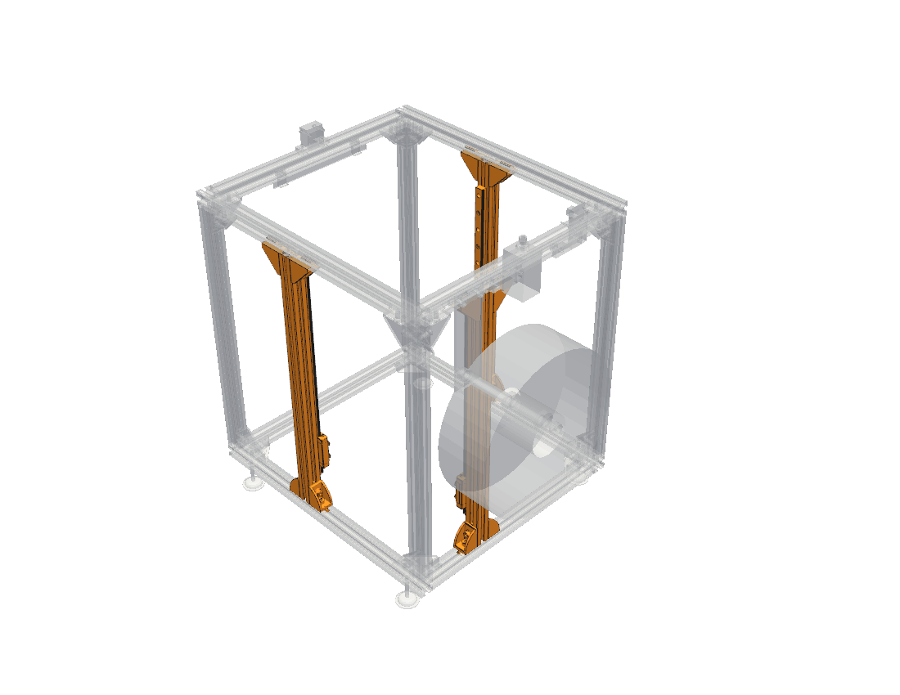

Orange: fitted in this stage. Grey: already there.

| # | Fit | Touches (simulation) | Screws that hold it (count x size, key, direction) | Check before moving on | Sim. step |
|---|---|---|---|---|---|
| 1 | **upright_rear** (EXT2020-364) | frame_bot_back | - | ends flush and square to the neighbouring members (set square on two faces) | 2 |
| 2 | **brkt_up_bot_a_rear** (HBLFSNF5) | frame_bot_back, upright_rear | - | seated flat on frame_bot_back, upright_rear with no gap; all its screws started before any is tightened | 11 |
| 3 | **brkt_up_bot_a_rear_screw_tnut** (HNTP5-5) | frame_bot_back | 1 x CBM5-10 cap screw, 4 mm key, from above, pointing down (-Z), into T-nut (brkt_up_bot_a_rear_screw) | seated flat on frame_bot_back with no gap; all its screws started before any is tightened | 12 |
| 4 | **brkt_up_bot_a_rear_screw_a_tnut** (HNTP5-5) | upright_rear | 1 x CBM5-10 cap screw, 4 mm key, from the left, pointing right (+X), into T-nut (brkt_up_bot_a_rear_screw_a) | seated flat on upright_rear with no gap; all its screws started before any is tightened | 14 |
| 5 | **upright_left** (EXT2020-364) | frame_bot_left | - | ends flush and square to the neighbouring members (set square on two faces) | 25 |
| 6 | **z_rail_left** (HIWIN-MGNR12R-295) | upright_left | - | seated flat on upright_left with no gap; all its screws started before any is tightened | 26 |
| 7 | **z_rail_left_screw_2_tnut** (TNUT-2020-M3) | upright_left | 1 x M3x8 cap screw, 2.5 mm key, from the right, pointing left (-X), into T-nut (z_rail_left_screw_2) | seated flat on upright_left with no gap; all its screws started before any is tightened | 27 |
| 8 | **z_rail_left_screw_1_tnut** (TNUT-2020-M3) | upright_left | 1 x M3x8 cap screw, 2.5 mm key, from the right, pointing left (-X), into T-nut (z_rail_left_screw_1) | seated flat on upright_left with no gap; all its screws started before any is tightened | 29 |
| 9 | **z_rail_left_screw_0_tnut** (TNUT-2020-M3) | upright_left | 1 x M3x8 cap screw, 2.5 mm key, from the right, pointing left (-X), into T-nut (z_rail_left_screw_0) | seated flat on upright_left with no gap; all its screws started before any is tightened | 31 |
| 10 | **z_carriage_left** (HIWIN-MGN12HZ0C) | z_rail_left | - | the block is slid on without losing balls (keep it on its plastic keeper until the rail is under it); it runs the whole rail by hand with even drag | 33 |
| 11 | **z_carriage_left_screw_3_washer** (WASHER-M3) | carriage_plate_left | - | seated flat on carriage_plate_left with no gap; all its screws started before any is tightened | 35 |
| 12 | **z_carriage_left_screw_2_washer** (WASHER-M3) | carriage_plate_left | - | seated flat on carriage_plate_left with no gap; all its screws started before any is tightened | 37 |
| 13 | **z_carriage_left_screw_1_washer** (WASHER-M3) | carriage_plate_left | - | seated flat on carriage_plate_left with no gap; all its screws started before any is tightened | 39 |
| 14 | **z_carriage_left_screw_0_washer** (WASHER-M3) | carriage_plate_left | - | seated flat on carriage_plate_left with no gap; all its screws started before any is tightened | 41 |
| 15 | **brkt_up_bot_b_right** (HBLFSNF5) | frame_bot_right | - | seated flat on frame_bot_right with no gap; all its screws started before any is tightened | 47 |
| 16 | **brkt_up_bot_b_right_screw_tnut** (HNTP5-5) | frame_bot_right | 1 x CBM5-10 cap screw, 4 mm key, from above, pointing down (-Z), into T-nut (brkt_up_bot_b_right_screw) | seated flat on frame_bot_right with no gap; all its screws started before any is tightened | 48 |
| 17 | **upright_right** (EXT2020-364) | brkt_up_bot_b_right, frame_bot_right | - | ends flush and square to the neighbouring members (set square on two faces) | 50 |
| 18 | **brkt_up_bot_b_right_screw_a_tnut** (HNTP5-5) | upright_right | 1 x CBM5-10 cap screw, 4 mm key, from the front, pointing back (+Y), into T-nut (brkt_up_bot_b_right_screw_a) | seated flat on upright_right with no gap; all its screws started before any is tightened | 51 |
| 19 | **brkt_up_bot_a_left** (HBLFSNF5) | frame_bot_left, upright_left | - | seated flat on frame_bot_left, upright_left with no gap; all its screws started before any is tightened | 66 |
| 20 | **brkt_up_bot_a_left_screw_tnut** (HNTP5-5) | frame_bot_left | 1 x CBM5-10 cap screw, 4 mm key, from above, pointing down (-Z), into T-nut (brkt_up_bot_a_left_screw) | seated flat on frame_bot_left with no gap; all its screws started before any is tightened | 67 |
| 21 | **brkt_up_bot_a_left_screw_a_tnut** (HNTP5-5) | upright_left | 1 x CBM5-10 cap screw, 4 mm key, from the front, pointing back (+Y), into T-nut (brkt_up_bot_a_left_screw_a) | seated flat on upright_left with no gap; all its screws started before any is tightened | 69 |
| 22 | **z_rail_right** (HIWIN-MGNR12R-295) | upright_right | - | seated flat on upright_right with no gap; all its screws started before any is tightened | 98 |
| 23 | **z_rail_right_screw_2_tnut** (TNUT-2020-M3) | upright_right | 1 x M3x8 cap screw, 2.5 mm key, from the left, pointing right (+X), into T-nut (z_rail_right_screw_2) | seated flat on upright_right with no gap; all its screws started before any is tightened | 99 |
| 24 | **z_rail_rear** (HIWIN-MGNR12R-295) | upright_rear | - | seated flat on upright_rear with no gap; all its screws started before any is tightened | 115 |
| 25 | **z_rail_rear_screw_2_tnut** (TNUT-2020-M3) | upright_rear | 1 x M3x8 cap screw, 2.5 mm key, from the front, pointing back (+Y), into T-nut (z_rail_rear_screw_2) | seated flat on upright_rear with no gap; all its screws started before any is tightened | 116 |
| 26 | **brkt_up_top_a_left** (HBLFSN5) | upright_left | - | seated flat on upright_left with no gap; all its screws started before any is tightened | 126 |
| 27 | **brkt_up_top_b_right** (HBLFSN5) | upright_right | - | seated flat on upright_right with no gap; all its screws started before any is tightened | 140 |
| 28 | **brkt_up_top_b_right_screw_a_tnut** (HNTP5-5) | frame_top_right | 1 x CBM5-10 cap screw, 4 mm key, from below, pointing up (+Z), into T-nut (brkt_up_top_b_right_screw_a) | seated flat on frame_top_right with no gap; all its screws started before any is tightened | 205 |
| 29 | **brkt_up_top_b_right_screw_tnut** (HNTP5-5) | upright_right | 1 x CBM5-10 cap screw, 4 mm key, from the front, pointing back (+Y), into T-nut (brkt_up_top_b_right_screw) | seated flat on upright_right with no gap; all its screws started before any is tightened | 207 |
| 30 | **brkt_up_bot_a_right** (HBLFSNF5) | frame_bot_right, upright_right | - | seated flat on frame_bot_right, upright_right with no gap; all its screws started before any is tightened | 209 |
| 31 | **brkt_up_top_a_right** (HBLFSN5) | frame_top_right, upright_right | - | seated flat on frame_top_right, upright_right with no gap; all its screws started before any is tightened | 210 |
| 32 | **brkt_up_bot_b_rear** (HBLFSNF5) | frame_bot_back, upright_rear | - | seated flat on frame_bot_back, upright_rear with no gap; all its screws started before any is tightened | 213 |
| 33 | **brkt_up_bot_b_left** (HBLFSNF5) | frame_bot_left, upright_left | - | seated flat on frame_bot_left, upright_left with no gap; all its screws started before any is tightened | 215 |
| 34 | **brkt_up_top_b_left** (HBLFSN5) | frame_top_left, upright_left | - | seated flat on frame_top_left, upright_left with no gap; all its screws started before any is tightened | 216 |
| 35 | **brkt_up_top_b_rear** (HBLFSN5) | spool_plate, upright_rear | - | seated flat on spool_plate, upright_rear with no gap; all its screws started before any is tightened | 220 |
| 36 | **brkt_up_top_a_rear** (HBLFSN5) | upright_rear | - | seated flat on upright_rear with no gap; all its screws started before any is tightened | 221 |
| 37 | **brkt_up_top_b_rear_screw_a_tnut** (HNTP5-5) | frame_top_back | 1 x CBM5-10 cap screw, 4 mm key, from below, pointing up (+Z), into T-nut (brkt_up_top_b_rear_screw_a) | seated flat on frame_top_back with no gap; all its screws started before any is tightened | 225 |
| 38 | **brkt_up_top_b_rear_screw_tnut** (HNTP5-5) | upright_rear | 1 x CBM5-10 cap screw, 4 mm key, from the right, pointing left (-X), into T-nut (brkt_up_top_b_rear_screw) | seated flat on upright_rear with no gap; all its screws started before any is tightened | 227 |
| 39 | **brkt_up_top_b_left_screw_a_tnut** (HNTP5-5) | frame_top_left | 1 x CBM5-10 cap screw, 4 mm key, from below, pointing up (+Z), into T-nut (brkt_up_top_b_left_screw_a) | seated flat on frame_top_left with no gap; all its screws started before any is tightened | 229 |
| 40 | **brkt_up_top_b_left_screw_tnut** (HNTP5-5) | upright_left | 1 x CBM5-10 cap screw, 4 mm key, from the back, pointing forward (-Y), into T-nut (brkt_up_top_b_left_screw) | seated flat on upright_left with no gap; all its screws started before any is tightened | 231 |
| 41 | **brkt_up_top_a_right_screw_a_tnut** (HNTP5-5) | frame_top_right | 1 x CBM5-10 cap screw, 4 mm key, from below, pointing up (+Z), into T-nut (brkt_up_top_a_right_screw_a) | seated flat on frame_top_right with no gap; all its screws started before any is tightened | 233 |
| 42 | **brkt_up_top_a_right_screw_tnut** (HNTP5-5) | upright_right | 1 x CBM5-10 cap screw, 4 mm key, from the back, pointing forward (-Y), into T-nut (brkt_up_top_a_right_screw) | seated flat on upright_right with no gap; all its screws started before any is tightened | 235 |
| 43 | **brkt_up_top_a_rear_screw_a_tnut** (HNTP5-5) | frame_top_back | 1 x CBM5-10 cap screw, 4 mm key, from below, pointing up (+Z), into T-nut (brkt_up_top_a_rear_screw_a) | seated flat on frame_top_back with no gap; all its screws started before any is tightened | 237 |
| 44 | **brkt_up_top_a_rear_screw_tnut** (HNTP5-5) | upright_rear | 1 x CBM5-10 cap screw, 4 mm key, from the left, pointing right (+X), into T-nut (brkt_up_top_a_rear_screw) | seated flat on upright_rear with no gap; all its screws started before any is tightened | 239 |
| 45 | **brkt_up_top_a_left_screw_a_tnut** (HNTP5-5) | frame_top_left | 1 x CBM5-10 cap screw, 4 mm key, from below, pointing up (+Z), into T-nut (brkt_up_top_a_left_screw_a) | seated flat on frame_top_left with no gap; all its screws started before any is tightened | 241 |
| 46 | **brkt_up_top_a_left_screw_tnut** (HNTP5-5) | upright_left | 1 x CBM5-10 cap screw, 4 mm key, from the front, pointing back (+Y), into T-nut (brkt_up_top_a_left_screw) | seated flat on upright_left with no gap; all its screws started before any is tightened | 243 |
| 47 | **brkt_up_bot_b_rear_screw_tnut** (HNTP5-5) | frame_bot_back | 1 x CBM5-10 cap screw, 4 mm key, from above, pointing down (-Z), into T-nut (brkt_up_bot_b_rear_screw) | seated flat on frame_bot_back with no gap; all its screws started before any is tightened | 245 |
| 48 | **brkt_up_bot_b_rear_screw_a_tnut** (HNTP5-5) | upright_rear | 1 x CBM5-10 cap screw, 4 mm key, from the right, pointing left (-X), into T-nut (brkt_up_bot_b_rear_screw_a) | seated flat on upright_rear with no gap; all its screws started before any is tightened | 247 |
| 49 | **brkt_up_bot_b_left_screw_tnut** (HNTP5-5) | frame_bot_left | 1 x CBM5-10 cap screw, 4 mm key, from above, pointing down (-Z), into T-nut (brkt_up_bot_b_left_screw) | seated flat on frame_bot_left with no gap; all its screws started before any is tightened | 249 |
| 50 | **brkt_up_bot_b_left_screw_a_tnut** (HNTP5-5) | upright_left | 1 x CBM5-10 cap screw, 4 mm key, from the back, pointing forward (-Y), into T-nut (brkt_up_bot_b_left_screw_a) | seated flat on upright_left with no gap; all its screws started before any is tightened | 251 |
| 51 | **brkt_up_bot_a_right_screw_tnut** (HNTP5-5) | frame_bot_right | 1 x CBM5-10 cap screw, 4 mm key, from above, pointing down (-Z), into T-nut (brkt_up_bot_a_right_screw) | seated flat on frame_bot_right with no gap; all its screws started before any is tightened | 253 |
| 52 | **brkt_up_bot_a_right_screw_a_tnut** (HNTP5-5) | upright_right | 1 x CBM5-10 cap screw, 4 mm key, from the back, pointing forward (-Y), into T-nut (brkt_up_bot_a_right_screw_a) | seated flat on upright_right with no gap; all its screws started before any is tightened | 255 |
| 53 | **z_rail_right_screw_1_tnut** (TNUT-2020-M3) | upright_right | 1 x M3x8 cap screw, 2.5 mm key, from the left, pointing right (+X), into T-nut (z_rail_right_screw_1) | seated flat on upright_right with no gap; all its screws started before any is tightened | 416 |
| 54 | **z_carriage_right** (HIWIN-MGN12HZ0C) | z_rail_right | - | the block is slid on without losing balls (keep it on its plastic keeper until the rail is under it); it runs the whole rail by hand with even drag | 418 |
| 55 | **z_rail_rear_screw_1_tnut** (TNUT-2020-M3) | upright_rear | 1 x M3x8 cap screw, 2.5 mm key, from the front, pointing back (+Y), into T-nut (z_rail_rear_screw_1) | seated flat on upright_rear with no gap; all its screws started before any is tightened | 426 |
| 56 | **z_rail_right_screw_5_tnut** (TNUT-2020-M3) | upright_right | 1 x M3x8 cap screw, 2.5 mm key, from the left, pointing right (+X), into T-nut (z_rail_right_screw_5) | seated flat on upright_right with no gap; all its screws started before any is tightened | 586 |
| 57 | **z_rail_right_screw_4_tnut** (TNUT-2020-M3) | upright_right | 1 x M3x8 cap screw, 2.5 mm key, from the left, pointing right (+X), into T-nut (z_rail_right_screw_4) | seated flat on upright_right with no gap; all its screws started before any is tightened | 588 |
| 58 | **z_rail_right_screw_3_tnut** (TNUT-2020-M3) | upright_right | 1 x M3x8 cap screw, 2.5 mm key, from the left, pointing right (+X), into T-nut (z_rail_right_screw_3) | seated flat on upright_right with no gap; all its screws started before any is tightened | 590 |
| 59 | **z_rail_right_screw_0_tnut** (TNUT-2020-M3) | upright_right | 1 x M3x8 cap screw, 2.5 mm key, from the left, pointing right (+X), into T-nut (z_rail_right_screw_0) | seated flat on upright_right with no gap; all its screws started before any is tightened | 592 |
| 60 | **z_rail_rear_screw_5_tnut** (TNUT-2020-M3) | upright_rear | 1 x M3x8 cap screw, 2.5 mm key, from the front, pointing back (+Y), into T-nut (z_rail_rear_screw_5) | seated flat on upright_rear with no gap; all its screws started before any is tightened | 594 |
| 61 | **z_rail_rear_screw_4_tnut** (TNUT-2020-M3) | upright_rear | 1 x M3x8 cap screw, 2.5 mm key, from the front, pointing back (+Y), into T-nut (z_rail_rear_screw_4) | seated flat on upright_rear with no gap; all its screws started before any is tightened | 596 |
| 62 | **z_rail_rear_screw_3_tnut** (TNUT-2020-M3) | upright_rear | 1 x M3x8 cap screw, 2.5 mm key, from the front, pointing back (+Y), into T-nut (z_rail_rear_screw_3) | seated flat on upright_rear with no gap; all its screws started before any is tightened | 598 |
| 63 | **z_rail_rear_screw_0_tnut** (TNUT-2020-M3) | upright_rear | 1 x M3x8 cap screw, 2.5 mm key, from the front, pointing back (+Y), into T-nut (z_rail_rear_screw_0) | seated flat on upright_rear with no gap; all its screws started before any is tightened | 600 |
| 64 | **z_rail_left_screw_5_tnut** (TNUT-2020-M3) | upright_left | 1 x M3x8 cap screw, 2.5 mm key, from the right, pointing left (-X), into T-nut (z_rail_left_screw_5) | seated flat on upright_left with no gap; all its screws started before any is tightened | 602 |
| 65 | **z_rail_left_screw_4_tnut** (TNUT-2020-M3) | upright_left | 1 x M3x8 cap screw, 2.5 mm key, from the right, pointing left (-X), into T-nut (z_rail_left_screw_4) | seated flat on upright_left with no gap; all its screws started before any is tightened | 604 |
| 66 | **z_rail_left_screw_3_tnut** (TNUT-2020-M3) | upright_left | 1 x M3x8 cap screw, 2.5 mm key, from the right, pointing left (-X), into T-nut (z_rail_left_screw_3) | seated flat on upright_left with no gap; all its screws started before any is tightened | 606 |
| 67 | **z_carriage_right_screw_3_washer** (WASHER-M3) | carriage_plate_right | - | seated flat on carriage_plate_right with no gap; all its screws started before any is tightened | 661 |
| 68 | **z_carriage_right_screw_2_washer** (WASHER-M3) | carriage_plate_right | - | seated flat on carriage_plate_right with no gap; all its screws started before any is tightened | 663 |
| 69 | **z_carriage_right_screw_1_washer** (WASHER-M3) | carriage_plate_right | - | seated flat on carriage_plate_right with no gap; all its screws started before any is tightened | 665 |
| 70 | **z_carriage_right_screw_0_washer** (WASHER-M3) | carriage_plate_right | - | seated flat on carriage_plate_right with no gap; all its screws started before any is tightened | 667 |
| 71 | **z_carriage_rear** (HIWIN-MGN12HZ0C) | carriage_plate_rear, z_rail_rear | - | the block is slid on without losing balls (keep it on its plastic keeper until the rail is under it); it runs the whole rail by hand with even drag | 669 |
| 72 | **z_carriage_rear_screw_3_washer** (WASHER-M3) | carriage_plate_rear | - | seated flat on carriage_plate_rear with no gap; all its screws started before any is tightened | 670 |
| 73 | **z_carriage_rear_screw_2_washer** (WASHER-M3) | carriage_plate_rear | - | seated flat on carriage_plate_rear with no gap; all its screws started before any is tightened | 672 |
| 74 | **z_carriage_rear_screw_1_washer** (WASHER-M3) | carriage_plate_rear | - | seated flat on carriage_plate_rear with no gap; all its screws started before any is tightened | 674 |
| 75 | **z_carriage_rear_screw_0_washer** (WASHER-M3) | carriage_plate_rear | - | seated flat on carriage_plate_rear with no gap; all its screws started before any is tightened | 676 |

Three uprights (v9): one in the left wall and one in the right wall at y -32, one in the back wall at x 65, each between a bottom and a top rail on two cast brackets per end. Slide each ZF block onto its rail before the rail goes on its upright. Rail alignment: see 'rail_align (z)' below: the rear rail is set square to the frame; the left and right rails are tightened last, with the carrier bolted to all three blocks and run up and down, so each rail takes the position the carrier gives it.
Use clearance-class (ZF) blocks on Z: the three screws hold the carrier's tilt, the blocks only locate it.

### Stage: Y rails and blocks

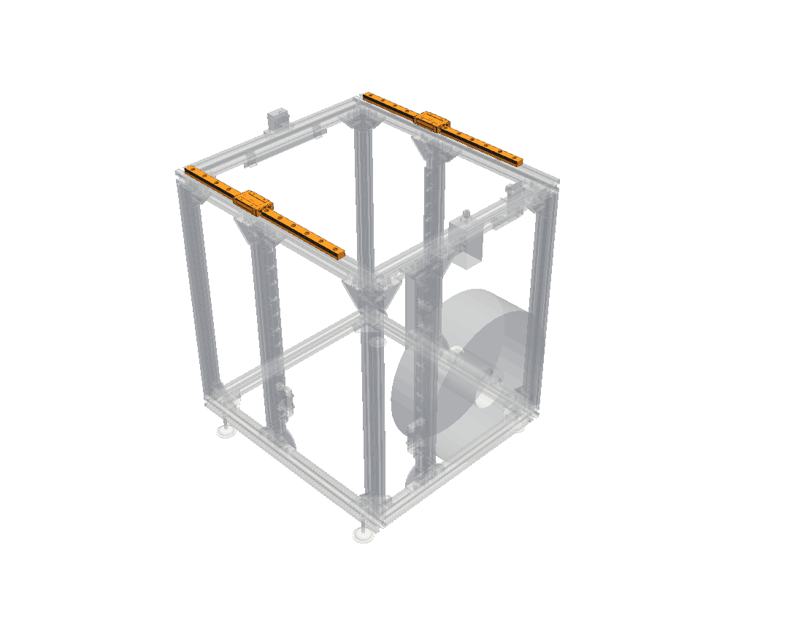

Orange: fitted in this stage. Grey: already there.

| # | Fit | Touches (simulation) | Screws that hold it (count x size, key, direction) | Check before moving on | Sim. step |
|---|---|---|---|---|---|
| 1 | **y_rail_right** (HIWIN-MGNR12R-295) | frame_top_right | - | seated flat on frame_top_right with no gap; all its screws started before any is tightened | 154 |
| 2 | **y_rail_right_screw_3_tnut** (TNUT-2020-M3) | frame_top_right | 1 x M3x8 cap screw, 2.5 mm key, from above, pointing down (-Z), into T-nut (y_rail_right_screw_3) | seated flat on frame_top_right with no gap; all its screws started before any is tightened | 155 |
| 3 | **y_rail_right_screw_2_tnut** (TNUT-2020-M3) | frame_top_right | 1 x M3x8 cap screw, 2.5 mm key, from above, pointing down (-Z), into T-nut (y_rail_right_screw_2) | seated flat on frame_top_right with no gap; all its screws started before any is tightened | 157 |
| 4 | **y_carriage_right** (HIWIN-MGN12HZ0C) | y_rail_right | - | the block is slid on without losing balls (keep it on its plastic keeper until the rail is under it); it runs the whole rail by hand with even drag | 159 |
| 5 | **y_rail_left** (HIWIN-MGNR12R-295) | frame_top_left | - | seated flat on frame_top_left with no gap; all its screws started before any is tightened | 170 |
| 6 | **y_rail_left_screw_3_tnut** (TNUT-2020-M3) | frame_top_left | 1 x M3x8 cap screw, 2.5 mm key, from above, pointing down (-Z), into T-nut (y_rail_left_screw_3) | seated flat on frame_top_left with no gap; all its screws started before any is tightened | 171 |
| 7 | **y_rail_left_screw_2_tnut** (TNUT-2020-M3) | frame_top_left | 1 x M3x8 cap screw, 2.5 mm key, from above, pointing down (-Z), into T-nut (y_rail_left_screw_2) | seated flat on frame_top_left with no gap; all its screws started before any is tightened | 173 |
| 8 | **y_rail_right_screw_5_tnut** (TNUT-2020-M3) | frame_top_right | 1 x M3x8 cap screw, 2.5 mm key, from above, pointing down (-Z), into T-nut (y_rail_right_screw_5) | seated flat on frame_top_right with no gap; all its screws started before any is tightened | 608 |
| 9 | **y_rail_right_screw_4_tnut** (TNUT-2020-M3) | frame_top_right | 1 x M3x8 cap screw, 2.5 mm key, from above, pointing down (-Z), into T-nut (y_rail_right_screw_4) | seated flat on frame_top_right with no gap; all its screws started before any is tightened | 610 |
| 10 | **y_rail_right_screw_1_tnut** (TNUT-2020-M3) | frame_top_right | 1 x M3x8 cap screw, 2.5 mm key, from above, pointing down (-Z), into T-nut (y_rail_right_screw_1) | seated flat on frame_top_right with no gap; all its screws started before any is tightened | 612 |
| 11 | **y_rail_right_screw_0_tnut** (TNUT-2020-M3) | frame_top_right | 1 x M3x8 cap screw, 2.5 mm key, from above, pointing down (-Z), into T-nut (y_rail_right_screw_0) | seated flat on frame_top_right with no gap; all its screws started before any is tightened | 614 |
| 12 | **y_rail_left_screw_5_tnut** (TNUT-2020-M3) | frame_top_left | 1 x M3x8 cap screw, 2.5 mm key, from above, pointing down (-Z), into T-nut (y_rail_left_screw_5) | seated flat on frame_top_left with no gap; all its screws started before any is tightened | 616 |
| 13 | **y_rail_left_screw_4_tnut** (TNUT-2020-M3) | frame_top_left | 1 x M3x8 cap screw, 2.5 mm key, from above, pointing down (-Z), into T-nut (y_rail_left_screw_4) | seated flat on frame_top_left with no gap; all its screws started before any is tightened | 618 |
| 14 | **y_rail_left_screw_1_tnut** (TNUT-2020-M3) | frame_top_left | 1 x M3x8 cap screw, 2.5 mm key, from above, pointing down (-Z), into T-nut (y_rail_left_screw_1) | seated flat on frame_top_left with no gap; all its screws started before any is tightened | 620 |
| 15 | **y_rail_left_screw_0_tnut** (TNUT-2020-M3) | frame_top_left | 1 x M3x8 cap screw, 2.5 mm key, from above, pointing down (-Z), into T-nut (y_rail_left_screw_0) | seated flat on frame_top_left with no gap; all its screws started before any is tightened | 622 |
| 16 | **y_carriage_left** (HIWIN-MGN12HZ0C) | y_plate_left, y_rail_left | - | the block is slid on without losing balls (keep it on its plastic keeper until the rail is under it); it runs the whole rail by hand with even drag | 628 |

### Stage: Electronics tray, mains inlet, earth

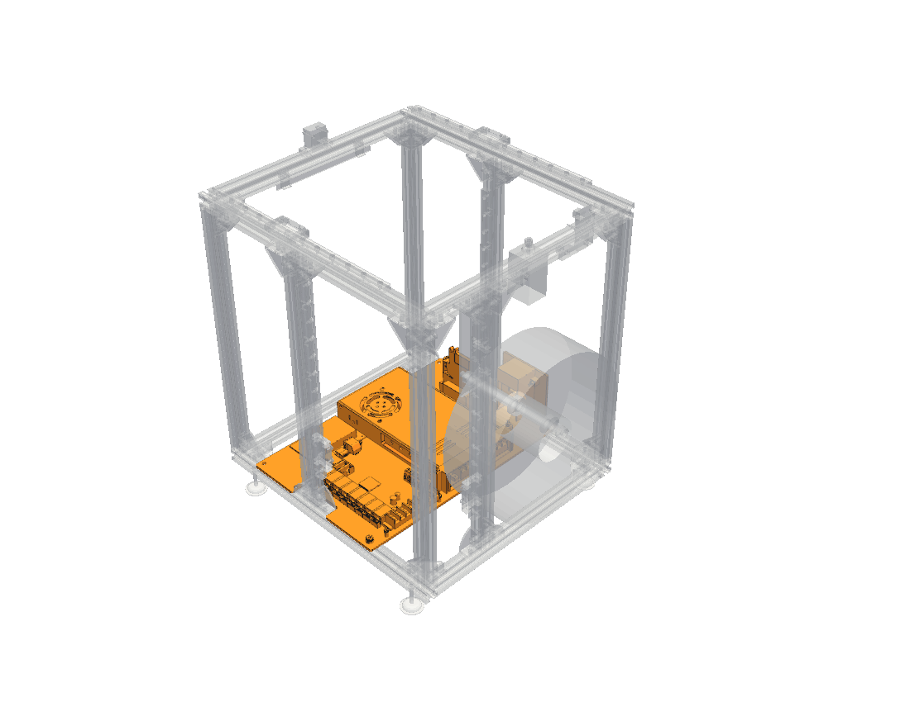

Orange: fitted in this stage. Grey: already there.

| # | Fit | Touches (simulation) | Screws that hold it (count x size, key, direction) | Check before moving on | Sim. step |
|---|---|---|---|---|---|
| 1 | bench unit **electronics** | frame_bot_left | - | the bench unit is complete (its own table above); it sits flat on what it bolts to before any screw is tightened | 43 |
| 2 | **tray_bolt_1_tnut** (TNUT-2020-M5) | frame_bot_right | - | seated flat on frame_bot_right with no gap; all its screws started before any is tightened | 399 |
| 3 | **tray_bolt_1_washer** (WASHER-M5) | electronics_tray | 1 x M5x8 cap screw, 4 mm key, from above, pointing down (-Z), into T-nut (tray_bolt_1) | seated flat on electronics_tray with no gap; all its screws started before any is tightened | 400 |
| 4 | **tray_bolt_0_tnut** (TNUT-2020-M5) | frame_bot_left | - | seated flat on frame_bot_left with no gap; all its screws started before any is tightened | 402 |
| 5 | **tray_bolt_0_washer** (WASHER-M5) | electronics_tray | 1 x M5x8 cap screw, 4 mm key, from above, pointing down (-Z), into T-nut (tray_bolt_0) | seated flat on electronics_tray with no gap; all its screws started before any is tightened | 403 |
| 6 | **inlet_panel** (custom) | brkt_up_bot_b_left, electronics_tray, frame_bot_left | - | seated flat on brkt_up_bot_b_left, electronics_tray with no gap; all its screws started before any is tightened | 409 |
| 7 | **inlet_panel_bolt_1_tnut** (TNUT-2020-M5) | frame_bot_left | - | seated flat on frame_bot_left with no gap; all its screws started before any is tightened | 410 |
| 8 | **inlet_panel_bolt_1_washer** (WASHER-M5) | inlet_panel | 1 x M5x8 cap screw, 4 mm key, from the left, pointing right (+X), into T-nut (inlet_panel_bolt_1) | seated flat on inlet_panel with no gap; all its screws started before any is tightened | 411 |
| 9 | **inlet_panel_bolt_0_tnut** (TNUT-2020-M5) | frame_bot_left | - | seated flat on frame_bot_left with no gap; all its screws started before any is tightened | 413 |
| 10 | **inlet_panel_bolt_0_washer** (WASHER-M5) | inlet_panel | 1 x M5x8 cap screw, 4 mm key, from the left, pointing right (+X), into T-nut (inlet_panel_bolt_0) | seated flat on inlet_panel with no gap; all its screws started before any is tightened | 414 |
| 11 | **earth_stud_tnut** (TNUT-2020-M5) | frame_bot_left | - | seated flat on frame_bot_left with no gap; all its screws started before any is tightened | 461 |
| 12 | **earth_stud_washer** (WASHER-M5-SERRATED) | frame_bot_left | 1 x M5x6 cap screw, 4 mm key, from the left, pointing right (+X), into T-nut (earth_stud) | seated flat on frame_bot_left with no gap; all its screws started before any is tightened | 462 |
| 13 | **mains_cover_inlet** (custom) | inlet_panel | - | seated flat on inlet_panel with no gap; all its screws started before any is tightened | 498 |
| 14 | **mains_cover_inlet_screw_1_nut** (NUT-M3) | mains_cover_inlet | - | seated flat on mains_cover_inlet with no gap; all its screws started before any is tightened | 499 |
| 15 | **mains_cover_inlet_screw_1_washer** (WASHER-M3) | inlet_panel | - | seated flat on inlet_panel with no gap; all its screws started before any is tightened | 500 |
| 16 | **mains_cover_inlet_screw_1_nwasher** (WASHER-M3) | mains_cover_inlet, mains_cover_inlet_screw_1_nut | 1 x M3x20 cap screw, 2.5 mm key, from the left, pointing right (+X) (mains_cover_inlet_screw_1) | seated flat on mains_cover_inlet, mains_cover_inlet_screw_1_nut with no gap; all its screws started before any is tightened | 501 |
| 17 | **mains_cover_inlet_screw_0_nut** (NUT-M3) | mains_cover_inlet | - | seated flat on mains_cover_inlet with no gap; all its screws started before any is tightened | 503 |
| 18 | **mains_cover_inlet_screw_0_washer** (WASHER-M3) | inlet_panel | - | seated flat on inlet_panel with no gap; all its screws started before any is tightened | 504 |
| 19 | **mains_cover_inlet_screw_0_nwasher** (WASHER-M3) | mains_cover_inlet, mains_cover_inlet_screw_0_nut | 1 x M3x20 cap screw, 2.5 mm key, from the left, pointing right (+X) (mains_cover_inlet_screw_0) | seated flat on mains_cover_inlet, mains_cover_inlet_screw_0_nut with no gap; all its screws started before any is tightened | 505 |
| 20 | **inlet_nut_1** (NUT-M3) | inlet_panel | - | seated flat on inlet_panel with no gap; all its screws started before any is tightened | 565 |
| 21 | **inlet_nut_0** (NUT-M3) | inlet_panel | - | seated flat on inlet_panel with no gap; all its screws started before any is tightened | 566 |
| 22 | **inlet_washer_1** (WASHER-M3) | inlet_nut_1, inlet_panel | - | seated flat on inlet_nut_1, inlet_panel with no gap; all its screws started before any is tightened | 567 |
| 23 | **inlet_washer_0** (WASHER-M3) | inlet_nut_0, inlet_panel | - | seated flat on inlet_nut_0, inlet_panel with no gap; all its screws started before any is tightened | 568 |
| 24 | **inlet** (INLET-C14-SW-FUSE-T8A) | inlet_panel | 2 x M3x10 cap screw, 2.5 mm key, from the left, pointing right (+X) (inlet_screw_1, inlet_screw_0) | seated flat on inlet_panel with no gap; all its screws started before any is tightened | 569 |

### Stage: Z drive: screws and motors (with their supports, pulleys and belt where the design has them)

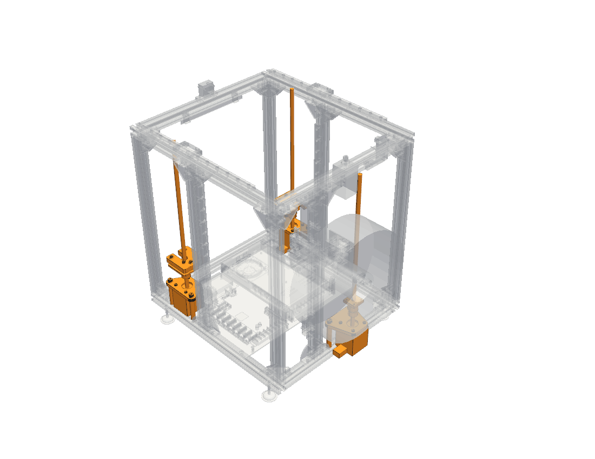

Orange: fitted in this stage. Grey: already there.

| # | Fit | Touches (simulation) | Screws that hold it (count x size, key, direction) | Check before moving on | Sim. step |
|---|---|---|---|---|---|
| 1 | **z_mount_rear_spacer_1** (custom) | frame_bot_back | - | seated flat on frame_bot_back with no gap; all its screws started before any is tightened | 16 |
| 2 | bench unit **z_drive_rear** | z_mount_rear_spacer_1 | - | the bench unit is complete (its own table above); it sits flat on what it bolts to before any screw is tightened | 17 |
| 3 | **z_mount_rear_bolt_1_tnut** (TNUT-2020-M5) | frame_bot_back | - | seated flat on frame_bot_back with no gap; all its screws started before any is tightened | 18 |
| 4 | **z_mount_rear_bolt_1_washer** (WASHER-M5) | z_motor_plate | 1 x M5x65 cap screw, 4 mm key, from above, pointing down (-Z), into T-nut (z_mount_rear_bolt_1) | seated flat on z_motor_plate with no gap; all its screws started before any is tightened | 19 |
| 5 | **z_mount_rear_spacer_0** (custom) | frame_bot_back, z_motor_plate | - | seated flat on frame_bot_back, z_motor_plate with no gap; all its screws started before any is tightened | 21 |
| 6 | **z_mount_rear_bolt_0_tnut** (TNUT-2020-M5) | frame_bot_back | - | seated flat on frame_bot_back with no gap; all its screws started before any is tightened | 22 |
| 7 | **z_mount_rear_bolt_0_washer** (WASHER-M5) | z_motor_plate | 1 x M5x65 cap screw, 4 mm key, from above, pointing down (-Z), into T-nut (z_mount_rear_bolt_0) | seated flat on z_motor_plate with no gap; all its screws started before any is tightened | 23 |
| 8 | bench unit **z_drive_fr** | bracket_10 | - | the bench unit is complete (its own table above); it sits flat on what it bolts to before any screw is tightened | 57 |
| 9 | **z_mount_fr_spacer_1** (custom) | electronics_tray, z_motor_plate_fr | - | seated flat on electronics_tray, z_motor_plate_fr with no gap; all its screws started before any is tightened | 58 |
| 10 | **z_mount_fr_bolt_1_tnut** (TNUT-2020-M5) | frame_bot_right | - | seated flat on frame_bot_right with no gap; all its screws started before any is tightened | 59 |
| 11 | **z_mount_fr_bolt_1_washer** (WASHER-M5) | z_motor_plate_fr | 1 x M5x65 cap screw, 4 mm key, from above, pointing down (-Z), into T-nut (z_mount_fr_bolt_1) | seated flat on z_motor_plate_fr with no gap; all its screws started before any is tightened | 60 |
| 12 | **z_mount_fr_spacer_0** (custom) | electronics_tray, z_motor_plate_fr | - | seated flat on electronics_tray, z_motor_plate_fr with no gap; all its screws started before any is tightened | 62 |
| 13 | **z_mount_fr_bolt_0_tnut** (TNUT-2020-M5) | frame_bot_right | - | seated flat on frame_bot_right with no gap; all its screws started before any is tightened | 63 |
| 14 | **z_mount_fr_bolt_0_washer** (WASHER-M5) | z_motor_plate_fr | 1 x M5x65 cap screw, 4 mm key, from above, pointing down (-Z), into T-nut (z_mount_fr_bolt_0) | seated flat on z_motor_plate_fr with no gap; all its screws started before any is tightened | 64 |
| 15 | **z_mount_fl_spacer_1** (custom) | electronics_tray | - | seated flat on electronics_tray with no gap; all its screws started before any is tightened | 75 |
| 16 | bench unit **z_drive_fl** | z_mount_fl_spacer_1 | - | the bench unit is complete (its own table above); it sits flat on what it bolts to before any screw is tightened | 76 |
| 17 | **z_mount_fl_bolt_1_tnut** (TNUT-2020-M5) | frame_bot_left | - | seated flat on frame_bot_left with no gap; all its screws started before any is tightened | 77 |
| 18 | **z_mount_fl_bolt_1_washer** (WASHER-M5) | z_motor_plate_fl | 1 x M5x65 cap screw, 4 mm key, from above, pointing down (-Z), into T-nut (z_mount_fl_bolt_1) | seated flat on z_motor_plate_fl with no gap; all its screws started before any is tightened | 78 |
| 19 | **z_mount_fl_spacer_0** (custom) | electronics_tray, z_motor_plate_fl | - | seated flat on electronics_tray, z_motor_plate_fl with no gap; all its screws started before any is tightened | 80 |
| 20 | **z_mount_fl_bolt_0_tnut** (TNUT-2020-M5) | frame_bot_left | - | seated flat on frame_bot_left with no gap; all its screws started before any is tightened | 81 |
| 21 | **z_mount_fl_bolt_0_washer** (WASHER-M5) | z_motor_plate_fl | 1 x M5x65 cap screw, 4 mm key, from above, pointing down (-Z), into T-nut (z_mount_fl_bolt_0) | seated flat on z_motor_plate_fl with no gap; all its screws started before any is tightened | 82 |

Cut each lead-screw motor's screw to 258 mm above the motor face (hacksaw, file a 0.5 mm chamfer, run the nut over the cut end) before fitting. Each motor is a bench unit: motor under its plate (the three plates are one shape), pilot in the plate's 22.3 mm hole, four M3 x 10 from above with medium thread locker (they reach 3.65 mm into the motor's 4.5 mm threads: do not substitute longer screws). Stand the two spacers on the rail (rear) or the tray over the rail (front), the unit on them, the M5 x 70 post bolts with washers into the T-nuts, thread locker. The screw must turn freely by hand, and its top end is free: no bearing.

### Stage: Bed carrier onto its blocks and nuts

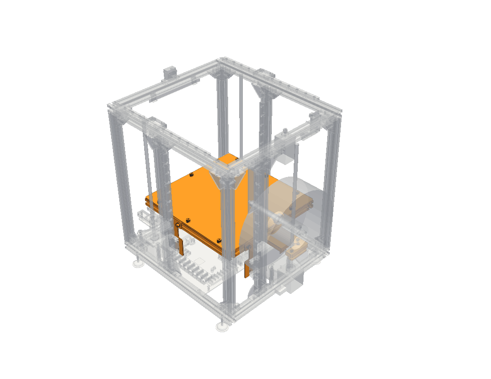

Orange: fitted in this stage. Grey: already there.

| # | Fit | Touches (simulation) | Screws that hold it (count x size, key, direction) | Check before moving on | Sim. step |
|---|---|---|---|---|---|
| 1 | **carriage_plate_left** (custom) | z_carriage_left | 4 x M3x5 cap screw, 2.5 mm key, from the right, pointing left (-X) (z_carriage_left_screw_3, z_carriage_left_screw_2, z_carriage_left_screw_1, z_carriage_left_screw_0) | seated flat on z_carriage_left with no gap; all its screws started before any is tightened | 34 |
| 2 | **sq_right** (EXT2020-281) | nut_plate_fr | - | ends flush and square to the neighbouring members (set square on two faces) | 101 |
| 3 | **nut_plate_fr_bolt_1_tnut** (TNUT-2020-M5) | sq_right | - | seated flat on sq_right with no gap; all its screws started before any is tightened | 102 |
| 4 | **nut_plate_fr_bolt_1_washer** (WASHER-M5) | nut_plate_fr | 1 x M5x16 cap screw, 4 mm key, from below, pointing up (+Z), into T-nut (nut_plate_fr_bolt_1) | seated flat on nut_plate_fr with no gap; all its screws started before any is tightened | 103 |
| 5 | **nut_plate_fr_bolt_0_tnut** (TNUT-2020-M5) | sq_right | - | seated flat on sq_right with no gap; all its screws started before any is tightened | 105 |
| 6 | **nut_plate_fr_bolt_0_washer** (WASHER-M5) | nut_plate_fr | 1 x M5x16 cap screw, 4 mm key, from below, pointing up (+Z), into T-nut (nut_plate_fr_bolt_0) | seated flat on nut_plate_fr with no gap; all its screws started before any is tightened | 106 |
| 7 | **sq_left** (EXT2020-281) | carriage_plate_left, nut_plate_fl | - | ends flush and square to the neighbouring members (set square on two faces) | 108 |
| 8 | **nut_plate_fl_bolt_1_tnut** (TNUT-2020-M5) | sq_left | - | seated flat on sq_left with no gap; all its screws started before any is tightened | 109 |
| 9 | **nut_plate_fl_bolt_1_washer** (WASHER-M5) | nut_plate_fl | 1 x M5x16 cap screw, 4 mm key, from below, pointing up (+Z), into T-nut (nut_plate_fl_bolt_1) | seated flat on nut_plate_fl with no gap; all its screws started before any is tightened | 110 |
| 10 | **nut_plate_fl_bolt_0_tnut** (TNUT-2020-M5) | sq_left | - | seated flat on sq_left with no gap; all its screws started before any is tightened | 112 |
| 11 | **nut_plate_fl_bolt_0_washer** (WASHER-M5) | nut_plate_fl | 1 x M5x16 cap screw, 4 mm key, from below, pointing up (+Z), into T-nut (nut_plate_fl_bolt_0) | seated flat on nut_plate_fl with no gap; all its screws started before any is tightened | 113 |
| 12 | **sq_rear** (EXT2020-230) | sq_left, sq_right | - | ends flush and square to the neighbouring members (set square on two faces) | 118 |
| 13 | **nut_plate** (custom) | sq_rear, z_nut | - | seated flat on sq_rear, z_nut with no gap; all its screws started before any is tightened | 119 |
| 14 | **nut_plate_bolt_1_tnut** (TNUT-2020-M5) | sq_rear | - | seated flat on sq_rear with no gap; all its screws started before any is tightened | 120 |
| 15 | **nut_plate_bolt_1_washer** (WASHER-M5) | nut_plate | 1 x M5x16 cap screw, 4 mm key, from below, pointing up (+Z), into T-nut (nut_plate_bolt_1) | seated flat on nut_plate with no gap; all its screws started before any is tightened | 121 |
| 16 | **nut_plate_bolt_0_tnut** (TNUT-2020-M5) | sq_rear | - | seated flat on sq_rear with no gap; all its screws started before any is tightened | 123 |
| 17 | **nut_plate_bolt_0_washer** (WASHER-M5) | nut_plate | 1 x M5x16 cap screw, 4 mm key, from below, pointing up (+Z), into T-nut (nut_plate_bolt_0) | seated flat on nut_plate with no gap; all its screws started before any is tightened | 124 |
| 18 | **sq_bracket_rr** (HBLFSNF5) | sq_rear, sq_right | - | seated flat on sq_rear, sq_right with no gap; all its screws started before any is tightened | 184 |
| 19 | **sq_bracket_rr_screw_tnut** (HNTP5-5) | sq_rear | 1 x CBM5-10 cap screw, 4 mm key, from the front, pointing back (+Y), into T-nut (sq_bracket_rr_screw) | seated flat on sq_rear with no gap; all its screws started before any is tightened | 185 |
| 20 | **sq_bracket_rr_screw_a_tnut** (HNTP5-5) | sq_right | 1 x CBM5-10 cap screw, 4 mm key, from the left, pointing right (+X), into T-nut (sq_bracket_rr_screw_a) | seated flat on sq_right with no gap; all its screws started before any is tightened | 187 |
| 21 | **sq_bracket_rl** (HBLFSNF5) | sq_left, sq_rear | - | seated flat on sq_left, sq_rear with no gap; all its screws started before any is tightened | 189 |
| 22 | **sq_bracket_rl_screw_tnut** (HNTP5-5) | sq_rear | 1 x CBM5-10 cap screw, 4 mm key, from the front, pointing back (+Y), into T-nut (sq_bracket_rl_screw) | seated flat on sq_rear with no gap; all its screws started before any is tightened | 190 |
| 23 | **sq_bracket_rl_screw_a_tnut** (HNTP5-5) | sq_left | 1 x CBM5-10 cap screw, 4 mm key, from the right, pointing left (-X), into T-nut (sq_bracket_rl_screw_a) | seated flat on sq_left with no gap; all its screws started before any is tightened | 192 |
| 24 | **sq_bracket_fr** (HBLFSNF5) | nut_plate_fr, sq_right | - | seated flat on nut_plate_fr, sq_right with no gap; all its screws started before any is tightened | 194 |
| 25 | **sq_bracket_fl** (HBLFSNF5) | nut_plate_fl, sq_left | - | seated flat on nut_plate_fl, sq_left with no gap; all its screws started before any is tightened | 195 |
| 26 | **sq_front** (EXT2020-230) | nut_plate_fl, nut_plate_fr, sq_bracket_fl | - | ends flush and square to the neighbouring members (set square on two faces) | 196 |
| 27 | **sq_bracket_fr_screw_tnut** (HNTP5-5) | sq_front | 1 x CBM5-10 cap screw, 4 mm key, from the back, pointing forward (-Y), into T-nut (sq_bracket_fr_screw) | seated flat on sq_front with no gap; all its screws started before any is tightened | 197 |
| 28 | **sq_bracket_fr_screw_a_tnut** (HNTP5-5) | sq_right | 1 x CBM5-10 cap screw, 4 mm key, from the left, pointing right (+X), into T-nut (sq_bracket_fr_screw_a) | seated flat on sq_right with no gap; all its screws started before any is tightened | 199 |
| 29 | **sq_bracket_fl_screw_tnut** (HNTP5-5) | sq_front | 1 x CBM5-10 cap screw, 4 mm key, from the back, pointing forward (-Y), into T-nut (sq_bracket_fl_screw) | seated flat on sq_front with no gap; all its screws started before any is tightened | 201 |
| 30 | **sq_bracket_fl_screw_a_tnut** (HNTP5-5) | sq_left | 1 x CBM5-10 cap screw, 4 mm key, from the right, pointing left (-X), into T-nut (sq_bracket_fl_screw_a) | seated flat on sq_left with no gap; all its screws started before any is tightened | 203 |
| 31 | **z_deck** (custom) | carriage_plate_left, sq_bracket_fl, sq_bracket_fr | - | seated flat on carriage_plate_left, sq_bracket_fl with no gap; all its screws started before any is tightened | 323 |
| 32 | **z_deck_bolt_9_tnut** (TNUT-2020-M5) | sq_rear | - | seated flat on sq_rear with no gap; all its screws started before any is tightened | 324 |
| 33 | **z_deck_bolt_9_washer** (WASHER-M5) | z_deck | 1 x M5x8 cap screw, 4 mm key, from above, pointing down (-Z), into T-nut (z_deck_bolt_9) | seated flat on z_deck with no gap; all its screws started before any is tightened | 325 |
| 34 | **z_deck_bolt_8_tnut** (TNUT-2020-M5) | sq_front | - | seated flat on sq_front with no gap; all its screws started before any is tightened | 327 |
| 35 | **z_deck_bolt_8_washer** (WASHER-M5) | z_deck | 1 x M5x8 cap screw, 4 mm key, from above, pointing down (-Z), into T-nut (z_deck_bolt_8) | seated flat on z_deck with no gap; all its screws started before any is tightened | 328 |
| 36 | **z_deck_bolt_7_tnut** (TNUT-2020-M5) | sq_front | - | seated flat on sq_front with no gap; all its screws started before any is tightened | 330 |
| 37 | **z_deck_bolt_7_washer** (WASHER-M5) | z_deck | 1 x M5x8 cap screw, 4 mm key, from above, pointing down (-Z), into T-nut (z_deck_bolt_7) | seated flat on z_deck with no gap; all its screws started before any is tightened | 331 |
| 38 | **z_deck_bolt_6_tnut** (TNUT-2020-M5) | sq_front | - | seated flat on sq_front with no gap; all its screws started before any is tightened | 333 |
| 39 | **z_deck_bolt_6_washer** (WASHER-M5) | z_deck | 1 x M5x8 cap screw, 4 mm key, from above, pointing down (-Z), into T-nut (z_deck_bolt_6) | seated flat on z_deck with no gap; all its screws started before any is tightened | 334 |
| 40 | **z_deck_bolt_5_tnut** (TNUT-2020-M5) | sq_right | - | seated flat on sq_right with no gap; all its screws started before any is tightened | 336 |
| 41 | **z_deck_bolt_5_washer** (WASHER-M5) | z_deck | 1 x M5x8 cap screw, 4 mm key, from above, pointing down (-Z), into T-nut (z_deck_bolt_5) | seated flat on z_deck with no gap; all its screws started before any is tightened | 337 |
| 42 | **z_deck_bolt_4_tnut** (TNUT-2020-M5) | sq_right | - | seated flat on sq_right with no gap; all its screws started before any is tightened | 339 |
| 43 | **z_deck_bolt_4_washer** (WASHER-M5) | z_deck | 1 x M5x8 cap screw, 4 mm key, from above, pointing down (-Z), into T-nut (z_deck_bolt_4) | seated flat on z_deck with no gap; all its screws started before any is tightened | 340 |
| 44 | **z_deck_bolt_3_tnut** (TNUT-2020-M5) | sq_right | - | seated flat on sq_right with no gap; all its screws started before any is tightened | 342 |
| 45 | **z_deck_bolt_3_washer** (WASHER-M5) | z_deck | 1 x M5x8 cap screw, 4 mm key, from above, pointing down (-Z), into T-nut (z_deck_bolt_3) | seated flat on z_deck with no gap; all its screws started before any is tightened | 343 |
| 46 | **z_deck_bolt_2_tnut** (TNUT-2020-M5) | sq_left | - | seated flat on sq_left with no gap; all its screws started before any is tightened | 345 |
| 47 | **z_deck_bolt_2_washer** (WASHER-M5) | z_deck | 1 x M5x8 cap screw, 4 mm key, from above, pointing down (-Z), into T-nut (z_deck_bolt_2) | seated flat on z_deck with no gap; all its screws started before any is tightened | 346 |
| 48 | **z_deck_bolt_11_tnut** (TNUT-2020-M5) | sq_rear | - | seated flat on sq_rear with no gap; all its screws started before any is tightened | 348 |
| 49 | **z_deck_bolt_11_washer** (WASHER-M5) | z_deck | 1 x M5x8 cap screw, 4 mm key, from above, pointing down (-Z), into T-nut (z_deck_bolt_11) | seated flat on z_deck with no gap; all its screws started before any is tightened | 349 |
| 50 | **z_deck_bolt_10_tnut** (TNUT-2020-M5) | sq_rear | - | seated flat on sq_rear with no gap; all its screws started before any is tightened | 351 |
| 51 | **z_deck_bolt_10_washer** (WASHER-M5) | z_deck | 1 x M5x8 cap screw, 4 mm key, from above, pointing down (-Z), into T-nut (z_deck_bolt_10) | seated flat on z_deck with no gap; all its screws started before any is tightened | 352 |
| 52 | **z_deck_bolt_1_tnut** (TNUT-2020-M5) | sq_left | - | seated flat on sq_left with no gap; all its screws started before any is tightened | 354 |
| 53 | **z_deck_bolt_1_washer** (WASHER-M5) | z_deck | 1 x M5x8 cap screw, 4 mm key, from above, pointing down (-Z), into T-nut (z_deck_bolt_1) | seated flat on z_deck with no gap; all its screws started before any is tightened | 355 |
| 54 | **z_deck_bolt_0_tnut** (TNUT-2020-M5) | sq_left | - | seated flat on sq_left with no gap; all its screws started before any is tightened | 357 |
| 55 | **z_deck_bolt_0_washer** (WASHER-M5) | z_deck | 1 x M5x8 cap screw, 4 mm key, from above, pointing down (-Z), into T-nut (z_deck_bolt_0) | seated flat on z_deck with no gap; all its screws started before any is tightened | 358 |
| 56 | **carriage_plate_right** (custom) | sq_right, z_carriage_right, z_deck | 4 x M3x5 cap screw, 2.5 mm key, from the left, pointing right (+X) (z_carriage_right_screw_3, z_carriage_right_screw_2, z_carriage_right_screw_1, z_carriage_right_screw_0) | seated flat on sq_right, z_carriage_right with no gap; all its screws started before any is tightened | 419 |
| 57 | **carriage_plate_right_bolt_1_tnut** (TNUT-2020-M5) | sq_right | - | seated flat on sq_right with no gap; all its screws started before any is tightened | 420 |
| 58 | **carriage_plate_right_bolt_1_washer** (WASHER-M5) | carriage_plate_right | 1 x M5x8 cap screw, 4 mm key, from the right, pointing left (-X), into T-nut (carriage_plate_right_bolt_1) | seated flat on carriage_plate_right with no gap; all its screws started before any is tightened | 421 |
| 59 | **carriage_plate_right_bolt_0_tnut** (TNUT-2020-M5) | sq_right | - | seated flat on sq_right with no gap; all its screws started before any is tightened | 423 |
| 60 | **carriage_plate_right_bolt_0_washer** (WASHER-M5) | carriage_plate_right | 1 x M5x8 cap screw, 4 mm key, from the right, pointing left (-X), into T-nut (carriage_plate_right_bolt_0) | seated flat on carriage_plate_right with no gap; all its screws started before any is tightened | 424 |
| 61 | **carriage_plate_rear** (custom) | sq_rear, z_deck | 4 x M3x5 cap screw, 2.5 mm key, from the front, pointing back (+Y) (z_carriage_rear_screw_3, z_carriage_rear_screw_2, z_carriage_rear_screw_1, z_carriage_rear_screw_0) | seated flat on sq_rear, z_deck with no gap; all its screws started before any is tightened | 428 |
| 62 | **carriage_plate_rear_bolt_1_tnut** (TNUT-2020-M5) | sq_rear | - | seated flat on sq_rear with no gap; all its screws started before any is tightened | 429 |
| 63 | **carriage_plate_rear_bolt_1_washer** (WASHER-M5) | carriage_plate_rear | 1 x M5x8 cap screw, 4 mm key, from the back, pointing forward (-Y), into T-nut (carriage_plate_rear_bolt_1) | seated flat on carriage_plate_rear with no gap; all its screws started before any is tightened | 430 |
| 64 | **carriage_plate_rear_bolt_0_tnut** (TNUT-2020-M5) | sq_rear | - | seated flat on sq_rear with no gap; all its screws started before any is tightened | 432 |
| 65 | **carriage_plate_rear_bolt_0_washer** (WASHER-M5) | carriage_plate_rear | 1 x M5x8 cap screw, 4 mm key, from the back, pointing forward (-Y), into T-nut (carriage_plate_rear_bolt_0) | seated flat on carriage_plate_rear with no gap; all its screws started before any is tightened | 433 |
| 66 | **carriage_plate_left_bolt_1_tnut** (TNUT-2020-M5) | sq_left | - | seated flat on sq_left with no gap; all its screws started before any is tightened | 435 |
| 67 | **carriage_plate_left_bolt_1_washer** (WASHER-M5) | carriage_plate_left | 1 x M5x8 cap screw, 4 mm key, from the left, pointing right (+X), into T-nut (carriage_plate_left_bolt_1) | seated flat on carriage_plate_left with no gap; all its screws started before any is tightened | 436 |
| 68 | **carriage_plate_left_bolt_0_tnut** (TNUT-2020-M5) | sq_left | - | seated flat on sq_left with no gap; all its screws started before any is tightened | 438 |
| 69 | **carriage_plate_left_bolt_0_washer** (WASHER-M5) | carriage_plate_left | 1 x M5x8 cap screw, 4 mm key, from the left, pointing right (+X), into T-nut (carriage_plate_left_bolt_0) | seated flat on carriage_plate_left with no gap; all its screws started before any is tightened | 439 |
| 70 | **nut_keeper** (custom) | z_nut | - | seated flat on z_nut with no gap; all its screws started before any is tightened | 484 |
| 71 | **nut_keeper_spacer_1** (SPACER-HARWIN-R30-6200614) | nut_keeper, nut_plate | - | seated flat on nut_keeper, nut_plate with no gap; all its screws started before any is tightened | 485 |
| 72 | **nut_keeper_bolt_1_nut** (NUT-M3) | nut_keeper | - | seated flat on nut_keeper with no gap; all its screws started before any is tightened | 486 |
| 73 | **nut_keeper_bolt_1_washer** (WASHER-M3-LARGE) | nut_plate | - | seated flat on nut_plate with no gap; all its screws started before any is tightened | 487 |
| 74 | **nut_keeper_bolt_1_nwasher** (WASHER-M3-LARGE) | nut_keeper, nut_keeper_bolt_1_nut | 1 x M3x25 cap screw, 2.5 mm key, from above, pointing down (-Z) (nut_keeper_bolt_1) | seated flat on nut_keeper, nut_keeper_bolt_1_nut with no gap; all its screws started before any is tightened | 488 |
| 75 | **nut_keeper_spacer_0** (SPACER-HARWIN-R30-6200614) | nut_keeper, nut_plate | - | seated flat on nut_keeper, nut_plate with no gap; all its screws started before any is tightened | 490 |
| 76 | **nut_keeper_bolt_0_nut** (NUT-M3) | nut_keeper | - | seated flat on nut_keeper with no gap; all its screws started before any is tightened | 491 |
| 77 | **nut_keeper_bolt_0_washer** (WASHER-M3-LARGE) | nut_plate | - | seated flat on nut_plate with no gap; all its screws started before any is tightened | 492 |
| 78 | **nut_keeper_bolt_0_nwasher** (WASHER-M3-LARGE) | nut_keeper, nut_keeper_bolt_0_nut | 1 x M3x25 cap screw, 2.5 mm key, from above, pointing down (-Z) (nut_keeper_bolt_0) | seated flat on nut_keeper, nut_keeper_bolt_0_nut with no gap; all its screws started before any is tightened | 493 |
| 79 | **nut_pin_sleeve** (SPACER-HARWIN-R30-6201014) | z_nut | - | seated flat on z_nut with no gap; all its screws started before any is tightened | 495 |
| 80 | **nut_pin_nut** (NUT-M3) | z_nut | 1 x M3x20 cap screw, 2.5 mm key, from above, pointing down (-Z) (nut_pin) | seated flat on z_nut with no gap; all its screws started before any is tightened | 496 |

Build the carrier upside down on a flat table (the deck's top face down): lay the deck, set the four 2020 members on it, a cast bracket in each inside corner on T-nuts in both legs, then the twelve deck bolts from the deck side (one sits straight outboard of each bed stud's hole), thread locker. Check the diagonals. Bolt the three carriage plates to the members' outer faces (two M5 each) and the three nut plates under the members (two M5 each). The order differs from the simulation's, which builds part by part in the machine.
Each T8 nut: flange under its plate, barrel up through the float hole, pin (M2.5 through the 5 mm sleeve, nylon-insert nut), then the keeper under the flange on its two M3 bolts and 3.6 mm spacers (0.1 mm play: the nut must slide sideways by hand).
Turn the three motors by hand until the nuts sit at the same height, lower the carrier onto the screws, and screw each carriage plate to its block (four M3 x 5 with washers and thread locker: they reach 2.9 mm into the block's 3.5 mm threads, do not substitute longer screws). Do not force a plate onto its block: slacken the rail instead. Check: the carrier runs the full travel without binding; then Z_TILT_ADJUST.

### Stage: Bed: tabs, posts, plate, tie, heater, magnet, sheet

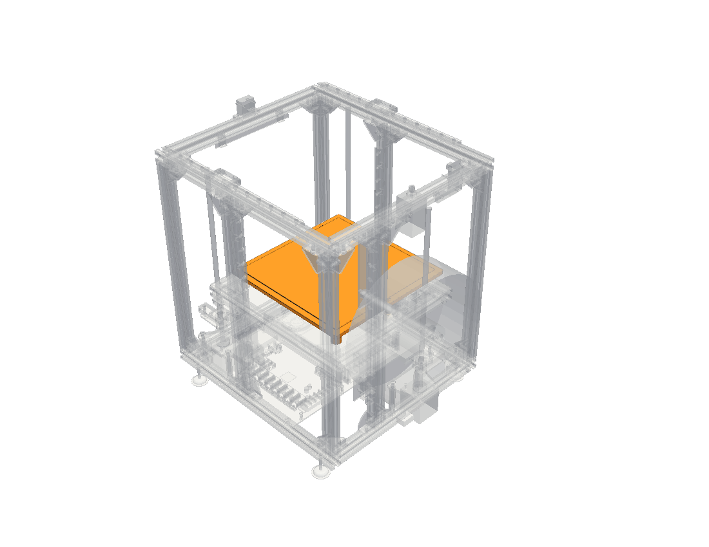

Orange: fitted in this stage. Grey: already there.

| # | Fit | Touches (simulation) | Screws that hold it (count x size, key, direction) | Check before moving on | Sim. step |
|---|---|---|---|---|---|
| 1 | **bed_thumb_2_washer** (WASHER-M4-LARGE) | z_deck | - | seated flat on z_deck with no gap; all its screws started before any is tightened | 697 |
| 2 | **bed_thumb_2** (THUMBNUT-DIN466-M4) | bed_thumb_2_washer | - | seated flat on bed_thumb_2_washer with no gap; all its screws started before any is tightened | 698 |
| 3 | **bed_thumb_1_washer** (WASHER-M4-LARGE) | z_deck | - | seated flat on z_deck with no gap; all its screws started before any is tightened | 699 |
| 4 | **bed_thumb_1** (THUMBNUT-DIN466-M4) | bed_thumb_1_washer | - | seated flat on bed_thumb_1_washer with no gap; all its screws started before any is tightened | 700 |
| 5 | **bed_thumb_0_washer** (WASHER-M4-LARGE) | z_deck | - | seated flat on z_deck with no gap; all its screws started before any is tightened | 701 |
| 6 | **bed_thumb_0** (THUMBNUT-DIN466-M4) | bed_thumb_0_washer | - | seated flat on bed_thumb_0_washer with no gap; all its screws started before any is tightened | 702 |
| 7 | bench unit **bed_unit** | bed_thumb_0, bed_thumb_1, bed_thumb_2 | - | the bench unit is complete (its own table above); it sits flat on what it bolts to before any screw is tightened | 703 |
| 8 | **bed_magnet** (WHAMBAM-MAGNETIC-BASE-220) | bed_plate | - | seated flat on bed_plate with no gap; all its screws started before any is tightened | 704 |
| 9 | **bed** (WHAMBAM-PEI-PLATE-220) | bed_magnet | - | seated flat on bed_magnet with no gap; all its screws started before any is tightened | 706 |

No tapping in the bed plate. Countersink the three holes from the top face if SendCutSend did not (90 degrees to 8.96 mm for M4). Then, plate upside down on the bench: each M4 x 40 FULLY THREADED countersunk screw through from the top face, washer and nut under the plate with medium thread locker, tightened against the countersink (the screw is now a fixed stud); heater pad (230 x 207 mm, between the front studs' and the rear stud's washers) and thermal cut-off bonded under the plate.
Springs over the three studs, an M4 washer on each spring. Lower the plate so the studs pass the deck's three holes (stud 0, front left, has the fitted hole; front right the slot; rear the oversize hole). From below: large M4 washer and thumb nut on each stud. Run every thumb nut up until its spring is 12.0 mm long (plate underside 16.8 mm above the deck), then level (adjustment section). THEN the magnetic base and the print sheet, both centred on the plate.
Division of labour (docs/PRINTER_V10.md, 'Motor tilt'): the thumb nuts are for the one-time coarse tram. Turn them until the first pass of Z_TILT_ADJUST reports less than 0.4 mm at every screw (a quarter turn is 0.175 mm; each nut has +/-1.5 mm); from then on the three motors level the bed at every print start. Do not let the motors take out more than about 1.2 mm at one screw: beyond that the nuts are forced out of square in their seats, and at about 1.7 mm the side blocks and the carriage plates' webs reach their limits.

### Stage: Gantry: Y plates, X beam, X rail, X drive

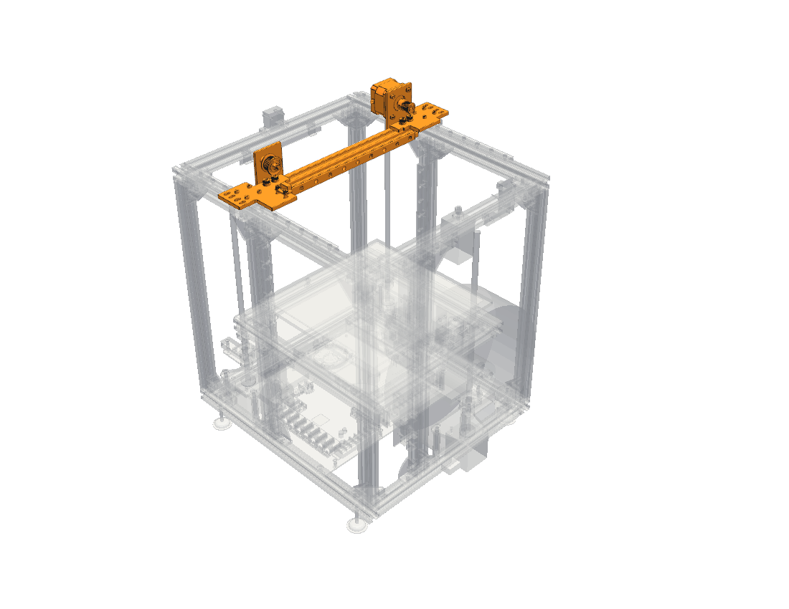

Orange: fitted in this stage. Grey: already there.

| # | Fit | Touches (simulation) | Screws that hold it (count x size, key, direction) | Check before moving on | Sim. step |
|---|---|---|---|---|---|
| 1 | **y_plate_right** (custom) | y_carriage_right | 4 x M3x8 cap screw, 2.5 mm key, from above, pointing down (-Z) (y_plate_right_screw_3, y_plate_right_screw_2, y_plate_right_screw_1, y_plate_right_screw_0) | seated flat on y_carriage_right with no gap; all its screws started before any is tightened | 160 |
| 2 | **x_beam** (EXT2020-276) | y_plate_right | - | ends flush and square to the neighbouring members (set square on two faces) | 161 |
| 3 | **beam_bolt_right_1_tnut** (TNUT-2020-M5) | x_beam | - | seated flat on x_beam with no gap; all its screws started before any is tightened | 162 |
| 4 | **beam_bolt_right_1_washer** (WASHER-M5) | y_plate_right | - | seated flat on y_plate_right with no gap; all its screws started before any is tightened | 163 |
| 5 | **beam_bolt_right_1_washer_2** (WASHER-M5) | beam_bolt_right_1_washer | 1 x M5x12 cap screw, 4 mm key, from above, pointing down (-Z), into T-nut (beam_bolt_right_1) | seated flat on beam_bolt_right_1_washer with no gap; all its screws started before any is tightened | 164 |
| 6 | **beam_bolt_right_tnut** (TNUT-2020-M5) | x_beam | - | seated flat on x_beam with no gap; all its screws started before any is tightened | 166 |
| 7 | **beam_bolt_right_washer** (WASHER-M5) | y_plate_right | - | seated flat on y_plate_right with no gap; all its screws started before any is tightened | 167 |
| 8 | **beam_bolt_right_washer_2** (WASHER-M5) | beam_bolt_right_washer | 1 x M5x12 cap screw, 4 mm key, from above, pointing down (-Z), into T-nut (beam_bolt_right) | seated flat on beam_bolt_right_washer with no gap; all its screws started before any is tightened | 168 |
| 9 | **y_plate_left** (custom) | x_beam | 4 x M3x8 cap screw, 2.5 mm key, from above, pointing down (-Z) (y_plate_left_screw_3, y_plate_left_screw_2, y_plate_left_screw_1, y_plate_left_screw_0) | seated flat on x_beam with no gap; all its screws started before any is tightened | 175 |
| 10 | **beam_bolt_left_1_tnut** (TNUT-2020-M5) | x_beam | - | seated flat on x_beam with no gap; all its screws started before any is tightened | 176 |
| 11 | **beam_bolt_left_1_washer** (WASHER-M5) | y_plate_left | - | seated flat on y_plate_left with no gap; all its screws started before any is tightened | 177 |
| 12 | **beam_bolt_left_1_washer_2** (WASHER-M5) | beam_bolt_left_1_washer | 1 x M5x12 cap screw, 4 mm key, from above, pointing down (-Z), into T-nut (beam_bolt_left_1) | seated flat on beam_bolt_left_1_washer with no gap; all its screws started before any is tightened | 178 |
| 13 | **beam_bolt_left_tnut** (TNUT-2020-M5) | x_beam | - | seated flat on x_beam with no gap; all its screws started before any is tightened | 180 |
| 14 | **beam_bolt_left_washer** (WASHER-M5) | y_plate_left | - | seated flat on y_plate_left with no gap; all its screws started before any is tightened | 181 |
| 15 | **beam_bolt_left_washer_2** (WASHER-M5) | beam_bolt_left_washer | 1 x M5x12 cap screw, 4 mm key, from above, pointing down (-Z), into T-nut (beam_bolt_left) | seated flat on beam_bolt_left_washer with no gap; all its screws started before any is tightened | 182 |
| 16 | bench unit **x_drive** | x_beam | - | the bench unit is complete (its own table above); it sits flat on what it bolts to before any screw is tightened | 385 |
| 17 | **x_motor_mount_bolt_1_tnut** (TNUT-2020-M5) | x_beam | - | seated flat on x_beam with no gap; all its screws started before any is tightened | 386 |
| 18 | **x_motor_mount_bolt_1_washer** (WASHER-M5) | x_motor_mount | 1 x M5x8 cap screw, 4 mm key, from the front, pointing back (+Y), into T-nut (x_motor_mount_bolt_1) | seated flat on x_motor_mount with no gap; all its screws started before any is tightened | 387 |
| 19 | **x_motor_mount_bolt_0_tnut** (TNUT-2020-M5) | x_beam | - | seated flat on x_beam with no gap; all its screws started before any is tightened | 389 |
| 20 | **x_motor_mount_bolt_0_washer** (WASHER-M5) | x_motor_mount | 1 x M5x8 cap screw, 4 mm key, from the front, pointing back (+Y), into T-nut (x_motor_mount_bolt_0) | seated flat on x_motor_mount with no gap; all its screws started before any is tightened | 390 |
| 21 | bench unit **x_idler_unit** | x_beam | - | the bench unit is complete (its own table above); it sits flat on what it bolts to before any screw is tightened | 392 |
| 22 | **x_idler_mount_bolt_1_tnut** (TNUT-2020-M5) | x_beam | - | seated flat on x_beam with no gap; all its screws started before any is tightened | 393 |
| 23 | **x_idler_mount_bolt_1_washer** (WASHER-M5) | x_idler_mount | 1 x M5x8 cap screw, 4 mm key, from the front, pointing back (+Y), into T-nut (x_idler_mount_bolt_1) | seated flat on x_idler_mount with no gap; all its screws started before any is tightened | 394 |
| 24 | **x_idler_mount_bolt_0_tnut** (TNUT-2020-M5) | x_beam | - | seated flat on x_beam with no gap; all its screws started before any is tightened | 396 |
| 25 | **x_idler_mount_bolt_0_washer** (WASHER-M5) | x_idler_mount | 1 x M5x8 cap screw, 4 mm key, from the front, pointing back (+Y), into T-nut (x_idler_mount_bolt_0) | seated flat on x_idler_mount with no gap; all its screws started before any is tightened | 397 |
| 26 | **x_rail** (HIWIN-MGNR12R-245) | x_beam | - | seated flat on x_beam with no gap; all its screws started before any is tightened | 441 |
| 27 | **x_endstop_spacer_1** (SPACER-HARWIN-R30-6700594) | y_plate_right | - | seated flat on y_plate_right with no gap; all its screws started before any is tightened | 517 |
| 28 | **x_endstop_carrier** (custom) | x_endstop_spacer_1 | - | seated flat on x_endstop_spacer_1 with no gap; all its screws started before any is tightened | 518 |
| 29 | **x_endstop_nut_1** (NUT-M3) | y_plate_right | - | seated flat on y_plate_right with no gap; all its screws started before any is tightened | 519 |
| 30 | **x_endstop_screw_1_washer** (WASHER-M3) | x_endstop_carrier | - | seated flat on x_endstop_carrier with no gap; all its screws started before any is tightened | 520 |
| 31 | **x_endstop_nwasher_1** (WASHER-M3) | x_endstop_nut_1, y_plate_right | 1 x M3x16 cap screw, 2.5 mm key, from above, pointing down (-Z) (x_endstop_screw_1) | seated flat on x_endstop_nut_1, y_plate_right with no gap; all its screws started before any is tightened | 521 |
| 32 | **x_endstop_nut_0** (NUT-M3) | y_plate_right | - | seated flat on y_plate_right with no gap; all its screws started before any is tightened | 523 |
| 33 | **x_endstop_spacer_0** (SPACER-HARWIN-R30-6700594) | x_endstop_carrier, y_plate_right | - | seated flat on x_endstop_carrier, y_plate_right with no gap; all its screws started before any is tightened | 524 |
| 34 | **x_endstop_screw_0_washer** (WASHER-M3) | x_endstop_carrier | - | seated flat on x_endstop_carrier with no gap; all its screws started before any is tightened | 525 |
| 35 | **x_endstop_nwasher_0** (WASHER-M3) | x_endstop_nut_0, y_plate_right | 1 x M3x16 cap screw, 2.5 mm key, from above, pointing down (-Z) (x_endstop_screw_0) | seated flat on x_endstop_nut_0, y_plate_right with no gap; all its screws started before any is tightened | 526 |
| 36 | **x_rail_screw_5_tnut** (TNUT-2020-M3) | x_beam | 1 x M3x8 cap screw, 2.5 mm key, from the back, pointing forward (-Y), into T-nut (x_rail_screw_5) | seated flat on x_beam with no gap; all its screws started before any is tightened | 633 |
| 37 | **x_rail_screw_4_tnut** (TNUT-2020-M3) | x_beam | 1 x M3x8 cap screw, 2.5 mm key, from the back, pointing forward (-Y), into T-nut (x_rail_screw_4) | seated flat on x_beam with no gap; all its screws started before any is tightened | 635 |
| 38 | **x_rail_screw_3_tnut** (TNUT-2020-M3) | x_beam | 1 x M3x8 cap screw, 2.5 mm key, from the back, pointing forward (-Y), into T-nut (x_rail_screw_3) | seated flat on x_beam with no gap; all its screws started before any is tightened | 637 |
| 39 | **x_rail_screw_2_tnut** (TNUT-2020-M3) | x_beam | 1 x M3x8 cap screw, 2.5 mm key, from the back, pointing forward (-Y), into T-nut (x_rail_screw_2) | seated flat on x_beam with no gap; all its screws started before any is tightened | 639 |
| 40 | **x_rail_screw_1_tnut** (TNUT-2020-M3) | x_beam | 1 x M3x8 cap screw, 2.5 mm key, from the back, pointing forward (-Y), into T-nut (x_rail_screw_1) | seated flat on x_beam with no gap; all its screws started before any is tightened | 641 |
| 41 | **x_rail_screw_0_tnut** (TNUT-2020-M3) | x_beam | 1 x M3x8 cap screw, 2.5 mm key, from the back, pointing forward (-Y), into T-nut (x_rail_screw_0) | seated flat on x_beam with no gap; all its screws started before any is tightened | 643 |
| 42 | **x_endstop** (ENDSTOP-OMRON-D2F-01L) | x_endstop_carrier | - | lever moves freely; leave the screws nipped: the switch is set in the adjustment section | 719 |

Leave the beam bolts in the Y plates' slots nipped until both Y rails are aligned: the slots let the gantry take up the frame's width error.
X rail (v10): HIWIN MGNR12R cut to 288 mm, flush with both ends of the 288 mm beam. Slide the X block on BEFORE the second Y plate goes on the beam: there are no separate rail stops any more, the Y plates' tabs are the stops (they meet the tool plates' edges 1.5 mm beyond the travel). Until both Y plates are on, tape the block to the rail.
X motor and idler stand outboard of the beam's ends, over the Y plates. Motor: on its 3.175 mm plate with four M3 x 8 and washers, as v9 (do not substitute longer screws). Fit the Y plates and the Y blocks' screws first; the motor plate's and the idler plate's wings pass 1.5 mm above those screw heads, the motor's body 2.1 mm.
X belt plane: the tolerance model puts the idler and the belt clamp more than 1 mm out of plane in about 6 % of builds. Sight along the belt after tensioning; if it rides against a flange of the idler, add or remove an M5 shim washer beside the idler's spacer. The motor's pulley is set on its shaft to the same plane.
X switch: on top of the right Y plate's land, on two 5.5 mm spacers, M3 x 16 from above, normal washer and nut under the land (they pass 1.3 mm above the right Y rail: use these lengths). The front tool plate's striker tab works its lever; X homes at the RIGHT end.
Y switch: on the bent bracket bolted into the right top rail's top slot behind the Y rail's end; the rear edge of the right Y plate's land works its lever. Slide the bracket along the slot to set it (adjustment section).
HeaterCore: clip it on with its lead sleeve pointing FORWARD, under the tool plates (2.2 mm) and the X block; the leads then turn back under the beam and run up the Roto's left side to the toolhead loom: tie them to the probe holder so the loop under the beam stays above the nozzle. Not backward (the probe's metal-free zone) and not sideways (the sleeve would meet the top side rail).
Toolhead loom: clamp it on TOP of the top back rail at x 118 and lead it over the rail's rear edge on a radius of 30 mm or more, down the outside of the back wall beside the right Y motor, and in again over the bottom back rail. Nothing may hang inside the frame's rear right corner: the toolhead comes within 2.4 mm of the right top rail and 1.4 mm of the back rail.

### Stage: Y drives, idlers, tensioners, Y endstop

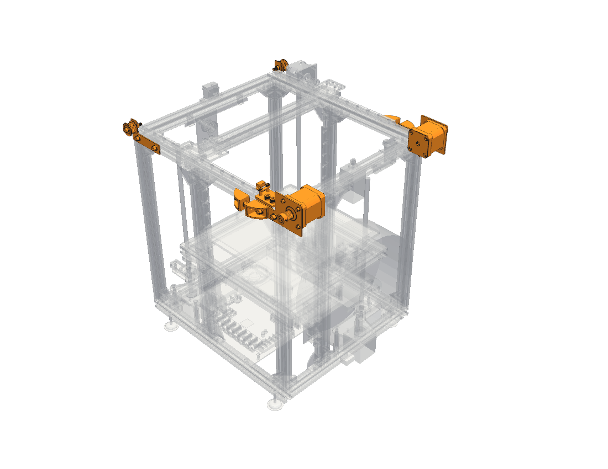

Orange: fitted in this stage. Grey: already there.

| # | Fit | Touches (simulation) | Screws that hold it (count x size, key, direction) | Check before moving on | Sim. step |
|---|---|---|---|---|---|
| 1 | **y_idler_mount_l** (custom) | post_lf | - | seated flat on post_lf with no gap; all its screws started before any is tightened | 84 |
| 2 | **y_idler_l_spacer** (WASHER-M5) | y_idler_mount_l | - | seated flat on y_idler_mount_l with no gap; all its screws started before any is tightened | 85 |
| 3 | **y_idler_l_spacer_b** (WASHER-M5) | y_idler_l_spacer | - | seated flat on y_idler_l_spacer with no gap; all its screws started before any is tightened | 86 |
| 4 | **y_idler_l** (GT2-IDLER-30T-B5-W9) | y_idler_l_spacer_b | - | seated flat on y_idler_l_spacer_b with no gap; all its screws started before any is tightened | 87 |
| 5 | **y_idler_l_nut** (NUT-M5-DIN934) | y_idler_mount_l | - | seated flat on y_idler_mount_l with no gap; all its screws started before any is tightened | 88 |
| 6 | **y_idler_l_nwasher** (WASHER-M5) | y_idler_l_nut, y_idler_mount_l | 1 x M5x30 cap screw, 4 mm key, from the left, pointing right (+X) (y_idler_l_bolt) | seated flat on y_idler_l_nut, y_idler_mount_l with no gap; all its screws started before any is tightened | 89 |
| 7 | **y_idler_mount** (custom) | post_rf | - | seated flat on post_rf with no gap; all its screws started before any is tightened | 91 |
| 8 | **y_idler_spacer** (WASHER-M5) | y_idler_mount | - | seated flat on y_idler_mount with no gap; all its screws started before any is tightened | 92 |
| 9 | **y_idler_spacer_b** (WASHER-M5) | y_idler_spacer | - | seated flat on y_idler_spacer with no gap; all its screws started before any is tightened | 93 |
| 10 | **y_idler** (GT2-IDLER-30T-B5-W9) | y_idler_spacer_b | - | seated flat on y_idler_spacer_b with no gap; all its screws started before any is tightened | 94 |
| 11 | **y_idler_nut** (NUT-M5-DIN934) | y_idler_mount | - | seated flat on y_idler_mount with no gap; all its screws started before any is tightened | 95 |
| 12 | **y_idler_nwasher** (WASHER-M5) | y_idler_mount, y_idler_nut | 1 x M5x30 cap screw, 4 mm key, from the right, pointing left (-X) (y_idler_bolt) | seated flat on y_idler_mount, y_idler_nut with no gap; all its screws started before any is tightened | 96 |
| 13 | **y_tension_anchor_l** (HBLFSNF5) | frame_top_left | - | seated flat on frame_top_left with no gap; all its screws started before any is tightened | 129 |
| 14 | **y_tension_anchor_l_screw_a_tnut** (HNTP5-5) | frame_top_left | 1 x BHCS-FL-M5x10 cap screw, 3 mm key, from the left, pointing right (+X), into T-nut (y_tension_anchor_l_screw_a) | seated flat on frame_top_left with no gap; all its screws started before any is tightened | 130 |
| 15 | bench unit **y_drive_l** | frame_top_left | - | the bench unit is complete (its own table above); it sits flat on what it bolts to before any screw is tightened | 132 |
| 16 | **y_tension_screw_l_rear_washer** (WASHER-M5) | y_tension_anchor_l | - | seated flat on y_tension_anchor_l with no gap; all its screws started before any is tightened | 133 |
| 17 | **y_tension_screw_l_front_washer** (WASHER-M5) | y_tension_anchor_l | - | seated flat on y_tension_anchor_l with no gap; all its screws started before any is tightened | 134 |
| 18 | **y_tension_screw_l** (SHCS-M5x30) | y_tension_screw_l_front_washer, y_tension_screw_l_rear_washer | - | seated flat on y_tension_screw_l_front_washer, y_tension_screw_l_rear_washer with no gap; all its screws started before any is tightened | 135 |
| 19 | **y_tension_bracket_l** (HBLFSNF5) | y_motor_mount_l, y_tension_screw_l | - | seated flat on y_motor_mount_l, y_tension_screw_l with no gap; all its screws started before any is tightened | 136 |
| 20 | **y_motor_mount_l_bolt_0_tnut** (TNUT-2020-M5) | frame_top_left | - | seated flat on frame_top_left with no gap; all its screws started before any is tightened | 137 |
| 21 | **y_motor_mount_l_bolt_0_washer** (WASHER-M5) | y_tension_bracket_l | 1 x M5x12 cap screw, 4 mm key, from the left, pointing right (+X), into T-nut (y_motor_mount_l_bolt_0) | seated flat on y_tension_bracket_l with no gap; all its screws started before any is tightened | 138 |
| 22 | **y_tension_anchor** (HBLFSNF5) | frame_top_right | - | seated flat on frame_top_right with no gap; all its screws started before any is tightened | 143 |
| 23 | **y_tension_anchor_screw_a_tnut** (HNTP5-5) | frame_top_right | 1 x BHCS-FL-M5x10 cap screw, 3 mm key, from the right, pointing left (-X), into T-nut (y_tension_anchor_screw_a) | seated flat on frame_top_right with no gap; all its screws started before any is tightened | 144 |
| 24 | bench unit **y_drive** | frame_top_right | - | the bench unit is complete (its own table above); it sits flat on what it bolts to before any screw is tightened | 146 |
| 25 | **y_tension_screw_rear_washer** (WASHER-M5) | y_tension_anchor | - | seated flat on y_tension_anchor with no gap; all its screws started before any is tightened | 147 |
| 26 | **y_tension_screw_front_washer** (WASHER-M5) | y_tension_anchor | - | seated flat on y_tension_anchor with no gap; all its screws started before any is tightened | 148 |
| 27 | **y_tension_screw** (SHCS-M5x30) | y_tension_screw_front_washer, y_tension_screw_rear_washer | - | seated flat on y_tension_screw_front_washer, y_tension_screw_rear_washer with no gap; all its screws started before any is tightened | 149 |
| 28 | **y_tension_bracket** (HBLFSNF5) | y_motor_mount, y_tension_screw | - | seated flat on y_motor_mount, y_tension_screw with no gap; all its screws started before any is tightened | 150 |
| 29 | **y_motor_mount_bolt_0_tnut** (TNUT-2020-M5) | frame_top_right | - | seated flat on frame_top_right with no gap; all its screws started before any is tightened | 151 |
| 30 | **y_motor_mount_bolt_0_washer** (WASHER-M5) | y_tension_bracket | 1 x M5x12 cap screw, 4 mm key, from the right, pointing left (-X), into T-nut (y_motor_mount_bolt_0) | seated flat on y_tension_bracket with no gap; all its screws started before any is tightened | 152 |
| 31 | **y_motor_mount_l_bolt_1_tnut** (TNUT-2020-M5) | frame_top_left | - | seated flat on frame_top_left with no gap; all its screws started before any is tightened | 360 |
| 32 | **y_motor_mount_l_bolt_1_washer** (WASHER-M5) | y_motor_mount_l | 1 x M5x8 cap screw, 4 mm key, from the left, pointing right (+X), into T-nut (y_motor_mount_l_bolt_1) | seated flat on y_motor_mount_l with no gap; all its screws started before any is tightened | 361 |
| 33 | **y_motor_mount_bolt_1_tnut** (TNUT-2020-M5) | frame_top_right | - | seated flat on frame_top_right with no gap; all its screws started before any is tightened | 363 |
| 34 | **y_motor_mount_bolt_1_washer** (WASHER-M5) | y_motor_mount | 1 x M5x8 cap screw, 4 mm key, from the right, pointing left (-X), into T-nut (y_motor_mount_bolt_1) | seated flat on y_motor_mount with no gap; all its screws started before any is tightened | 364 |
| 35 | **y_idler_mount_l_bolt_1_tnut** (TNUT-2020-M5) | frame_top_left | - | seated flat on frame_top_left with no gap; all its screws started before any is tightened | 366 |
| 36 | **y_idler_mount_l_bolt_1_washer** (WASHER-M5) | y_idler_mount_l | 1 x M5x8 cap screw, 4 mm key, from the left, pointing right (+X), into T-nut (y_idler_mount_l_bolt_1) | seated flat on y_idler_mount_l with no gap; all its screws started before any is tightened | 367 |
| 37 | **y_idler_mount_l_bolt_0_tnut** (TNUT-2020-M5) | frame_top_left | - | seated flat on frame_top_left with no gap; all its screws started before any is tightened | 369 |
| 38 | **y_idler_mount_l_bolt_0_washer** (WASHER-M5) | y_idler_mount_l | 1 x M5x8 cap screw, 4 mm key, from the left, pointing right (+X), into T-nut (y_idler_mount_l_bolt_0) | seated flat on y_idler_mount_l with no gap; all its screws started before any is tightened | 370 |
| 39 | **y_idler_mount_bolt_1_tnut** (TNUT-2020-M5) | frame_top_right | - | seated flat on frame_top_right with no gap; all its screws started before any is tightened | 372 |
| 40 | **y_idler_mount_bolt_1_washer** (WASHER-M5) | y_idler_mount | 1 x M5x8 cap screw, 4 mm key, from the right, pointing left (-X), into T-nut (y_idler_mount_bolt_1) | seated flat on y_idler_mount with no gap; all its screws started before any is tightened | 373 |
| 41 | **y_idler_mount_bolt_0_tnut** (TNUT-2020-M5) | frame_top_right | - | seated flat on frame_top_right with no gap; all its screws started before any is tightened | 375 |
| 42 | **y_idler_mount_bolt_0_washer** (WASHER-M5) | y_idler_mount | 1 x M5x8 cap screw, 4 mm key, from the right, pointing left (-X), into T-nut (y_idler_mount_bolt_0) | seated flat on y_idler_mount with no gap; all its screws started before any is tightened | 376 |
| 43 | **y_endstop_mount** (custom) | frame_top_back, frame_top_right | - | seated flat on frame_top_back, frame_top_right with no gap; all its screws started before any is tightened | 378 |
| 44 | **y_endstop_mount_bolt_1_tnut** (TNUT-2020-M5) | frame_top_right | - | seated flat on frame_top_right with no gap; all its screws started before any is tightened | 379 |
| 45 | **y_endstop_mount_bolt_1_washer** (WASHER-M5) | y_endstop_mount | 1 x M5x8 cap screw, 4 mm key, from above, pointing down (-Z), into T-nut (y_endstop_mount_bolt_1) | seated flat on y_endstop_mount with no gap; all its screws started before any is tightened | 380 |
| 46 | **y_endstop_mount_bolt_0_tnut** (TNUT-2020-M5) | frame_top_right | - | seated flat on frame_top_right with no gap; all its screws started before any is tightened | 382 |
| 47 | **y_endstop_mount_bolt_0_washer** (WASHER-M5) | y_endstop_mount | 1 x M5x8 cap screw, 4 mm key, from above, pointing down (-Z), into T-nut (y_endstop_mount_bolt_0) | seated flat on y_endstop_mount with no gap; all its screws started before any is tightened | 383 |
| 48 | **y_endstop_spacer_1** (SPACER-HARWIN-R30-6700894) | y_endstop_mount | - | seated flat on y_endstop_mount with no gap; all its screws started before any is tightened | 507 |
| 49 | **y_endstop_carrier** (custom) | y_endstop_spacer_1 | - | seated flat on y_endstop_spacer_1 with no gap; all its screws started before any is tightened | 508 |
| 50 | **y_endstop_nut_1** (NUT-M3) | y_endstop_mount | - | seated flat on y_endstop_mount with no gap; all its screws started before any is tightened | 509 |
| 51 | **y_endstop_screw_1_washer** (WASHER-M3) | y_endstop_carrier | - | seated flat on y_endstop_carrier with no gap; all its screws started before any is tightened | 510 |
| 52 | **y_endstop_nwasher_1** (WASHER-M3) | y_endstop_mount, y_endstop_nut_1 | 1 x M3x18 cap screw, 2.5 mm key, from above, pointing down (-Z) (y_endstop_screw_1) | seated flat on y_endstop_mount, y_endstop_nut_1 with no gap; all its screws started before any is tightened | 511 |
| 53 | **y_endstop_screw_0_tnut** (TNUT-2020-M3) | frame_top_right | - | seated flat on frame_top_right with no gap; all its screws started before any is tightened | 513 |
| 54 | **y_endstop_spacer_0** (SPACER-HARWIN-R30-6700894) | y_endstop_carrier, y_endstop_mount | - | seated flat on y_endstop_carrier, y_endstop_mount with no gap; all its screws started before any is tightened | 514 |
| 55 | **y_endstop_screw_0_washer** (WASHER-M3) | y_endstop_carrier | 1 x M3x18 cap screw, 2.5 mm key, from above, pointing down (-Z), into T-nut (y_endstop_screw_0) | seated flat on y_endstop_carrier with no gap; all its screws started before any is tightened | 515 |
| 56 | **y_endstop** (ENDSTOP-OMRON-D2F-01L) | y_endstop_carrier | - | lever moves freely; leave the screws nipped: the switch is set in the adjustment section | 718 |
| 57 | **y_tension_screw_rear_nut** (NUT-M5-DIN934) | y_tension_anchor, y_tension_screw, y_tension_screw_rear_washer | - | seated flat on y_tension_anchor, y_tension_screw with no gap; all its screws started before any is tightened | 720 |
| 58 | **y_tension_screw_l_rear_nut** (NUT-M5-DIN934) | y_tension_anchor_l, y_tension_screw_l, y_tension_screw_l_rear_washer | - | seated flat on y_tension_anchor_l, y_tension_screw_l with no gap; all its screws started before any is tightened | 721 |
| 59 | **y_tension_screw_l_front_nut** (NUT-M5-DIN934) | y_tension_anchor_l, y_tension_screw_l, y_tension_screw_l_front_washer | - | seated flat on y_tension_anchor_l, y_tension_screw_l with no gap; all its screws started before any is tightened | 722 |
| 60 | **y_tension_screw_front_nut** (NUT-M5-DIN934) | y_tension_anchor, y_tension_screw, y_tension_screw_front_washer | - | seated flat on y_tension_anchor, y_tension_screw with no gap; all its screws started before any is tightened | 723 |

### Stage: Toolhead: plate, extruder, hotend, probe, part cooling

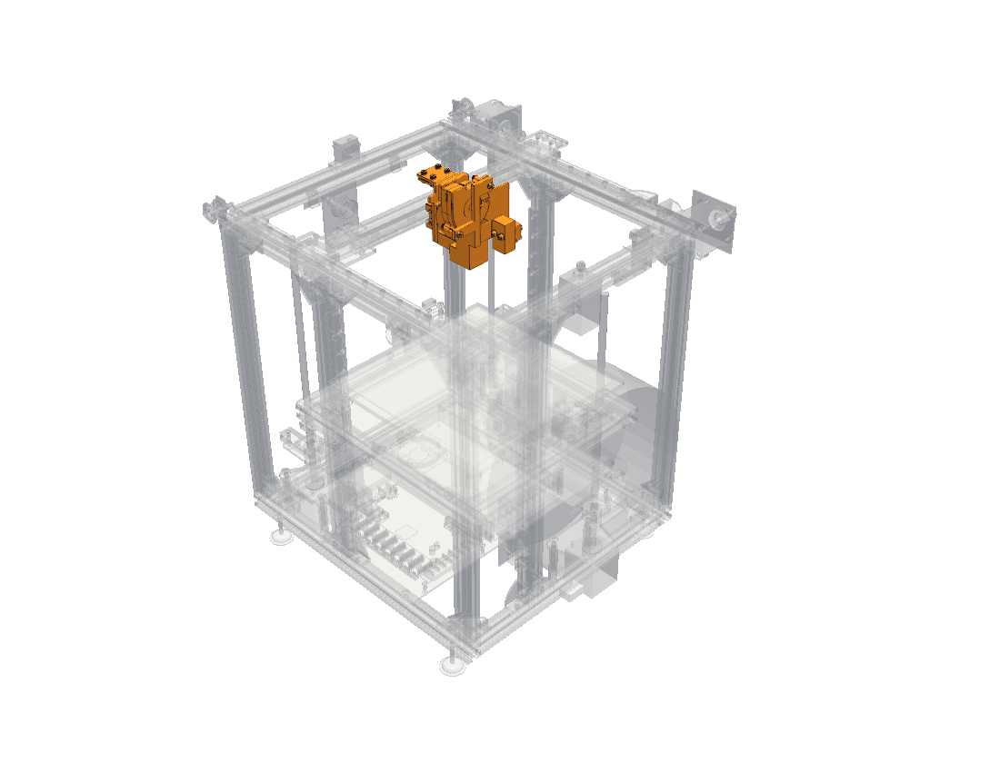

Orange: fitted in this stage. Grey: already there.

| # | Fit | Touches (simulation) | Screws that hold it (count x size, key, direction) | Check before moving on | Sim. step |
|---|---|---|---|---|---|
| 1 | **x_carriage** (HIWIN-MGN12HZ0C) | x_rail | - | the block is slid on without losing balls (keep it on its plastic keeper until the rail is under it); it runs the whole rail by hand with even drag | 442 |
| 2 | **tool_plate** (custom) | x_carriage | 4 x M3x6 cap screw, 2.5 mm key, from the back, pointing forward (-Y) (tool_screw_3, tool_screw_2, tool_screw_1, tool_screw_0) | seated flat on x_carriage with no gap; all its screws started before any is tightened | 443 |
| 3 | **tool_plate_rear** (custom) | tool_plate | - | seated flat on tool_plate with no gap; all its screws started before any is tightened | 448 |
| 4 | **x_belt_bracket_nut_1** (NUT-M3) | tool_plate, tool_plate_rear | - | seated flat on tool_plate, tool_plate_rear with no gap; all its screws started before any is tightened | 449 |
| 5 | **x_belt_bracket_nut_0** (NUT-M3) | tool_plate, tool_plate_rear | - | seated flat on tool_plate, tool_plate_rear with no gap; all its screws started before any is tightened | 450 |
| 6 | **extruder_nut_1** (NUT-PEM-S-M3-0) | tool_plate | - | seated flat on tool_plate with no gap; all its screws started before any is tightened | 451 |
| 7 | **extruder_nut_0** (NUT-PEM-S-M3-0) | tool_plate | - | seated flat on tool_plate with no gap; all its screws started before any is tightened | 452 |
| 8 | **extruder** (EXTRUDER-E3D-ROTO) | tool_plate_rear | - | seated flat on tool_plate_rear with no gap; all its screws started before any is tightened | 453 |
| 9 | **probe_mount** (custom) | extruder | - | seated flat on extruder with no gap; all its screws started before any is tightened | 454 |
| 10 | **extruder_screw_1_washer** (WASHER-M3-LARGE) | probe_mount | - | seated flat on probe_mount with no gap; all its screws started before any is tightened | 455 |
| 11 | **extruder_screw_1_washer_2** (WASHER-M3-LARGE) | extruder_screw_1_washer | 1 x M3x50 cap screw, 2.5 mm key, from the back, pointing forward (-Y) (extruder_screw_1) | seated flat on extruder_screw_1_washer with no gap; all its screws started before any is tightened | 456 |
| 12 | **extruder_screw_0_washer** (WASHER-M3-LARGE) | probe_mount | - | seated flat on probe_mount with no gap; all its screws started before any is tightened | 458 |
| 13 | **extruder_screw_0_washer_2** (WASHER-M3-LARGE) | extruder_screw_0_washer | 1 x M3x50 cap screw, 2.5 mm key, from the back, pointing forward (-Y) (extruder_screw_0) | seated flat on extruder_screw_0_washer with no gap; all its screws started before any is tightened | 459 |
| 14 | **eddy_holder** (custom) | probe_mount | - | seated flat on probe_mount with no gap; all its screws started before any is tightened | 464 |
| 15 | **bed_probe** (PROBE-BTT-EDDY-DUO) | eddy_holder | - | leave its nuts finger-tight: the height is set in the adjustment section | 465 |
| 16 | **eddy_bolt_1_nut** (NUT-M3-NYLOC) | bed_probe | - | seated flat on bed_probe with no gap; all its screws started before any is tightened | 466 |
| 17 | **eddy_bolt_1_washer** (WASHER-M3) | eddy_holder | - | seated flat on eddy_holder with no gap; all its screws started before any is tightened | 467 |
| 18 | **eddy_bolt_1_nwasher** (WASHER-M3) | bed_probe, eddy_bolt_1_nut | 1 x M3x30 cap screw, 2.5 mm key, from the left, pointing right (+X) (eddy_bolt_1) | seated flat on bed_probe, eddy_bolt_1_nut with no gap; all its screws started before any is tightened | 468 |
| 19 | **eddy_bolt_0_nut** (NUT-M3-NYLOC) | bed_probe | - | seated flat on bed_probe with no gap; all its screws started before any is tightened | 470 |
| 20 | **eddy_bolt_0_washer** (WASHER-M3) | eddy_holder | - | seated flat on eddy_holder with no gap; all its screws started before any is tightened | 471 |
| 21 | **eddy_bolt_0_nwasher** (WASHER-M3) | bed_probe, eddy_bolt_0_nut | 1 x M3x30 cap screw, 2.5 mm key, from the left, pointing right (+X) (eddy_bolt_0) | seated flat on bed_probe, eddy_bolt_0_nut with no gap; all its screws started before any is tightened | 472 |
| 22 | **part_duct** (custom) | tool_plate_rear | - | seated flat on tool_plate_rear with no gap; all its screws started before any is tightened | 474 |
| 23 | **part_fan** (FAN-BLOWER-5015-BFB0524HH) | part_duct | - | seated flat on part_duct with no gap; all its screws started before any is tightened | 475 |
| 24 | **part_fan_screw_1_nut** (NUT-M3) | part_duct | - | seated flat on part_duct with no gap; all its screws started before any is tightened | 476 |
| 25 | **part_fan_screw_1_washer** (WASHER-M3) | part_fan | - | seated flat on part_fan with no gap; all its screws started before any is tightened | 477 |
| 26 | **part_fan_screw_1_nwasher** (WASHER-M3) | part_duct, part_fan_screw_1_nut | 1 x M3x25 cap screw, 2.5 mm key, from the front, pointing back (+Y) (part_fan_screw_1) | seated flat on part_duct, part_fan_screw_1_nut with no gap; all its screws started before any is tightened | 478 |
| 27 | **part_fan_screw_0_nut** (NUT-M3) | part_duct | - | seated flat on part_duct with no gap; all its screws started before any is tightened | 480 |
| 28 | **part_fan_screw_0_washer** (WASHER-M3) | part_fan | - | seated flat on part_fan with no gap; all its screws started before any is tightened | 481 |
| 29 | **part_fan_screw_0_nwasher** (WASHER-M3) | part_duct, part_fan_screw_0_nut | 1 x M3x25 cap screw, 2.5 mm key, from the front, pointing back (+Y) (part_fan_screw_0) | seated flat on part_duct, part_fan_screw_0_nut with no gap; all its screws started before any is tightened | 482 |
| 30 | **part_duct_screw_1_nut** (NUT-M3-NYLOC) | part_duct | - | seated flat on part_duct with no gap; all its screws started before any is tightened | 528 |
| 31 | **part_duct_screw_1_washer** (WASHER-M3) | tool_plate | - | seated flat on tool_plate with no gap; all its screws started before any is tightened | 529 |
| 32 | **part_duct_screw_1_nwasher** (WASHER-M3) | part_duct, part_duct_screw_1_nut | 1 x M3x16 cap screw, 2.5 mm key, from the front, pointing back (+Y) (part_duct_screw_1) | seated flat on part_duct, part_duct_screw_1_nut with no gap; all its screws started before any is tightened | 530 |
| 33 | **part_duct_screw_0_nut** (NUT-M3-NYLOC) | part_duct | - | seated flat on part_duct with no gap; all its screws started before any is tightened | 532 |
| 34 | **part_duct_screw_0_washer** (WASHER-M3) | tool_plate | - | seated flat on tool_plate with no gap; all its screws started before any is tightened | 533 |
| 35 | **part_duct_screw_0_nwasher** (WASHER-M3) | part_duct, part_duct_screw_0_nut | 1 x M3x16 cap screw, 2.5 mm key, from the front, pointing back (+Y) (part_duct_screw_0) | seated flat on part_duct, part_duct_screw_0_nut with no gap; all its screws started before any is tightened | 534 |
| 36 | **x_belt_bracket** (custom) | tool_plate | - | seated flat on tool_plate with no gap; all its screws started before any is tightened | 536 |
| 37 | **x_belt_bracket_screw_1_washer** (WASHER-M3) | x_belt_bracket | 1 x M3x10 cap screw, 2.5 mm key, from the front, pointing back (+Y) (x_belt_bracket_screw_1) | seated flat on x_belt_bracket with no gap; all its screws started before any is tightened | 537 |
| 38 | **x_belt_clamp** (custom) | x_belt_bracket | - | seated flat on x_belt_bracket with no gap; all its screws started before any is tightened | 539 |
| 39 | **x_belt_clamp_screw_3_nut** (NUT-M3) | x_belt_clamp | - | seated flat on x_belt_clamp with no gap; all its screws started before any is tightened | 540 |
| 40 | **x_belt_clamp_screw_3_washer** (WASHER-M3) | x_belt_bracket | - | seated flat on x_belt_bracket with no gap; all its screws started before any is tightened | 541 |
| 41 | **x_belt_clamp_screw_3_nwasher** (WASHER-M3) | x_belt_clamp, x_belt_clamp_screw_3_nut | 1 x M3x10 cap screw, 2.5 mm key, from above, pointing down (-Z) (x_belt_clamp_screw_3) | seated flat on x_belt_clamp, x_belt_clamp_screw_3_nut with no gap; all its screws started before any is tightened | 542 |
| 42 | **x_belt_clamp_screw_2_nut** (NUT-M3) | x_belt_clamp | - | seated flat on x_belt_clamp with no gap; all its screws started before any is tightened | 544 |
| 43 | **x_belt_clamp_screw_2_washer** (WASHER-M3) | x_belt_bracket | - | seated flat on x_belt_bracket with no gap; all its screws started before any is tightened | 545 |
| 44 | **x_belt_clamp_screw_2_nwasher** (WASHER-M3) | x_belt_clamp, x_belt_clamp_screw_2_nut | 1 x M3x10 cap screw, 2.5 mm key, from above, pointing down (-Z) (x_belt_clamp_screw_2) | seated flat on x_belt_clamp, x_belt_clamp_screw_2_nut with no gap; all its screws started before any is tightened | 546 |
| 45 | **x_belt_bracket_screw_0_washer** (WASHER-M3) | x_belt_bracket | 1 x M3x10 cap screw, 2.5 mm key, from the front, pointing back (+Y) (x_belt_bracket_screw_0) | seated flat on x_belt_bracket with no gap; all its screws started before any is tightened | 548 |
| 46 | **x_belt_clamp_screw_1_nut** (NUT-M3) | x_belt_clamp | - | seated flat on x_belt_clamp with no gap; all its screws started before any is tightened | 550 |
| 47 | **x_belt_clamp_screw_1_washer** (WASHER-M3) | x_belt_bracket | - | seated flat on x_belt_bracket with no gap; all its screws started before any is tightened | 551 |
| 48 | **x_belt_clamp_screw_1_nwasher** (WASHER-M3) | x_belt_clamp, x_belt_clamp_screw_1_nut | 1 x M3x10 cap screw, 2.5 mm key, from above, pointing down (-Z) (x_belt_clamp_screw_1) | seated flat on x_belt_clamp, x_belt_clamp_screw_1_nut with no gap; all its screws started before any is tightened | 552 |
| 49 | **x_belt_clamp_screw_0_nut** (NUT-M3) | x_belt_clamp | - | seated flat on x_belt_clamp with no gap; all its screws started before any is tightened | 554 |
| 50 | **x_belt_clamp_screw_0_washer** (WASHER-M3) | x_belt_bracket | - | seated flat on x_belt_bracket with no gap; all its screws started before any is tightened | 555 |
| 51 | **x_belt_clamp_screw_0_nwasher** (WASHER-M3) | x_belt_clamp, x_belt_clamp_screw_0_nut | 1 x M3x10 cap screw, 2.5 mm key, from above, pointing down (-Z) (x_belt_clamp_screw_0) | seated flat on x_belt_clamp, x_belt_clamp_screw_0_nut with no gap; all its screws started before any is tightened | 556 |
| 52 | **eddy_holder_bolt_1_nut** (NUT-M3) | eddy_holder | - | seated flat on eddy_holder with no gap; all its screws started before any is tightened | 653 |
| 53 | **eddy_holder_bolt_1_washer** (WASHER-M3) | probe_mount | - | seated flat on probe_mount with no gap; all its screws started before any is tightened | 654 |
| 54 | **eddy_holder_bolt_1_nwasher** (WASHER-M3) | eddy_holder, eddy_holder_bolt_1_nut | 1 x M3x8 cap screw, 2.5 mm key, from below, pointing up (+Z) (eddy_holder_bolt_1) | seated flat on eddy_holder, eddy_holder_bolt_1_nut with no gap; all its screws started before any is tightened | 655 |
| 55 | **eddy_holder_bolt_0_nut** (NUT-M3) | eddy_holder | - | seated flat on eddy_holder with no gap; all its screws started before any is tightened | 657 |
| 56 | **eddy_holder_bolt_0_washer** (WASHER-M3) | probe_mount | - | seated flat on probe_mount with no gap; all its screws started before any is tightened | 658 |
| 57 | **eddy_holder_bolt_0_nwasher** (WASHER-M3) | eddy_holder, eddy_holder_bolt_0_nut | 1 x M3x8 cap screw, 2.5 mm key, from below, pointing up (+Z) (eddy_holder_bolt_0) | seated flat on eddy_holder, eddy_holder_bolt_0_nut with no gap; all its screws started before any is tightened | 659 |
| 58 | **hotend** (HOTEND-REVO-24V-40W) | extruder | - | seated flat on extruder with no gap; all its screws started before any is tightened | 711 |

## Alignment and adjustment

Every `Adjustment` the design declares, with what the tolerance simulation says it must absorb (99th percentile of the simulated builds) against what the design provides.

### z_offset: probe z_offset in the firmware

- Needed 1.24 mm (99 %); provided 1.65 mm of Z over-travel past the nominal nozzle plane.
- **Probe height (on its two nuts):** sensing face 2.5 mm above the nozzle tip as drawn. It must stay inside the face window **[1.186, 2.414] mm** above the tip (lower: the face could meet the bed before the nozzle, margin 1.186 mm; upper: the weakest sensor would not switch in time). Set it with a 2.5 mm gauge block (or stacked feeler gauges) under the face while the cold nozzle rests on the bare print sheet; tighten both nuts; re-measure.
- Then `PROBE_CALIBRATE`: predicted z_offset 1.5 mm, anywhere in [1.1, 1.9] mm over sensor spread and temperature ([1.1, 1.9] mm over unit spread alone). These figures assume the sensor reads the thin spring-steel sheet like OMRON's iron target: UNVERIFIED, see COMMISSIONING.md step B1.
- Check: PROBE_ACCURACY passes the configured `samples_tolerance`; the nozzle touches paper at Z = 0 with the bed at working temperature.

### bed_level: the knurled thumb nut under the deck at each of the three bed studs (0.7 mm per turn)

- Needed 0.72 mm (99 %); provided +/-1.5 mm of thread at each post. As built, before tramming, the bed is up to 1.44 mm out of level (99 %).
- How: at each of the four posts the plate's height is set by the nut above the tab and locked by the nut below it. Home X and Y, bring the nozzle over each post position in turn, and set each corner to the same feeler-gauge gap under the cold nozzle (or zero a dial indicator clamped to the toolhead). Go round twice. Lock each lower nut while holding the upper one with a second spanner.
- Check: all four corners within 0.1 mm of each other (half a 0.2 mm layer, the report's own criterion) after locking; re-check after the first heat cycle to working temperature. The posts' jam nuts under the plate must be tight before the magnetic sheet goes on.

### endstop (x): x switch: its screws run in slots in the right Y plate's land

- Switch x_endstop, struck by tool_plate, at the max end. Working end of travel 93.3 mm, mechanical end 94.8 mm (joint coordinates).
- Needed: 1.38 mm (99 %); provided: +/-2 mm. As drawn, without setting, 73% of builds miss the window ([-0.1, 0.23] mm wide around the drawn position).
- How: with the switch's screws nipped, move the axis by hand to its mechanical end (against whatever stops it). Slide the switch towards the striker until it has clicked and the lever is still clear of the switch body, then back it off so the click happens between 0 and 3.0 mm before the end. Tighten.
- Check: the click is heard before the end of travel from a slow hand approach, three times; at the mechanical end the lever is not crushed on the case (the maker guarantees only 0.55 mm of lever travel past the click; case contact is 0.25 mm past the latest operating position). The axis must be stopped by the signal, never by the switch.

### endstop (y): y switch: its flat plate slides along the right top rail's top slot on its T-nuts

- Switch y_endstop, struck by y_plate_right, at the max end. Working end of travel 104.05 mm, mechanical end 105.55 mm (joint coordinates).
- Needed: 1.3 mm (99 %); provided: +/-5 mm. As drawn, without setting, 71% of builds miss the window ([-0.1, 0.23] mm wide around the drawn position).
- How: with the switch's screws nipped, move the axis by hand to its mechanical end (against whatever stops it). Slide the switch towards the striker until it has clicked and the lever is still clear of the switch body, then back it off so the click happens between 0 and 3.0 mm before the end. Tighten.
- Check: the click is heard before the end of travel from a slow hand approach, three times; at the mechanical end the lever is not crushed on the case (the maker guarantees only 0.55 mm of lever travel past the click; case contact is 0.25 mm past the latest operating position). The axis must be stopped by the signal, never by the switch.

### rail_align (y): y rails on sliding T-nuts

Design note: an M3 in the 6.2 mm slot slides +/-1.6 mm: left rail to a straight edge, right rail tightened while the gantry runs.

- Rails: y_rail_left, y_rail_right. As built, before alignment: out of parallel by up to 1.205 mm over the travel (99 %). Allowed by the maker: 0.009 mm (Hiwin MG catalogue Table 3.88 (p.104): MG_12, preload Z0). Share of builds inside that without alignment: 0.001. Adjustment provided: +/-1.6 mm (T-nuts sliding across the slot). **The machine depends on this step.**
- How: tighten the first rail against a straight edge (Y) or a square off the bottom rail (Z). Leave the second rail's screws nipped. Fit what joins the two blocks (the gantry beam; the bed carrier's back plate), run it to one end, tighten the second rail's screws nearest the block, run to the other end, tighten there, then the screws between, moving the block to each screw.
- Check: by hand the axis moves over its whole travel with the same light drag everywhere and no tight end. The maker's 0.009 mm cannot be measured with shop tools; drag is the test. The simulation's un-aligned case would add 90.4 N of drag.

### rail_align (z): z rails on sliding T-nuts

Design note: rear rail to a square; left and right rails tightened while the carrier is run up and down; what is left goes into the carriage plates' webs.

- Rails: z_rail_left, z_rail_right, z_rail_rear. As built, before alignment: out of parallel by up to 0.952 mm over the travel (99 %). Allowed by the maker: 0.009 mm (Hiwin MG catalogue Table 3.88 (p.104): MG_12, preload Z0). Share of builds inside that without alignment: 0.236. Adjustment provided: +/-1.6 mm (T-nuts sliding across the slot). **The machine depends on this step.**
- How: tighten the first rail against a straight edge (Y) or a square off the bottom rail (Z). Leave the second rail's screws nipped. Fit what joins the two blocks (the gantry beam; the bed carrier's back plate), run it to one end, tighten the second rail's screws nearest the block, run to the other end, tighten there, then the screws between, moving the block to each screw.
- Check: by hand the axis moves over its whole travel with the same light drag everywhere and no tight end. The maker's 0.009 mm cannot be measured with shop tools; drag is the test. The simulation's un-aligned case would add 5.51 N of drag.

### float (z): floating lead screw nut

- Each lead-screw nut hangs under its printed block with +/-1.8 mm of radial room; a pin in a slot stops it turning. Needed: up to 2.16 mm (99 %, worst screw: leadscrew 2.16, leadscrew_fl 2.03, leadscrew_fr 1.53). Margin -0.36 mm.
- How: nothing to set, but it must be true: the nyloc nut under each pin is left 0.2 mm slack; the nut's flange is not clamped.
- Check: with the bed at the bottom, the middle and the top of its travel, each nut can still be pushed sideways a little in its pocket in every direction. A nut hard against one side of its pocket at either end of the travel has used all its float: re-seat that screw's pedestal or mount.

### belt_tension (x): x belt: the X motor plate slides in its two slots on the beam's T-nuts, pulled outward by hand, then the two M5 are tightened

- x_belt (9 mm): **14.2 N per span** is what the motor shaft-load check used (Gates' minimum installation tension for the width; Gates' 'general' figure is 75.6 N). Tensioner travel +/-3 mm.
  - Measure by plucking a free span at the home position and reading the pitch (phone tuner app): 106.3 mm span: about 185 Hz; 244.8 mm span: about 80 Hz; 110.5 mm span: about 178 Hz. From f = sqrt(T / mu) / 2L with mu = 9.2 g/m, a figure the catalogue DERIVES from Gates' constants (not printed by Gates): treat +/-10 %.
  - Spans at home: [106.3, 244.8, 110.5] mm.
- Check: after 20 full strokes the pitch has not dropped.

### belt_tension (y): y belts: each motor plate slides on its T-nuts, pushed by an M5 tension screw positioned by two jam nuts on a cast corner bracket

- y_belt (9 mm): **14.2 N per span** is what the motor shaft-load check used (Gates' minimum installation tension for the width; Gates' 'general' figure is 75.6 N). Tensioner travel +/-3 mm.
  - Measure by plucking a free span at the home position and reading the pitch (phone tuner app): 121.5 mm span: about 162 Hz; 386.4 mm span: about 51 Hz; 229.5 mm span: about 86 Hz. From f = sqrt(T / mu) / 2L with mu = 9.2 g/m, a figure the catalogue DERIVES from Gates' constants (not printed by Gates): treat +/-10 %.
  - Spans at home: [121.5, 386.4, 229.5] mm.
- y_belt_l (9 mm): **14.2 N per span** is what the motor shaft-load check used (Gates' minimum installation tension for the width; Gates' 'general' figure is 75.6 N). Tensioner travel +/-3 mm.
  - Measure by plucking a free span at the home position and reading the pitch (phone tuner app): 121.5 mm span: about 162 Hz; 386.4 mm span: about 51 Hz; 229.5 mm span: about 86 Hz. From f = sqrt(T / mu) / 2L with mu = 9.2 g/m, a figure the catalogue DERIVES from Gates' constants (not printed by Gates): treat +/-10 %.
  - Spans at home: [121.5, 386.4, 229.5] mm.
- Check: both Y belts read the same pitch on the same span (the gantry must not rack); after 20 full strokes the pitch has not dropped.
