# Fabrication drawings: printer_v12

> **STALE PACKAGE (--force): the report does not describe this design file.** the report is not a pass (errors present)

Generated by `tools/build_package.py` from `designs/printer_v12.py` (md5 `ddbc1d9b2fc8c7acd9200a8153176ba7`) and `out/printer_v12/report.json` (written 2026-11-21 01:49:36, md5 `d9d11a04a123`). Do not edit: change the design, re-run verify, re-run the generator.

> **Simulated design. Nothing has been built.** See [OPEN_ITEMS.md](OPEN_ITEMS.md) before spending money.

48 custom parts: 6 machined, 9 printed, 33 sheet. One sheet per part in `drawings/` (SVG and PDF; all sheets in `drawings/printer_v12_drawings.pdf`), a STEP file per part in `cad/` **in the drawing's own coordinates** (the hole table's X, Y, Z are the STEP's X, Y, Z), a DXF of the flat profile per sheet part in `dxf/` (same origin), an STL per printed part in `stl/` already turned to its print orientation.

## What is automatic and what a person must add

Automatic, from the design's geometry and fasteners: three orthographic views and an isometric, overall dimensions, the datum scheme, a table of every round hole and round-ended slot (position, size, depth, counterbore, what it is for, which pattern it belongs to), the tolerance block, the critical-feature list, the files.

**Not automatic. A person must add or check before release:**

- Dimensions of everything that is not a round hole or a slot: outline steps, cut-outs, windows, pockets, nut slots, inside radii. They are in the STEP / DXF only; the sheet says so.
- The datum scheme is geometric (bounding edges of the plan view). On L-shaped or notched parts choose functional datums and re-reference the table.
- Surface finish, edge condition beyond the general deburr note, plating or paint (none is in the model: every steel part is bare).
- Hole labels are placed by rule and can sit on top of each other on dense patterns; the table is authoritative.
- Thread class, tap depth beyond 'through', and any geometric tolerance frames (the block gives plus/minus values, not GD&T).
- A drawing check by someone who has made parts: these sheets have not been reviewed by a person.

## Tolerances: where the numbers come from

`mechloop/tolerance/process.py` holds, per process, the standard deviations the tolerance verifier built its 3000 simulated machines with. The sheets hold the fabricator to +/-2 standard deviations of the same figures, so a batch of parts inside the drawing tolerance is the population that was simulated. A part AT the limit everywhere is worse than what was simulated: the limits are not a licence to sit on them.

| Process | Position to datums | Within one pattern | Size | Hole diameter as made | Mating-face flatness | Model sd (pos / pattern / hole) |
|---|---|---|---|---|---|---|
| machined | +/-0.08 | +/-0.04 | +/-0.04 % | drawn +0.00 +/-0.04 | 0.04 | 0.04 / 0.02 / 0.02 |
| sheet | +/-0.16 | +/-0.08 | +/-0.10 % | drawn +0.00 +/-0.08 | 0.20 | 0.08 / 0.04 / 0.04 |
| extrusion | +/-0.30 | +/-0.20 | +/-0.20 % | drawn +0.00 +/-0.06 | 0.10 | 0.15 / 0.1 / 0.03 |
| printed | +/-0.24 | +/-0.10 | +/-0.30 % | drawn -0.15 +/-0.14 | 0.20 | 0.12 / 0.05 / 0.07 |

The model's own comment calls these 'typical shop figures, deliberately a little pessimistic' and recalled class values: confirm them with the shop that quotes.

## Printing

- Printer assumed by the manufacture verifier: build volume (220.0, 220.0, 220.0), nozzle 0.4 mm, layer 0.2 (the verifier default: the design does not declare one) mm.
- Orientation: pinned per part in the design (`print_up`), listed below; the STL is already turned so the bed face is on Z = 0.
- Walls and infill: **not declared by the design.** The verifier's mass and time estimate used: None.
- **The FEA load cases treat every printed part as solid, isotropic material.** A part printed at 20 % infill is not the part that was analysed. For the parts with a load case (), print solid or accept that the factor of safety is unverified.
- No threads in plastic, no heat-set inserts: every screw in a printed part runs into a steel nut (captive pockets and slots are in the models).
- Printed clearance holes are drawn at ISO 273 medium + 0.2 mm FDM allowance (M2.5 3.1, M3 3.6, M4 4.7, M5 5.7, M6 6.8; +0.3 and a teardrop or flat top for a hole whose axis lies in the build plane): vertical holes print undersize. Starting values: print a coupon of M3 holes 3.4 to 3.8 in 0.1 mm steps on the printer that will make the parts, then set the allowance and the slicer's hole compensation (docs/DESIGN_GUIDELINES.md). Bearing seats and insert pockets are drawn to their own figures.

## Parts

| Part | Process | Material | X x Y x Z mm | Mass kg | Holes / slots | Critical features | Same or mirror-image geometry | Files |
|---|---|---|---|---|---|---|---|---|
| carriage_plate_left | sheet | aluminium 6061 | 97.4 x 50 x 1.6 | 0.017 | 6 / 0 | 4 | carriage_plate_right, carriage_plate_rear | [svg](drawings/carriage_plate_left.svg) [pdf](drawings/carriage_plate_left.pdf) [dxf](dxf/carriage_plate_left.dxf) [step](cad/carriage_plate_left.step) |
| carriage_plate_right | sheet | aluminium 6061 | 97.4 x 50 x 1.6 | 0.017 | 6 / 0 | 4 | carriage_plate_left, carriage_plate_rear | [svg](drawings/carriage_plate_right.svg) [pdf](drawings/carriage_plate_right.pdf) [dxf](dxf/carriage_plate_right.dxf) [step](cad/carriage_plate_right.step) |
| carriage_plate_rear | sheet | aluminium 6061 | 97.4 x 50 x 1.6 | 0.017 | 6 / 0 | 4 | carriage_plate_left, carriage_plate_right | [svg](drawings/carriage_plate_rear.svg) [pdf](drawings/carriage_plate_rear.pdf) [dxf](dxf/carriage_plate_rear.dxf) [step](cad/carriage_plate_rear.step) |
| z_deck | sheet | aluminium 6061 | 281.8 x 270.8 x 3.18 | 0.651 | 14 / 1 | 0 | - | [svg](drawings/z_deck.svg) [pdf](drawings/z_deck.pdf) [dxf](dxf/z_deck.dxf) [step](cad/z_deck.step) |
| nut_plate | sheet | aluminium 6061 | 99.7 x 55.5 x 9.53 | 0.127 | 4 / 0 | 0 | - | [svg](drawings/nut_plate.svg) [pdf](drawings/nut_plate.pdf) [dxf](dxf/nut_plate.dxf) [step](cad/nut_plate.step) |
| nut_keeper | sheet | aluminium 6061 | 50 x 37 x 3.18 | 0.008 | 2 / 0 | 0 | nut_keeper_fl, nut_keeper_fr | [svg](drawings/nut_keeper.svg) [pdf](drawings/nut_keeper.pdf) [dxf](dxf/nut_keeper.dxf) [step](cad/nut_keeper.step) |
| nut_plate_fl | sheet | aluminium 6061 | 55.5 x 52.6 x 9.53 | 0.060 | 4 / 0 | 0 | nut_plate_fr | [svg](drawings/nut_plate_fl.svg) [pdf](drawings/nut_plate_fl.pdf) [dxf](dxf/nut_plate_fl.dxf) [step](cad/nut_plate_fl.step) |
| nut_keeper_fl | sheet | aluminium 6061 | 50 x 37 x 3.18 | 0.008 | 2 / 0 | 0 | nut_keeper, nut_keeper_fr | [svg](drawings/nut_keeper_fl.svg) [pdf](drawings/nut_keeper_fl.pdf) [dxf](dxf/nut_keeper_fl.dxf) [step](cad/nut_keeper_fl.step) |
| nut_plate_fr | sheet | aluminium 6061 | 55.5 x 52.6 x 9.53 | 0.060 | 4 / 0 | 0 | nut_plate_fl | [svg](drawings/nut_plate_fr.svg) [pdf](drawings/nut_plate_fr.pdf) [dxf](dxf/nut_plate_fr.dxf) [step](cad/nut_plate_fr.step) |
| nut_keeper_fr | sheet | aluminium 6061 | 50 x 37 x 3.18 | 0.008 | 2 / 0 | 0 | nut_keeper, nut_keeper_fl | [svg](drawings/nut_keeper_fr.svg) [pdf](drawings/nut_keeper_fr.pdf) [dxf](dxf/nut_keeper_fr.dxf) [step](cad/nut_keeper_fr.step) |
| bed_plate | sheet | cast aluminium tooling plate (MIC-6 class), faces as supplied | 240 x 240 x 6.35 | 2.024* | 3 / 0 | 0 | - | [svg](drawings/bed_plate.svg) [pdf](drawings/bed_plate.pdf) [dxf](dxf/bed_plate.dxf) [step](cad/bed_plate.step) |
| z_motor_plate | sheet | aluminium 6061 | 71.99 x 61.6 x 6.35 | 0.053 | 7 / 0 | 4 | - | [svg](drawings/z_motor_plate.svg) [pdf](drawings/z_motor_plate.pdf) [dxf](dxf/z_motor_plate.dxf) [step](cad/z_motor_plate.step) |
| z_mount_rear_spacer_0 | machined | aluminium 6061 | 53.2 x 10 x 10 | 0.008 | 1 / 0 | 0 | z_mount_rear_spacer_1 | [svg](drawings/z_mount_rear_spacer_0.svg) [pdf](drawings/z_mount_rear_spacer_0.pdf) [step](cad/z_mount_rear_spacer_0.step) |
| z_mount_rear_spacer_1 | machined | aluminium 6061 | 53.2 x 10 x 10 | 0.008 | 1 / 0 | 0 | z_mount_rear_spacer_0 | [svg](drawings/z_mount_rear_spacer_1.svg) [pdf](drawings/z_mount_rear_spacer_1.pdf) [step](cad/z_mount_rear_spacer_1.step) |
| z_motor_plate_fl | sheet | aluminium 6061 | 80.99 x 45.5 x 6.35 | 0.042 | 7 / 0 | 4 | z_motor_plate_fr | [svg](drawings/z_motor_plate_fl.svg) [pdf](drawings/z_motor_plate_fl.pdf) [dxf](dxf/z_motor_plate_fl.dxf) [step](cad/z_motor_plate_fl.step) |
| z_mount_fl_spacer_0 | machined | aluminium 6061 | 49 x 10 x 10 | 0.007 | 1 / 0 | 0 | z_mount_fl_spacer_1, z_mount_fr_spacer_0, z_mount_fr_spacer_1 | [svg](drawings/z_mount_fl_spacer_0.svg) [pdf](drawings/z_mount_fl_spacer_0.pdf) [step](cad/z_mount_fl_spacer_0.step) |
| z_mount_fl_spacer_1 | machined | aluminium 6061 | 49 x 10 x 10 | 0.007 | 1 / 0 | 0 | z_mount_fl_spacer_0, z_mount_fr_spacer_0, z_mount_fr_spacer_1 | [svg](drawings/z_mount_fl_spacer_1.svg) [pdf](drawings/z_mount_fl_spacer_1.pdf) [step](cad/z_mount_fl_spacer_1.step) |
| z_motor_plate_fr | sheet | aluminium 6061 | 80.99 x 45.5 x 6.35 | 0.042 | 7 / 0 | 4 | z_motor_plate_fl | [svg](drawings/z_motor_plate_fr.svg) [pdf](drawings/z_motor_plate_fr.pdf) [dxf](dxf/z_motor_plate_fr.dxf) [step](cad/z_motor_plate_fr.step) |
| z_mount_fr_spacer_0 | machined | aluminium 6061 | 49 x 10 x 10 | 0.007 | 1 / 0 | 0 | z_mount_fl_spacer_0, z_mount_fl_spacer_1, z_mount_fr_spacer_1 | [svg](drawings/z_mount_fr_spacer_0.svg) [pdf](drawings/z_mount_fr_spacer_0.pdf) [step](cad/z_mount_fr_spacer_0.step) |
| z_mount_fr_spacer_1 | machined | aluminium 6061 | 49 x 10 x 10 | 0.007 | 1 / 0 | 0 | z_mount_fl_spacer_0, z_mount_fl_spacer_1, z_mount_fr_spacer_0 | [svg](drawings/z_mount_fr_spacer_1.svg) [pdf](drawings/z_mount_fr_spacer_1.pdf) [step](cad/z_mount_fr_spacer_1.step) |
| y_plate_left | sheet | aluminium 6061 | 91.02 x 52.5 x 4.75 | 0.040 | 4 / 6 | 4 | - | [svg](drawings/y_plate_left.svg) [pdf](drawings/y_plate_left.pdf) [dxf](dxf/y_plate_left.dxf) [step](cad/y_plate_left.step) |
| y_plate_right | sheet | aluminium 6061 | 91.02 x 73.5 x 4.75 | 0.051 | 4 / 8 | 4 | - | [svg](drawings/y_plate_right.svg) [pdf](drawings/y_plate_right.pdf) [dxf](dxf/y_plate_right.dxf) [step](cad/y_plate_right.step) |
| tool_plate | sheet | aluminium 6061 | 65 x 50.9 x 3.18 | 0.023 | 10 / 0 | 4 | - | [svg](drawings/tool_plate.svg) [pdf](drawings/tool_plate.pdf) [dxf](dxf/tool_plate.dxf) [step](cad/tool_plate.step) |
| tool_plate_rear | sheet | aluminium 6061 | 65 x 46 x 4.75 | 0.029 | 8 / 0 | 4 | - | [svg](drawings/tool_plate_rear.svg) [pdf](drawings/tool_plate_rear.pdf) [dxf](dxf/tool_plate_rear.dxf) [step](cad/tool_plate_rear.step) |
| probe_mount | sheet | aluminium 5052-H32 | 58.05 x 46.15 x 21.89 | 0.016 | 4 / 0 | 0 | - | [svg](drawings/probe_mount.svg) [pdf](drawings/probe_mount.pdf) [dxf](dxf/probe_mount.dxf) [step](cad/probe_mount.step) |
| eddy_holder | printed | PETG | 18.79 x 8.5 x 15.11 | 0.002 | 6 / 0 | 0 | - | [svg](drawings/eddy_holder.svg) [pdf](drawings/eddy_holder.pdf) [step](cad/eddy_holder.step) [stl](stl/eddy_holder.stl) |
| part_duct | printed | PETG | 66.43 x 64.88 x 99.59 | 0.027 | 6 / 0 | 0 | - | [svg](drawings/part_duct.svg) [pdf](drawings/part_duct.pdf) [step](cad/part_duct.step) [stl](stl/part_duct.stl) |
| x_belt_bracket | sheet | aluminium 5052-H32 | 31 x 30 x 13 | 0.007 | 6 / 0 | 0 | - | [svg](drawings/x_belt_bracket.svg) [pdf](drawings/x_belt_bracket.pdf) [dxf](dxf/x_belt_bracket.dxf) [step](cad/x_belt_bracket.step) |
| x_belt_clamp | sheet | aluminium 6061 | 30 x 22.5 x 2.03 | 0.003 | 4 / 0 | 0 | - | [svg](drawings/x_belt_clamp.svg) [pdf](drawings/x_belt_clamp.pdf) [dxf](dxf/x_belt_clamp.dxf) [step](cad/x_belt_clamp.step) |
| x_motor_mount | sheet | aluminium 6061 | 72 x 47.8 x 3.17 | 0.023 | 5 / 2 | 5 | - | [svg](drawings/x_motor_mount.svg) [pdf](drawings/x_motor_mount.pdf) [dxf](dxf/x_motor_mount.dxf) [step](cad/x_motor_mount.step) |
| x_idler_mount | sheet | aluminium 6061 | 66.68 x 43 x 3.17 | 0.024 | 3 / 0 | 1 | - | [svg](drawings/x_idler_mount.svg) [pdf](drawings/x_idler_mount.pdf) [dxf](dxf/x_idler_mount.dxf) [step](cad/x_idler_mount.step) |
| x_endstop_carrier | sheet | aluminium 6061 | 20 x 12.5 x 1.6 | 0.001 | 2 / 0 | 0 | y_endstop_carrier | [svg](drawings/x_endstop_carrier.svg) [pdf](drawings/x_endstop_carrier.pdf) [dxf](dxf/x_endstop_carrier.dxf) [step](cad/x_endstop_carrier.step) |
| y_motor_mount | sheet | stainless steel 304 | 100 x 55.08 x 1.88 | 0.050 | 7 / 0 | 5 | y_motor_mount_l | [svg](drawings/y_motor_mount.svg) [pdf](drawings/y_motor_mount.pdf) [dxf](dxf/y_motor_mount.dxf) [step](cad/y_motor_mount.step) |
| y_idler_mount | sheet | stainless steel 304 | 75.36 x 41.4 x 1.52 | 0.020 | 3 / 0 | 1 | y_idler_mount_l | [svg](drawings/y_idler_mount.svg) [pdf](drawings/y_idler_mount.pdf) [dxf](dxf/y_idler_mount.dxf) [step](cad/y_idler_mount.step) |
| y_motor_mount_l | sheet | stainless steel 304 | 100 x 55.08 x 1.88 | 0.050 | 7 / 0 | 5 | y_motor_mount | [svg](drawings/y_motor_mount_l.svg) [pdf](drawings/y_motor_mount_l.pdf) [dxf](dxf/y_motor_mount_l.dxf) [step](cad/y_motor_mount_l.step) |
| y_idler_mount_l | sheet | stainless steel 304 | 75.36 x 41.4 x 1.52 | 0.020 | 3 / 0 | 1 | y_idler_mount | [svg](drawings/y_idler_mount_l.svg) [pdf](drawings/y_idler_mount_l.pdf) [dxf](dxf/y_idler_mount_l.dxf) [step](cad/y_idler_mount_l.step) |
| y_endstop_carrier | sheet | aluminium 6061 | 20 x 12.5 x 1.6 | 0.001 | 2 / 0 | 0 | x_endstop_carrier | [svg](drawings/y_endstop_carrier.svg) [pdf](drawings/y_endstop_carrier.pdf) [dxf](dxf/y_endstop_carrier.dxf) [step](cad/y_endstop_carrier.step) |
| y_endstop_mount | sheet | aluminium 6061 | 39.5 x 29.5 x 3.18 | 0.009 | 4 / 0 | 0 | - | [svg](drawings/y_endstop_mount.svg) [pdf](drawings/y_endstop_mount.pdf) [dxf](dxf/y_endstop_mount.dxf) [step](cad/y_endstop_mount.step) |
| mains_cover_psu | printed | PETG | 139 x 17 x 32.86 | 0.011 | 2 / 0 | 0 | - | [svg](drawings/mains_cover_psu.svg) [pdf](drawings/mains_cover_psu.pdf) [step](cad/mains_cover_psu.step) [stl](stl/mains_cover_psu.stl) |
| electronics_tray | sheet | aluminium 6061 | 340 x 225.5 x 3.18 | 0.631 | 20 / 0 | 0 | - | [svg](drawings/electronics_tray.svg) [pdf](drawings/electronics_tray.pdf) [dxf](dxf/electronics_tray.dxf) [step](cad/electronics_tray.step) |
| inlet_panel | sheet | aluminium 6061 | 94 x 80 x 2.54 | 0.042 | 6 / 0 | 0 | - | [svg](drawings/inlet_panel.svg) [pdf](drawings/inlet_panel.pdf) [dxf](dxf/inlet_panel.dxf) [step](cad/inlet_panel.step) |
| mains_cover_inlet | printed | PETG | 54 x 34 x 70 | 0.018 | 2 / 0 | 0 | - | [svg](drawings/mains_cover_inlet.svg) [pdf](drawings/mains_cover_inlet.pdf) [step](cad/mains_cover_inlet.step) [stl](stl/mains_cover_inlet.stl) |
| cam_overview_mount | printed | PETG | 44 x 14 x 30 | 0.011 | 4 / 0 | 0 | - | [svg](drawings/cam_overview_mount.svg) [pdf](drawings/cam_overview_mount.pdf) [step](cad/cam_overview_mount.step) [stl](stl/cam_overview_mount.stl) |
| cam_topdown_mount | printed | PETG | 44 x 20 x 53 | 0.012 | 4 / 0 | 0 | - | [svg](drawings/cam_topdown_mount.svg) [pdf](drawings/cam_topdown_mount.pdf) [step](cad/cam_topdown_mount.step) [stl](stl/cam_topdown_mount.stl) |
| sfs_mount | printed | PETG | 44 x 10 x 18 | 0.006 | 2 / 0 | 0 | - | [svg](drawings/sfs_mount.svg) [pdf](drawings/sfs_mount.pdf) [step](cad/sfs_mount.step) [stl](stl/sfs_mount.stl) |
| led_clip_0 | printed | PETG | 12 x 6 x 22 | 0.001 | 1 / 0 | 0 | led_clip_1 | [svg](drawings/led_clip_0.svg) [pdf](drawings/led_clip_0.pdf) [step](cad/led_clip_0.step) [stl](stl/led_clip_0.stl) |
| led_clip_1 | printed | PETG | 12 x 6 x 22 | 0.001 | 1 / 0 | 0 | led_clip_0 | [svg](drawings/led_clip_1.svg) [pdf](drawings/led_clip_1.pdf) [step](cad/led_clip_1.step) [stl](stl/led_clip_1.stl) |
| spool_plate | sheet | aluminium 6061 | 126 x 40 x 3.18 | 0.042 | 3 / 0 | 0 | - | [svg](drawings/spool_plate.svg) [pdf](drawings/spool_plate.pdf) [dxf](dxf/spool_plate.dxf) [step](cad/spool_plate.step) |

\* mass includes a payload mass declared on the part in the design. For flat sheet a mirror-image part is the same cut part turned over: one DXF serves both.

## Purchased parts that need work

none found

- Every extrusion: saw-cut square to the lengths in BOM.md; deburr the ends.

### carriage_plate_left

- Quantity 1. aluminium 6061; sheet; 97.4 x 50 x 1.6 mm; 0.017 kg. Same size, volume and hole list as carriage_plate_right, carriage_plate_rear (same or mirror-image part: compare before sharing a file).
- Sheet not specified mm, None cut, flat (no bends), through-cut only. Flat size None mm, cut length None mm, None pierces (report). DXF written here: {'LINE': 12, 'ARC': 12, 'CIRCLE': 6}, cut length 412.1 mm, extent (97.4, 50.0).
- Threads: none. Inserts and clinch nuts: none. Reaming: none.
- Drawing note, not yet in the model: Deburr; break all sharp edges 0.2-0.5 mm; outside profile corners R1 min unless dimensioned.
- **Needs more than the general tolerance, or rests on an assumption:**
  - **Patterns b, c, d, e** (guide block / motor): hole to hole +/-0.08 mm is the figure the screw-pattern check used (tighter than the +/-0.16 mm position tolerance); radial clearance on the screws 0.20 mm. Cut all holes of a pattern in one set-up.

| ID | Kind | Axis | X | Y | Z | Dia / width | Slot length | Depth | Counterbore (dia x depth, from) | Function | Screws | On its axis | Pattern | Critical |
|---|---|---|---|---|---|---|---|---|---|---|---|---|---|---|
| H1 | hole | Z | 87.4 | 9 | 0.8 | 5.5 | - | through | - | clearance M5 | carriage_plate_left_bolt_1 (SHCS-M5x8) | - | a: carriage_plate_left_bolt_1_washer, sq_left | - |
| H2 | hole | Z | 13.7 | 15 | 0.8 | 3.4 | - | through | - | clearance M3 | z_carriage_left_screw_0 (SHCS-M3x5) | - | b: z_carriage_left, z_carriage_left_screw_0_washer | locates guide block z_carriage_left |
| H3 | hole | Z | 33.7 | 15 | 0.8 | 3.4 | - | through | - | clearance M3 | z_carriage_left_screw_2 (SHCS-M3x5) | - | c: z_carriage_left, z_carriage_left_screw_2_washer | locates guide block z_carriage_left |
| H4 | hole | Z | 13.7 | 35 | 0.8 | 3.4 | - | through | - | clearance M3 | z_carriage_left_screw_1 (SHCS-M3x5) | - | d: z_carriage_left, z_carriage_left_screw_1_washer | locates guide block z_carriage_left |
| H5 | hole | Z | 33.7 | 35 | 0.8 | 3.4 | - | through | - | clearance M3 | z_carriage_left_screw_3 (SHCS-M3x5) | - | e: z_carriage_left, z_carriage_left_screw_3_washer | locates guide block z_carriage_left |
| H6 | hole | Z | 87.4 | 41 | 0.8 | 5.5 | - | through | - | clearance M5 | carriage_plate_left_bolt_0 (SHCS-M5x8) | - | f: carriage_plate_left_bolt_0_washer, sq_left | - |

### carriage_plate_right

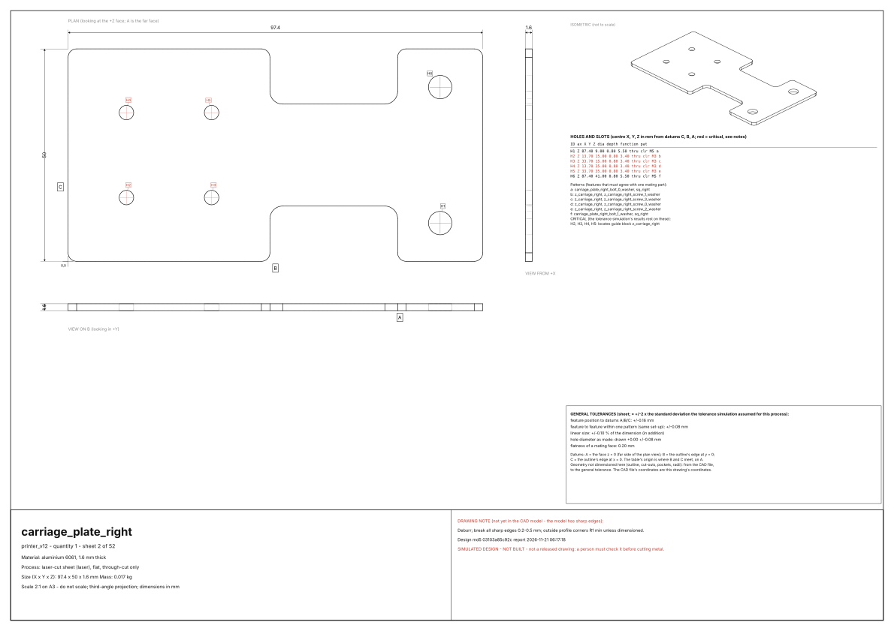

- Quantity 1. aluminium 6061; sheet; 97.4 x 50 x 1.6 mm; 0.017 kg. Same size, volume and hole list as carriage_plate_left, carriage_plate_rear (same or mirror-image part: compare before sharing a file).
- Sheet not specified mm, None cut, flat (no bends), through-cut only. Flat size None mm, cut length None mm, None pierces (report). DXF written here: {'LINE': 12, 'ARC': 12, 'CIRCLE': 6}, cut length 412.1 mm, extent (97.4, 50.0).
- Threads: none. Inserts and clinch nuts: none. Reaming: none.
- Drawing note, not yet in the model: Deburr; break all sharp edges 0.2-0.5 mm; outside profile corners R1 min unless dimensioned.
- **Needs more than the general tolerance, or rests on an assumption:**
  - **Patterns b, c, d, e** (guide block / motor): hole to hole +/-0.08 mm is the figure the screw-pattern check used (tighter than the +/-0.16 mm position tolerance); radial clearance on the screws 0.20 mm. Cut all holes of a pattern in one set-up.

| ID | Kind | Axis | X | Y | Z | Dia / width | Slot length | Depth | Counterbore (dia x depth, from) | Function | Screws | On its axis | Pattern | Critical |
|---|---|---|---|---|---|---|---|---|---|---|---|---|---|---|
| H1 | hole | Z | 87.4 | 9 | 0.8 | 5.5 | - | through | - | clearance M5 | carriage_plate_right_bolt_0 (SHCS-M5x8) | - | a: carriage_plate_right_bolt_0_washer, sq_right | - |
| H2 | hole | Z | 13.7 | 15 | 0.8 | 3.4 | - | through | - | clearance M3 | z_carriage_right_screw_1 (SHCS-M3x5) | - | b: z_carriage_right, z_carriage_right_screw_1_washer | locates guide block z_carriage_right |
| H3 | hole | Z | 33.7 | 15 | 0.8 | 3.4 | - | through | - | clearance M3 | z_carriage_right_screw_3 (SHCS-M3x5) | - | c: z_carriage_right, z_carriage_right_screw_3_washer | locates guide block z_carriage_right |
| H4 | hole | Z | 13.7 | 35 | 0.8 | 3.4 | - | through | - | clearance M3 | z_carriage_right_screw_0 (SHCS-M3x5) | - | d: z_carriage_right, z_carriage_right_screw_0_washer | locates guide block z_carriage_right |
| H5 | hole | Z | 33.7 | 35 | 0.8 | 3.4 | - | through | - | clearance M3 | z_carriage_right_screw_2 (SHCS-M3x5) | - | e: z_carriage_right, z_carriage_right_screw_2_washer | locates guide block z_carriage_right |
| H6 | hole | Z | 87.4 | 41 | 0.8 | 5.5 | - | through | - | clearance M5 | carriage_plate_right_bolt_1 (SHCS-M5x8) | - | f: carriage_plate_right_bolt_1_washer, sq_right | - |

### carriage_plate_rear

- Quantity 1. aluminium 6061; sheet; 97.4 x 50 x 1.6 mm; 0.017 kg. Same size, volume and hole list as carriage_plate_left, carriage_plate_right (same or mirror-image part: compare before sharing a file).
- Sheet not specified mm, None cut, flat (no bends), through-cut only. Flat size None mm, cut length None mm, None pierces (report). DXF written here: {'LINE': 12, 'ARC': 12, 'CIRCLE': 6}, cut length 412.1 mm, extent (97.4, 50.0).
- Threads: none. Inserts and clinch nuts: none. Reaming: none.
- Drawing note, not yet in the model: Deburr; break all sharp edges 0.2-0.5 mm; outside profile corners R1 min unless dimensioned.
- **Needs more than the general tolerance, or rests on an assumption:**
  - **Patterns b, c, d, e** (guide block / motor): hole to hole +/-0.08 mm is the figure the screw-pattern check used (tighter than the +/-0.16 mm position tolerance); radial clearance on the screws 0.20 mm. Cut all holes of a pattern in one set-up.

| ID | Kind | Axis | X | Y | Z | Dia / width | Slot length | Depth | Counterbore (dia x depth, from) | Function | Screws | On its axis | Pattern | Critical |
|---|---|---|---|---|---|---|---|---|---|---|---|---|---|---|
| H1 | hole | Z | 87.4 | 9 | 0.8 | 5.5 | - | through | - | clearance M5 | carriage_plate_rear_bolt_0 (SHCS-M5x8) | - | a: carriage_plate_rear_bolt_0_washer, sq_rear | - |
| H2 | hole | Z | 13.7 | 15 | 0.8 | 3.4 | - | through | - | clearance M3 | z_carriage_rear_screw_1 (SHCS-M3x5) | - | b: z_carriage_rear, z_carriage_rear_screw_1_washer | locates guide block z_carriage_rear |
| H3 | hole | Z | 33.7 | 15 | 0.8 | 3.4 | - | through | - | clearance M3 | z_carriage_rear_screw_3 (SHCS-M3x5) | - | c: z_carriage_rear, z_carriage_rear_screw_3_washer | locates guide block z_carriage_rear |
| H4 | hole | Z | 13.7 | 35 | 0.8 | 3.4 | - | through | - | clearance M3 | z_carriage_rear_screw_0 (SHCS-M3x5) | - | d: z_carriage_rear, z_carriage_rear_screw_0_washer | locates guide block z_carriage_rear |
| H5 | hole | Z | 33.7 | 35 | 0.8 | 3.4 | - | through | - | clearance M3 | z_carriage_rear_screw_2 (SHCS-M3x5) | - | e: z_carriage_rear, z_carriage_rear_screw_2_washer | locates guide block z_carriage_rear |
| H6 | hole | Z | 87.4 | 41 | 0.8 | 5.5 | - | through | - | clearance M5 | carriage_plate_rear_bolt_1 (SHCS-M5x8) | - | f: carriage_plate_rear_bolt_1_washer, sq_rear | - |

### z_deck

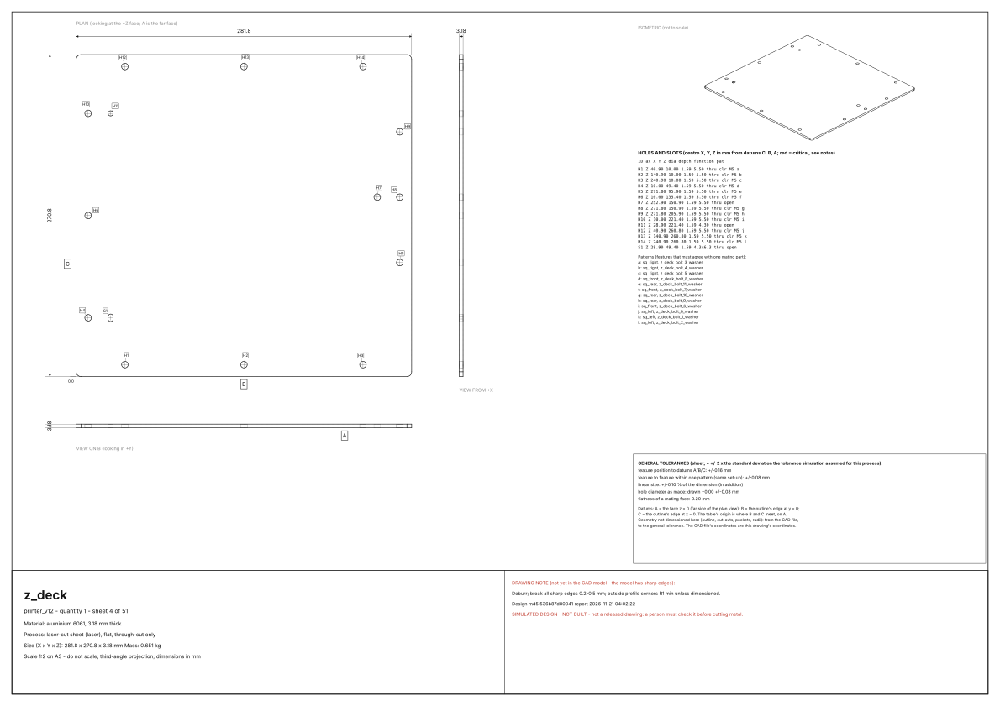

- Quantity 1. aluminium 6061; sheet; 281.8 x 270.8 x 3.18 mm; 0.651 kg.
- Sheet not specified mm, None cut, flat (no bends), through-cut only. Flat size None mm, cut length None mm, None pierces (report). DXF written here: {'LINE': 6, 'ARC': 6, 'CIRCLE': 14}, cut length 1354.0 mm, extent (281.8, 270.8).
- Threads: none. Inserts and clinch nuts: none. Reaming: none.
- Drawing note, not yet in the model: Deburr; break all sharp edges 0.2-0.5 mm; outside profile corners R1 min unless dimensioned.

| ID | Kind | Axis | X | Y | Z | Dia / width | Slot length | Depth | Counterbore (dia x depth, from) | Function | Screws | On its axis | Pattern | Critical |
|---|---|---|---|---|---|---|---|---|---|---|---|---|---|---|
| H1 | hole | Z | 40.9 | 10 | 1.59 | 5.5 | - | through | - | clearance M5 | z_deck_bolt_3 (SHCS-M5x8) | - | a: sq_right, z_deck_bolt_3_washer | - |
| H2 | hole | Z | 140.9 | 10 | 1.59 | 5.5 | - | through | - | clearance M5 | z_deck_bolt_4 (SHCS-M5x8) | - | b: sq_right, z_deck_bolt_4_washer | - |
| H3 | hole | Z | 240.9 | 10 | 1.59 | 5.5 | - | through | - | clearance M5 | z_deck_bolt_5 (SHCS-M5x8) | - | c: sq_right, z_deck_bolt_5_washer | - |
| H4 | hole | Z | 10 | 49.4 | 1.59 | 5.5 | - | through | - | clearance M5 | z_deck_bolt_8 (SHCS-M5x8) | - | d: sq_front, z_deck_bolt_8_washer | - |
| H5 | hole | Z | 271.8 | 95.9 | 1.59 | 5.5 | - | through | - | clearance M5 | z_deck_bolt_11 (SHCS-M5x8) | - | e: sq_rear, z_deck_bolt_11_washer | - |
| H6 | hole | Z | 10 | 135.4 | 1.59 | 5.5 | - | through | - | clearance M5 | z_deck_bolt_7 (SHCS-M5x8) | - | f: sq_front, z_deck_bolt_7_washer | - |
| H7 | hole | Z | 252.9 | 150.9 | 1.59 | 5.5 | - | through | - | hole (no screw or part on its axis in the model) | - | - | - | - |
| H8 | hole | Z | 271.8 | 150.9 | 1.59 | 5.5 | - | through | - | clearance M5 | z_deck_bolt_10 (SHCS-M5x8) | - | g: sq_rear, z_deck_bolt_10_washer | - |
| H9 | hole | Z | 271.8 | 205.9 | 1.59 | 5.5 | - | through | - | clearance M5 | z_deck_bolt_9 (SHCS-M5x8) | - | h: sq_rear, z_deck_bolt_9_washer | - |
| H10 | hole | Z | 10 | 221.4 | 1.59 | 5.5 | - | through | - | clearance M5 | z_deck_bolt_6 (SHCS-M5x8) | - | i: sq_front, z_deck_bolt_6_washer | - |
| H11 | hole | Z | 28.9 | 221.4 | 1.59 | 4.3 | - | through | - | hole (no screw or part on its axis in the model) | - | - | - | - |
| H12 | hole | Z | 40.9 | 260.8 | 1.59 | 5.5 | - | through | - | clearance M5 | z_deck_bolt_0 (SHCS-M5x8) | - | j: sq_left, z_deck_bolt_0_washer | - |
| H13 | hole | Z | 140.9 | 260.8 | 1.59 | 5.5 | - | through | - | clearance M5 | z_deck_bolt_1 (SHCS-M5x8) | - | k: sq_left, z_deck_bolt_1_washer | - |
| H14 | hole | Z | 240.9 | 260.8 | 1.59 | 5.5 | - | through | - | clearance M5 | z_deck_bolt_2 (SHCS-M5x8) | - | l: sq_left, z_deck_bolt_2_washer | - |
| S1 | slot | Z | 28.9 | 49.4 | 1.59 | 4.3 | 6.3 | through | - | hole (no screw or part on its axis in the model) | - | - | - | - |

### nut_plate

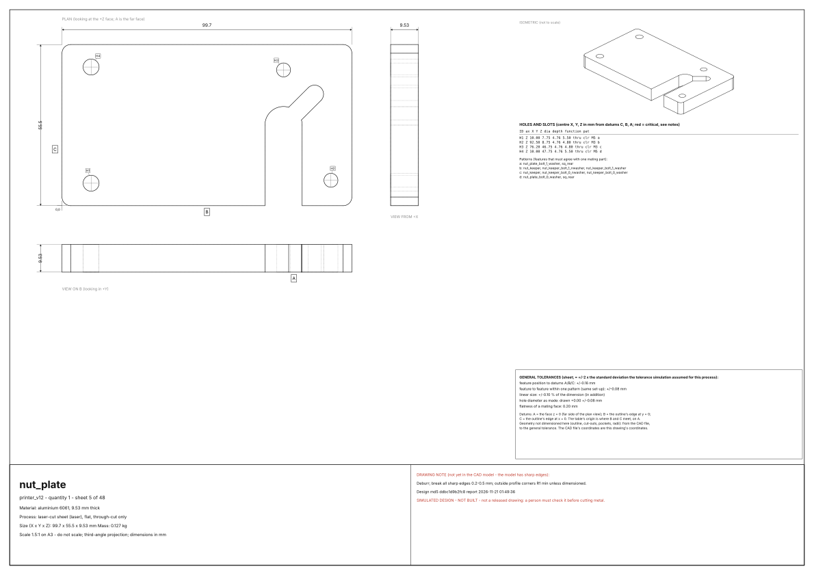

- Quantity 1. aluminium 6061; sheet; 99.7 x 55.5 x 9.53 mm; 0.127 kg.
- Sheet not specified mm, None cut, flat (no bends), through-cut only. Flat size None mm, cut length None mm, None pierces (report). DXF written here: {'LINE': 9, 'ARC': 7, 'CIRCLE': 4}, cut length 455.0 mm, extent (99.7, 55.5).
- Threads: none. Inserts and clinch nuts: none. Reaming: none.
- Drawing note, not yet in the model: Deburr; break all sharp edges 0.2-0.5 mm; outside profile corners R1 min unless dimensioned.
- **Needs more than the general tolerance, or rests on an assumption:**
  - Report, manufacture `hole_smaller_than_thickness`: 4 hole(s) or cut-out(s) narrower than the 9.525 mm sheet (smallest 4.80 mm at [-19.0, 201.6, 140.42]): they cut, but taper and lose accuracy.
  - Report, manufacture `hole_too_close_to_edge`: 4 hole(s) with less than 9.525 mm of material to the edge (least 4.80 mm at [19.0, 217.9, 140.42]): the web overheats and distorts, and tears if the part is bent or loaded.
  - Report, manufacture `narrow_slot`: 1 slot(s) or notch(es) in the outline narrower than 9.525 mm (narrowest about 6.20 mm at [-7.31, 208.91, 140.42]): the cut is ragged and the slot closes up with heat.
  - Report, manufacture `supplier_rule`: SendCutSend rule sendcutsend.cut.hole_min_al6061_page: smallest hole or cut-out 4.8 mm (4 of 4), limit >= 9.53 mm (warning: the supplier's words: "Design holes no smaller than material thickness.").
  - Report, manufacture `supplier_rule`: SendCutSend rule sendcutsend.cut.hole_edge_al6061_page: hole edge to part edge 4.8 mm (4 of 4), limit >= 14.3 mm (warning: the supplier's words: "Keep holes and cutouts 1.5–2× material thickness away from edges to prevent warping or distortion.").
  - Report, manufacture `supplier_rule`: SendCutSend rule sendcutsend.cut.hole_edge_d_ratio: hole edge to part edge 5 mm (2 of 4), limit >= 5.5 mm (warning: the supplier's words: "we generally recommend keeping your holes at least 1X their diameter from an edge and slots at least 1.5X their width away from edges or other cut features.").
  - Report, manufacture `sharp_profile_corners`: 6 outside corner(s) of the cut profile are dead sharp (no radius). A sheet part with needle corners cuts hands and cables and chips its paint; a corner radius costs nothing in laser or waterjet cutting.

| ID | Kind | Axis | X | Y | Z | Dia / width | Slot length | Depth | Counterbore (dia x depth, from) | Function | Screws | On its axis | Pattern | Critical |
|---|---|---|---|---|---|---|---|---|---|---|---|---|---|---|
| H1 | hole | Z | 10 | 7.75 | 4.76 | 5.5 | - | through | - | clearance M5 | nut_plate_bolt_1 (SHCS-M5x16) | - | a: nut_plate_bolt_1_washer, sq_rear | - |
| H2 | hole | Z | 92.5 | 8.75 | 4.76 | 4.8 | - | through | - | clearance M3 | nut_keeper_bolt_1 (SHCS-M3x25) | - | b: nut_keeper, nut_keeper_bolt_1_nwasher, nut_keeper_bolt_1_washer | - |
| H3 | hole | Z | 76.2 | 46.75 | 4.76 | 4.8 | - | through | - | clearance M3 | nut_keeper_bolt_0 (SHCS-M3x25) | - | c: nut_keeper, nut_keeper_bolt_0_nwasher, nut_keeper_bolt_0_washer | - |
| H4 | hole | Z | 10 | 47.75 | 4.76 | 5.5 | - | through | - | clearance M5 | nut_plate_bolt_0 (SHCS-M5x16) | - | d: nut_plate_bolt_0_washer, sq_rear | - |

### nut_keeper

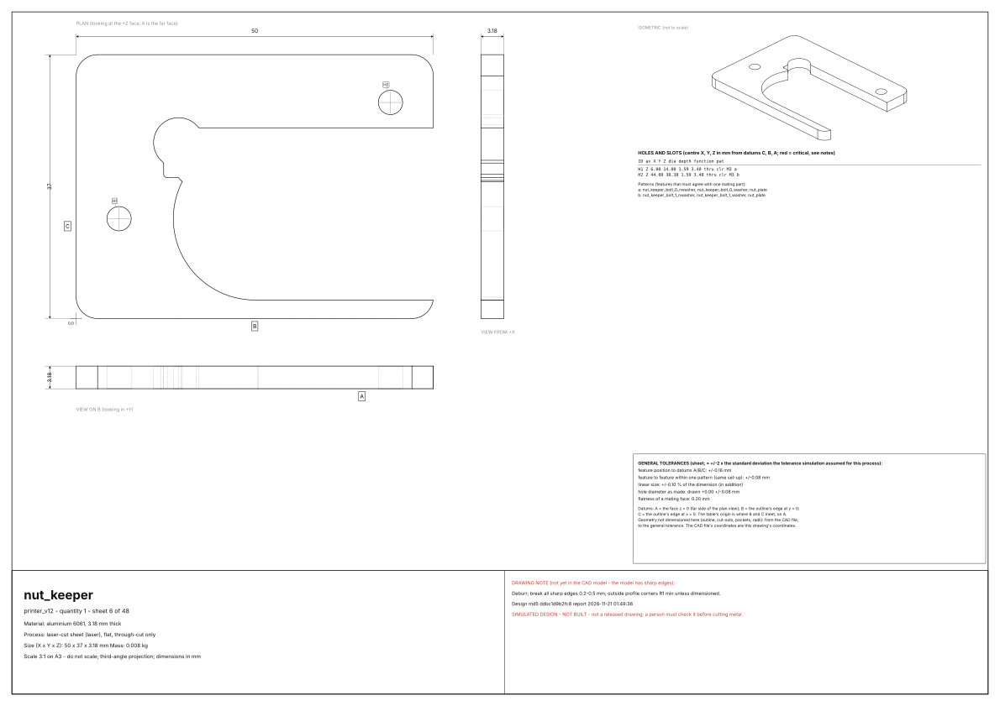

- Quantity 1. aluminium 6061; sheet; 50 x 37 x 3.18 mm; 0.008 kg. Same size, volume and hole list as nut_keeper_fl, nut_keeper_fr (same or mirror-image part: compare before sharing a file).
- Sheet not specified mm, None cut, flat (no bends), through-cut only. Flat size None mm, cut length None mm, None pierces (report). DXF written here: {'LINE': 11, 'ARC': 9, 'CIRCLE': 2}, cut length 263.9 mm, extent (50.0, 37.0).
- Threads: none. Inserts and clinch nuts: none. Reaming: none.
- Drawing note, not yet in the model: Deburr; break all sharp edges 0.2-0.5 mm; outside profile corners R1 min unless dimensioned.
- **Needs more than the general tolerance, or rests on an assumption:**
  - Report, manufacture `hole_too_close_to_edge`: 1 hole(s) with less than 3.175 mm of material to the edge (least 1.85 mm at [19.0, 217.9, 128.07]): the web overheats and distorts, and tears if the part is bent or loaded.
  - Report, manufacture `thin_feature`: 1 tab(s) or neck(s) narrower than 3.175 mm, the sheet's thickness (narrowest about 2.62 mm at [11.27, 189.1, 128.07]): they warp from the heat of the cut and bend in handling.
  - Report, manufacture `supplier_rule`: SendCutSend rule sendcutsend.cut.hole_edge_al6061_page: hole edge to part edge 1.85 mm (2 of 2), limit >= 4.76 mm (warning: the supplier's words: "Keep holes and cutouts 1.5–2× material thickness away from edges to prevent warping or distortion.").
  - Report, manufacture `supplier_rule`: SendCutSend rule sendcutsend.cut.hole_edge_d_ratio: hole edge to part edge 1.85 mm (1 of 2), limit >= 3.4 mm (warning: the supplier's words: "we generally recommend keeping your holes at least 1X their diameter from an edge and slots at least 1.5X their width away from edges or other cut features.").
  - Report, manufacture `sharp_profile_corners`: 1 outside corner(s) of the cut profile are dead sharp (no radius). A sheet part with needle corners cuts hands and cables and chips its paint; a corner radius costs nothing in laser or waterjet cutting.

| ID | Kind | Axis | X | Y | Z | Dia / width | Slot length | Depth | Counterbore (dia x depth, from) | Function | Screws | On its axis | Pattern | Critical |
|---|---|---|---|---|---|---|---|---|---|---|---|---|---|---|
| H1 | hole | Z | 6 | 14 | 1.59 | 3.4 | - | through | - | clearance M3 | nut_keeper_bolt_0 (SHCS-M3x25) | - | a: nut_keeper_bolt_0_nwasher, nut_keeper_bolt_0_washer, nut_plate | - |
| H2 | hole | Z | 44 | 30.3 | 1.59 | 3.4 | - | through | - | clearance M3 | nut_keeper_bolt_1 (SHCS-M3x25) | - | b: nut_keeper_bolt_1_nwasher, nut_keeper_bolt_1_washer, nut_plate | - |

### nut_plate_fl

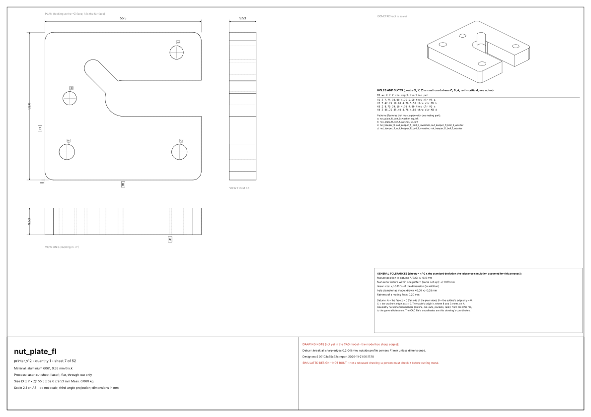

- Quantity 1. aluminium 6061; sheet; 55.5 x 52.6 x 9.53 mm; 0.060 kg. Same size, volume and hole list as nut_plate_fr (same or mirror-image part: compare before sharing a file).
- Sheet not specified mm, None cut, flat (no bends), through-cut only. Flat size None mm, cut length None mm, None pierces (report). DXF written here: {'LINE': 9, 'ARC': 7, 'CIRCLE': 4}, cut length 360.8 mm, extent (55.5, 52.6).
- Threads: none. Inserts and clinch nuts: none. Reaming: none.
- Drawing note, not yet in the model: Deburr; break all sharp edges 0.2-0.5 mm; outside profile corners R1 min unless dimensioned.
- **Needs more than the general tolerance, or rests on an assumption:**
  - Report, manufacture `hole_smaller_than_thickness`: 4 hole(s) or cut-out(s) narrower than the 9.525 mm sheet (smallest 4.80 mm at [-144.5, -120.0, 140.42]): they cut, but taper and lose accuracy.
  - Report, manufacture `hole_too_close_to_edge`: 4 hole(s) with less than 9.525 mm of material to the edge (least 4.80 mm at [-160.8, -82.0, 140.42]): the web overheats and distorts, and tears if the part is bent or loaded.
  - Report, manufacture `holes_too_close`: 1 pair(s) of holes or cut-outs with too little material between them (least 13.98 mm at [-134.95, -120.5, 140.42], wanted 19.05 mm = 2 x thickness).
  - Report, manufacture `narrow_slot`: 1 slot(s) or notch(es) in the outline narrower than 9.525 mm (narrowest about 6.20 mm at [-151.81, -108.31, 140.42]): the cut is ragged and the slot closes up with heat.
  - Report, manufacture `supplier_rule`: SendCutSend rule sendcutsend.cut.hole_min_al6061_page: smallest hole or cut-out 4.8 mm (4 of 4), limit >= 9.53 mm (warning: the supplier's words: "Design holes no smaller than material thickness.").
  - Report, manufacture `supplier_rule`: SendCutSend rule sendcutsend.cut.hole_edge_al6061_page: hole edge to part edge 4.8 mm (4 of 4), limit >= 14.3 mm (warning: the supplier's words: "Keep holes and cutouts 1.5–2× material thickness away from edges to prevent warping or distortion.").
  - Report, manufacture `supplier_rule`: SendCutSend rule sendcutsend.cut.hole_edge_d_ratio: hole edge to part edge 5 mm (2 of 4), limit >= 5.5 mm (warning: the supplier's words: "we generally recommend keeping your holes at least 1X their diameter from an edge and slots at least 1.5X their width away from edges or other cut features.").
  - Report, manufacture `sharp_profile_corners`: 6 outside corner(s) of the cut profile are dead sharp (no radius). A sheet part with needle corners cuts hands and cables and chips its paint; a corner radius costs nothing in laser or waterjet cutting.

| ID | Kind | Axis | X | Y | Z | Dia / width | Slot length | Depth | Counterbore (dia x depth, from) | Function | Screws | On its axis | Pattern | Critical |
|---|---|---|---|---|---|---|---|---|---|---|---|---|---|---|
| H1 | hole | Z | 7.75 | 10 | 4.76 | 5.5 | - | through | - | clearance M5 | nut_plate_fl_bolt_0 (SHCS-M5x16) | - | a: nut_plate_fl_bolt_0_washer, sq_left | - |
| H2 | hole | Z | 47.75 | 10 | 4.76 | 5.5 | - | through | - | clearance M5 | nut_plate_fl_bolt_1 (SHCS-M5x16) | - | b: nut_plate_fl_bolt_1_washer, sq_left | - |
| H3 | hole | Z | 8.75 | 29.1 | 4.76 | 4.8 | - | through | - | clearance M3 | nut_keeper_fl_bolt_0 (SHCS-M3x25) | - | c: nut_keeper_fl, nut_keeper_fl_bolt_0_nwasher, nut_keeper_fl_bolt_0_washer | - |
| H4 | hole | Z | 46.75 | 45.4 | 4.76 | 4.8 | - | through | - | clearance M3 | nut_keeper_fl_bolt_1 (SHCS-M3x25) | - | d: nut_keeper_fl, nut_keeper_fl_bolt_1_nwasher, nut_keeper_fl_bolt_1_washer | - |

### nut_keeper_fl

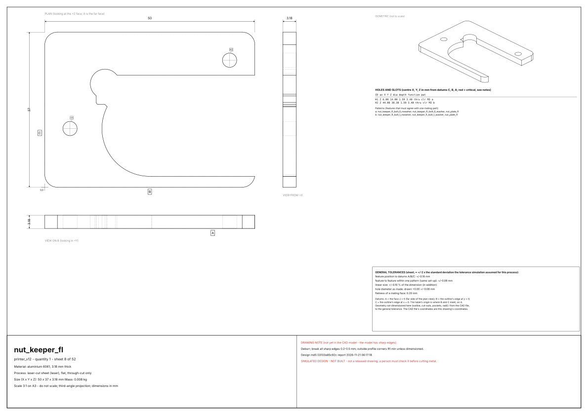

- Quantity 1. aluminium 6061; sheet; 50 x 37 x 3.18 mm; 0.008 kg. Same size, volume and hole list as nut_keeper, nut_keeper_fr (same or mirror-image part: compare before sharing a file).
- Sheet not specified mm, None cut, flat (no bends), through-cut only. Flat size None mm, cut length None mm, None pierces (report). DXF written here: {'LINE': 11, 'ARC': 9, 'CIRCLE': 2}, cut length 263.9 mm, extent (50.0, 37.0).
- Threads: none. Inserts and clinch nuts: none. Reaming: none.
- Drawing note, not yet in the model: Deburr; break all sharp edges 0.2-0.5 mm; outside profile corners R1 min unless dimensioned.
- **Needs more than the general tolerance, or rests on an assumption:**
  - Report, manufacture `hole_too_close_to_edge`: 1 hole(s) with less than 3.175 mm of material to the edge (least 1.85 mm at [-160.8, -82.0, 128.07]): the web overheats and distorts, and tears if the part is bent or loaded.
  - Report, manufacture `thin_feature`: 1 tab(s) or neck(s) narrower than 3.175 mm, the sheet's thickness (narrowest about 2.62 mm at [-131.8, -89.75, 128.07]): they warp from the heat of the cut and bend in handling.
  - Report, manufacture `supplier_rule`: SendCutSend rule sendcutsend.cut.hole_edge_al6061_page: hole edge to part edge 1.85 mm (2 of 2), limit >= 4.76 mm (warning: the supplier's words: "Keep holes and cutouts 1.5–2× material thickness away from edges to prevent warping or distortion.").
  - Report, manufacture `supplier_rule`: SendCutSend rule sendcutsend.cut.hole_edge_d_ratio: hole edge to part edge 1.85 mm (1 of 2), limit >= 3.4 mm (warning: the supplier's words: "we generally recommend keeping your holes at least 1X their diameter from an edge and slots at least 1.5X their width away from edges or other cut features.").
  - Report, manufacture `sharp_profile_corners`: 1 outside corner(s) of the cut profile are dead sharp (no radius). A sheet part with needle corners cuts hands and cables and chips its paint; a corner radius costs nothing in laser or waterjet cutting.

| ID | Kind | Axis | X | Y | Z | Dia / width | Slot length | Depth | Counterbore (dia x depth, from) | Function | Screws | On its axis | Pattern | Critical |
|---|---|---|---|---|---|---|---|---|---|---|---|---|---|---|
| H1 | hole | Z | 6 | 14 | 1.59 | 3.4 | - | through | - | clearance M3 | nut_keeper_fl_bolt_0 (SHCS-M3x25) | - | a: nut_keeper_fl_bolt_0_nwasher, nut_keeper_fl_bolt_0_washer, nut_plate_fl | - |
| H2 | hole | Z | 44 | 30.3 | 1.59 | 3.4 | - | through | - | clearance M3 | nut_keeper_fl_bolt_1 (SHCS-M3x25) | - | b: nut_keeper_fl_bolt_1_nwasher, nut_keeper_fl_bolt_1_washer, nut_plate_fl | - |

### nut_plate_fr

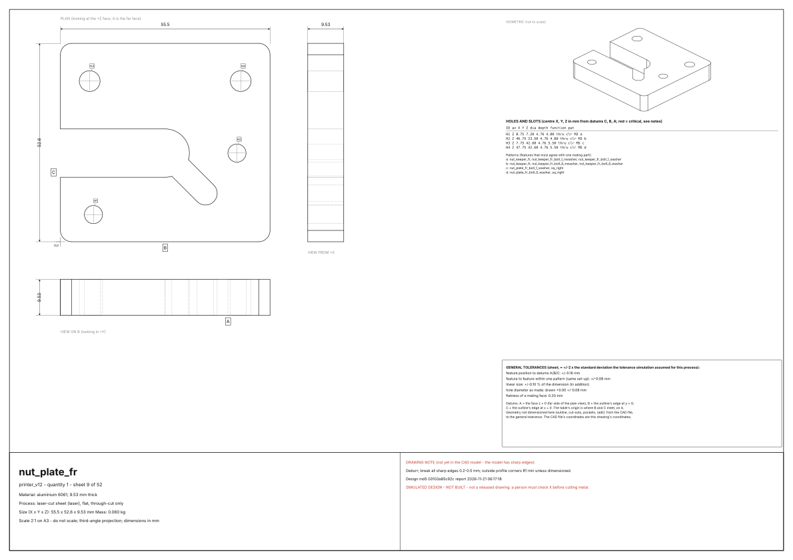

- Quantity 1. aluminium 6061; sheet; 55.5 x 52.6 x 9.53 mm; 0.060 kg. Same size, volume and hole list as nut_plate_fl (same or mirror-image part: compare before sharing a file).
- Sheet not specified mm, None cut, flat (no bends), through-cut only. Flat size None mm, cut length None mm, None pierces (report). DXF written here: {'LINE': 9, 'ARC': 7, 'CIRCLE': 4}, cut length 360.8 mm, extent (55.5, 52.6).
- Threads: none. Inserts and clinch nuts: none. Reaming: none.
- Drawing note, not yet in the model: Deburr; break all sharp edges 0.2-0.5 mm; outside profile corners R1 min unless dimensioned.
- **Needs more than the general tolerance, or rests on an assumption:**
  - Report, manufacture `hole_smaller_than_thickness`: 4 hole(s) or cut-out(s) narrower than the 9.525 mm sheet (smallest 4.80 mm at [144.5, -82.0, 140.42]): they cut, but taper and lose accuracy.
  - Report, manufacture `hole_too_close_to_edge`: 4 hole(s) with less than 9.525 mm of material to the edge (least 4.80 mm at [160.8, -120.0, 140.42]): the web overheats and distorts, and tears if the part is bent or loaded.
  - Report, manufacture `holes_too_close`: 1 pair(s) of holes or cut-outs with too little material between them (least 13.98 mm at [134.95, -81.5, 140.42], wanted 19.05 mm = 2 x thickness).
  - Report, manufacture `narrow_slot`: 1 slot(s) or notch(es) in the outline narrower than 9.525 mm (narrowest about 6.20 mm at [151.81, -93.69, 140.42]): the cut is ragged and the slot closes up with heat.
  - Report, manufacture `supplier_rule`: SendCutSend rule sendcutsend.cut.hole_min_al6061_page: smallest hole or cut-out 4.8 mm (4 of 4), limit >= 9.53 mm (warning: the supplier's words: "Design holes no smaller than material thickness.").
  - Report, manufacture `supplier_rule`: SendCutSend rule sendcutsend.cut.hole_edge_al6061_page: hole edge to part edge 4.8 mm (4 of 4), limit >= 14.3 mm (warning: the supplier's words: "Keep holes and cutouts 1.5–2× material thickness away from edges to prevent warping or distortion.").
  - Report, manufacture `supplier_rule`: SendCutSend rule sendcutsend.cut.hole_edge_d_ratio: hole edge to part edge 5 mm (2 of 4), limit >= 5.5 mm (warning: the supplier's words: "we generally recommend keeping your holes at least 1X their diameter from an edge and slots at least 1.5X their width away from edges or other cut features.").
  - Report, manufacture `sharp_profile_corners`: 6 outside corner(s) of the cut profile are dead sharp (no radius). A sheet part with needle corners cuts hands and cables and chips its paint; a corner radius costs nothing in laser or waterjet cutting.

| ID | Kind | Axis | X | Y | Z | Dia / width | Slot length | Depth | Counterbore (dia x depth, from) | Function | Screws | On its axis | Pattern | Critical |
|---|---|---|---|---|---|---|---|---|---|---|---|---|---|---|
| H1 | hole | Z | 8.75 | 7.2 | 4.76 | 4.8 | - | through | - | clearance M3 | nut_keeper_fr_bolt_1 (SHCS-M3x25) | - | a: nut_keeper_fr, nut_keeper_fr_bolt_1_nwasher, nut_keeper_fr_bolt_1_washer | - |
| H2 | hole | Z | 46.75 | 23.5 | 4.76 | 4.8 | - | through | - | clearance M3 | nut_keeper_fr_bolt_0 (SHCS-M3x25) | - | b: nut_keeper_fr, nut_keeper_fr_bolt_0_nwasher, nut_keeper_fr_bolt_0_washer | - |
| H3 | hole | Z | 7.75 | 42.6 | 4.76 | 5.5 | - | through | - | clearance M5 | nut_plate_fr_bolt_1 (SHCS-M5x16) | - | c: nut_plate_fr_bolt_1_washer, sq_right | - |
| H4 | hole | Z | 47.75 | 42.6 | 4.76 | 5.5 | - | through | - | clearance M5 | nut_plate_fr_bolt_0 (SHCS-M5x16) | - | d: nut_plate_fr_bolt_0_washer, sq_right | - |

### nut_keeper_fr

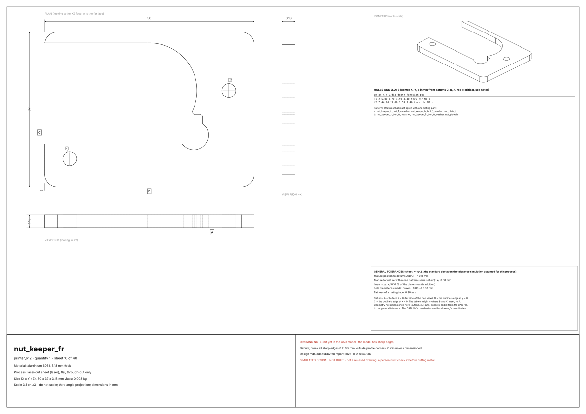

- Quantity 1. aluminium 6061; sheet; 50 x 37 x 3.18 mm; 0.008 kg. Same size, volume and hole list as nut_keeper, nut_keeper_fl (same or mirror-image part: compare before sharing a file).
- Sheet not specified mm, None cut, flat (no bends), through-cut only. Flat size None mm, cut length None mm, None pierces (report). DXF written here: {'LINE': 11, 'ARC': 9, 'CIRCLE': 2}, cut length 263.9 mm, extent (50.0, 37.0).
- Threads: none. Inserts and clinch nuts: none. Reaming: none.
- Drawing note, not yet in the model: Deburr; break all sharp edges 0.2-0.5 mm; outside profile corners R1 min unless dimensioned.
- **Needs more than the general tolerance, or rests on an assumption:**
  - Report, manufacture `hole_too_close_to_edge`: 1 hole(s) with less than 3.175 mm of material to the edge (least 1.85 mm at [160.8, -120.0, 128.07]): the web overheats and distorts, and tears if the part is bent or loaded.
  - Report, manufacture `thin_feature`: 1 tab(s) or neck(s) narrower than 3.175 mm, the sheet's thickness (narrowest about 2.62 mm at [131.8, -112.25, 128.07]): they warp from the heat of the cut and bend in handling.
  - Report, manufacture `supplier_rule`: SendCutSend rule sendcutsend.cut.hole_edge_al6061_page: hole edge to part edge 1.85 mm (2 of 2), limit >= 4.76 mm (warning: the supplier's words: "Keep holes and cutouts 1.5–2× material thickness away from edges to prevent warping or distortion.").
  - Report, manufacture `supplier_rule`: SendCutSend rule sendcutsend.cut.hole_edge_d_ratio: hole edge to part edge 1.85 mm (1 of 2), limit >= 3.4 mm (warning: the supplier's words: "we generally recommend keeping your holes at least 1X their diameter from an edge and slots at least 1.5X their width away from edges or other cut features.").
  - Report, manufacture `sharp_profile_corners`: 1 outside corner(s) of the cut profile are dead sharp (no radius). A sheet part with needle corners cuts hands and cables and chips its paint; a corner radius costs nothing in laser or waterjet cutting.

| ID | Kind | Axis | X | Y | Z | Dia / width | Slot length | Depth | Counterbore (dia x depth, from) | Function | Screws | On its axis | Pattern | Critical |
|---|---|---|---|---|---|---|---|---|---|---|---|---|---|---|
| H1 | hole | Z | 6 | 6.7 | 1.59 | 3.4 | - | through | - | clearance M3 | nut_keeper_fr_bolt_1 (SHCS-M3x25) | - | a: nut_keeper_fr_bolt_1_nwasher, nut_keeper_fr_bolt_1_washer, nut_plate_fr | - |
| H2 | hole | Z | 44 | 23 | 1.59 | 3.4 | - | through | - | clearance M3 | nut_keeper_fr_bolt_0 (SHCS-M3x25) | - | b: nut_keeper_fr_bolt_0_nwasher, nut_keeper_fr_bolt_0_washer, nut_plate_fr | - |

### bed_plate

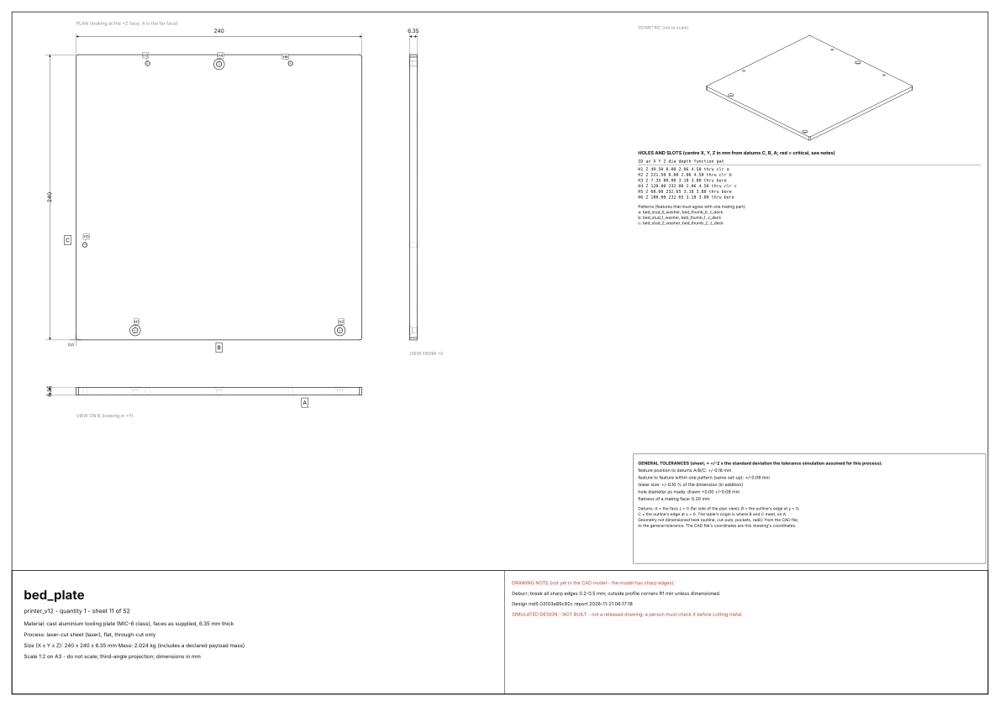

- Quantity 1. cast aluminium tooling plate (MIC-6 class), faces as supplied; sheet; 240 x 240 x 6.35 mm; 2.024 kg.
- Sheet not specified mm, None cut, flat (no bends), through-cut only. Flat size None mm, cut length None mm, None pierces (report). DXF written here: {'LINE': 4, 'ARC': 4, 'CIRCLE': 3}, cut length 1041.0 mm, extent (240.0, 240.0).
- Threads: none. Inserts and clinch nuts: none. Reaming: none.
- Drawing note, not yet in the model: Deburr; break all sharp edges 0.2-0.5 mm; outside profile corners R1 min unless dimensioned.
- **Needs more than the general tolerance, or rests on an assumption:**
  - Report, manufacture `secondary_op_countersink`: 3 countersink(s): a second operation after cutting (model plain through holes in the cut file).
  - Report, manufacture `hole_too_close_to_edge`: 3 hole(s) with less than 6.35 mm of material to the edge (least 3.52 mm at [-86.0, -107.5, 188.53]): the web overheats and distorts, and tears if the part is bent or loaded.

| ID | Kind | Axis | X | Y | Z | Dia / width | Slot length | Depth | Counterbore (dia x depth, from) | Function | Screws | On its axis | Pattern | Critical |
|---|---|---|---|---|---|---|---|---|---|---|---|---|---|---|
| H1 | hole | Z | 49.5 | 8 | 2.06 | 4.5 | - | through | - | clearance  | bed_stud_0 (FHCS-M4x40) | - | a: bed_stud_0_washer, bed_thumb_0, z_deck | - |
| H2 | hole | Z | 221.5 | 8 | 2.06 | 4.5 | - | through | - | clearance  | bed_stud_1 (FHCS-M4x40) | - | b: bed_stud_1_washer, bed_thumb_1, z_deck | - |
| H3 | hole | Z | 120 | 232 | 2.06 | 4.5 | - | through | - | clearance  | bed_stud_2 (FHCS-M4x40) | - | c: bed_stud_2_washer, bed_thumb_2, z_deck | - |

### z_motor_plate

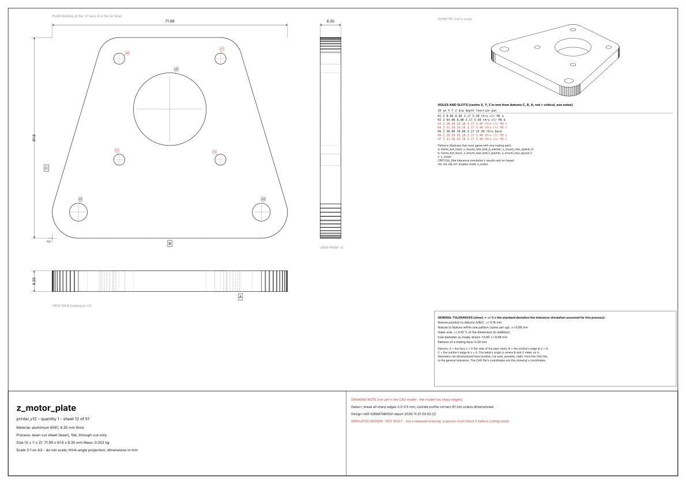

- Quantity 1. aluminium 6061; sheet; 71.99 x 61.6 x 6.35 mm; 0.053 kg.
- Sheet not specified mm, None cut, flat (no bends), through-cut only. Flat size None mm, cut length None mm, None pierces (report). DXF written here: {'LINE': 44, 'ARC': 36, 'CIRCLE': 7}, cut length 378.1 mm, extent (71.99, 61.6).
- Threads: none. Inserts and clinch nuts: none. Reaming: none.
- Drawing note, not yet in the model: Deburr; break all sharp edges 0.2-0.5 mm; outside profile corners R1 min unless dimensioned.
- **Needs more than the general tolerance, or rests on an assumption:**
  - **Patterns c** (guide block / motor): hole to hole +/-0.08 mm is the figure the screw-pattern check used (tighter than the +/-0.16 mm position tolerance); radial clearance on the screws 0.20 mm. Cut all holes of a pattern in one set-up.
  - This part places a pulley or idler: its thickness and flatness are in the belt-plane result (x_belt: 95.9% of builds within 1 mm, +/-0.36%; y_belt: 99.5% of builds within 1 mm, +/-0.13%; y_belt_l: 99.2% of builds within 1 mm, +/-0.16%).
  - Report, manufacture `hole_smaller_than_thickness`: 6 hole(s) or cut-out(s) narrower than the 6.35 mm sheet (smallest 3.40 mm at [-15.5, 186.1, 76.38]): they cut, but taper and lose accuracy.
  - Report, manufacture `hole_too_close_to_edge`: 4 hole(s) with less than 6.35 mm of material to the edge (least 4.78 mm at [-15.5, 217.1, 76.38]): the web overheats and distorts, and tears if the part is bent or loaded.
  - Report, manufacture `holes_too_close`: 4 pair(s) of holes or cut-outs with too little material between them (least 9.07 mm at [-7.75, 193.85, 76.38], wanted 12.7 mm = 2 x thickness).
  - Report, manufacture `supplier_rule`: SendCutSend rule sendcutsend.cut.hole_min_al6061_page: smallest hole or cut-out 3.4 mm (6 of 7), limit >= 6.35 mm (warning: the supplier's words: "Design holes no smaller than material thickness.").
  - Report, manufacture `supplier_rule`: SendCutSend rule sendcutsend.cut.hole_edge_al6061_page: hole edge to part edge 4.78 mm (4 of 7), limit >= 9.53 mm (warning: the supplier's words: "Keep holes and cutouts 1.5–2× material thickness away from edges to prevent warping or distortion.").
  - Report, manufacture `supplier_rule`: SendCutSend rule sendcutsend.cut.hole_edge_d_ratio: hole edge to part edge 10.8 mm (3 of 7), limit >= 22.3 mm (warning: the supplier's words: "we generally recommend keeping your holes at least 1X their diameter from an edge and slots at least 1.5X their width away from edges or other cut features.").

| ID | Kind | Axis | X | Y | Z | Dia / width | Slot length | Depth | Counterbore (dia x depth, from) | Function | Screws | On its axis | Pattern | Critical |
|---|---|---|---|---|---|---|---|---|---|---|---|---|---|---|
| H1 | hole | Z | 8 | 8 | 3.17 | 5.5 | - | through | - | clearance M5 | z_mount_rear_bolt_0 (SHCS-M5x65) | z_mount_rear_spacer_0 (custom) | a: frame_bot_back, z_mount_rear_bolt_0_washer, z_mount_rear_spacer_0 | - |
| H2 | hole | Z | 64 | 8 | 3.17 | 5.5 | - | through | - | clearance M5 | z_mount_rear_bolt_1 (SHCS-M5x65) | z_mount_rear_spacer_1 (custom) | b: frame_bot_back, z_mount_rear_bolt_1_washer, z_mount_rear_spacer_1 | - |
| H3 | hole | Z | 20.5 | 24.1 | 3.17 | 3.4 | - | through | - | clearance M3 | z_motor_screw_0 (SHCS-M3x10) | - | c: z_motor | locates motor z_motor |
| H4 | hole | Z | 51.5 | 24.1 | 3.17 | 3.4 | - | through | - | clearance M3 | z_motor_screw_2 (SHCS-M3x10) | - | c: z_motor | locates motor z_motor |
| H5 | hole | Z | 36 | 39.6 | 3.17 | 22.3 | - | through | - | bore / opening | - | leadscrew (TR8x2-INTEGRAL-17E19S1684AB4-330RA) | - | - |
| H6 | hole | Z | 20.5 | 55.1 | 3.17 | 3.4 | - | through | - | clearance M3 | z_motor_screw_1 (SHCS-M3x10) | - | c: z_motor | locates motor z_motor |
| H7 | hole | Z | 51.5 | 55.1 | 3.17 | 3.4 | - | through | - | clearance M3 | z_motor_screw_3 (SHCS-M3x10) | - | c: z_motor | locates motor z_motor |

### z_mount_rear_spacer_0

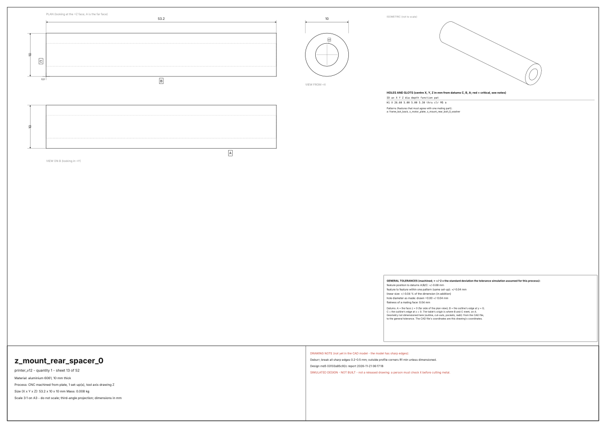

- Quantity 1. aluminium 6061; machined; 53.2 x 10 x 10 mm; 0.008 kg. Same size, volume and hole list as z_mount_rear_spacer_1 (same or mirror-image part: compare before sharing a file).
- Stock: None; 1 set-up(s), cut from None; smallest wall None mm; estimate None min machining (...).
- Threads: none. Inserts and clinch nuts: none. Reaming: none.
- Drawing note, not yet in the model: Deburr; break all sharp edges 0.2-0.5 mm; outside profile corners R1 min unless dimensioned.
- **Needs more than the general tolerance, or rests on an assumption:**
  - Report, manufacture `deep_hole`: 1 hole(s) deeper than 10 diameters (worst 5.3 mm x 53.2 mm deep = 10:1 at [-28.0, 170.0, 46.6]); it needs a long-series or gun drill and pecking.

| ID | Kind | Axis | X | Y | Z | Dia / width | Slot length | Depth | Counterbore (dia x depth, from) | Function | Screws | On its axis | Pattern | Critical |
|---|---|---|---|---|---|---|---|---|---|---|---|---|---|---|
| H1 | hole | X | 26.6 | 5 | 5 | 5.3 | - | through | - | clearance M5 | z_mount_rear_bolt_0 (SHCS-M5x65) | - | a: frame_bot_back, z_motor_plate, z_mount_rear_bolt_0_washer | - |

### z_mount_rear_spacer_1

- Quantity 1. aluminium 6061; machined; 53.2 x 10 x 10 mm; 0.008 kg. Same size, volume and hole list as z_mount_rear_spacer_0 (same or mirror-image part: compare before sharing a file).
- Stock: None; 1 set-up(s), cut from None; smallest wall None mm; estimate None min machining (...).
- Threads: none. Inserts and clinch nuts: none. Reaming: none.
- Drawing note, not yet in the model: Deburr; break all sharp edges 0.2-0.5 mm; outside profile corners R1 min unless dimensioned.
- **Needs more than the general tolerance, or rests on an assumption:**
  - Report, manufacture `deep_hole`: 1 hole(s) deeper than 10 diameters (worst 5.3 mm x 53.2 mm deep = 10:1 at [28.0, 170.0, 46.6]); it needs a long-series or gun drill and pecking.

| ID | Kind | Axis | X | Y | Z | Dia / width | Slot length | Depth | Counterbore (dia x depth, from) | Function | Screws | On its axis | Pattern | Critical |
|---|---|---|---|---|---|---|---|---|---|---|---|---|---|---|
| H1 | hole | X | 26.6 | 5 | 5 | 5.3 | - | through | - | clearance M5 | z_mount_rear_bolt_1 (SHCS-M5x65) | - | a: frame_bot_back, z_motor_plate, z_mount_rear_bolt_1_washer | - |

### z_motor_plate_fl

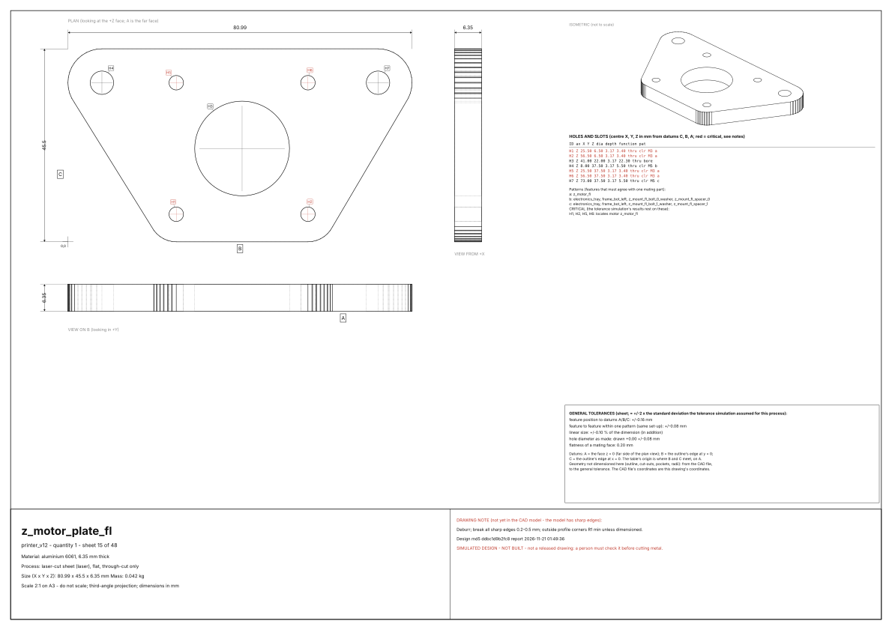

- Quantity 1. aluminium 6061; sheet; 80.99 x 45.5 x 6.35 mm; 0.042 kg. Same size, volume and hole list as z_motor_plate_fr (same or mirror-image part: compare before sharing a file).
- Sheet not specified mm, None cut, flat (no bends), through-cut only. Flat size None mm, cut length None mm, None pierces (report). DXF written here: {'LINE': 44, 'ARC': 37, 'CIRCLE': 7}, cut length 361.1 mm, extent (80.99, 45.5).
- Threads: none. Inserts and clinch nuts: none. Reaming: none.
- Drawing note, not yet in the model: Deburr; break all sharp edges 0.2-0.5 mm; outside profile corners R1 min unless dimensioned.
- **Needs more than the general tolerance, or rests on an assumption:**
  - **Patterns a** (guide block / motor): hole to hole +/-0.08 mm is the figure the screw-pattern check used (tighter than the +/-0.16 mm position tolerance); radial clearance on the screws 0.20 mm. Cut all holes of a pattern in one set-up.
  - This part places a pulley or idler: its thickness and flatness are in the belt-plane result (x_belt: 95.9% of builds within 1 mm, +/-0.36%; y_belt: 99.5% of builds within 1 mm, +/-0.13%; y_belt_l: 99.2% of builds within 1 mm, +/-0.16%).
  - Report, manufacture `hole_smaller_than_thickness`: 6 hole(s) or cut-out(s) narrower than the 6.35 mm sheet (smallest 3.40 mm at [-160.0, -116.5, 75.35]): they cut, but taper and lose accuracy.
  - Report, manufacture `hole_too_close_to_edge`: 6 hole(s) with less than 6.35 mm of material to the edge (least 4.78 mm at [-129.0, -85.5, 75.35]): the web overheats and distorts, and tears if the part is bent or loaded.
  - Report, manufacture `holes_too_close`: 5 pair(s) of holes or cut-outs with too little material between them (least 9.07 mm at [-152.25, -108.75, 75.35], wanted 12.7 mm = 2 x thickness).
  - Report, manufacture `supplier_rule`: SendCutSend rule sendcutsend.cut.hole_min_al6061_page: smallest hole or cut-out 3.4 mm (6 of 7), limit >= 6.35 mm (warning: the supplier's words: "Design holes no smaller than material thickness.").
  - Report, manufacture `supplier_rule`: SendCutSend rule sendcutsend.cut.hole_edge_al6061_page: hole edge to part edge 4.78 mm (6 of 7), limit >= 9.53 mm (warning: the supplier's words: "Keep holes and cutouts 1.5–2× material thickness away from edges to prevent warping or distortion.").
  - Report, manufacture `supplier_rule`: SendCutSend rule sendcutsend.cut.hole_edge_d_ratio: hole edge to part edge 10.8 mm (3 of 7), limit >= 22.3 mm (warning: the supplier's words: "we generally recommend keeping your holes at least 1X their diameter from an edge and slots at least 1.5X their width away from edges or other cut features.").

| ID | Kind | Axis | X | Y | Z | Dia / width | Slot length | Depth | Counterbore (dia x depth, from) | Function | Screws | On its axis | Pattern | Critical |
|---|---|---|---|---|---|---|---|---|---|---|---|---|---|---|
| H1 | hole | Z | 25.5 | 6.5 | 3.17 | 3.4 | - | through | - | clearance M3 | z_motor_fl_screw_2 (SHCS-M3x10) | - | a: z_motor_fl | locates motor z_motor_fl |
| H2 | hole | Z | 56.5 | 6.5 | 3.17 | 3.4 | - | through | - | clearance M3 | z_motor_fl_screw_3 (SHCS-M3x10) | - | a: z_motor_fl | locates motor z_motor_fl |
| H3 | hole | Z | 41 | 22 | 3.17 | 22.3 | - | through | - | bore / opening | - | leadscrew_fl (TR8x2-INTEGRAL-17E19S1684AB4-330RA) | - | - |
| H4 | hole | Z | 8 | 37.5 | 3.17 | 5.5 | - | through | - | clearance M5 | z_mount_fl_bolt_0 (SHCS-M5x65) | z_mount_fl_spacer_0 (custom) | b: electronics_tray, frame_bot_left, z_mount_fl_bolt_0_washer, z_mount_fl_spacer_0 | - |
| H5 | hole | Z | 25.5 | 37.5 | 3.17 | 3.4 | - | through | - | clearance M3 | z_motor_fl_screw_0 (SHCS-M3x10) | - | a: z_motor_fl | locates motor z_motor_fl |
| H6 | hole | Z | 56.5 | 37.5 | 3.17 | 3.4 | - | through | - | clearance M3 | z_motor_fl_screw_1 (SHCS-M3x10) | - | a: z_motor_fl | locates motor z_motor_fl |
| H7 | hole | Z | 73 | 37.5 | 3.17 | 5.5 | - | through | - | clearance M5 | z_mount_fl_bolt_1 (SHCS-M5x65) | z_mount_fl_spacer_1 (custom) | c: electronics_tray, frame_bot_left, z_mount_fl_bolt_1_washer, z_mount_fl_spacer_1 | - |

### z_mount_fl_spacer_0

- Quantity 1. aluminium 6061; machined; 49 x 10 x 10 mm; 0.007 kg. Same size, volume and hole list as z_mount_fl_spacer_1, z_mount_fr_spacer_0, z_mount_fr_spacer_1 (same or mirror-image part: compare before sharing a file).
- Stock: None; 1 set-up(s), cut from None; smallest wall None mm; estimate None min machining (...).
- Threads: none. Inserts and clinch nuts: none. Reaming: none.
- Drawing note, not yet in the model: Deburr; break all sharp edges 0.2-0.5 mm; outside profile corners R1 min unless dimensioned.

| ID | Kind | Axis | X | Y | Z | Dia / width | Slot length | Depth | Counterbore (dia x depth, from) | Function | Screws | On its axis | Pattern | Critical |
|---|---|---|---|---|---|---|---|---|---|---|---|---|---|---|
| H1 | hole | X | 24.5 | 5 | 5 | 5.3 | - | through | - | clearance M5 | z_mount_fl_bolt_0 (SHCS-M5x65) | - | a: electronics_tray, frame_bot_left, z_motor_plate_fl, z_mount_fl_bolt_0_washer | - |

### z_mount_fl_spacer_1

- Quantity 1. aluminium 6061; machined; 49 x 10 x 10 mm; 0.007 kg. Same size, volume and hole list as z_mount_fl_spacer_0, z_mount_fr_spacer_0, z_mount_fr_spacer_1 (same or mirror-image part: compare before sharing a file).
- Stock: None; 1 set-up(s), cut from None; smallest wall None mm; estimate None min machining (...).
- Threads: none. Inserts and clinch nuts: none. Reaming: none.
- Drawing note, not yet in the model: Deburr; break all sharp edges 0.2-0.5 mm; outside profile corners R1 min unless dimensioned.

| ID | Kind | Axis | X | Y | Z | Dia / width | Slot length | Depth | Counterbore (dia x depth, from) | Function | Screws | On its axis | Pattern | Critical |
|---|---|---|---|---|---|---|---|---|---|---|---|---|---|---|
| H1 | hole | X | 24.5 | 5 | 5 | 5.3 | - | through | - | clearance M5 | z_mount_fl_bolt_1 (SHCS-M5x65) | - | a: electronics_tray, frame_bot_left, z_motor_plate_fl, z_mount_fl_bolt_1_washer | - |

### z_motor_plate_fr

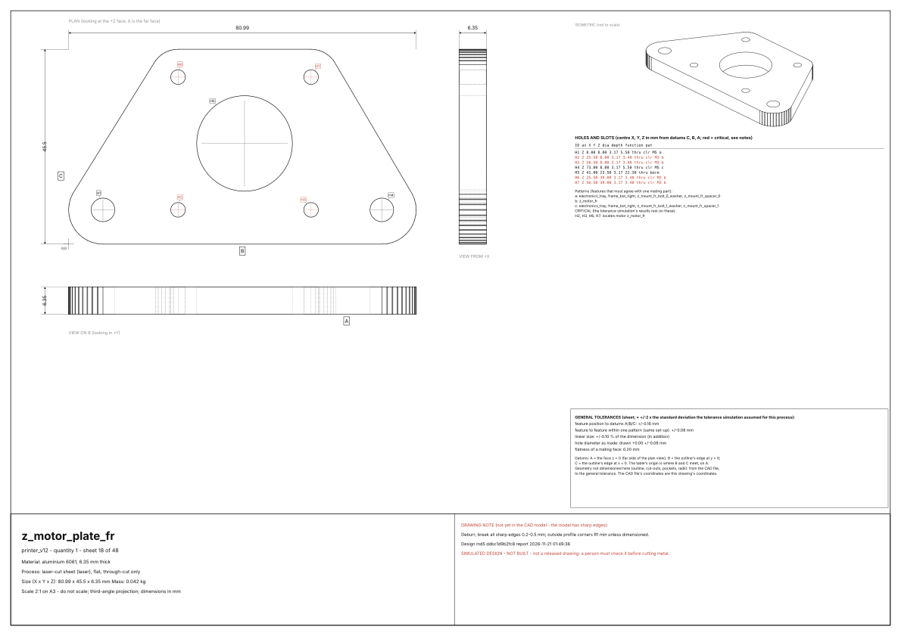

- Quantity 1. aluminium 6061; sheet; 80.99 x 45.5 x 6.35 mm; 0.042 kg. Same size, volume and hole list as z_motor_plate_fl (same or mirror-image part: compare before sharing a file).
- Sheet not specified mm, None cut, flat (no bends), through-cut only. Flat size None mm, cut length None mm, None pierces (report). DXF written here: {'LINE': 44, 'ARC': 37, 'CIRCLE': 7}, cut length 361.1 mm, extent (80.99, 45.5).
- Threads: none. Inserts and clinch nuts: none. Reaming: none.
- Drawing note, not yet in the model: Deburr; break all sharp edges 0.2-0.5 mm; outside profile corners R1 min unless dimensioned.
- **Needs more than the general tolerance, or rests on an assumption:**
  - **Patterns b** (guide block / motor): hole to hole +/-0.08 mm is the figure the screw-pattern check used (tighter than the +/-0.16 mm position tolerance); radial clearance on the screws 0.20 mm. Cut all holes of a pattern in one set-up.
  - This part places a pulley or idler: its thickness and flatness are in the belt-plane result (x_belt: 95.9% of builds within 1 mm, +/-0.36%; y_belt: 99.5% of builds within 1 mm, +/-0.13%; y_belt_l: 99.2% of builds within 1 mm, +/-0.16%).
  - Report, manufacture `hole_smaller_than_thickness`: 6 hole(s) or cut-out(s) narrower than the 6.35 mm sheet (smallest 3.40 mm at [129.0, -116.5, 75.35]): they cut, but taper and lose accuracy.
  - Report, manufacture `hole_too_close_to_edge`: 6 hole(s) with less than 6.35 mm of material to the edge (least 4.78 mm at [129.0, -116.5, 75.35]): the web overheats and distorts, and tears if the part is bent or loaded.
  - Report, manufacture `holes_too_close`: 5 pair(s) of holes or cut-outs with too little material between them (least 9.07 mm at [136.75, -108.75, 75.35], wanted 12.7 mm = 2 x thickness).
  - Report, manufacture `supplier_rule`: SendCutSend rule sendcutsend.cut.hole_min_al6061_page: smallest hole or cut-out 3.4 mm (6 of 7), limit >= 6.35 mm (warning: the supplier's words: "Design holes no smaller than material thickness.").
  - Report, manufacture `supplier_rule`: SendCutSend rule sendcutsend.cut.hole_edge_al6061_page: hole edge to part edge 4.78 mm (6 of 7), limit >= 9.53 mm (warning: the supplier's words: "Keep holes and cutouts 1.5–2× material thickness away from edges to prevent warping or distortion.").
  - Report, manufacture `supplier_rule`: SendCutSend rule sendcutsend.cut.hole_edge_d_ratio: hole edge to part edge 10.8 mm (3 of 7), limit >= 22.3 mm (warning: the supplier's words: "we generally recommend keeping your holes at least 1X their diameter from an edge and slots at least 1.5X their width away from edges or other cut features.").

| ID | Kind | Axis | X | Y | Z | Dia / width | Slot length | Depth | Counterbore (dia x depth, from) | Function | Screws | On its axis | Pattern | Critical |
|---|---|---|---|---|---|---|---|---|---|---|---|---|---|---|
| H1 | hole | Z | 8 | 8 | 3.17 | 5.5 | - | through | - | clearance M5 | z_mount_fr_bolt_0 (SHCS-M5x65) | z_mount_fr_spacer_0 (custom) | a: electronics_tray, frame_bot_right, z_mount_fr_bolt_0_washer, z_mount_fr_spacer_0 | - |
| H2 | hole | Z | 25.5 | 8 | 3.17 | 3.4 | - | through | - | clearance M3 | z_motor_fr_screw_2 (SHCS-M3x10) | - | b: z_motor_fr | locates motor z_motor_fr |
| H3 | hole | Z | 56.5 | 8 | 3.17 | 3.4 | - | through | - | clearance M3 | z_motor_fr_screw_3 (SHCS-M3x10) | - | b: z_motor_fr | locates motor z_motor_fr |
| H4 | hole | Z | 73 | 8 | 3.17 | 5.5 | - | through | - | clearance M5 | z_mount_fr_bolt_1 (SHCS-M5x65) | z_mount_fr_spacer_1 (custom) | c: electronics_tray, frame_bot_right, z_mount_fr_bolt_1_washer, z_mount_fr_spacer_1 | - |
| H5 | hole | Z | 41 | 23.5 | 3.17 | 22.3 | - | through | - | bore / opening | - | leadscrew_fr (TR8x2-INTEGRAL-17E19S1684AB4-330RA) | - | - |
| H6 | hole | Z | 25.5 | 39 | 3.17 | 3.4 | - | through | - | clearance M3 | z_motor_fr_screw_0 (SHCS-M3x10) | - | b: z_motor_fr | locates motor z_motor_fr |
| H7 | hole | Z | 56.5 | 39 | 3.17 | 3.4 | - | through | - | clearance M3 | z_motor_fr_screw_1 (SHCS-M3x10) | - | b: z_motor_fr | locates motor z_motor_fr |

### z_mount_fr_spacer_0

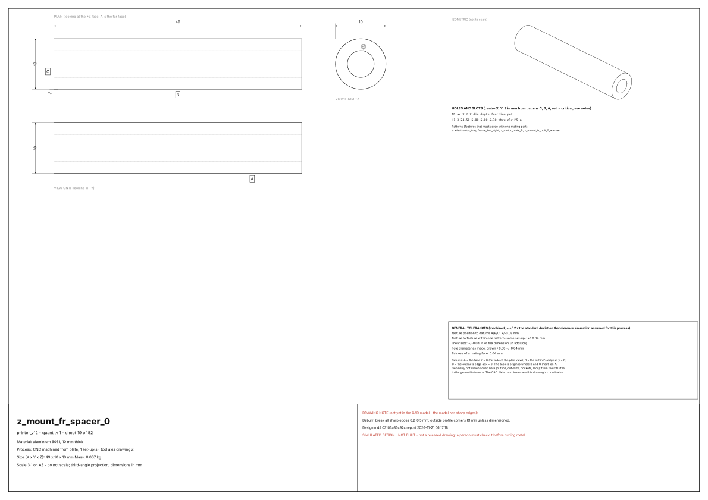

- Quantity 1. aluminium 6061; machined; 49 x 10 x 10 mm; 0.007 kg. Same size, volume and hole list as z_mount_fl_spacer_0, z_mount_fl_spacer_1, z_mount_fr_spacer_1 (same or mirror-image part: compare before sharing a file).
- Stock: None; 1 set-up(s), cut from None; smallest wall None mm; estimate None min machining (...).
- Threads: none. Inserts and clinch nuts: none. Reaming: none.
- Drawing note, not yet in the model: Deburr; break all sharp edges 0.2-0.5 mm; outside profile corners R1 min unless dimensioned.

| ID | Kind | Axis | X | Y | Z | Dia / width | Slot length | Depth | Counterbore (dia x depth, from) | Function | Screws | On its axis | Pattern | Critical |
|---|---|---|---|---|---|---|---|---|---|---|---|---|---|---|
| H1 | hole | X | 24.5 | 5 | 5 | 5.3 | - | through | - | clearance M5 | z_mount_fr_bolt_0 (SHCS-M5x65) | - | a: electronics_tray, frame_bot_right, z_motor_plate_fr, z_mount_fr_bolt_0_washer | - |

### z_mount_fr_spacer_1

- Quantity 1. aluminium 6061; machined; 49 x 10 x 10 mm; 0.007 kg. Same size, volume and hole list as z_mount_fl_spacer_0, z_mount_fl_spacer_1, z_mount_fr_spacer_0 (same or mirror-image part: compare before sharing a file).
- Stock: None; 1 set-up(s), cut from None; smallest wall None mm; estimate None min machining (...).
- Threads: none. Inserts and clinch nuts: none. Reaming: none.
- Drawing note, not yet in the model: Deburr; break all sharp edges 0.2-0.5 mm; outside profile corners R1 min unless dimensioned.

| ID | Kind | Axis | X | Y | Z | Dia / width | Slot length | Depth | Counterbore (dia x depth, from) | Function | Screws | On its axis | Pattern | Critical |
|---|---|---|---|---|---|---|---|---|---|---|---|---|---|---|
| H1 | hole | X | 24.5 | 5 | 5 | 5.3 | - | through | - | clearance M5 | z_mount_fr_bolt_1 (SHCS-M5x65) | - | a: electronics_tray, frame_bot_right, z_motor_plate_fr, z_mount_fr_bolt_1_washer | - |

### y_plate_left

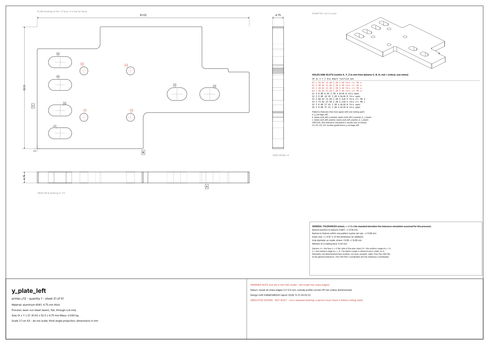

- Quantity 1. aluminium 6061; sheet; 91.02 x 52.5 x 4.75 mm; 0.040 kg.
- Sheet not specified mm, None cut, flat (no bends), through-cut only. Flat size None mm, cut length None mm, None pierces (report). DXF written here: {'LINE': 24, 'ARC': 24, 'CIRCLE': 4}, cut length 475.2 mm, extent (91.02, 52.5).
- Threads: none. Inserts and clinch nuts: none. Reaming: none.
- Drawing note, not yet in the model: Deburr; break all sharp edges 0.2-0.5 mm; outside profile corners R1 min unless dimensioned.
- **Needs more than the general tolerance, or rests on an assumption:**
  - **Patterns a** (guide block / motor): hole to hole +/-0.08 mm is the figure the screw-pattern check used (tighter than the +/-0.16 mm position tolerance); radial clearance on the screws 0.25 mm. Cut all holes of a pattern in one set-up.
  - Report, manufacture `hole_smaller_than_thickness`: 4 hole(s) or cut-out(s) narrower than the 4.75 mm sheet (smallest 3.50 mm at [-170.0, -51.61, 419.38]): they cut, but taper and lose accuracy.
  - Report, manufacture `hole_too_close_to_edge`: 3 hole(s) with less than 4.75 mm of material to the edge (least 3.35 mm at [-180.22, -27.87, 419.38]): the web overheats and distorts, and tears if the part is bent or loaded.
  - Report, manufacture `holes_too_close`: 2 pair(s) of holes or cut-outs with too little material between them (least 4.02 mm at [-175.11, -50.14, 419.38], wanted 4.75 mm = 1 x thickness).
  - Report, manufacture `supplier_rule`: SendCutSend rule sendcutsend.cut.hole_min_al6061_page: smallest hole or cut-out 3.5 mm (4 of 10), limit >= 4.75 mm (warning: the supplier's words: "Design holes no smaller than material thickness.").
  - Report, manufacture `supplier_rule`: SendCutSend rule sendcutsend.cut.hole_edge_al6061_page: hole edge to part edge 3.75 mm (1 of 4), limit >= 7.12 mm (warning: the supplier's words: "Keep holes and cutouts 1.5–2× material thickness away from edges to prevent warping or distortion.").
  - Report, manufacture `supplier_rule`: SendCutSend rule sendcutsend.cut.slot_edge_w_ratio: slot to edge or next feature 3.35 mm (4 of 4), limit >= 7.2 mm (warning: the supplier's words: "we generally recommend keeping your holes at least 1X their diameter from an edge and slots at least 1.5X their width away from edges or other cut features.").

| ID | Kind | Axis | X | Y | Z | Dia / width | Slot length | Depth | Counterbore (dia x depth, from) | Function | Screws | On its axis | Pattern | Critical |
|---|---|---|---|---|---|---|---|---|---|---|---|---|---|---|
| H1 | hole | Z | 20.02 | 13.5 | 2.38 | 3.5 | - | through | - | clearance M3 | y_plate_left_screw_0 (SHCS-M3x8) | - | a: y_carriage_left | locates guide block y_carriage_left |
| H2 | hole | Z | 40.02 | 13.5 | 2.38 | 3.5 | - | through | - | clearance M3 | y_plate_left_screw_2 (SHCS-M3x8) | - | a: y_carriage_left | locates guide block y_carriage_left |
| H3 | hole | Z | 20.02 | 33.5 | 2.38 | 3.5 | - | through | - | clearance M3 | y_plate_left_screw_1 (SHCS-M3x8) | - | a: y_carriage_left | locates guide block y_carriage_left |
| H4 | hole | Z | 40.02 | 33.5 | 2.38 | 3.5 | - | through | - | clearance M3 | y_plate_left_screw_3 (SHCS-M3x8) | - | a: y_carriage_left | locates guide block y_carriage_left |
| S1 | slot | Z | 9.8 | 6.65 | 2.38 | 4.8 | 10 | through | - | hole (no screw or part on its axis in the model) | - | - | - | - |
| S2 | slot | Z | 9.8 | 16.45 | 2.38 | 4.8 | 10 | through | - | hole (no screw or part on its axis in the model) | - | - | - | - |
| S3 | slot | Z | 60.02 | 23.5 | 2.38 | 5.5 | 8.5 | through | - | clearance M5 | beam_bolt_left_1 (SHCS-M5x12) | - | b: beam_bolt_left_1_washer, beam_bolt_left_1_washer_2, x_beam | - |
| S4 | slot | Z | 74.02 | 23.5 | 2.38 | 5.5 | 8.5 | through | - | clearance M5 | beam_bolt_left (SHCS-M5x12) | - | c: beam_bolt_left_washer, beam_bolt_left_washer_2, x_beam | - |
| S5 | slot | Z | 9.8 | 27.45 | 2.38 | 4.8 | 10 | through | - | hole (no screw or part on its axis in the model) | - | - | - | - |
| S6 | slot | Z | 9.8 | 37.25 | 2.38 | 4.8 | 10 | through | - | hole (no screw or part on its axis in the model) | - | - | - | - |

### y_plate_right

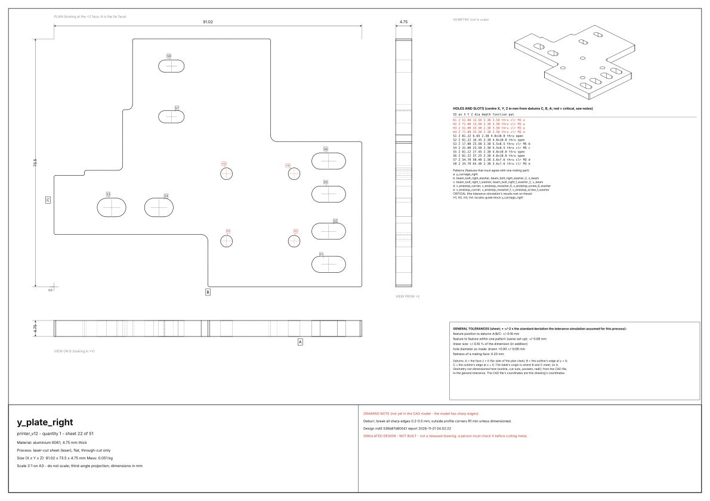

- Quantity 1. aluminium 6061; sheet; 91.02 x 73.5 x 4.75 mm; 0.051 kg.
- Sheet not specified mm, None cut, flat (no bends), through-cut only. Flat size None mm, cut length None mm, None pierces (report). DXF written here: {'LINE': 30, 'ARC': 30, 'CIRCLE': 4}, cut length 555.0 mm, extent (91.02, 73.5).
- Threads: none. Inserts and clinch nuts: none. Reaming: none.
- Drawing note, not yet in the model: Deburr; break all sharp edges 0.2-0.5 mm; outside profile corners R1 min unless dimensioned.
- **Needs more than the general tolerance, or rests on an assumption:**
  - **Patterns a** (guide block / motor): hole to hole +/-0.08 mm is the figure the screw-pattern check used (tighter than the +/-0.16 mm position tolerance); radial clearance on the screws 0.25 mm. Cut all holes of a pattern in one set-up.
  - Report, manufacture `hole_smaller_than_thickness`: 6 hole(s) or cut-out(s) narrower than the 4.75 mm sheet (smallest 3.50 mm at [150.0, -51.61, 419.38]): they cut, but taper and lose accuracy.
  - Report, manufacture `hole_too_close_to_edge`: 3 hole(s) with less than 4.75 mm of material to the edge (least 3.35 mm at [180.22, -27.87, 419.38]): the web overheats and distorts, and tears if the part is bent or loaded.
  - Report, manufacture `holes_too_close`: 2 pair(s) of holes or cut-outs with too little material between them (least 4.02 mm at [175.11, -50.14, 419.38], wanted 4.75 mm = 1 x thickness).
  - Report, manufacture `supplier_rule`: SendCutSend rule sendcutsend.cut.hole_min_al6061_page: smallest hole or cut-out 3.5 mm (6 of 12), limit >= 4.75 mm (warning: the supplier's words: "Design holes no smaller than material thickness.").
  - Report, manufacture `supplier_rule`: SendCutSend rule sendcutsend.cut.hole_edge_al6061_page: hole edge to part edge 3.75 mm (1 of 4), limit >= 7.12 mm (warning: the supplier's words: "Keep holes and cutouts 1.5–2× material thickness away from edges to prevent warping or distortion.").
  - Report, manufacture `supplier_rule`: SendCutSend rule sendcutsend.cut.slot_edge_w_ratio: slot to edge or next feature 3.35 mm (4 of 6), limit >= 7.2 mm (warning: the supplier's words: "we generally recommend keeping your holes at least 1X their diameter from an edge and slots at least 1.5X their width away from edges or other cut features.").

| ID | Kind | Axis | X | Y | Z | Dia / width | Slot length | Depth | Counterbore (dia x depth, from) | Function | Screws | On its axis | Pattern | Critical |
|---|---|---|---|---|---|---|---|---|---|---|---|---|---|---|
| H1 | hole | Z | 51 | 13.5 | 2.38 | 3.5 | - | through | - | clearance M3 | y_plate_right_screw_0 (SHCS-M3x8) | - | a: y_carriage_right | locates guide block y_carriage_right |
| H2 | hole | Z | 71 | 13.5 | 2.38 | 3.5 | - | through | - | clearance M3 | y_plate_right_screw_2 (SHCS-M3x8) | - | a: y_carriage_right | locates guide block y_carriage_right |
| H3 | hole | Z | 51 | 33.5 | 2.38 | 3.5 | - | through | - | clearance M3 | y_plate_right_screw_1 (SHCS-M3x8) | - | a: y_carriage_right | locates guide block y_carriage_right |
| H4 | hole | Z | 71 | 33.5 | 2.38 | 3.5 | - | through | - | clearance M3 | y_plate_right_screw_3 (SHCS-M3x8) | - | a: y_carriage_right | locates guide block y_carriage_right |
| S1 | slot | Z | 81.22 | 6.65 | 2.38 | 4.8 | 10 | through | - | hole (no screw or part on its axis in the model) | - | - | - | - |
| S2 | slot | Z | 81.22 | 16.45 | 2.38 | 4.8 | 10 | through | - | hole (no screw or part on its axis in the model) | - | - | - | - |
| S3 | slot | Z | 17 | 23.5 | 2.38 | 5.5 | 8.5 | through | - | clearance M5 | beam_bolt_right (SHCS-M5x12) | - | b: beam_bolt_right_washer, beam_bolt_right_washer_2, x_beam | - |
| S4 | slot | Z | 31 | 23.5 | 2.38 | 5.5 | 8.5 | through | - | clearance M5 | beam_bolt_right_1 (SHCS-M5x12) | - | c: beam_bolt_right_1_washer, beam_bolt_right_1_washer_2, x_beam | - |
| S5 | slot | Z | 81.22 | 27.45 | 2.38 | 4.8 | 10 | through | - | hole (no screw or part on its axis in the model) | - | - | - | - |
| S6 | slot | Z | 81.22 | 37.25 | 2.38 | 4.8 | 10 | through | - | hole (no screw or part on its axis in the model) | - | - | - | - |
| S7 | slot | Z | 34.7 | 50.4 | 2.38 | 3.6 | 7.6 | through | - | clearance M3 | x_endstop_screw_0 (SHCS-M3x16) | - | d: x_endstop_carrier, x_endstop_nwasher_0, x_endstop_screw_0_washer | - |
| S8 | slot | Z | 34.7 | 65.4 | 2.38 | 3.6 | 7.6 | through | - | clearance M3 | x_endstop_screw_1 (SHCS-M3x16) | - | e: x_endstop_carrier, x_endstop_nwasher_1, x_endstop_screw_1_washer | - |

### tool_plate

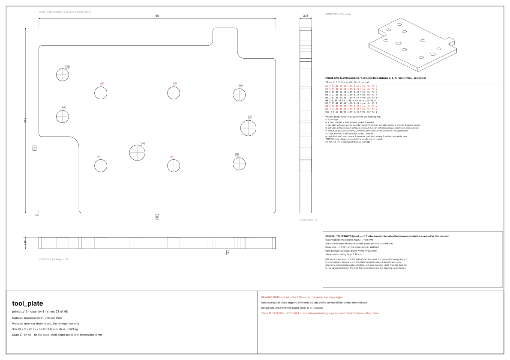

- Quantity 1. aluminium 6061; sheet; 65 x 50.9 x 3.18 mm; 0.023 kg.
- Sheet not specified mm, None cut, flat (no bends), through-cut only. Flat size None mm, cut length None mm, None pierces (report). DXF written here: {'LINE': 10, 'ARC': 10, 'CIRCLE': 10}, cut length 338.9 mm, extent (65.0, 50.9).
- Threads: none. Inserts and clinch nuts: none. Reaming: none.
- Drawing note, not yet in the model: Deburr; break all sharp edges 0.2-0.5 mm; outside profile corners R1 min unless dimensioned.
- **Needs more than the general tolerance, or rests on an assumption:**
  - **Patterns a** (guide block / motor): hole to hole +/-0.08 mm is the figure the screw-pattern check used (tighter than the +/-0.16 mm position tolerance); radial clearance on the screws 0.20 mm. Cut all holes of a pattern in one set-up.
  - Report, manufacture `holes_too_close`: 2 pair(s) of holes or cut-outs with too little material between them (least 5.64 mm at [4.93, -17.03, 436.25], wanted 6.35 mm = 2 x thickness).
  - Report, manufacture `supplier_rule`: SendCutSend rule sendcutsend.cut.hole_edge_al6061_page: hole edge to part edge 3.8 mm (2 of 10), limit >= 4.76 mm (warning: the supplier's words: "Keep holes and cutouts 1.5–2× material thickness away from edges to prevent warping or distortion.").

| ID | Kind | Axis | X | Y | Z | Dia / width | Slot length | Depth | Counterbore (dia x depth, from) | Function | Screws | On its axis | Pattern | Critical |
|---|---|---|---|---|---|---|---|---|---|---|---|---|---|---|
| H1 | hole | Z | 17 | 13 | 1.59 | 3.4 | - | through | - | clearance M3 | tool_screw_0 (SHCS-M3x6) | - | a: x_carriage | locates guide block x_carriage |
| H2 | hole | Z | 37 | 13 | 1.59 | 3.4 | - | through | - | clearance M3 | tool_screw_2 (SHCS-M3x6) | - | a: x_carriage | locates guide block x_carriage |
| H3 | hole | Z | 55 | 13.5 | 1.59 | 3.4 | - | through | - | clearance M3 | x_belt_bracket_screw_0 (SHCS-M3x10) | - | b: x_belt_bracket, x_belt_bracket_screw_0_washer | - |
| H4 | hole | Z | 27 | 16.56 | 1.59 | 4.27 | - | through | - | clearance M3 | extruder_screw_0 (SHCS-M3x50) | extruder_nut_0 (NUT-PEM-S-M3-0) | c: extruder, extruder_nut_0, extruder_screw_0_washer, extruder_screw_0_washer_2, probe_mount, tool_plate_rear | - |
| H5 | hole | Z | 57.5 | 23.36 | 1.59 | 4.27 | - | through | - | clearance M3 | extruder_screw_1 (SHCS-M3x50) | extruder_nut_1 (NUT-PEM-S-M3-0), x_belt_bracket (custom) | d: extruder, extruder_nut_1, extruder_screw_1_washer, extruder_screw_1_washer_2, probe_mount, tool_plate_rear | - |
| H6 | hole | Z | 6.5 | 26.5 | 1.59 | 3.4 | - | through | - | clearance M3 | part_duct_screw_0 (SHCS-M3x16) | - | e: part_duct, part_duct_screw_0_nwasher, part_duct_screw_0_washer, tool_plate_rear | - |
| H7 | hole | Z | 55 | 32.5 | 1.59 | 3.4 | - | through | - | clearance M3 | x_belt_bracket_screw_1 (SHCS-M3x10) | - | f: x_belt_bracket, x_belt_bracket_screw_1_washer | - |
| H8 | hole | Z | 17 | 33 | 1.59 | 3.4 | - | through | - | clearance M3 | tool_screw_1 (SHCS-M3x6) | - | a: x_carriage | locates guide block x_carriage |
| H9 | hole | Z | 37 | 33 | 1.59 | 3.4 | - | through | - | clearance M3 | tool_screw_3 (SHCS-M3x6) | - | a: x_carriage | locates guide block x_carriage |
| H10 | hole | Z | 6.5 | 38 | 1.59 | 3.4 | - | through | - | clearance M3 | part_duct_screw_1 (SHCS-M3x16) | - | g: part_duct, part_duct_screw_1_nwasher, part_duct_screw_1_washer, tool_plate_rear | - |

### tool_plate_rear

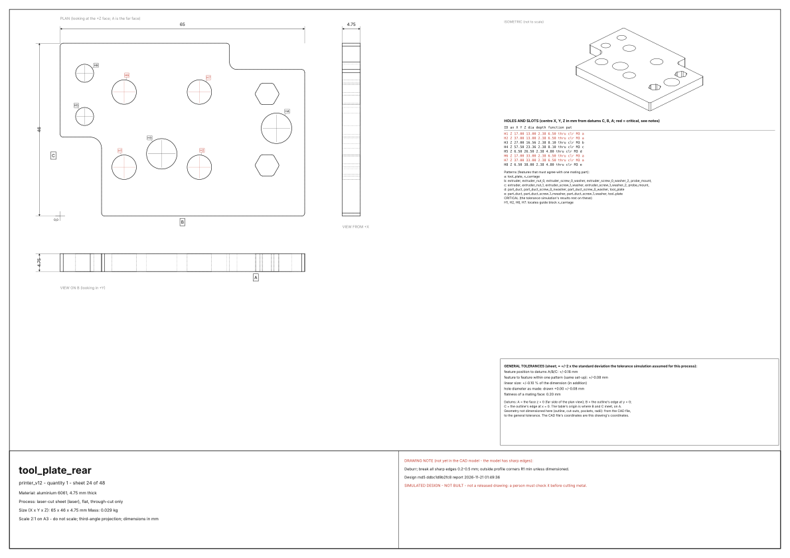

- Quantity 1. aluminium 6061; sheet; 65 x 46 x 4.75 mm; 0.029 kg.
- Sheet not specified mm, None cut, flat (no bends), through-cut only. Flat size None mm, cut length None mm, None pierces (report). DXF written here: {'LINE': 20, 'ARC': 20, 'CIRCLE': 8}, cut length 418.6 mm, extent (65.0, 46.0).
- Threads: none. Inserts and clinch nuts: none. Reaming: none.
- Drawing note, not yet in the model: Deburr; break all sharp edges 0.2-0.5 mm; outside profile corners R1 min unless dimensioned.
- **Needs more than the general tolerance, or rests on an assumption:**
  - **Patterns a** (guide block / motor): hole to hole +/-0.08 mm is the figure the screw-pattern check used (tighter than the +/-0.16 mm position tolerance); radial clearance on the screws 1.75 mm. Cut all holes of a pattern in one set-up.
  - Report, manufacture `hole_too_close_to_edge`: 5 hole(s) with less than 4.75 mm of material to the edge (least 2.75 mm at [-10.0, -13.06, 397.0]): the web overheats and distorts, and tears if the part is bent or loaded.
  - Report, manufacture `holes_too_close`: 7 pair(s) of holes or cut-outs with too little material between them (least 3.32 mm at [-8.22, -13.06, 402.0], wanted 9.5 mm = 2 x thickness).
  - Report, manufacture `supplier_rule`: SendCutSend rule sendcutsend.cut.hole_edge_al6061_page: hole edge to part edge 2.75 mm (4 of 8), limit >= 7.12 mm (warning: the supplier's words: "Keep holes and cutouts 1.5–2× material thickness away from edges to prevent warping or distortion.").
  - Report, manufacture `supplier_rule`: SendCutSend rule sendcutsend.cut.hole_edge_d_ratio: hole edge to part edge 3.45 mm (4 of 8), limit >= 8.1 mm (warning: the supplier's words: "we generally recommend keeping your holes at least 1X their diameter from an edge and slots at least 1.5X their width away from edges or other cut features.").

| ID | Kind | Axis | X | Y | Z | Dia / width | Slot length | Depth | Counterbore (dia x depth, from) | Function | Screws | On its axis | Pattern | Critical |
|---|---|---|---|---|---|---|---|---|---|---|---|---|---|---|
| H1 | hole | Z | 17 | 13 | 2.38 | 6.5 | - | through | - | clearance M3 | tool_screw_0 (SHCS-M3x6) | - | a: tool_plate, x_carriage | locates guide block x_carriage |
| H2 | hole | Z | 37 | 13 | 2.38 | 6.5 | - | through | - | clearance M3 | tool_screw_2 (SHCS-M3x6) | - | a: tool_plate, x_carriage | locates guide block x_carriage |
| H3 | hole | Z | 27 | 16.56 | 2.38 | 8.1 | - | through | - | clearance M3 | extruder_screw_0 (SHCS-M3x50) | extruder_nut_0 (NUT-PEM-S-M3-0) | b: extruder, extruder_nut_0, extruder_screw_0_washer, extruder_screw_0_washer_2, probe_mount, tool_plate | - |
| H4 | hole | Z | 57.5 | 23.36 | 2.38 | 8.1 | - | through | - | clearance M3 | extruder_screw_1 (SHCS-M3x50) | extruder_nut_1 (NUT-PEM-S-M3-0) | c: extruder, extruder_nut_1, extruder_screw_1_washer, extruder_screw_1_washer_2, probe_mount, tool_plate | - |
| H5 | hole | Z | 6.5 | 26.5 | 2.38 | 4.8 | - | through | - | clearance M3 | part_duct_screw_0 (SHCS-M3x16) | - | d: part_duct, part_duct_screw_0_nwasher, part_duct_screw_0_washer, tool_plate | - |
| H6 | hole | Z | 17 | 33 | 2.38 | 6.5 | - | through | - | clearance M3 | tool_screw_1 (SHCS-M3x6) | - | a: tool_plate, x_carriage | locates guide block x_carriage |
| H7 | hole | Z | 37 | 33 | 2.38 | 6.5 | - | through | - | clearance M3 | tool_screw_3 (SHCS-M3x6) | - | a: tool_plate, x_carriage | locates guide block x_carriage |
| H8 | hole | Z | 6.5 | 38 | 2.38 | 4.8 | - | through | - | clearance M3 | part_duct_screw_1 (SHCS-M3x16) | - | e: part_duct, part_duct_screw_1_nwasher, part_duct_screw_1_washer, tool_plate | - |

### probe_mount

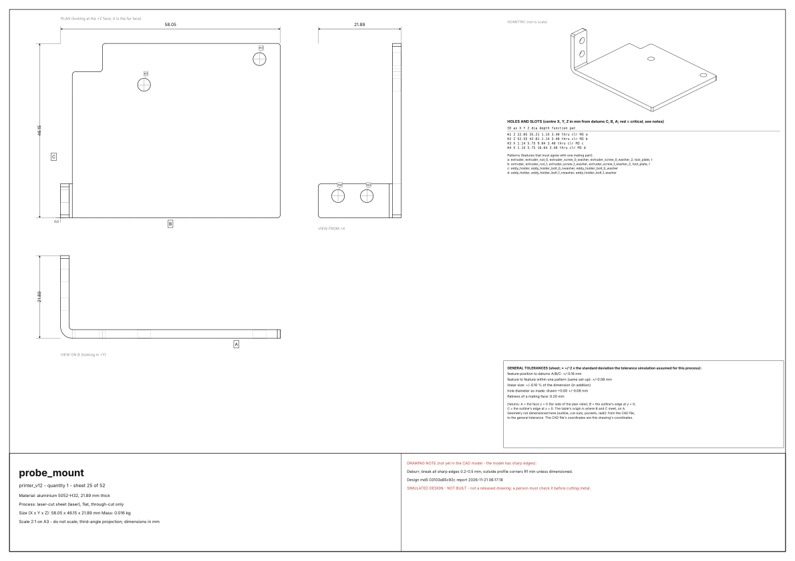

- Quantity 1. aluminium 5052-H32; sheet; 58.05 x 46.15 x 21.89 mm; 0.016 kg.
- Sheet not specified mm, None cut, **BENT: 1 bend(s)**, 90 degrees, inside radius 0.81 mm, K-factor 0.37 (bend allowance 2.601 mm). The DXF is the unfolded flat pattern ([76.345, 46.15] mm, cut on layer CUT, the bend line on layer BEND); flat area x thickness / part volume 0.9984 (checked within 2 %). Send the STEP with it and mark the bend direction on the order.
- Threads: none. Inserts and clinch nuts: none. Reaming: none.
- Drawing note, not yet in the model: Deburr; break all sharp edges 0.2-0.5 mm; outside profile corners R1 min unless dimensioned.
- **Needs more than the general tolerance, or rests on an assumption:**
  - Report, manufacture `hole_too_close_to_bend`: 1 hole(s) closer than 4.5721 mm (2 x thickness) to where a bend's radius starts (nearest 4.24 mm, a 3.4 mm hole at [-35.9, 36.85, 386.09]): the hole stretches into an oval when the bend is formed.
  - Report, manufacture `supplier_rule`: SendCutSend rule sendcutsend.cut.hole_edge_al5052_page: hole edge to part edge 1.55 mm (3 of 4), limit >= 4.57 mm (warning: the supplier's words: "Spacing from edges: Leave at least 2x thickness between a hole and an edge.").
  - Report, manufacture `supplier_rule`: SendCutSend rule sendcutsend.cut.hole_edge_d_ratio: hole edge to part edge 1.55 mm (3 of 4), limit >= 3.4 mm (warning: the supplier's words: "we generally recommend keeping your holes at least 1X their diameter from an edge and slots at least 1.5X their width away from edges or other cut features.").
  - Report, manufacture `supplier_rule`: SendCutSend rule sendcutsend.bend.die_width.al5052.2.286mm: hole or cut-out to bend 5.54 mm (1 of 4), limit >= 6 mm (warning: the supplier's words: "Bending specifications per material (bending calculator), 5052 Aluminum .090″: Die Width .472″. Bend deformation guideline: make sure your cut features are at l").

| ID | Kind | Axis | X | Y | Z | Dia / width | Slot length | Depth | Counterbore (dia x depth, from) | Function | Screws | On its axis | Pattern | Critical |
|---|---|---|---|---|---|---|---|---|---|---|---|---|---|---|
| H1 | hole | Z | 22.05 | 35.21 | 1.14 | 3.4 | - | through | - | clearance M3 | extruder_screw_0 (SHCS-M3x50) | - | a: extruder, extruder_nut_0, extruder_screw_0_washer, extruder_screw_0_washer_2, tool_plate, tool_plate_rear | - |
| H2 | hole | Z | 52.55 | 42.01 | 1.14 | 3.4 | - | through | - | clearance M3 | extruder_screw_1 (SHCS-M3x50) | - | b: extruder, extruder_nut_1, extruder_screw_1_washer, extruder_screw_1_washer_2, tool_plate, tool_plate_rear | - |
| H3 | hole | X | 1.14 | 5.75 | 9.04 | 3.4 | - | through | - | clearance M3 | eddy_holder_bolt_0 (SHCS-M3x8) | - | c: eddy_holder, eddy_holder_bolt_0_nwasher, eddy_holder_bolt_0_washer | - |
| H4 | hole | X | 1.14 | 5.75 | 16.64 | 3.4 | - | through | - | clearance M3 | eddy_holder_bolt_1 (SHCS-M3x8) | - | d: eddy_holder, eddy_holder_bolt_1_nwasher, eddy_holder_bolt_1_washer | - |

### eddy_holder

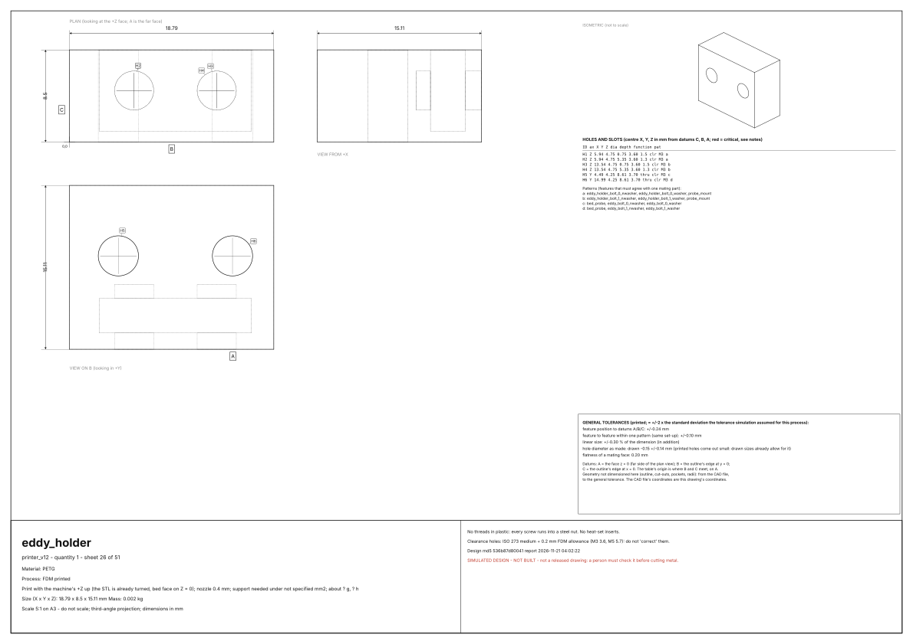

- Quantity 1. PETG; printed; 18.79 x 8.5 x 15.11 mm; 0.002 kg.
- Print with the machine's **+Z** direction up (STL already turned). Support needed under None mm2; longest bridge None mm; bed contact None; thinnest wall None mm; None g, None h (estimate). Holes opening on the bed face: 0 (first-layer squash makes them tight).
- Threads: none. Inserts and clinch nuts: none. Reaming: none.
- **Needs more than the general tolerance, or rests on an assumption:**
  - Report, manufacture `supplier_process_rule`: Hubs (Protolabs Network) rule hubs.fdm.overhang: overhang beyond the angle 19.4 mm2, limit <= 0 mm2 (warning: the supplier's words: "Depending on the material, an overhang can usually be printed up to 45° without compromising quality.").

| ID | Kind | Axis | X | Y | Z | Dia / width | Slot length | Depth | Counterbore (dia x depth, from) | Function | Screws | On its axis | Pattern | Critical |
|---|---|---|---|---|---|---|---|---|---|---|---|---|---|---|
| H1 | hole | Z | 5.94 | 4.75 | 0.75 | 3.6 | - | 1.5 | - | clearance M3 | eddy_holder_bolt_0 (SHCS-M3x8) | - | a: eddy_holder_bolt_0_nwasher, eddy_holder_bolt_0_washer, probe_mount | - |
| H2 | hole | Z | 5.94 | 4.75 | 5.35 | 3.6 | - | 1.3 | - | clearance M3 | eddy_holder_bolt_0 (SHCS-M3x8) | - | a: eddy_holder_bolt_0_nwasher, eddy_holder_bolt_0_washer, probe_mount | - |
| H3 | hole | Z | 13.54 | 4.75 | 0.75 | 3.6 | - | 1.5 | - | clearance M3 | eddy_holder_bolt_1 (SHCS-M3x8) | - | b: eddy_holder_bolt_1_nwasher, eddy_holder_bolt_1_washer, probe_mount | - |
| H4 | hole | Z | 13.54 | 4.75 | 5.35 | 3.6 | - | 1.3 | - | clearance M3 | eddy_holder_bolt_1 (SHCS-M3x8) | - | b: eddy_holder_bolt_1_nwasher, eddy_holder_bolt_1_washer, probe_mount | - |
| H5 | hole | Y | 4.49 | 4.25 | 8.61 | 3.7 | - | through | - | clearance M3 | eddy_bolt_0 (SHCS-M3x30) | - | c: bed_probe, eddy_bolt_0_nwasher, eddy_bolt_0_washer | - |
| H6 | hole | Y | 14.99 | 4.25 | 8.61 | 3.7 | - | through | - | clearance M3 | eddy_bolt_1 (SHCS-M3x30) | - | d: bed_probe, eddy_bolt_1_nwasher, eddy_bolt_1_washer | - |

### part_duct

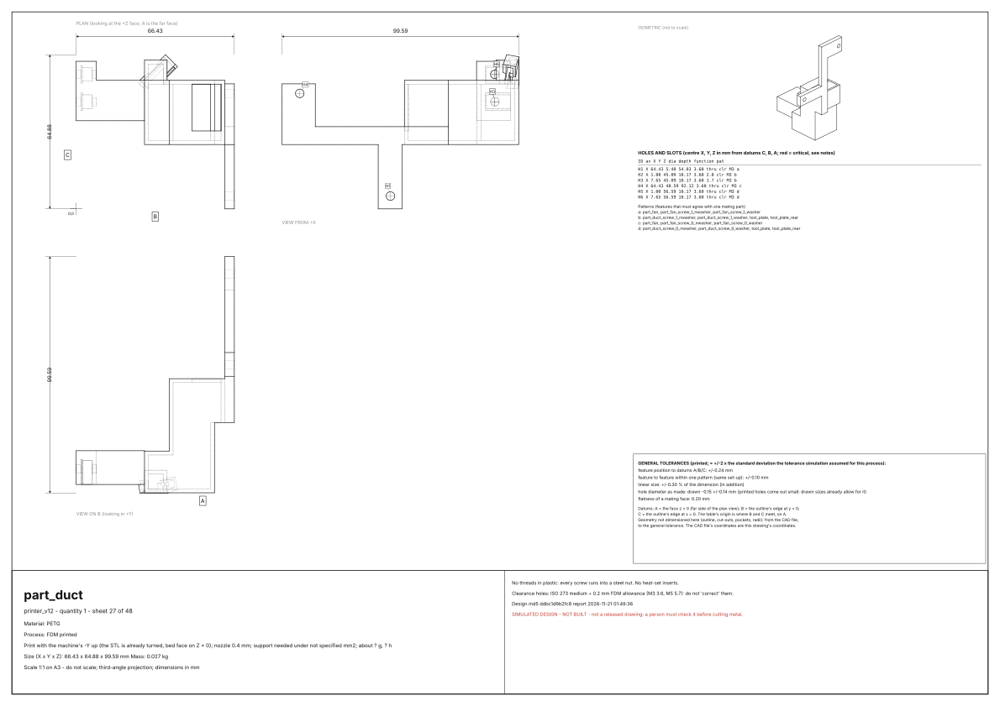

- Quantity 1. PETG; printed; 66.43 x 64.88 x 99.59 mm; 0.027 kg.
- Print with the machine's **-Y** direction up (STL already turned). Support needed under None mm2; longest bridge None mm; bed contact None; thinnest wall None mm; None g, None h (estimate). Holes opening on the bed face: 0 (first-layer squash makes them tight).
- Threads: none. Inserts and clinch nuts: none. Reaming: none.
- **Needs more than the general tolerance, or rests on an assumption:**
  - Report, manufacture `needs_support`: pinned print orientation (-Y up) 1245 mm² overhangs by more than 45 degrees with nothing under it and needs support material.
  - Report, manufacture `supplier_process_rule`: Hubs (Protolabs Network) rule hubs.fdm.overhang: overhang beyond the angle 1293.8 mm2, limit <= 0 mm2 (warning: the supplier's words: "Depending on the material, an overhang can usually be printed up to 45° without compromising quality.").

| ID | Kind | Axis | X | Y | Z | Dia / width | Slot length | Depth | Counterbore (dia x depth, from) | Function | Screws | On its axis | Pattern | Critical |
|---|---|---|---|---|---|---|---|---|---|---|---|---|---|---|
| H1 | hole | X | 64.43 | 5.4 | 54.03 | 3.6 | - | through | - | clearance M3 | part_fan_screw_1 (SHCS-M3x25) | - | a: part_fan, part_fan_screw_1_nwasher, part_fan_screw_1_washer | - |
| H2 | hole | X | 1 | 45.09 | 10.17 | 3.6 | - | 2 | - | clearance M3 | part_duct_screw_1 (SHCS-M3x16) | - | b: part_duct_screw_1_nwasher, part_duct_screw_1_washer, tool_plate, tool_plate_rear | - |
| H3 | hole | X | 7.65 | 45.09 | 10.17 | 3.6 | - | 1.7 | - | clearance M3 | part_duct_screw_1 (SHCS-M3x16) | - | b: part_duct_screw_1_nwasher, part_duct_screw_1_washer, tool_plate, tool_plate_rear | - |
| H4 | hole | X | 64.43 | 48.59 | 92.12 | 3.6 | - | through | - | clearance M3 | part_fan_screw_0 (SHCS-M3x25) | - | c: part_fan, part_fan_screw_0_nwasher, part_fan_screw_0_washer | - |
| H5 | hole | X | 1 | 56.59 | 10.17 | 3.6 | - | through | - | clearance M3 | part_duct_screw_0 (SHCS-M3x16) | - | d: part_duct_screw_0_nwasher, part_duct_screw_0_washer, tool_plate, tool_plate_rear | - |
| H6 | hole | X | 7.65 | 56.59 | 10.17 | 3.6 | - | through | - | clearance M3 | part_duct_screw_0 (SHCS-M3x16) | - | d: part_duct_screw_0_nwasher, part_duct_screw_0_washer, tool_plate, tool_plate_rear | - |

### x_belt_bracket

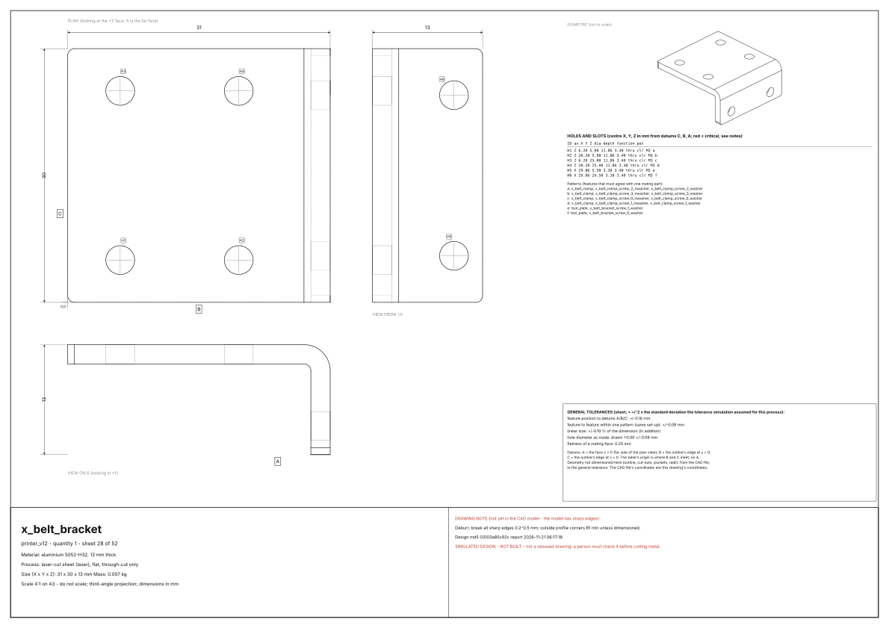

- Quantity 1. aluminium 5052-H32; sheet; 31 x 30 x 13 mm; 0.007 kg.
- Sheet not specified mm, None cut, **BENT: 1 bend(s)**, 90 degrees, inside radius 0.81 mm, K-factor 0.37 (bend allowance 2.601 mm). The DXF is the unfolded flat pattern ([40.409, 30.0] mm, cut on layer CUT, the bend line on layer BEND); flat area x thickness / part volume 0.9881 (checked within 2 %). Send the STEP with it and mark the bend direction on the order.
- Threads: none. Inserts and clinch nuts: none. Reaming: none.
- Drawing note, not yet in the model: Deburr; break all sharp edges 0.2-0.5 mm; outside profile corners R1 min unless dimensioned.
- **Needs more than the general tolerance, or rests on an assumption:**
  - Report, manufacture `supplier_rule`: SendCutSend rule sendcutsend.cut.hole_edge_al5052_page: hole edge to part edge 1.68 mm (6 of 6), limit >= 4.57 mm (warning: the supplier's words: "Spacing from edges: Leave at least 2x thickness between a hole and an edge.").
  - Report, manufacture `supplier_rule`: SendCutSend rule sendcutsend.cut.hole_edge_d_ratio: hole edge to part edge 1.68 mm (6 of 6), limit >= 3.4 mm (warning: the supplier's words: "we generally recommend keeping your holes at least 1X their diameter from an edge and slots at least 1.5X their width away from edges or other cut features.").

| ID | Kind | Axis | X | Y | Z | Dia / width | Slot length | Depth | Counterbore (dia x depth, from) | Function | Screws | On its axis | Pattern | Critical |
|---|---|---|---|---|---|---|---|---|---|---|---|---|---|---|
| H1 | hole | Z | 6.2 | 5 | 11.86 | 3.4 | - | through | - | clearance M3 | x_belt_clamp_screw_2 (SHCS-M3x10) | - | a: x_belt_clamp, x_belt_clamp_screw_2_nwasher, x_belt_clamp_screw_2_washer | - |
| H2 | hole | Z | 20.2 | 5 | 11.86 | 3.4 | - | through | - | clearance M3 | x_belt_clamp_screw_3 (SHCS-M3x10) | - | b: x_belt_clamp, x_belt_clamp_screw_3_nwasher, x_belt_clamp_screw_3_washer | - |
| H3 | hole | Z | 6.2 | 25 | 11.86 | 3.4 | - | through | - | clearance M3 | x_belt_clamp_screw_0 (SHCS-M3x10) | - | c: x_belt_clamp, x_belt_clamp_screw_0_nwasher, x_belt_clamp_screw_0_washer | - |
| H4 | hole | Z | 20.2 | 25 | 11.86 | 3.4 | - | through | - | clearance M3 | x_belt_clamp_screw_1 (SHCS-M3x10) | - | d: x_belt_clamp, x_belt_clamp_screw_1_nwasher, x_belt_clamp_screw_1_washer | - |
| H5 | hole | X | 29.86 | 5.5 | 3.38 | 3.4 | - | through | - | clearance M3 | x_belt_bracket_screw_1 (SHCS-M3x10) | - | e: tool_plate, x_belt_bracket_screw_1_washer | - |
| H6 | hole | X | 29.86 | 24.5 | 3.38 | 3.4 | - | through | - | clearance M3 | x_belt_bracket_screw_0 (SHCS-M3x10) | - | f: tool_plate, x_belt_bracket_screw_0_washer | - |

### x_belt_clamp

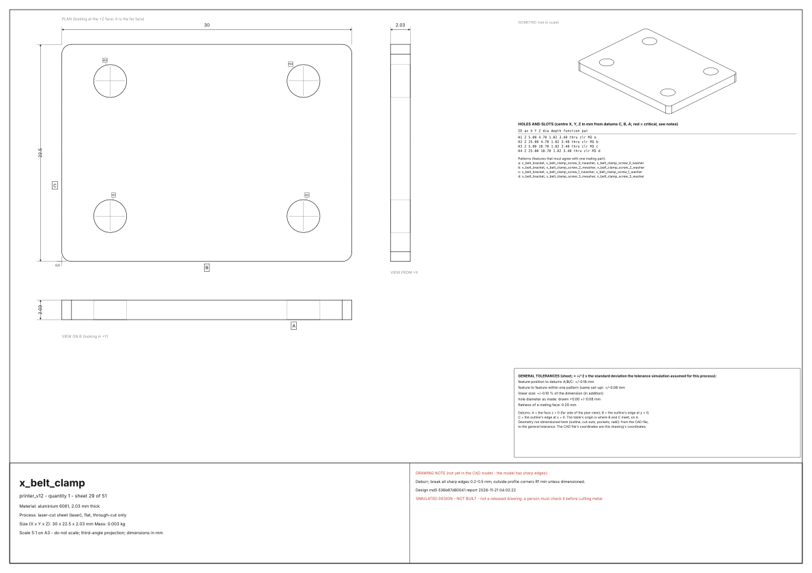

- Quantity 1. aluminium 6061; sheet; 30 x 22.5 x 2.03 mm; 0.003 kg.
- Sheet not specified mm, None cut, flat (no bends), through-cut only. Flat size None mm, cut length None mm, None pierces (report). DXF written here: {'LINE': 4, 'ARC': 4, 'CIRCLE': 4}, cut length 146.0 mm, extent (30.0, 22.5).
- Threads: none. Inserts and clinch nuts: none. Reaming: none.
- Drawing note, not yet in the model: Deburr; break all sharp edges 0.2-0.5 mm; outside profile corners R1 min unless dimensioned.
- **Needs more than the general tolerance, or rests on an assumption:**
  - Report, manufacture `supplier_rule`: SendCutSend rule sendcutsend.cut.hole_edge_al6061_page: hole edge to part edge 2.1 mm (4 of 4), limit >= 3.05 mm (warning: the supplier's words: "Keep holes and cutouts 1.5–2× material thickness away from edges to prevent warping or distortion.").
  - Report, manufacture `supplier_rule`: SendCutSend rule sendcutsend.cut.hole_edge_d_ratio: hole edge to part edge 2.1 mm (4 of 4), limit >= 3.4 mm (warning: the supplier's words: "we generally recommend keeping your holes at least 1X their diameter from an edge and slots at least 1.5X their width away from edges or other cut features.").

| ID | Kind | Axis | X | Y | Z | Dia / width | Slot length | Depth | Counterbore (dia x depth, from) | Function | Screws | On its axis | Pattern | Critical |
|---|---|---|---|---|---|---|---|---|---|---|---|---|---|---|
| H1 | hole | Z | 5 | 4.7 | 1.02 | 3.4 | - | through | - | clearance M3 | x_belt_clamp_screw_0 (SHCS-M3x10) | - | a: x_belt_bracket, x_belt_clamp_screw_0_nwasher, x_belt_clamp_screw_0_washer | - |
| H2 | hole | Z | 25 | 4.7 | 1.02 | 3.4 | - | through | - | clearance M3 | x_belt_clamp_screw_2 (SHCS-M3x10) | - | b: x_belt_bracket, x_belt_clamp_screw_2_nwasher, x_belt_clamp_screw_2_washer | - |
| H3 | hole | Z | 5 | 18.7 | 1.02 | 3.4 | - | through | - | clearance M3 | x_belt_clamp_screw_1 (SHCS-M3x10) | - | c: x_belt_bracket, x_belt_clamp_screw_1_nwasher, x_belt_clamp_screw_1_washer | - |
| H4 | hole | Z | 25 | 18.7 | 1.02 | 3.4 | - | through | - | clearance M3 | x_belt_clamp_screw_3 (SHCS-M3x10) | - | d: x_belt_bracket, x_belt_clamp_screw_3_nwasher, x_belt_clamp_screw_3_washer | - |

### x_motor_mount

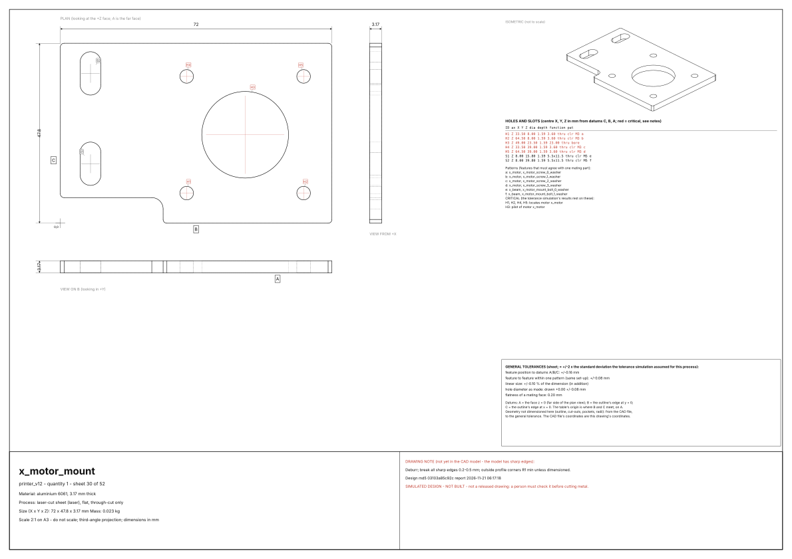

- Quantity 1. aluminium 6061; sheet; 72 x 47.8 x 3.17 mm; 0.023 kg.
- Sheet not specified mm, None cut, flat (no bends), through-cut only. Flat size None mm, cut length None mm, None pierces (report). DXF written here: {'LINE': 10, 'ARC': 10, 'CIRCLE': 5}, cut length 412.2 mm, extent (72.0, 47.8).
- Threads: none. Inserts and clinch nuts: none. Reaming: none.
- Drawing note, not yet in the model: Deburr; break all sharp edges 0.2-0.5 mm; outside profile corners R1 min unless dimensioned.
- **Needs more than the general tolerance, or rests on an assumption:**
  - **Patterns a, b, c, d** (guide block / motor): hole to hole +/-0.08 mm is the figure the screw-pattern check used (tighter than the +/-0.16 mm position tolerance); radial clearance on the screws 0.30 mm. Cut all holes of a pattern in one set-up.
  - This part places a pulley or idler: its thickness and flatness are in the belt-plane result (x_belt: 95.9% of builds within 1 mm, +/-0.36%; y_belt: 99.5% of builds within 1 mm, +/-0.13%; y_belt_l: 99.2% of builds within 1 mm, +/-0.16%).
  - Report, manufacture `hole_too_close_to_edge`: 1 hole(s) with less than 3.175 mm of material to the edge (least 2.25 mm at [-104.0, -53.2, 407.0]): the web overheats and distorts, and tears if the part is bent or loaded.
  - Report, manufacture `supplier_rule`: SendCutSend rule sendcutsend.cut.hole_edge_d_ratio: hole edge to part edge 11.5 mm (1 of 5), limit >= 23.0 mm (warning: the supplier's words: "we generally recommend keeping your holes at least 1X their diameter from an edge and slots at least 1.5X their width away from edges or other cut features.").
  - Report, manufacture `supplier_rule`: SendCutSend rule sendcutsend.cut.slot_edge_w_ratio: slot to edge or next feature 2.25 mm (2 of 2), limit >= 8.25 mm (warning: the supplier's words: "we generally recommend keeping your holes at least 1X their diameter from an edge and slots at least 1.5X their width away from edges or other cut features.").

| ID | Kind | Axis | X | Y | Z | Dia / width | Slot length | Depth | Counterbore (dia x depth, from) | Function | Screws | On its axis | Pattern | Critical |
|---|---|---|---|---|---|---|---|---|---|---|---|---|---|---|
| H1 | hole | Z | 33.5 | 8 | 1.59 | 3.6 | - | through | - | clearance M3 | x_motor_screw_0 (SHCS-M3x8) | - | a: x_motor, x_motor_screw_0_washer | locates motor x_motor |
| H2 | hole | Z | 64.5 | 8 | 1.59 | 3.6 | - | through | - | clearance M3 | x_motor_screw_1 (SHCS-M3x8) | - | b: x_motor, x_motor_screw_1_washer | locates motor x_motor |
| H3 | hole | Z | 49 | 23.5 | 1.59 | 23 | - | through | - | bore / opening | - | x_motor (NEMA17-34) | - | pilot of motor x_motor |
| H4 | hole | Z | 33.5 | 39 | 1.59 | 3.6 | - | through | - | clearance M3 | x_motor_screw_2 (SHCS-M3x8) | - | c: x_motor, x_motor_screw_2_washer | locates motor x_motor |
| H5 | hole | Z | 64.5 | 39 | 1.59 | 3.6 | - | through | - | clearance M3 | x_motor_screw_3 (SHCS-M3x8) | - | d: x_motor, x_motor_screw_3_washer | locates motor x_motor |
| S1 | slot | Z | 8 | 15.8 | 1.59 | 5.5 | 11.5 | through | - | clearance M5 | x_motor_mount_bolt_0 (SHCS-M5x8) | - | e: x_beam, x_motor_mount_bolt_0_washer | - |
| S2 | slot | Z | 8 | 39.8 | 1.59 | 5.5 | 11.5 | through | - | clearance M5 | x_motor_mount_bolt_1 (SHCS-M5x8) | - | f: x_beam, x_motor_mount_bolt_1_washer | - |

### x_idler_mount

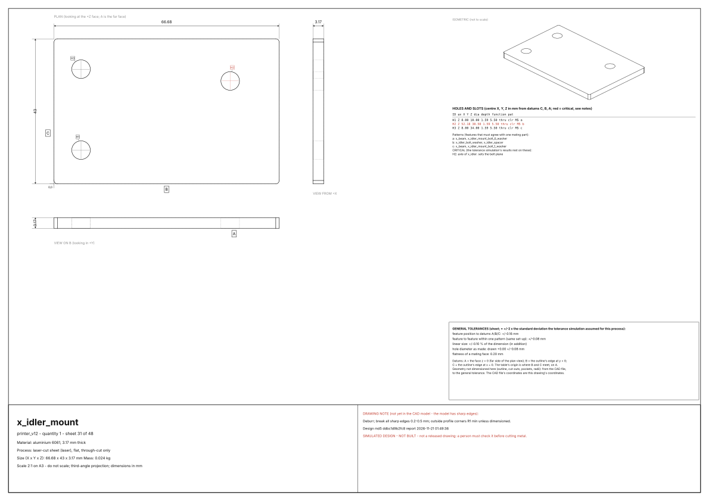

- Quantity 1. aluminium 6061; sheet; 66.68 x 43 x 3.17 mm; 0.024 kg.
- Sheet not specified mm, None cut, flat (no bends), through-cut only. Flat size None mm, cut length None mm, None pierces (report). DXF written here: {'LINE': 4, 'ARC': 4, 'CIRCLE': 3}, cut length 269.5 mm, extent (66.68, 43.0).
- Threads: none. Inserts and clinch nuts: none. Reaming: none.
- Drawing note, not yet in the model: Deburr; break all sharp edges 0.2-0.5 mm; outside profile corners R1 min unless dimensioned.
- **Needs more than the general tolerance, or rests on an assumption:**
  - This part places a pulley or idler: its thickness and flatness are in the belt-plane result (x_belt: 95.9% of builds within 1 mm, +/-0.36%; y_belt: 99.5% of builds within 1 mm, +/-0.13%; y_belt_l: 99.2% of builds within 1 mm, +/-0.16%).
  - Report, manufacture `supplier_rule`: SendCutSend rule sendcutsend.cut.hole_edge_d_ratio: hole edge to part edge 5.25 mm (2 of 3), limit >= 5.5 mm (warning: the supplier's words: "we generally recommend keeping your holes at least 1X their diameter from an edge and slots at least 1.5X their width away from edges or other cut features.").

| ID | Kind | Axis | X | Y | Z | Dia / width | Slot length | Depth | Counterbore (dia x depth, from) | Function | Screws | On its axis | Pattern | Critical |
|---|---|---|---|---|---|---|---|---|---|---|---|---|---|---|
| H1 | hole | Z | 8 | 10 | 1.59 | 5.5 | - | through | - | clearance M5 | x_idler_mount_bolt_0 (SHCS-M5x8) | - | a: x_beam, x_idler_mount_bolt_0_washer | - |
| H2 | hole | Z | 52.18 | 30.5 | 1.59 | 5.5 | - | through | - | clearance M5 | x_idler_bolt (SHCS-M5x35) | x_idler_spacer (MCMASTER-94669A079) | b: x_idler_bolt_washer, x_idler_spacer | axle of x_idler: sets the belt plane |
| H3 | hole | Z | 8 | 34 | 1.59 | 5.5 | - | through | - | clearance M5 | x_idler_mount_bolt_1 (SHCS-M5x8) | - | c: x_beam, x_idler_mount_bolt_1_washer | - |

### x_endstop_carrier

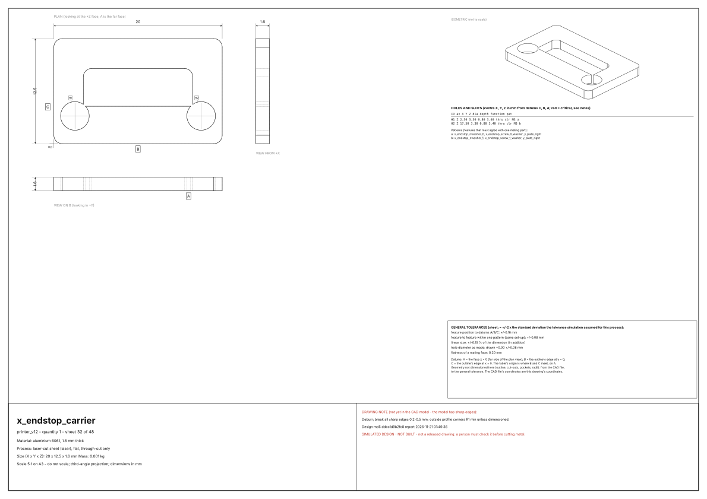

- Quantity 1. aluminium 6061; sheet; 20 x 12.5 x 1.6 mm; 0.001 kg. Same size, volume and hole list as y_endstop_carrier (same or mirror-image part: compare before sharing a file).
- Sheet not specified mm, None cut, flat (no bends), through-cut only. Flat size None mm, cut length None mm, None pierces (report). DXF written here: {'LINE': 8, 'ARC': 8}, cut length 117.2 mm, extent (20.0, 12.5).
- Threads: none. Inserts and clinch nuts: none. Reaming: none.
- Drawing note, not yet in the model: Deburr; break all sharp edges 0.2-0.5 mm; outside profile corners R1 min unless dimensioned.
- **Needs more than the general tolerance, or rests on an assumption:**
  - Report, manufacture `hole_too_close_to_edge`: 1 hole(s) with less than 1.6 mm of material to the edge (least 0.80 mm at [131.12, -7.22, 427.55]): the web overheats and distorts, and tears if the part is bent or loaded.
  - Report, manufacture `supplier_rule`: SendCutSend rule sendcutsend.cut.slot_edge_w_ratio: slot to edge or next feature 0.8 mm, limit >= 6.75 mm (warning: the supplier's words: "we generally recommend keeping your holes at least 1X their diameter from an edge and slots at least 1.5X their width away from edges or other cut features.").

| ID | Kind | Axis | X | Y | Z | Dia / width | Slot length | Depth | Counterbore (dia x depth, from) | Function | Screws | On its axis | Pattern | Critical |
|---|---|---|---|---|---|---|---|---|---|---|---|---|---|---|
| H1 | hole | Z | 2.5 | 3.3 | 0.8 | 3.4 | - | through | - | clearance M3 | x_endstop_screw_0 (SHCS-M3x16) | - | a: x_endstop_nwasher_0, x_endstop_screw_0_washer, y_plate_right | - |
| H2 | hole | Z | 17.5 | 3.3 | 0.8 | 3.4 | - | through | - | clearance M3 | x_endstop_screw_1 (SHCS-M3x16) | - | b: x_endstop_nwasher_1, x_endstop_screw_1_washer, y_plate_right | - |

### y_motor_mount

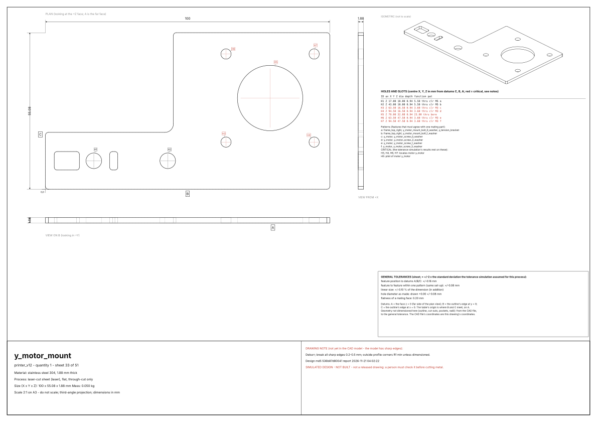

- Quantity 1. stainless steel 304; sheet; 100 x 55.08 x 1.88 mm; 0.050 kg. Same size, volume and hole list as y_motor_mount_l (same or mirror-image part: compare before sharing a file).
- Sheet not specified mm, None cut, flat (no bends), through-cut only. Flat size None mm, cut length None mm, None pierces (report). DXF written here: {'LINE': 14, 'ARC': 14, 'CIRCLE': 7}, cut length 504.7 mm, extent (100.0, 55.08).
- Threads: none. Inserts and clinch nuts: none. Reaming: none.
- Drawing note, not yet in the model: Deburr; break all sharp edges 0.2-0.5 mm; outside profile corners R1 min unless dimensioned.
- **Needs more than the general tolerance, or rests on an assumption:**
  - **Patterns c, d, e, f** (guide block / motor): hole to hole +/-0.08 mm is the figure the screw-pattern check used (tighter than the +/-0.16 mm position tolerance); radial clearance on the screws 0.30 mm. Cut all holes of a pattern in one set-up.
  - This part places a pulley or idler: its thickness and flatness are in the belt-plane result (x_belt: 95.9% of builds within 1 mm, +/-0.36%; y_belt: 99.5% of builds within 1 mm, +/-0.13%; y_belt_l: 99.2% of builds within 1 mm, +/-0.16%).
  - Report, manufacture `supplier_rule`: SendCutSend rule sendcutsend.cut.hole_edge_d_ratio: hole edge to part edge 9.5 mm (1 of 7), limit >= 23.0 mm (warning: the supplier's words: "we generally recommend keeping your holes at least 1X their diameter from an edge and slots at least 1.5X their width away from edges or other cut features.").
  - Report, manufacture `supplier_rule`: SendCutSend rule sendcutsend.cut.slot_edge_w_ratio: slot to edge or next feature 2.83 mm, limit >= 4.26 mm (warning: the supplier's words: "we generally recommend keeping your holes at least 1X their diameter from an edge and slots at least 1.5X their width away from edges or other cut features.").

| ID | Kind | Axis | X | Y | Z | Dia / width | Slot length | Depth | Counterbore (dia x depth, from) | Function | Screws | On its axis | Pattern | Critical |
|---|---|---|---|---|---|---|---|---|---|---|---|---|---|---|
| H1 | hole | Z | 17 | 10 | 0.94 | 5.5 | - | through | - | clearance M5 | y_motor_mount_bolt_0 (SHCS-M5x12) | - | a: frame_top_right, y_motor_mount_bolt_0_washer, y_tension_bracket | - |
| H2 | hole | Z | 43 | 10 | 0.94 | 5.5 | - | through | - | clearance M5 | y_motor_mount_bolt_1 (SHCS-M5x8) | - | b: frame_top_right, y_motor_mount_bolt_1_washer | - |
| H3 | hole | Z | 63.5 | 16.58 | 0.94 | 3.6 | - | through | - | clearance M3 | y_motor_screw_0 (SHCS-M3x6) | - | c: y_motor, y_motor_screw_0_washer | locates motor y_motor |
| H4 | hole | Z | 94.5 | 16.58 | 0.94 | 3.6 | - | through | - | clearance M3 | y_motor_screw_2 (SHCS-M3x6) | - | d: y_motor, y_motor_screw_2_washer | locates motor y_motor |
| H5 | hole | Z | 79 | 32.08 | 0.94 | 23 | - | through | - | bore / opening | - | y_motor (NEMA17-48) | - | pilot of motor y_motor |
| H6 | hole | Z | 63.5 | 47.58 | 0.94 | 3.6 | - | through | - | clearance M3 | y_motor_screw_1 (SHCS-M3x6) | - | e: y_motor, y_motor_screw_1_washer | locates motor y_motor |
| H7 | hole | Z | 94.5 | 47.58 | 0.94 | 3.6 | - | through | - | clearance M3 | y_motor_screw_3 (SHCS-M3x6) | - | f: y_motor, y_motor_screw_3_washer | locates motor y_motor |

### y_idler_mount

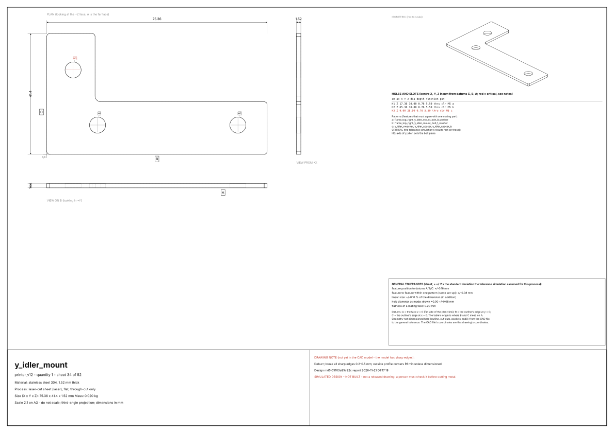

- Quantity 1. stainless steel 304; sheet; 75.36 x 41.4 x 1.52 mm; 0.020 kg. Same size, volume and hole list as y_idler_mount_l (same or mirror-image part: compare before sharing a file).
- Sheet not specified mm, None cut, flat (no bends), through-cut only. Flat size None mm, cut length None mm, None pierces (report). DXF written here: {'LINE': 6, 'ARC': 6, 'CIRCLE': 3}, cut length 282.4 mm, extent (75.36, 41.4).
- Threads: none. Inserts and clinch nuts: none. Reaming: none.
- Drawing note, not yet in the model: Deburr; break all sharp edges 0.2-0.5 mm; outside profile corners R1 min unless dimensioned.
- **Needs more than the general tolerance, or rests on an assumption:**
  - This part places a pulley or idler: its thickness and flatness are in the belt-plane result (x_belt: 95.9% of builds within 1 mm, +/-0.36%; y_belt: 99.5% of builds within 1 mm, +/-0.13%; y_belt_l: 99.2% of builds within 1 mm, +/-0.16%).
  - Report, manufacture `supplier_rule`: SendCutSend rule sendcutsend.cut.hole_edge_d_ratio: hole edge to part edge 4.75 mm (3 of 3), limit >= 5.5 mm (warning: the supplier's words: "we generally recommend keeping your holes at least 1X their diameter from an edge and slots at least 1.5X their width away from edges or other cut features.").

| ID | Kind | Axis | X | Y | Z | Dia / width | Slot length | Depth | Counterbore (dia x depth, from) | Function | Screws | On its axis | Pattern | Critical |
|---|---|---|---|---|---|---|---|---|---|---|---|---|---|---|
| H1 | hole | Z | 17.36 | 10 | 0.76 | 5.5 | - | through | - | clearance M5 | y_idler_mount_bolt_0 (SHCS-M5x8) | - | a: frame_top_right, y_idler_mount_bolt_0_washer | - |
| H2 | hole | Z | 65.36 | 10 | 0.76 | 5.5 | - | through | - | clearance M5 | y_idler_mount_bolt_1 (SHCS-M5x8) | - | b: frame_top_right, y_idler_mount_bolt_1_washer | - |
| H3 | hole | Z | 9 | 28.9 | 0.76 | 5.5 | - | through | - | clearance M5 | y_idler_bolt (SHCS-M5x30) | - | c: y_idler_nwasher, y_idler_spacer, y_idler_spacer_b | axle of y_idler: sets the belt plane |

### y_motor_mount_l

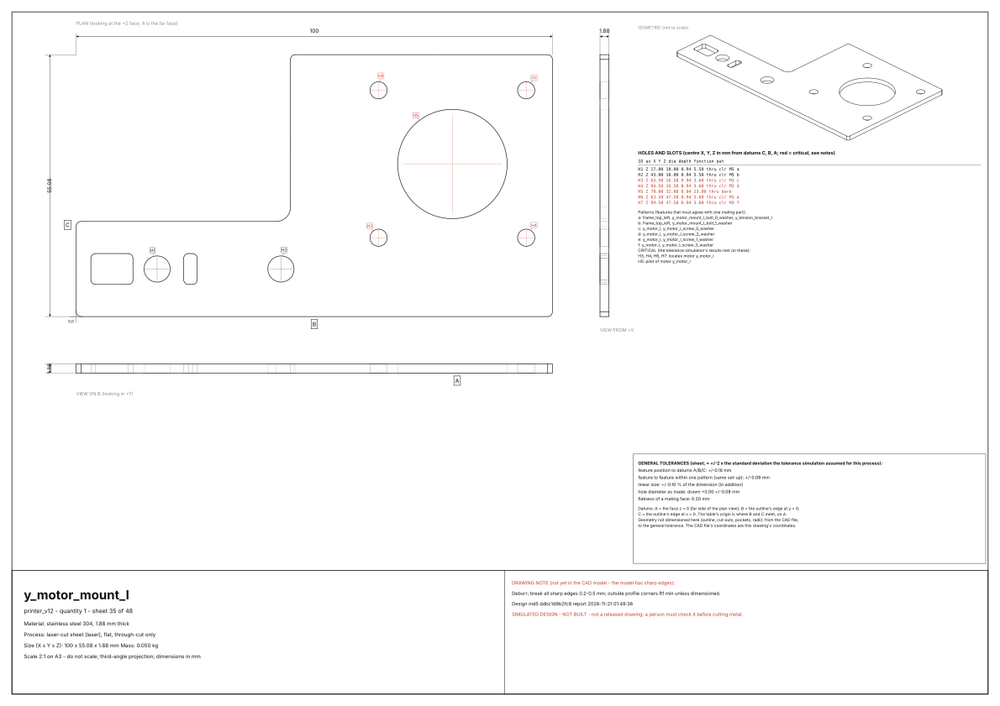

- Quantity 1. stainless steel 304; sheet; 100 x 55.08 x 1.88 mm; 0.050 kg. Same size, volume and hole list as y_motor_mount (same or mirror-image part: compare before sharing a file).
- Sheet not specified mm, None cut, flat (no bends), through-cut only. Flat size None mm, cut length None mm, None pierces (report). DXF written here: {'LINE': 14, 'ARC': 14, 'CIRCLE': 7}, cut length 504.7 mm, extent (100.0, 55.08).
- Threads: none. Inserts and clinch nuts: none. Reaming: none.
- Drawing note, not yet in the model: Deburr; break all sharp edges 0.2-0.5 mm; outside profile corners R1 min unless dimensioned.
- **Needs more than the general tolerance, or rests on an assumption:**
  - **Patterns c, d, e, f** (guide block / motor): hole to hole +/-0.08 mm is the figure the screw-pattern check used (tighter than the +/-0.16 mm position tolerance); radial clearance on the screws 0.30 mm. Cut all holes of a pattern in one set-up.
  - This part places a pulley or idler: its thickness and flatness are in the belt-plane result (x_belt: 95.9% of builds within 1 mm, +/-0.36%; y_belt: 99.5% of builds within 1 mm, +/-0.13%; y_belt_l: 99.2% of builds within 1 mm, +/-0.16%).
  - Report, manufacture `supplier_rule`: SendCutSend rule sendcutsend.cut.hole_edge_d_ratio: hole edge to part edge 9.5 mm (1 of 7), limit >= 23.0 mm (warning: the supplier's words: "we generally recommend keeping your holes at least 1X their diameter from an edge and slots at least 1.5X their width away from edges or other cut features.").
  - Report, manufacture `supplier_rule`: SendCutSend rule sendcutsend.cut.slot_edge_w_ratio: slot to edge or next feature 2.83 mm, limit >= 4.26 mm (warning: the supplier's words: "we generally recommend keeping your holes at least 1X their diameter from an edge and slots at least 1.5X their width away from edges or other cut features.").

| ID | Kind | Axis | X | Y | Z | Dia / width | Slot length | Depth | Counterbore (dia x depth, from) | Function | Screws | On its axis | Pattern | Critical |
|---|---|---|---|---|---|---|---|---|---|---|---|---|---|---|
| H1 | hole | Z | 17 | 10 | 0.94 | 5.5 | - | through | - | clearance M5 | y_motor_mount_l_bolt_0 (SHCS-M5x12) | - | a: frame_top_left, y_motor_mount_l_bolt_0_washer, y_tension_bracket_l | - |
| H2 | hole | Z | 43 | 10 | 0.94 | 5.5 | - | through | - | clearance M5 | y_motor_mount_l_bolt_1 (SHCS-M5x8) | - | b: frame_top_left, y_motor_mount_l_bolt_1_washer | - |
| H3 | hole | Z | 63.5 | 16.58 | 0.94 | 3.6 | - | through | - | clearance M3 | y_motor_l_screw_0 (SHCS-M3x6) | - | c: y_motor_l, y_motor_l_screw_0_washer | locates motor y_motor_l |
| H4 | hole | Z | 94.5 | 16.58 | 0.94 | 3.6 | - | through | - | clearance M3 | y_motor_l_screw_2 (SHCS-M3x6) | - | d: y_motor_l, y_motor_l_screw_2_washer | locates motor y_motor_l |
| H5 | hole | Z | 79 | 32.08 | 0.94 | 23 | - | through | - | bore / opening | - | y_motor_l (NEMA17-48) | - | pilot of motor y_motor_l |
| H6 | hole | Z | 63.5 | 47.58 | 0.94 | 3.6 | - | through | - | clearance M3 | y_motor_l_screw_1 (SHCS-M3x6) | - | e: y_motor_l, y_motor_l_screw_1_washer | locates motor y_motor_l |
| H7 | hole | Z | 94.5 | 47.58 | 0.94 | 3.6 | - | through | - | clearance M3 | y_motor_l_screw_3 (SHCS-M3x6) | - | f: y_motor_l, y_motor_l_screw_3_washer | locates motor y_motor_l |

### y_idler_mount_l

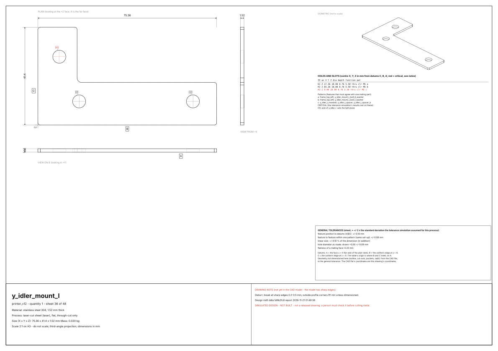

- Quantity 1. stainless steel 304; sheet; 75.36 x 41.4 x 1.52 mm; 0.020 kg. Same size, volume and hole list as y_idler_mount (same or mirror-image part: compare before sharing a file).
- Sheet not specified mm, None cut, flat (no bends), through-cut only. Flat size None mm, cut length None mm, None pierces (report). DXF written here: {'LINE': 6, 'ARC': 6, 'CIRCLE': 3}, cut length 282.4 mm, extent (75.36, 41.4).
- Threads: none. Inserts and clinch nuts: none. Reaming: none.
- Drawing note, not yet in the model: Deburr; break all sharp edges 0.2-0.5 mm; outside profile corners R1 min unless dimensioned.
- **Needs more than the general tolerance, or rests on an assumption:**
  - This part places a pulley or idler: its thickness and flatness are in the belt-plane result (x_belt: 95.9% of builds within 1 mm, +/-0.36%; y_belt: 99.5% of builds within 1 mm, +/-0.13%; y_belt_l: 99.2% of builds within 1 mm, +/-0.16%).
  - Report, manufacture `supplier_rule`: SendCutSend rule sendcutsend.cut.hole_edge_d_ratio: hole edge to part edge 4.75 mm (3 of 3), limit >= 5.5 mm (warning: the supplier's words: "we generally recommend keeping your holes at least 1X their diameter from an edge and slots at least 1.5X their width away from edges or other cut features.").

| ID | Kind | Axis | X | Y | Z | Dia / width | Slot length | Depth | Counterbore (dia x depth, from) | Function | Screws | On its axis | Pattern | Critical |
|---|---|---|---|---|---|---|---|---|---|---|---|---|---|---|
| H1 | hole | Z | 17.36 | 10 | 0.76 | 5.5 | - | through | - | clearance M5 | y_idler_mount_l_bolt_0 (SHCS-M5x8) | - | a: frame_top_left, y_idler_mount_l_bolt_0_washer | - |
| H2 | hole | Z | 65.36 | 10 | 0.76 | 5.5 | - | through | - | clearance M5 | y_idler_mount_l_bolt_1 (SHCS-M5x8) | - | b: frame_top_left, y_idler_mount_l_bolt_1_washer | - |
| H3 | hole | Z | 9 | 28.9 | 0.76 | 5.5 | - | through | - | clearance M5 | y_idler_l_bolt (SHCS-M5x30) | - | c: y_idler_l_nwasher, y_idler_l_spacer, y_idler_l_spacer_b | axle of y_idler_l: sets the belt plane |

### y_endstop_carrier

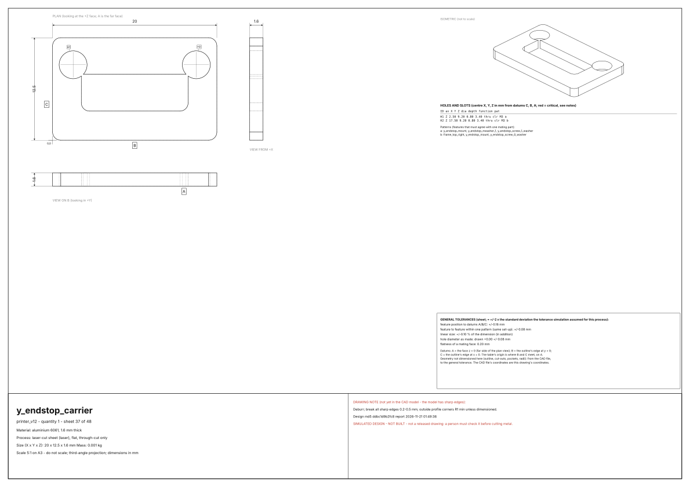

- Quantity 1. aluminium 6061; sheet; 20 x 12.5 x 1.6 mm; 0.001 kg. Same size, volume and hole list as x_endstop_carrier (same or mirror-image part: compare before sharing a file).
- Sheet not specified mm, None cut, flat (no bends), through-cut only. Flat size None mm, cut length None mm, None pierces (report). DXF written here: {'LINE': 8, 'ARC': 8}, cut length 117.2 mm, extent (20.0, 12.5).
- Threads: none. Inserts and clinch nuts: none. Reaming: none.
- Drawing note, not yet in the model: Deburr; break all sharp edges 0.2-0.5 mm; outside profile corners R1 min unless dimensioned.
- **Needs more than the general tolerance, or rests on an assumption:**
  - Report, manufacture `hole_too_close_to_edge`: 1 hole(s) with less than 1.6 mm of material to the edge (least 0.80 mm at [152.5, 122.35, 415.98]): the web overheats and distorts, and tears if the part is bent or loaded.
  - Report, manufacture `supplier_rule`: SendCutSend rule sendcutsend.cut.slot_edge_w_ratio: slot to edge or next feature 0.8 mm, limit >= 6.75 mm (warning: the supplier's words: "we generally recommend keeping your holes at least 1X their diameter from an edge and slots at least 1.5X their width away from edges or other cut features.").

| ID | Kind | Axis | X | Y | Z | Dia / width | Slot length | Depth | Counterbore (dia x depth, from) | Function | Screws | On its axis | Pattern | Critical |
|---|---|---|---|---|---|---|---|---|---|---|---|---|---|---|
| H1 | hole | Z | 2.5 | 9.2 | 0.8 | 3.4 | - | through | - | clearance M3 | y_endstop_screw_1 (SHCS-M3x18) | - | a: y_endstop_mount, y_endstop_nwasher_1, y_endstop_screw_1_washer | - |
| H2 | hole | Z | 17.5 | 9.2 | 0.8 | 3.4 | - | through | - | clearance M3 | y_endstop_screw_0 (SHCS-M3x18) | - | b: frame_top_right, y_endstop_mount, y_endstop_screw_0_washer | - |

### y_endstop_mount

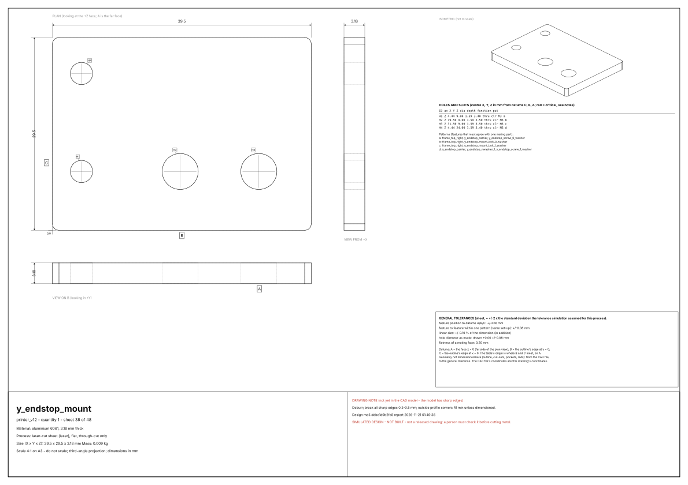

- Quantity 1. aluminium 6061; sheet; 39.5 x 29.5 x 3.18 mm; 0.009 kg.
- Sheet not specified mm, None cut, flat (no bends), through-cut only. Flat size None mm, cut length None mm, None pierces (report). DXF written here: {'LINE': 4, 'ARC': 4, 'CIRCLE': 4}, cut length 192.2 mm, extent (39.5, 29.5).
- Threads: none. Inserts and clinch nuts: none. Reaming: none.
- Drawing note, not yet in the model: Deburr; break all sharp edges 0.2-0.5 mm; outside profile corners R1 min unless dimensioned.
- **Needs more than the general tolerance, or rests on an assumption:**
  - Report, manufacture `hole_too_close_to_edge`: 2 hole(s) with less than 3.175 mm of material to the edge (least 2.73 mm at [145.0, 124.93, 405.59]): the web overheats and distorts, and tears if the part is bent or loaded.
  - Report, manufacture `supplier_rule`: SendCutSend rule sendcutsend.cut.hole_edge_al6061_page: hole edge to part edge 2.73 mm (2 of 4), limit >= 4.76 mm (warning: the supplier's words: "Keep holes and cutouts 1.5–2× material thickness away from edges to prevent warping or distortion.").
  - Report, manufacture `supplier_rule`: SendCutSend rule sendcutsend.cut.hole_edge_d_ratio: hole edge to part edge 2.73 mm (3 of 4), limit >= 3.4 mm (warning: the supplier's words: "we generally recommend keeping your holes at least 1X their diameter from an edge and slots at least 1.5X their width away from edges or other cut features.").

| ID | Kind | Axis | X | Y | Z | Dia / width | Slot length | Depth | Counterbore (dia x depth, from) | Function | Screws | On its axis | Pattern | Critical |
|---|---|---|---|---|---|---|---|---|---|---|---|---|---|---|
| H1 | hole | Z | 4.44 | 9 | 1.59 | 3.4 | - | through | - | clearance M3 | y_endstop_screw_0 (SHCS-M3x18) | - | a: frame_top_right, y_endstop_carrier, y_endstop_screw_0_washer | - |
| H2 | hole | Z | 19.5 | 9 | 1.59 | 5.5 | - | through | - | clearance M5 | y_endstop_mount_bolt_0 (SHCS-M5x8) | - | b: frame_top_right, y_endstop_mount_bolt_0_washer | - |
| H3 | hole | Z | 31.5 | 9 | 1.59 | 5.5 | - | through | - | clearance M5 | y_endstop_mount_bolt_1 (SHCS-M5x8) | - | c: frame_top_right, y_endstop_mount_bolt_1_washer | - |
| H4 | hole | Z | 4.44 | 24 | 1.59 | 3.4 | - | through | - | clearance M3 | y_endstop_screw_1 (SHCS-M3x18) | - | d: y_endstop_carrier, y_endstop_nwasher_1, y_endstop_screw_1_washer | - |

### mains_cover_psu

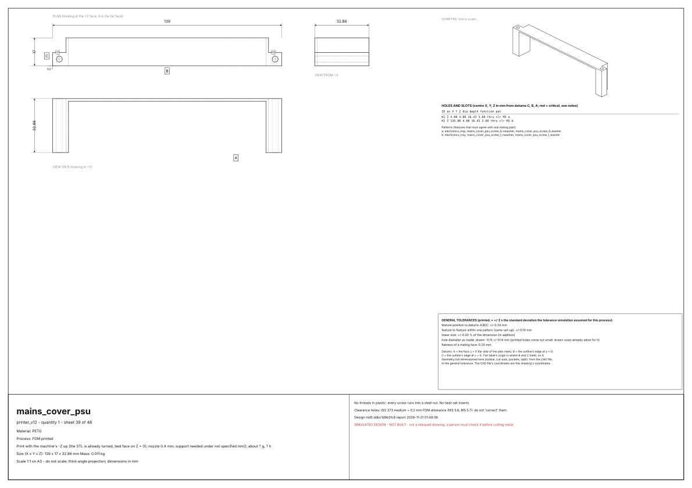

- Quantity 1. PETG; printed; 139 x 17 x 32.86 mm; 0.011 kg.
- Print with the machine's **-Z** direction up (STL already turned). Support needed under None mm2; longest bridge None mm; bed contact None; thinnest wall None mm; None g, None h (estimate). Holes opening on the bed face: 0 (first-layer squash makes them tight).
- Threads: none. Inserts and clinch nuts: none. Reaming: none.

| ID | Kind | Axis | X | Y | Z | Dia / width | Slot length | Depth | Counterbore (dia x depth, from) | Function | Screws | On its axis | Pattern | Critical |
|---|---|---|---|---|---|---|---|---|---|---|---|---|---|---|
| H1 | hole | Z | 4 | 4 | 16.43 | 3.6 | - | through | - | clearance M3 | mains_cover_psu_screw_0 (SHCS-M3x45) | - | a: electronics_tray, mains_cover_psu_screw_0_nwasher, mains_cover_psu_screw_0_washer | - |
| H2 | hole | Z | 135 | 4 | 16.43 | 3.6 | - | through | - | clearance M3 | mains_cover_psu_screw_1 (SHCS-M3x45) | - | b: electronics_tray, mains_cover_psu_screw_1_nwasher, mains_cover_psu_screw_1_washer | - |

### electronics_tray

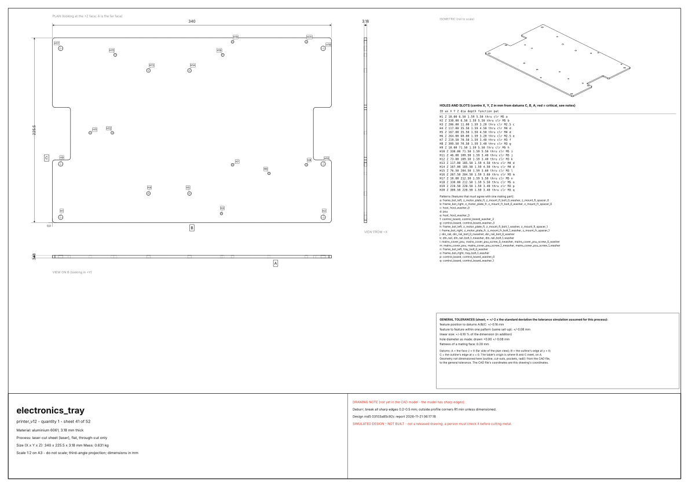

- Quantity 1. aluminium 6061; sheet; 340 x 225.5 x 3.18 mm; 0.631 kg.
- Sheet not specified mm, None cut, flat (no bends), through-cut only. Flat size None mm, cut length None mm, None pierces (report). DXF written here: {'LINE': 12, 'ARC': 12, 'CIRCLE': 20}, cut length 1470.6 mm, extent (340.0, 225.5).
- Threads: none. Inserts and clinch nuts: none. Reaming: none.
- Drawing note, not yet in the model: Deburr; break all sharp edges 0.2-0.5 mm; outside profile corners R1 min unless dimensioned.
- **Needs more than the general tolerance, or rests on an assumption:**
  - Report, manufacture `hole_too_close_to_edge`: 2 hole(s) with less than 3.175 mm of material to the edge (least 2.25 mm at [-160.0, -69.0, 21.59]): the web overheats and distorts, and tears if the part is bent or loaded.
  - Report, manufacture `supplier_rule`: SendCutSend rule sendcutsend.cut.hole_edge_al6061_page: hole edge to part edge 2.25 mm (6 of 20), limit >= 4.76 mm (warning: the supplier's words: "Keep holes and cutouts 1.5–2× material thickness away from edges to prevent warping or distortion.").
  - Report, manufacture `supplier_rule`: SendCutSend rule sendcutsend.cut.hole_edge_d_ratio: hole edge to part edge 2.25 mm (6 of 20), limit >= 5.5 mm (warning: the supplier's words: "we generally recommend keeping your holes at least 1X their diameter from an edge and slots at least 1.5X their width away from edges or other cut features.").

| ID | Kind | Axis | X | Y | Z | Dia / width | Slot length | Depth | Counterbore (dia x depth, from) | Function | Screws | On its axis | Pattern | Critical |
|---|---|---|---|---|---|---|---|---|---|---|---|---|---|---|
| H1 | hole | Z | 10 | 6.5 | 1.59 | 5.5 | - | through | - | clearance M5 | z_mount_fl_bolt_0 (SHCS-M5x65) | z_mount_fl_spacer_0 (custom) | a: frame_bot_left, z_motor_plate_fl, z_mount_fl_bolt_0_washer, z_mount_fl_spacer_0 | - |
| H2 | hole | Z | 330 | 6.5 | 1.59 | 5.5 | - | through | - | clearance M5 | z_mount_fr_bolt_0 (SHCS-M5x65) | z_mount_fr_spacer_0 (custom) | b: frame_bot_right, z_motor_plate_fr, z_mount_fr_bolt_0_washer, z_mount_fr_spacer_0 | - |
| H3 | hole | Z | 206 | 11 | 1.59 | 3.2 | - | through | - | clearance M2.5 | host_screw_0 (SHCS-M2.5x12) | host_washer_0 (WASHER-M2.5) | c: host, host_washer_0 | - |
| H4 | hole | Z | 117 | 35.5 | 1.59 | 4.5 | - | through | - | clearance M4 | psu_screw_2 (SHCS-M4x6) | - | d: psu | - |
| H5 | hole | Z | 167 | 35.5 | 1.59 | 4.5 | - | through | - | clearance M4 | psu_screw_3 (SHCS-M4x6) | - | d: psu | - |
| H6 | hole | Z | 264 | 60 | 1.59 | 3.2 | - | through | - | clearance M2.5 | host_screw_3 (SHCS-M2.5x12) | host_washer_3 (WASHER-M2.5) | e: host, host_washer_3 | - |
| H7 | hole | Z | 219.5 | 70.5 | 1.59 | 3.4 | - | through | - | clearance M3 | control_board_screw_2 (SHCS-M3x16) | - | f: control_board, control_board_washer_2 | - |
| H8 | hole | Z | 309.5 | 70.5 | 1.59 | 3.4 | - | through | - | clearance M3 | control_board_screw_3 (SHCS-M3x16) | - | g: control_board, control_board_washer_3 | - |
| H9 | hole | Z | 10 | 71.5 | 1.59 | 5.5 | - | through | - | clearance M5 | z_mount_fl_bolt_1 (SHCS-M5x65) | z_mount_fl_spacer_1 (custom) | h: frame_bot_left, z_motor_plate_fl, z_mount_fl_bolt_1_washer, z_mount_fl_spacer_1 | - |
| H10 | hole | Z | 330 | 71.5 | 1.59 | 5.5 | - | through | - | clearance M5 | z_mount_fr_bolt_1 (SHCS-M5x65) | z_mount_fr_spacer_1 (custom) | i: frame_bot_right, z_motor_plate_fr, z_mount_fr_bolt_1_washer, z_mount_fr_spacer_1 | - |
| H11 | hole | Z | 46 | 109.5 | 1.59 | 3.4 | - | through | - | clearance M3 | din_rail_bolt_0 (SHCS-M3x10) | - | j: din_rail, din_rail_bolt_0_nwasher, din_rail_bolt_0_washer | - |
| H12 | hole | Z | 73 | 109.5 | 1.59 | 3.4 | - | through | - | clearance M3 | din_rail_bolt_1 (SHCS-M3x10) | - | k: din_rail, din_rail_bolt_1_nwasher, din_rail_bolt_1_washer | - |
| H13 | hole | Z | 117 | 185.5 | 1.59 | 4.5 | - | through | - | clearance M4 | psu_screw_0 (SHCS-M4x6) | - | d: psu | - |
| H14 | hole | Z | 167 | 185.5 | 1.59 | 4.5 | - | through | - | clearance M4 | psu_screw_1 (SHCS-M4x6) | - | d: psu | - |
| H15 | hole | Z | 76.5 | 204.5 | 1.59 | 3.6 | - | through | - | clearance M3 | mains_cover_psu_screw_0 (SHCS-M3x45) | - | l: mains_cover_psu, mains_cover_psu_screw_0_nwasher, mains_cover_psu_screw_0_washer | - |
| H16 | hole | Z | 207.5 | 204.5 | 1.59 | 3.6 | - | through | - | clearance M3 | mains_cover_psu_screw_1 (SHCS-M3x45) | - | m: mains_cover_psu, mains_cover_psu_screw_1_nwasher, mains_cover_psu_screw_1_washer | - |
| H17 | hole | Z | 10 | 212.5 | 1.59 | 5.5 | - | through | - | clearance M5 | tray_bolt_0 (SHCS-M5x8) | - | n: frame_bot_left, tray_bolt_0_washer | - |
| H18 | hole | Z | 330 | 212.5 | 1.59 | 5.5 | - | through | - | clearance M5 | tray_bolt_1 (SHCS-M5x8) | - | o: frame_bot_right, tray_bolt_1_washer | - |
| H19 | hole | Z | 219.5 | 220.5 | 1.59 | 3.4 | - | through | - | clearance M3 | control_board_screw_0 (SHCS-M3x16) | - | p: control_board, control_board_washer_0 | - |
| H20 | hole | Z | 309.5 | 220.5 | 1.59 | 3.4 | - | through | - | clearance M3 | control_board_screw_1 (SHCS-M3x16) | - | q: control_board, control_board_washer_1 | - |

### inlet_panel

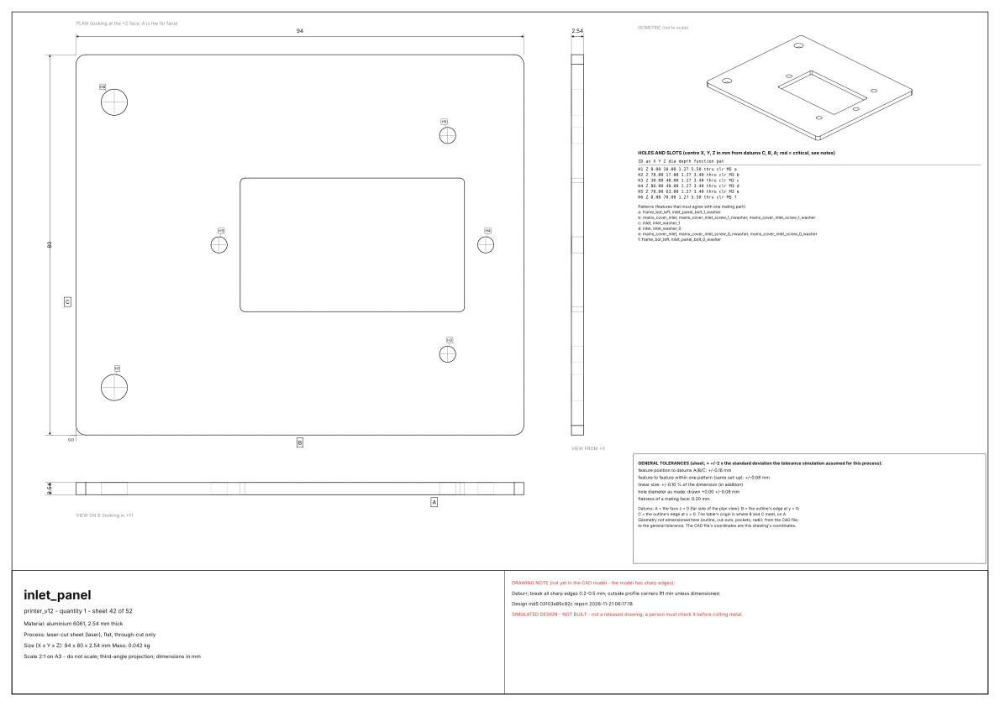

- Quantity 1. aluminium 6061; sheet; 94 x 80 x 2.54 mm; 0.042 kg.
- Sheet not specified mm, None cut, flat (no bends), through-cut only. Flat size None mm, cut length None mm, None pierces (report). DXF written here: {'LINE': 8, 'ARC': 8, 'CIRCLE': 6}, cut length 570.5 mm, extent (94.0, 80.0).
- Threads: none. Inserts and clinch nuts: none. Reaming: none.
- Drawing note, not yet in the model: Deburr; break all sharp edges 0.2-0.5 mm; outside profile corners R1 min unless dimensioned.
- **Needs more than the general tolerance, or rests on an assumption:**
  - Report, manufacture `supplier_rule`: SendCutSend rule sendcutsend.cut.hole_edge_d_ratio: hole edge to part edge 5.25 mm (2 of 6), limit >= 5.5 mm (warning: the supplier's words: "we generally recommend keeping your holes at least 1X their diameter from an edge and slots at least 1.5X their width away from edges or other cut features.").

| ID | Kind | Axis | X | Y | Z | Dia / width | Slot length | Depth | Counterbore (dia x depth, from) | Function | Screws | On its axis | Pattern | Critical |
|---|---|---|---|---|---|---|---|---|---|---|---|---|---|---|
| H1 | hole | Z | 8 | 10 | 1.27 | 5.5 | - | through | - | clearance M5 | inlet_panel_bolt_1 (SHCS-M5x8) | - | a: frame_bot_left, inlet_panel_bolt_1_washer | - |
| H2 | hole | Z | 78 | 17 | 1.27 | 3.4 | - | through | - | clearance M3 | mains_cover_inlet_screw_1 (SHCS-M3x20) | - | b: mains_cover_inlet, mains_cover_inlet_screw_1_nwasher, mains_cover_inlet_screw_1_washer | - |
| H3 | hole | Z | 30 | 40 | 1.27 | 3.4 | - | through | - | clearance M3 | inlet_screw_1 (SHCS-M3x10) | - | c: inlet, inlet_washer_1 | - |
| H4 | hole | Z | 86 | 40 | 1.27 | 3.4 | - | through | - | clearance M3 | inlet_screw_0 (SHCS-M3x10) | - | d: inlet, inlet_washer_0 | - |
| H5 | hole | Z | 78 | 63 | 1.27 | 3.4 | - | through | - | clearance M3 | mains_cover_inlet_screw_0 (SHCS-M3x20) | - | e: mains_cover_inlet, mains_cover_inlet_screw_0_nwasher, mains_cover_inlet_screw_0_washer | - |
| H6 | hole | Z | 8 | 70 | 1.27 | 5.5 | - | through | - | clearance M5 | inlet_panel_bolt_0 (SHCS-M5x8) | - | f: frame_bot_left, inlet_panel_bolt_0_washer | - |

### mains_cover_inlet

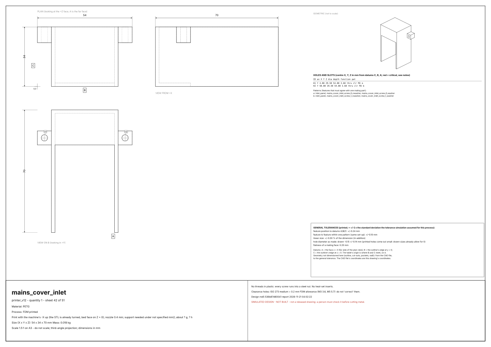

- Quantity 1. PETG; printed; 54 x 34 x 70 mm; 0.018 kg.
- Print with the machine's **-X** direction up (STL already turned). Support needed under None mm2; longest bridge None mm; bed contact None; thinnest wall None mm; None g, None h (estimate). Holes opening on the bed face: 0 (first-layer squash makes them tight).
- Threads: none. Inserts and clinch nuts: none. Reaming: none.
- **Needs more than the general tolerance, or rests on an assumption:**
  - Report, manufacture `supplier_process_rule`: Hubs (Protolabs Network) rule hubs.fdm.overhang: overhang beyond the angle 70.5 mm2, limit <= 0 mm2 (warning: the supplier's words: "Depending on the material, an overhang can usually be printed up to 45° without compromising quality.").

| ID | Kind | Axis | X | Y | Z | Dia / width | Slot length | Depth | Counterbore (dia x depth, from) | Function | Screws | On its axis | Pattern | Critical |
|---|---|---|---|---|---|---|---|---|---|---|---|---|---|---|
| H1 | hole | Y | 4 | 29.5 | 54 | 3.6 | - | through | - | clearance M3 | mains_cover_inlet_screw_0 (SHCS-M3x20) | - | a: inlet_panel, mains_cover_inlet_screw_0_nwasher, mains_cover_inlet_screw_0_washer | - |
| H2 | hole | Y | 50 | 29.5 | 54 | 3.6 | - | through | - | clearance M3 | mains_cover_inlet_screw_1 (SHCS-M3x20) | - | b: inlet_panel, mains_cover_inlet_screw_1_nwasher, mains_cover_inlet_screw_1_washer | - |

### cam_overview_mount

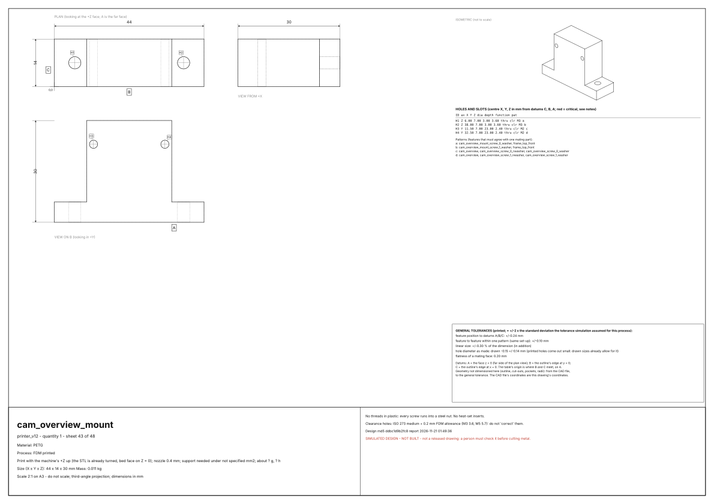

- Quantity 1. PETG; printed; 44 x 14 x 30 mm; 0.011 kg.
- Print with the machine's **+Z** direction up (STL already turned). Support needed under None mm2; longest bridge None mm; bed contact None; thinnest wall None mm; None g, None h (estimate). Holes opening on the bed face: 0 (first-layer squash makes them tight).
- Threads: none. Inserts and clinch nuts: none. Reaming: none.

| ID | Kind | Axis | X | Y | Z | Dia / width | Slot length | Depth | Counterbore (dia x depth, from) | Function | Screws | On its axis | Pattern | Critical |
|---|---|---|---|---|---|---|---|---|---|---|---|---|---|---|
| H1 | hole | Z | 6 | 7 | 3 | 3.6 | - | through | - | clearance M3 | cam_overview_mount_screw_0 (SHCS-M3x10) | - | a: cam_overview_mount_screw_0_washer, frame_top_front | - |
| H2 | hole | Z | 38 | 7 | 3 | 3.6 | - | through | - | clearance M3 | cam_overview_mount_screw_1 (SHCS-M3x10) | - | b: cam_overview_mount_screw_1_washer, frame_top_front | - |
| H3 | hole | Y | 11.5 | 7 | 23 | 2.4 | - | through | - | clearance M2 | cam_overview_screw_0 (SHCS-M2x20) | cam_overview_screw_0_washer (WASHER-M2) | c: cam_overview, cam_overview_screw_0_nwasher, cam_overview_screw_0_washer | - |
| H4 | hole | Y | 32.5 | 7 | 23 | 2.4 | - | through | - | clearance M2 | cam_overview_screw_1 (SHCS-M2x20) | cam_overview_screw_1_washer (WASHER-M2) | d: cam_overview, cam_overview_screw_1_nwasher, cam_overview_screw_1_washer | - |

### cam_topdown_mount

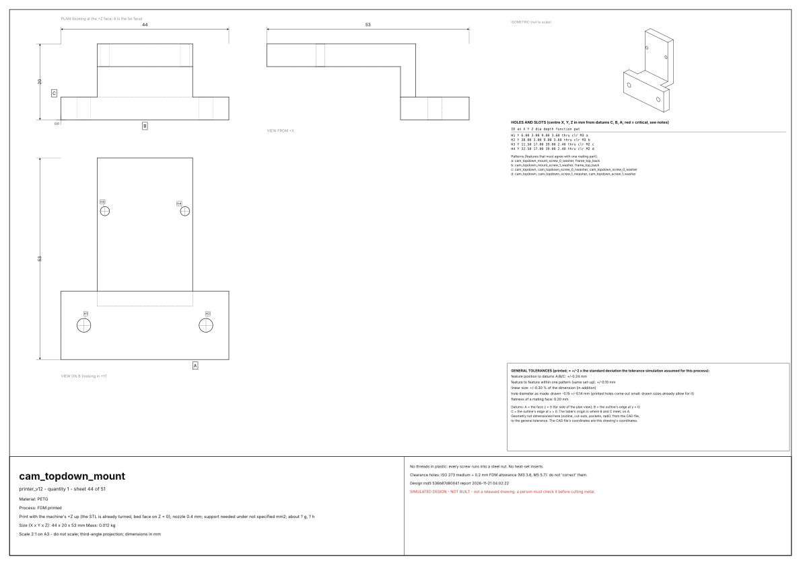

- Quantity 1. PETG; printed; 44 x 20 x 53 mm; 0.012 kg.
- Print with the machine's **+Z** direction up (STL already turned). Support needed under None mm2; longest bridge None mm; bed contact None; thinnest wall None mm; None g, None h (estimate). Holes opening on the bed face: 0 (first-layer squash makes them tight).
- Threads: none. Inserts and clinch nuts: none. Reaming: none.
- **Needs more than the general tolerance, or rests on an assumption:**
  - Report, manufacture `needs_support`: pinned print orientation (+Z up) 350 mm² overhangs by more than 45 degrees with nothing under it and needs support material.
  - Report, manufacture `supplier_process_rule`: Hubs (Protolabs Network) rule hubs.fdm.overhang: overhang beyond the angle 350.0 mm2, limit <= 0 mm2 (warning: the supplier's words: "Depending on the material, an overhang can usually be printed up to 45° without compromising quality.").

| ID | Kind | Axis | X | Y | Z | Dia / width | Slot length | Depth | Counterbore (dia x depth, from) | Function | Screws | On its axis | Pattern | Critical |
|---|---|---|---|---|---|---|---|---|---|---|---|---|---|---|
| H1 | hole | Y | 6 | 3 | 9 | 3.6 | - | through | - | clearance M3 | cam_topdown_mount_screw_0 (SHCS-M3x10) | - | a: cam_topdown_mount_screw_0_washer, frame_top_back | - |
| H2 | hole | Y | 38 | 3 | 9 | 3.6 | - | through | - | clearance M3 | cam_topdown_mount_screw_1 (SHCS-M3x10) | - | b: cam_topdown_mount_screw_1_washer, frame_top_back | - |
| H3 | hole | Y | 11.5 | 17 | 39 | 2.4 | - | through | - | clearance M2 | cam_topdown_screw_0 (SHCS-M2x20) | cam_topdown_screw_0_washer (WASHER-M2) | c: cam_topdown, cam_topdown_screw_0_nwasher, cam_topdown_screw_0_washer | - |
| H4 | hole | Y | 32.5 | 17 | 39 | 2.4 | - | through | - | clearance M2 | cam_topdown_screw_1 (SHCS-M2x20) | cam_topdown_screw_1_washer (WASHER-M2) | d: cam_topdown, cam_topdown_screw_1_nwasher, cam_topdown_screw_1_washer | - |

### sfs_mount

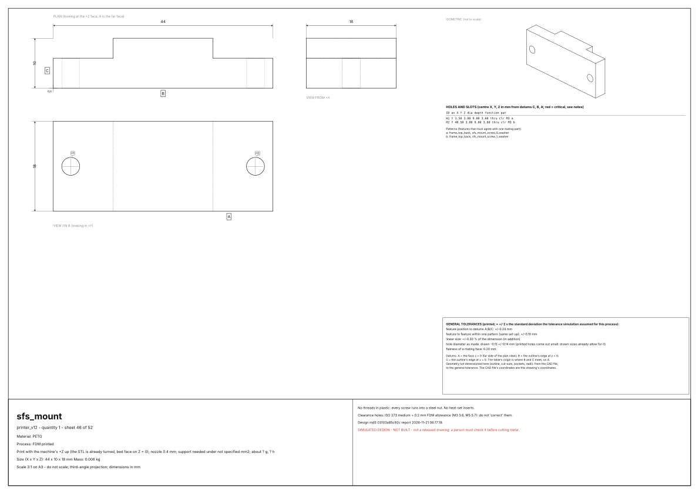

- Quantity 1. PETG; printed; 44 x 10 x 18 mm; 0.006 kg.
- Print with the machine's **+Z** direction up (STL already turned). Support needed under None mm2; longest bridge None mm; bed contact None; thinnest wall None mm; None g, None h (estimate). Holes opening on the bed face: 0 (first-layer squash makes them tight).
- Threads: none. Inserts and clinch nuts: none. Reaming: none.

| ID | Kind | Axis | X | Y | Z | Dia / width | Slot length | Depth | Counterbore (dia x depth, from) | Function | Screws | On its axis | Pattern | Critical |
|---|---|---|---|---|---|---|---|---|---|---|---|---|---|---|
| H1 | hole | Y | 3.5 | 3 | 9 | 3.6 | - | through | - | clearance M3 | sfs_mount_screw_0 (SHCS-M3x10) | - | a: frame_top_back, sfs_mount_screw_0_washer | - |
| H2 | hole | Y | 40.5 | 3 | 9 | 3.6 | - | through | - | clearance M3 | sfs_mount_screw_1 (SHCS-M3x10) | - | b: frame_top_back, sfs_mount_screw_1_washer | - |

### led_clip_0

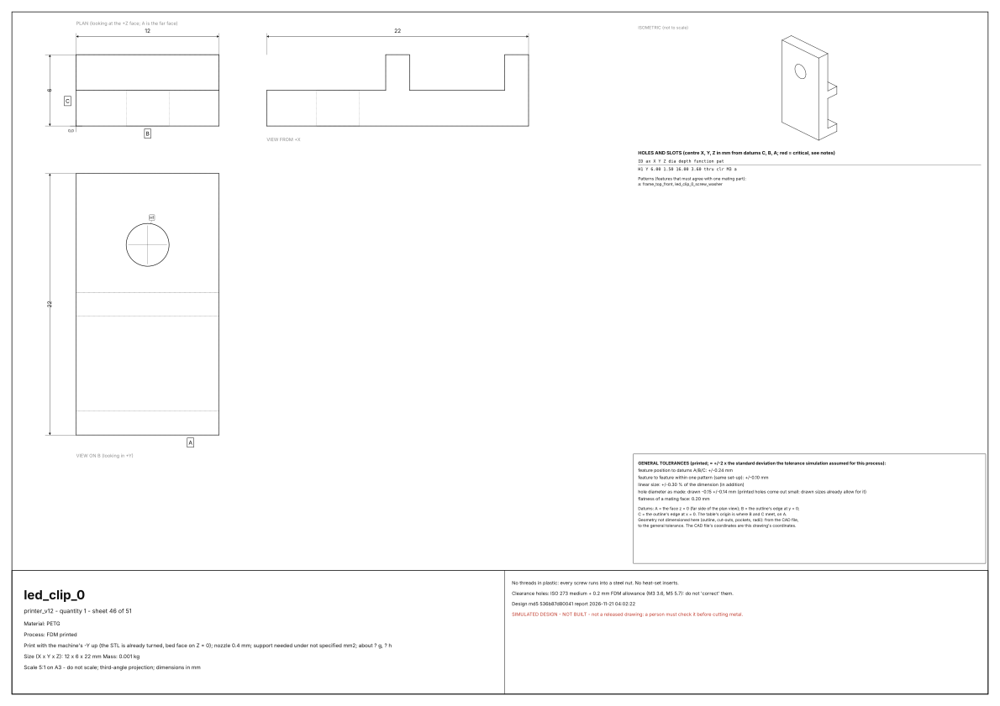

- Quantity 1. PETG; printed; 12 x 6 x 22 mm; 0.001 kg. Same size, volume and hole list as led_clip_1 (same or mirror-image part: compare before sharing a file).
- Print with the machine's **-Y** direction up (STL already turned). Support needed under None mm2; longest bridge None mm; bed contact None; thinnest wall None mm; None g, None h (estimate). Holes opening on the bed face: 0 (first-layer squash makes them tight).
- Threads: none. Inserts and clinch nuts: none. Reaming: none.
- **Needs more than the general tolerance, or rests on an assumption:**
  - Report, manufacture `supplier_process_rule`: Hubs (Protolabs Network) rule hubs.fdm.overhang: overhang beyond the angle 109.9 mm2, limit <= 0 mm2 (warning: the supplier's words: "Depending on the material, an overhang can usually be printed up to 45° without compromising quality.").

| ID | Kind | Axis | X | Y | Z | Dia / width | Slot length | Depth | Counterbore (dia x depth, from) | Function | Screws | On its axis | Pattern | Critical |
|---|---|---|---|---|---|---|---|---|---|---|---|---|---|---|
| H1 | hole | Y | 6 | 1.5 | 16 | 3.6 | - | through | - | clearance M3 | led_clip_0_screw (SHCS-M3x8) | - | a: frame_top_front, led_clip_0_screw_washer | - |

### led_clip_1

- Quantity 1. PETG; printed; 12 x 6 x 22 mm; 0.001 kg. Same size, volume and hole list as led_clip_0 (same or mirror-image part: compare before sharing a file).
- Print with the machine's **-Y** direction up (STL already turned). Support needed under None mm2; longest bridge None mm; bed contact None; thinnest wall None mm; None g, None h (estimate). Holes opening on the bed face: 0 (first-layer squash makes them tight).
- Threads: none. Inserts and clinch nuts: none. Reaming: none.
- **Needs more than the general tolerance, or rests on an assumption:**
  - Report, manufacture `supplier_process_rule`: Hubs (Protolabs Network) rule hubs.fdm.overhang: overhang beyond the angle 109.9 mm2, limit <= 0 mm2 (warning: the supplier's words: "Depending on the material, an overhang can usually be printed up to 45° without compromising quality.").

| ID | Kind | Axis | X | Y | Z | Dia / width | Slot length | Depth | Counterbore (dia x depth, from) | Function | Screws | On its axis | Pattern | Critical |
|---|---|---|---|---|---|---|---|---|---|---|---|---|---|---|
| H1 | hole | Y | 6 | 1.5 | 16 | 3.6 | - | through | - | clearance M3 | led_clip_1_screw (SHCS-M3x8) | - | a: frame_top_front, led_clip_1_screw_washer | - |

### spool_plate

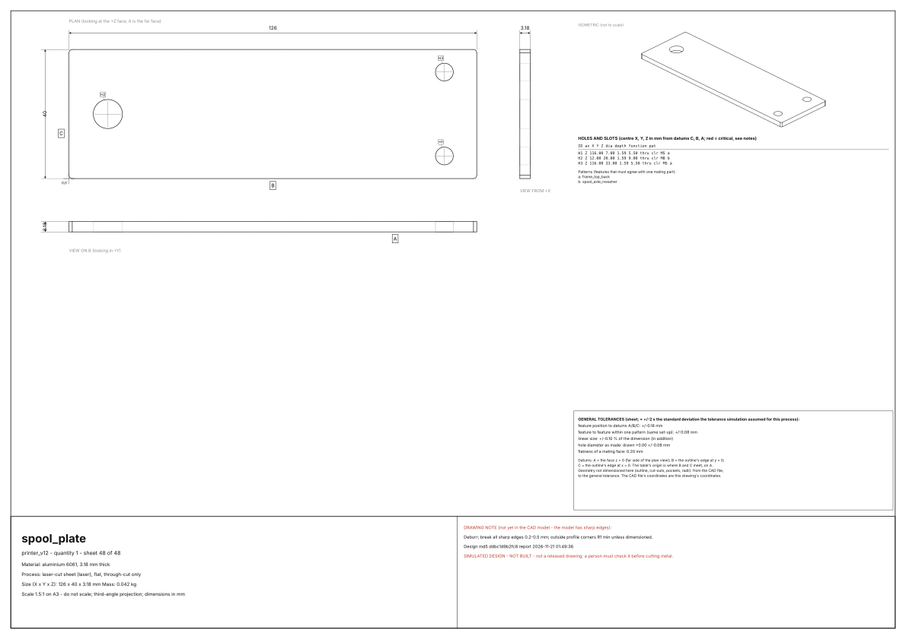

- Quantity 1. aluminium 6061; sheet; 126 x 40 x 3.18 mm; 0.042 kg.
- Sheet not specified mm, None cut, flat (no bends), through-cut only. Flat size None mm, cut length None mm, None pierces (report). DXF written here: {'LINE': 4, 'ARC': 4, 'CIRCLE': 3}, cut length 393.1 mm, extent (126.0, 40.0).
- Threads: none. Inserts and clinch nuts: none. Reaming: none.
- Drawing note, not yet in the model: Deburr; break all sharp edges 0.2-0.5 mm; outside profile corners R1 min unless dimensioned.
- **Needs more than the general tolerance, or rests on an assumption:**
  - Report, manufacture `supplier_rule`: SendCutSend rule sendcutsend.cut.hole_edge_al6061_page: hole edge to part edge 4.25 mm (2 of 3), limit >= 4.76 mm (warning: the supplier's words: "Keep holes and cutouts 1.5–2× material thickness away from edges to prevent warping or distortion.").
  - Report, manufacture `supplier_rule`: SendCutSend rule sendcutsend.cut.hole_edge_d_ratio: hole edge to part edge 7.5 mm (3 of 3), limit >= 9 mm (warning: the supplier's words: "we generally recommend keeping your holes at least 1X their diameter from an edge and slots at least 1.5X their width away from edges or other cut features.").

| ID | Kind | Axis | X | Y | Z | Dia / width | Slot length | Depth | Counterbore (dia x depth, from) | Function | Screws | On its axis | Pattern | Critical |
|---|---|---|---|---|---|---|---|---|---|---|---|---|---|---|
| H1 | hole | Z | 116 | 7 | 1.59 | 5.5 | - | through | - | clearance M5 | spool_plate_screw_0 (SHCS-M5x8) | - | a: frame_top_back | - |
| H2 | hole | Z | 12 | 20 | 1.59 | 9 | - | through | - | clearance M8 | spool_axle (SHCS-M8x140) | - | b: spool_axle_nwasher | - |
| H3 | hole | Z | 116 | 33 | 1.59 | 5.5 | - | through | - | clearance M5 | spool_plate_screw_1 (SHCS-M5x8) | - | a: frame_top_back | - |
