# Assembly guide: printer_v8

Generated by `tools/build_package.py` from `designs/printer_v8.py` (md5 `9f4017d87957e199a7069390d97496bc`) and `out/printer_v8/report.json` (written 2026-11-15 18:53:15, md5 `1d5bf219132d`). Do not edit: change the design, re-run verify, re-run the generator.

> **Simulated design. Nothing has been built.** See [OPEN_ITEMS.md](OPEN_ITEMS.md) before spending money.

386 parts, 172 drawn screws (15 types), tools: 2 mm hex key, 2.5 mm hex key, 3 mm hex key, 4 mm hex key. The simulation's time allowance is 84.7 min: a figure for comparing designs. It does not contain the operations listed under 'Not in the simulation' below, which are a large part of the real work.

## Read this first: what this guide is and is not

- **Bench units** below follow the assembly simulation step for step (it found an order with a way in for every part and driver access for every screw).
- **The main assembly does NOT follow the simulation's order.** That order is valid for access but is not one a person can build: 33 of its steps place a unit before anything supports it (it fits the bed carrier at step 10 and the frame's posts at steps 225 to 227, the corner brackets last), it turns the machine over 12 times and does 53 operations from below. The cause is in the model: corner brackets on T-slots have no drawn screws, so nothing 'holds' the frame until the end. The stages below re-group the simulation's units into the order a builder uses (frame first). **That stage order has not been run through the access checker.** Each screw's driving direction is given in machine axes so access can be judged before a part is fitted over it. The simulation's own sequence is in `data/assembly_plan.json` and `data/assembly_simulated_order.md`.
- Torque: neither the parts catalogue nor the joint model holds a tightening torque for any screw. Every 'snug' below is the builder's judgement. Printed parts and circuit boards: do not crush.
- Washers: the model has none. See OPEN_ITEMS.md (washer audit) and decide before you start; a washer under a head changes how far the screw reaches (thread engagement was checked without them).
- Directions: front is -Y (the side the bed plate overhangs), right is +X, up is +Z.

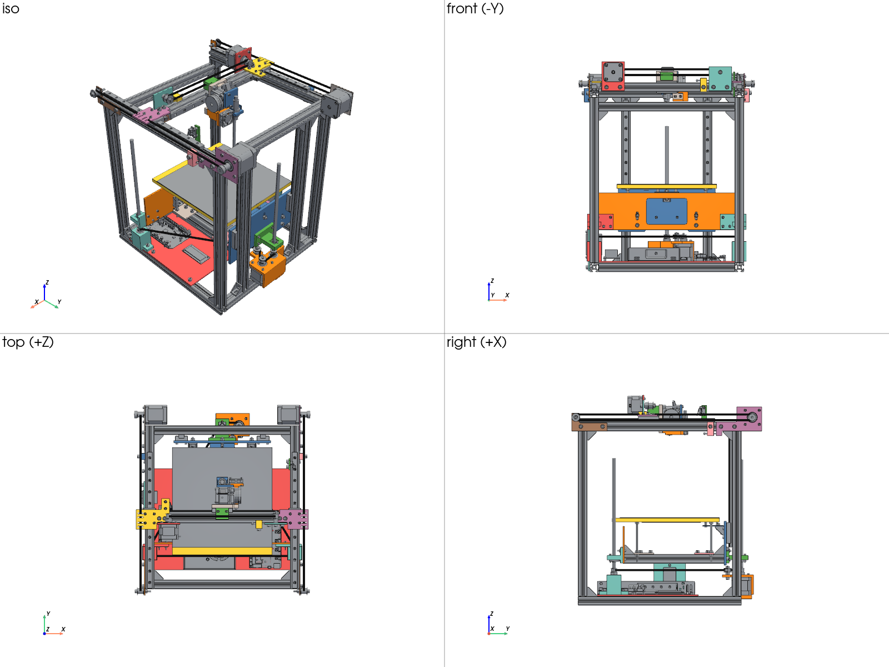

## Not in the simulation (do these; they are not in the step lists or the time)

- 96 M5 and 27 M3 T-nuts: one under every screw marked 'into T-nut' and under every corner-bracket leg on a slot.
- 52 M5 x 8 corner-bracket screws on T-slots (29 brackets): counted in the BOM, not drawn, so not in any step.
- Tapping M5 in the extrusion ends listed in BOM.md (cut lengths, end work).
- Pulley set screws (all pulleys), the nyloc nut under each lead-screw nut's pin (leave 0.2 mm slack so the nut can float), the star washer under the earth stud.
- Bonding the heater pad, the thermal cut-off and the magnetic sheet to the plate. Fit the four bed posts and their jam nuts BEFORE the magnetic sheet: it covers their heads.
- Belts: X and Y (thread, fold back in the anchors, tie); the closed Z belt must be laid round the three screw pulleys, the idler and the motor pulley BEFORE the bed carrier is lowered onto the lead-screw nuts (afterwards the carrier is in the way).
- All wiring (WIRING.md), looms, cable ties, the BAT85 diode in the probe lead.
- Deburring every cut and machined part (the model has sharp edges everywhere).

## Bench units

### Bench unit: bed_carrier

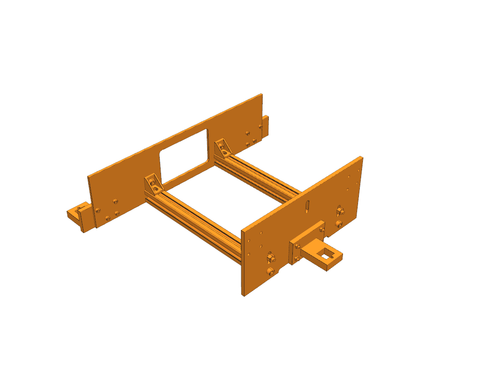

Parts: back_plate, front_plate, nut_block, nut_block_nut_0, nut_block_nut_1, nut_block_nut_2, nut_block_nut_3, nut_block_fl, nut_block_fl_nut_0, nut_block_fl_nut_1, nut_block_fl_nut_2, nut_block_fl_nut_3, nut_block_fr, nut_block_fr_nut_0, nut_block_fr_nut_1, nut_block_fr_nut_2, nut_block_fr_nut_3, bed_arm_left, bed_arm_left_bracket, bed_arm_left_bracket_nut, bed_arm_left_fbracket, bed_arm_left_fbracket_nut, bed_arm_right, bed_arm_right_bracket, bed_arm_right_bracket_nut, bed_arm_right_fbracket, bed_arm_right_fbracket_nut. Screws: 20. Held by hand at 6 steps; turned 1 times. Goes into stage: Bed carrier onto its blocks and nuts.

1. Start with **back_plate** on the bench, on its back (front face up).
2. Fit **bed_arm_right_bracket** (BRKT-2020) onto back_plate, from the side. Check: both legs flat on their members; T-nuts turned across the slot before tightening.
3. Fit **bed_arm_right_bracket_nut** (NUT-M5) onto back_plate, from the side. Hold it until fastened (nothing stops it falling). Check: seated flat on back_plate with no gap; all its screws started before any is tightened.
4. Drive 1 x M5x16 from above with the 4 mm hex key: bed_arm_right_bracket_screw. Snug; no torque figure in the model.
5. Fit **bed_arm_right** (EXT2020-220) onto back_plate, bed_arm_right_bracket, from the side. Check: ends flush and square to the neighbouring members (set square on two faces).
6. Drive 1 x M5x16 from below with the 4 mm hex key: bed_arm_right_bolt. Snug; no torque figure in the model.
7. Fit **bed_arm_left_bracket** (BRKT-2020) onto back_plate, from the side. Check: both legs flat on their members; T-nuts turned across the slot before tightening.
8. Fit **bed_arm_left_bracket_nut** (NUT-M5) onto back_plate, from the side. Hold it until fastened (nothing stops it falling). Check: seated flat on back_plate with no gap; all its screws started before any is tightened.
9. Drive 1 x M5x16 from above with the 4 mm hex key: bed_arm_left_bracket_screw. Snug; no torque figure in the model.
10. Fit **bed_arm_left** (EXT2020-220) onto back_plate, bed_arm_left_bracket, from the side. Check: ends flush and square to the neighbouring members (set square on two faces).
11. Drive 1 x M5x16 from below with the 4 mm hex key: bed_arm_left_bolt. Snug; no torque figure in the model.
12. Fit **front_plate** onto bed_arm_left, bed_arm_right, from the side. Hold it until fastened (it would tip or slide off (centre of mass is 26 mm outside what it rests on)). Check: seated flat on bed_arm_left, bed_arm_right with no gap; all its screws started before any is tightened.
13. Fit **bed_arm_right_fbracket** (BRKT-2020) onto bed_arm_right, front_plate, from the side. Hold it until fastened (nothing stops it falling). Check: both legs flat on their members; T-nuts turned across the slot before tightening.
14. Fit **bed_arm_right_fbracket_nut** (NUT-M5) onto front_plate, from the side. Hold it until fastened (it rests only on parts that are themselves still loose). Check: seated flat on front_plate with no gap; all its screws started before any is tightened.
15. Drive 1 x M5x12 from below with the 4 mm hex key: bed_arm_right_fbracket_screw. Snug; no torque figure in the model.
16. Drive 1 x M5x12 from above with the 4 mm hex key: bed_arm_right_fbolt. Snug; no torque figure in the model.
17. Fit **bed_arm_left_fbracket** (BRKT-2020) onto bed_arm_left, front_plate, from the side. Hold it until fastened (nothing stops it falling). Check: both legs flat on their members; T-nuts turned across the slot before tightening.
18. Fit **bed_arm_left_fbracket_nut** (NUT-M5) onto front_plate, from the side. Check: seated flat on front_plate with no gap; all its screws started before any is tightened.
19. Drive 1 x M5x12 from below with the 4 mm hex key: bed_arm_left_fbracket_screw. Snug; no torque figure in the model.
20. Drive 1 x M5x12 from above with the 4 mm hex key: bed_arm_left_fbolt. Snug; no torque figure in the model.
21. Fit **nut_block_fr** onto front_plate, from the side. Check: seated flat on front_plate with no gap; all its screws started before any is tightened.
22. Fit **nut_block_fr_nut_3** (NUT-M3) onto nut_block_fr, from the side. Check: seated flat on nut_block_fr with no gap; all its screws started before any is tightened.
23. Drive 1 x M3x16 from below with the 2.5 mm hex key: nut_block_fr_bolt_3. Snug; no torque figure in the model.
24. Fit **nut_block_fr_nut_2** (NUT-M3) onto nut_block_fr, from the side. Check: seated flat on nut_block_fr with no gap; all its screws started before any is tightened.
25. Drive 1 x M3x16 from below with the 2.5 mm hex key: nut_block_fr_bolt_2. Snug; no torque figure in the model.
26. Fit **nut_block_fr_nut_1** (NUT-M3) onto nut_block_fr, from the side. Check: seated flat on nut_block_fr with no gap; all its screws started before any is tightened.
27. Drive 1 x M3x16 from below with the 2.5 mm hex key: nut_block_fr_bolt_1. Snug; no torque figure in the model.
28. Fit **nut_block_fr_nut_0** (NUT-M3) onto nut_block_fr, from the side. Check: seated flat on nut_block_fr with no gap; all its screws started before any is tightened.
29. Drive 1 x M3x16 from below with the 2.5 mm hex key: nut_block_fr_bolt_0. Snug; no torque figure in the model.
30. Fit **nut_block_fl** onto front_plate, from the side. Check: seated flat on front_plate with no gap; all its screws started before any is tightened.
31. Fit **nut_block_fl_nut_3** (NUT-M3) onto nut_block_fl, from the side. Check: seated flat on nut_block_fl with no gap; all its screws started before any is tightened.
32. Drive 1 x M3x16 from below with the 2.5 mm hex key: nut_block_fl_bolt_3. Snug; no torque figure in the model.
33. Fit **nut_block_fl_nut_2** (NUT-M3) onto nut_block_fl, from the side. Check: seated flat on nut_block_fl with no gap; all its screws started before any is tightened.
34. Drive 1 x M3x16 from below with the 2.5 mm hex key: nut_block_fl_bolt_2. Snug; no torque figure in the model.
35. Fit **nut_block_fl_nut_1** (NUT-M3) onto nut_block_fl, from the side. Check: seated flat on nut_block_fl with no gap; all its screws started before any is tightened.
36. Drive 1 x M3x16 from below with the 2.5 mm hex key: nut_block_fl_bolt_1. Snug; no torque figure in the model.
37. Fit **nut_block_fl_nut_0** (NUT-M3) onto nut_block_fl, from above. Check: seated flat on nut_block_fl with no gap; all its screws started before any is tightened.
38. Turn the unit on its front (back face up). Drive 1 x M3x16 from above with the 2.5 mm hex key: nut_block_fl_bolt_0. Snug; no torque figure in the model.
39. Fit **nut_block** onto back_plate, from the side. Check: seated flat on back_plate with no gap; all its screws started before any is tightened.
40. Fit **nut_block_nut_3** (NUT-M3) onto nut_block, from the side. Check: seated flat on nut_block with no gap; all its screws started before any is tightened.
41. Drive 1 x M3x16 from below with the 2.5 mm hex key: nut_block_bolt_3. Snug; no torque figure in the model.
42. Fit **nut_block_nut_2** (NUT-M3) onto nut_block, from the side. Check: seated flat on nut_block with no gap; all its screws started before any is tightened.
43. Drive 1 x M3x16 from below with the 2.5 mm hex key: nut_block_bolt_2. Snug; no torque figure in the model.
44. Fit **nut_block_nut_1** (NUT-M3) onto nut_block, from the side. Check: seated flat on nut_block with no gap; all its screws started before any is tightened.
45. Drive 1 x M3x16 from below with the 2.5 mm hex key: nut_block_bolt_1. Snug; no torque figure in the model.
46. Fit **nut_block_nut_0** (NUT-M3) onto nut_block, from the side. Check: seated flat on nut_block with no gap; all its screws started before any is tightened.
47. Drive 1 x M3x16 from below with the 2.5 mm hex key: nut_block_bolt_0. Snug; no torque figure in the model.

Before moving on: every screw of the unit is in (20); nothing rocks on a flat surface; moving parts (shaft, idler) turn freely.

### Bench unit: electronics

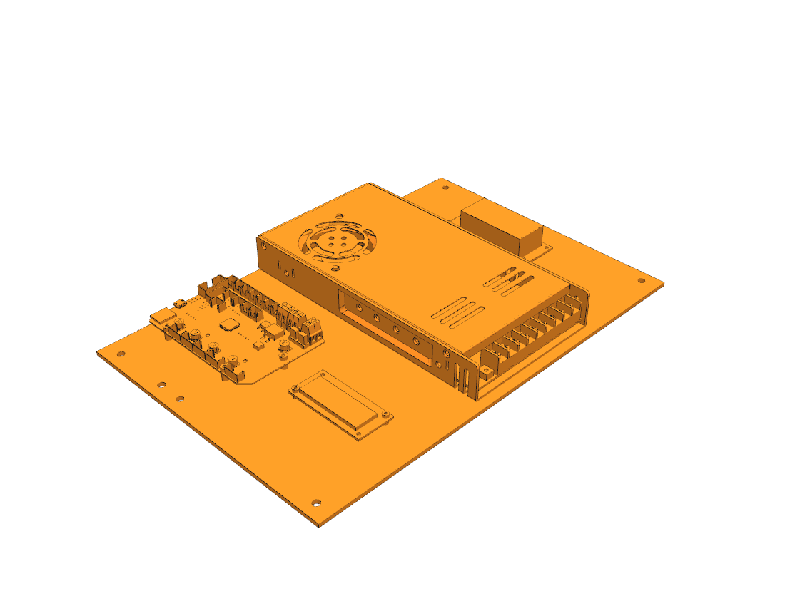

Parts: electronics_tray, psu, control_board, control_board_spacer_0, control_board_nut_0, control_board_spacer_1, control_board_nut_1, control_board_spacer_2, control_board_nut_2, control_board_spacer_4, control_board_nut_4, host, host_spacer_0, host_nut_0, host_spacer_3, host_nut_3, psu_relay, psu_relay_spacer_0, psu_relay_nut_0, psu_relay_spacer_1, psu_relay_nut_1, psu_relay_spacer_2, psu_relay_nut_2. Screws: 13. Held by hand at 6 steps; turned 0 times. Goes into stage: Electronics tray, mains inlet, earth.

1. Start with **psu** on the bench, upside down.
2. Fit **electronics_tray** onto psu, from the side. Check: seated flat on psu with no gap; all its screws started before any is tightened.
3. Drive 4 x M4x6 from above with the 3 mm hex key: psu_screw_3, psu_screw_2, psu_screw_1, psu_screw_0. Snug; no torque figure in the model.
4. Fit **psu_relay_spacer_2** (SPACER-NYLON-M3-5x3.3x6) onto electronics_tray, from below. Hold it until fastened (nothing stops it falling). Check: seated flat on electronics_tray with no gap; all its screws started before any is tightened.
5. Fit **psu_relay** (RELAY-BTT-V1.2) onto psu_relay_spacer_2, from below. Hold it until fastened (nothing stops it falling). Check: seated flat on psu_relay_spacer_2 with no gap; all its screws started before any is tightened.
6. Fit **psu_relay_nut_2** (NUT-M3) onto electronics_tray, from the side. Check: seated flat on electronics_tray with no gap; all its screws started before any is tightened.
7. Drive 1 x M3x16 from below with the 2.5 mm hex key: psu_relay_screw_2. Snug; no torque figure in the model.
8. Fit **psu_relay_spacer_1** (SPACER-NYLON-M3-5x3.3x6) onto electronics_tray, psu_relay, from the side. Check: seated flat on electronics_tray, psu_relay with no gap; all its screws started before any is tightened.
9. Fit **psu_relay_nut_1** (NUT-M3) onto electronics_tray, from the side. Check: seated flat on electronics_tray with no gap; all its screws started before any is tightened.
10. Drive 1 x M3x16 from below with the 2.5 mm hex key: psu_relay_screw_1. Snug; no torque figure in the model.
11. Fit **psu_relay_spacer_0** (SPACER-NYLON-M3-5x3.3x6) onto electronics_tray, psu_relay, from the side. Check: seated flat on electronics_tray, psu_relay with no gap; all its screws started before any is tightened.
12. Fit **psu_relay_nut_0** (NUT-M3) onto electronics_tray, from the side. Check: seated flat on electronics_tray with no gap; all its screws started before any is tightened.
13. Drive 1 x M3x16 from below with the 2.5 mm hex key: psu_relay_screw_0. Snug; no torque figure in the model.
14. Fit **control_board_spacer_4** (SPACER-NYLON-M3-5x3.3x6) onto electronics_tray, from below. Hold it until fastened (nothing stops it falling). Check: seated flat on electronics_tray with no gap; all its screws started before any is tightened.
15. Fit **control_board** (CTRL-SKR-MINI-E3-V3) onto control_board_spacer_4, from below. Hold it until fastened (nothing stops it falling). Check: seated flat on control_board_spacer_4 with no gap; all its screws started before any is tightened.
16. Fit **control_board_nut_4** (NUT-M3) onto electronics_tray, from the side. Check: seated flat on electronics_tray with no gap; all its screws started before any is tightened.
17. Drive 1 x M3x16 from below with the 2.5 mm hex key: control_board_screw_4. Snug; no torque figure in the model.
18. Fit **control_board_spacer_2** (SPACER-NYLON-M3-5x3.3x6) onto control_board, electronics_tray, from the side. Check: seated flat on control_board, electronics_tray with no gap; all its screws started before any is tightened.
19. Fit **control_board_nut_2** (NUT-M3) onto electronics_tray, from the side. Check: seated flat on electronics_tray with no gap; all its screws started before any is tightened.
20. Drive 1 x M3x16 from below with the 2.5 mm hex key: control_board_screw_2. Snug; no torque figure in the model.
21. Fit **control_board_spacer_1** (SPACER-NYLON-M3-5x3.3x6) onto control_board, electronics_tray, from the side. Check: seated flat on control_board, electronics_tray with no gap; all its screws started before any is tightened.
22. Fit **control_board_nut_1** (NUT-M3) onto electronics_tray, from the side. Check: seated flat on electronics_tray with no gap; all its screws started before any is tightened.
23. Drive 1 x M3x16 from below with the 2.5 mm hex key: control_board_screw_1. Snug; no torque figure in the model.
24. Fit **control_board_spacer_0** (SPACER-NYLON-M3-5x3.3x6) onto control_board, electronics_tray, from the side. Check: seated flat on control_board, electronics_tray with no gap; all its screws started before any is tightened.
25. Fit **control_board_nut_0** (NUT-M3) onto electronics_tray, from the side. Check: seated flat on electronics_tray with no gap; all its screws started before any is tightened.
26. Drive 1 x M3x16 from below with the 2.5 mm hex key: control_board_screw_0. Snug; no torque figure in the model.
27. Fit **host_spacer_3** (SPACER-NYLON-M2.5-4x2.7x4) onto electronics_tray, from below. Hold it until fastened (nothing stops it falling). Check: seated flat on electronics_tray with no gap; all its screws started before any is tightened.
28. Fit **host** (HOST-RPI-ZERO-2W) onto host_spacer_3, from below. Hold it until fastened (nothing stops it falling). Check: seated flat on host_spacer_3 with no gap; all its screws started before any is tightened.
29. Fit **host_nut_3** (NUT-M2.5) onto electronics_tray, from the side. Check: seated flat on electronics_tray with no gap; all its screws started before any is tightened.
30. Drive 1 x M2.5x12 from below with the 2 mm hex key: host_screw_3. Snug; no torque figure in the model.
31. Fit **host_nut_0** (NUT-M2.5) onto electronics_tray, from the side. Check: seated flat on electronics_tray with no gap; all its screws started before any is tightened.
32. Fit **host_spacer_0** (SPACER-NYLON-M2.5-4x2.7x4) onto electronics_tray, host, from the side. Check: seated flat on electronics_tray, host with no gap; all its screws started before any is tightened.
33. Drive 1 x M2.5x12 from below with the 2 mm hex key: host_screw_0. Snug; no torque figure in the model.

Before moving on: every screw of the unit is in (13); nothing rocks on a flat surface; moving parts (shaft, idler) turn freely.

### Bench unit: z_drive

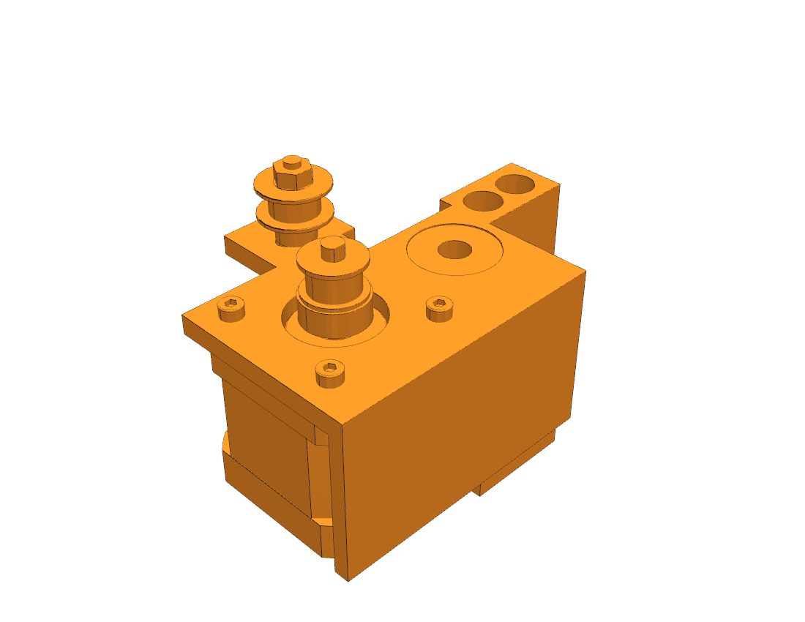

Parts: z_drive_mount, z_bearing_lo, z_sleeve, z_bearing_hi, z_motor, z_pulley_m, z_idler_spacer, z_idler, z_idler_nut. Screws: 5. Held by hand at 1 steps; turned 0 times. Goes into stage: Z drive: mount, pedestals, bearings, screws, pulleys, belt.

1. Start with **z_motor** on the bench.
2. Fit **z_drive_mount** onto z_motor, from above. Check: seated flat on z_motor with no gap; all its screws started before any is tightened.
3. Fit **z_idler_spacer** (SPACER-AL-M5-10x5.1x6) onto z_drive_mount, from above. Check: seated flat on z_drive_mount with no gap; all its screws started before any is tightened.
4. Fit **z_idler** (GT2-IDLER-20T-B5) onto z_idler_spacer, from above. Check: seated flat on z_idler_spacer with no gap; all its screws started before any is tightened.
5. Fit **z_idler_nut** (NUT-M5-DIN934) onto z_idler, from above. Check: seated flat on z_idler with no gap; all its screws started before any is tightened.
6. Drive 1 x M5x25 from below with the 4 mm hex key: z_idler_bolt. Snug; no torque figure in the model.
7. Drive 4 x M3x8 from above with the 2.5 mm hex key: z_motor_screw_3, z_motor_screw_2, z_motor_screw_1, z_motor_screw_0. Snug; no torque figure in the model.
8. Fit **z_bearing_lo** (BRG-608) onto z_drive_mount, from above. Check: bearing pushed fully home in its seat by hand; turns freely.
9. Fit **z_sleeve** onto z_bearing_lo, z_drive_mount, from above. Check: seated flat on z_bearing_lo, z_drive_mount with no gap; all its screws started before any is tightened.
10. Fit **z_bearing_hi** (BRG-608) onto z_drive_mount, z_sleeve, from above. Check: bearing pushed fully home in its seat by hand; turns freely.
11. Fit **z_pulley_m** (GT2-20T-B5) onto z_motor, from above. Hold it until fastened (nothing stops it falling). Check: set screws tight on the shaft; on a lead screw the hub rests on the upper bearing's INNER ring and does not touch the outer ring.

Before moving on: every screw of the unit is in (5); nothing rocks on a flat surface; moving parts (shaft, idler) turn freely.

### Bench unit: y_drive_l

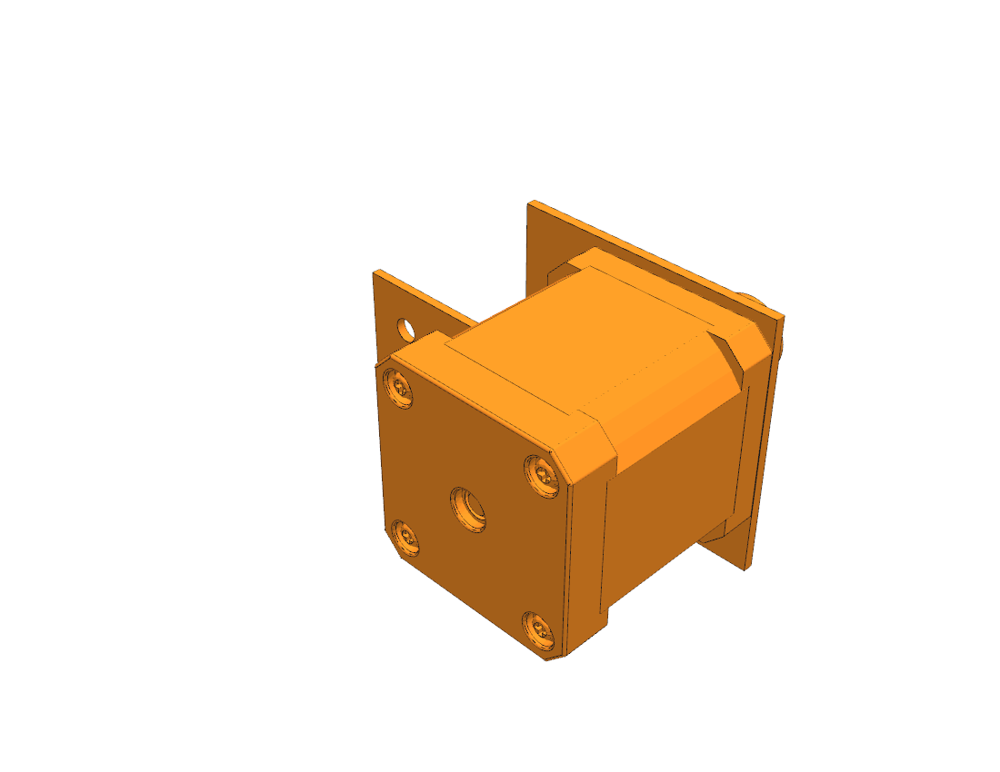

Parts: y_motor_mount_l, y_motor_l, y_pulley_l. Screws: 4. Held by hand at 0 steps; turned 0 times. Goes into stage: Y drives, idlers, tensioners, Y endstop.

1. Start with **y_motor_l** on the bench.
2. Fit **y_motor_mount_l** onto y_motor_l, from the side. Check: seated flat on y_motor_l with no gap; all its screws started before any is tightened.
3. Drive 4 x M3x6 from the side with the 2.5 mm hex key: y_motor_l_screw_3, y_motor_l_screw_2, y_motor_l_screw_1, y_motor_l_screw_0. Snug; no torque figure in the model.
4. Fit **y_pulley_l** (GT2-20T-B5) onto y_motor_l, from the side. Check: set screws tight on the shaft; on a lead screw the hub rests on the upper bearing's INNER ring and does not touch the outer ring.

Before moving on: every screw of the unit is in (4); nothing rocks on a flat surface; moving parts (shaft, idler) turn freely.

### Bench unit: y_drive

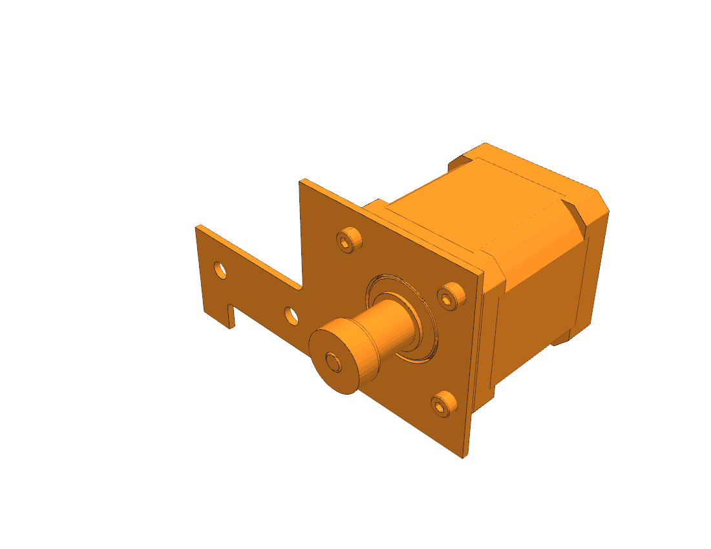

Parts: y_motor_mount, y_motor, y_pulley. Screws: 4. Held by hand at 0 steps; turned 0 times. Goes into stage: Y drives, idlers, tensioners, Y endstop.

1. Start with **y_motor** on the bench.
2. Fit **y_motor_mount** onto y_motor, from the side. Check: seated flat on y_motor with no gap; all its screws started before any is tightened.
3. Drive 4 x M3x6 from the side with the 2.5 mm hex key: y_motor_screw_3, y_motor_screw_2, y_motor_screw_1, y_motor_screw_0. Snug; no torque figure in the model.
4. Fit **y_pulley** (GT2-20T-B5) onto y_motor, from the side. Check: set screws tight on the shaft; on a lead screw the hub rests on the upper bearing's INNER ring and does not touch the outer ring.

Before moving on: every screw of the unit is in (4); nothing rocks on a flat surface; moving parts (shaft, idler) turn freely.

### Bench unit: x_drive

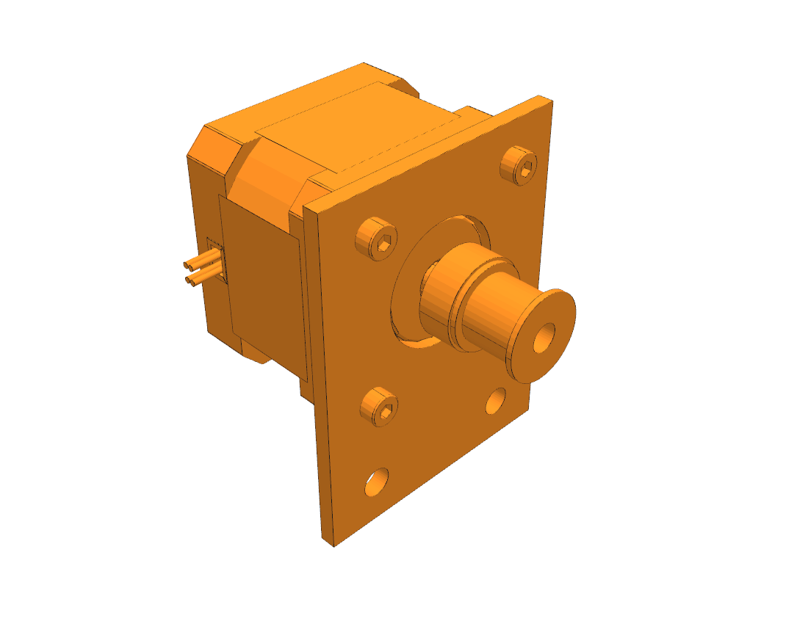

Parts: x_motor_mount, x_motor, x_pulley. Screws: 4. Held by hand at 0 steps; turned 0 times. Goes into stage: Gantry: Y plates, X beam, X rail, X drive.

1. Start with **x_motor** on the bench.
2. Fit **x_motor_mount** onto x_motor, from the side. Check: seated flat on x_motor with no gap; all its screws started before any is tightened.
3. Drive 4 x M3x6 from the side with the 2.5 mm hex key: x_motor_screw_3, x_motor_screw_2, x_motor_screw_1, x_motor_screw_0. Snug; no torque figure in the model.
4. Fit **x_pulley** (GT2-20T-B5-W9) onto x_motor, from the side. Check: set screws tight on the shaft; on a lead screw the hub rests on the upper bearing's INNER ring and does not touch the outer ring.

Before moving on: every screw of the unit is in (4); nothing rocks on a flat surface; moving parts (shaft, idler) turn freely.

### Bench unit: x_idler_unit

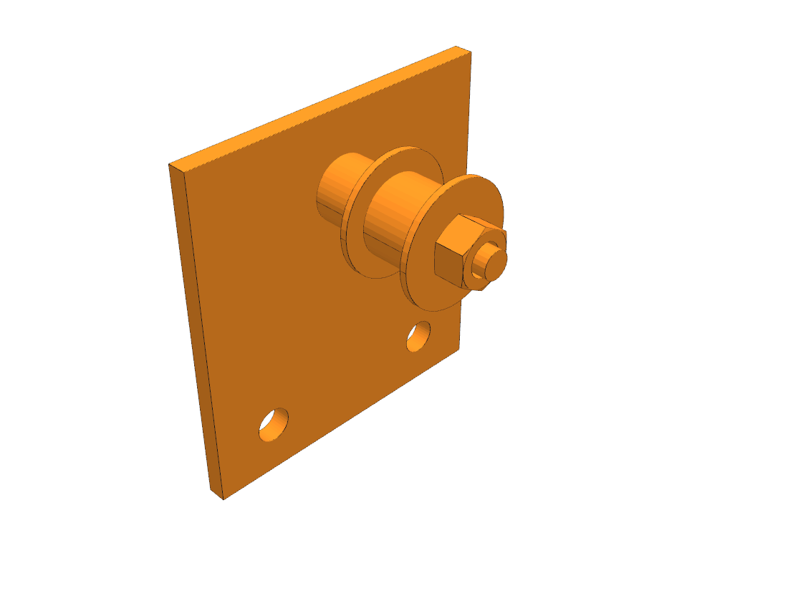

Parts: x_idler_mount, x_idler_spacer, x_idler, x_idler_nut. Screws: 1. Held by hand at 0 steps; turned 0 times. Goes into stage: Gantry: Y plates, X beam, X rail, X drive.

1. Start with **x_idler_mount** on the bench, on its front (back face up).
2. Fit **x_idler_spacer** (SPACER-AL-M5-10x5.1x9) onto x_idler_mount, from the side. Check: seated flat on x_idler_mount with no gap; all its screws started before any is tightened.
3. Fit **x_idler** (GT2-IDLER-20T-B5-W9) onto x_idler_spacer, from the side. Check: seated flat on x_idler_spacer with no gap; all its screws started before any is tightened.
4. Fit **x_idler_nut** (NUT-M5) onto x_idler, from the side. Check: seated flat on x_idler with no gap; all its screws started before any is tightened.
5. Drive 1 x M5x30 from below with the 4 mm hex key: x_idler_bolt. Snug; no torque figure in the model.

Before moving on: every screw of the unit is in (1); nothing rocks on a flat surface; moving parts (shaft, idler) turn freely.

### Bench unit: part_cooling

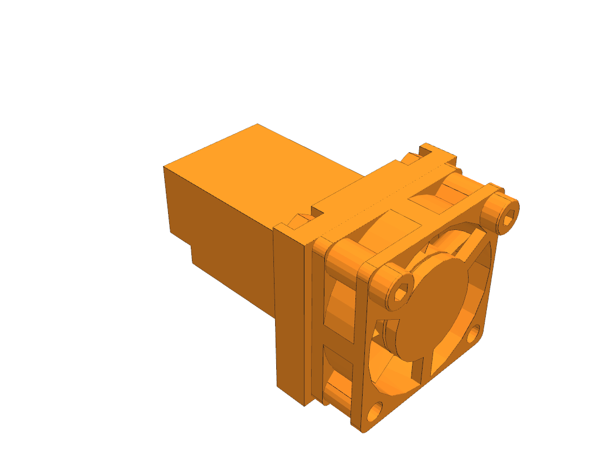

Parts: part_duct, part_fan, part_fan_nut_0, part_fan_nut_1. Screws: 2. Held by hand at 0 steps; turned 0 times. Goes into stage: Toolhead: plate, extruder, hotend, probe, part cooling.

1. Start with **part_duct** on the bench.
2. Fit **part_fan** (FAN-3010) onto part_duct, from above. Check: seated flat on part_duct with no gap; all its screws started before any is tightened.
3. Fit **part_fan_nut_1** (NUT-M3) onto part_duct, from above. Check: seated flat on part_duct with no gap; all its screws started before any is tightened.
4. Drive 1 x M3x16 from the side with the 2.5 mm hex key: part_fan_screw_1. Snug; no torque figure in the model.
5. Fit **part_fan_nut_0** (NUT-M3) onto part_duct, from above. Check: seated flat on part_duct with no gap; all its screws started before any is tightened.
6. Drive 1 x M3x16 from the side with the 2.5 mm hex key: part_fan_screw_0. Snug; no torque figure in the model.

Before moving on: every screw of the unit is in (2); nothing rocks on a flat surface; moving parts (shaft, idler) turn freely.

## Main assembly, by stage

### Stage: Frame

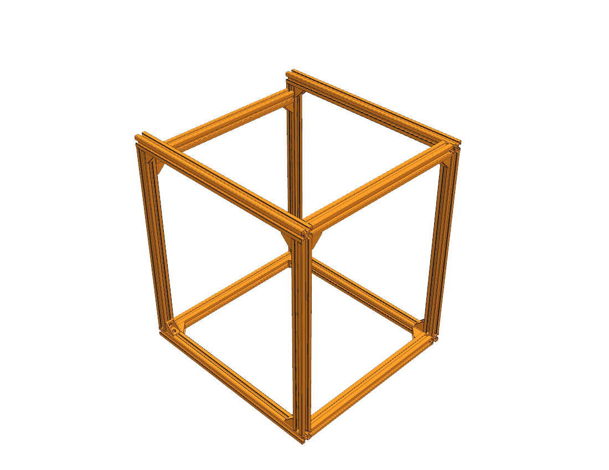

Orange: fitted in this stage. Grey: already there.

| # | Fit | Touches (simulation) | Screws that hold it (count x size, key, direction) | Check before moving on | Sim. step |
|---|---|---|---|---|---|
| 1 | **frame_bot_back** (EXT2020-300) | frame_bot_left, frame_bot_right, upright_left | - | ends flush and square to the neighbouring members (set square on two faces) | 29 |
| 2 | **frame_bot_front** (EXT2020-300) | frame_bot_left, frame_bot_right, post_lf | - | ends flush and square to the neighbouring members (set square on two faces) | 232 |
| 3 | **frame_bot_left** (EXT2020-360) | - | - | ends flush and square to the neighbouring members (set square on two faces) | 0 |
| 4 | **frame_bot_right** (EXT2020-360) | electronics_tray, post_rf | - | ends flush and square to the neighbouring members (set square on two faces) | 28 |
| 5 | **post_lb** (EXT2020-364) | frame_bot_back, frame_bot_left, frame_top_left | - | ends flush and square to the neighbouring members (set square on two faces) | 227 |
| 6 | **post_lf** (EXT2020-364) | frame_bot_left, frame_top_left, y_idler_mount_l | - | ends flush and square to the neighbouring members (set square on two faces) | 226 |
| 7 | **post_rb** (EXT2020-364) | frame_bot_back, frame_bot_right, frame_top_right | - | ends flush and square to the neighbouring members (set square on two faces) | 225 |
| 8 | **post_rf** (EXT2020-364) | frame_top_right | - | ends flush and square to the neighbouring members (set square on two faces) | 27 |
| 9 | **frame_top_front** (EXT2020-300) | post_lf, post_rf | - | ends flush and square to the neighbouring members (set square on two faces) | 228 |
| 10 | **frame_top_back** (EXT2020-300) | frame_top_left, frame_top_right, post_lb | - | ends flush and square to the neighbouring members (set square on two faces) | 231 |
| 11 | **frame_top_left** (EXT2020-360) | - | - | ends flush and square to the neighbouring members (set square on two faces) | 17 |
| 12 | **frame_top_right** (EXT2020-360) | - | - | ends flush and square to the neighbouring members (set square on two faces) | 7 |
| 13 | **bracket_11** (BRKT-2020) | frame_bot_front, frame_bot_right | M5 x 8 cap screw and T-nut in each leg that lies on a T-slot, 4 mm key (BOM only: not drawn, access not checked) | both legs flat on their members; T-nuts turned across the slot before tightening | 259 |
| 14 | **bracket_15** (BRKT-2020) | frame_bot_back, frame_bot_right | M5 x 8 cap screw and T-nut in each leg that lies on a T-slot, 4 mm key (BOM only: not drawn, access not checked) | both legs flat on their members; T-nuts turned across the slot before tightening | 255 |
| 15 | **bracket_3** (BRKT-2020) | frame_bot_front, frame_bot_left | M5 x 8 cap screw and T-nut in each leg that lies on a T-slot, 4 mm key (BOM only: not drawn, access not checked) | both legs flat on their members; T-nuts turned across the slot before tightening | 253 |
| 16 | **bracket_7** (BRKT-2020) | frame_bot_back, frame_bot_left | M5 x 8 cap screw and T-nut in each leg that lies on a T-slot, 4 mm key (BOM only: not drawn, access not checked) | both legs flat on their members; T-nuts turned across the slot before tightening | 249 |
| 17 | **bracket_10** (BRKT-2020) | frame_bot_right, post_rf | M5 x 8 cap screw and T-nut in each leg that lies on a T-slot, 4 mm key (BOM only: not drawn, access not checked) | both legs flat on their members; T-nuts turned across the slot before tightening | 260 |
| 18 | **bracket_14** (BRKT-2020) | frame_bot_right, post_rb | M5 x 8 cap screw and T-nut in each leg that lies on a T-slot, 4 mm key (BOM only: not drawn, access not checked) | both legs flat on their members; T-nuts turned across the slot before tightening | 256 |
| 19 | **bracket_2** (BRKT-2020) | frame_bot_left, post_lf | M5 x 8 cap screw and T-nut in each leg that lies on a T-slot, 4 mm key (BOM only: not drawn, access not checked) | both legs flat on their members; T-nuts turned across the slot before tightening | 254 |
| 20 | **bracket_6** (BRKT-2020) | frame_bot_left, post_lb | M5 x 8 cap screw and T-nut in each leg that lies on a T-slot, 4 mm key (BOM only: not drawn, access not checked) | both legs flat on their members; T-nuts turned across the slot before tightening | 250 |
| 21 | **bracket_0** (BRKT-2020) | frame_top_left, post_lf | M5 x 8 cap screw and T-nut in each leg that lies on a T-slot, 4 mm key (BOM only: not drawn, access not checked) | both legs flat on their members; T-nuts turned across the slot before tightening | 262 |
| 22 | **bracket_1** (BRKT-2020) | frame_top_front, post_lf | M5 x 8 cap screw and T-nut in each leg that lies on a T-slot, 4 mm key (BOM only: not drawn, access not checked) | both legs flat on their members; T-nuts turned across the slot before tightening | 261 |
| 23 | **bracket_12** (BRKT-2020) | frame_top_right, post_rb | M5 x 8 cap screw and T-nut in each leg that lies on a T-slot, 4 mm key (BOM only: not drawn, access not checked) | both legs flat on their members; T-nuts turned across the slot before tightening | 258 |
| 24 | **bracket_13** (BRKT-2020) | frame_top_back, frame_top_right, post_rb | M5 x 8 cap screw and T-nut in each leg that lies on a T-slot, 4 mm key (BOM only: not drawn, access not checked) | both legs flat on their members; T-nuts turned across the slot before tightening | 257 |
| 25 | **bracket_4** (BRKT-2020) | frame_top_left, post_lb | M5 x 8 cap screw and T-nut in each leg that lies on a T-slot, 4 mm key (BOM only: not drawn, access not checked) | both legs flat on their members; T-nuts turned across the slot before tightening | 252 |
| 26 | **bracket_5** (BRKT-2020) | frame_top_back, frame_top_left, post_lb | M5 x 8 cap screw and T-nut in each leg that lies on a T-slot, 4 mm key (BOM only: not drawn, access not checked) | both legs flat on their members; T-nuts turned across the slot before tightening | 251 |
| 27 | **bracket_8** (BRKT-2020) | frame_top_right, post_rf | M5 x 8 cap screw and T-nut in each leg that lies on a T-slot, 4 mm key (BOM only: not drawn, access not checked) | both legs flat on their members; T-nuts turned across the slot before tightening | 248 |
| 28 | **bracket_9** (BRKT-2020) | frame_top_front, post_rf | M5 x 8 cap screw and T-nut in each leg that lies on a T-slot, 4 mm key (BOM only: not drawn, access not checked) | both legs flat on their members; T-nuts turned across the slot before tightening | 247 |

Build the bottom rectangle flat on a surface plate or a known-flat table, then the four posts, then the top. The front top rail sits lower than the other three. Check: diagonals of the bottom and top rectangles equal within 0.5 mm; the frame does not rock. The frame's squareness is not in any tolerance result beyond the saw-cut length figures.

### Stage: Z uprights, rails and blocks

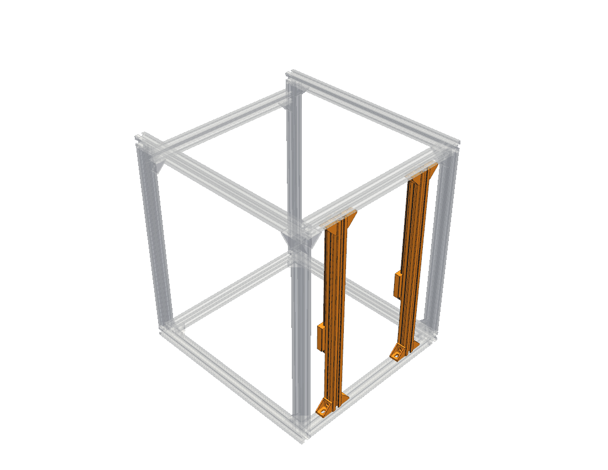

Orange: fitted in this stage. Grey: already there.

| # | Fit | Touches (simulation) | Screws that hold it (count x size, key, direction) | Check before moving on | Sim. step |
|---|---|---|---|---|---|
| 1 | **upright_right** (EXT2020-364) | - | - | ends flush and square to the neighbouring members (set square on two faces) | 1 |
| 2 | **z_rail_right** (MGN12-R-250) | upright_right | 5 x M3x8 cap screw, 2.5 mm key, from the front, pointing back (+Y), into T-nut (z_rail_right_screw_0, z_rail_right_screw_1, z_rail_right_screw_4, z_rail_right_screw_3, z_rail_right_screw_2) | rail lies flat in the slot's faces; leave its screws just nipped until the rail-alignment step for this axis | 2 |
| 3 | **upright_left** (EXT2020-364) | - | - | ends flush and square to the neighbouring members (set square on two faces) | 4 |
| 4 | **z_rail_left** (MGN12-R-250) | upright_left | 5 x M3x8 cap screw, 2.5 mm key, from the front, pointing back (+Y), into T-nut (z_rail_left_screw_0, z_rail_left_screw_1, z_rail_left_screw_4, z_rail_left_screw_3, z_rail_left_screw_2) | rail lies flat in the slot's faces; leave its screws just nipped until the rail-alignment step for this axis | 5 |
| 5 | **z_carriage_right_hi** (MGN12H) | back_plate, z_rail_right | - | the block is slid on without losing balls (keep it on its plastic keeper until the rail is under it); it runs the whole rail by hand with even drag | 196 |
| 6 | **z_carriage_left_hi** (MGN12H) | back_plate, z_rail_left | - | the block is slid on without losing balls (keep it on its plastic keeper until the rail is under it); it runs the whole rail by hand with even drag | 201 |
| 7 | **brkt_up_top_out_right** (BRKT-2020) | frame_top_back, upright_right | M5 x 8 cap screw and T-nut in each leg that lies on a T-slot, 4 mm key (BOM only: not drawn, access not checked) | both legs flat on their members; T-nuts turned across the slot before tightening | 239 |
| 8 | **brkt_up_top_out_left** (BRKT-2020) | frame_top_back, upright_left | M5 x 8 cap screw and T-nut in each leg that lies on a T-slot, 4 mm key (BOM only: not drawn, access not checked) | both legs flat on their members; T-nuts turned across the slot before tightening | 240 |
| 9 | **brkt_up_top_in_right** (BRKT-2020) | frame_top_back, upright_right | M5 x 8 cap screw and T-nut in each leg that lies on a T-slot, 4 mm key (BOM only: not drawn, access not checked) | both legs flat on their members; T-nuts turned across the slot before tightening | 241 |
| 10 | **brkt_up_top_in_left** (BRKT-2020) | frame_top_back, upright_left | M5 x 8 cap screw and T-nut in each leg that lies on a T-slot, 4 mm key (BOM only: not drawn, access not checked) | both legs flat on their members; T-nuts turned across the slot before tightening | 242 |
| 11 | **brkt_up_bot_out_right** (BRKT-2020) | frame_bot_back, upright_right | M5 x 8 cap screw and T-nut in each leg that lies on a T-slot, 4 mm key (BOM only: not drawn, access not checked) | both legs flat on their members; T-nuts turned across the slot before tightening | 243 |
| 12 | **brkt_up_bot_out_left** (BRKT-2020) | frame_bot_back, upright_left | M5 x 8 cap screw and T-nut in each leg that lies on a T-slot, 4 mm key (BOM only: not drawn, access not checked) | both legs flat on their members; T-nuts turned across the slot before tightening | 244 |
| 13 | **brkt_up_bot_in_right** (BRKT-2020) | frame_bot_back, upright_right | M5 x 8 cap screw and T-nut in each leg that lies on a T-slot, 4 mm key (BOM only: not drawn, access not checked) | both legs flat on their members; T-nuts turned across the slot before tightening | 245 |
| 14 | **brkt_up_bot_in_left** (BRKT-2020) | frame_bot_back, upright_left | M5 x 8 cap screw and T-nut in each leg that lies on a T-slot, 4 mm key (BOM only: not drawn, access not checked) | both legs flat on their members; T-nuts turned across the slot before tightening | 246 |

Slide each block onto its rail before the rail's far end is closed off by the top back rail. Rail alignment: see 'rail_align (z)' below.

### Stage: Y rails and blocks

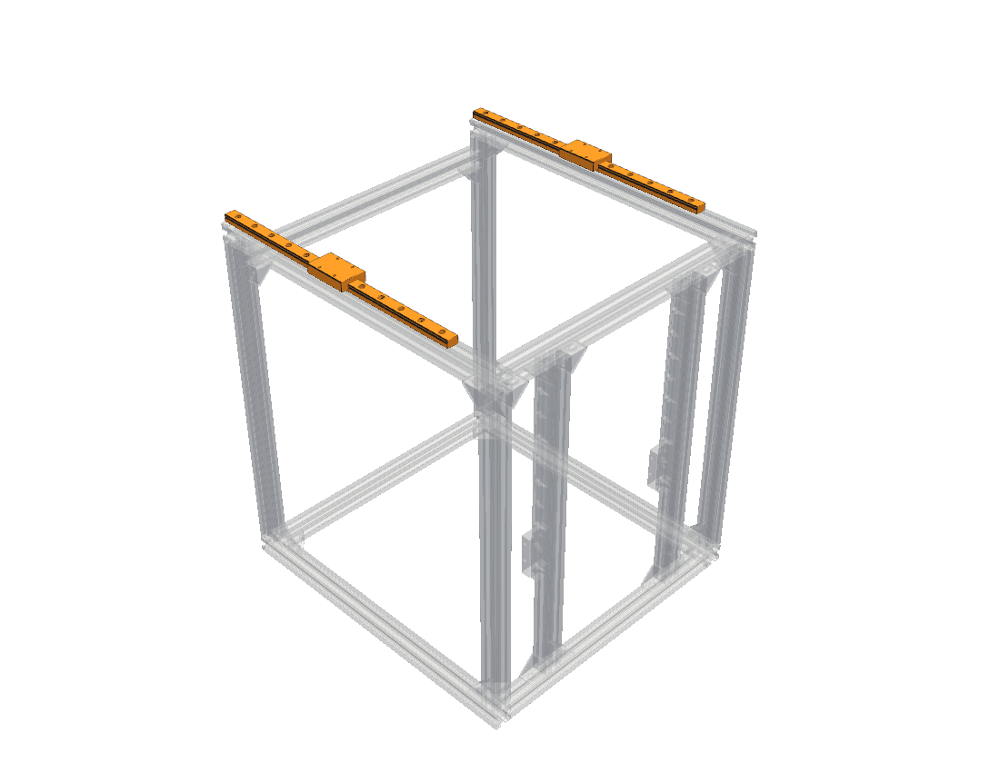

Orange: fitted in this stage. Grey: already there.

| # | Fit | Touches (simulation) | Screws that hold it (count x size, key, direction) | Check before moving on | Sim. step |
|---|---|---|---|---|---|
| 1 | **y_rail_right** (MGN12-R-300) | frame_top_right | 6 x M3x8 cap screw, 2.5 mm key, from above, pointing down (-Z), into T-nut (y_rail_right_screw_3, y_rail_right_screw_5, y_rail_right_screw_4, y_rail_right_screw_2, y_rail_right_screw_1, y_rail_right_screw_0) | rail lies flat in the slot's faces; leave its screws just nipped until the rail-alignment step for this axis | 8 |
| 2 | **y_rail_left** (MGN12-R-300) | frame_top_left | 6 x M3x8 cap screw, 2.5 mm key, from above, pointing down (-Z), into T-nut (y_rail_left_screw_3, y_rail_left_screw_5, y_rail_left_screw_4, y_rail_left_screw_2, y_rail_left_screw_1, y_rail_left_screw_0) | rail lies flat in the slot's faces; leave its screws just nipped until the rail-alignment step for this axis | 18 |
| 3 | **y_carriage_right** (MGN12H) | y_rail_right | - | the block is slid on without losing balls (keep it on its plastic keeper until the rail is under it); it runs the whole rail by hand with even drag | 31 |
| 4 | **y_carriage_left** (MGN12H) | y_rail_left | - | the block is slid on without losing balls (keep it on its plastic keeper until the rail is under it); it runs the whole rail by hand with even drag | 32 |

### Stage: Electronics tray, mains inlet, earth

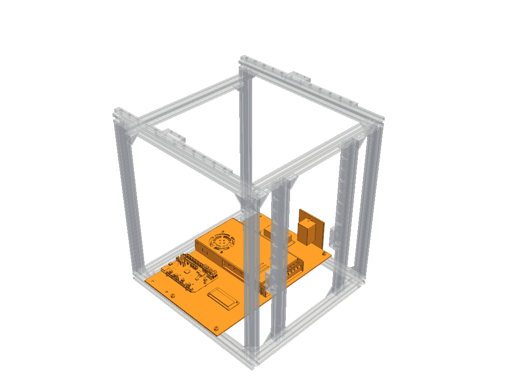

Orange: fitted in this stage. Grey: already there.

| # | Fit | Touches (simulation) | Screws that hold it (count x size, key, direction) | Check before moving on | Sim. step |
|---|---|---|---|---|---|
| 1 | bench unit **electronics** | frame_bot_left, z_bearing_fl_lo, z_bearing_fr_lo | 4 x M5x8 cap screw, 4 mm key, from above, pointing down (-Z), into T-nut (tray_bolt_3, tray_bolt_2, tray_bolt_1, tray_bolt_0) | the bench unit is complete (its own table above); it sits flat on what it bolts to before any screw is tightened | 26 |
| 2 | **inlet_panel** (custom) | electronics_tray, frame_bot_left | 2 x M5x8 cap screw, 4 mm key, from the left, pointing right (+X), into T-nut (inlet_panel_bolt_1, inlet_panel_bolt_0) | seated flat on electronics_tray, frame_bot_left with no gap; all its screws started before any is tightened | 116 |
| 3 | **inlet** (INLET-C14-SW-FUSE-T8A) | inlet_panel | - | seated flat on inlet_panel with no gap; all its screws started before any is tightened | 163 |
| 4 | **inlet_nut_1** (NUT-M3) | inlet_panel | 1 x M3x16 cap screw, 2.5 mm key, from the left, pointing right (+X) (inlet_screw_1) | seated flat on inlet_panel with no gap; all its screws started before any is tightened | 164 |
| 5 | **inlet_nut_0** (NUT-M3) | inlet_panel | 1 x M3x16 cap screw, 2.5 mm key, from the left, pointing right (+X) (inlet_screw_0) | seated flat on inlet_panel with no gap; all its screws started before any is tightened | 166 |

Also in this stage, into parts fitted earlier: 1 x M5x8 cap screw, 4 mm key, from the left, pointing right (+X), into T-nut (earth_stud).

### Stage: Z drive: mount, pedestals, bearings, screws, pulleys, belt

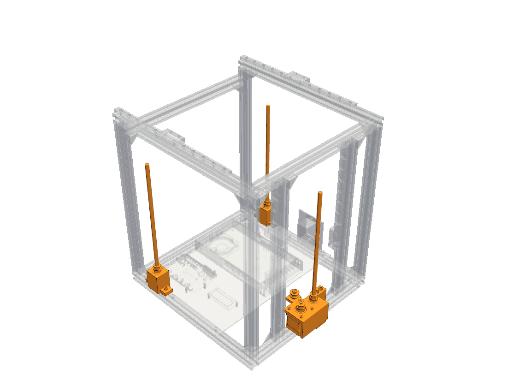

Orange: fitted in this stage. Grey: already there.

| # | Fit | Touches (simulation) | Screws that hold it (count x size, key, direction) | Check before moving on | Sim. step |
|---|---|---|---|---|---|
| 1 | **z_bearing_fl_lo** (BRG-608) | - | - | bearing pushed fully home in its seat by hand; turns freely | 11 |
| 2 | **z_pedestal_fl** (custom) | z_bearing_fl_lo | 2 x M5x16 cap screw, 4 mm key, from above, pointing down (-Z), into T-nut (z_pedestal_fl_bolt_1, z_pedestal_fl_bolt_0) | seated flat on z_bearing_fl_lo with no gap; all its screws started before any is tightened | 12 |
| 3 | **z_bearing_fl_hi** (BRG-608) | z_pedestal_fl | - | bearing pushed fully home in its seat by hand; turns freely | 13 |
| 4 | **z_pulley_fl** (GT2-20T-B8) | z_bearing_fl_hi | - | set screws tight on the shaft; on a lead screw the hub rests on the upper bearing's INNER ring and does not touch the outer ring | 14 |
| 5 | **leadscrew_fl** (T8x2-300) | z_bearing_fl_hi, z_bearing_fl_lo, z_nut_fl | - | turns freely in both bearings; no wobble at the top | 16 |
| 6 | **z_pedestal_fr** (custom) | - | 2 x M5x16 cap screw, 4 mm key, from above, pointing down (-Z), into T-nut (z_pedestal_fr_bolt_1, z_pedestal_fr_bolt_0) | seated flat on its seat with no gap; all its screws started before any is tightened | 20 |
| 7 | **z_bearing_fr_hi** (BRG-608) | z_pedestal_fr | - | bearing pushed fully home in its seat by hand; turns freely | 21 |
| 8 | **z_pulley_fr** (GT2-20T-B8) | z_bearing_fr_hi | - | set screws tight on the shaft; on a lead screw the hub rests on the upper bearing's INNER ring and does not touch the outer ring | 22 |
| 9 | **leadscrew_fr** (T8x2-300) | z_bearing_fr_hi, z_nut_fr, z_pulley_fr | - | turns freely in both bearings; no wobble at the top | 24 |
| 10 | **z_bearing_fr_lo** (BRG-608) | leadscrew_fr, z_pedestal_fr | - | bearing pushed fully home in its seat by hand; turns freely | 25 |
| 11 | bench unit **z_drive** | frame_bot_back | 2 x M5x16 cap screw, 4 mm key, from above, pointing down (-Z), into T-nut (z_drive_mount_bolt_1, z_drive_mount_bolt_0) | the bench unit is complete (its own table above); it sits flat on what it bolts to before any screw is tightened | 72 |
| 12 | **z_pulley** (GT2-20T-B8) | z_bearing_hi | - | set screws tight on the shaft; on a lead screw the hub rests on the upper bearing's INNER ring and does not touch the outer ring | 229 |
| 13 | **leadscrew** (T8x2-300) | z_bearing_hi, z_bearing_lo, z_nut | - | turns freely in both bearings; no wobble at the top | 230 |

Fit the closed Z belt now, before the bed carrier. Set its tension in the adjustment section. Each screw must turn freely by hand with the belt off before the belt goes on.

### Stage: Bed carrier onto its blocks and nuts

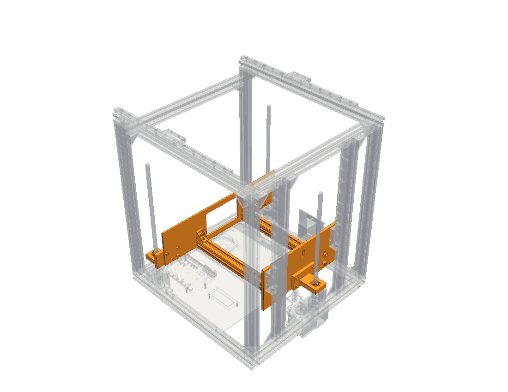

Orange: fitted in this stage. Grey: already there.

| # | Fit | Touches (simulation) | Screws that hold it (count x size, key, direction) | Check before moving on | Sim. step |
|---|---|---|---|---|---|
| 1 | bench unit **bed_carrier** | - | 8 x M3x8 cap screw, 2.5 mm key, from the front, pointing back (+Y) (z_carriage_right_hi_screw_3, z_carriage_right_hi_screw_2, z_carriage_right_hi_screw_1, z_carriage_right_hi_screw_0, z_carriage_left_hi_screw_3, z_carriage_left_hi_screw_2 ...) | the bench unit is complete (its own table above); it sits flat on what it bolts to before any screw is tightened | 10 |
| 2 | **z_nut_fl** (T8-NUT) | nut_block_fl | 1 x M3x16 cap screw, 2.5 mm key, from above, pointing down (-Z) (nut_pin_fl) | seated flat on nut_block_fl with no gap; all its screws started before any is tightened | 15 |
| 3 | **z_nut_fr** (T8-NUT) | nut_block_fr | 1 x M3x16 cap screw, 2.5 mm key, from above, pointing down (-Z) (nut_pin_fr) | seated flat on nut_block_fr with no gap; all its screws started before any is tightened | 23 |
| 4 | **z_nut** (T8-NUT) | nut_block | 1 x M3x16 cap screw, 2.5 mm key, from above, pointing down (-Z) (nut_pin) | seated flat on nut_block with no gap; all its screws started before any is tightened | 161 |

Wind each T8 nut onto its screw to the same height first (count turns from the pulley), lower the carrier so each printed block sits on its nut's flange, fit the pins, then screw the back plate to the two Z blocks. Check: turning the belt by hand raises all three corners together and the carrier does not bind anywhere in the travel.

### Stage: Bed: tabs, posts, plate, tie, heater, magnet, sheet

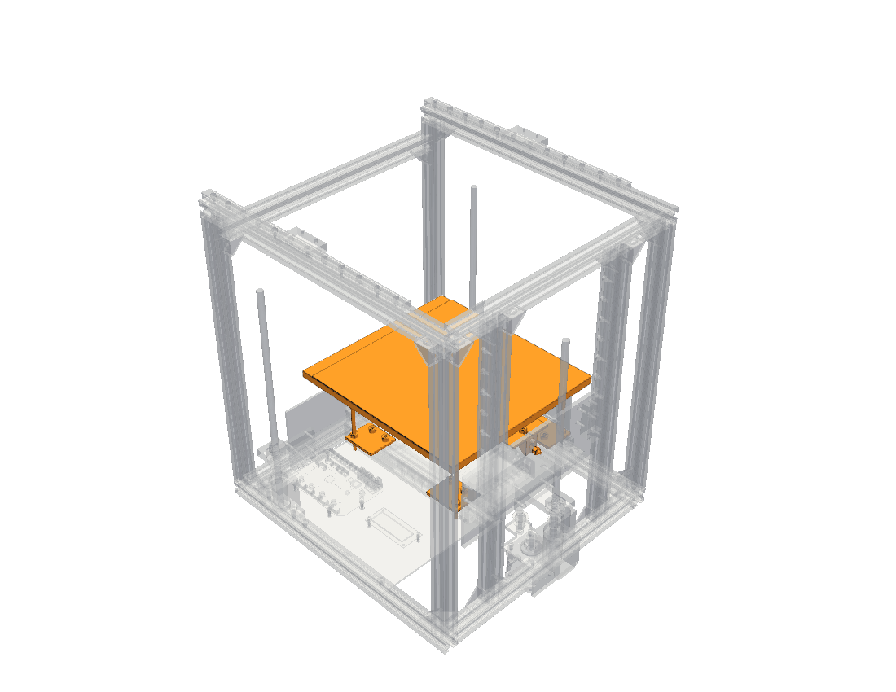

Orange: fitted in this stage. Grey: already there.

| # | Fit | Touches (simulation) | Screws that hold it (count x size, key, direction) | Check before moving on | Sim. step |
|---|---|---|---|---|---|
| 1 | **bed_post_tab_3** (custom) | bed_arm_right | 2 x M5x8 cap screw, 4 mm key, from above, pointing down (-Z), into T-nut (bed_post_tab_3_bolt_1, bed_post_tab_3_bolt_0) | seated flat on bed_arm_right with no gap; all its screws started before any is tightened | 37 |
| 2 | **bed_plate** (custom) | bed_post_tab_3 | - | seated flat on bed_post_tab_3 with no gap; all its screws started before any is tightened | 38 |
| 3 | **bed_post_3_nut_top** (NUT-M5) | bed_plate | - | seated flat on bed_plate with no gap; all its screws started before any is tightened | 39 |
| 4 | **bed_post_3_nut_low** (NUT-M5) | bed_post_tab_3 | - | seated flat on bed_post_tab_3 with no gap; all its screws started before any is tightened | 40 |
| 5 | **bed_post_3_nut_arm** (NUT-M5) | bed_post_tab_3 | 1 x M5x90 cap screw, 4 mm key, from above, pointing down (-Z) (bed_post_3) | seated flat on bed_post_tab_3 with no gap; all its screws started before any is tightened | 41 |
| 6 | **bed_post_tab_2** (custom) | bed_arm_left, bed_plate | 2 x M5x8 cap screw, 4 mm key, from above, pointing down (-Z), into T-nut (bed_post_tab_2_bolt_1, bed_post_tab_2_bolt_0) | seated flat on bed_arm_left, bed_plate with no gap; all its screws started before any is tightened | 43 |
| 7 | **bed_post_2_nut_top** (NUT-M5) | bed_plate | - | seated flat on bed_plate with no gap; all its screws started before any is tightened | 44 |
| 8 | **bed_post_2_nut_low** (NUT-M5) | bed_post_tab_2 | - | seated flat on bed_post_tab_2 with no gap; all its screws started before any is tightened | 45 |
| 9 | **bed_post_2_nut_arm** (NUT-M5) | bed_post_tab_2 | 1 x M5x90 cap screw, 4 mm key, from above, pointing down (-Z) (bed_post_2) | seated flat on bed_post_tab_2 with no gap; all its screws started before any is tightened | 46 |
| 10 | **bed_post_tab_1** (custom) | bed_arm_right, bed_plate | 2 x M5x8 cap screw, 4 mm key, from above, pointing down (-Z), into T-nut (bed_post_tab_1_bolt_1, bed_post_tab_1_bolt_0) | seated flat on bed_arm_right, bed_plate with no gap; all its screws started before any is tightened | 48 |
| 11 | **bed_post_1_nut_top** (NUT-M5) | bed_plate | - | seated flat on bed_plate with no gap; all its screws started before any is tightened | 49 |
| 12 | **bed_post_1_nut_low** (NUT-M5) | bed_post_tab_1 | - | seated flat on bed_post_tab_1 with no gap; all its screws started before any is tightened | 50 |
| 13 | **bed_post_1_nut_arm** (NUT-M5) | bed_post_tab_1 | 1 x M5x90 cap screw, 4 mm key, from above, pointing down (-Z) (bed_post_1) | seated flat on bed_post_tab_1 with no gap; all its screws started before any is tightened | 51 |
| 14 | **bed_post_tab_0** (custom) | bed_arm_left, bed_plate | 2 x M5x8 cap screw, 4 mm key, from above, pointing down (-Z), into T-nut (bed_post_tab_0_bolt_1, bed_post_tab_0_bolt_0) | seated flat on bed_arm_left, bed_plate with no gap; all its screws started before any is tightened | 53 |
| 15 | **bed_post_0_nut_top** (NUT-M5) | bed_plate | - | seated flat on bed_plate with no gap; all its screws started before any is tightened | 54 |
| 16 | **bed_post_0_nut_low** (NUT-M5) | bed_post_tab_0 | - | seated flat on bed_post_tab_0 with no gap; all its screws started before any is tightened | 55 |
| 17 | **bed_post_0_nut_arm** (NUT-M5) | bed_post_tab_0 | 1 x M5x90 cap screw, 4 mm key, from above, pointing down (-Z) (bed_post_0) | seated flat on bed_post_tab_0 with no gap; all its screws started before any is tightened | 56 |
| 18 | **bed_tie_bracket** (BRKT-2020) | back_plate | M5 x 8 cap screw and T-nut in each leg that lies on a T-slot, 4 mm key (BOM only: not drawn, access not checked) | both legs flat on their members; T-nuts turned across the slot before tightening | 81 |
| 19 | **bed_tie_bracket_nut** (NUT-M5) | back_plate | 1 x M5x16 cap screw, 4 mm key, from the front, pointing back (+Y) (bed_tie_bracket_screw) | seated flat on back_plate with no gap; all its screws started before any is tightened | 82 |
| 20 | **bed_tie** (custom) | bed_tie_bracket | - | seated flat on bed_tie_bracket with no gap; all its screws started before any is tightened | 84 |
| 21 | **bed_tie_bracket_nut_a** (NUT-M5) | bed_tie | 1 x M5x10 cap screw, 4 mm key, from below, pointing up (+Z) (bed_tie_bracket_screw_a) | seated flat on bed_tie with no gap; all its screws started before any is tightened | 85 |
| 22 | **bed_tie_spacer_1** (SPACER-AL-M3-6x3.2x8) | bed_plate, bed_tie | - | seated flat on bed_plate, bed_tie with no gap; all its screws started before any is tightened | 168 |
| 23 | **bed_tie_nut_1** (NUT-M3) | bed_tie | 1 x M3x16 cap screw, 2.5 mm key, from above, pointing down (-Z) (bed_tie_screw_1) | seated flat on bed_tie with no gap; all its screws started before any is tightened | 169 |
| 24 | **bed_tie_spacer_0** (SPACER-AL-M3-6x3.2x8) | bed_plate, bed_tie | - | seated flat on bed_plate, bed_tie with no gap; all its screws started before any is tightened | 171 |
| 25 | **bed_tie_nut_0** (NUT-M3) | bed_tie | 1 x M3x16 cap screw, 2.5 mm key, from above, pointing down (-Z) (bed_tie_screw_0) | seated flat on bed_tie with no gap; all its screws started before any is tightened | 172 |
| 26 | **bed_magnet** (BED-MAGNET-220-STANDIN) | bed_plate | - | seated flat on bed_plate with no gap; all its screws started before any is tightened | 233 |
| 27 | **bed_heater** (HEATER-SIL-200x130-24V-180W) | bed_plate | - | seated flat on bed_plate with no gap; all its screws started before any is tightened | 234 |
| 28 | **bed** (PRINT-SHEET-STEEL-220-STANDIN) | bed_magnet | - | seated flat on bed_magnet with no gap; all its screws started before any is tightened | 235 |
| 29 | **bed_tco** (TCO-133C-15A) | bed_plate | - | seated flat on bed_plate with no gap; all its screws started before any is tightened | 264 |

Order matters and differs from the simulation: posts and jam nuts into the bare plate, heater pad and thermal cut-off under it, plate onto the tabs, tie, tram (adjustment section), THEN the magnetic sheet and the print sheet.

### Stage: Gantry: Y plates, X beam, X rail, X drive

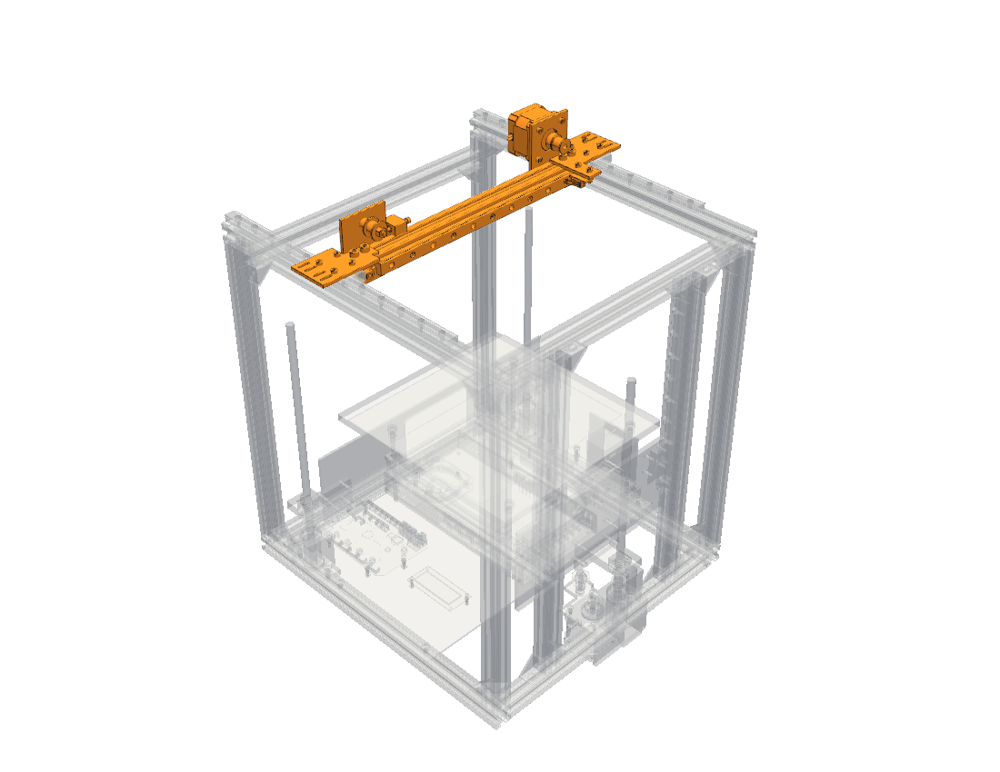

Orange: fitted in this stage. Grey: already there.

| # | Fit | Touches (simulation) | Screws that hold it (count x size, key, direction) | Check before moving on | Sim. step |
|---|---|---|---|---|---|
| 1 | **x_beam** (EXT2020-288) | - | - | ends flush and square to the neighbouring members (set square on two faces) | 30 |
| 2 | **y_plate_left** (custom) | x_beam, y_carriage_left | 4 x M3x6 cap screw, 2.5 mm key, from above, pointing down (-Z) (y_plate_left_screw_3, y_plate_left_screw_2, y_plate_left_screw_1, y_plate_left_screw_0) 2 x M5x8 cap screw, 4 mm key, from above, pointing down (-Z), into T-nut (beam_bolt_left, beam_bolt_left_1) | seated flat on x_beam, y_carriage_left with no gap; all its screws started before any is tightened | 33 |
| 3 | **y_plate_right** (custom) | x_beam, y_carriage_right | 4 x M3x6 cap screw, 2.5 mm key, from above, pointing down (-Z) (y_plate_right_screw_3, y_plate_right_screw_2, y_plate_right_screw_1, y_plate_right_screw_0) 2 x M5x8 cap screw, 4 mm key, from above, pointing down (-Z), into T-nut (beam_bolt_right, beam_bolt_right_1) | seated flat on x_beam, y_carriage_right with no gap; all its screws started before any is tightened | 34 |
| 4 | **x_tension_anchor** (custom) | x_beam | 1 x M5x16 cap screw, 4 mm key, from the front, pointing back (+Y), into T-nut (x_tension_anchor_bolt) | seated flat on x_beam with no gap; all its screws started before any is tightened | 79 |
| 5 | **x_rail_stop_right** (custom) | x_beam, y_plate_right | 1 x M5x8 cap screw, 4 mm key, from the back, pointing forward (-Y), into T-nut (x_rail_stop_right_bolt) | seated flat on x_beam, y_plate_right with no gap; all its screws started before any is tightened | 100 |
| 6 | **x_rail_stop_left** (custom) | x_beam, y_plate_left | 1 x M5x8 cap screw, 4 mm key, from the back, pointing forward (-Y), into T-nut (x_rail_stop_left_bolt) | seated flat on x_beam, y_plate_left with no gap; all its screws started before any is tightened | 102 |
| 7 | bench unit **x_drive** | x_beam | 2 x M5x8 cap screw, 4 mm key, from the front, pointing back (+Y), into T-nut (x_motor_mount_bolt_1, x_motor_mount_bolt_0) | the bench unit is complete (its own table above); it sits flat on what it bolts to before any screw is tightened | 105 |
| 8 | bench unit **x_idler_unit** | x_beam | 2 x M5x8 cap screw, 4 mm key, from the front, pointing back (+Y), into T-nut (x_idler_mount_bolt_1, x_idler_mount_bolt_0) | the bench unit is complete (its own table above); it sits flat on what it bolts to before any screw is tightened | 109 |
| 9 | **x_rail** (MGN12-R-250) | x_beam, x_rail_stop_left, x_rail_stop_right | 5 x M3x8 cap screw, 2.5 mm key, from the back, pointing forward (-Y), into T-nut (x_rail_screw_2, x_rail_screw_3, x_rail_screw_0, x_rail_screw_4, x_rail_screw_1) | rail lies flat in the slot's faces; leave its screws just nipped until the rail-alignment step for this axis | 130 |
| 10 | **x_tension_nut** (NUT-M3) | x_tension_anchor | 1 x M3x25 cap screw, 2.5 mm key, from the left, pointing right (+X) (x_tension_screw) | seated flat on x_tension_anchor with no gap; all its screws started before any is tightened | 152 |
| 11 | **x_endstop_spacer_1** (SPACER-NYLON-M3-5x3.3x4) | y_plate_left | - | seated flat on y_plate_left with no gap; all its screws started before any is tightened | 183 |
| 12 | **x_endstop** (ENDSTOP-MICRO) | x_endstop_spacer_1 | - | lever moves freely; leave the screws nipped: the switch is set in the adjustment section | 184 |
| 13 | **x_endstop_nut_1** (NUT-M3) | x_endstop | 1 x M3x12 cap screw, 2.5 mm key, from above, pointing down (-Z) (x_endstop_screw_1) | seated flat on x_endstop with no gap; all its screws started before any is tightened | 185 |
| 14 | **x_endstop_nut_0** (NUT-M3) | x_endstop | - | seated flat on x_endstop with no gap; all its screws started before any is tightened | 187 |
| 15 | **x_endstop_spacer_0** (SPACER-NYLON-M3-5x3.3x4) | x_endstop, y_plate_left | 1 x M3x12 cap screw, 2.5 mm key, from above, pointing down (-Z) (x_endstop_screw_0) | seated flat on x_endstop, y_plate_left with no gap; all its screws started before any is tightened | 188 |

Leave the beam bolts in the Y plates' slots nipped until both Y rails are aligned: the slots let the gantry take up the frame's width error.

### Stage: Y drives, idlers, tensioners, Y endstop

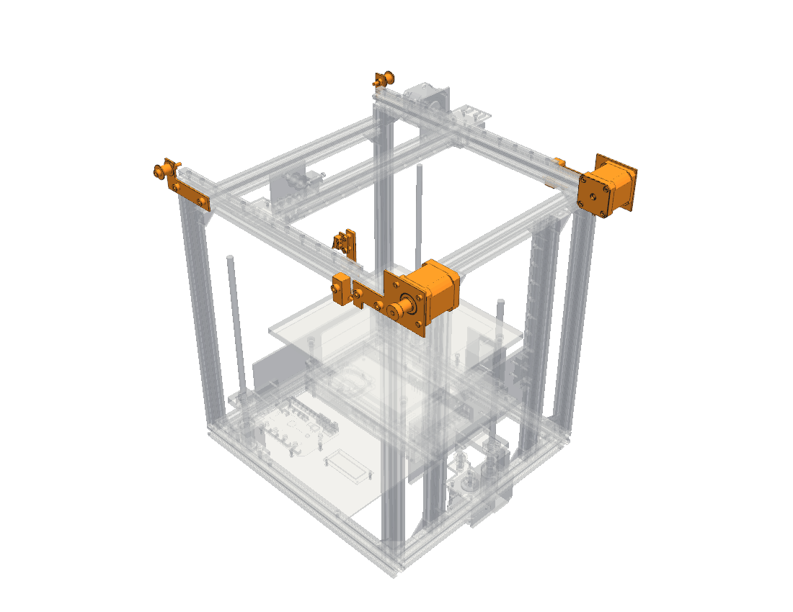

Orange: fitted in this stage. Grey: already there.

| # | Fit | Touches (simulation) | Screws that hold it (count x size, key, direction) | Check before moving on | Sim. step |
|---|---|---|---|---|---|
| 1 | **y_idler_mount_l** (custom) | frame_top_left | 2 x M5x8 cap screw, 4 mm key, from the left, pointing right (+X), into T-nut (y_idler_mount_l_bolt_1, y_idler_mount_l_bolt_0) | seated flat on frame_top_left with no gap; all its screws started before any is tightened | 58 |
| 2 | **y_idler_spacer_l** (SPACER-AL-M5-10x5.1x1) | y_idler_mount_l | - | seated flat on y_idler_mount_l with no gap; all its screws started before any is tightened | 59 |
| 3 | **y_idler_l** (GT2-IDLER-20T-B5) | y_idler_spacer_l | - | seated flat on y_idler_spacer_l with no gap; all its screws started before any is tightened | 60 |
| 4 | **y_idler_l_nut** (NUT-M5) | y_idler_mount_l | 1 x M5x30 cap screw, 4 mm key, from the left, pointing right (+X) (y_idler_l_bolt) | seated flat on y_idler_mount_l with no gap; all its screws started before any is tightened | 61 |
| 5 | **y_idler_mount** (custom) | frame_top_right, post_rf | 2 x M5x8 cap screw, 4 mm key, from the right, pointing left (-X), into T-nut (y_idler_mount_bolt_1, y_idler_mount_bolt_0) | seated flat on frame_top_right, post_rf with no gap; all its screws started before any is tightened | 63 |
| 6 | **y_idler_spacer** (SPACER-AL-M5-10x5.1x1) | y_idler_mount | - | seated flat on y_idler_mount with no gap; all its screws started before any is tightened | 64 |
| 7 | **y_idler** (GT2-IDLER-20T-B5) | y_idler_spacer | - | seated flat on y_idler_spacer with no gap; all its screws started before any is tightened | 65 |
| 8 | **y_idler_nut** (NUT-M5) | y_idler_mount | 1 x M5x30 cap screw, 4 mm key, from the right, pointing left (-X) (y_idler_bolt) | seated flat on y_idler_mount with no gap; all its screws started before any is tightened | 66 |
| 9 | **y_tension_anchor_l** (custom) | frame_top_left | 1 x M5x16 cap screw, 4 mm key, from the left, pointing right (+X), into T-nut (y_tension_anchor_l_bolt) | seated flat on frame_top_left with no gap; all its screws started before any is tightened | 75 |
| 10 | **y_tension_anchor** (custom) | frame_top_right | 1 x M5x16 cap screw, 4 mm key, from the right, pointing left (-X), into T-nut (y_tension_anchor_bolt) | seated flat on frame_top_right with no gap; all its screws started before any is tightened | 77 |
| 11 | bench unit **y_drive_l** | frame_top_left | 2 x M5x8 cap screw, 4 mm key, from the left, pointing right (+X), into T-nut (y_motor_mount_l_bolt_1, y_motor_mount_l_bolt_0) | the bench unit is complete (its own table above); it sits flat on what it bolts to before any screw is tightened | 87 |
| 12 | bench unit **y_drive** | frame_top_right | 2 x M5x8 cap screw, 4 mm key, from the right, pointing left (-X), into T-nut (y_motor_mount_bolt_1, y_motor_mount_bolt_0) | the bench unit is complete (its own table above); it sits flat on what it bolts to before any screw is tightened | 90 |
| 13 | **y_endstop_mount** (custom) | frame_top_right | 2 x M5x8 cap screw, 4 mm key, from the left, pointing right (+X), into T-nut (y_endstop_mount_bolt_1, y_endstop_mount_bolt_0) | seated flat on frame_top_right with no gap; all its screws started before any is tightened | 97 |
| 14 | **y_tension_nut_l** (NUT-M3) | y_tension_anchor_l | 1 x M3x25 cap screw, 2.5 mm key, from the front, pointing back (+Y) (y_tension_screw_l) | seated flat on y_tension_anchor_l with no gap; all its screws started before any is tightened | 148 |
| 15 | **y_tension_nut** (NUT-M3) | y_tension_anchor | 1 x M3x25 cap screw, 2.5 mm key, from the front, pointing back (+Y) (y_tension_screw) | seated flat on y_tension_anchor with no gap; all its screws started before any is tightened | 150 |
| 16 | **y_endstop_spacer_1** (SPACER-NYLON-M3-5x3.3x4) | y_endstop_mount | - | seated flat on y_endstop_mount with no gap; all its screws started before any is tightened | 175 |
| 17 | **y_endstop** (ENDSTOP-MICRO) | y_endstop_spacer_1 | - | lever moves freely; leave the screws nipped: the switch is set in the adjustment section | 176 |
| 18 | **y_endstop_nut_1** (NUT-M3) | y_endstop | 1 x M3x12 cap screw, 2.5 mm key, from the left, pointing right (+X) (y_endstop_screw_1) | seated flat on y_endstop with no gap; all its screws started before any is tightened | 177 |
| 19 | **y_endstop_nut_0** (NUT-M3) | y_endstop | - | seated flat on y_endstop with no gap; all its screws started before any is tightened | 179 |
| 20 | **y_endstop_spacer_0** (SPACER-NYLON-M3-5x3.3x4) | y_endstop, y_endstop_mount | 1 x M3x12 cap screw, 2.5 mm key, from the left, pointing right (+X) (y_endstop_screw_0) | seated flat on y_endstop, y_endstop_mount with no gap; all its screws started before any is tightened | 180 |

### Stage: Toolhead: plate, extruder, hotend, probe, part cooling

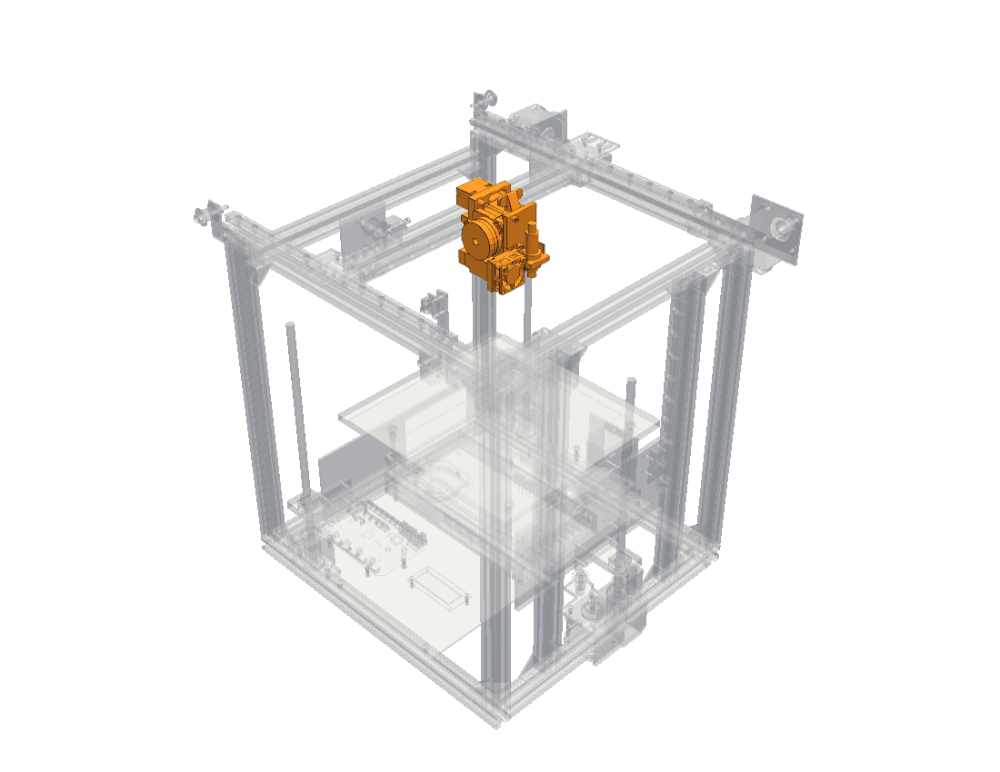

Orange: fitted in this stage. Grey: already there.

| # | Fit | Touches (simulation) | Screws that hold it (count x size, key, direction) | Check before moving on | Sim. step |
|---|---|---|---|---|---|
| 1 | **x_carriage** (MGN12H) | x_rail | - | the block is slid on without losing balls (keep it on its plastic keeper until the rail is under it); it runs the whole rail by hand with even drag | 132 |
| 2 | **tool_plate** (custom) | x_carriage | 4 x M3x6 cap screw, 2.5 mm key, from the back, pointing forward (-Y) (tool_screw_3, tool_screw_2, tool_screw_1, tool_screw_0) | seated flat on x_carriage with no gap; all its screws started before any is tightened | 133 |
| 3 | **x_belt_block** (custom) | tool_plate | - | seated flat on tool_plate with no gap; all its screws started before any is tightened | 134 |
| 4 | **x_belt_block_nut_1** (NUT-M3) | x_belt_block | 1 x M3x16 cap screw, 2.5 mm key, from the back, pointing forward (-Y) (x_belt_block_screw_1) | seated flat on x_belt_block with no gap; all its screws started before any is tightened | 135 |
| 5 | **x_belt_block_nut_0** (NUT-M3) | x_belt_block | 1 x M3x16 cap screw, 2.5 mm key, from the back, pointing forward (-Y) (x_belt_block_screw_0) | seated flat on x_belt_block with no gap; all its screws started before any is tightened | 137 |
| 6 | **extruder** (EXTRUDER-E3D-ROTO) | tool_plate | - | seated flat on tool_plate with no gap; all its screws started before any is tightened | 144 |
| 7 | **probe_mount** (custom) | extruder | 2 x M3x50 cap screw, 2.5 mm key, from the back, pointing forward (-Y) (extruder_screw_1, extruder_screw_0) | seated flat on extruder with no gap; all its screws started before any is tightened | 145 |
| 8 | bench unit **part_cooling** | tool_plate | - | the bench unit is complete (its own table above); it sits flat on what it bolts to before any screw is tightened | 154 |
| 9 | **part_duct_nut_1** (NUT-M3) | part_duct | 1 x M3x16 cap screw, 2.5 mm key, from the front, pointing back (+Y) (part_duct_screw_1) | seated flat on part_duct with no gap; all its screws started before any is tightened | 155 |
| 10 | **part_duct_nut_0** (NUT-M3) | part_duct | 1 x M3x16 cap screw, 2.5 mm key, from the front, pointing back (+Y) (part_duct_screw_0) | seated flat on part_duct with no gap; all its screws started before any is tightened | 157 |
| 11 | **bed_probe_nut_rear** (NUT-OMRON-E2E-M12-W) | probe_mount | - | seated flat on probe_mount with no gap; all its screws started before any is tightened | 236 |
| 12 | **bed_probe** (PROBE-OMRON-E2E-X5ME1) | bed_probe_nut_rear, probe_mount | - | leave its nuts finger-tight: the height is set in the adjustment section | 237 |
| 13 | **hotend** (HOTEND-REVO-24V-40W) | extruder | - | seated flat on extruder with no gap; all its screws started before any is tightened | 238 |
| 14 | **bed_probe_nut_front** (NUT-OMRON-E2E-M12) | bed_probe, probe_mount | - | seated flat on bed_probe, probe_mount with no gap; all its screws started before any is tightened | 263 |

## Alignment and adjustment

Every `Adjustment` the design declares, with what the tolerance simulation says it must absorb (99th percentile of the simulated builds) against what the design provides.

### z_offset: probe z_offset in the firmware

- Needed 0.99 mm (99 %); provided 1.65 mm of Z over-travel past the nominal nozzle plane.
- **Probe height (on its two nuts):** sensing face 2.0 mm above the nozzle tip as drawn. It must stay inside the face window **[0.684, 3.316] mm** above the tip (lower: the face could meet the bed before the nozzle, margin 0.684 mm; upper: the weakest sensor would not switch in time). Set it with a 2.0 mm gauge block (or stacked feeler gauges) under the face while the cold nozzle rests on the bare print sheet; tighten both nuts; re-measure.
- Then `PROBE_CALIBRATE`: predicted z_offset 3.0 mm, anywhere in [2.0, 4.0] mm over sensor spread and temperature ([2.5, 3.5] mm over unit spread alone). These figures assume the sensor reads the thin spring-steel sheet like OMRON's iron target: UNVERIFIED, see COMMISSIONING.md step B1.
- Check: PROBE_ACCURACY passes the configured `samples_tolerance`; the nozzle touches paper at Z = 0 with the bed at working temperature.

### bed_level: the two nuts at the tab of each of the four bed posts (set once at assembly)

- Needed 0.79 mm (99 %); provided +/-4 mm of thread at each post. As built, before tramming, the bed is up to 1.59 mm out of level (99 %).
- How: at each of the four posts the plate's height is set by the nut above the tab and locked by the nut below it. Home X and Y, bring the nozzle over each post position in turn, and set each corner to the same feeler-gauge gap under the cold nozzle (or zero a dial indicator clamped to the toolhead). Go round twice. Lock each lower nut while holding the upper one with a second spanner.
- Check: all four corners within 0.1 mm of each other (half a 0.2 mm layer, the report's own criterion) after locking; re-check after the first heat cycle to working temperature. The posts' jam nuts under the plate must be tight before the magnetic sheet goes on.

### endstop (x): x switch: its screws run in slots in the Y plate's land

- Switch x_endstop, struck by x_carriage, at the min end. Working end of travel -90.0 mm, mechanical end -91.5 mm (joint coordinates).
- Needed: 0.66 mm (99 %); provided: +/-2 mm. As drawn, without setting, 46% of builds miss the window ([-0.1, 0.23] mm wide around the drawn position).
- How: with the switch's screws nipped, move the axis by hand to its mechanical end (against whatever stops it). Slide the switch towards the striker until it has clicked and the lever is still clear of the switch body, then back it off so the click happens between 0 and 3.0 mm before the end. Tighten.
- Check: the click is heard before the end of travel from a slow hand approach, three times; at the mechanical end the lever is not crushed on the case (the maker guarantees only 0.55 mm of lever travel past the click; case contact is 0.25 mm past the latest operating position). The axis must be stopped by the signal, never by the switch.

### endstop (y): y switch: its mount slides along the rail on two T-nuts

- Switch y_endstop, struck by y_plate_right, at the max end. Working end of travel 90.0 mm, mechanical end 91.5 mm (joint coordinates).
- Needed: 1.59 mm (99 %); provided: +/-5 mm. As drawn, without setting, 76% of builds miss the window ([-0.1, 0.23] mm wide around the drawn position).
- How: with the switch's screws nipped, move the axis by hand to its mechanical end (against whatever stops it). Slide the switch towards the striker until it has clicked and the lever is still clear of the switch body, then back it off so the click happens between 0 and 3.0 mm before the end. Tighten.
- Check: the click is heard before the end of travel from a slow hand approach, three times; at the mechanical end the lever is not crushed on the case (the maker guarantees only 0.55 mm of lever travel past the click; case contact is 0.25 mm past the latest operating position). The axis must be stopped by the signal, never by the switch.

### belt_tension (z): z belt: tensioner idler bolt in a slot

- z_belt (6 mm): **9.3 N per span** is what the motor shaft-load check used (Gates' minimum installation tension for the width; Gates' 'general' figure is 44.5 N). Tensioner travel +/-3 mm.
  - Measure by plucking a free span at the home position and reading the pitch (phone tuner app): 320.0 mm span: about 61 Hz; 286.2 mm span: about 68 Hz; 323.4 mm span: about 60 Hz. From f = sqrt(T / mu) / 2L with mu = 6.1 g/m, a figure the catalogue DERIVES from Gates' constants (not printed by Gates): treat +/-10 %.
  - Spans at home: [320.0, 286.2, 31.0, 37.0, 323.4] mm.
- Check: after 20 full strokes the pitch has not dropped; all three screws turn together when the motor pulley is turned by hand.

### rail_align (y): y rails on sliding T-nuts

- Rails: y_rail_left, y_rail_right. As built, before alignment: out of parallel by up to 1.453 mm over the travel (99 %). Allowed by the maker: 0.009 mm (Hiwin MG catalogue Table 3.88 (p.104): MG_12, preload Z0). Share of builds inside that without alignment: 0.0. Adjustment provided: +/-1.5 mm (T-nuts sliding across the slot). **The machine depends on this step.**
- How: tighten the first rail against a straight edge (Y) or a square off the bottom rail (Z). Leave the second rail's screws nipped. Fit what joins the two blocks (the gantry beam; the bed carrier's back plate), run it to one end, tighten the second rail's screws nearest the block, run to the other end, tighten there, then the screws between, moving the block to each screw.
- Check: by hand the axis moves over its whole travel with the same light drag everywhere and no tight end. The maker's 0.009 mm cannot be measured with shop tools; drag is the test. The simulation's un-aligned case would add 108.9 N of drag.

### rail_align (z): z rails on sliding T-nuts

Design note: left rail to a square, right rail tightened while the bed carrier is run up and down on all four blocks.

- Rails: z_rail_left, z_rail_right. As built, before alignment: out of parallel by up to 0.964 mm over the travel (99 %). Allowed by the maker: 0.009 mm (Hiwin MG catalogue Table 3.88 (p.104): MG_12, preload Z0). Share of builds inside that without alignment: 0.0. Adjustment provided: +/-1.5 mm (T-nuts sliding across the slot). **The machine depends on this step.**
- How: tighten the first rail against a straight edge (Y) or a square off the bottom rail (Z). Leave the second rail's screws nipped. Fit what joins the two blocks (the gantry beam; the bed carrier's back plate), run it to one end, tighten the second rail's screws nearest the block, run to the other end, tighten there, then the screws between, moving the block to each screw.
- Check: by hand the axis moves over its whole travel with the same light drag everywhere and no tight end. The maker's 0.009 mm cannot be measured with shop tools; drag is the test. The simulation's un-aligned case would add 72.3 N of drag.

### float (z): floating lead screw nut

- Each lead-screw nut hangs under its printed block with +/-2.2 mm of radial room; a pin in a slot stops it turning. Needed: up to 1.9 mm (99 %, worst screw: leadscrew 1.5, leadscrew_fl 1.86, leadscrew_fr 1.9). Margin 0.3 mm.
- How: nothing to set, but it must be true: the nyloc nut under each pin is left 0.2 mm slack; the nut's flange is not clamped.
- Check: with the bed at the bottom, the middle and the top of its travel, each nut can still be pushed sideways a little in its pocket in every direction. A nut hard against one side of its pocket at either end of the travel has used all its float: re-seat that screw's pedestal or mount.

### belt_tension (x): x belt: idler plate slides on its T-nuts, M3 jack screw

- x_belt (9 mm): **14.2 N per span** is what the motor shaft-load check used (Gates' minimum installation tension for the width; Gates' 'general' figure is 75.6 N). Tensioner travel +/-3 mm.
  - Measure by plucking a free span at the home position and reading the pitch (phone tuner app): 104.0 mm span: about 189 Hz; 236.0 mm span: about 83 Hz; 104.0 mm span: about 189 Hz. From f = sqrt(T / mu) / 2L with mu = 9.2 g/m, a figure the catalogue DERIVES from Gates' constants (not printed by Gates): treat +/-10 %.
  - Spans at home: [104.0, 236.0, 104.0] mm.
- Check: after 20 full strokes the pitch has not dropped.

### belt_tension (y): y belts: motor mounts slide on their T-nuts, M3 jack screws

- y_belt (12 mm): **18.7 N per span** is what the motor shaft-load check used (Gates' minimum installation tension for the width; Gates' 'general' figure is 106.8 N). Tensioner travel +/-3 mm.
  - Measure by plucking a free span at the home position and reading the pitch (phone tuner app): 140.8 mm span: about 140 Hz; 389.2 mm span: about 51 Hz; 215.4 mm span: about 91 Hz. From f = sqrt(T / mu) / 2L with mu = 12.1 g/m, a figure the catalogue DERIVES from Gates' constants (not printed by Gates): treat +/-10 %.
  - Spans at home: [140.8, 389.2, 215.4] mm.
- y_belt_l (12 mm): **18.7 N per span** is what the motor shaft-load check used (Gates' minimum installation tension for the width; Gates' 'general' figure is 106.8 N). Tensioner travel +/-3 mm.
  - Measure by plucking a free span at the home position and reading the pitch (phone tuner app): 140.8 mm span: about 140 Hz; 389.2 mm span: about 51 Hz; 215.4 mm span: about 91 Hz. From f = sqrt(T / mu) / 2L with mu = 12.1 g/m, a figure the catalogue DERIVES from Gates' constants (not printed by Gates): treat +/-10 %.
  - Spans at home: [140.8, 389.2, 215.4] mm.
- Check: both Y belts read the same pitch on the same span (the gantry must not rack); after 20 full strokes the pitch has not dropped.
