# Fabrication drawings: printer_v8

Generated by `tools/build_package.py` from `designs/printer_v8.py` (md5 `9f4017d87957e199a7069390d97496bc`) and `out/printer_v8/report.json` (written 2026-11-15 18:53:15, md5 `1d5bf219132d`). Do not edit: change the design, re-run verify, re-run the generator.

> **Simulated design. Nothing has been built.** See [OPEN_ITEMS.md](OPEN_ITEMS.md) before spending money.

35 custom parts: 2 machined, 13 printed, 20 sheet. One sheet per part in `drawings/` (SVG and PDF; all sheets in `drawings/printer_v8_drawings.pdf`), a STEP file per part in `cad/` **in the drawing's own coordinates** (the hole table's X, Y, Z are the STEP's X, Y, Z), a DXF of the flat profile per sheet part in `dxf/` (same origin), an STL per printed part in `stl/` already turned to its print orientation.

## What is automatic and what a person must add

Automatic, from the design's geometry and fasteners: three orthographic views and an isometric, overall dimensions, the datum scheme, a table of every round hole and round-ended slot (position, size, depth, counterbore, what it is for, which pattern it belongs to), the tolerance block, the critical-feature list, the files.

**Not automatic. A person must add or check before release:**

- Dimensions of everything that is not a round hole or a slot: outline steps, cut-outs, windows, pockets, nut slots, inside radii. They are in the STEP / DXF only; the sheet says so.
- The datum scheme is geometric (bounding edges of the plan view). On L-shaped or notched parts choose functional datums and re-reference the table.
- Surface finish, edge condition beyond the general deburr note, plating or paint (none is in the model: every steel part is bare).
- Hole labels are placed by rule and can sit on top of each other on dense patterns; the table is authoritative.
- Thread class, tap depth beyond 'through', and any geometric tolerance frames (the block gives plus/minus values, not GD&T).
- A drawing check by someone who has made parts: these sheets have not been reviewed by a person.

## Tolerances: where the numbers come from

`mechloop/tolerance/process.py` holds, per process, the standard deviations the tolerance verifier built its 3000 simulated machines with. The sheets hold the fabricator to +/-2 standard deviations of the same figures, so a batch of parts inside the drawing tolerance is the population that was simulated. A part AT the limit everywhere is worse than what was simulated: the limits are not a licence to sit on them.

| Process | Position to datums | Within one pattern | Size | Hole diameter as made | Mating-face flatness | Model sd (pos / pattern / hole) |
|---|---|---|---|---|---|---|
| machined | +/-0.08 | +/-0.04 | +/-0.04 % | drawn +0.00 +/-0.04 | 0.04 | 0.04 / 0.02 / 0.02 |
| sheet | +/-0.16 | +/-0.08 | +/-0.10 % | drawn +0.00 +/-0.08 | 0.20 | 0.08 / 0.04 / 0.04 |
| extrusion | +/-0.30 | +/-0.20 | +/-0.20 % | drawn +0.00 +/-0.06 | 0.10 | 0.15 / 0.1 / 0.03 |
| printed | +/-0.24 | +/-0.10 | +/-0.30 % | drawn -0.15 +/-0.14 | 0.20 | 0.12 / 0.05 / 0.07 |

The model's own comment calls these 'typical shop figures, deliberately a little pessimistic' and recalled class values: confirm them with the shop that quotes.

## Printing

- Printer assumed by the manufacture verifier: build volume (220.0, 220.0, 220.0), nozzle 0.4 mm, layer 0.2 (the verifier default: the design does not declare one) mm.
- Orientation: pinned per part in the design (`print_up`), listed below; the STL is already turned so the bed face is on Z = 0.
- Walls and infill: **not declared by the design.** The verifier's mass and time estimate used: estimate: 1.2 mm walls, 20% infill, 5 mm3/s, no support material counted.
- **The FEA load cases treat every printed part as solid, isotropic material.** A part printed at 20 % infill is not the part that was analysed. For the parts with a load case (nut_block, nut_block_fr, x_belt_block, z_drive_mount, z_pedestal_fr), print solid or accept that the factor of safety is unverified.
- No threads in plastic, no heat-set inserts: every screw in a printed part runs into a steel nut (captive pockets and slots are in the models).
- Printed holes are drawn oversize (M3 4.2, M5 6.0) for an assumed 0.15 mm shrink; bearing seats are drawn 22.4 for a 22 mm bearing on the same assumption.

## Parts

| Part | Process | Material | X x Y x Z mm | Mass kg | Holes / slots | Critical features | Same or mirror-image geometry | Files |
|---|---|---|---|---|---|---|---|---|
| back_plate | sheet | aluminium 6061 | 214 x 96.9 x 5 | 0.268 | 14 / 3 | 8 | - | [svg](drawings/back_plate.svg) [pdf](drawings/back_plate.pdf) [dxf](dxf/back_plate.dxf) [step](cad/back_plate.step) |
| front_plate | sheet | steel sheet (grade NOT specified in the model) | 314 x 81.4 x 3 | 0.473 | 10 / 2 | 0 | - | [svg](drawings/front_plate.svg) [pdf](drawings/front_plate.pdf) [dxf](dxf/front_plate.dxf) [step](cad/front_plate.step) |
| nut_block | printed | ABS | 60 x 48 x 34 | 0.023 | 4 / 0 | 0 | - | [svg](drawings/nut_block.svg) [pdf](drawings/nut_block.pdf) [step](cad/nut_block.step) [stl](stl/nut_block.stl) |
| nut_block_fl | printed | ABS | 57 x 35 x 34 | 0.018 | 4 / 0 | 0 | nut_block_fr | [svg](drawings/nut_block_fl.svg) [pdf](drawings/nut_block_fl.pdf) [step](cad/nut_block_fl.step) [stl](stl/nut_block_fl.stl) |
| nut_block_fr | printed | ABS | 57 x 35 x 34 | 0.018 | 4 / 0 | 0 | nut_block_fl | [svg](drawings/nut_block_fr.svg) [pdf](drawings/nut_block_fr.pdf) [step](cad/nut_block_fr.step) [stl](stl/nut_block_fr.stl) |
| bed_plate | machined | cast aluminium tooling plate (MIC-6 class), faces as supplied | 236.5 x 220 x 8 | 2.165* | 6 / 0 | 0 | - | [svg](drawings/bed_plate.svg) [pdf](drawings/bed_plate.pdf) [step](cad/bed_plate.step) |
| bed_post_tab_0 | sheet | steel sheet (grade NOT specified in the model) | 43.5 x 38 x 3 | 0.037 | 3 / 0 | 0 | bed_post_tab_1, bed_post_tab_2, bed_post_tab_3 | [svg](drawings/bed_post_tab_0.svg) [pdf](drawings/bed_post_tab_0.pdf) [dxf](dxf/bed_post_tab_0.dxf) [step](cad/bed_post_tab_0.step) |
| bed_post_tab_1 | sheet | steel sheet (grade NOT specified in the model) | 43.5 x 38 x 3 | 0.037 | 3 / 0 | 0 | bed_post_tab_0, bed_post_tab_2, bed_post_tab_3 | [svg](drawings/bed_post_tab_1.svg) [pdf](drawings/bed_post_tab_1.pdf) [dxf](dxf/bed_post_tab_1.dxf) [step](cad/bed_post_tab_1.step) |
| bed_post_tab_2 | sheet | steel sheet (grade NOT specified in the model) | 43.5 x 38 x 3 | 0.037 | 3 / 0 | 0 | bed_post_tab_0, bed_post_tab_1, bed_post_tab_3 | [svg](drawings/bed_post_tab_2.svg) [pdf](drawings/bed_post_tab_2.pdf) [dxf](dxf/bed_post_tab_2.dxf) [step](cad/bed_post_tab_2.step) |
| bed_post_tab_3 | sheet | steel sheet (grade NOT specified in the model) | 43.5 x 38 x 3 | 0.037 | 3 / 0 | 0 | bed_post_tab_0, bed_post_tab_1, bed_post_tab_2 | [svg](drawings/bed_post_tab_3.svg) [pdf](drawings/bed_post_tab_3.pdf) [dxf](dxf/bed_post_tab_3.dxf) [step](cad/bed_post_tab_3.step) |
| bed_tie | sheet | steel sheet (grade NOT specified in the model) | 54 x 46.5 x 1.5 | 0.028 | 2 / 0 | 0 | - | [svg](drawings/bed_tie.svg) [pdf](drawings/bed_tie.pdf) [dxf](dxf/bed_tie.dxf) [step](cad/bed_tie.step) |
| z_drive_mount | printed | PETG | 101 x 69 x 53 | 0.090 | 8 / 1 | 6 | - | [svg](drawings/z_drive_mount.svg) [pdf](drawings/z_drive_mount.pdf) [step](cad/z_drive_mount.step) [stl](stl/z_drive_mount.stl) |
| z_sleeve | printed | PETG | 22 x 22 x 32.75 | 0.008 | 1 / 0 | 0 | - | [svg](drawings/z_sleeve.svg) [pdf](drawings/z_sleeve.pdf) [step](cad/z_sleeve.step) [stl](stl/z_sleeve.stl) |
| z_pedestal_fl | printed | PETG | 64 x 32 x 43.75 | 0.046 | 3 / 0 | 1 | z_pedestal_fr | [svg](drawings/z_pedestal_fl.svg) [pdf](drawings/z_pedestal_fl.pdf) [step](cad/z_pedestal_fl.step) [stl](stl/z_pedestal_fl.stl) |
| z_pedestal_fr | printed | PETG | 64 x 32 x 43.75 | 0.046 | 3 / 0 | 1 | z_pedestal_fl | [svg](drawings/z_pedestal_fr.svg) [pdf](drawings/z_pedestal_fr.pdf) [step](cad/z_pedestal_fr.step) [stl](stl/z_pedestal_fr.stl) |
| y_plate_left | sheet | steel sheet (grade NOT specified in the model) | 73.5 x 68 x 3 | 0.067 | 4 / 8 | 6 | - | [svg](drawings/y_plate_left.svg) [pdf](drawings/y_plate_left.pdf) [dxf](dxf/y_plate_left.dxf) [step](cad/y_plate_left.step) |
| y_plate_right | sheet | steel sheet (grade NOT specified in the model) | 70.5 x 43.5 x 3 | 0.055 | 4 / 6 | 4 | - | [svg](drawings/y_plate_right.svg) [pdf](drawings/y_plate_right.pdf) [dxf](dxf/y_plate_right.dxf) [step](cad/y_plate_right.step) |
| x_rail_stop_left | sheet | steel sheet (grade NOT specified in the model) | 26.5 x 20 x 3 | 0.007 | 1 / 0 | 0 | x_rail_stop_right | [svg](drawings/x_rail_stop_left.svg) [pdf](drawings/x_rail_stop_left.pdf) [dxf](dxf/x_rail_stop_left.dxf) [step](cad/x_rail_stop_left.step) |
| x_rail_stop_right | sheet | steel sheet (grade NOT specified in the model) | 26.5 x 20 x 3 | 0.007 | 1 / 0 | 0 | x_rail_stop_left | [svg](drawings/x_rail_stop_right.svg) [pdf](drawings/x_rail_stop_right.pdf) [dxf](dxf/x_rail_stop_right.dxf) [step](cad/x_rail_stop_right.step) |
| tool_plate | machined | aluminium 6061 | 62 x 59 x 8 | 0.045 | 10 / 0 | 4 | - | [svg](drawings/tool_plate.svg) [pdf](drawings/tool_plate.pdf) [step](cad/tool_plate.step) |
| probe_mount | printed | ABS | 37 x 21.69 x 51.55 | 0.009 | 3 / 0 | 1 | - | [svg](drawings/probe_mount.svg) [pdf](drawings/probe_mount.pdf) [step](cad/probe_mount.step) [stl](stl/probe_mount.stl) |
| part_duct | printed | ABS | 46 x 33.3 x 30 | 0.009 | 6 / 0 | 0 | - | [svg](drawings/part_duct.svg) [pdf](drawings/part_duct.pdf) [step](cad/part_duct.step) [stl](stl/part_duct.stl) |
| x_belt_block | printed | ABS | 28 x 25 x 17.5 | 0.011 | 4 / 0 | 0 | - | [svg](drawings/x_belt_block.svg) [pdf](drawings/x_belt_block.pdf) [step](cad/x_belt_block.step) [stl](stl/x_belt_block.stl) |
| x_motor_mount | sheet | steel sheet (grade NOT specified in the model) | 64 x 50 x 3 | 0.063 | 7 / 0 | 4 | - | [svg](drawings/x_motor_mount.svg) [pdf](drawings/x_motor_mount.pdf) [dxf](dxf/x_motor_mount.dxf) [step](cad/x_motor_mount.step) |
| x_idler_mount | sheet | steel sheet (grade NOT specified in the model) | 53 x 50 x 3 | 0.061 | 3 / 0 | 1 | - | [svg](drawings/x_idler_mount.svg) [pdf](drawings/x_idler_mount.pdf) [dxf](dxf/x_idler_mount.dxf) [step](cad/x_idler_mount.step) |
| x_tension_anchor | printed | PETG | 18 x 14 x 30 | 0.007 | 2 / 0 | 0 | y_tension_anchor, y_tension_anchor_l | [svg](drawings/x_tension_anchor.svg) [pdf](drawings/x_tension_anchor.pdf) [step](cad/x_tension_anchor.step) [stl](stl/x_tension_anchor.stl) |
| y_motor_mount | sheet | steel sheet (grade NOT specified in the model) | 100 x 63.33 x 2 | 0.054 | 7 / 0 | 4 | y_motor_mount_l | [svg](drawings/y_motor_mount.svg) [pdf](drawings/y_motor_mount.pdf) [dxf](dxf/y_motor_mount.dxf) [step](cad/y_motor_mount.step) |
| y_tension_anchor | printed | PETG | 18 x 14 x 30 | 0.007 | 2 / 0 | 0 | x_tension_anchor, y_tension_anchor_l | [svg](drawings/y_tension_anchor.svg) [pdf](drawings/y_tension_anchor.pdf) [step](cad/y_tension_anchor.step) [stl](stl/y_tension_anchor.stl) |
| y_idler_mount | sheet | steel sheet (grade NOT specified in the model) | 78.19 x 39.33 x 2 | 0.027 | 3 / 0 | 1 | y_idler_mount_l | [svg](drawings/y_idler_mount.svg) [pdf](drawings/y_idler_mount.pdf) [dxf](dxf/y_idler_mount.dxf) [step](cad/y_idler_mount.step) |
| y_motor_mount_l | sheet | steel sheet (grade NOT specified in the model) | 100 x 63.33 x 2 | 0.054 | 7 / 0 | 4 | y_motor_mount | [svg](drawings/y_motor_mount_l.svg) [pdf](drawings/y_motor_mount_l.pdf) [dxf](dxf/y_motor_mount_l.dxf) [step](cad/y_motor_mount_l.step) |
| y_tension_anchor_l | printed | PETG | 18 x 14 x 30 | 0.007 | 2 / 0 | 0 | x_tension_anchor, y_tension_anchor | [svg](drawings/y_tension_anchor_l.svg) [pdf](drawings/y_tension_anchor_l.pdf) [step](cad/y_tension_anchor_l.step) [stl](stl/y_tension_anchor_l.stl) |
| y_idler_mount_l | sheet | steel sheet (grade NOT specified in the model) | 78.19 x 39.33 x 2 | 0.027 | 3 / 0 | 1 | y_idler_mount | [svg](drawings/y_idler_mount_l.svg) [pdf](drawings/y_idler_mount_l.pdf) [dxf](dxf/y_idler_mount_l.dxf) [step](cad/y_idler_mount_l.step) |
| y_endstop_mount | sheet | steel sheet (grade NOT specified in the model) | 54.5 x 25 x 3 | 0.018 | 4 / 0 | 2 | - | [svg](drawings/y_endstop_mount.svg) [pdf](drawings/y_endstop_mount.pdf) [dxf](dxf/y_endstop_mount.dxf) [step](cad/y_endstop_mount.step) |
| electronics_tray | sheet | aluminium 6061 | 340 x 223 x 3 | 0.611 | 21 / 0 | 0 | - | [svg](drawings/electronics_tray.svg) [pdf](drawings/electronics_tray.pdf) [dxf](dxf/electronics_tray.dxf) [step](cad/electronics_tray.step) |
| inlet_panel | sheet | aluminium 6061 | 94 x 70 x 3 | 0.042 | 4 / 0 | 0 | - | [svg](drawings/inlet_panel.svg) [pdf](drawings/inlet_panel.pdf) [dxf](dxf/inlet_panel.dxf) [step](cad/inlet_panel.step) |

\* mass includes a payload mass declared on the part in the design. For flat sheet a mirror-image part is the same cut part turned over: one DXF serves both.

## Purchased parts that need work

- bed_arm_left: tap M5 in the end's centre hole for bed_arm_left_bolt (SHCS-M5x16)
- bed_arm_left: tap M5 in the end's centre hole for bed_arm_left_fbolt (SHCS-M5x12)
- bed_arm_right: tap M5 in the end's centre hole for bed_arm_right_bolt (SHCS-M5x16)
- bed_arm_right: tap M5 in the end's centre hole for bed_arm_right_fbolt (SHCS-M5x12)

- Every extrusion: saw-cut square to the lengths in BOM.md; deburr the ends.

### back_plate

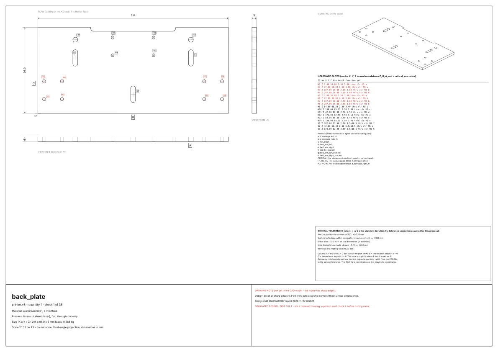

- Quantity 1. aluminium 6061; sheet; 214 x 96.9 x 5 mm; 0.268 kg.
- Sheet 5 mm, laser cut, flat (no bends), through-cut only. Flat size [214.0, 96.9] mm, cut length 925.0 mm, 18 pierces (report). DXF written here: {'LINE': 14, 'ARC': 8, 'CIRCLE': 14}, cut length 925.1 mm, extent (214.0, 96.9).
- Threads: none. Heat-set inserts: none. Reaming: none.
- Drawing note, not yet in the model: Deburr; break all sharp edges 0.2-0.5 mm; outside profile corners R1 min unless dimensioned.
- **Needs more than the general tolerance, or rests on an assumption:**
  - **Patterns a, b** (guide block / motor): hole to hole +/-0.08 mm is the figure the screw-pattern check used (tighter than the +/-0.16 mm position tolerance); radial clearance on the screws 0.30 mm. Cut all holes of a pattern in one set-up.
  - Report, manufacture `hole_smaller_than_thickness`: 12 hole(s) or cut-out(s) narrower than the 5 mm sheet (smallest 3.40 mm at [-23.0, 144.5, 100.0]): they cut, but taper and lose accuracy.

| ID | Kind | Axis | X | Y | Z | Dia / width | Slot length | Depth | Counterbore (dia x depth, from) | Function | Screws | On its axis | Pattern | Critical |
|---|---|---|---|---|---|---|---|---|---|---|---|---|---|---|
| H1 | hole | Z | 7 | 16 | 2.5 | 3.6 | - | through | - | clearance M3 | z_carriage_left_hi_screw_3 (SHCS-M3x8) | - | a: z_carriage_left_hi | locates guide block z_carriage_left_hi |
| H2 | hole | Z | 27 | 16 | 2.5 | 3.6 | - | through | - | clearance M3 | z_carriage_left_hi_screw_2 (SHCS-M3x8) | - | a: z_carriage_left_hi | locates guide block z_carriage_left_hi |
| H3 | hole | Z | 187 | 16 | 2.5 | 3.6 | - | through | - | clearance M3 | z_carriage_right_hi_screw_3 (SHCS-M3x8) | - | b: z_carriage_right_hi | locates guide block z_carriage_right_hi |
| H4 | hole | Z | 207 | 16 | 2.5 | 3.6 | - | through | - | clearance M3 | z_carriage_right_hi_screw_2 (SHCS-M3x8) | - | b: z_carriage_right_hi | locates guide block z_carriage_right_hi |
| H5 | hole | Z | 7 | 36 | 2.5 | 3.6 | - | through | - | clearance M3 | z_carriage_left_hi_screw_1 (SHCS-M3x8) | - | a: z_carriage_left_hi | locates guide block z_carriage_left_hi |
| H6 | hole | Z | 27 | 36 | 2.5 | 3.6 | - | through | - | clearance M3 | z_carriage_left_hi_screw_0 (SHCS-M3x8) | - | a: z_carriage_left_hi | locates guide block z_carriage_left_hi |
| H7 | hole | Z | 187 | 36 | 2.5 | 3.6 | - | through | - | clearance M3 | z_carriage_right_hi_screw_1 (SHCS-M3x8) | - | b: z_carriage_right_hi | locates guide block z_carriage_right_hi |
| H8 | hole | Z | 207 | 36 | 2.5 | 3.6 | - | through | - | clearance M3 | z_carriage_right_hi_screw_0 (SHCS-M3x8) | - | b: z_carriage_right_hi | locates guide block z_carriage_right_hi |
| H9 | hole | Z | 84 | 65.35 | 2.5 | 3.4 | - | through | - | clearance M3 | nut_block_bolt_1 (SHCS-M3x16) | - | c: nut_block | - |
| H10 | hole | Z | 130 | 65.35 | 2.5 | 3.4 | - | through | - | clearance M3 | nut_block_bolt_3 (SHCS-M3x16) | - | c: nut_block | - |
| H11 | hole | Z | 42 | 82.9 | 2.5 | 5.5 | - | through | - | clearance M5 | bed_arm_left_bolt (SHCS-M5x16) | - | d: bed_arm_left | - |
| H12 | hole | Z | 172 | 82.9 | 2.5 | 5.5 | - | through | - | clearance M5 | bed_arm_right_bolt (SHCS-M5x16) | - | e: bed_arm_right | - |
| H13 | hole | Z | 84 | 85.35 | 2.5 | 3.4 | - | through | - | clearance M3 | nut_block_bolt_0 (SHCS-M3x16) | - | c: nut_block | - |
| H14 | hole | Z | 130 | 85.35 | 2.5 | 3.4 | - | through | - | clearance M3 | nut_block_bolt_2 (SHCS-M3x16) | - | c: nut_block | - |
| S1 | slot | Z | 107 | 21.5 | 2.5 | 5.5 | 18.5 | through | - | clearance M5 | bed_tie_bracket_screw (SHCS-M5x16) | - | f: bed_tie_bracket | - |
| S2 | slot | Z | 42 | 62.4 | 2.5 | 5.5 | 18.5 | through | - | clearance M5 | bed_arm_left_bracket_screw (SHCS-M5x16) | - | g: bed_arm_left_bracket | - |
| S3 | slot | Z | 172 | 62.4 | 2.5 | 5.5 | 18.5 | through | - | clearance M5 | bed_arm_right_bracket_screw (SHCS-M5x16) | - | h: bed_arm_right_bracket | - |

### front_plate

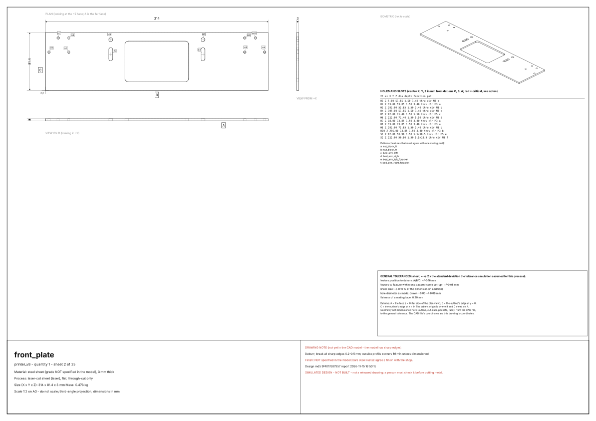

- Quantity 1. steel sheet (grade NOT specified in the model); sheet; 314 x 81.4 x 3 mm; 0.473 kg.
- Sheet 3 mm, laser cut, flat (no bends), through-cut only. Flat size [314.0, 81.4] mm, cut length 1284.0 mm, 14 pierces (report). DXF written here: {'LINE': 12, 'CIRCLE': 10, 'ARC': 8}, cut length 1283.6 mm, extent (314.0, 81.4).
- Threads: none. Heat-set inserts: none. Reaming: none.
- Drawing note, not yet in the model: Deburr; break all sharp edges 0.2-0.5 mm; outside profile corners R1 min unless dimensioned.

| ID | Kind | Axis | X | Y | Z | Dia / width | Slot length | Depth | Counterbore (dia x depth, from) | Function | Screws | On its axis | Pattern | Critical |
|---|---|---|---|---|---|---|---|---|---|---|---|---|---|---|
| H1 | hole | Z | 5 | 53.85 | 1.5 | 3.4 | - | through | - | clearance M3 | nut_block_fl_bolt_3 (SHCS-M3x16) | - | a: nut_block_fl | - |
| H2 | hole | Z | 33 | 53.85 | 1.5 | 3.4 | - | through | - | clearance M3 | nut_block_fl_bolt_1 (SHCS-M3x16) | - | a: nut_block_fl | - |
| H3 | hole | Z | 281 | 53.85 | 1.5 | 3.4 | - | through | - | clearance M3 | nut_block_fr_bolt_1 (SHCS-M3x16) | - | b: nut_block_fr | - |
| H4 | hole | Z | 309 | 53.85 | 1.5 | 3.4 | - | through | - | clearance M3 | nut_block_fr_bolt_3 (SHCS-M3x16) | - | b: nut_block_fr | - |
| H5 | hole | Z | 92 | 71.4 | 1.5 | 5.5 | - | through | - | clearance M5 | bed_arm_left_fbolt (SHCS-M5x12) | - | c: bed_arm_left | - |
| H6 | hole | Z | 222 | 71.4 | 1.5 | 5.5 | - | through | - | clearance M5 | bed_arm_right_fbolt (SHCS-M5x12) | - | d: bed_arm_right | - |
| H7 | hole | Z | 18 | 73.85 | 1.5 | 3.4 | - | through | - | clearance M3 | nut_block_fl_bolt_2 (SHCS-M3x16) | - | a: nut_block_fl | - |
| H8 | hole | Z | 33 | 73.85 | 1.5 | 3.4 | - | through | - | clearance M3 | nut_block_fl_bolt_0 (SHCS-M3x16) | - | a: nut_block_fl | - |
| H9 | hole | Z | 281 | 73.85 | 1.5 | 3.4 | - | through | - | clearance M3 | nut_block_fr_bolt_0 (SHCS-M3x16) | - | b: nut_block_fr | - |
| H10 | hole | Z | 296 | 73.85 | 1.5 | 3.4 | - | through | - | clearance M3 | nut_block_fr_bolt_2 (SHCS-M3x16) | - | b: nut_block_fr | - |
| S1 | slot | Z | 92 | 50.9 | 1.5 | 5.5 | 18.5 | through | - | clearance M5 | bed_arm_left_fbracket_screw (SHCS-M5x12) | - | e: bed_arm_left_fbracket | - |
| S2 | slot | Z | 222 | 50.9 | 1.5 | 5.5 | 18.5 | through | - | clearance M5 | bed_arm_right_fbracket_screw (SHCS-M5x12) | - | f: bed_arm_right_fbracket | - |

### nut_block

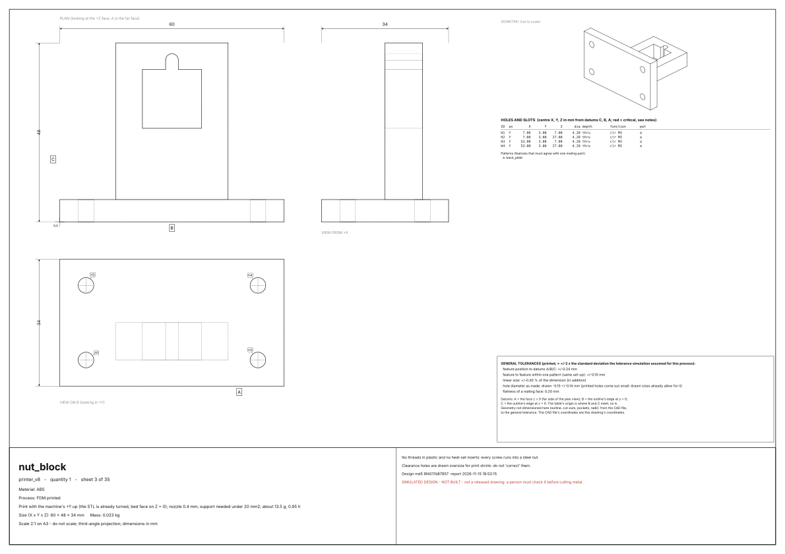

- Quantity 1. ABS; printed; 60 x 48 x 34 mm; 0.023 kg.
- Print with the machine's **+Y** direction up (STL already turned). Support needed under 20.0 mm2; longest bridge 15.8 mm; bed contact 0.93; thinnest wall 2.9 mm; 13.5 g, 0.95 h (estimate). Holes opening on the bed face: 4 (first-layer squash makes them tight).
- Threads: none. Heat-set inserts: none. Reaming: none.

| ID | Kind | Axis | X | Y | Z | Dia / width | Slot length | Depth | Counterbore (dia x depth, from) | Function | Screws | On its axis | Pattern | Critical |
|---|---|---|---|---|---|---|---|---|---|---|---|---|---|---|
| H1 | hole | Y | 7 | 3 | 7 | 4.2 | - | through | - | clearance M3 | nut_block_bolt_0 (SHCS-M3x16) | - | a: back_plate | - |
| H2 | hole | Y | 7 | 3 | 27 | 4.2 | - | through | - | clearance M3 | nut_block_bolt_1 (SHCS-M3x16) | - | a: back_plate | - |
| H3 | hole | Y | 53 | 3 | 7 | 4.2 | - | through | - | clearance M3 | nut_block_bolt_2 (SHCS-M3x16) | - | a: back_plate | - |
| H4 | hole | Y | 53 | 3 | 27 | 4.2 | - | through | - | clearance M3 | nut_block_bolt_3 (SHCS-M3x16) | - | a: back_plate | - |

### nut_block_fl

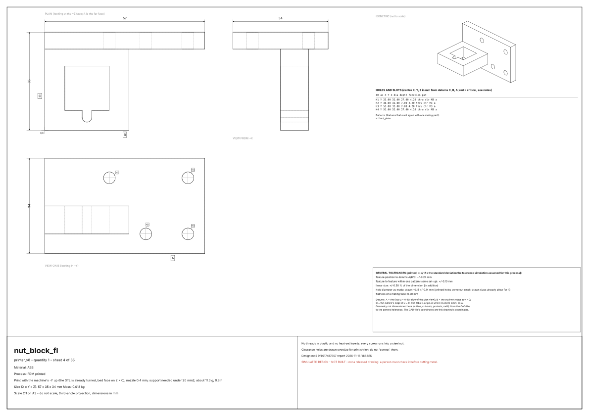

- Quantity 1. ABS; printed; 57 x 35 x 34 mm; 0.018 kg. Same or mirror-image geometry as nut_block_fr.
- Print with the machine's **-Y** direction up (STL already turned). Support needed under 20.0 mm2; longest bridge 15.8 mm; bed contact 0.92; thinnest wall 2.9 mm; 11.3 g, 0.8 h (estimate). Holes opening on the bed face: 4 (first-layer squash makes them tight).
- Threads: none. Heat-set inserts: none. Reaming: none.

| ID | Kind | Axis | X | Y | Z | Dia / width | Slot length | Depth | Counterbore (dia x depth, from) | Function | Screws | On its axis | Pattern | Critical |
|---|---|---|---|---|---|---|---|---|---|---|---|---|---|---|
| H1 | hole | Y | 23 | 32 | 27 | 4.2 | - | through | - | clearance M3 | nut_block_fl_bolt_3 (SHCS-M3x16) | - | a: front_plate | - |
| H2 | hole | Y | 36 | 32 | 7 | 4.2 | - | through | - | clearance M3 | nut_block_fl_bolt_2 (SHCS-M3x16) | - | a: front_plate | - |
| H3 | hole | Y | 51 | 32 | 7 | 4.2 | - | through | - | clearance M3 | nut_block_fl_bolt_0 (SHCS-M3x16) | - | a: front_plate | - |
| H4 | hole | Y | 51 | 32 | 27 | 4.2 | - | through | - | clearance M3 | nut_block_fl_bolt_1 (SHCS-M3x16) | - | a: front_plate | - |

### nut_block_fr

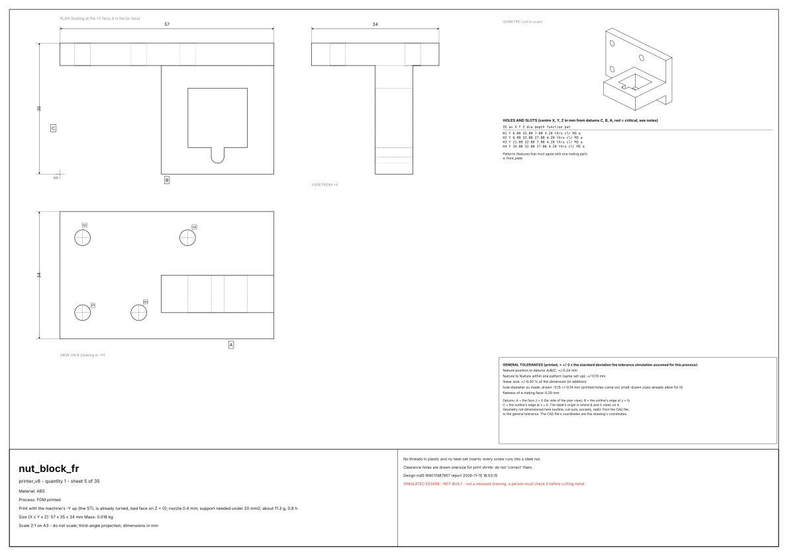

- Quantity 1. ABS; printed; 57 x 35 x 34 mm; 0.018 kg. Same or mirror-image geometry as nut_block_fl.
- Print with the machine's **-Y** direction up (STL already turned). Support needed under 20.0 mm2; longest bridge 15.8 mm; bed contact 0.92; thinnest wall 2.9 mm; 11.3 g, 0.8 h (estimate). Holes opening on the bed face: 4 (first-layer squash makes them tight).
- Threads: none. Heat-set inserts: none. Reaming: none.

| ID | Kind | Axis | X | Y | Z | Dia / width | Slot length | Depth | Counterbore (dia x depth, from) | Function | Screws | On its axis | Pattern | Critical |
|---|---|---|---|---|---|---|---|---|---|---|---|---|---|---|
| H1 | hole | Y | 6 | 32 | 7 | 4.2 | - | through | - | clearance M3 | nut_block_fr_bolt_0 (SHCS-M3x16) | - | a: front_plate | - |
| H2 | hole | Y | 6 | 32 | 27 | 4.2 | - | through | - | clearance M3 | nut_block_fr_bolt_1 (SHCS-M3x16) | - | a: front_plate | - |
| H3 | hole | Y | 21 | 32 | 7 | 4.2 | - | through | - | clearance M3 | nut_block_fr_bolt_2 (SHCS-M3x16) | - | a: front_plate | - |
| H4 | hole | Y | 34 | 32 | 27 | 4.2 | - | through | - | clearance M3 | nut_block_fr_bolt_3 (SHCS-M3x16) | - | a: front_plate | - |

### bed_plate

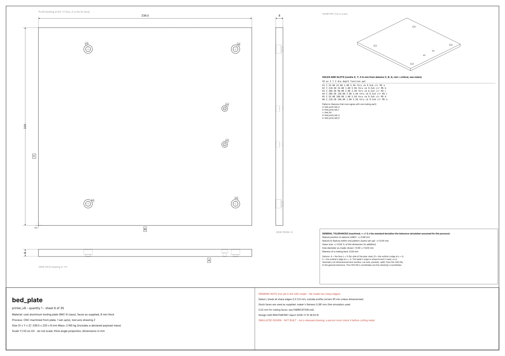

- Quantity 1. cast aluminium tooling plate (MIC-6 class), faces as supplied; machined; 236.5 x 220 x 8 mm; 2.165 kg.
- Stock: plate 8 mm, blank 240 x 224 mm; 1 set-up(s), cut from ['+Z']; smallest wall 2.0 mm; estimate 11.9 min machining (estimate, not a quote: 12 cm3/min roughi...).
- Threads: none. Heat-set inserts: none. Reaming: none.
- Drawing note, not yet in the model: Deburr; break all sharp edges 0.2-0.5 mm; outside profile corners R1 min unless dimensioned.
- **Needs more than the general tolerance, or rests on an assumption:**
  - **Faces A and +Z are stock faces, not machined.** The stack-up gave every mating face of a machined part a flatness of 0.02 mm (1 sd); the maker's guarantee for this plate as supplied is 0.381 mm (Alcoa MIC 6 brochure (guaranteed maximum deviation: 0.381 mm for 1/4 to 5/8 in plate, 0.127 mm for 3/4 in and thicker; thickness +/-0.127 mm)). The bed-flatness figures in the report carry that 0.381 mm as a reference, the tolerance stack-up does not. Measure the plate on receipt; thickness tolerance of the stock: +/-0.127 mm.

| ID | Kind | Axis | X | Y | Z | Dia / width | Slot length | Depth | Counterbore (dia x depth, from) | Function | Screws | On its axis | Pattern | Critical |
|---|---|---|---|---|---|---|---|---|---|---|---|---|---|---|
| H1 | hole | Z | 55 | 24 | 1 | 5.5 | - | through | 9.5 x 6, +Z face | clearance M5 | bed_post_3 (SHCS-M5x90) | - | a: bed_post_tab_3 | - |
| H2 | hole | Z | 218.5 | 24 | 1 | 5.5 | - | through | 9.5 x 6, +Z face | clearance M5 | bed_post_1 (SHCS-M5x90) | - | b: bed_post_tab_1 | - |
| H3 | hole | Z | 206.5 | 90 | 2 | 3.4 | - | through | 6.5 x 4, +Z face | clearance M3 | bed_tie_screw_1 (SHCS-M3x16) | - | c: bed_tie | - |
| H4 | hole | Z | 206.5 | 130 | 2 | 3.4 | - | through | 6.5 x 4, +Z face | clearance M3 | bed_tie_screw_0 (SHCS-M3x16) | - | c: bed_tie | - |
| H5 | hole | Z | 55 | 196 | 1 | 5.5 | - | through | 9.5 x 6, +Z face | clearance M5 | bed_post_2 (SHCS-M5x90) | - | d: bed_post_tab_2 | - |
| H6 | hole | Z | 218.5 | 196 | 1 | 5.5 | - | through | 9.5 x 6, +Z face | clearance M5 | bed_post_0 (SHCS-M5x90) | - | e: bed_post_tab_0 | - |

### bed_post_tab_0

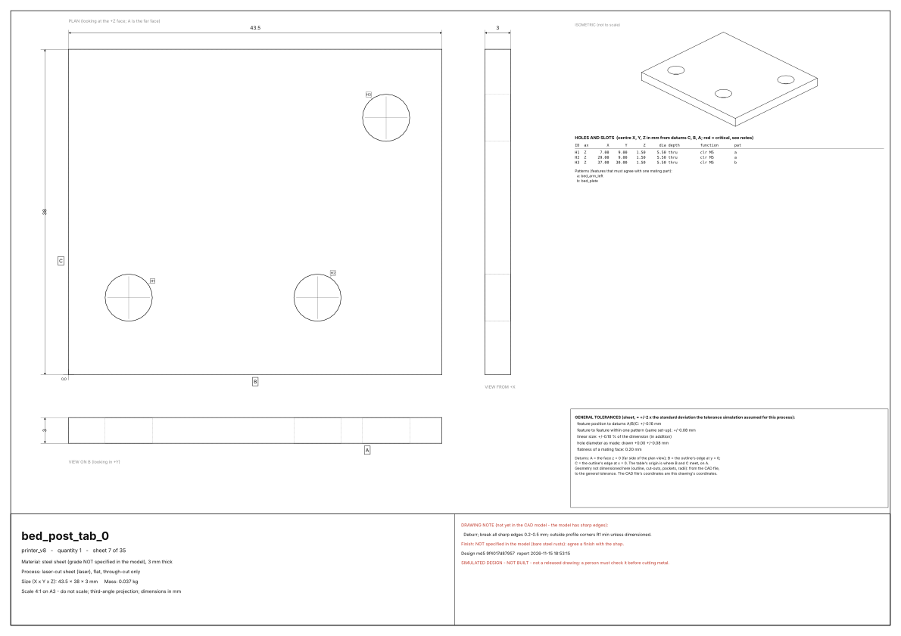

- Quantity 1. steel sheet (grade NOT specified in the model); sheet; 43.5 x 38 x 3 mm; 0.037 kg. Same or mirror-image geometry as bed_post_tab_1, bed_post_tab_2, bed_post_tab_3.
- Sheet 3 mm, laser cut, flat (no bends), through-cut only. Flat size [43.5, 38.0] mm, cut length 215.0 mm, 4 pierces (report). DXF written here: {'LINE': 4, 'CIRCLE': 3}, cut length 214.8 mm, extent (43.5, 38.0).
- Threads: none. Heat-set inserts: none. Reaming: none.
- Drawing note, not yet in the model: Deburr; break all sharp edges 0.2-0.5 mm; outside profile corners R1 min unless dimensioned.

| ID | Kind | Axis | X | Y | Z | Dia / width | Slot length | Depth | Counterbore (dia x depth, from) | Function | Screws | On its axis | Pattern | Critical |
|---|---|---|---|---|---|---|---|---|---|---|---|---|---|---|
| H1 | hole | Z | 7 | 9 | 1.5 | 5.5 | - | through | - | clearance M5 | bed_post_tab_0_bolt_0 (SHCS-M5x8) | - | a: bed_arm_left | - |
| H2 | hole | Z | 29 | 9 | 1.5 | 5.5 | - | through | - | clearance M5 | bed_post_tab_0_bolt_1 (SHCS-M5x8) | - | a: bed_arm_left | - |
| H3 | hole | Z | 37 | 30 | 1.5 | 5.5 | - | through | - | clearance M5 | bed_post_0 (SHCS-M5x90) | - | b: bed_plate | - |

### bed_post_tab_1

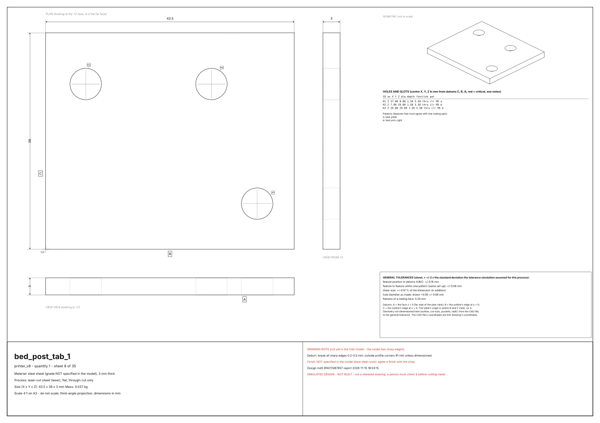

- Quantity 1. steel sheet (grade NOT specified in the model); sheet; 43.5 x 38 x 3 mm; 0.037 kg. Same or mirror-image geometry as bed_post_tab_0, bed_post_tab_2, bed_post_tab_3.
- Sheet 3 mm, laser cut, flat (no bends), through-cut only. Flat size [43.5, 38.0] mm, cut length 215.0 mm, 4 pierces (report). DXF written here: {'LINE': 4, 'CIRCLE': 3}, cut length 214.8 mm, extent (43.5, 38.0).
- Threads: none. Heat-set inserts: none. Reaming: none.
- Drawing note, not yet in the model: Deburr; break all sharp edges 0.2-0.5 mm; outside profile corners R1 min unless dimensioned.

| ID | Kind | Axis | X | Y | Z | Dia / width | Slot length | Depth | Counterbore (dia x depth, from) | Function | Screws | On its axis | Pattern | Critical |
|---|---|---|---|---|---|---|---|---|---|---|---|---|---|---|
| H1 | hole | Z | 37 | 8 | 1.5 | 5.5 | - | through | - | clearance M5 | bed_post_1 (SHCS-M5x90) | - | a: bed_plate | - |
| H2 | hole | Z | 7 | 29 | 1.5 | 5.5 | - | through | - | clearance M5 | bed_post_tab_1_bolt_0 (SHCS-M5x8) | - | b: bed_arm_right | - |
| H3 | hole | Z | 29 | 29 | 1.5 | 5.5 | - | through | - | clearance M5 | bed_post_tab_1_bolt_1 (SHCS-M5x8) | - | b: bed_arm_right | - |

### bed_post_tab_2

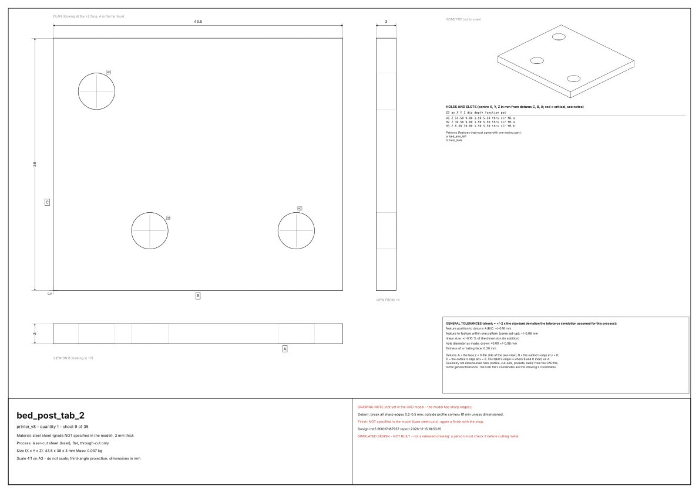

- Quantity 1. steel sheet (grade NOT specified in the model); sheet; 43.5 x 38 x 3 mm; 0.037 kg. Same or mirror-image geometry as bed_post_tab_0, bed_post_tab_1, bed_post_tab_3.
- Sheet 3 mm, laser cut, flat (no bends), through-cut only. Flat size [43.5, 38.0] mm, cut length 215.0 mm, 4 pierces (report). DXF written here: {'LINE': 4, 'CIRCLE': 3}, cut length 214.8 mm, extent (43.5, 38.0).
- Threads: none. Heat-set inserts: none. Reaming: none.
- Drawing note, not yet in the model: Deburr; break all sharp edges 0.2-0.5 mm; outside profile corners R1 min unless dimensioned.

| ID | Kind | Axis | X | Y | Z | Dia / width | Slot length | Depth | Counterbore (dia x depth, from) | Function | Screws | On its axis | Pattern | Critical |
|---|---|---|---|---|---|---|---|---|---|---|---|---|---|---|
| H1 | hole | Z | 14.5 | 9 | 1.5 | 5.5 | - | through | - | clearance M5 | bed_post_tab_2_bolt_0 (SHCS-M5x8) | - | a: bed_arm_left | - |
| H2 | hole | Z | 36.5 | 9 | 1.5 | 5.5 | - | through | - | clearance M5 | bed_post_tab_2_bolt_1 (SHCS-M5x8) | - | a: bed_arm_left | - |
| H3 | hole | Z | 6.5 | 30 | 1.5 | 5.5 | - | through | - | clearance M5 | bed_post_2 (SHCS-M5x90) | - | b: bed_plate | - |

### bed_post_tab_3

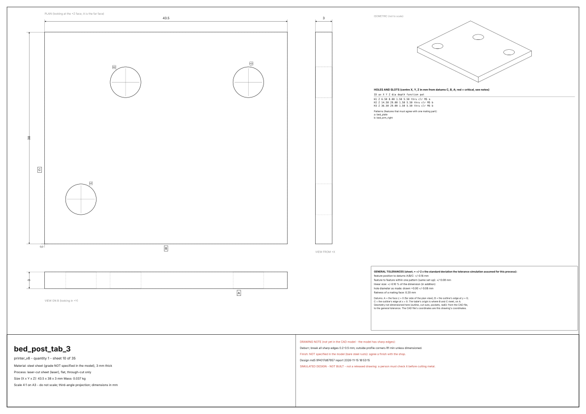

- Quantity 1. steel sheet (grade NOT specified in the model); sheet; 43.5 x 38 x 3 mm; 0.037 kg. Same or mirror-image geometry as bed_post_tab_0, bed_post_tab_1, bed_post_tab_2.
- Sheet 3 mm, laser cut, flat (no bends), through-cut only. Flat size [43.5, 38.0] mm, cut length 215.0 mm, 4 pierces (report). DXF written here: {'LINE': 4, 'CIRCLE': 3}, cut length 214.8 mm, extent (43.5, 38.0).
- Threads: none. Heat-set inserts: none. Reaming: none.
- Drawing note, not yet in the model: Deburr; break all sharp edges 0.2-0.5 mm; outside profile corners R1 min unless dimensioned.

| ID | Kind | Axis | X | Y | Z | Dia / width | Slot length | Depth | Counterbore (dia x depth, from) | Function | Screws | On its axis | Pattern | Critical |
|---|---|---|---|---|---|---|---|---|---|---|---|---|---|---|
| H1 | hole | Z | 6.5 | 8 | 1.5 | 5.5 | - | through | - | clearance M5 | bed_post_3 (SHCS-M5x90) | - | a: bed_plate | - |
| H2 | hole | Z | 14.5 | 29 | 1.5 | 5.5 | - | through | - | clearance M5 | bed_post_tab_3_bolt_0 (SHCS-M5x8) | - | b: bed_arm_right | - |
| H3 | hole | Z | 36.5 | 29 | 1.5 | 5.5 | - | through | - | clearance M5 | bed_post_tab_3_bolt_1 (SHCS-M5x8) | - | b: bed_arm_right | - |

### bed_tie

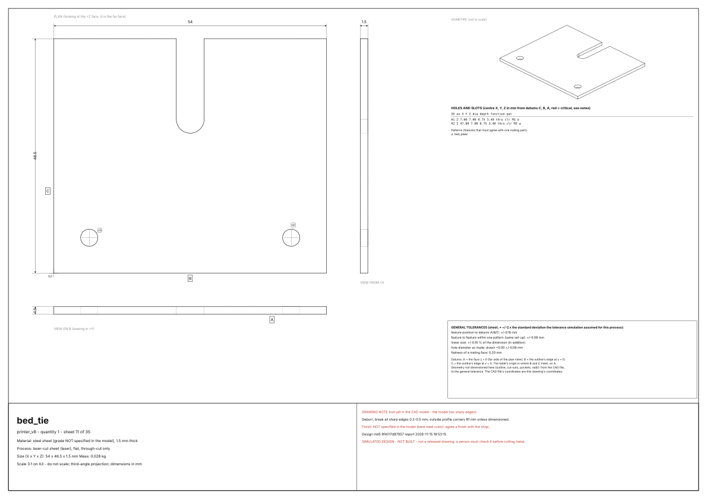

- Quantity 1. steel sheet (grade NOT specified in the model); sheet; 54 x 46.5 x 1.5 mm; 0.028 kg.
- Sheet 1.5 mm, laser cut, flat (no bends), through-cut only. Flat size [54.0, 46.5] mm, cut length 257.0 mm, 3 pierces (report). DXF written here: {'LINE': 7, 'ARC': 1, 'CIRCLE': 2}, cut length 257.5 mm, extent (54.0, 46.5).
- Threads: none. Heat-set inserts: none. Reaming: none.
- Drawing note, not yet in the model: Deburr; break all sharp edges 0.2-0.5 mm; outside profile corners R1 min unless dimensioned.

| ID | Kind | Axis | X | Y | Z | Dia / width | Slot length | Depth | Counterbore (dia x depth, from) | Function | Screws | On its axis | Pattern | Critical |
|---|---|---|---|---|---|---|---|---|---|---|---|---|---|---|
| H1 | hole | Z | 7 | 7 | 0.75 | 3.4 | - | through | - | clearance M3 | bed_tie_screw_0 (SHCS-M3x16) | - | a: bed_plate | - |
| H2 | hole | Z | 47 | 7 | 0.75 | 3.4 | - | through | - | clearance M3 | bed_tie_screw_1 (SHCS-M3x16) | - | a: bed_plate | - |

### z_drive_mount

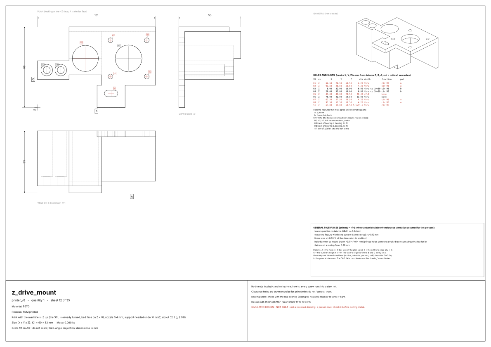

- Quantity 1. PETG; printed; 101 x 69 x 53 mm; 0.090 kg.
- Print with the machine's **-Z** direction up (STL already turned). Support needed under 0.0 mm2; longest bridge 21.1 mm; bed contact 0.94; thinnest wall 2.02 mm; 52.3 g, 2.91 h (estimate). Holes opening on the bed face: 6 (first-layer squash makes them tight).
- Threads: none. Heat-set inserts: none. Reaming: H5 if the bearing does not slide in.
- **Needs more than the general tolerance, or rests on an assumption:**
  - **Bearing seats H5** are drawn 22.40 mm for a 22 mm bearing: the fit only exists if this printer's holes come out 0.15 mm small (+/-0.14), which is the simulation's assumption, not a measurement of your printer. Print a 10 mm tall test ring of this bore first and adjust.
  - **Patterns a** (guide block / motor): hole to hole +/-0.10 mm is the figure the screw-pattern check used (tighter than the +/-0.24 mm position tolerance); radial clearance on the screws 0.60 mm. Cut all holes of a pattern in one set-up.
  - This part places a pulley or idler: its thickness and flatness are in the belt-plane result (x_belt: 99.5% of builds within 1 mm, +/-0.13%; y_belt: 98.1% of builds within 1 mm, +/-0.25%; y_belt_l: 98.1% of builds within 1 mm, +/-0.25%).
  - Report, manufacture `load_across_layers`: load case 'z_drive_mount_thrust' acts 100% along the build direction (-Z up): it pulls the layers apart, the weakest direction of a printed part, and the FEA assumes the material is equally strong every way.

| ID | Kind | Axis | X | Y | Z | Dia / width | Slot length | Depth | Counterbore (dia x depth, from) | Function | Screws | On its axis | Pattern | Critical |
|---|---|---|---|---|---|---|---|---|---|---|---|---|---|---|
| H1 | hole | Z | 62.5 | 26.5 | 50.5 | 4.2 | - | through | - | clearance M3 | z_motor_screw_0 (SHCS-M3x8) | - | a: z_motor | locates motor z_motor |
| H2 | hole | Z | 93.5 | 26.5 | 50.5 | 4.2 | - | through | - | clearance M3 | z_motor_screw_2 (SHCS-M3x8) | - | a: z_motor | locates motor z_motor |
| H3 | hole | Z | 8 | 32 | 10 | 6 | - | through | 10 x 39, +Z face | clearance M5 | z_drive_mount_bolt_0 (SHCS-M5x16) | - | b: frame_bot_back | - |
| H4 | hole | Z | 20 | 32 | 10 | 6 | - | through | 10 x 39, +Z face | clearance M5 | z_drive_mount_bolt_1 (SHCS-M5x16) | - | b: frame_bot_back | - |
| H5 | hole | Z | 41 | 42 | 29.5 | 22.4 | - | 47 | - | bore / opening | - | z_sleeve (custom), leadscrew (T8x2-300), z_bearing_lo (BRG-608), z_bearing_hi (BRG-608), z_pulley (GT2-20T-B8) | - | seat of bearing z_bearing_hi: fit; seat of bearing z_bearing_lo: fit |
| H6 | hole | Z | 78 | 42 | 50.5 | 23 | - | through | - | bore / opening | - | z_motor (NEMA17-40), z_pulley_m (GT2-20T-B5) | - | - |
| H7 | hole | Z | 62.5 | 57.5 | 50.5 | 4.2 | - | through | - | clearance M3 | z_motor_screw_1 (SHCS-M3x8) | - | a: z_motor | locates motor z_motor |
| H8 | hole | Z | 93.5 | 57.5 | 50.5 | 4.2 | - | through | - | clearance M3 | z_motor_screw_3 (SHCS-M3x8) | - | a: z_motor | locates motor z_motor |
| S1 | slot | Z | 63 | 12 | 50.5 | 5.5 | 11.5 | through | - | clearance M5 | z_idler_bolt (SHCS-M5x25) | - | - | axle of z_idler: sets the belt plane |

### z_sleeve

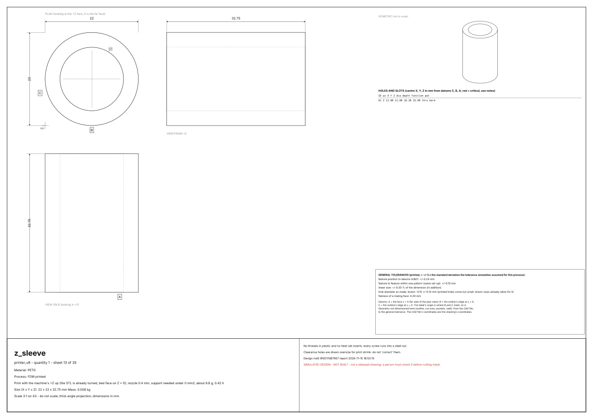

- Quantity 1. PETG; printed; 22 x 22 x 32.75 mm; 0.008 kg.
- Print with the machine's **+Z** direction up (STL already turned). Support needed under 0.0 mm2; longest bridge 0.0 mm; bed contact 1.0; thinnest wall 3.49 mm; 6.8 g, 0.42 h (estimate). Holes opening on the bed face: 1 (first-layer squash makes them tight).
- Threads: none. Heat-set inserts: none. Reaming: none.

| ID | Kind | Axis | X | Y | Z | Dia / width | Slot length | Depth | Counterbore (dia x depth, from) | Function | Screws | On its axis | Pattern | Critical |
|---|---|---|---|---|---|---|---|---|---|---|---|---|---|---|
| H1 | hole | Z | 11 | 11 | 16.38 | 15 | - | through | - | bore / opening | - | leadscrew (T8x2-300) | - | - |

### z_pedestal_fl

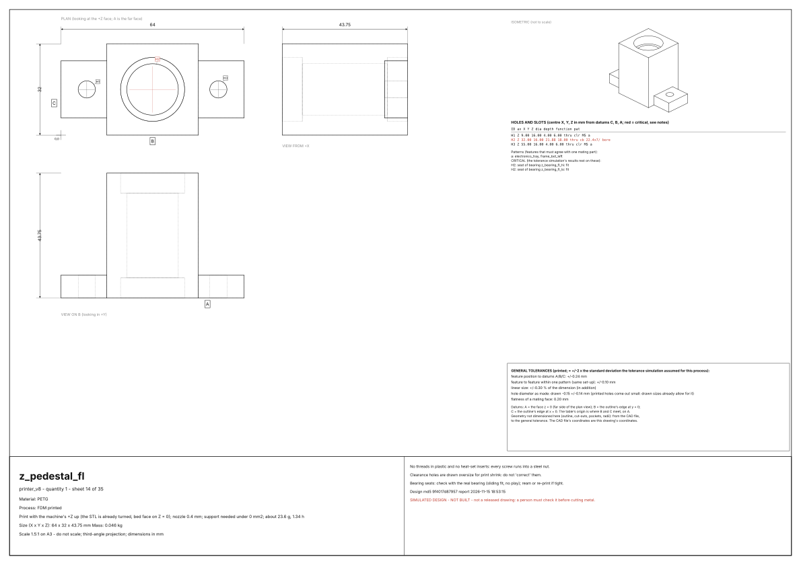

- Quantity 1. PETG; printed; 64 x 32 x 43.75 mm; 0.046 kg. Same or mirror-image geometry as z_pedestal_fr.
- Print with the machine's **+Z** direction up (STL already turned). Support needed under 0.0 mm2; longest bridge 14.3 mm; bed contact 0.9; thinnest wall 4.81 mm; 23.6 g, 1.34 h (estimate). Holes opening on the bed face: 2 (first-layer squash makes them tight).
- Threads: none. Heat-set inserts: none. Reaming: H2 if the bearing does not slide in.
- **Needs more than the general tolerance, or rests on an assumption:**
  - **Bearing seats H2** are drawn 18.00 mm for a 18 mm bearing: the fit only exists if this printer's holes come out 0.15 mm small (+/-0.14), which is the simulation's assumption, not a measurement of your printer. Print a 10 mm tall test ring of this bore first and adjust.

| ID | Kind | Axis | X | Y | Z | Dia / width | Slot length | Depth | Counterbore (dia x depth, from) | Function | Screws | On its axis | Pattern | Critical |
|---|---|---|---|---|---|---|---|---|---|---|---|---|---|---|
| H1 | hole | Z | 9 | 16 | 4 | 6 | - | through | - | clearance M5 | z_pedestal_fl_bolt_0 (SHCS-M5x16) | - | a: electronics_tray, frame_bot_left | - |
| H2 | hole | Z | 32 | 16 | 21.88 | 18 | - | through | 22.4 x 7; 22.4 x 7, -Z face | bore / opening | - | leadscrew_fl (T8x2-300), z_bearing_fl_lo (BRG-608), z_bearing_fl_hi (BRG-608), z_pulley_fl (GT2-20T-B8) | - | seat of bearing z_bearing_fl_hi: fit; seat of bearing z_bearing_fl_lo: fit |
| H3 | hole | Z | 55 | 16 | 4 | 6 | - | through | - | clearance M5 | z_pedestal_fl_bolt_1 (SHCS-M5x16) | - | a: electronics_tray, frame_bot_left | - |

### z_pedestal_fr

- Quantity 1. PETG; printed; 64 x 32 x 43.75 mm; 0.046 kg. Same or mirror-image geometry as z_pedestal_fl.
- Print with the machine's **+Z** direction up (STL already turned). Support needed under 0.0 mm2; longest bridge 14.3 mm; bed contact 0.9; thinnest wall 4.81 mm; 23.6 g, 1.34 h (estimate). Holes opening on the bed face: 2 (first-layer squash makes them tight).
- Threads: none. Heat-set inserts: none. Reaming: H2 if the bearing does not slide in.
- **Needs more than the general tolerance, or rests on an assumption:**
  - **Bearing seats H2** are drawn 18.00 mm for a 18 mm bearing: the fit only exists if this printer's holes come out 0.15 mm small (+/-0.14), which is the simulation's assumption, not a measurement of your printer. Print a 10 mm tall test ring of this bore first and adjust.
  - Report, manufacture `load_across_layers`: load case 'z_pedestal_thrust' acts 100% along the build direction (+Z up): it pulls the layers apart, the weakest direction of a printed part, and the FEA assumes the material is equally strong every way.

| ID | Kind | Axis | X | Y | Z | Dia / width | Slot length | Depth | Counterbore (dia x depth, from) | Function | Screws | On its axis | Pattern | Critical |
|---|---|---|---|---|---|---|---|---|---|---|---|---|---|---|
| H1 | hole | Z | 9 | 16 | 4 | 6 | - | through | - | clearance M5 | z_pedestal_fr_bolt_0 (SHCS-M5x16) | - | a: electronics_tray, frame_bot_right | - |
| H2 | hole | Z | 32 | 16 | 21.88 | 18 | - | through | 22.4 x 7; 22.4 x 7, -Z face | bore / opening | - | leadscrew_fr (T8x2-300), z_bearing_fr_lo (BRG-608), z_bearing_fr_hi (BRG-608), z_pulley_fr (GT2-20T-B8) | - | seat of bearing z_bearing_fr_hi: fit; seat of bearing z_bearing_fr_lo: fit |
| H3 | hole | Z | 55 | 16 | 4 | 6 | - | through | - | clearance M5 | z_pedestal_fr_bolt_1 (SHCS-M5x16) | - | a: electronics_tray, frame_bot_right | - |

### y_plate_left

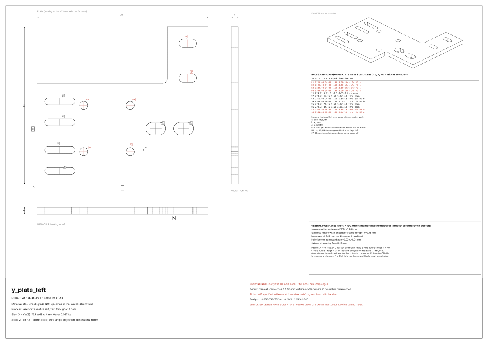

- Quantity 1. steel sheet (grade NOT specified in the model); sheet; 73.5 x 68 x 3 mm; 0.067 kg.
- Sheet 3 mm, laser cut, flat (no bends), through-cut only. Flat size [73.5, 68.0] mm, cut length 528.0 mm, 13 pierces (report). DXF written here: {'LINE': 24, 'ARC': 18, 'CIRCLE': 4}, cut length 528.1 mm, extent (73.5, 68.0).
- Threads: none. Heat-set inserts: none. Reaming: none.
- Drawing note, not yet in the model: Deburr; break all sharp edges 0.2-0.5 mm; outside profile corners R1 min unless dimensioned.
- **Needs more than the general tolerance, or rests on an assumption:**
  - **Patterns a** (guide block / motor): hole to hole +/-0.08 mm is the figure the screw-pattern check used (tighter than the +/-0.16 mm position tolerance); radial clearance on the screws 0.25 mm. Cut all holes of a pattern in one set-up.
  - Report, manufacture `holes_too_close`: 2 pair(s) of holes or cut-outs with too little material between them (least 2.05 mm at [-175.13, -34.32, 418.5], wanted 3 mm = 1 x thickness).

| ID | Kind | Axis | X | Y | Z | Dia / width | Slot length | Depth | Counterbore (dia x depth, from) | Function | Screws | On its axis | Pattern | Critical |
|---|---|---|---|---|---|---|---|---|---|---|---|---|---|---|
| H1 | hole | Z | 20 | 14 | 1.5 | 3.5 | - | through | - | clearance M3 | y_plate_left_screw_0 (SHCS-M3x6) | - | a: y_carriage_left | locates guide block y_carriage_left |
| H2 | hole | Z | 40 | 14 | 1.5 | 3.5 | - | through | - | clearance M3 | y_plate_left_screw_2 (SHCS-M3x6) | - | a: y_carriage_left | locates guide block y_carriage_left |
| H3 | hole | Z | 20 | 34 | 1.5 | 3.5 | - | through | - | clearance M3 | y_plate_left_screw_1 (SHCS-M3x6) | - | a: y_carriage_left | locates guide block y_carriage_left |
| H4 | hole | Z | 40 | 34 | 1.5 | 3.5 | - | through | - | clearance M3 | y_plate_left_screw_3 (SHCS-M3x6) | - | a: y_carriage_left | locates guide block y_carriage_left |
| S1 | slot | Z | 9.75 | 5.75 | 1.5 | 3 | 13 | through | - | hole (no screw or part on its axis in the model) | - | - | - | - |
| S2 | slot | Z | 9.75 | 14.75 | 1.5 | 3 | 13 | through | - | hole (no screw or part on its axis in the model) | - | - | - | - |
| S3 | slot | Z | 51 | 24 | 1.5 | 5.5 | 8.5 | through | - | clearance M5 | beam_bolt_left_1 (SHCS-M5x8) | - | b: x_beam | - |
| S4 | slot | Z | 63 | 24 | 1.5 | 5.5 | 8.5 | through | - | clearance M5 | beam_bolt_left (SHCS-M5x8) | - | b: x_beam | - |
| S5 | slot | Z | 9.75 | 26.75 | 1.5 | 3 | 13 | through | - | hole (no screw or part on its axis in the model) | - | - | - | - |
| S6 | slot | Z | 9.75 | 35.75 | 1.5 | 3 | 13 | through | - | hole (no screw or part on its axis in the model) | - | - | - | - |
| S7 | slot | Z | 64.8 | 45.8 | 1.5 | 3.6 | 7.6 | through | - | clearance M3 | x_endstop_screw_0 (SHCS-M3x12) | - | c: x_endstop | carries endstop x_endstop (set at assembly) |
| S8 | slot | Z | 64.8 | 60.8 | 1.5 | 3.6 | 7.6 | through | - | clearance M3 | x_endstop_screw_1 (SHCS-M3x12) | - | c: x_endstop | carries endstop x_endstop (set at assembly) |

### y_plate_right

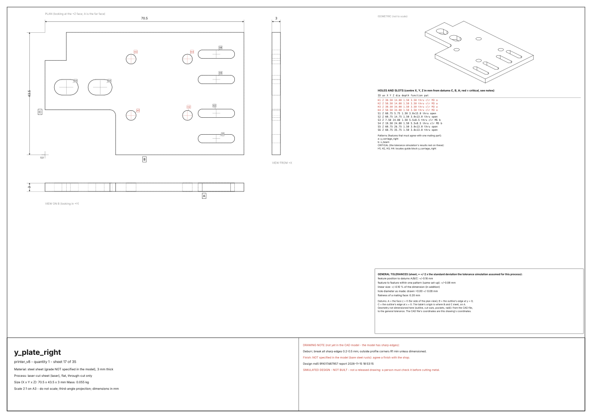

- Quantity 1. steel sheet (grade NOT specified in the model); sheet; 70.5 x 43.5 x 3 mm; 0.055 kg.
- Sheet 3 mm, laser cut, flat (no bends), through-cut only. Flat size [70.5, 43.5] mm, cut length 435.0 mm, 11 pierces (report). DXF written here: {'LINE': 20, 'ARC': 13, 'CIRCLE': 4}, cut length 435.4 mm, extent (70.5, 43.5).
- Threads: none. Heat-set inserts: none. Reaming: none.
- Drawing note, not yet in the model: Deburr; break all sharp edges 0.2-0.5 mm; outside profile corners R1 min unless dimensioned.
- **Needs more than the general tolerance, or rests on an assumption:**
  - **Patterns a** (guide block / motor): hole to hole +/-0.08 mm is the figure the screw-pattern check used (tighter than the +/-0.16 mm position tolerance); radial clearance on the screws 0.25 mm. Cut all holes of a pattern in one set-up.
  - Report, manufacture `holes_too_close`: 2 pair(s) of holes or cut-outs with too little material between them (least 2.05 mm at [175.13, -34.32, 418.5], wanted 3 mm = 1 x thickness).

| ID | Kind | Axis | X | Y | Z | Dia / width | Slot length | Depth | Counterbore (dia x depth, from) | Function | Screws | On its axis | Pattern | Critical |
|---|---|---|---|---|---|---|---|---|---|---|---|---|---|---|
| H1 | hole | Z | 30.5 | 14 | 1.5 | 3.5 | - | through | - | clearance M3 | y_plate_right_screw_0 (SHCS-M3x6) | - | a: y_carriage_right | locates guide block y_carriage_right |
| H2 | hole | Z | 50.5 | 14 | 1.5 | 3.5 | - | through | - | clearance M3 | y_plate_right_screw_2 (SHCS-M3x6) | - | a: y_carriage_right | locates guide block y_carriage_right |
| H3 | hole | Z | 30.5 | 34 | 1.5 | 3.5 | - | through | - | clearance M3 | y_plate_right_screw_1 (SHCS-M3x6) | - | a: y_carriage_right | locates guide block y_carriage_right |
| H4 | hole | Z | 50.5 | 34 | 1.5 | 3.5 | - | through | - | clearance M3 | y_plate_right_screw_3 (SHCS-M3x6) | - | a: y_carriage_right | locates guide block y_carriage_right |
| S1 | slot | Z | 60.75 | 5.75 | 1.5 | 3 | 13 | through | - | hole (no screw or part on its axis in the model) | - | - | - | - |
| S2 | slot | Z | 60.75 | 14.75 | 1.5 | 3 | 13 | through | - | hole (no screw or part on its axis in the model) | - | - | - | - |
| S3 | slot | Z | 7.5 | 24 | 1.5 | 5.5 | 8.5 | through | - | clearance M5 | beam_bolt_right (SHCS-M5x8) | - | b: x_beam | - |
| S4 | slot | Z | 19.5 | 24 | 1.5 | 5.5 | 8.5 | through | - | clearance M5 | beam_bolt_right_1 (SHCS-M5x8) | - | b: x_beam | - |
| S5 | slot | Z | 60.75 | 26.75 | 1.5 | 3 | 13 | through | - | hole (no screw or part on its axis in the model) | - | - | - | - |
| S6 | slot | Z | 60.75 | 35.75 | 1.5 | 3 | 13 | through | - | hole (no screw or part on its axis in the model) | - | - | - | - |

### x_rail_stop_left

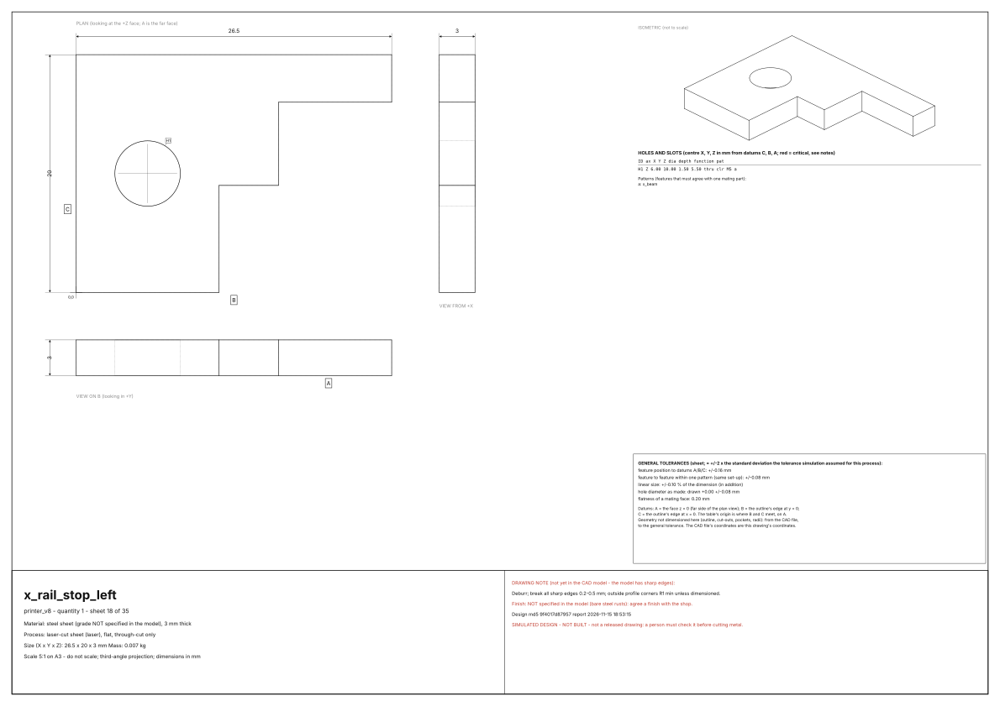

- Quantity 1. steel sheet (grade NOT specified in the model); sheet; 26.5 x 20 x 3 mm; 0.007 kg. Same or mirror-image geometry as x_rail_stop_right.
- Sheet 3 mm, laser cut, flat (no bends), through-cut only. Flat size [26.5, 20.0] mm, cut length 110.0 mm, 2 pierces (report). DXF written here: {'LINE': 8, 'CIRCLE': 1}, cut length 110.3 mm, extent (26.5, 20.0).
- Threads: none. Heat-set inserts: none. Reaming: none.
- Drawing note, not yet in the model: Deburr; break all sharp edges 0.2-0.5 mm; outside profile corners R1 min unless dimensioned.

| ID | Kind | Axis | X | Y | Z | Dia / width | Slot length | Depth | Counterbore (dia x depth, from) | Function | Screws | On its axis | Pattern | Critical |
|---|---|---|---|---|---|---|---|---|---|---|---|---|---|---|
| H1 | hole | Z | 6 | 10 | 1.5 | 5.5 | - | through | - | clearance M5 | x_rail_stop_left_bolt (SHCS-M5x8) | - | a: x_beam | - |

### x_rail_stop_right

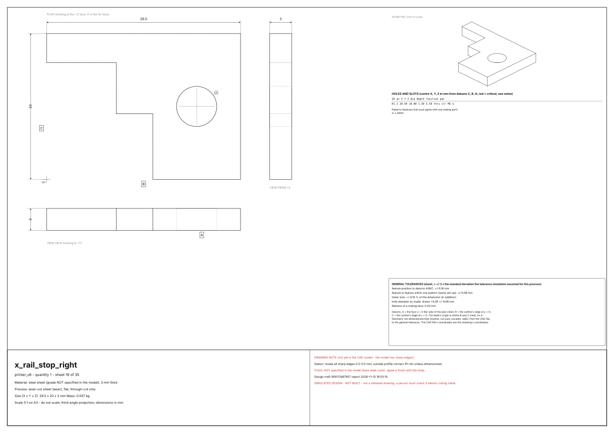

- Quantity 1. steel sheet (grade NOT specified in the model); sheet; 26.5 x 20 x 3 mm; 0.007 kg. Same or mirror-image geometry as x_rail_stop_left.
- Sheet 3 mm, laser cut, flat (no bends), through-cut only. Flat size [26.5, 20.0] mm, cut length 110.0 mm, 2 pierces (report). DXF written here: {'LINE': 8, 'CIRCLE': 1}, cut length 110.3 mm, extent (26.5, 20.0).
- Threads: none. Heat-set inserts: none. Reaming: none.
- Drawing note, not yet in the model: Deburr; break all sharp edges 0.2-0.5 mm; outside profile corners R1 min unless dimensioned.

| ID | Kind | Axis | X | Y | Z | Dia / width | Slot length | Depth | Counterbore (dia x depth, from) | Function | Screws | On its axis | Pattern | Critical |
|---|---|---|---|---|---|---|---|---|---|---|---|---|---|---|
| H1 | hole | Z | 20.5 | 10 | 1.5 | 5.5 | - | through | - | clearance M5 | x_rail_stop_right_bolt (SHCS-M5x8) | - | a: x_beam | - |

### tool_plate

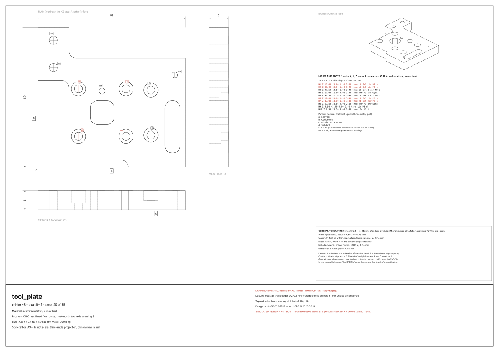

- Quantity 1. aluminium 6061; machined; 62 x 59 x 8 mm; 0.045 kg.
- Stock: plate 8 mm, blank 66 x 63 mm; 1 set-up(s), cut from ['+Y']; smallest wall 1.01 mm; estimate 8.1 min machining (estimate, not a quote: 12 cm3/min roughi...).
- Threads: H4 TAP M3 through, H8 TAP M3 through. Heat-set inserts: none. Reaming: none.
- Drawing note, not yet in the model: Deburr; break all sharp edges 0.2-0.5 mm; outside profile corners R1 min unless dimensioned.
- **Needs more than the general tolerance, or rests on an assumption:**
  - **Faces A and +Z are the plate's stock faces** (42.3 cm2 not machined). The stack-up assumed 0.02 mm flatness (1 sd) and the plate's thickness to the general tolerance; no stock flatness or thickness tolerance for al6061 plate is in the catalogue. Ask for the faces to be skimmed or state flatness 0.04 mm on the order.
  - **Patterns a** (guide block / motor): hole to hole +/-0.04 mm is the figure the screw-pattern check used (tighter than the +/-0.08 mm position tolerance); radial clearance on the screws 0.20 mm. Cut all holes of a pattern in one set-up.

| ID | Kind | Axis | X | Y | Z | Dia / width | Slot length | Depth | Counterbore (dia x depth, from) | Function | Screws | On its axis | Pattern | Critical |
|---|---|---|---|---|---|---|---|---|---|---|---|---|---|---|
| H1 | hole | Z | 17 | 13 | 1.5 | 3.4 | - | through | 6 x 5, +Z face | clearance M3 | tool_screw_0 (SHCS-M3x6) | - | a: x_carriage | locates guide block x_carriage |
| H2 | hole | Z | 37 | 13 | 1.5 | 3.4 | - | through | 6 x 5, +Z face | clearance M3 | tool_screw_2 (SHCS-M3x6) | - | a: x_carriage | locates guide block x_carriage |
| H3 | hole | Z | 47.5 | 13.5 | 1.9 | 3.4 | - | through | 6 x 4.2, +Z face | clearance M3 | x_belt_block_screw_0 (SHCS-M3x16) | - | b: x_belt_block | - |
| H4 | hole | Z | 27 | 32.06 | 4 | 2.5 | - | through | - | TAP M3 through | extruder_screw_0 (SHCS-M3x50) | - | c: extruder, probe_mount | - |
| H5 | hole | Z | 47.5 | 32.5 | 1.9 | 3.4 | - | through | 6 x 4.2, +Z face | clearance M3 | x_belt_block_screw_1 (SHCS-M3x16) | - | b: x_belt_block | - |
| H6 | hole | Z | 17 | 33 | 1.5 | 3.4 | - | through | 6 x 5, +Z face | clearance M3 | tool_screw_1 (SHCS-M3x6) | - | a: x_carriage | locates guide block x_carriage |
| H7 | hole | Z | 37 | 33 | 1.5 | 3.4 | - | through | 6 x 5, +Z face | clearance M3 | tool_screw_3 (SHCS-M3x6) | - | a: x_carriage | locates guide block x_carriage |
| H8 | hole | Z | 57.5 | 38.86 | 4 | 2.5 | - | through | - | TAP M3 through | extruder_screw_1 (SHCS-M3x50) | - | c: extruder, probe_mount | - |
| H9 | hole | Z | 6.5 | 42 | 4 | 3.4 | - | through | - | clearance M3 | part_duct_screw_0 (SHCS-M3x16) | - | d: part_duct | - |
| H10 | hole | Z | 6.5 | 53.5 | 4 | 3.4 | - | through | - | clearance M3 | part_duct_screw_1 (SHCS-M3x16) | - | d: part_duct | - |

### probe_mount

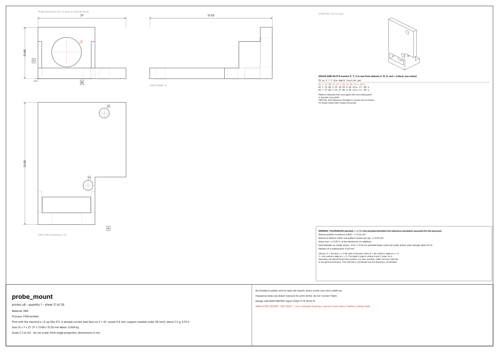

- Quantity 1. ABS; printed; 37 x 21.69 x 51.55 mm; 0.009 kg.
- Print with the machine's **+Z** direction up (STL already turned). Support needed under 58.0 mm2; longest bridge 20.4 mm; bed contact 0.68; thinnest wall 0.85 mm; 7.2 g, 0.53 h (estimate). Holes opening on the bed face: 1 (first-layer squash makes them tight).
- Threads: none. Heat-set inserts: none. Reaming: none.

| ID | Kind | Axis | X | Y | Z | Dia / width | Slot length | Depth | Counterbore (dia x depth, from) | Function | Screws | On its axis | Pattern | Critical |
|---|---|---|---|---|---|---|---|---|---|---|---|---|---|---|
| H1 | hole | Z | 12 | 11.19 | 2.5 | 12.5 | - | through | - | bore / opening | - | bed_probe (PROBE-OMRON-E2E-X5ME1) | - | probe clamp hole: locates the probe |
| H2 | hole | Y | 21.06 | 2.25 | 16.55 | 4.2 | - | through | - | clearance M3 | extruder_screw_0 (SHCS-M3x50) | - | a: extruder, tool_plate | - |
| H3 | hole | Y | 27.86 | 2.25 | 47.05 | 4.2 | - | through | - | clearance M3 | extruder_screw_1 (SHCS-M3x50) | - | a: extruder, tool_plate | - |

### part_duct

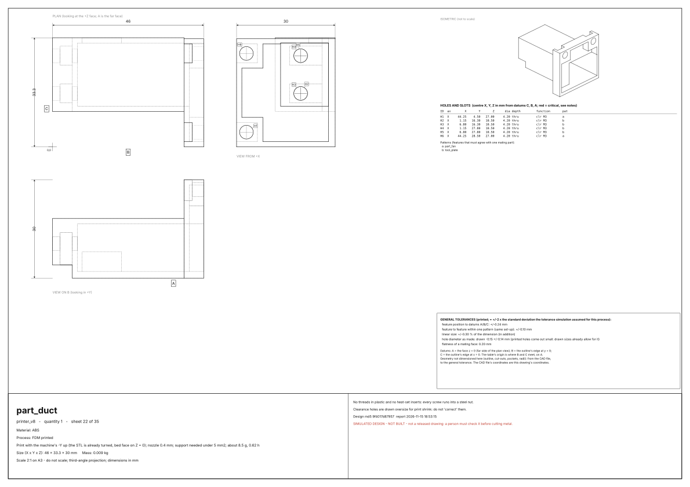

- Quantity 1. ABS; printed; 46 x 33.3 x 30 mm; 0.009 kg.
- Print with the machine's **-Y** direction up (STL already turned). Support needed under 5.0 mm2; longest bridge 26.4 mm; bed contact 0.24; thinnest wall 0.91 mm; 8.5 g, 0.62 h (estimate). Holes opening on the bed face: 2 (first-layer squash makes them tight).
- Threads: none. Heat-set inserts: none. Reaming: none.

| ID | Kind | Axis | X | Y | Z | Dia / width | Slot length | Depth | Counterbore (dia x depth, from) | Function | Screws | On its axis | Pattern | Critical |
|---|---|---|---|---|---|---|---|---|---|---|---|---|---|---|
| H1 | hole | X | 44.25 | 4.5 | 27 | 4.2 | - | through | - | clearance M3 | part_fan_screw_1 (SHCS-M3x16) | - | a: part_fan | - |
| H2 | hole | X | 1.15 | 16.3 | 10.5 | 4.2 | - | through | - | clearance M3 | part_duct_screw_1 (SHCS-M3x16) | - | b: tool_plate | - |
| H3 | hole | X | 6.8 | 16.3 | 10.5 | 4.2 | - | through | - | clearance M3 | part_duct_screw_1 (SHCS-M3x16) | - | b: tool_plate | - |
| H4 | hole | X | 1.15 | 27.8 | 10.5 | 4.2 | - | through | - | clearance M3 | part_duct_screw_0 (SHCS-M3x16) | - | b: tool_plate | - |
| H5 | hole | X | 6.8 | 27.8 | 10.5 | 4.2 | - | through | - | clearance M3 | part_duct_screw_0 (SHCS-M3x16) | - | b: tool_plate | - |
| H6 | hole | X | 44.25 | 28.5 | 27 | 4.2 | - | through | - | clearance M3 | part_fan_screw_0 (SHCS-M3x16) | - | a: part_fan | - |

### x_belt_block

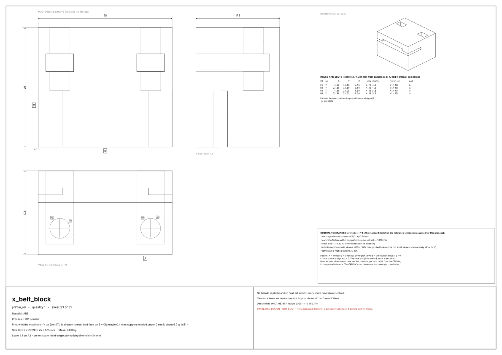

- Quantity 1. ABS; printed; 28 x 25 x 17.5 mm; 0.011 kg.
- Print with the machine's **-Y** direction up (STL already turned). Support needed under 0.0 mm2; longest bridge 5.8 mm; bed contact 0.74; thinnest wall 1.6 mm; 6.9 g, 0.51 h (estimate). Holes opening on the bed face: 2 (first-layer squash makes them tight).
- Threads: none. Heat-set inserts: none. Reaming: none.

| ID | Kind | Axis | X | Y | Z | Dia / width | Slot length | Depth | Counterbore (dia x depth, from) | Function | Screws | On its axis | Pattern | Critical |
|---|---|---|---|---|---|---|---|---|---|---|---|---|---|---|
| H1 | hole | Y | 4.5 | 13.8 | 5.5 | 4.2 | - | 4 | - | clearance M3 | x_belt_block_screw_0 (SHCS-M3x16) | - | a: tool_plate | - |
| H2 | hole | Y | 23.5 | 13.8 | 5.5 | 4.2 | - | 4 | - | clearance M3 | x_belt_block_screw_1 (SHCS-M3x16) | - | a: tool_plate | - |
| H3 | hole | Y | 4.5 | 22.25 | 5.5 | 4.2 | - | 5.5 | - | clearance M3 | x_belt_block_screw_0 (SHCS-M3x16) | - | a: tool_plate | - |
| H4 | hole | Y | 23.5 | 22.25 | 5.5 | 4.2 | - | 5.5 | - | clearance M3 | x_belt_block_screw_1 (SHCS-M3x16) | - | a: tool_plate | - |

### x_motor_mount

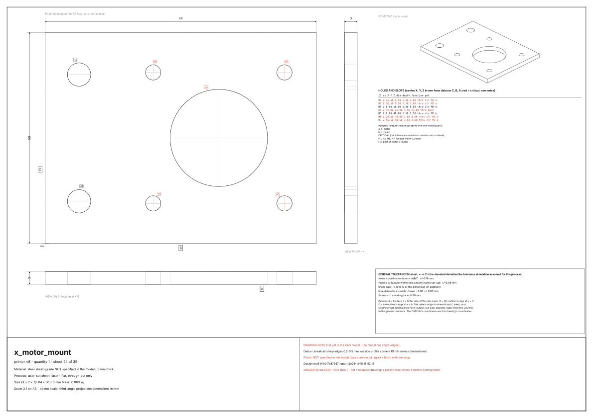

- Quantity 1. steel sheet (grade NOT specified in the model); sheet; 64 x 50 x 3 mm; 0.063 kg.
- Sheet 3 mm, laser cut, flat (no bends), through-cut only. Flat size [64.0, 50.0] mm, cut length 380.0 mm, 8 pierces (report). DXF written here: {'LINE': 4, 'CIRCLE': 7}, cut length 380.1 mm, extent (64.0, 50.0).
- Threads: none. Heat-set inserts: none. Reaming: none.
- Drawing note, not yet in the model: Deburr; break all sharp edges 0.2-0.5 mm; outside profile corners R1 min unless dimensioned.
- **Needs more than the general tolerance, or rests on an assumption:**
  - **Patterns a** (guide block / motor): hole to hole +/-0.08 mm is the figure the screw-pattern check used (tighter than the +/-0.16 mm position tolerance); radial clearance on the screws 0.30 mm. Cut all holes of a pattern in one set-up.
  - This part places a pulley or idler: its thickness and flatness are in the belt-plane result (x_belt: 99.5% of builds within 1 mm, +/-0.13%; y_belt: 98.1% of builds within 1 mm, +/-0.25%; y_belt_l: 98.1% of builds within 1 mm, +/-0.25%).

| ID | Kind | Axis | X | Y | Z | Dia / width | Slot length | Depth | Counterbore (dia x depth, from) | Function | Screws | On its axis | Pattern | Critical |
|---|---|---|---|---|---|---|---|---|---|---|---|---|---|---|
| H1 | hole | Z | 25.5 | 9.5 | 1.5 | 3.6 | - | through | - | clearance M3 | x_motor_screw_0 (SHCS-M3x6) | - | a: x_motor | locates motor x_motor |
| H2 | hole | Z | 56.5 | 9.5 | 1.5 | 3.6 | - | through | - | clearance M3 | x_motor_screw_1 (SHCS-M3x6) | - | a: x_motor | locates motor x_motor |
| H3 | hole | Z | 8 | 10 | 1.5 | 5.5 | - | through | - | clearance M5 | x_motor_mount_bolt_0 (SHCS-M5x8) | - | b: x_beam | - |
| H4 | hole | Z | 41 | 25 | 1.5 | 23 | - | through | - | bore / opening | - | x_motor (NEMA17-34) | - | - |
| H5 | hole | Z | 8 | 40 | 1.5 | 5.5 | - | through | - | clearance M5 | x_motor_mount_bolt_1 (SHCS-M5x8) | - | b: x_beam | - |
| H6 | hole | Z | 25.5 | 40.5 | 1.5 | 3.6 | - | through | - | clearance M3 | x_motor_screw_2 (SHCS-M3x6) | - | a: x_motor | locates motor x_motor |
| H7 | hole | Z | 56.5 | 40.5 | 1.5 | 3.6 | - | through | - | clearance M3 | x_motor_screw_3 (SHCS-M3x6) | - | a: x_motor | locates motor x_motor |

### x_idler_mount

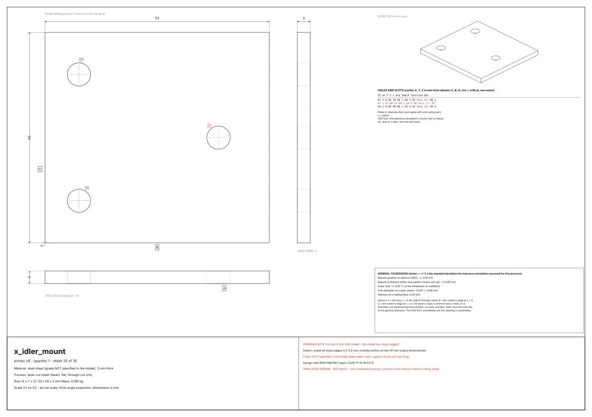

- Quantity 1. steel sheet (grade NOT specified in the model); sheet; 53 x 50 x 3 mm; 0.061 kg.
- Sheet 3 mm, laser cut, flat (no bends), through-cut only. Flat size [53.0, 50.0] mm, cut length 258.0 mm, 4 pierces (report). DXF written here: {'LINE': 4, 'CIRCLE': 3}, cut length 257.8 mm, extent (53.0, 50.0).
- Threads: none. Heat-set inserts: none. Reaming: none.
- Drawing note, not yet in the model: Deburr; break all sharp edges 0.2-0.5 mm; outside profile corners R1 min unless dimensioned.
- **Needs more than the general tolerance, or rests on an assumption:**
  - This part places a pulley or idler: its thickness and flatness are in the belt-plane result (x_belt: 99.5% of builds within 1 mm, +/-0.13%; y_belt: 98.1% of builds within 1 mm, +/-0.25%; y_belt_l: 98.1% of builds within 1 mm, +/-0.25%).

| ID | Kind | Axis | X | Y | Z | Dia / width | Slot length | Depth | Counterbore (dia x depth, from) | Function | Screws | On its axis | Pattern | Critical |
|---|---|---|---|---|---|---|---|---|---|---|---|---|---|---|
| H1 | hole | Z | 8 | 10 | 1.5 | 5.5 | - | through | - | clearance M5 | x_idler_mount_bolt_0 (SHCS-M5x8) | - | a: x_beam | - |
| H2 | hole | Z | 41 | 25 | 1.5 | 5.5 | - | through | - | clearance M5 | x_idler_bolt (SHCS-M5x30) | - | - | axle of x_idler: sets the belt plane |
| H3 | hole | Z | 8 | 40 | 1.5 | 5.5 | - | through | - | clearance M5 | x_idler_mount_bolt_1 (SHCS-M5x8) | - | a: x_beam | - |

### x_tension_anchor

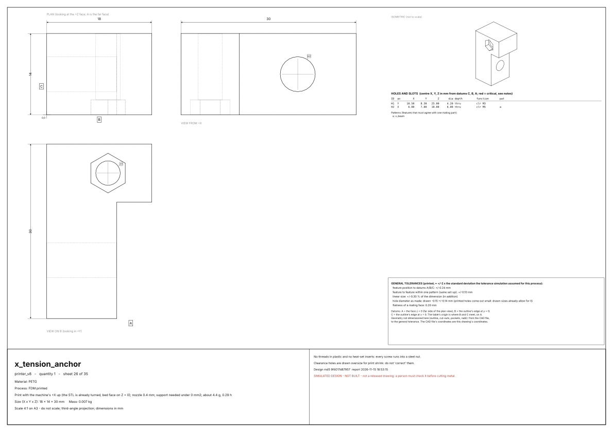

- Quantity 1. PETG; printed; 18 x 14 x 30 mm; 0.007 kg. Same or mirror-image geometry as y_tension_anchor, y_tension_anchor_l.
- Print with the machine's **+X** direction up (STL already turned). Support needed under 0.0 mm2; longest bridge 0.0 mm; bed contact 0.85; thinnest wall 1.6 mm; 4.4 g, 0.29 h (estimate). Holes opening on the bed face: 1 (first-layer squash makes them tight).
- Threads: none. Heat-set inserts: none. Reaming: none.

| ID | Kind | Axis | X | Y | Z | Dia / width | Slot length | Depth | Counterbore (dia x depth, from) | Function | Screws | On its axis | Pattern | Critical |
|---|---|---|---|---|---|---|---|---|---|---|---|---|---|---|
| H1 | hole | Y | 10.5 | 8.3 | 25 | 4.2 | - | through | - | clearance M3 | x_tension_screw (SHCS-M3x25) | - | - | - |
| H2 | hole | X | 6 | 7 | 10 | 6 | - | through | - | clearance M5 | x_tension_anchor_bolt (SHCS-M5x16) | - | a: x_beam | - |

### y_motor_mount

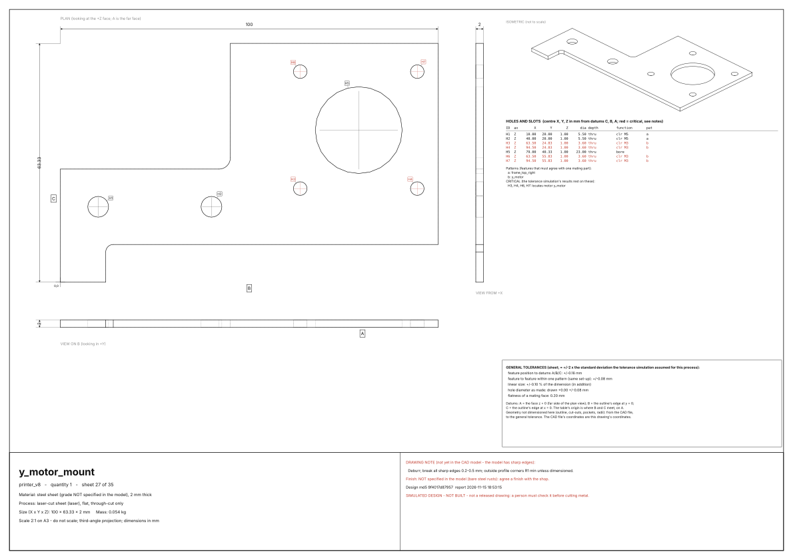

- Quantity 1. steel sheet (grade NOT specified in the model); sheet; 100 x 63.33 x 2 mm; 0.054 kg. Same or mirror-image geometry as y_motor_mount_l.
- Sheet 2 mm, laser cut, flat (no bends), through-cut only. Flat size [106.5, 59.2] mm, cut length 477.0 mm, 8 pierces (report). DXF written here: {'LINE': 8, 'ARC': 2, 'CIRCLE': 7}, cut length 476.6 mm, extent (100.0, 63.33).
- Threads: none. Heat-set inserts: none. Reaming: none.
- Drawing note, not yet in the model: Deburr; break all sharp edges 0.2-0.5 mm; outside profile corners R1 min unless dimensioned.
- **Needs more than the general tolerance, or rests on an assumption:**
  - **Patterns b** (guide block / motor): hole to hole +/-0.08 mm is the figure the screw-pattern check used (tighter than the +/-0.16 mm position tolerance); radial clearance on the screws 0.30 mm. Cut all holes of a pattern in one set-up.
  - This part places a pulley or idler: its thickness and flatness are in the belt-plane result (x_belt: 99.5% of builds within 1 mm, +/-0.13%; y_belt: 98.1% of builds within 1 mm, +/-0.25%; y_belt_l: 98.1% of builds within 1 mm, +/-0.25%).

| ID | Kind | Axis | X | Y | Z | Dia / width | Slot length | Depth | Counterbore (dia x depth, from) | Function | Screws | On its axis | Pattern | Critical |
|---|---|---|---|---|---|---|---|---|---|---|---|---|---|---|
| H1 | hole | Z | 10 | 20 | 1 | 5.5 | - | through | - | clearance M5 | y_motor_mount_bolt_0 (SHCS-M5x8) | - | a: frame_top_right | - |
| H2 | hole | Z | 40 | 20 | 1 | 5.5 | - | through | - | clearance M5 | y_motor_mount_bolt_1 (SHCS-M5x8) | - | a: frame_top_right | - |
| H3 | hole | Z | 63.5 | 24.83 | 1 | 3.6 | - | through | - | clearance M3 | y_motor_screw_0 (SHCS-M3x6) | - | b: y_motor | locates motor y_motor |
| H4 | hole | Z | 94.5 | 24.83 | 1 | 3.6 | - | through | - | clearance M3 | y_motor_screw_2 (SHCS-M3x6) | - | b: y_motor | locates motor y_motor |
| H5 | hole | Z | 79 | 40.33 | 1 | 23 | - | through | - | bore / opening | - | y_motor (NEMA17-48) | - | - |
| H6 | hole | Z | 63.5 | 55.83 | 1 | 3.6 | - | through | - | clearance M3 | y_motor_screw_1 (SHCS-M3x6) | - | b: y_motor | locates motor y_motor |
| H7 | hole | Z | 94.5 | 55.83 | 1 | 3.6 | - | through | - | clearance M3 | y_motor_screw_3 (SHCS-M3x6) | - | b: y_motor | locates motor y_motor |

### y_tension_anchor

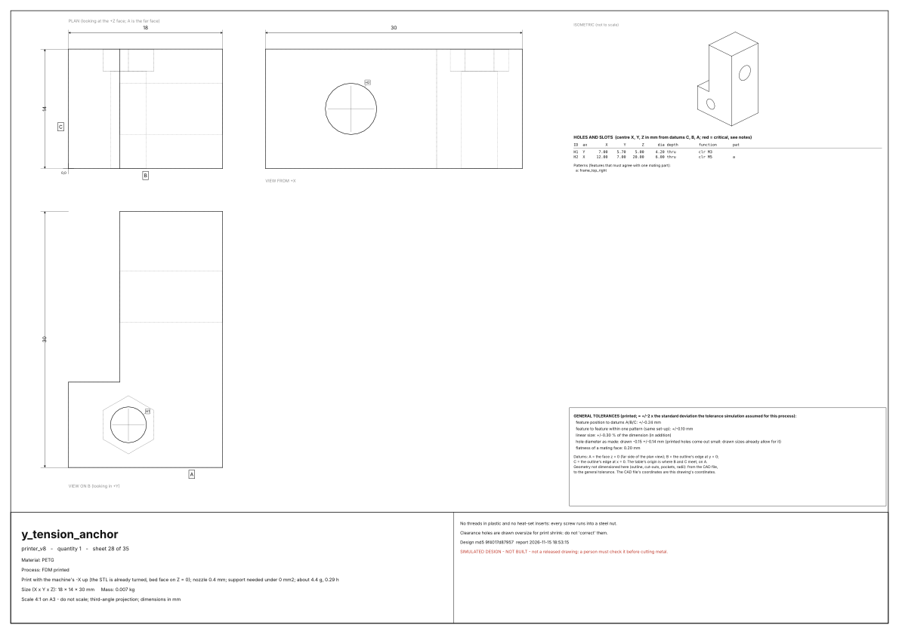

- Quantity 1. PETG; printed; 18 x 14 x 30 mm; 0.007 kg. Same or mirror-image geometry as x_tension_anchor, y_tension_anchor_l.
- Print with the machine's **-X** direction up (STL already turned). Support needed under 0.0 mm2; longest bridge 3.5 mm; bed contact 0.86; thinnest wall 1.92 mm; 4.4 g, 0.29 h (estimate). Holes opening on the bed face: 1 (first-layer squash makes them tight).
- Threads: none. Heat-set inserts: none. Reaming: none.

| ID | Kind | Axis | X | Y | Z | Dia / width | Slot length | Depth | Counterbore (dia x depth, from) | Function | Screws | On its axis | Pattern | Critical |
|---|---|---|---|---|---|---|---|---|---|---|---|---|---|---|
| H1 | hole | Y | 7 | 5.7 | 5 | 4.2 | - | through | - | clearance M3 | y_tension_screw (SHCS-M3x25) | - | - | - |
| H2 | hole | X | 12 | 7 | 20 | 6 | - | through | - | clearance M5 | y_tension_anchor_bolt (SHCS-M5x16) | - | a: frame_top_right | - |

### y_idler_mount

- Quantity 1. steel sheet (grade NOT specified in the model); sheet; 78.19 x 39.33 x 2 mm; 0.027 kg. Same or mirror-image geometry as y_idler_mount_l.
- Sheet 2 mm, laser cut, flat (no bends), through-cut only. Flat size [78.2, 39.3] mm, cut length 286.0 mm, 4 pierces (report). DXF written here: {'LINE': 6, 'ARC': 1, 'CIRCLE': 3}, cut length 286.0 mm, extent (78.19, 39.33).
- Threads: none. Heat-set inserts: none. Reaming: none.
- Drawing note, not yet in the model: Deburr; break all sharp edges 0.2-0.5 mm; outside profile corners R1 min unless dimensioned.
- **Needs more than the general tolerance, or rests on an assumption:**
  - This part places a pulley or idler: its thickness and flatness are in the belt-plane result (x_belt: 99.5% of builds within 1 mm, +/-0.13%; y_belt: 98.1% of builds within 1 mm, +/-0.25%; y_belt_l: 98.1% of builds within 1 mm, +/-0.25%).

| ID | Kind | Axis | X | Y | Z | Dia / width | Slot length | Depth | Counterbore (dia x depth, from) | Function | Screws | On its axis | Pattern | Critical |
|---|---|---|---|---|---|---|---|---|---|---|---|---|---|---|
| H1 | hole | Z | 20.19 | 10 | 1 | 5.5 | - | through | - | clearance M5 | y_idler_mount_bolt_0 (SHCS-M5x8) | - | a: frame_top_right | - |
| H2 | hole | Z | 68.19 | 10 | 1 | 5.5 | - | through | - | clearance M5 | y_idler_mount_bolt_1 (SHCS-M5x8) | - | a: frame_top_right | - |
| H3 | hole | Z | 9 | 30.33 | 1 | 5.5 | - | through | - | clearance M5 | y_idler_bolt (SHCS-M5x30) | - | - | axle of y_idler: sets the belt plane |

### y_motor_mount_l

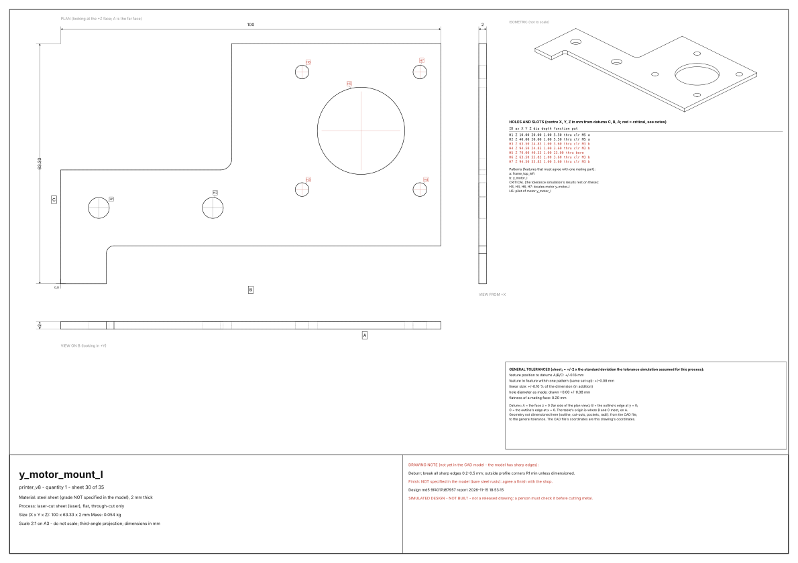

- Quantity 1. steel sheet (grade NOT specified in the model); sheet; 100 x 63.33 x 2 mm; 0.054 kg. Same or mirror-image geometry as y_motor_mount.
- Sheet 2 mm, laser cut, flat (no bends), through-cut only. Flat size [106.5, 59.2] mm, cut length 477.0 mm, 8 pierces (report). DXF written here: {'LINE': 8, 'ARC': 2, 'CIRCLE': 7}, cut length 476.6 mm, extent (100.0, 63.33).
- Threads: none. Heat-set inserts: none. Reaming: none.
- Drawing note, not yet in the model: Deburr; break all sharp edges 0.2-0.5 mm; outside profile corners R1 min unless dimensioned.
- **Needs more than the general tolerance, or rests on an assumption:**
  - **Patterns b** (guide block / motor): hole to hole +/-0.08 mm is the figure the screw-pattern check used (tighter than the +/-0.16 mm position tolerance); radial clearance on the screws 0.30 mm. Cut all holes of a pattern in one set-up.
  - This part places a pulley or idler: its thickness and flatness are in the belt-plane result (x_belt: 99.5% of builds within 1 mm, +/-0.13%; y_belt: 98.1% of builds within 1 mm, +/-0.25%; y_belt_l: 98.1% of builds within 1 mm, +/-0.25%).

| ID | Kind | Axis | X | Y | Z | Dia / width | Slot length | Depth | Counterbore (dia x depth, from) | Function | Screws | On its axis | Pattern | Critical |
|---|---|---|---|---|---|---|---|---|---|---|---|---|---|---|
| H1 | hole | Z | 10 | 20 | 1 | 5.5 | - | through | - | clearance M5 | y_motor_mount_l_bolt_0 (SHCS-M5x8) | - | a: frame_top_left | - |
| H2 | hole | Z | 40 | 20 | 1 | 5.5 | - | through | - | clearance M5 | y_motor_mount_l_bolt_1 (SHCS-M5x8) | - | a: frame_top_left | - |
| H3 | hole | Z | 63.5 | 24.83 | 1 | 3.6 | - | through | - | clearance M3 | y_motor_l_screw_0 (SHCS-M3x6) | - | b: y_motor_l | locates motor y_motor_l |
| H4 | hole | Z | 94.5 | 24.83 | 1 | 3.6 | - | through | - | clearance M3 | y_motor_l_screw_2 (SHCS-M3x6) | - | b: y_motor_l | locates motor y_motor_l |
| H5 | hole | Z | 79 | 40.33 | 1 | 23 | - | through | - | bore / opening | - | y_motor_l (NEMA17-48) | - | - |
| H6 | hole | Z | 63.5 | 55.83 | 1 | 3.6 | - | through | - | clearance M3 | y_motor_l_screw_1 (SHCS-M3x6) | - | b: y_motor_l | locates motor y_motor_l |
| H7 | hole | Z | 94.5 | 55.83 | 1 | 3.6 | - | through | - | clearance M3 | y_motor_l_screw_3 (SHCS-M3x6) | - | b: y_motor_l | locates motor y_motor_l |

### y_tension_anchor_l

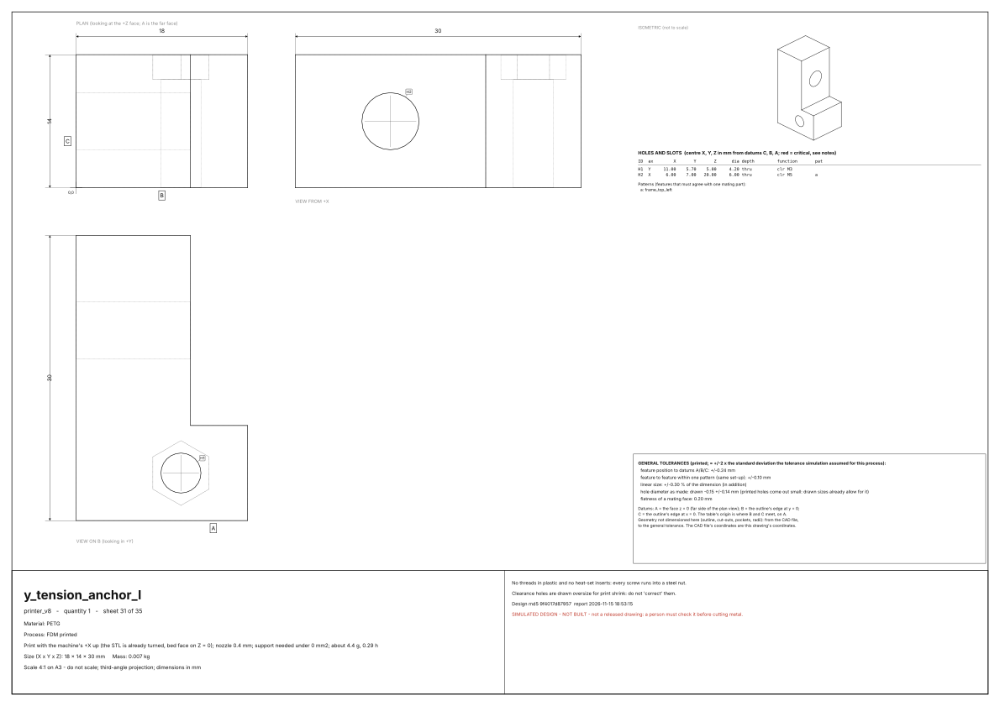

- Quantity 1. PETG; printed; 18 x 14 x 30 mm; 0.007 kg. Same or mirror-image geometry as x_tension_anchor, y_tension_anchor.
- Print with the machine's **+X** direction up (STL already turned). Support needed under 0.0 mm2; longest bridge 3.5 mm; bed contact 0.86; thinnest wall 1.73 mm; 4.4 g, 0.29 h (estimate). Holes opening on the bed face: 1 (first-layer squash makes them tight).
- Threads: none. Heat-set inserts: none. Reaming: none.

| ID | Kind | Axis | X | Y | Z | Dia / width | Slot length | Depth | Counterbore (dia x depth, from) | Function | Screws | On its axis | Pattern | Critical |
|---|---|---|---|---|---|---|---|---|---|---|---|---|---|---|
| H1 | hole | Y | 11 | 5.7 | 5 | 4.2 | - | through | - | clearance M3 | y_tension_screw_l (SHCS-M3x25) | - | - | - |
| H2 | hole | X | 6 | 7 | 20 | 6 | - | through | - | clearance M5 | y_tension_anchor_l_bolt (SHCS-M5x16) | - | a: frame_top_left | - |

### y_idler_mount_l

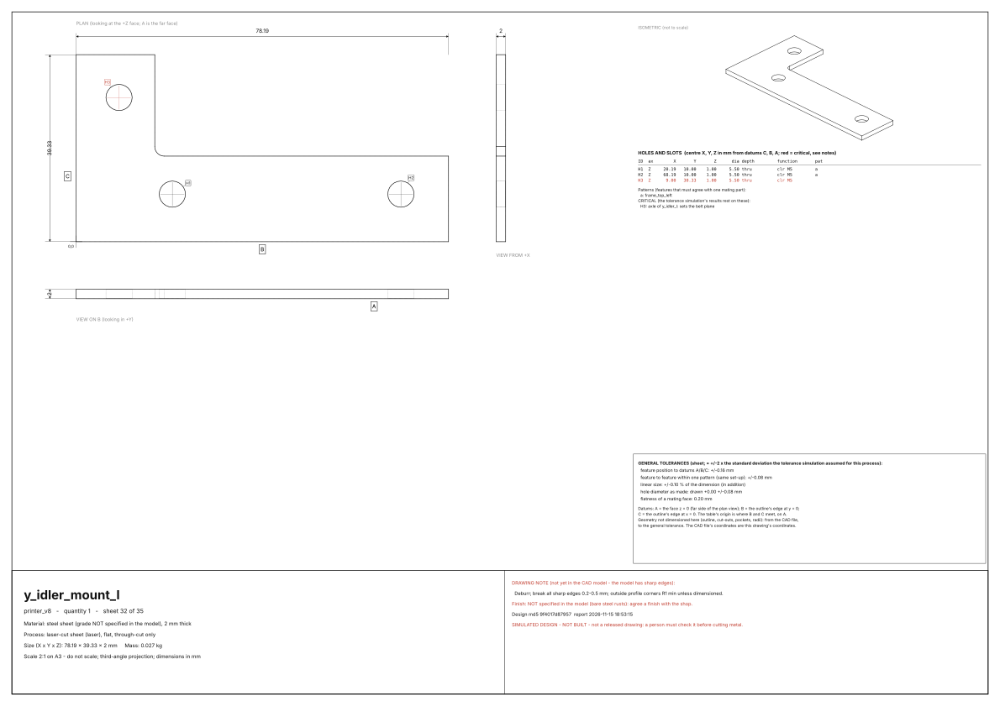

- Quantity 1. steel sheet (grade NOT specified in the model); sheet; 78.19 x 39.33 x 2 mm; 0.027 kg. Same or mirror-image geometry as y_idler_mount.
- Sheet 2 mm, laser cut, flat (no bends), through-cut only. Flat size [78.2, 39.3] mm, cut length 286.0 mm, 4 pierces (report). DXF written here: {'LINE': 6, 'ARC': 1, 'CIRCLE': 3}, cut length 286.0 mm, extent (78.19, 39.33).
- Threads: none. Heat-set inserts: none. Reaming: none.
- Drawing note, not yet in the model: Deburr; break all sharp edges 0.2-0.5 mm; outside profile corners R1 min unless dimensioned.
- **Needs more than the general tolerance, or rests on an assumption:**
  - This part places a pulley or idler: its thickness and flatness are in the belt-plane result (x_belt: 99.5% of builds within 1 mm, +/-0.13%; y_belt: 98.1% of builds within 1 mm, +/-0.25%; y_belt_l: 98.1% of builds within 1 mm, +/-0.25%).

| ID | Kind | Axis | X | Y | Z | Dia / width | Slot length | Depth | Counterbore (dia x depth, from) | Function | Screws | On its axis | Pattern | Critical |
|---|---|---|---|---|---|---|---|---|---|---|---|---|---|---|
| H1 | hole | Z | 20.19 | 10 | 1 | 5.5 | - | through | - | clearance M5 | y_idler_mount_l_bolt_0 (SHCS-M5x8) | - | a: frame_top_left | - |
| H2 | hole | Z | 68.19 | 10 | 1 | 5.5 | - | through | - | clearance M5 | y_idler_mount_l_bolt_1 (SHCS-M5x8) | - | a: frame_top_left | - |
| H3 | hole | Z | 9 | 30.33 | 1 | 5.5 | - | through | - | clearance M5 | y_idler_l_bolt (SHCS-M5x30) | - | - | axle of y_idler_l: sets the belt plane |

### y_endstop_mount

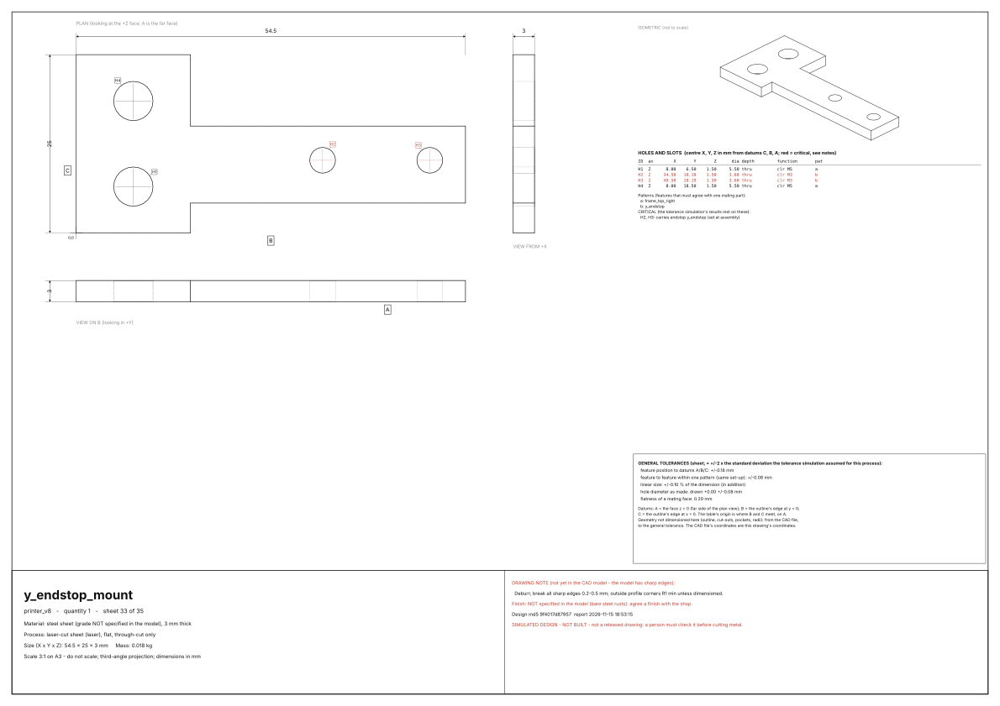

- Quantity 1. steel sheet (grade NOT specified in the model); sheet; 54.5 x 25 x 3 mm; 0.018 kg.
- Sheet 3 mm, laser cut, flat (no bends), through-cut only. Flat size [54.5, 25.0] mm, cut length 216.0 mm, 5 pierces (report). DXF written here: {'LINE': 8, 'CIRCLE': 4}, cut length 216.2 mm, extent (54.5, 25.0).
- Threads: none. Heat-set inserts: none. Reaming: none.
- Drawing note, not yet in the model: Deburr; break all sharp edges 0.2-0.5 mm; outside profile corners R1 min unless dimensioned.

| ID | Kind | Axis | X | Y | Z | Dia / width | Slot length | Depth | Counterbore (dia x depth, from) | Function | Screws | On its axis | Pattern | Critical |
|---|---|---|---|---|---|---|---|---|---|---|---|---|---|---|
| H1 | hole | Z | 8 | 6.5 | 1.5 | 5.5 | - | through | - | clearance M5 | y_endstop_mount_bolt_1 (SHCS-M5x8) | - | a: frame_top_right | - |
| H2 | hole | Z | 34.5 | 10.19 | 1.5 | 3.6 | - | through | - | clearance M3 | y_endstop_screw_0 (SHCS-M3x12) | - | b: y_endstop | carries endstop y_endstop (set at assembly) |
| H3 | hole | Z | 49.5 | 10.19 | 1.5 | 3.6 | - | through | - | clearance M3 | y_endstop_screw_1 (SHCS-M3x12) | - | b: y_endstop | carries endstop y_endstop (set at assembly) |
| H4 | hole | Z | 8 | 18.5 | 1.5 | 5.5 | - | through | - | clearance M5 | y_endstop_mount_bolt_0 (SHCS-M5x8) | - | a: frame_top_right | - |

### electronics_tray

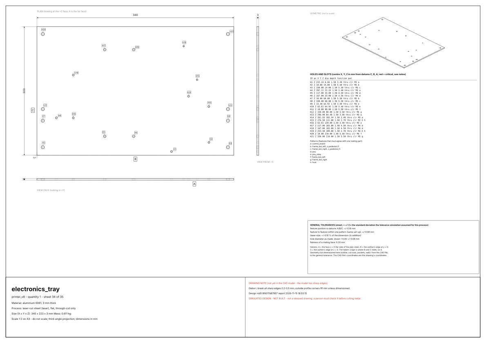

- Quantity 1. aluminium 6061; sheet; 340 x 223 x 3 mm; 0.611 kg.
- Sheet 3 mm, laser cut, flat (no bends), through-cut only. Flat size [340.0, 223.0] mm, cut length 1412.0 mm, 22 pierces (report). DXF written here: {'LINE': 4, 'CIRCLE': 21}, cut length 1412.5 mm, extent (340.0, 223.0).
- Threads: none. Heat-set inserts: none. Reaming: none.
- Drawing note, not yet in the model: Deburr; break all sharp edges 0.2-0.5 mm; outside profile corners R1 min unless dimensioned.
- **Needs more than the general tolerance, or rests on an assumption:**
  - Report, manufacture `hole_smaller_than_thickness`: 2 hole(s) or cut-out(s) narrower than the 3 mm sheet (smallest 2.70 mm at [106.5, -7.0, 21.5]): they cut, but taper and lose accuracy.

| ID | Kind | Axis | X | Y | Z | Dia / width | Slot length | Depth | Counterbore (dia x depth, from) | Function | Screws | On its axis | Pattern | Critical |
|---|---|---|---|---|---|---|---|---|---|---|---|---|---|---|
| H1 | hole | Z | 232.44 | 6.66 | 1.5 | 3.4 | - | through | - | clearance M3 | control_board_screw_4 (SHCS-M3x16) | - | a: control_board | - |
| H2 | hole | Z | 10 | 14 | 1.5 | 5.5 | - | through | - | clearance M5 | z_pedestal_fl_bolt_0 (SHCS-M5x16) | - | b: frame_bot_left, z_pedestal_fl | - |
| H3 | hole | Z | 330 | 14 | 1.5 | 5.5 | - | through | - | clearance M5 | z_pedestal_fr_bolt_0 (SHCS-M5x16) | - | c: frame_bot_right, z_pedestal_fr | - |
| H4 | hole | Z | 297.11 | 22.33 | 1.5 | 3.4 | - | through | - | clearance M3 | control_board_screw_1 (SHCS-M3x16) | - | a: control_board | - |
| H5 | hole | Z | 117 | 33 | 1.5 | 4.5 | - | through | - | clearance M4 | psu_screw_2 (SHCS-M4x6) | - | d: psu | - |
| H6 | hole | Z | 167 | 33 | 1.5 | 4.5 | - | through | - | clearance M4 | psu_screw_3 (SHCS-M4x6) | - | d: psu | - |
| H7 | hole | Z | 10 | 60 | 1.5 | 5.5 | - | through | - | clearance M5 | z_pedestal_fl_bolt_1 (SHCS-M5x16) | - | b: frame_bot_left, z_pedestal_fl | - |
| H8 | hole | Z | 330 | 60 | 1.5 | 5.5 | - | through | - | clearance M5 | z_pedestal_fr_bolt_1 (SHCS-M5x16) | - | c: frame_bot_right, z_pedestal_fr | - |
| H9 | hole | Z | 33.4 | 64.92 | 1.5 | 3.4 | - | through | - | clearance M3 | psu_relay_screw_1 (SHCS-M3x16) | - | e: psu_relay | - |
| H10 | hole | Z | 62.61 | 64.92 | 1.5 | 3.4 | - | through | - | clearance M3 | psu_relay_screw_0 (SHCS-M3x16) | - | e: psu_relay | - |
| H11 | hole | Z | 10 | 80 | 1.5 | 5.5 | - | through | - | clearance M5 | tray_bolt_0 (SHCS-M5x8) | - | f: frame_bot_left | - |
| H12 | hole | Z | 330 | 80 | 1.5 | 5.5 | - | through | - | clearance M5 | tray_bolt_2 (SHCS-M5x8) | - | g: frame_bot_right | - |
| H13 | hole | Z | 296.9 | 84.48 | 1.5 | 3.4 | - | through | - | clearance M3 | control_board_screw_0 (SHCS-M3x16) | - | a: control_board | - |
| H14 | hole | Z | 261.93 | 102.34 | 1.5 | 3.4 | - | through | - | clearance M3 | control_board_screw_2 (SHCS-M3x16) | - | a: control_board | - |
| H15 | hole | Z | 276.5 | 131 | 1.5 | 2.7 | - | through | - | clearance M2.5 | host_screw_0 (SHCS-M2.5x12) | - | h: host | - |
| H16 | hole | Z | 62.61 | 139.09 | 1.5 | 3.4 | - | through | - | clearance M3 | psu_relay_screw_2 (SHCS-M3x16) | - | e: psu_relay | - |
| H17 | hole | Z | 117 | 183 | 1.5 | 4.5 | - | through | - | clearance M4 | psu_screw_0 (SHCS-M4x6) | - | d: psu | - |
| H18 | hole | Z | 167 | 183 | 1.5 | 4.5 | - | through | - | clearance M4 | psu_screw_1 (SHCS-M4x6) | - | d: psu | - |
| H19 | hole | Z | 253.5 | 189 | 1.5 | 2.7 | - | through | - | clearance M2.5 | host_screw_3 (SHCS-M2.5x12) | - | h: host | - |
| H20 | hole | Z | 10 | 210 | 1.5 | 5.5 | - | through | - | clearance M5 | tray_bolt_1 (SHCS-M5x8) | - | f: frame_bot_left | - |
| H21 | hole | Z | 330 | 210 | 1.5 | 5.5 | - | through | - | clearance M5 | tray_bolt_3 (SHCS-M5x8) | - | g: frame_bot_right | - |

### inlet_panel

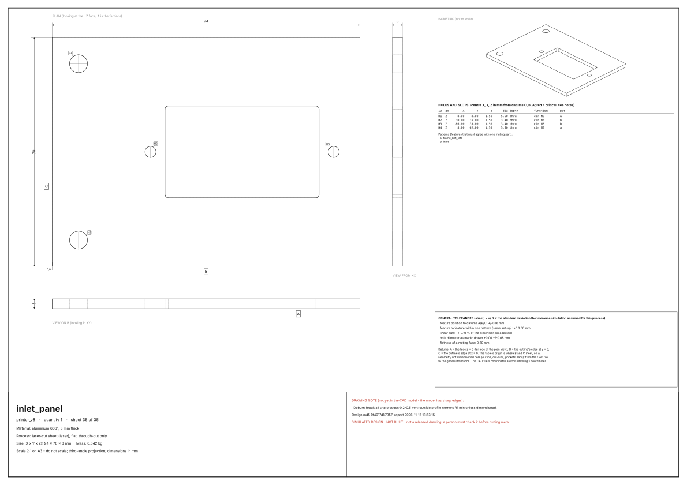

- Quantity 1. aluminium 6061; sheet; 94 x 70 x 3 mm; 0.042 kg.
- Sheet 3 mm, laser cut, flat (no bends), through-cut only. Flat size [94.0, 70.0] mm, cut length 533.0 mm, 6 pierces (report). DXF written here: {'LINE': 8, 'CIRCLE': 4, 'ARC': 4}, cut length 532.6 mm, extent (94.0, 70.0).
- Threads: none. Heat-set inserts: none. Reaming: none.
- Drawing note, not yet in the model: Deburr; break all sharp edges 0.2-0.5 mm; outside profile corners R1 min unless dimensioned.
- **Needs more than the general tolerance, or rests on an assumption:**
  - Report, manufacture `holes_too_close`: 2 pair(s) of holes or cut-outs with too little material between them (least 2.75 mm at [-171.5, 22.0, 74.0], wanted 3 mm = 1 x thickness).

| ID | Kind | Axis | X | Y | Z | Dia / width | Slot length | Depth | Counterbore (dia x depth, from) | Function | Screws | On its axis | Pattern | Critical |
|---|---|---|---|---|---|---|---|---|---|---|---|---|---|---|
| H1 | hole | Z | 8 | 8 | 1.5 | 5.5 | - | through | - | clearance M5 | inlet_panel_bolt_1 (SHCS-M5x8) | - | a: frame_bot_left | - |
| H2 | hole | Z | 30 | 35 | 1.5 | 3.4 | - | through | - | clearance M3 | inlet_screw_1 (SHCS-M3x16) | - | b: inlet | - |
| H3 | hole | Z | 86 | 35 | 1.5 | 3.4 | - | through | - | clearance M3 | inlet_screw_0 (SHCS-M3x16) | - | b: inlet | - |
| H4 | hole | Z | 8 | 62 | 1.5 | 5.5 | - | through | - | clearance M5 | inlet_panel_bolt_0 (SHCS-M5x8) | - | a: frame_bot_left | - |
