# Fabrication drawings: printer_v8_1

Generated by `tools/build_package.py` from `designs/printer_v8_1.py` (md5 `55c09c8cc5dd5178daf9a2c4bc0cc34a`) and `out/printer_v8_1/report.json` (written 2026-11-16 19:23:38, md5 `c8096a4e1a4a`). Do not edit: change the design, re-run verify, re-run the generator.

> **Simulated design. Nothing has been built.** See [OPEN_ITEMS.md](OPEN_ITEMS.md) before spending money.

59 custom parts: 5 printed, 54 sheet. One sheet per part in `drawings/` (SVG and PDF; all sheets in `drawings/printer_v8_1_drawings.pdf`), a STEP file per part in `cad/` **in the drawing's own coordinates** (the hole table's X, Y, Z are the STEP's X, Y, Z), a DXF of the flat profile per sheet part in `dxf/` (same origin), an STL per printed part in `stl/` already turned to its print orientation.

## What is automatic and what a person must add

Automatic, from the design's geometry and fasteners: three orthographic views and an isometric, overall dimensions, the datum scheme, a table of every round hole and round-ended slot (position, size, depth, counterbore, what it is for, which pattern it belongs to), the tolerance block, the critical-feature list, the files.

**Not automatic. A person must add or check before release:**

- Dimensions of everything that is not a round hole or a slot: outline steps, cut-outs, windows, pockets, nut slots, inside radii. They are in the STEP / DXF only; the sheet says so.
- The datum scheme is geometric (bounding edges of the plan view). On L-shaped or notched parts choose functional datums and re-reference the table.
- Surface finish, edge condition beyond the general deburr note, plating or paint (none is in the model: every steel part is bare).
- Hole labels are placed by rule and can sit on top of each other on dense patterns; the table is authoritative.
- Thread class, tap depth beyond 'through', and any geometric tolerance frames (the block gives plus/minus values, not GD&T).
- A drawing check by someone who has made parts: these sheets have not been reviewed by a person.

## Tolerances: where the numbers come from

`mechloop/tolerance/process.py` holds, per process, the standard deviations the tolerance verifier built its 3000 simulated machines with. The sheets hold the fabricator to +/-2 standard deviations of the same figures, so a batch of parts inside the drawing tolerance is the population that was simulated. A part AT the limit everywhere is worse than what was simulated: the limits are not a licence to sit on them.

| Process | Position to datums | Within one pattern | Size | Hole diameter as made | Mating-face flatness | Model sd (pos / pattern / hole) |
|---|---|---|---|---|---|---|
| sheet | +/-0.16 | +/-0.08 | +/-0.10 % | drawn +0.00 +/-0.08 | 0.20 | 0.08 / 0.04 / 0.04 |
| extrusion | +/-0.30 | +/-0.20 | +/-0.20 % | drawn +0.00 +/-0.06 | 0.10 | 0.15 / 0.1 / 0.03 |
| printed | +/-0.24 | +/-0.10 | +/-0.30 % | drawn -0.15 +/-0.14 | 0.20 | 0.12 / 0.05 / 0.07 |

The model's own comment calls these 'typical shop figures, deliberately a little pessimistic' and recalled class values: confirm them with the shop that quotes.

## Printing

- Printer assumed by the manufacture verifier: build volume (220.0, 220.0, 220.0), nozzle 0.4 mm, layer 0.2 (the verifier default: the design does not declare one) mm.
- Orientation: pinned per part in the design (`print_up`), listed below; the STL is already turned so the bed face is on Z = 0.
- Walls and infill: **not declared by the design.** The verifier's mass and time estimate used: None.
- **The FEA load cases treat every printed part as solid, isotropic material.** A part printed at 20 % infill is not the part that was analysed. For the parts with a load case (), print solid or accept that the factor of safety is unverified.
- No threads in plastic, no heat-set inserts: every screw in a printed part runs into a steel nut (captive pockets and slots are in the models).
- Printed clearance holes are drawn at ISO 273 medium + 0.2 mm FDM allowance (M2.5 3.1, M3 3.6, M4 4.7, M5 5.7, M6 6.8; +0.3 and a teardrop or flat top for a hole whose axis lies in the build plane): vertical holes print undersize. Starting values: print a coupon of M3 holes 3.4 to 3.8 in 0.1 mm steps on the printer that will make the parts, then set the allowance and the slicer's hole compensation (docs/DESIGN_GUIDELINES.md). Bearing seats and insert pockets are drawn to their own figures.

## Parts

| Part | Process | Material | X x Y x Z mm | Mass kg | Holes / slots | Critical features | Same or mirror-image geometry | Files |
|---|---|---|---|---|---|---|---|---|
| back_plate | sheet | aluminium 6061 | 215 x 100.08 x 4.75 | 0.264 | 13 / 0 | 8 | - | [svg](drawings/back_plate.svg) [pdf](drawings/back_plate.pdf) [dxf](dxf/back_plate.dxf) [step](cad/back_plate.step) |
| front_plate | sheet | aluminium 6061 | 256 x 98.35 x 12.7 | 0.846 | 4 / 0 | 0 | - | [svg](drawings/front_plate.svg) [pdf](drawings/front_plate.pdf) [dxf](dxf/front_plate.dxf) [step](cad/front_plate.step) |
| nut_plate | sheet | aluminium 6061 | 82.25 x 78 x 9.53 | 0.114 | 3 / 0 | 0 | - | [svg](drawings/nut_plate.svg) [pdf](drawings/nut_plate.pdf) [dxf](dxf/nut_plate.dxf) [step](cad/nut_plate.step) |
| nut_plate_fl | sheet | aluminium 6061 | 67.5 x 40 x 6.35 | 0.041 | 3 / 0 | 0 | nut_plate_fr | [svg](drawings/nut_plate_fl.svg) [pdf](drawings/nut_plate_fl.pdf) [dxf](dxf/nut_plate_fl.dxf) [step](cad/nut_plate_fl.step) |
| nut_plate_fr | sheet | aluminium 6061 | 67.5 x 40 x 6.35 | 0.041 | 3 / 0 | 0 | nut_plate_fl | [svg](drawings/nut_plate_fr.svg) [pdf](drawings/nut_plate_fr.pdf) [dxf](dxf/nut_plate_fr.dxf) [step](cad/nut_plate_fr.step) |
| bed_plate | sheet | cast aluminium tooling plate (MIC-6 class), faces as supplied | 256.5 x 220 x 9.53 | 2.505* | 6 / 0 | 0 | - | [svg](drawings/bed_plate.svg) [pdf](drawings/bed_plate.pdf) [dxf](dxf/bed_plate.dxf) [step](cad/bed_plate.step) |
| bed_post_tab_0 | sheet | aluminium 6061 | 45.3 x 38 x 4.75 | 0.021 | 3 / 0 | 0 | bed_post_tab_1, bed_post_tab_2, bed_post_tab_3 | [svg](drawings/bed_post_tab_0.svg) [pdf](drawings/bed_post_tab_0.pdf) [dxf](dxf/bed_post_tab_0.dxf) [step](cad/bed_post_tab_0.step) |
| bed_post_tab_1 | sheet | aluminium 6061 | 45.3 x 38 x 4.75 | 0.021 | 3 / 0 | 0 | bed_post_tab_0, bed_post_tab_2, bed_post_tab_3 | [svg](drawings/bed_post_tab_1.svg) [pdf](drawings/bed_post_tab_1.pdf) [dxf](dxf/bed_post_tab_1.dxf) [step](cad/bed_post_tab_1.step) |
| bed_post_tab_2 | sheet | aluminium 6061 | 45.3 x 38 x 4.75 | 0.021 | 3 / 0 | 0 | bed_post_tab_0, bed_post_tab_1, bed_post_tab_3 | [svg](drawings/bed_post_tab_2.svg) [pdf](drawings/bed_post_tab_2.pdf) [dxf](dxf/bed_post_tab_2.dxf) [step](cad/bed_post_tab_2.step) |
| bed_post_tab_3 | sheet | aluminium 6061 | 45.3 x 38 x 4.75 | 0.021 | 3 / 0 | 0 | bed_post_tab_0, bed_post_tab_1, bed_post_tab_2 | [svg](drawings/bed_post_tab_3.svg) [pdf](drawings/bed_post_tab_3.pdf) [dxf](dxf/bed_post_tab_3.dxf) [step](cad/bed_post_tab_3.step) |
| bed_tie | sheet | stainless steel 304 | 54 x 48.5 x 20 | 0.042 | 4 / 0 | 0 | - | [svg](drawings/bed_tie.svg) [pdf](drawings/bed_tie.pdf) [dxf](dxf/bed_tie.dxf) [step](cad/bed_tie.step) |
| z_drive_plate | sheet | aluminium 6061 | 102.46 x 63.07 x 6.35 | 0.078 | 7 / 1 | 6 | - | [svg](drawings/z_drive_plate.svg) [pdf](drawings/z_drive_plate.pdf) [dxf](dxf/z_drive_plate.dxf) [step](cad/z_drive_plate.step) |
| z_rear_r1 | sheet | aluminium 6061 | 79.8 x 53.94 x 6.35 | 0.045 | 3 / 0 | 0 | - | [svg](drawings/z_rear_r1.svg) [pdf](drawings/z_rear_r1.pdf) [dxf](dxf/z_rear_r1.dxf) [step](cad/z_rear_r1.step) |
| z_rear_r0 | sheet | aluminium 6061 | 79.8 x 53.94 x 3.18 | 0.025 | 4 / 0 | 0 | - | [svg](drawings/z_rear_r0.svg) [pdf](drawings/z_rear_r0.pdf) [dxf](dxf/z_rear_r0.dxf) [step](cad/z_rear_r0.step) |
| z_rear_h1 | sheet | aluminium 6061 | 79.57 x 51.63 x 4.75 | 0.031 | 4 / 0 | 0 | - | [svg](drawings/z_rear_h1.svg) [pdf](drawings/z_rear_h1.pdf) [dxf](dxf/z_rear_h1.dxf) [step](cad/z_rear_h1.step) |
| z_rear_r3 | sheet | aluminium 6061 | 49.34 x 34.01 x 4.75 | 0.015 | 3 / 0 | 1 | - | [svg](drawings/z_rear_r3.svg) [pdf](drawings/z_rear_r3.pdf) [dxf](dxf/z_rear_r3.dxf) [step](cad/z_rear_r3.step) |
| z_rear_h2a | sheet | aluminium 6061 | 49.23 x 34 x 4.75 | 0.013 | 2 / 0 | 0 | - | [svg](drawings/z_rear_h2a.svg) [pdf](drawings/z_rear_h2a.pdf) [dxf](dxf/z_rear_h2a.dxf) [step](cad/z_rear_h2a.step) |
| z_rear_h2b | sheet | aluminium 5052-H32 | 49.23 x 34 x 2.29 | 0.006 | 2 / 0 | 0 | - | [svg](drawings/z_rear_h2b.svg) [pdf](drawings/z_rear_h2b.pdf) [dxf](dxf/z_rear_h2b.dxf) [step](cad/z_rear_h2b.step) |
| z_rear_r4 | sheet | aluminium 6061 | 49.34 x 34.01 x 3.17 | 0.010 | 3 / 0 | 1 | - | [svg](drawings/z_rear_r4.svg) [pdf](drawings/z_rear_r4.pdf) [dxf](dxf/z_rear_r4.dxf) [step](cad/z_rear_r4.step) |
| z_rear_shim | sheet | aluminium 6061 | 11.8 x 12.1 x 1.6 | 0.000 | 1 / 0 | 0 | z_fl_shim, z_fr_shim | [svg](drawings/z_rear_shim.svg) [pdf](drawings/z_rear_shim.pdf) [dxf](dxf/z_rear_shim.dxf) [step](cad/z_rear_shim.step) |
| z_fl_r1 | sheet | aluminium 6061 | 64.62 x 55.88 x 6.35 | 0.036 | 3 / 0 | 0 | z_fr_r1 | [svg](drawings/z_fl_r1.svg) [pdf](drawings/z_fl_r1.pdf) [dxf](dxf/z_fl_r1.dxf) [step](cad/z_fl_r1.step) |
| z_fl_h1 | sheet | aluminium 6061 | 62.48 x 52.43 x 4.75 | 0.024 | 4 / 0 | 0 | z_fr_h1 | [svg](drawings/z_fl_h1.svg) [pdf](drawings/z_fl_h1.pdf) [dxf](dxf/z_fl_h1.dxf) [step](cad/z_fl_h1.step) |
| z_fl_r3 | sheet | aluminium 6061 | 49.01 x 34 x 4.75 | 0.014 | 3 / 0 | 0 | z_fr_r3 | [svg](drawings/z_fl_r3.svg) [pdf](drawings/z_fl_r3.pdf) [dxf](dxf/z_fl_r3.dxf) [step](cad/z_fl_r3.step) |
| z_fl_h2a | sheet | aluminium 6061 | 49.01 x 34 x 4.75 | 0.012 | 2 / 0 | 0 | z_fr_h2a | [svg](drawings/z_fl_h2a.svg) [pdf](drawings/z_fl_h2a.pdf) [dxf](dxf/z_fl_h2a.dxf) [step](cad/z_fl_h2a.step) |
| z_fl_h2b | sheet | aluminium 5052-H32 | 49.01 x 34 x 2.29 | 0.006 | 2 / 0 | 0 | z_fr_h2b | [svg](drawings/z_fl_h2b.svg) [pdf](drawings/z_fl_h2b.pdf) [dxf](dxf/z_fl_h2b.dxf) [step](cad/z_fl_h2b.step) |
| z_fl_r4 | sheet | aluminium 6061 | 49.01 x 34 x 3.17 | 0.009 | 3 / 0 | 0 | z_fr_r4 | [svg](drawings/z_fl_r4.svg) [pdf](drawings/z_fl_r4.pdf) [dxf](dxf/z_fl_r4.dxf) [step](cad/z_fl_r4.step) |
| z_fl_shim | sheet | aluminium 6061 | 11.8 x 12.1 x 1.6 | 0.000 | 1 / 0 | 0 | z_rear_shim, z_fr_shim | [svg](drawings/z_fl_shim.svg) [pdf](drawings/z_fl_shim.pdf) [dxf](dxf/z_fl_shim.dxf) [step](cad/z_fl_shim.step) |
| z_fr_r1 | sheet | aluminium 6061 | 64.62 x 55.88 x 6.35 | 0.036 | 3 / 0 | 0 | z_fl_r1 | [svg](drawings/z_fr_r1.svg) [pdf](drawings/z_fr_r1.pdf) [dxf](dxf/z_fr_r1.dxf) [step](cad/z_fr_r1.step) |
| z_fr_h1 | sheet | aluminium 6061 | 62.48 x 52.43 x 4.75 | 0.024 | 4 / 0 | 0 | z_fl_h1 | [svg](drawings/z_fr_h1.svg) [pdf](drawings/z_fr_h1.pdf) [dxf](dxf/z_fr_h1.dxf) [step](cad/z_fr_h1.step) |
| z_fr_r3 | sheet | aluminium 6061 | 49.01 x 34 x 4.75 | 0.014 | 3 / 0 | 0 | z_fl_r3 | [svg](drawings/z_fr_r3.svg) [pdf](drawings/z_fr_r3.pdf) [dxf](dxf/z_fr_r3.dxf) [step](cad/z_fr_r3.step) |
| z_fr_h2a | sheet | aluminium 6061 | 49.01 x 34 x 4.75 | 0.012 | 2 / 0 | 0 | z_fl_h2a | [svg](drawings/z_fr_h2a.svg) [pdf](drawings/z_fr_h2a.pdf) [dxf](dxf/z_fr_h2a.dxf) [step](cad/z_fr_h2a.step) |
| z_fr_h2b | sheet | aluminium 5052-H32 | 49.01 x 34 x 2.29 | 0.006 | 2 / 0 | 0 | z_fl_h2b | [svg](drawings/z_fr_h2b.svg) [pdf](drawings/z_fr_h2b.pdf) [dxf](dxf/z_fr_h2b.dxf) [step](cad/z_fr_h2b.step) |
| z_fr_r4 | sheet | aluminium 6061 | 49.01 x 34 x 3.17 | 0.009 | 3 / 0 | 0 | z_fl_r4 | [svg](drawings/z_fr_r4.svg) [pdf](drawings/z_fr_r4.pdf) [dxf](dxf/z_fr_r4.dxf) [step](cad/z_fr_r4.step) |
| z_fr_shim | sheet | aluminium 6061 | 11.8 x 12.1 x 1.6 | 0.000 | 1 / 0 | 0 | z_rear_shim, z_fl_shim | [svg](drawings/z_fr_shim.svg) [pdf](drawings/z_fr_shim.pdf) [dxf](dxf/z_fr_shim.dxf) [step](cad/z_fr_shim.step) |
| y_plate_left | sheet | aluminium 6061 | 74.93 x 68 x 4.75 | 0.036 | 4 / 8 | 6 | - | [svg](drawings/y_plate_left.svg) [pdf](drawings/y_plate_left.pdf) [dxf](dxf/y_plate_left.dxf) [step](cad/y_plate_left.step) |
| y_plate_right | sheet | aluminium 6061 | 73.43 x 43.5 x 4.75 | 0.030 | 4 / 6 | 4 | - | [svg](drawings/y_plate_right.svg) [pdf](drawings/y_plate_right.pdf) [dxf](dxf/y_plate_right.dxf) [step](cad/y_plate_right.step) |
| x_rail_stop_left | sheet | aluminium 6061 | 26.5 x 20 x 3.18 | 0.003 | 1 / 0 | 0 | x_rail_stop_right | [svg](drawings/x_rail_stop_left.svg) [pdf](drawings/x_rail_stop_left.pdf) [dxf](dxf/x_rail_stop_left.dxf) [step](cad/x_rail_stop_left.step) |
| x_rail_stop_right | sheet | aluminium 6061 | 26.5 x 20 x 3.18 | 0.003 | 1 / 0 | 0 | x_rail_stop_left | [svg](drawings/x_rail_stop_right.svg) [pdf](drawings/x_rail_stop_right.pdf) [dxf](dxf/x_rail_stop_right.dxf) [step](cad/x_rail_stop_right.step) |
| tool_plate | sheet | aluminium 6061 | 65 x 61.5 x 3.18 | 0.022 | 10 / 0 | 4 | - | [svg](drawings/tool_plate.svg) [pdf](drawings/tool_plate.pdf) [dxf](dxf/tool_plate.dxf) [step](cad/tool_plate.step) |
| tool_plate_rear | sheet | aluminium 6061 | 65 x 61.5 x 4.75 | 0.030 | 6 / 0 | 4 | - | [svg](drawings/tool_plate_rear.svg) [pdf](drawings/tool_plate_rear.pdf) [dxf](dxf/tool_plate_rear.dxf) [step](cad/tool_plate_rear.step) |
| probe_mount | printed | ABS | 37 x 21.69 x 52.05 | 0.007 | 3 / 0 | 1 | - | [svg](drawings/probe_mount.svg) [pdf](drawings/probe_mount.pdf) [step](cad/probe_mount.step) [stl](stl/probe_mount.stl) |
| part_duct | printed | ABS | 47 x 33.3 x 30 | 0.010 | 6 / 0 | 0 | - | [svg](drawings/part_duct.svg) [pdf](drawings/part_duct.pdf) [step](cad/part_duct.step) [stl](stl/part_duct.stl) |
| x_belt_bracket | sheet | aluminium 5052-H32 | 31 x 30 x 12.6 | 0.007 | 6 / 0 | 0 | - | [svg](drawings/x_belt_bracket.svg) [pdf](drawings/x_belt_bracket.pdf) [dxf](dxf/x_belt_bracket.dxf) [step](cad/x_belt_bracket.step) |
| x_belt_clamp | sheet | aluminium 6061 | 30 x 22.5 x 2.03 | 0.003 | 4 / 0 | 0 | - | [svg](drawings/x_belt_clamp.svg) [pdf](drawings/x_belt_clamp.pdf) [dxf](dxf/x_belt_clamp.dxf) [step](cad/x_belt_clamp.step) |
| x_motor_mount | sheet | aluminium 6061 | 64 x 50 x 3.17 | 0.023 | 7 / 0 | 5 | - | [svg](drawings/x_motor_mount.svg) [pdf](drawings/x_motor_mount.pdf) [dxf](dxf/x_motor_mount.dxf) [step](cad/x_motor_mount.step) |
| x_idler_mount | sheet | aluminium 5052-H32 | 53 x 50 x 22 | 0.030 | 3 / 0 | 1 | - | [svg](drawings/x_idler_mount.svg) [pdf](drawings/x_idler_mount.pdf) [dxf](dxf/x_idler_mount.dxf) [step](cad/x_idler_mount.step) |
| x_tension_anchor | sheet | aluminium 5052-H32 | 34 x 30 x 22 | 0.012 | 3 / 0 | 0 | - | [svg](drawings/x_tension_anchor.svg) [pdf](drawings/x_tension_anchor.pdf) [dxf](dxf/x_tension_anchor.dxf) [step](cad/x_tension_anchor.step) |
| y_motor_mount | sheet | stainless steel 304 | 100 x 55.08 x 22 | 0.057 | 7 / 0 | 5 | y_motor_mount_l | [svg](drawings/y_motor_mount.svg) [pdf](drawings/y_motor_mount.pdf) [dxf](dxf/y_motor_mount.dxf) [step](cad/y_motor_mount.step) |
| y_tension_anchor | sheet | aluminium 5052-H32 | 34 x 22 x 20 | 0.008 | 3 / 0 | 0 | y_tension_anchor_l | [svg](drawings/y_tension_anchor.svg) [pdf](drawings/y_tension_anchor.pdf) [dxf](dxf/y_tension_anchor.dxf) [step](cad/y_tension_anchor.step) |
| y_idler_mount | sheet | stainless steel 304 | 77.87 x 41.08 x 1.88 | 0.026 | 3 / 0 | 1 | y_idler_mount_l | [svg](drawings/y_idler_mount.svg) [pdf](drawings/y_idler_mount.pdf) [dxf](dxf/y_idler_mount.dxf) [step](cad/y_idler_mount.step) |
| y_motor_mount_l | sheet | stainless steel 304 | 100 x 55.08 x 22 | 0.057 | 7 / 0 | 5 | y_motor_mount | [svg](drawings/y_motor_mount_l.svg) [pdf](drawings/y_motor_mount_l.pdf) [dxf](dxf/y_motor_mount_l.dxf) [step](cad/y_motor_mount_l.step) |
| y_tension_anchor_l | sheet | aluminium 5052-H32 | 34 x 22 x 20 | 0.008 | 3 / 0 | 0 | y_tension_anchor | [svg](drawings/y_tension_anchor_l.svg) [pdf](drawings/y_tension_anchor_l.pdf) [dxf](dxf/y_tension_anchor_l.dxf) [step](cad/y_tension_anchor_l.step) |
| y_idler_mount_l | sheet | stainless steel 304 | 77.87 x 41.08 x 1.88 | 0.026 | 3 / 0 | 1 | y_idler_mount | [svg](drawings/y_idler_mount_l.svg) [pdf](drawings/y_idler_mount_l.pdf) [dxf](dxf/y_idler_mount_l.dxf) [step](cad/y_idler_mount_l.step) |
| y_endstop_mount | sheet | aluminium 6061 | 54.5 x 25 x 3.18 | 0.007 | 4 / 0 | 2 | - | [svg](drawings/y_endstop_mount.svg) [pdf](drawings/y_endstop_mount.pdf) [dxf](dxf/y_endstop_mount.dxf) [step](cad/y_endstop_mount.step) |
| mains_cover_relay | printed | PETG | 42 x 33 x 29.4 | 0.009 | 2 / 0 | 0 | - | [svg](drawings/mains_cover_relay.svg) [pdf](drawings/mains_cover_relay.pdf) [step](cad/mains_cover_relay.step) [stl](stl/mains_cover_relay.stl) |
| mains_cover_psu | printed | PETG | 139 x 17 x 32.87 | 0.011 | 2 / 0 | 0 | - | [svg](drawings/mains_cover_psu.svg) [pdf](drawings/mains_cover_psu.pdf) [step](cad/mains_cover_psu.step) [stl](stl/mains_cover_psu.stl) |
| electronics_tray | sheet | aluminium 6061 | 340 x 223 x 3.18 | 0.645 | 29 / 0 | 0 | - | [svg](drawings/electronics_tray.svg) [pdf](drawings/electronics_tray.pdf) [dxf](dxf/electronics_tray.dxf) [step](cad/electronics_tray.step) |
| inlet_panel | sheet | aluminium 6061 | 94 x 80 x 2.54 | 0.042 | 6 / 0 | 0 | - | [svg](drawings/inlet_panel.svg) [pdf](drawings/inlet_panel.pdf) [dxf](dxf/inlet_panel.dxf) [step](cad/inlet_panel.step) |
| mains_cover_inlet | printed | PETG | 54 x 32 x 70 | 0.017 | 2 / 0 | 0 | - | [svg](drawings/mains_cover_inlet.svg) [pdf](drawings/mains_cover_inlet.pdf) [step](cad/mains_cover_inlet.step) [stl](stl/mains_cover_inlet.stl) |

\* mass includes a payload mass declared on the part in the design. For flat sheet a mirror-image part is the same cut part turned over: one DXF serves both.

## Purchased parts that need work

none found

- Every extrusion: saw-cut square to the lengths in BOM.md; deburr the ends.

### back_plate

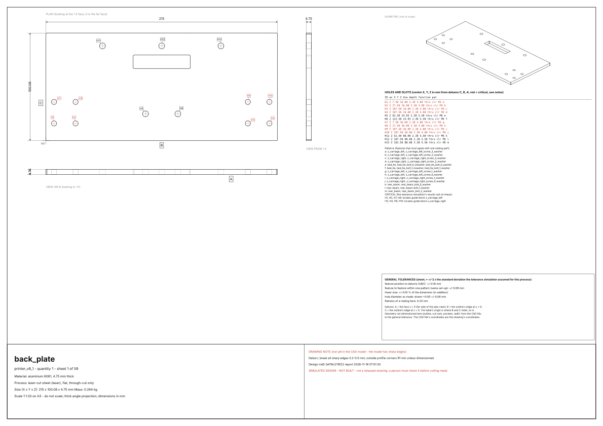

- Quantity 1. aluminium 6061; sheet; 215 x 100.08 x 4.75 mm; 0.264 kg.
- Sheet not specified mm, None cut, flat (no bends), through-cut only. Flat size None mm, cut length None mm, None pierces (report). DXF written here: {'LINE': 8, 'ARC': 8, 'CIRCLE': 13}, cut length 964.8 mm, extent (215.0, 100.08).
- Threads: none. Inserts and clinch nuts: none. Reaming: none.
- Drawing note, not yet in the model: Deburr; break all sharp edges 0.2-0.5 mm; outside profile corners R1 min unless dimensioned.
- **Needs more than the general tolerance, or rests on an assumption:**
  - **Patterns a, b, c, d, g, h, i, j** (guide block / motor): hole to hole +/-0.08 mm is the figure the screw-pattern check used (tighter than the +/-0.16 mm position tolerance); radial clearance on the screws 0.90 mm. Cut all holes of a pattern in one set-up.

| ID | Kind | Axis | X | Y | Z | Dia / width | Slot length | Depth | Counterbore (dia x depth, from) | Function | Screws | On its axis | Pattern | Critical |
|---|---|---|---|---|---|---|---|---|---|---|---|---|---|---|
| H1 | hole | Z | 7.5 | 16 | 2.38 | 4.8 | - | through | - | clearance M3 | z_carriage_left_screw_3 (SHCS-M3x8) | z_carriage_left_screw_3_washer (WASHER-M3) | a: z_carriage_left, z_carriage_left_screw_3_washer | locates guide block z_carriage_left |
| H2 | hole | Z | 27.5 | 16 | 2.38 | 4.8 | - | through | - | clearance M3 | z_carriage_left_screw_2 (SHCS-M3x8) | z_carriage_left_screw_2_washer (WASHER-M3) | b: z_carriage_left, z_carriage_left_screw_2_washer | locates guide block z_carriage_left |
| H3 | hole | Z | 187.5 | 16 | 2.38 | 4.8 | - | through | - | clearance M3 | z_carriage_right_screw_3 (SHCS-M3x8) | z_carriage_right_screw_3_washer (WASHER-M3) | c: z_carriage_right, z_carriage_right_screw_3_washer | locates guide block z_carriage_right |
| H4 | hole | Z | 207.5 | 16 | 2.38 | 4.8 | - | through | - | clearance M3 | z_carriage_right_screw_2 (SHCS-M3x8) | z_carriage_right_screw_2_washer (WASHER-M3) | d: z_carriage_right, z_carriage_right_screw_2_washer | locates guide block z_carriage_right |
| H5 | hole | Z | 92.5 | 24.93 | 2.38 | 5.5 | - | through | - | clearance M5 | bed_tie_bolt_0 (SHCS-M5x16) | - | e: bed_tie, bed_tie_bolt_0_nwasher, bed_tie_bolt_0_washer | - |
| H6 | hole | Z | 122.5 | 24.93 | 2.38 | 5.5 | - | through | - | clearance M5 | bed_tie_bolt_1 (SHCS-M5x16) | - | f: bed_tie, bed_tie_bolt_1_nwasher, bed_tie_bolt_1_washer | - |
| H7 | hole | Z | 7.5 | 36 | 2.38 | 4.8 | - | through | - | clearance M3 | z_carriage_left_screw_1 (SHCS-M3x8) | z_carriage_left_screw_1_washer (WASHER-M3) | g: z_carriage_left, z_carriage_left_screw_1_washer | locates guide block z_carriage_left |
| H8 | hole | Z | 27.5 | 36 | 2.38 | 4.8 | - | through | - | clearance M3 | z_carriage_left_screw_0 (SHCS-M3x8) | z_carriage_left_screw_0_washer (WASHER-M3) | h: z_carriage_left, z_carriage_left_screw_0_washer | locates guide block z_carriage_left |
| H9 | hole | Z | 187.5 | 36 | 2.38 | 4.8 | - | through | - | clearance M3 | z_carriage_right_screw_1 (SHCS-M3x8) | z_carriage_right_screw_1_washer (WASHER-M3) | i: z_carriage_right, z_carriage_right_screw_1_washer | locates guide block z_carriage_right |
| H10 | hole | Z | 207.5 | 36 | 2.38 | 4.8 | - | through | - | clearance M3 | z_carriage_right_screw_0 (SHCS-M3x8) | z_carriage_right_screw_0_washer (WASHER-M3) | j: z_carriage_right, z_carriage_right_screw_0_washer | locates guide block z_carriage_right |
| H11 | hole | Z | 52.5 | 88.08 | 2.38 | 5.5 | - | through | - | clearance M5 | rear_beam_bolt_0 (SHCS-M5x10) | - | k: rear_beam, rear_beam_bolt_0_washer | - |
| H12 | hole | Z | 107.5 | 88.08 | 2.38 | 5.5 | - | through | - | clearance M5 | rear_beam_bolt_1 (SHCS-M5x10) | - | l: rear_beam, rear_beam_bolt_1_washer | - |
| H13 | hole | Z | 162.5 | 88.08 | 2.38 | 5.5 | - | through | - | clearance M5 | rear_beam_bolt_2 (SHCS-M5x10) | - | m: rear_beam, rear_beam_bolt_2_washer | - |

### front_plate

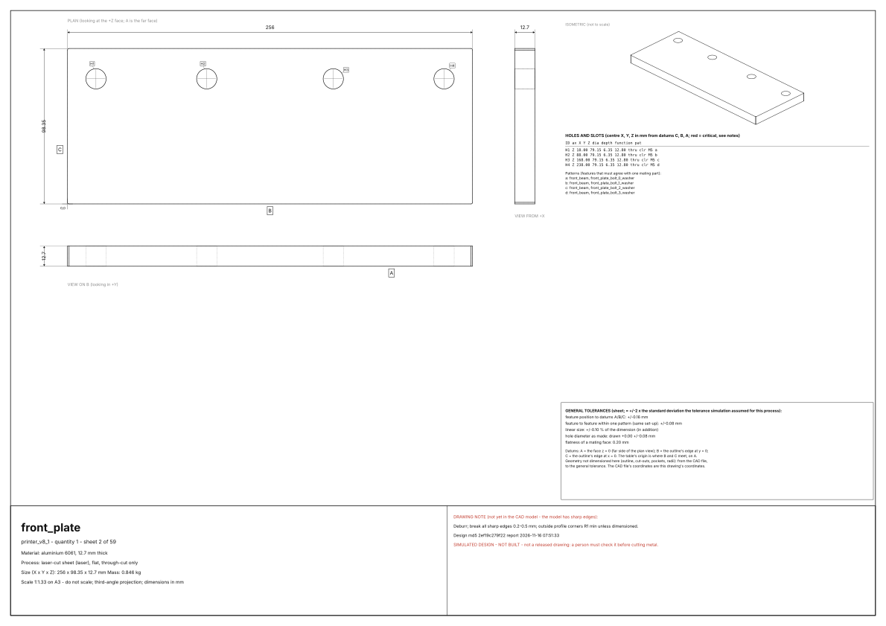

- Quantity 1. aluminium 6061; sheet; 256 x 98.35 x 12.7 mm; 0.846 kg.
- Sheet not specified mm, None cut, flat (no bends), through-cut only. Flat size None mm, cut length None mm, None pierces (report). DXF written here: {'LINE': 4, 'ARC': 4, 'CIRCLE': 4}, cut length 867.8 mm, extent (256.0, 98.35).
- Threads: none. Inserts and clinch nuts: none. Reaming: none.
- Drawing note, not yet in the model: Deburr; break all sharp edges 0.2-0.5 mm; outside profile corners R1 min unless dimensioned.
- **Needs more than the general tolerance, or rests on an assumption:**
  - Report, manufacture `hole_too_close_to_edge`: 2 hole(s) with less than 12.7 mm of material to the edge (least 11.60 mm at [-110.0, -81.35, 97.27]): the web overheats and distorts, and tears if the part is bent or loaded.

| ID | Kind | Axis | X | Y | Z | Dia / width | Slot length | Depth | Counterbore (dia x depth, from) | Function | Screws | On its axis | Pattern | Critical |
|---|---|---|---|---|---|---|---|---|---|---|---|---|---|---|
| H1 | hole | Z | 18 | 79.15 | 6.35 | 12.8 | - | through | - | clearance M5 | front_plate_bolt_0 (SHCS-M5x18) | front_plate_bolt_0_washer (WASHER-M5-LARGE) | a: front_beam, front_plate_bolt_0_washer | - |
| H2 | hole | Z | 88 | 79.15 | 6.35 | 12.8 | - | through | - | clearance M5 | front_plate_bolt_1 (SHCS-M5x18) | front_plate_bolt_1_washer (WASHER-M5-LARGE) | b: front_beam, front_plate_bolt_1_washer | - |
| H3 | hole | Z | 168 | 79.15 | 6.35 | 12.8 | - | through | - | clearance M5 | front_plate_bolt_2 (SHCS-M5x18) | front_plate_bolt_2_washer (WASHER-M5-LARGE) | c: front_beam, front_plate_bolt_2_washer | - |
| H4 | hole | Z | 238 | 79.15 | 6.35 | 12.8 | - | through | - | clearance M5 | front_plate_bolt_3 (SHCS-M5x18) | front_plate_bolt_3_washer (WASHER-M5-LARGE) | d: front_beam, front_plate_bolt_3_washer | - |

### nut_plate

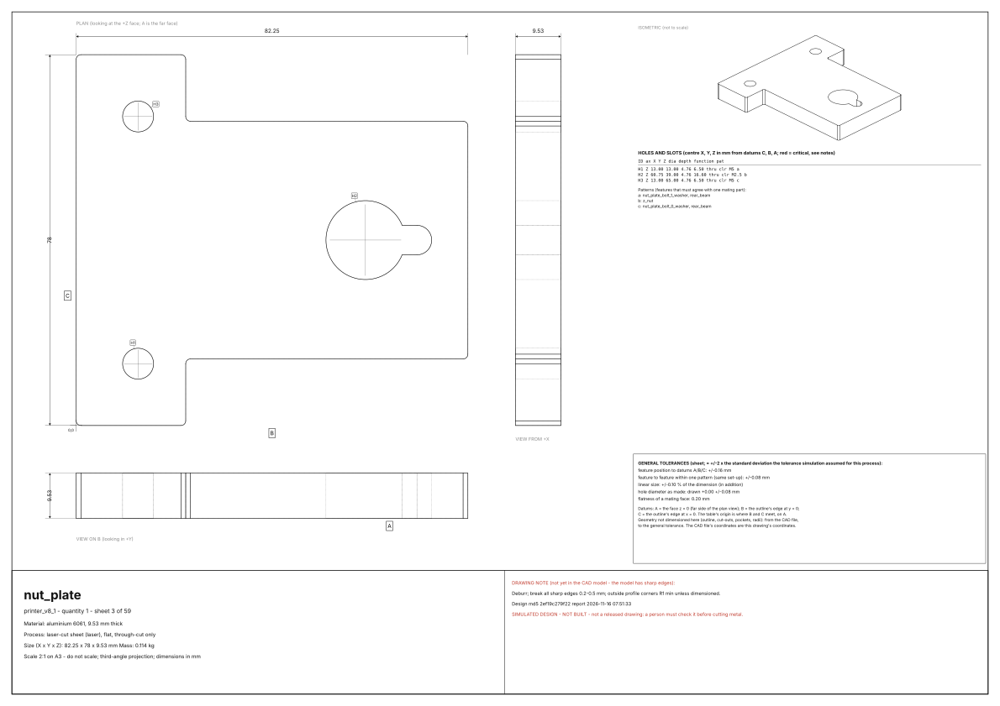

- Quantity 1. aluminium 6061; sheet; 82.25 x 78 x 9.53 mm; 0.114 kg.
- Sheet not specified mm, None cut, flat (no bends), through-cut only. Flat size None mm, cut length None mm, None pierces (report). DXF written here: {'LINE': 10, 'ARC': 10, 'CIRCLE': 2}, cut length 419.6 mm, extent (82.25, 78.0).
- Threads: none. Inserts and clinch nuts: none. Reaming: none.
- Drawing note, not yet in the model: Deburr; break all sharp edges 0.2-0.5 mm; outside profile corners R1 min unless dimensioned.
- **Needs more than the general tolerance, or rests on an assumption:**
  - Report, manufacture `hole_smaller_than_thickness`: 2 hole(s) or cut-out(s) narrower than the 9.525 mm sheet (smallest 6.50 mm at [-26.0, 132.25, 112.04]): they cut, but taper and lose accuracy.
  - Report, manufacture `hole_too_close_to_edge`: 3 hole(s) with less than 9.525 mm of material to the edge (least 6.75 mm at [-26.0, 132.25, 112.04]): the web overheats and distorts, and tears if the part is bent or loaded.

| ID | Kind | Axis | X | Y | Z | Dia / width | Slot length | Depth | Counterbore (dia x depth, from) | Function | Screws | On its axis | Pattern | Critical |
|---|---|---|---|---|---|---|---|---|---|---|---|---|---|---|
| H1 | hole | Z | 13 | 13 | 4.76 | 6.5 | - | through | - | clearance M5 | nut_plate_bolt_1 (SHCS-M5x16) | - | a: nut_plate_bolt_1_washer, rear_beam | - |
| H2 | hole | Z | 60.75 | 39 | 4.76 | 16.6 | - | through | - | clearance M2.5 | nut_pin (SHCS-M2.5x18) | leadscrew (T8x2-300) | b: z_nut | - |
| H3 | hole | Z | 13 | 65 | 4.76 | 6.5 | - | through | - | clearance M5 | nut_plate_bolt_0 (SHCS-M5x16) | - | c: nut_plate_bolt_0_washer, rear_beam | - |

### nut_plate_fl

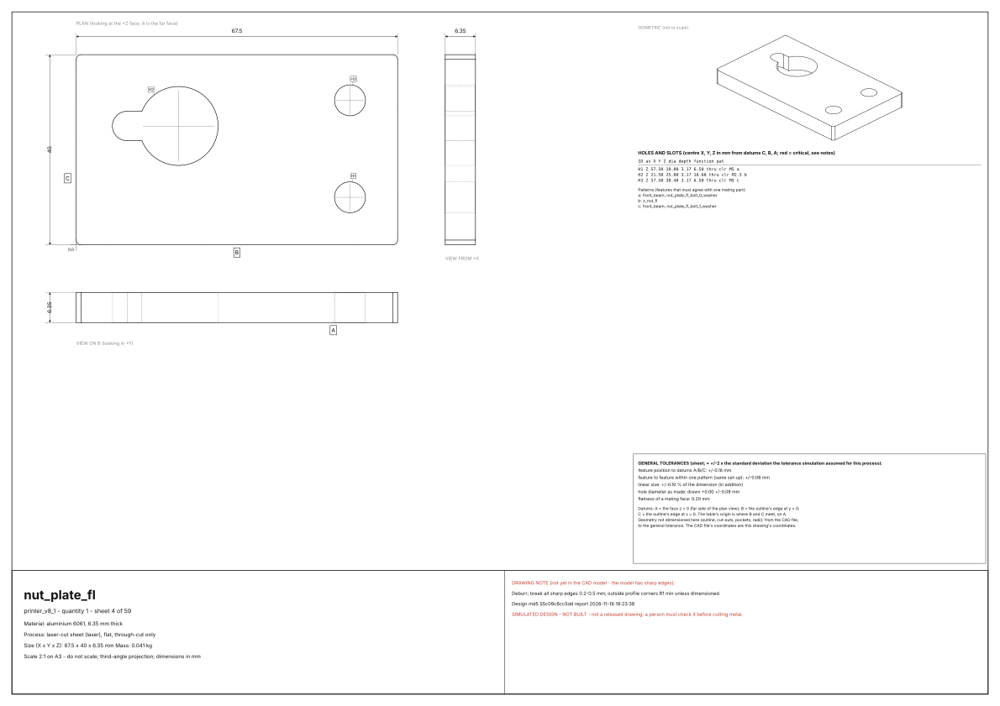

- Quantity 1. aluminium 6061; sheet; 67.5 x 40 x 6.35 mm; 0.041 kg. Same size, volume and hole list as nut_plate_fr (same or mirror-image part: compare before sharing a file).
- Sheet not specified mm, None cut, flat (no bends), through-cut only. Flat size None mm, cut length None mm, None pierces (report). DXF written here: {'LINE': 6, 'ARC': 6, 'CIRCLE': 2}, cut length 315.9 mm, extent (67.5, 40.0).
- Threads: none. Inserts and clinch nuts: none. Reaming: none.
- Drawing note, not yet in the model: Deburr; break all sharp edges 0.2-0.5 mm; outside profile corners R1 min unless dimensioned.

| ID | Kind | Axis | X | Y | Z | Dia / width | Slot length | Depth | Counterbore (dia x depth, from) | Function | Screws | On its axis | Pattern | Critical |
|---|---|---|---|---|---|---|---|---|---|---|---|---|---|---|
| H1 | hole | Z | 57.5 | 10 | 3.17 | 6.5 | - | through | - | clearance M5 | nut_plate_fl_bolt_0 (SHCS-M5x16) | - | a: front_beam, nut_plate_fl_bolt_0_washer | - |
| H2 | hole | Z | 21.5 | 25 | 3.17 | 16.6 | - | through | - | clearance M2.5 | nut_pin_fl (SHCS-M2.5x16) | leadscrew_fl (T8x2-300) | b: z_nut_fl | - |
| H3 | hole | Z | 57.5 | 30.4 | 3.17 | 6.5 | - | through | - | clearance M5 | nut_plate_fl_bolt_1 (SHCS-M5x16) | - | c: front_beam, nut_plate_fl_bolt_1_washer | - |

### nut_plate_fr

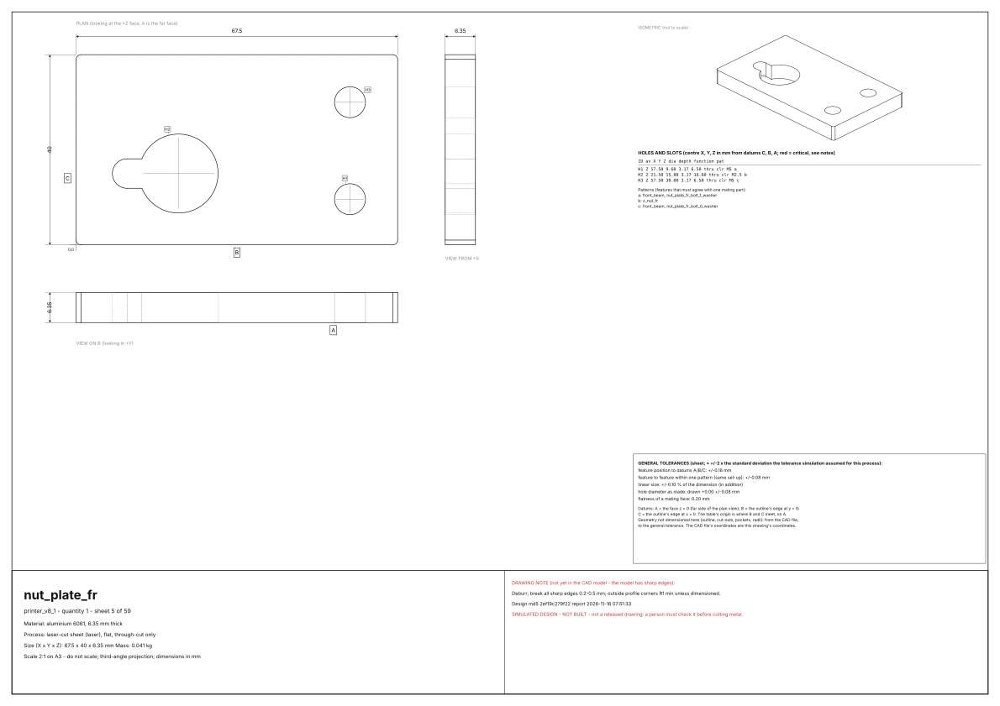

- Quantity 1. aluminium 6061; sheet; 67.5 x 40 x 6.35 mm; 0.041 kg. Same size, volume and hole list as nut_plate_fl (same or mirror-image part: compare before sharing a file).
- Sheet not specified mm, None cut, flat (no bends), through-cut only. Flat size None mm, cut length None mm, None pierces (report). DXF written here: {'LINE': 6, 'ARC': 6, 'CIRCLE': 2}, cut length 315.9 mm, extent (67.5, 40.0).
- Threads: none. Inserts and clinch nuts: none. Reaming: none.
- Drawing note, not yet in the model: Deburr; break all sharp edges 0.2-0.5 mm; outside profile corners R1 min unless dimensioned.

| ID | Kind | Axis | X | Y | Z | Dia / width | Slot length | Depth | Counterbore (dia x depth, from) | Function | Screws | On its axis | Pattern | Critical |
|---|---|---|---|---|---|---|---|---|---|---|---|---|---|---|
| H1 | hole | Z | 57.5 | 9.6 | 3.17 | 6.5 | - | through | - | clearance M5 | nut_plate_fr_bolt_1 (SHCS-M5x16) | - | a: front_beam, nut_plate_fr_bolt_1_washer | - |
| H2 | hole | Z | 21.5 | 15 | 3.17 | 16.6 | - | through | - | clearance M2.5 | nut_pin_fr (SHCS-M2.5x16) | leadscrew_fr (T8x2-300) | b: z_nut_fr | - |
| H3 | hole | Z | 57.5 | 30 | 3.17 | 6.5 | - | through | - | clearance M5 | nut_plate_fr_bolt_0 (SHCS-M5x16) | - | c: front_beam, nut_plate_fr_bolt_0_washer | - |

### bed_plate

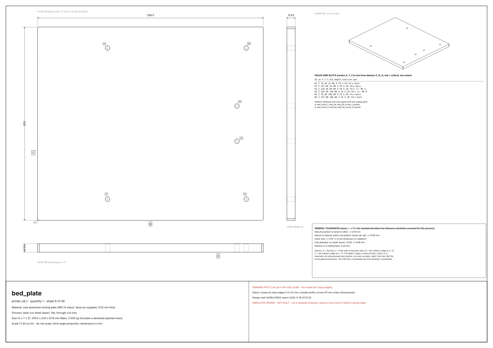

- Quantity 1. cast aluminium tooling plate (MIC-6 class), faces as supplied; sheet; 256.5 x 220 x 9.53 mm; 2.505 kg.
- Sheet not specified mm, None cut, flat (no bends), through-cut only. Flat size None mm, cut length None mm, None pierces (report). DXF written here: {'LINE': 4, 'ARC': 4, 'CIRCLE': 6}, cut length 1047.6 mm, extent (256.5, 220.0).
- Threads: none. Inserts and clinch nuts: none. Reaming: none.
- Drawing note, not yet in the model: Deburr; break all sharp edges 0.2-0.5 mm; outside profile corners R1 min unless dimensioned.
- **Needs more than the general tolerance, or rests on an assumption:**
  - Report, manufacture `hole_smaller_than_thickness`: 6 hole(s) or cut-out(s) narrower than the 9.525 mm sheet (smallest 5.20 mm at [-86.0, -45.25, 187.19]): they cut, but taper and lose accuracy.

| ID | Kind | Axis | X | Y | Z | Dia / width | Slot length | Depth | Counterbore (dia x depth, from) | Function | Screws | On its axis | Pattern | Critical |
|---|---|---|---|---|---|---|---|---|---|---|---|---|---|---|
| H1 | hole | Z | 79.5 | 24 | 4.76 | 5.2 | - | through | - | bore / opening | - | bed_post_3 (ROD-M5-DIN976-A2-91.4) | - | - |
| H2 | hole | Z | 237 | 24 | 4.76 | 5.2 | - | through | - | bore / opening | - | bed_post_1 (ROD-M5-DIN976-A2-91.4) | - | - |
| H3 | hole | Z | 226.5 | 90 | 4.76 | 5.2 | - | through | - | clearance M5 | bed_tie_screw_1 (SHCS-M5x16) | bed_insert_1 (INSERT-THREAD-M5x1.5D-STAINLESS) | a: bed_insert_1, bed_tie, bed_tie_screw_1_washer | - |
| H4 | hole | Z | 226.5 | 130 | 4.76 | 5.2 | - | through | - | clearance M5 | bed_tie_screw_0 (SHCS-M5x16) | bed_insert_0 (INSERT-THREAD-M5x1.5D-STAINLESS) | b: bed_insert_0, bed_tie, bed_tie_screw_0_washer | - |
| H5 | hole | Z | 79.5 | 196 | 4.76 | 5.2 | - | through | - | bore / opening | - | bed_post_2 (ROD-M5-DIN976-A2-91.4) | - | - |
| H6 | hole | Z | 237 | 196 | 4.76 | 5.2 | - | through | - | bore / opening | - | bed_post_0 (ROD-M5-DIN976-A2-91.4) | - | - |

### bed_post_tab_0

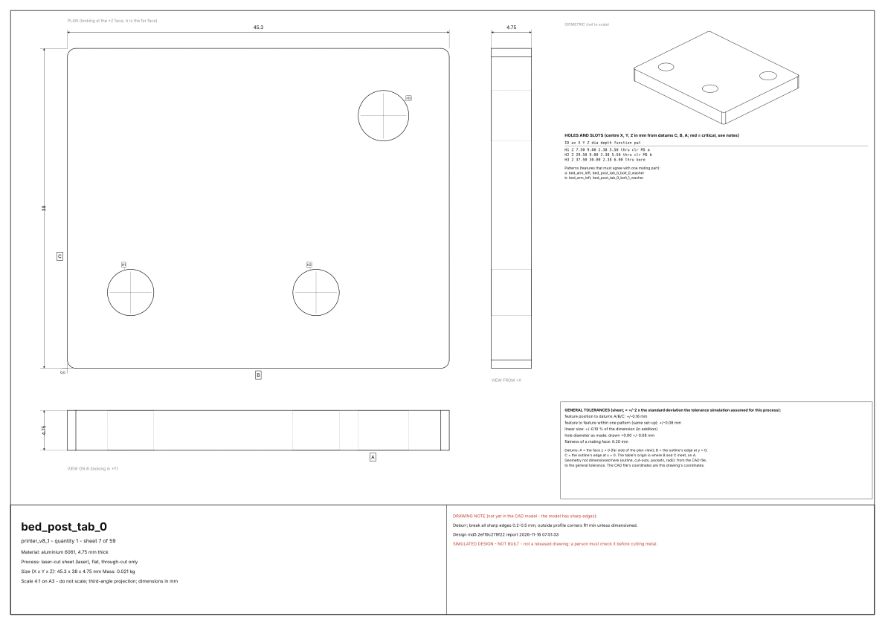

- Quantity 1. aluminium 6061; sheet; 45.3 x 38 x 4.75 mm; 0.021 kg. Same size, volume and hole list as bed_post_tab_1, bed_post_tab_2, bed_post_tab_3 (same or mirror-image part: compare before sharing a file).
- Sheet not specified mm, None cut, flat (no bends), through-cut only. Flat size None mm, cut length None mm, None pierces (report). DXF written here: {'LINE': 4, 'ARC': 4, 'CIRCLE': 3}, cut length 218.3 mm, extent (45.3, 38.0).
- Threads: none. Inserts and clinch nuts: none. Reaming: none.
- Drawing note, not yet in the model: Deburr; break all sharp edges 0.2-0.5 mm; outside profile corners R1 min unless dimensioned.

| ID | Kind | Axis | X | Y | Z | Dia / width | Slot length | Depth | Counterbore (dia x depth, from) | Function | Screws | On its axis | Pattern | Critical |
|---|---|---|---|---|---|---|---|---|---|---|---|---|---|---|
| H1 | hole | Z | 7.5 | 9 | 2.38 | 5.5 | - | through | - | clearance M5 | bed_post_tab_0_bolt_0 (SHCS-M5x10) | - | a: bed_arm_left, bed_post_tab_0_bolt_0_washer | - |
| H2 | hole | Z | 29.5 | 9 | 2.38 | 5.5 | - | through | - | clearance M5 | bed_post_tab_0_bolt_1 (SHCS-M5x10) | - | b: bed_arm_left, bed_post_tab_0_bolt_1_washer | - |
| H3 | hole | Z | 37.5 | 30 | 2.38 | 6 | - | through | - | bore / opening | - | bed_post_0 (ROD-M5-DIN976-A2-91.4) | - | - |

### bed_post_tab_1

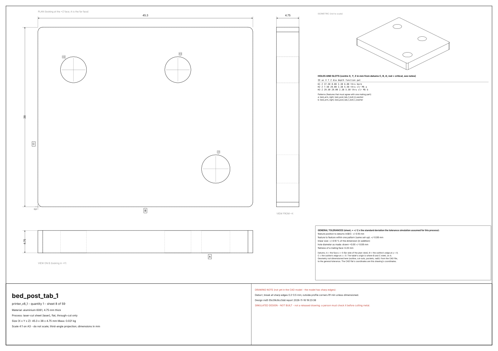

- Quantity 1. aluminium 6061; sheet; 45.3 x 38 x 4.75 mm; 0.021 kg. Same size, volume and hole list as bed_post_tab_0, bed_post_tab_2, bed_post_tab_3 (same or mirror-image part: compare before sharing a file).
- Sheet not specified mm, None cut, flat (no bends), through-cut only. Flat size None mm, cut length None mm, None pierces (report). DXF written here: {'LINE': 4, 'ARC': 4, 'CIRCLE': 3}, cut length 218.3 mm, extent (45.3, 38.0).
- Threads: none. Inserts and clinch nuts: none. Reaming: none.
- Drawing note, not yet in the model: Deburr; break all sharp edges 0.2-0.5 mm; outside profile corners R1 min unless dimensioned.

| ID | Kind | Axis | X | Y | Z | Dia / width | Slot length | Depth | Counterbore (dia x depth, from) | Function | Screws | On its axis | Pattern | Critical |
|---|---|---|---|---|---|---|---|---|---|---|---|---|---|---|
| H1 | hole | Z | 37.5 | 8 | 2.38 | 6 | - | through | - | bore / opening | - | bed_post_1 (ROD-M5-DIN976-A2-91.4) | - | - |
| H2 | hole | Z | 7.5 | 29 | 2.38 | 5.5 | - | through | - | clearance M5 | bed_post_tab_1_bolt_0 (SHCS-M5x10) | - | a: bed_arm_right, bed_post_tab_1_bolt_0_washer | - |
| H3 | hole | Z | 29.5 | 29 | 2.38 | 5.5 | - | through | - | clearance M5 | bed_post_tab_1_bolt_1 (SHCS-M5x10) | - | b: bed_arm_right, bed_post_tab_1_bolt_1_washer | - |

### bed_post_tab_2

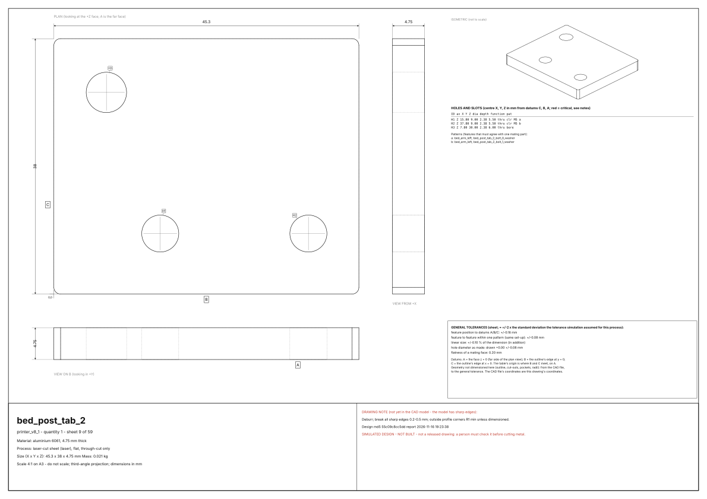

- Quantity 1. aluminium 6061; sheet; 45.3 x 38 x 4.75 mm; 0.021 kg. Same size, volume and hole list as bed_post_tab_0, bed_post_tab_1, bed_post_tab_3 (same or mirror-image part: compare before sharing a file).
- Sheet not specified mm, None cut, flat (no bends), through-cut only. Flat size None mm, cut length None mm, None pierces (report). DXF written here: {'LINE': 4, 'ARC': 4, 'CIRCLE': 3}, cut length 218.3 mm, extent (45.3, 38.0).
- Threads: none. Inserts and clinch nuts: none. Reaming: none.
- Drawing note, not yet in the model: Deburr; break all sharp edges 0.2-0.5 mm; outside profile corners R1 min unless dimensioned.

| ID | Kind | Axis | X | Y | Z | Dia / width | Slot length | Depth | Counterbore (dia x depth, from) | Function | Screws | On its axis | Pattern | Critical |
|---|---|---|---|---|---|---|---|---|---|---|---|---|---|---|
| H1 | hole | Z | 15.8 | 9 | 2.38 | 5.5 | - | through | - | clearance M5 | bed_post_tab_2_bolt_0 (SHCS-M5x10) | - | a: bed_arm_left, bed_post_tab_2_bolt_0_washer | - |
| H2 | hole | Z | 37.8 | 9 | 2.38 | 5.5 | - | through | - | clearance M5 | bed_post_tab_2_bolt_1 (SHCS-M5x10) | - | b: bed_arm_left, bed_post_tab_2_bolt_1_washer | - |
| H3 | hole | Z | 7.8 | 30 | 2.38 | 6 | - | through | - | bore / opening | - | bed_post_2 (ROD-M5-DIN976-A2-91.4) | - | - |

### bed_post_tab_3

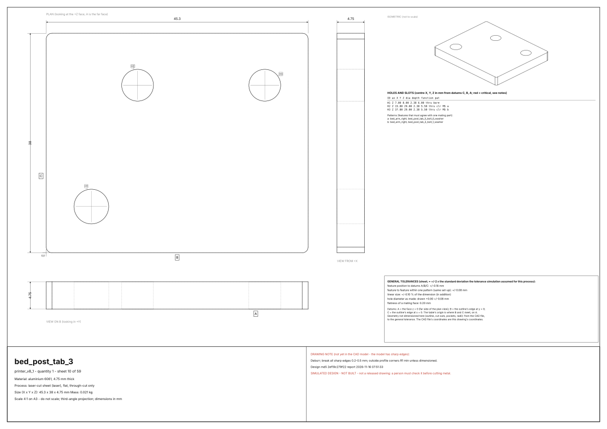

- Quantity 1. aluminium 6061; sheet; 45.3 x 38 x 4.75 mm; 0.021 kg. Same size, volume and hole list as bed_post_tab_0, bed_post_tab_1, bed_post_tab_2 (same or mirror-image part: compare before sharing a file).
- Sheet not specified mm, None cut, flat (no bends), through-cut only. Flat size None mm, cut length None mm, None pierces (report). DXF written here: {'LINE': 4, 'ARC': 4, 'CIRCLE': 3}, cut length 218.3 mm, extent (45.3, 38.0).
- Threads: none. Inserts and clinch nuts: none. Reaming: none.
- Drawing note, not yet in the model: Deburr; break all sharp edges 0.2-0.5 mm; outside profile corners R1 min unless dimensioned.

| ID | Kind | Axis | X | Y | Z | Dia / width | Slot length | Depth | Counterbore (dia x depth, from) | Function | Screws | On its axis | Pattern | Critical |
|---|---|---|---|---|---|---|---|---|---|---|---|---|---|---|
| H1 | hole | Z | 7.8 | 8 | 2.38 | 6 | - | through | - | bore / opening | - | bed_post_3 (ROD-M5-DIN976-A2-91.4) | - | - |
| H2 | hole | Z | 15.8 | 29 | 2.38 | 5.5 | - | through | - | clearance M5 | bed_post_tab_3_bolt_0 (SHCS-M5x10) | - | a: bed_arm_right, bed_post_tab_3_bolt_0_washer | - |
| H3 | hole | Z | 37.8 | 29 | 2.38 | 5.5 | - | through | - | clearance M5 | bed_post_tab_3_bolt_1 (SHCS-M5x10) | - | b: bed_arm_right, bed_post_tab_3_bolt_1_washer | - |

### bed_tie

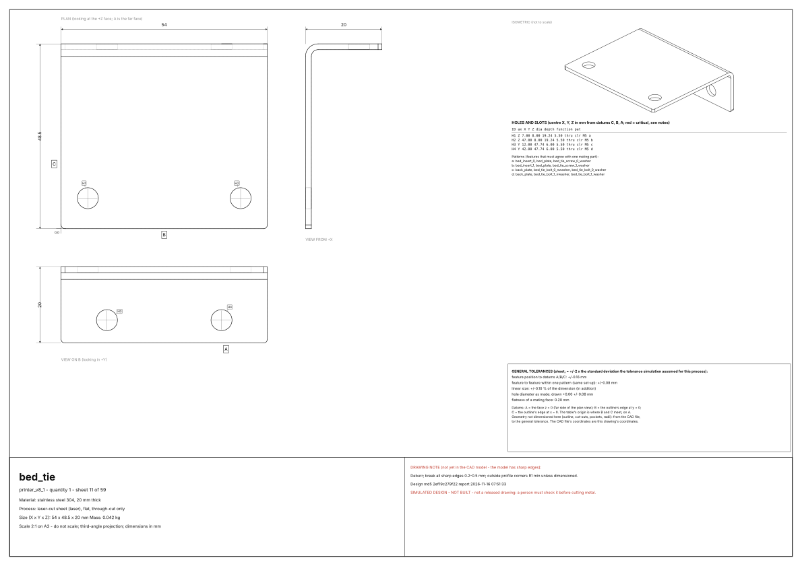

- Quantity 1. stainless steel 304; sheet; 54 x 48.5 x 20 mm; 0.042 kg.
- Sheet not specified mm, None cut, flat (no bends), through-cut only. Flat size None mm, cut length None mm, None pierces (report). DXF written here: {'LINE': 4, 'ARC': 2, 'CIRCLE': 2}, cut length 232.1 mm, extent (54.0, 45.2).
- Threads: none. Inserts and clinch nuts: none. Reaming: none.
- Drawing note, not yet in the model: Deburr; break all sharp edges 0.2-0.5 mm; outside profile corners R1 min unless dimensioned.

| ID | Kind | Axis | X | Y | Z | Dia / width | Slot length | Depth | Counterbore (dia x depth, from) | Function | Screws | On its axis | Pattern | Critical |
|---|---|---|---|---|---|---|---|---|---|---|---|---|---|---|
| H1 | hole | Z | 7 | 8 | 19.24 | 5.5 | - | through | - | clearance M5 | bed_tie_screw_0 (SHCS-M5x16) | - | a: bed_insert_0, bed_plate, bed_tie_screw_0_washer | - |
| H2 | hole | Z | 47 | 8 | 19.24 | 5.5 | - | through | - | clearance M5 | bed_tie_screw_1 (SHCS-M5x16) | - | b: bed_insert_1, bed_plate, bed_tie_screw_1_washer | - |
| H3 | hole | Y | 12 | 47.74 | 6 | 5.5 | - | through | - | clearance M5 | bed_tie_bolt_0 (SHCS-M5x16) | - | c: back_plate, bed_tie_bolt_0_nwasher, bed_tie_bolt_0_washer | - |
| H4 | hole | Y | 42 | 47.74 | 6 | 5.5 | - | through | - | clearance M5 | bed_tie_bolt_1 (SHCS-M5x16) | - | d: back_plate, bed_tie_bolt_1_nwasher, bed_tie_bolt_1_washer | - |

### z_drive_plate

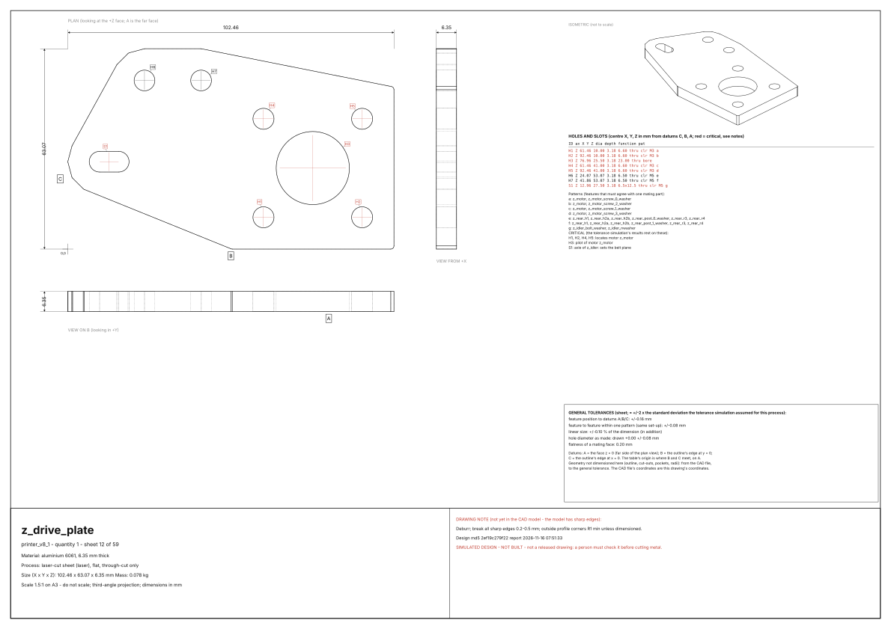

- Quantity 1. aluminium 6061; sheet; 102.46 x 63.07 x 6.35 mm; 0.078 kg.
- Sheet not specified mm, None cut, flat (no bends), through-cut only. Flat size None mm, cut length None mm, None pierces (report). DXF written here: {'LINE': 13, 'ARC': 13, 'CIRCLE': 7}, cut length 514.5 mm, extent (102.43, 63.07).
- Threads: none. Inserts and clinch nuts: none. Reaming: none.
- Drawing note, not yet in the model: Deburr; break all sharp edges 0.2-0.5 mm; outside profile corners R1 min unless dimensioned.
- **Needs more than the general tolerance, or rests on an assumption:**
  - **Patterns a, b, c, d** (guide block / motor): hole to hole +/-0.08 mm is the figure the screw-pattern check used (tighter than the +/-0.16 mm position tolerance); radial clearance on the screws 1.80 mm. Cut all holes of a pattern in one set-up.
  - This part places a pulley or idler: its thickness and flatness are in the belt-plane result (x_belt: 97.5% of builds within 1 mm, +/-0.29%; y_belt: 98.9% of builds within 1 mm, +/-0.19%; y_belt_l: 98.5% of builds within 1 mm, +/-0.22%).
  - Report, manufacture `holes_too_close`: 5 pair(s) of holes or cut-outs with too little material between them (least 7.12 mm at [36.25, 135.75, 47.87], wanted 12.7 mm = 2 x thickness).

| ID | Kind | Axis | X | Y | Z | Dia / width | Slot length | Depth | Counterbore (dia x depth, from) | Function | Screws | On its axis | Pattern | Critical |
|---|---|---|---|---|---|---|---|---|---|---|---|---|---|---|
| H1 | hole | Z | 61.46 | 10 | 3.18 | 6.6 | - | through | - | clearance M3 | z_motor_screw_0 (SHCS-M3x10) | z_motor_screw_0_washer (WASHER-M3-LARGE) | a: z_motor, z_motor_screw_0_washer | locates motor z_motor |
| H2 | hole | Z | 92.46 | 10 | 3.18 | 6.6 | - | through | - | clearance M3 | z_motor_screw_2 (SHCS-M3x10) | z_motor_screw_2_washer (WASHER-M3-LARGE) | b: z_motor, z_motor_screw_2_washer | locates motor z_motor |
| H3 | hole | Z | 76.96 | 25.5 | 3.18 | 23 | - | through | - | bore / opening | - | z_motor (NEMA17-40), z_pulley_m (GT2-20T-B5) | - | pilot of motor z_motor |
| H4 | hole | Z | 61.46 | 41 | 3.18 | 6.6 | - | through | - | clearance M3 | z_motor_screw_1 (SHCS-M3x10) | z_motor_screw_1_washer (WASHER-M3-LARGE) | c: z_motor, z_motor_screw_1_washer | locates motor z_motor |
| H5 | hole | Z | 92.46 | 41 | 3.18 | 6.6 | - | through | - | clearance M3 | z_motor_screw_3 (SHCS-M3x10) | z_motor_screw_3_washer (WASHER-M3-LARGE) | d: z_motor, z_motor_screw_3_washer | locates motor z_motor |
| H6 | hole | Z | 24.07 | 53.07 | 3.18 | 6.5 | - | through | - | clearance M5 | z_rear_post_0 (SHCS-M5x65) | - | e: z_rear_h1, z_rear_h2a, z_rear_h2b, z_rear_post_0_washer, z_rear_r3, z_rear_r4 | - |
| H7 | hole | Z | 41.86 | 53.07 | 3.18 | 6.5 | - | through | - | clearance M5 | z_rear_post_1 (SHCS-M5x65) | - | f: z_rear_h1, z_rear_h2a, z_rear_h2b, z_rear_post_1_washer, z_rear_r3, z_rear_r4 | - |
| S1 | slot | Z | 12.96 | 27.5 | 3.18 | 6.5 | 12.5 | through | - | clearance M5 | z_idler_bolt (SHCS-M5x30) | - | g: z_idler_bolt_washer, z_idler_nwasher | axle of z_idler: sets the belt plane |

### z_rear_r1

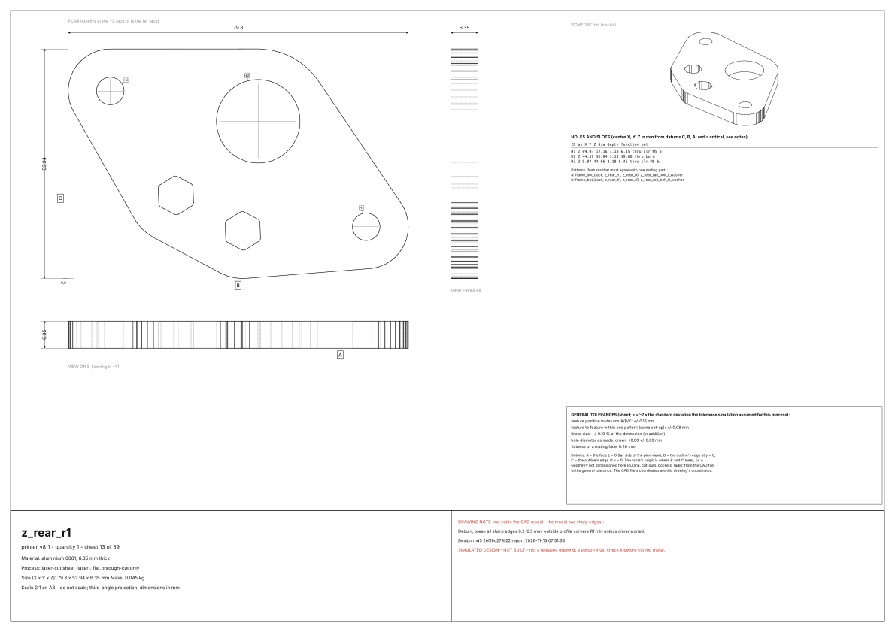

- Quantity 1. aluminium 6061; sheet; 79.8 x 53.94 x 6.35 mm; 0.045 kg.
- Sheet not specified mm, None cut, flat (no bends), through-cut only. Flat size None mm, cut length None mm, None pierces (report). DXF written here: {'LINE': 57, 'ARC': 47, 'CIRCLE': 3}, cut length 372.8 mm, extent (79.79, 53.94).
- Threads: none. Inserts and clinch nuts: none. Reaming: none.
- Drawing note, not yet in the model: Deburr; break all sharp edges 0.2-0.5 mm; outside profile corners R1 min unless dimensioned.

| ID | Kind | Axis | X | Y | Z | Dia / width | Slot length | Depth | Counterbore (dia x depth, from) | Function | Screws | On its axis | Pattern | Critical |
|---|---|---|---|---|---|---|---|---|---|---|---|---|---|---|
| H1 | hole | Z | 69.93 | 12.16 | 3.18 | 6.45 | - | through | - | clearance M5 | z_rear_rail_bolt_1 (SHCS-M5x20) | - | a: frame_bot_back, z_rear_h1, z_rear_r0, z_rear_rail_bolt_1_washer | - |
| H2 | hole | Z | 44.59 | 36.94 | 3.18 | 19.6 | - | through | - | bore / opening | - | leadscrew (T8x2-300) | - | - |
| H3 | hole | Z | 9.87 | 44.06 | 3.18 | 6.45 | - | through | - | clearance M5 | z_rear_rail_bolt_0 (SHCS-M5x20) | - | b: frame_bot_back, z_rear_h1, z_rear_r0, z_rear_rail_bolt_0_washer | - |

### z_rear_r0

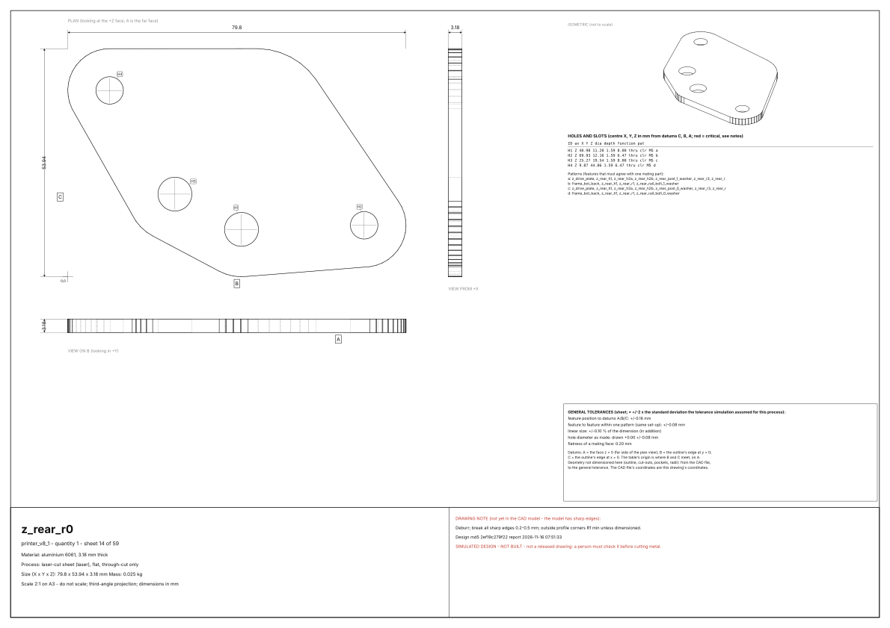

- Quantity 1. aluminium 6061; sheet; 79.8 x 53.94 x 3.18 mm; 0.025 kg.
- Sheet not specified mm, None cut, flat (no bends), through-cut only. Flat size None mm, cut length None mm, None pierces (report). DXF written here: {'LINE': 45, 'ARC': 35, 'CIRCLE': 4}, cut length 306.5 mm, extent (79.79, 53.94).
- Threads: none. Inserts and clinch nuts: none. Reaming: none.
- Drawing note, not yet in the model: Deburr; break all sharp edges 0.2-0.5 mm; outside profile corners R1 min unless dimensioned.

| ID | Kind | Axis | X | Y | Z | Dia / width | Slot length | Depth | Counterbore (dia x depth, from) | Function | Screws | On its axis | Pattern | Critical |
|---|---|---|---|---|---|---|---|---|---|---|---|---|---|---|
| H1 | hole | Z | 40.98 | 11.2 | 1.59 | 8 | - | through | - | clearance M5 | z_rear_post_1 (SHCS-M5x65) | - | a: z_drive_plate, z_rear_h1, z_rear_h2a, z_rear_h2b, z_rear_post_1_washer, z_rear_r3, z_rear_r4 | - |
| H2 | hole | Z | 69.93 | 12.16 | 1.59 | 6.47 | - | through | - | clearance M5 | z_rear_rail_bolt_1 (SHCS-M5x20) | - | b: frame_bot_back, z_rear_h1, z_rear_r1, z_rear_rail_bolt_1_washer | - |
| H3 | hole | Z | 25.27 | 19.54 | 1.59 | 8 | - | through | - | clearance M5 | z_rear_post_0 (SHCS-M5x65) | - | c: z_drive_plate, z_rear_h1, z_rear_h2a, z_rear_h2b, z_rear_post_0_washer, z_rear_r3, z_rear_r4 | - |
| H4 | hole | Z | 9.87 | 44.06 | 1.59 | 6.47 | - | through | - | clearance M5 | z_rear_rail_bolt_0 (SHCS-M5x20) | - | d: frame_bot_back, z_rear_h1, z_rear_r1, z_rear_rail_bolt_0_washer | - |

### z_rear_h1

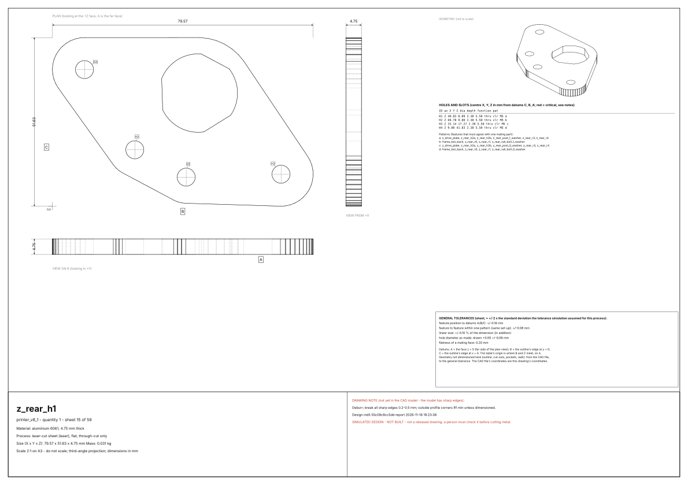

- Quantity 1. aluminium 6061; sheet; 79.57 x 51.63 x 4.75 mm; 0.031 kg.
- Sheet not specified mm, None cut, flat (no bends), through-cut only. Flat size None mm, cut length None mm, None pierces (report). DXF written here: {'LINE': 48, 'ARC': 38, 'CIRCLE': 4}, cut length 355.6 mm, extent (79.57, 51.63).
- Threads: none. Inserts and clinch nuts: none. Reaming: none.
- Drawing note, not yet in the model: Deburr; break all sharp edges 0.2-0.5 mm; outside profile corners R1 min unless dimensioned.

| ID | Kind | Axis | X | Y | Z | Dia / width | Slot length | Depth | Counterbore (dia x depth, from) | Function | Screws | On its axis | Pattern | Critical |
|---|---|---|---|---|---|---|---|---|---|---|---|---|---|---|
| H1 | hole | Z | 40.83 | 8.89 | 2.38 | 5.5 | - | through | - | clearance M5 | z_rear_post_1 (SHCS-M5x65) | - | a: z_drive_plate, z_rear_h2a, z_rear_h2b, z_rear_post_1_washer, z_rear_r3, z_rear_r4 | - |
| H2 | hole | Z | 69.78 | 9.8 | 2.38 | 5.5 | - | through | - | clearance M5 | z_rear_rail_bolt_1 (SHCS-M5x20) | - | b: frame_bot_back, z_rear_r0, z_rear_r1, z_rear_rail_bolt_1_washer | - |
| H3 | hole | Z | 25.14 | 17.27 | 2.38 | 5.5 | - | through | - | clearance M5 | z_rear_post_0 (SHCS-M5x65) | - | c: z_drive_plate, z_rear_h2a, z_rear_h2b, z_rear_post_0_washer, z_rear_r3, z_rear_r4 | - |
| H4 | hole | Z | 9.8 | 41.83 | 2.38 | 5.5 | - | through | - | clearance M5 | z_rear_rail_bolt_0 (SHCS-M5x20) | - | d: frame_bot_back, z_rear_r0, z_rear_r1, z_rear_rail_bolt_0_washer | - |

### z_rear_r3

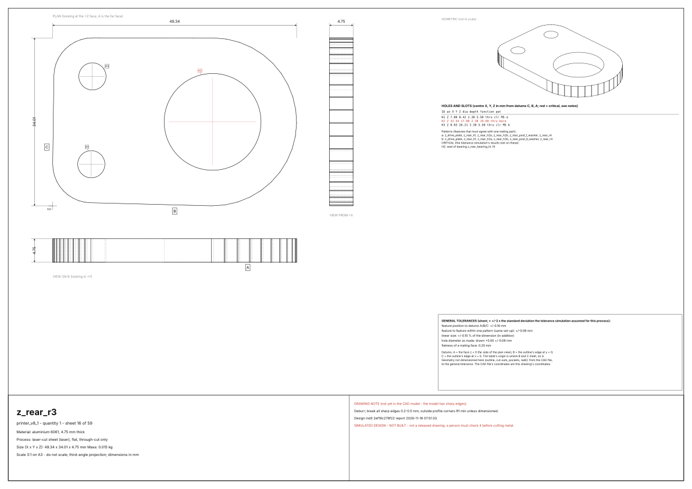

- Quantity 1. aluminium 6061; sheet; 49.34 x 34.01 x 4.75 mm; 0.015 kg.
- Sheet not specified mm, None cut, flat (no bends), through-cut only. Flat size None mm, cut length None mm, None pierces (report). DXF written here: {'LINE': 43, 'ARC': 37, 'CIRCLE': 3}, cut length 240.6 mm, extent (49.34, 34.01).
- Threads: none. Inserts and clinch nuts: none. Reaming: H2 if the bearing does not slide in.
- Drawing note, not yet in the model: Deburr; break all sharp edges 0.2-0.5 mm; outside profile corners R1 min unless dimensioned.

| ID | Kind | Axis | X | Y | Z | Dia / width | Slot length | Depth | Counterbore (dia x depth, from) | Function | Screws | On its axis | Pattern | Critical |
|---|---|---|---|---|---|---|---|---|---|---|---|---|---|---|
| H1 | hole | Z | 7.8 | 8.42 | 2.38 | 5.5 | - | through | - | clearance M5 | z_rear_post_1 (SHCS-M5x65) | - | a: z_drive_plate, z_rear_h1, z_rear_h2a, z_rear_h2b, z_rear_post_1_washer, z_rear_r4 | - |
| H2 | hole | Z | 32.34 | 17 | 2.38 | 19.6 | - | through | - | bore / opening | - | z_rear_shim (custom), z_rear_bearing_hi (BRG-608), leadscrew (T8x2-300), z_pulley (GT2-20T-B8) | - | seat of bearing z_rear_bearing_hi: fit |
| H3 | hole | Z | 8.03 | 26.21 | 2.38 | 5.5 | - | through | - | clearance M5 | z_rear_post_0 (SHCS-M5x65) | - | b: z_drive_plate, z_rear_h1, z_rear_h2a, z_rear_h2b, z_rear_post_0_washer, z_rear_r4 | - |

### z_rear_h2a

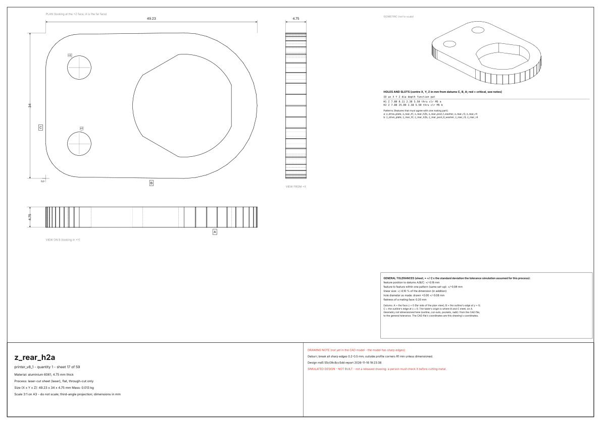

- Quantity 1. aluminium 6061; sheet; 49.23 x 34 x 4.75 mm; 0.013 kg.
- Sheet not specified mm, None cut, flat (no bends), through-cut only. Flat size None mm, cut length None mm, None pierces (report). DXF written here: {'LINE': 46, 'ARC': 40, 'CIRCLE': 2}, cut length 253.6 mm, extent (49.23, 34.0).
- Threads: none. Inserts and clinch nuts: none. Reaming: none.
- Drawing note, not yet in the model: Deburr; break all sharp edges 0.2-0.5 mm; outside profile corners R1 min unless dimensioned.

| ID | Kind | Axis | X | Y | Z | Dia / width | Slot length | Depth | Counterbore (dia x depth, from) | Function | Screws | On its axis | Pattern | Critical |
|---|---|---|---|---|---|---|---|---|---|---|---|---|---|---|
| H1 | hole | Z | 7.8 | 8.11 | 2.38 | 5.5 | - | through | - | clearance M5 | z_rear_post_1 (SHCS-M5x65) | - | a: z_drive_plate, z_rear_h1, z_rear_h2b, z_rear_post_1_washer, z_rear_r3, z_rear_r4 | - |
| H2 | hole | Z | 7.8 | 25.89 | 2.38 | 5.5 | - | through | - | clearance M5 | z_rear_post_0 (SHCS-M5x65) | - | b: z_drive_plate, z_rear_h1, z_rear_h2b, z_rear_post_0_washer, z_rear_r3, z_rear_r4 | - |

### z_rear_h2b

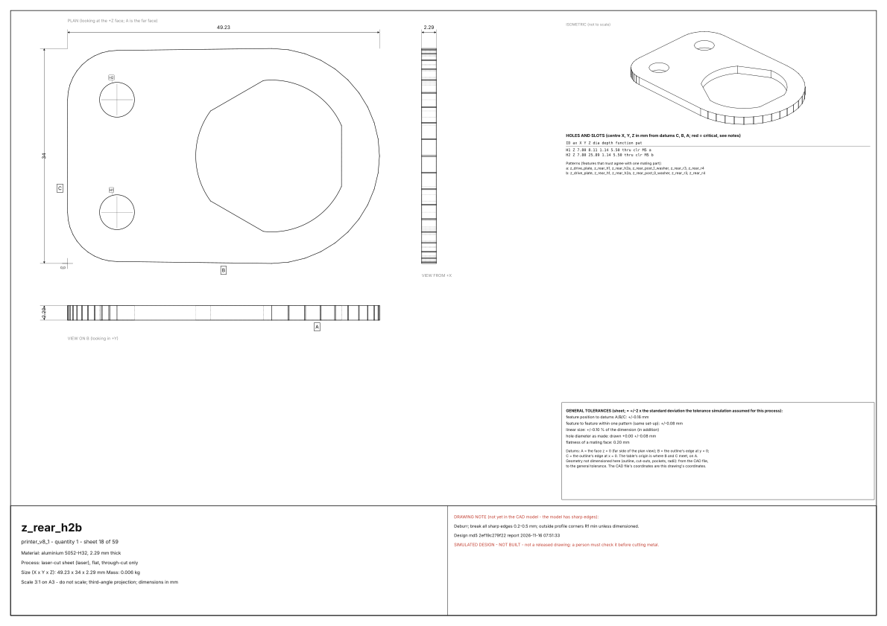

- Quantity 1. aluminium 5052-H32; sheet; 49.23 x 34 x 2.29 mm; 0.006 kg.
- Sheet not specified mm, None cut, flat (no bends), through-cut only. Flat size None mm, cut length None mm, None pierces (report). DXF written here: {'LINE': 46, 'ARC': 40, 'CIRCLE': 2}, cut length 253.6 mm, extent (49.23, 34.0).
- Threads: none. Inserts and clinch nuts: none. Reaming: none.
- Drawing note, not yet in the model: Deburr; break all sharp edges 0.2-0.5 mm; outside profile corners R1 min unless dimensioned.

| ID | Kind | Axis | X | Y | Z | Dia / width | Slot length | Depth | Counterbore (dia x depth, from) | Function | Screws | On its axis | Pattern | Critical |
|---|---|---|---|---|---|---|---|---|---|---|---|---|---|---|
| H1 | hole | Z | 7.8 | 8.11 | 1.14 | 5.5 | - | through | - | clearance M5 | z_rear_post_1 (SHCS-M5x65) | - | a: z_drive_plate, z_rear_h1, z_rear_h2a, z_rear_post_1_washer, z_rear_r3, z_rear_r4 | - |
| H2 | hole | Z | 7.8 | 25.89 | 1.14 | 5.5 | - | through | - | clearance M5 | z_rear_post_0 (SHCS-M5x65) | - | b: z_drive_plate, z_rear_h1, z_rear_h2a, z_rear_post_0_washer, z_rear_r3, z_rear_r4 | - |

### z_rear_r4

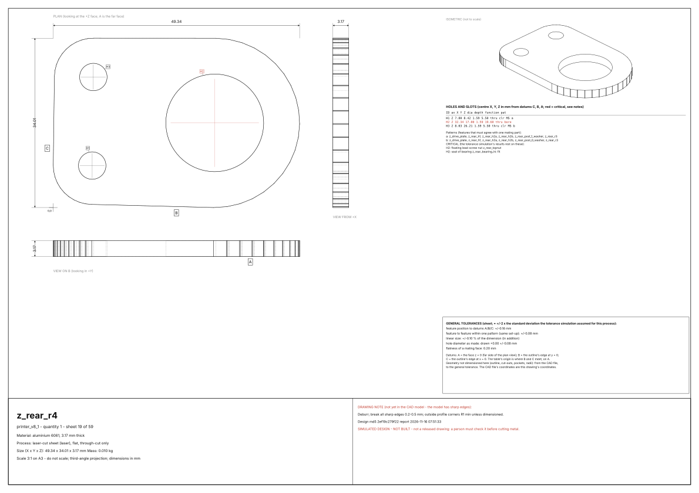

- Quantity 1. aluminium 6061; sheet; 49.34 x 34.01 x 3.17 mm; 0.010 kg.
- Sheet not specified mm, None cut, flat (no bends), through-cut only. Flat size None mm, cut length None mm, None pierces (report). DXF written here: {'LINE': 43, 'ARC': 37, 'CIRCLE': 3}, cut length 240.6 mm, extent (49.34, 34.01).
- Threads: none. Inserts and clinch nuts: none. Reaming: H2 if the bearing does not slide in.
- Drawing note, not yet in the model: Deburr; break all sharp edges 0.2-0.5 mm; outside profile corners R1 min unless dimensioned.

| ID | Kind | Axis | X | Y | Z | Dia / width | Slot length | Depth | Counterbore (dia x depth, from) | Function | Screws | On its axis | Pattern | Critical |
|---|---|---|---|---|---|---|---|---|---|---|---|---|---|---|
| H1 | hole | Z | 7.8 | 8.42 | 1.59 | 5.5 | - | through | - | clearance M5 | z_rear_post_1 (SHCS-M5x65) | - | a: z_drive_plate, z_rear_h1, z_rear_h2a, z_rear_h2b, z_rear_post_1_washer, z_rear_r3 | - |
| H2 | hole | Z | 32.34 | 17 | 1.59 | 19.6 | - | through | - | bore / opening | - | z_rear_bearing_hi (BRG-608), leadscrew (T8x2-300), z_rear_topnut (T8-NUT) | - | floating lead-screw nut z_rear_topnut; seat of bearing z_rear_bearing_hi: fit |
| H3 | hole | Z | 8.03 | 26.21 | 1.59 | 5.5 | - | through | - | clearance M5 | z_rear_post_0 (SHCS-M5x65) | - | b: z_drive_plate, z_rear_h1, z_rear_h2a, z_rear_h2b, z_rear_post_0_washer, z_rear_r3 | - |

### z_rear_shim

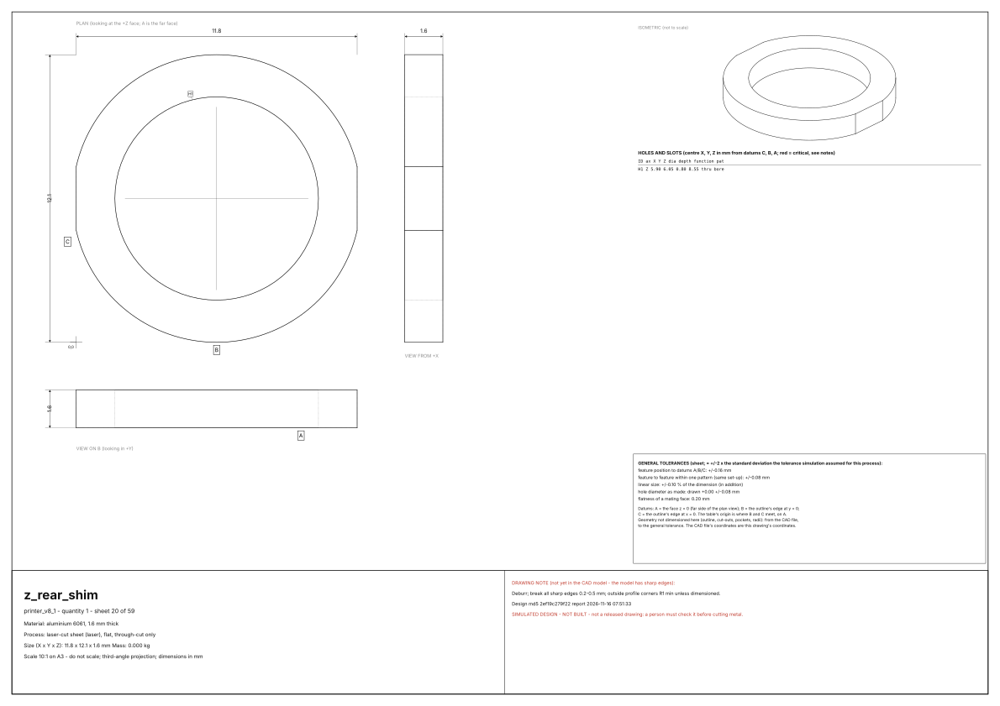

- Quantity 1. aluminium 6061; sheet; 11.8 x 12.1 x 1.6 mm; 0.000 kg. Same size, volume and hole list as z_fl_shim, z_fr_shim (same or mirror-image part: compare before sharing a file).
- Sheet not specified mm, None cut, flat (no bends), through-cut only. Flat size None mm, cut length None mm, None pierces (report). DXF written here: {'LINE': 2, 'ARC': 2, 'CIRCLE': 1}, cut length 64.8 mm, extent (11.8, 8.55).
- Threads: none. Inserts and clinch nuts: none. Reaming: none.
- Drawing note, not yet in the model: Deburr; break all sharp edges 0.2-0.5 mm; outside profile corners R1 min unless dimensioned.
- **Needs more than the general tolerance, or rests on an assumption:**
  - Report, manufacture `mostly_holes`: 50% of the blank is cut away inside the outline; grilles this open shift, warp or break while being cut.

| ID | Kind | Axis | X | Y | Z | Dia / width | Slot length | Depth | Counterbore (dia x depth, from) | Function | Screws | On its axis | Pattern | Critical |
|---|---|---|---|---|---|---|---|---|---|---|---|---|---|---|
| H1 | hole | Z | 5.9 | 6.05 | 0.8 | 8.55 | - | through | - | bore / opening | - | leadscrew (T8x2-300) | - | - |

### z_fl_r1

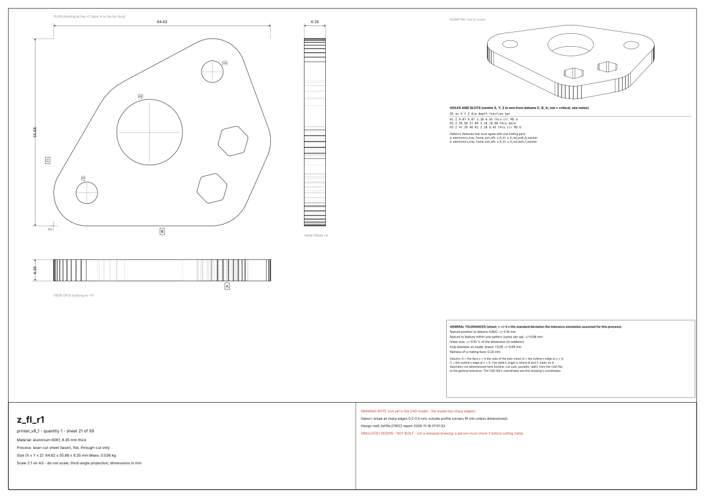

- Quantity 1. aluminium 6061; sheet; 64.62 x 55.88 x 6.35 mm; 0.036 kg. Same size, volume and hole list as z_fr_r1 (same or mirror-image part: compare before sharing a file).
- Sheet not specified mm, None cut, flat (no bends), through-cut only. Flat size None mm, cut length None mm, None pierces (report). DXF written here: {'LINE': 57, 'ARC': 48, 'CIRCLE': 3}, cut length 350.0 mm, extent (64.62, 55.88).
- Threads: none. Inserts and clinch nuts: none. Reaming: none.
- Drawing note, not yet in the model: Deburr; break all sharp edges 0.2-0.5 mm; outside profile corners R1 min unless dimensioned.

| ID | Kind | Axis | X | Y | Z | Dia / width | Slot length | Depth | Counterbore (dia x depth, from) | Function | Screws | On its axis | Pattern | Critical |
|---|---|---|---|---|---|---|---|---|---|---|---|---|---|---|
| H1 | hole | Z | 9.87 | 9.87 | 3.18 | 6.45 | - | through | - | clearance M5 | z_fl_rail_bolt_0 (SHCS-M5x20) | - | a: electronics_tray, frame_bot_left, z_fl_h1, z_fl_rail_bolt_0_washer | - |
| H2 | hole | Z | 28.56 | 27.94 | 3.18 | 19.6 | - | through | - | bore / opening | - | leadscrew_fl (T8x2-300) | - | - |
| H3 | hole | Z | 47.26 | 46.01 | 3.18 | 6.45 | - | through | - | clearance M5 | z_fl_rail_bolt_1 (SHCS-M5x20) | - | b: electronics_tray, frame_bot_left, z_fl_h1, z_fl_rail_bolt_1_washer | - |

### z_fl_h1

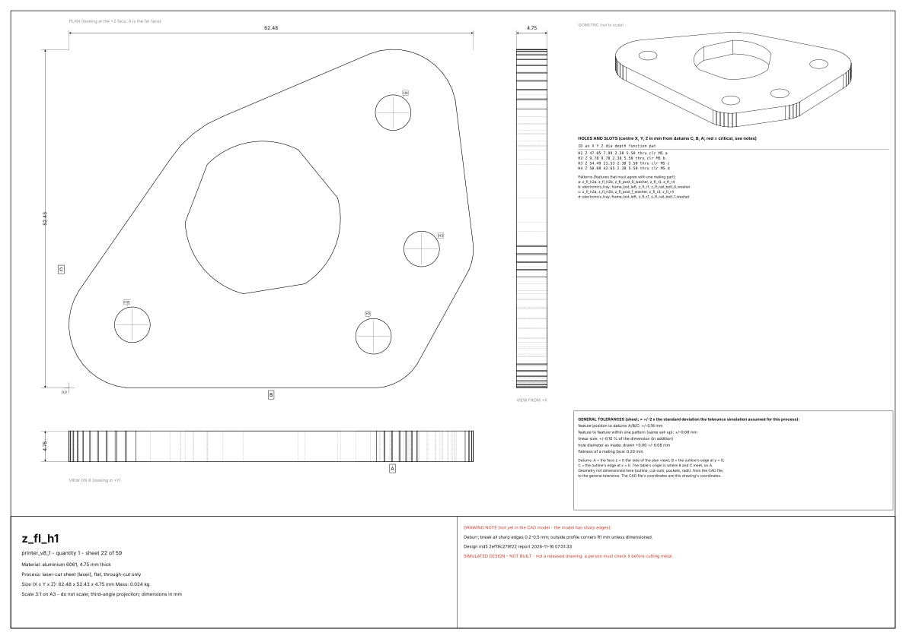

- Quantity 1. aluminium 6061; sheet; 62.48 x 52.43 x 4.75 mm; 0.024 kg. Same size, volume and hole list as z_fr_h1 (same or mirror-image part: compare before sharing a file).
- Sheet not specified mm, None cut, flat (no bends), through-cut only. Flat size None mm, cut length None mm, None pierces (report). DXF written here: {'LINE': 48, 'ARC': 40, 'CIRCLE': 4}, cut length 330.4 mm, extent (62.48, 52.43).
- Threads: none. Inserts and clinch nuts: none. Reaming: none.
- Drawing note, not yet in the model: Deburr; break all sharp edges 0.2-0.5 mm; outside profile corners R1 min unless dimensioned.

| ID | Kind | Axis | X | Y | Z | Dia / width | Slot length | Depth | Counterbore (dia x depth, from) | Function | Screws | On its axis | Pattern | Critical |
|---|---|---|---|---|---|---|---|---|---|---|---|---|---|---|
| H1 | hole | Z | 47.05 | 7.99 | 2.38 | 5.5 | - | through | - | clearance M5 | z_fl_post_0 (SHCS-M5x65) | - | a: z_fl_h2a, z_fl_h2b, z_fl_post_0_washer, z_fl_r3, z_fl_r4 | - |
| H2 | hole | Z | 9.78 | 9.78 | 2.38 | 5.5 | - | through | - | clearance M5 | z_fl_rail_bolt_0 (SHCS-M5x20) | - | b: electronics_tray, frame_bot_left, z_fl_r1, z_fl_rail_bolt_0_washer | - |
| H3 | hole | Z | 54.49 | 21.53 | 2.38 | 5.5 | - | through | - | clearance M5 | z_fl_post_1 (SHCS-M5x65) | - | c: z_fl_h2a, z_fl_h2b, z_fl_post_1_washer, z_fl_r3, z_fl_r4 | - |
| H4 | hole | Z | 50.08 | 42.65 | 2.38 | 5.5 | - | through | - | clearance M5 | z_fl_rail_bolt_1 (SHCS-M5x20) | - | d: electronics_tray, frame_bot_left, z_fl_r1, z_fl_rail_bolt_1_washer | - |

### z_fl_r3

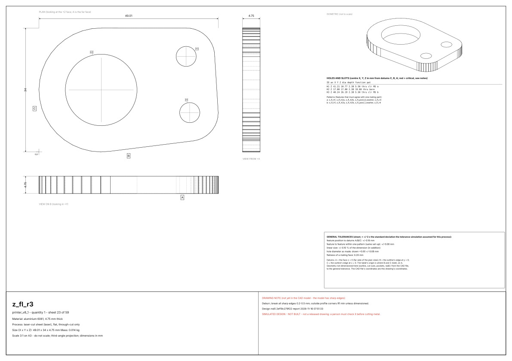

- Quantity 1. aluminium 6061; sheet; 49.01 x 34 x 4.75 mm; 0.014 kg. Same size, volume and hole list as z_fr_r3 (same or mirror-image part: compare before sharing a file).
- Sheet not specified mm, None cut, flat (no bends), through-cut only. Flat size None mm, cut length None mm, None pierces (report). DXF written here: {'LINE': 43, 'ARC': 38, 'CIRCLE': 3}, cut length 237.0 mm, extent (49.0, 33.99).
- Threads: none. Inserts and clinch nuts: none. Reaming: none.
- Drawing note, not yet in the model: Deburr; break all sharp edges 0.2-0.5 mm; outside profile corners R1 min unless dimensioned.

| ID | Kind | Axis | X | Y | Z | Dia / width | Slot length | Depth | Counterbore (dia x depth, from) | Function | Screws | On its axis | Pattern | Critical |
|---|---|---|---|---|---|---|---|---|---|---|---|---|---|---|
| H1 | hole | Z | 41.21 | 10.77 | 2.38 | 5.5 | - | through | - | clearance M5 | z_fl_post_0 (SHCS-M5x65) | - | a: z_fl_h1, z_fl_h2a, z_fl_h2b, z_fl_post_0_washer, z_fl_r4 | - |
| H2 | hole | Z | 17 | 17 | 2.38 | 19.6 | - | through | - | bore / opening | - | z_fl_shim (custom), leadscrew_fl (T8x2-300), z_pulley_fl (GT2-20T-B8) | - | - |
| H3 | hole | Z | 40.24 | 26.19 | 2.38 | 5.5 | - | through | - | clearance M5 | z_fl_post_1 (SHCS-M5x65) | - | b: z_fl_h1, z_fl_h2a, z_fl_h2b, z_fl_post_1_washer, z_fl_r4 | - |

### z_fl_h2a

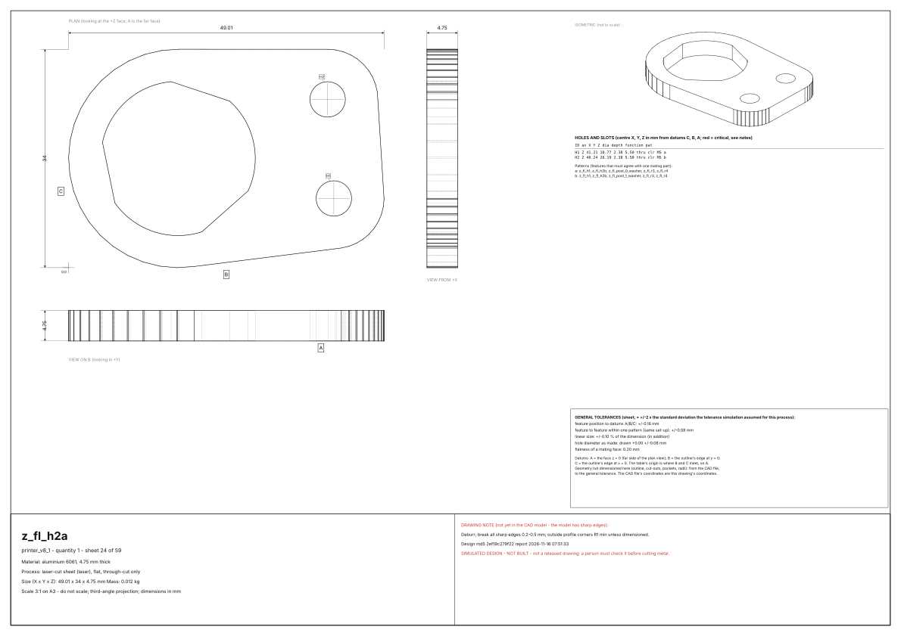

- Quantity 1. aluminium 6061; sheet; 49.01 x 34 x 4.75 mm; 0.012 kg. Same size, volume and hole list as z_fr_h2a (same or mirror-image part: compare before sharing a file).
- Sheet not specified mm, None cut, flat (no bends), through-cut only. Flat size None mm, cut length None mm, None pierces (report). DXF written here: {'LINE': 46, 'ARC': 41, 'CIRCLE': 2}, cut length 250.0 mm, extent (49.0, 33.99).
- Threads: none. Inserts and clinch nuts: none. Reaming: none.
- Drawing note, not yet in the model: Deburr; break all sharp edges 0.2-0.5 mm; outside profile corners R1 min unless dimensioned.

| ID | Kind | Axis | X | Y | Z | Dia / width | Slot length | Depth | Counterbore (dia x depth, from) | Function | Screws | On its axis | Pattern | Critical |
|---|---|---|---|---|---|---|---|---|---|---|---|---|---|---|
| H1 | hole | Z | 41.21 | 10.77 | 2.38 | 5.5 | - | through | - | clearance M5 | z_fl_post_0 (SHCS-M5x65) | - | a: z_fl_h1, z_fl_h2b, z_fl_post_0_washer, z_fl_r3, z_fl_r4 | - |
| H2 | hole | Z | 40.24 | 26.19 | 2.38 | 5.5 | - | through | - | clearance M5 | z_fl_post_1 (SHCS-M5x65) | - | b: z_fl_h1, z_fl_h2b, z_fl_post_1_washer, z_fl_r3, z_fl_r4 | - |

### z_fl_h2b

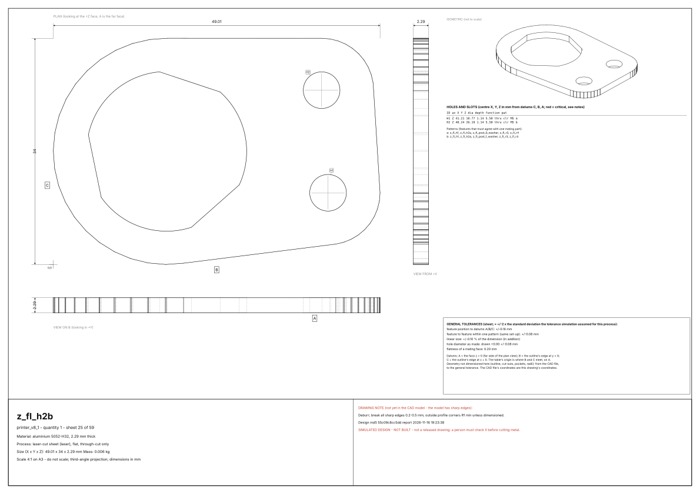

- Quantity 1. aluminium 5052-H32; sheet; 49.01 x 34 x 2.29 mm; 0.006 kg. Same size, volume and hole list as z_fr_h2b (same or mirror-image part: compare before sharing a file).
- Sheet not specified mm, None cut, flat (no bends), through-cut only. Flat size None mm, cut length None mm, None pierces (report). DXF written here: {'LINE': 46, 'ARC': 41, 'CIRCLE': 2}, cut length 250.0 mm, extent (49.0, 33.99).
- Threads: none. Inserts and clinch nuts: none. Reaming: none.
- Drawing note, not yet in the model: Deburr; break all sharp edges 0.2-0.5 mm; outside profile corners R1 min unless dimensioned.

| ID | Kind | Axis | X | Y | Z | Dia / width | Slot length | Depth | Counterbore (dia x depth, from) | Function | Screws | On its axis | Pattern | Critical |
|---|---|---|---|---|---|---|---|---|---|---|---|---|---|---|
| H1 | hole | Z | 41.21 | 10.77 | 1.14 | 5.5 | - | through | - | clearance M5 | z_fl_post_0 (SHCS-M5x65) | - | a: z_fl_h1, z_fl_h2a, z_fl_post_0_washer, z_fl_r3, z_fl_r4 | - |
| H2 | hole | Z | 40.24 | 26.19 | 1.14 | 5.5 | - | through | - | clearance M5 | z_fl_post_1 (SHCS-M5x65) | - | b: z_fl_h1, z_fl_h2a, z_fl_post_1_washer, z_fl_r3, z_fl_r4 | - |

### z_fl_r4

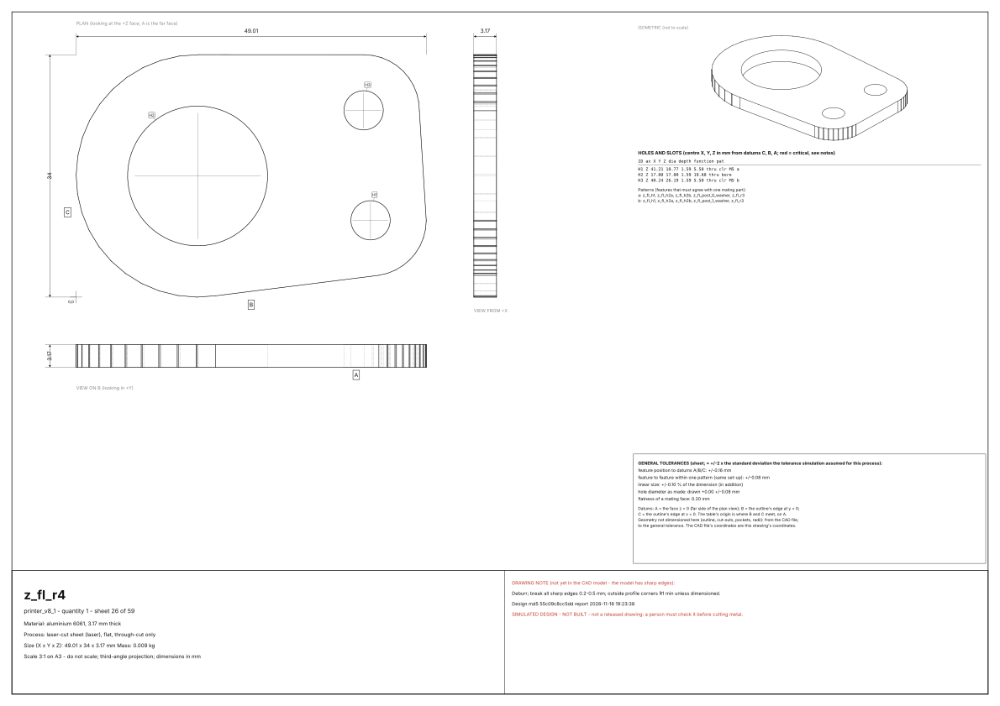

- Quantity 1. aluminium 6061; sheet; 49.01 x 34 x 3.17 mm; 0.009 kg. Same size, volume and hole list as z_fr_r4 (same or mirror-image part: compare before sharing a file).
- Sheet not specified mm, None cut, flat (no bends), through-cut only. Flat size None mm, cut length None mm, None pierces (report). DXF written here: {'LINE': 43, 'ARC': 38, 'CIRCLE': 3}, cut length 237.0 mm, extent (49.0, 33.99).
- Threads: none. Inserts and clinch nuts: none. Reaming: none.
- Drawing note, not yet in the model: Deburr; break all sharp edges 0.2-0.5 mm; outside profile corners R1 min unless dimensioned.

| ID | Kind | Axis | X | Y | Z | Dia / width | Slot length | Depth | Counterbore (dia x depth, from) | Function | Screws | On its axis | Pattern | Critical |
|---|---|---|---|---|---|---|---|---|---|---|---|---|---|---|
| H1 | hole | Z | 41.21 | 10.77 | 1.59 | 5.5 | - | through | - | clearance M5 | z_fl_post_0 (SHCS-M5x65) | - | a: z_fl_h1, z_fl_h2a, z_fl_h2b, z_fl_post_0_washer, z_fl_r3 | - |
| H2 | hole | Z | 17 | 17 | 1.59 | 19.6 | - | through | - | bore / opening | - | leadscrew_fl (T8x2-300) | - | - |
| H3 | hole | Z | 40.24 | 26.19 | 1.59 | 5.5 | - | through | - | clearance M5 | z_fl_post_1 (SHCS-M5x65) | - | b: z_fl_h1, z_fl_h2a, z_fl_h2b, z_fl_post_1_washer, z_fl_r3 | - |

### z_fl_shim

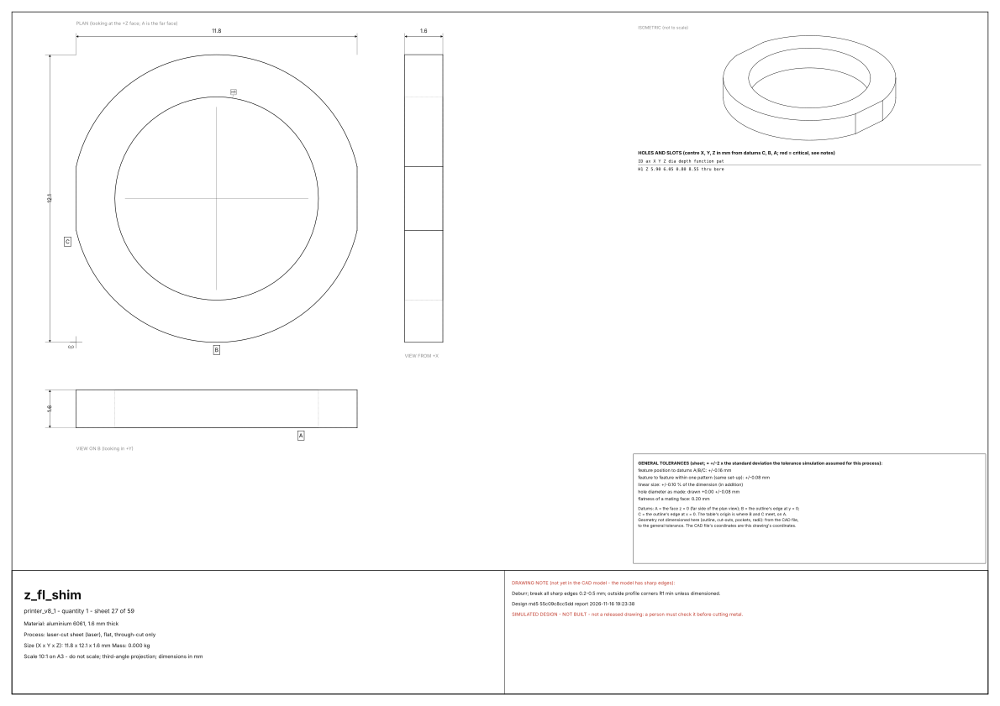

- Quantity 1. aluminium 6061; sheet; 11.8 x 12.1 x 1.6 mm; 0.000 kg. Same size, volume and hole list as z_rear_shim, z_fr_shim (same or mirror-image part: compare before sharing a file).
- Sheet not specified mm, None cut, flat (no bends), through-cut only. Flat size None mm, cut length None mm, None pierces (report). DXF written here: {'LINE': 2, 'ARC': 2, 'CIRCLE': 1}, cut length 64.8 mm, extent (11.8, 8.55).
- Threads: none. Inserts and clinch nuts: none. Reaming: none.
- Drawing note, not yet in the model: Deburr; break all sharp edges 0.2-0.5 mm; outside profile corners R1 min unless dimensioned.
- **Needs more than the general tolerance, or rests on an assumption:**
  - Report, manufacture `mostly_holes`: 50% of the blank is cut away inside the outline; grilles this open shift, warp or break while being cut.

| ID | Kind | Axis | X | Y | Z | Dia / width | Slot length | Depth | Counterbore (dia x depth, from) | Function | Screws | On its axis | Pattern | Critical |
|---|---|---|---|---|---|---|---|---|---|---|---|---|---|---|
| H1 | hole | Z | 5.9 | 6.05 | 0.8 | 8.55 | - | through | - | bore / opening | - | leadscrew_fl (T8x2-300) | - | - |

### z_fr_r1

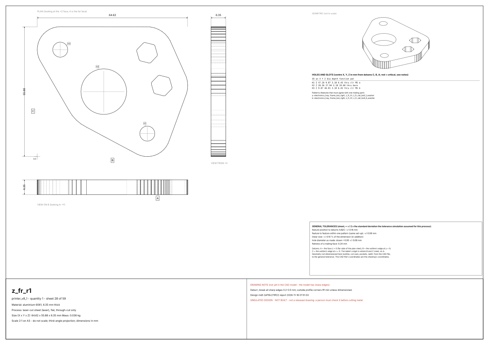

- Quantity 1. aluminium 6061; sheet; 64.62 x 55.88 x 6.35 mm; 0.036 kg. Same size, volume and hole list as z_fl_r1 (same or mirror-image part: compare before sharing a file).
- Sheet not specified mm, None cut, flat (no bends), through-cut only. Flat size None mm, cut length None mm, None pierces (report). DXF written here: {'LINE': 57, 'ARC': 48, 'CIRCLE': 3}, cut length 350.0 mm, extent (64.62, 55.88).
- Threads: none. Inserts and clinch nuts: none. Reaming: none.
- Drawing note, not yet in the model: Deburr; break all sharp edges 0.2-0.5 mm; outside profile corners R1 min unless dimensioned.

| ID | Kind | Axis | X | Y | Z | Dia / width | Slot length | Depth | Counterbore (dia x depth, from) | Function | Screws | On its axis | Pattern | Critical |
|---|---|---|---|---|---|---|---|---|---|---|---|---|---|---|
| H1 | hole | Z | 47.26 | 9.87 | 3.18 | 6.45 | - | through | - | clearance M5 | z_fr_rail_bolt_1 (SHCS-M5x20) | - | a: electronics_tray, frame_bot_right, z_fr_h1, z_fr_rail_bolt_1_washer | - |
| H2 | hole | Z | 28.56 | 27.94 | 3.18 | 19.6 | - | through | - | bore / opening | - | leadscrew_fr (T8x2-300) | - | - |
| H3 | hole | Z | 9.87 | 46.01 | 3.18 | 6.45 | - | through | - | clearance M5 | z_fr_rail_bolt_0 (SHCS-M5x20) | - | b: electronics_tray, frame_bot_right, z_fr_h1, z_fr_rail_bolt_0_washer | - |

### z_fr_h1

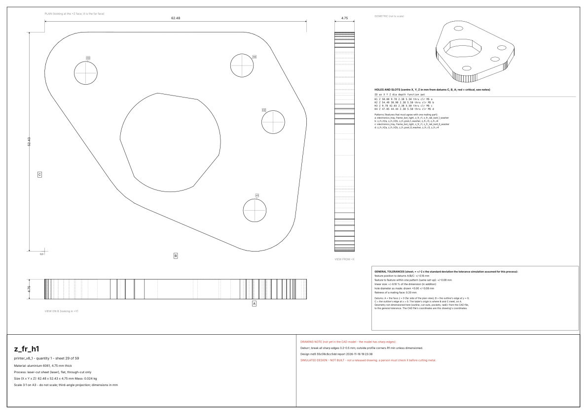

- Quantity 1. aluminium 6061; sheet; 62.48 x 52.43 x 4.75 mm; 0.024 kg. Same size, volume and hole list as z_fl_h1 (same or mirror-image part: compare before sharing a file).
- Sheet not specified mm, None cut, flat (no bends), through-cut only. Flat size None mm, cut length None mm, None pierces (report). DXF written here: {'LINE': 48, 'ARC': 40, 'CIRCLE': 4}, cut length 330.4 mm, extent (62.48, 52.43).
- Threads: none. Inserts and clinch nuts: none. Reaming: none.
- Drawing note, not yet in the model: Deburr; break all sharp edges 0.2-0.5 mm; outside profile corners R1 min unless dimensioned.

| ID | Kind | Axis | X | Y | Z | Dia / width | Slot length | Depth | Counterbore (dia x depth, from) | Function | Screws | On its axis | Pattern | Critical |
|---|---|---|---|---|---|---|---|---|---|---|---|---|---|---|
| H1 | hole | Z | 50.08 | 9.78 | 2.38 | 5.5 | - | through | - | clearance M5 | z_fr_rail_bolt_1 (SHCS-M5x20) | - | a: electronics_tray, frame_bot_right, z_fr_r1, z_fr_rail_bolt_1_washer | - |
| H2 | hole | Z | 54.49 | 30.9 | 2.38 | 5.5 | - | through | - | clearance M5 | z_fr_post_1 (SHCS-M5x65) | - | b: z_fr_h2a, z_fr_h2b, z_fr_post_1_washer, z_fr_r3, z_fr_r4 | - |
| H3 | hole | Z | 9.78 | 42.65 | 2.38 | 5.5 | - | through | - | clearance M5 | z_fr_rail_bolt_0 (SHCS-M5x20) | - | c: electronics_tray, frame_bot_right, z_fr_r1, z_fr_rail_bolt_0_washer | - |
| H4 | hole | Z | 47.05 | 44.44 | 2.38 | 5.5 | - | through | - | clearance M5 | z_fr_post_0 (SHCS-M5x65) | - | d: z_fr_h2a, z_fr_h2b, z_fr_post_0_washer, z_fr_r3, z_fr_r4 | - |

### z_fr_r3

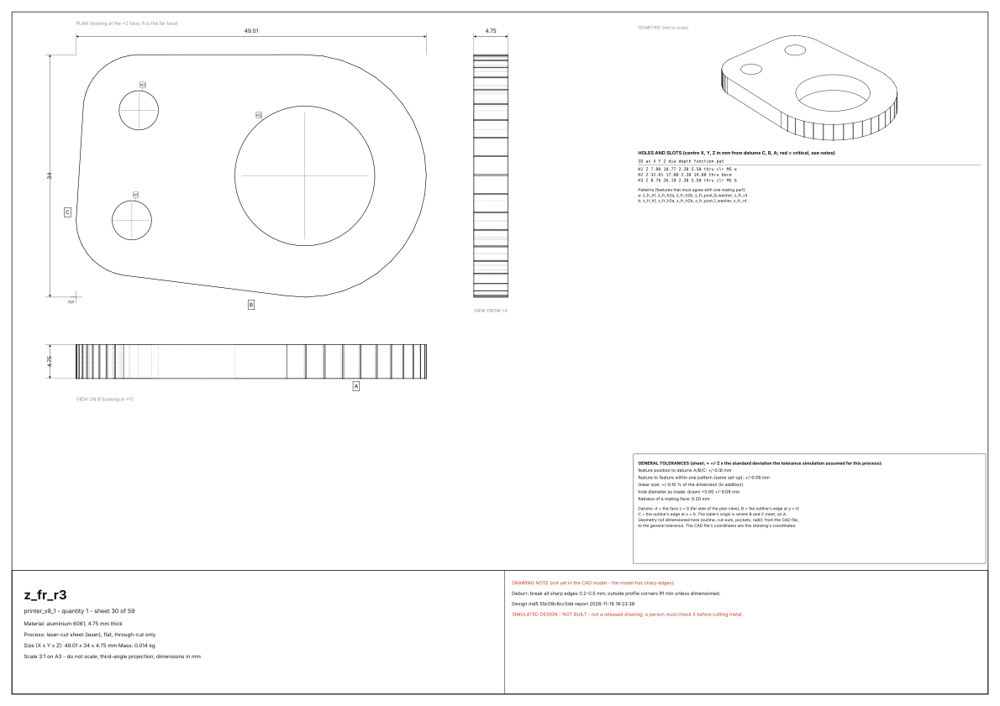

- Quantity 1. aluminium 6061; sheet; 49.01 x 34 x 4.75 mm; 0.014 kg. Same size, volume and hole list as z_fl_r3 (same or mirror-image part: compare before sharing a file).
- Sheet not specified mm, None cut, flat (no bends), through-cut only. Flat size None mm, cut length None mm, None pierces (report). DXF written here: {'LINE': 43, 'ARC': 38, 'CIRCLE': 3}, cut length 237.0 mm, extent (49.0, 33.99).
- Threads: none. Inserts and clinch nuts: none. Reaming: none.
- Drawing note, not yet in the model: Deburr; break all sharp edges 0.2-0.5 mm; outside profile corners R1 min unless dimensioned.

| ID | Kind | Axis | X | Y | Z | Dia / width | Slot length | Depth | Counterbore (dia x depth, from) | Function | Screws | On its axis | Pattern | Critical |
|---|---|---|---|---|---|---|---|---|---|---|---|---|---|---|
| H1 | hole | Z | 7.8 | 10.77 | 2.38 | 5.5 | - | through | - | clearance M5 | z_fr_post_0 (SHCS-M5x65) | - | a: z_fr_h1, z_fr_h2a, z_fr_h2b, z_fr_post_0_washer, z_fr_r4 | - |
| H2 | hole | Z | 32.01 | 17 | 2.38 | 19.6 | - | through | - | bore / opening | - | z_fr_shim (custom), leadscrew_fr (T8x2-300), z_pulley_fr (GT2-20T-B8) | - | - |
| H3 | hole | Z | 8.76 | 26.19 | 2.38 | 5.5 | - | through | - | clearance M5 | z_fr_post_1 (SHCS-M5x65) | - | b: z_fr_h1, z_fr_h2a, z_fr_h2b, z_fr_post_1_washer, z_fr_r4 | - |

### z_fr_h2a

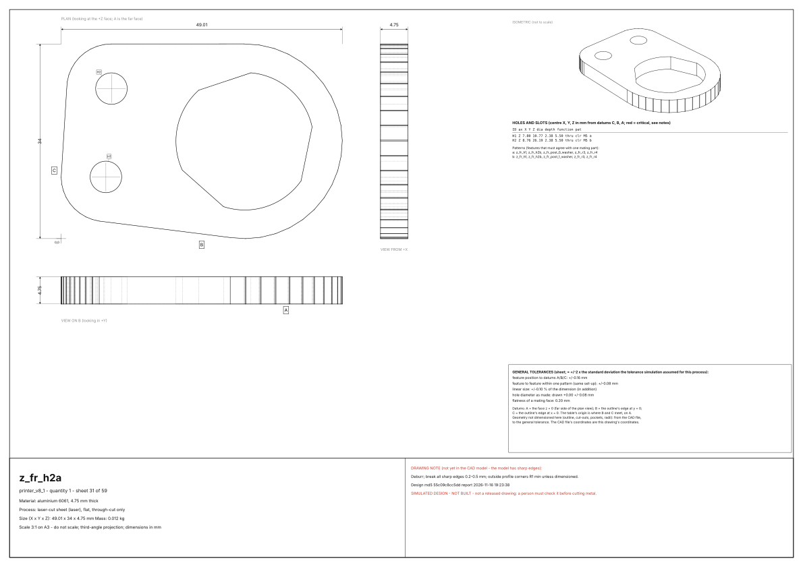

- Quantity 1. aluminium 6061; sheet; 49.01 x 34 x 4.75 mm; 0.012 kg. Same size, volume and hole list as z_fl_h2a (same or mirror-image part: compare before sharing a file).
- Sheet not specified mm, None cut, flat (no bends), through-cut only. Flat size None mm, cut length None mm, None pierces (report). DXF written here: {'LINE': 46, 'ARC': 41, 'CIRCLE': 2}, cut length 250.0 mm, extent (49.0, 33.99).
- Threads: none. Inserts and clinch nuts: none. Reaming: none.
- Drawing note, not yet in the model: Deburr; break all sharp edges 0.2-0.5 mm; outside profile corners R1 min unless dimensioned.

| ID | Kind | Axis | X | Y | Z | Dia / width | Slot length | Depth | Counterbore (dia x depth, from) | Function | Screws | On its axis | Pattern | Critical |
|---|---|---|---|---|---|---|---|---|---|---|---|---|---|---|
| H1 | hole | Z | 7.8 | 10.77 | 2.38 | 5.5 | - | through | - | clearance M5 | z_fr_post_0 (SHCS-M5x65) | - | a: z_fr_h1, z_fr_h2b, z_fr_post_0_washer, z_fr_r3, z_fr_r4 | - |
| H2 | hole | Z | 8.76 | 26.19 | 2.38 | 5.5 | - | through | - | clearance M5 | z_fr_post_1 (SHCS-M5x65) | - | b: z_fr_h1, z_fr_h2b, z_fr_post_1_washer, z_fr_r3, z_fr_r4 | - |

### z_fr_h2b

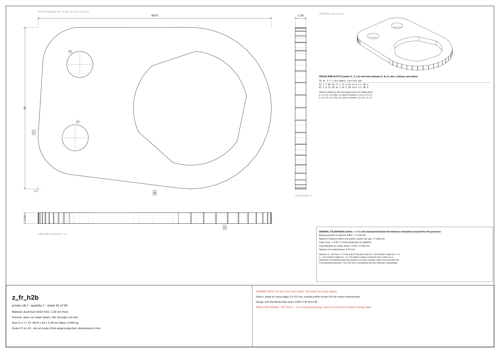

- Quantity 1. aluminium 5052-H32; sheet; 49.01 x 34 x 2.29 mm; 0.006 kg. Same size, volume and hole list as z_fl_h2b (same or mirror-image part: compare before sharing a file).
- Sheet not specified mm, None cut, flat (no bends), through-cut only. Flat size None mm, cut length None mm, None pierces (report). DXF written here: {'LINE': 46, 'ARC': 41, 'CIRCLE': 2}, cut length 250.0 mm, extent (49.0, 33.99).
- Threads: none. Inserts and clinch nuts: none. Reaming: none.
- Drawing note, not yet in the model: Deburr; break all sharp edges 0.2-0.5 mm; outside profile corners R1 min unless dimensioned.

| ID | Kind | Axis | X | Y | Z | Dia / width | Slot length | Depth | Counterbore (dia x depth, from) | Function | Screws | On its axis | Pattern | Critical |
|---|---|---|---|---|---|---|---|---|---|---|---|---|---|---|
| H1 | hole | Z | 7.8 | 10.77 | 1.14 | 5.5 | - | through | - | clearance M5 | z_fr_post_0 (SHCS-M5x65) | - | a: z_fr_h1, z_fr_h2a, z_fr_post_0_washer, z_fr_r3, z_fr_r4 | - |
| H2 | hole | Z | 8.76 | 26.19 | 1.14 | 5.5 | - | through | - | clearance M5 | z_fr_post_1 (SHCS-M5x65) | - | b: z_fr_h1, z_fr_h2a, z_fr_post_1_washer, z_fr_r3, z_fr_r4 | - |

### z_fr_r4

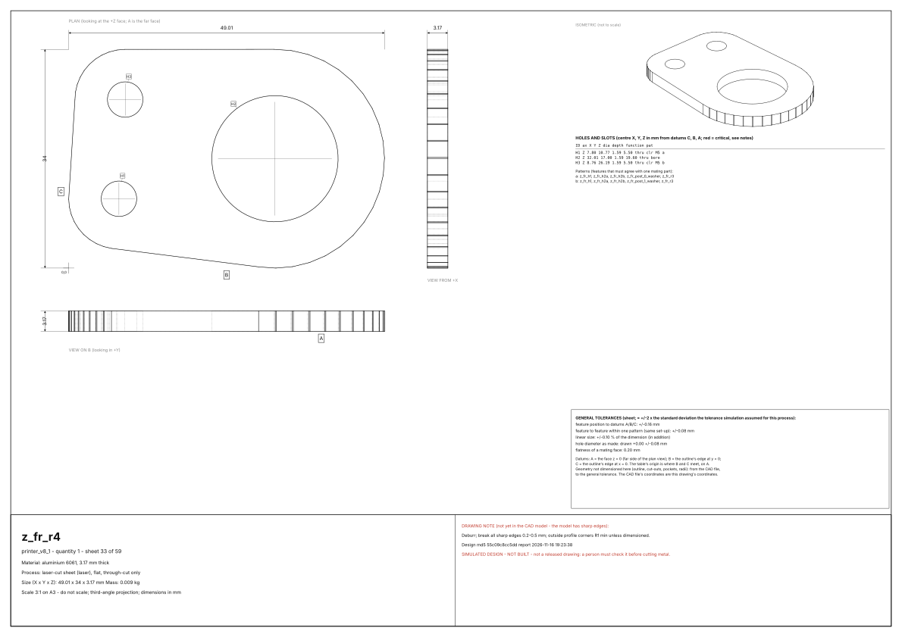

- Quantity 1. aluminium 6061; sheet; 49.01 x 34 x 3.17 mm; 0.009 kg. Same size, volume and hole list as z_fl_r4 (same or mirror-image part: compare before sharing a file).
- Sheet not specified mm, None cut, flat (no bends), through-cut only. Flat size None mm, cut length None mm, None pierces (report). DXF written here: {'LINE': 43, 'ARC': 38, 'CIRCLE': 3}, cut length 237.0 mm, extent (49.0, 33.99).
- Threads: none. Inserts and clinch nuts: none. Reaming: none.
- Drawing note, not yet in the model: Deburr; break all sharp edges 0.2-0.5 mm; outside profile corners R1 min unless dimensioned.

| ID | Kind | Axis | X | Y | Z | Dia / width | Slot length | Depth | Counterbore (dia x depth, from) | Function | Screws | On its axis | Pattern | Critical |
|---|---|---|---|---|---|---|---|---|---|---|---|---|---|---|
| H1 | hole | Z | 7.8 | 10.77 | 1.59 | 5.5 | - | through | - | clearance M5 | z_fr_post_0 (SHCS-M5x65) | - | a: z_fr_h1, z_fr_h2a, z_fr_h2b, z_fr_post_0_washer, z_fr_r3 | - |
| H2 | hole | Z | 32.01 | 17 | 1.59 | 19.6 | - | through | - | bore / opening | - | leadscrew_fr (T8x2-300) | - | - |
| H3 | hole | Z | 8.76 | 26.19 | 1.59 | 5.5 | - | through | - | clearance M5 | z_fr_post_1 (SHCS-M5x65) | - | b: z_fr_h1, z_fr_h2a, z_fr_h2b, z_fr_post_1_washer, z_fr_r3 | - |

### z_fr_shim

- Quantity 1. aluminium 6061; sheet; 11.8 x 12.1 x 1.6 mm; 0.000 kg. Same size, volume and hole list as z_rear_shim, z_fl_shim (same or mirror-image part: compare before sharing a file).
- Sheet not specified mm, None cut, flat (no bends), through-cut only. Flat size None mm, cut length None mm, None pierces (report). DXF written here: {'LINE': 2, 'ARC': 2, 'CIRCLE': 1}, cut length 64.8 mm, extent (11.8, 8.55).
- Threads: none. Inserts and clinch nuts: none. Reaming: none.
- Drawing note, not yet in the model: Deburr; break all sharp edges 0.2-0.5 mm; outside profile corners R1 min unless dimensioned.
- **Needs more than the general tolerance, or rests on an assumption:**
  - Report, manufacture `mostly_holes`: 50% of the blank is cut away inside the outline; grilles this open shift, warp or break while being cut.

| ID | Kind | Axis | X | Y | Z | Dia / width | Slot length | Depth | Counterbore (dia x depth, from) | Function | Screws | On its axis | Pattern | Critical |
|---|---|---|---|---|---|---|---|---|---|---|---|---|---|---|
| H1 | hole | Z | 5.9 | 6.05 | 0.8 | 8.55 | - | through | - | bore / opening | - | leadscrew_fr (T8x2-300) | - | - |

### y_plate_left

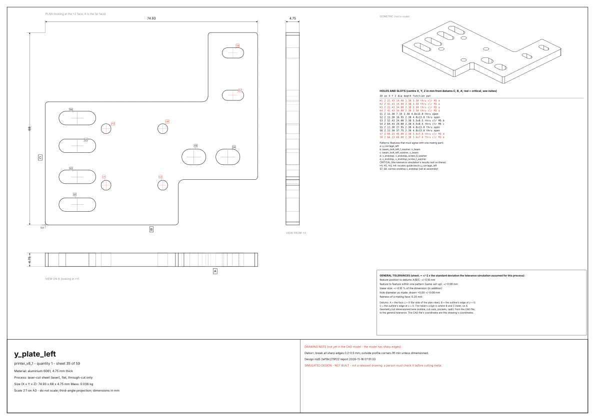

- Quantity 1. aluminium 6061; sheet; 74.93 x 68 x 4.75 mm; 0.036 kg.
- Sheet not specified mm, None cut, flat (no bends), through-cut only. Flat size None mm, cut length None mm, None pierces (report). DXF written here: {'LINE': 24, 'ARC': 24, 'CIRCLE': 4}, cut length 536.6 mm, extent (74.93, 68.0).
- Threads: none. Inserts and clinch nuts: none. Reaming: none.
- Drawing note, not yet in the model: Deburr; break all sharp edges 0.2-0.5 mm; outside profile corners R1 min unless dimensioned.
- **Needs more than the general tolerance, or rests on an assumption:**
  - **Patterns a** (guide block / motor): hole to hole +/-0.08 mm is the figure the screw-pattern check used (tighter than the +/-0.16 mm position tolerance); radial clearance on the screws 0.25 mm. Cut all holes of a pattern in one set-up.
  - Report, manufacture `hole_smaller_than_thickness`: 6 hole(s) or cut-out(s) narrower than the 4.75 mm sheet (smallest 3.50 mm at [-170.0, -34.37, 419.38]): they cut, but taper and lose accuracy.
  - Report, manufacture `hole_too_close_to_edge`: 2 hole(s) with less than 4.75 mm of material to the edge (least 3.35 mm at [-180.13, -10.62, 419.38]): the web overheats and distorts, and tears if the part is bent or loaded.
  - Report, manufacture `holes_too_close`: 4 pair(s) of holes or cut-outs with too little material between them (least 2.56 mm at [-175.06, -32.89, 419.38], wanted 4.75 mm = 1 x thickness).

| ID | Kind | Axis | X | Y | Z | Dia / width | Slot length | Depth | Counterbore (dia x depth, from) | Function | Screws | On its axis | Pattern | Critical |
|---|---|---|---|---|---|---|---|---|---|---|---|---|---|---|
| H1 | hole | Z | 21.43 | 14 | 2.38 | 3.5 | - | through | - | clearance M3 | y_plate_left_screw_0 (SHCS-M3x8) | - | a: y_carriage_left | locates guide block y_carriage_left |
| H2 | hole | Z | 41.43 | 14 | 2.38 | 3.5 | - | through | - | clearance M3 | y_plate_left_screw_2 (SHCS-M3x8) | - | a: y_carriage_left | locates guide block y_carriage_left |
| H3 | hole | Z | 21.43 | 34 | 2.38 | 3.5 | - | through | - | clearance M3 | y_plate_left_screw_1 (SHCS-M3x8) | - | a: y_carriage_left | locates guide block y_carriage_left |
| H4 | hole | Z | 41.43 | 34 | 2.38 | 3.5 | - | through | - | clearance M3 | y_plate_left_screw_3 (SHCS-M3x8) | - | a: y_carriage_left | locates guide block y_carriage_left |
| S1 | slot | Z | 11.3 | 7.15 | 2.38 | 4.8 | 13 | through | - | hole (no screw or part on its axis in the model) | - | - | - | - |
| S2 | slot | Z | 11.3 | 16.95 | 2.38 | 4.8 | 13 | through | - | hole (no screw or part on its axis in the model) | - | - | - | - |
| S3 | slot | Z | 52.43 | 24 | 2.38 | 5.5 | 8.5 | through | - | clearance M5 | beam_bolt_left_1 (SHCS-M5x10) | - | b: beam_bolt_left_1_washer, x_beam | - |
| S4 | slot | Z | 64.43 | 24 | 2.38 | 5.5 | 8.5 | through | - | clearance M5 | beam_bolt_left (SHCS-M5x10) | - | c: beam_bolt_left_washer, x_beam | - |
| S5 | slot | Z | 11.3 | 27.95 | 2.38 | 4.8 | 13 | through | - | hole (no screw or part on its axis in the model) | - | - | - | - |
| S6 | slot | Z | 11.3 | 37.75 | 2.38 | 4.8 | 13 | through | - | hole (no screw or part on its axis in the model) | - | - | - | - |
| S7 | slot | Z | 66.23 | 45.8 | 2.38 | 3.6 | 7.6 | through | - | clearance M3 | x_endstop_screw_0 (SHCS-M3x16) | - | d: x_endstop, x_endstop_screw_0_washer | carries endstop x_endstop (set at assembly) |
| S8 | slot | Z | 66.23 | 60.8 | 2.38 | 3.6 | 7.6 | through | - | clearance M3 | x_endstop_screw_1 (SHCS-M3x16) | - | e: x_endstop, x_endstop_screw_1_washer | carries endstop x_endstop (set at assembly) |

### y_plate_right

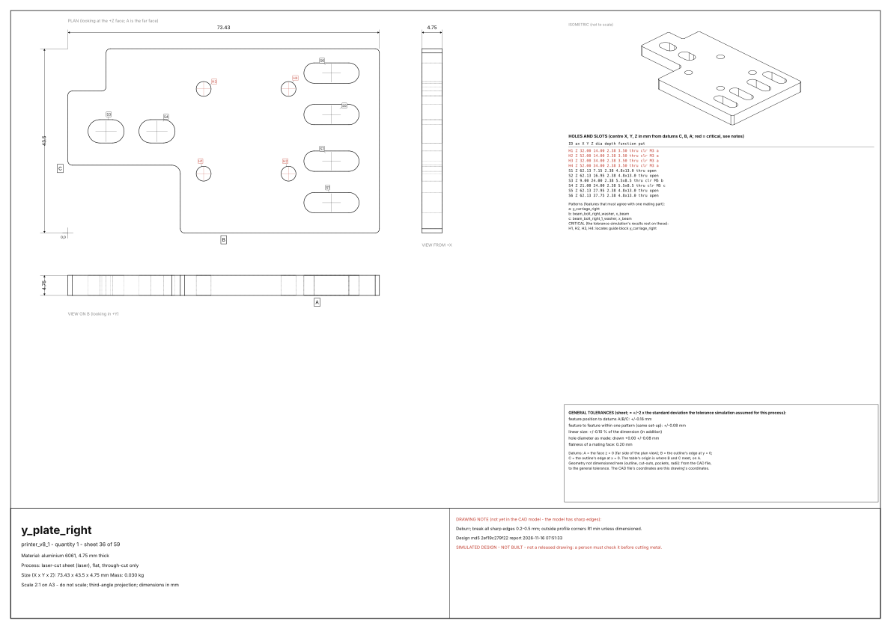

- Quantity 1. aluminium 6061; sheet; 73.43 x 43.5 x 4.75 mm; 0.030 kg.
- Sheet not specified mm, None cut, flat (no bends), through-cut only. Flat size None mm, cut length None mm, None pierces (report). DXF written here: {'LINE': 20, 'ARC': 20, 'CIRCLE': 4}, cut length 446.5 mm, extent (73.43, 43.5).
- Threads: none. Inserts and clinch nuts: none. Reaming: none.
- Drawing note, not yet in the model: Deburr; break all sharp edges 0.2-0.5 mm; outside profile corners R1 min unless dimensioned.
- **Needs more than the general tolerance, or rests on an assumption:**
  - **Patterns a** (guide block / motor): hole to hole +/-0.08 mm is the figure the screw-pattern check used (tighter than the +/-0.16 mm position tolerance); radial clearance on the screws 0.25 mm. Cut all holes of a pattern in one set-up.
  - Report, manufacture `hole_smaller_than_thickness`: 4 hole(s) or cut-out(s) narrower than the 4.75 mm sheet (smallest 3.50 mm at [150.0, -34.37, 419.38]): they cut, but taper and lose accuracy.
  - Report, manufacture `hole_too_close_to_edge`: 2 hole(s) with less than 4.75 mm of material to the edge (least 3.35 mm at [180.13, -10.62, 419.38]): the web overheats and distorts, and tears if the part is bent or loaded.
  - Report, manufacture `holes_too_close`: 4 pair(s) of holes or cut-outs with too little material between them (least 2.56 mm at [175.07, -32.89, 419.38], wanted 4.75 mm = 1 x thickness).

| ID | Kind | Axis | X | Y | Z | Dia / width | Slot length | Depth | Counterbore (dia x depth, from) | Function | Screws | On its axis | Pattern | Critical |
|---|---|---|---|---|---|---|---|---|---|---|---|---|---|---|
| H1 | hole | Z | 32 | 14 | 2.38 | 3.5 | - | through | - | clearance M3 | y_plate_right_screw_0 (SHCS-M3x8) | - | a: y_carriage_right | locates guide block y_carriage_right |
| H2 | hole | Z | 52 | 14 | 2.38 | 3.5 | - | through | - | clearance M3 | y_plate_right_screw_2 (SHCS-M3x8) | - | a: y_carriage_right | locates guide block y_carriage_right |
| H3 | hole | Z | 32 | 34 | 2.38 | 3.5 | - | through | - | clearance M3 | y_plate_right_screw_1 (SHCS-M3x8) | - | a: y_carriage_right | locates guide block y_carriage_right |
| H4 | hole | Z | 52 | 34 | 2.38 | 3.5 | - | through | - | clearance M3 | y_plate_right_screw_3 (SHCS-M3x8) | - | a: y_carriage_right | locates guide block y_carriage_right |
| S1 | slot | Z | 62.13 | 7.15 | 2.38 | 4.8 | 13 | through | - | hole (no screw or part on its axis in the model) | - | - | - | - |
| S2 | slot | Z | 62.13 | 16.95 | 2.38 | 4.8 | 13 | through | - | hole (no screw or part on its axis in the model) | - | - | - | - |
| S3 | slot | Z | 9 | 24 | 2.38 | 5.5 | 8.5 | through | - | clearance M5 | beam_bolt_right (SHCS-M5x10) | - | b: beam_bolt_right_washer, x_beam | - |
| S4 | slot | Z | 21 | 24 | 2.38 | 5.5 | 8.5 | through | - | clearance M5 | beam_bolt_right_1 (SHCS-M5x10) | - | c: beam_bolt_right_1_washer, x_beam | - |
| S5 | slot | Z | 62.13 | 27.95 | 2.38 | 4.8 | 13 | through | - | hole (no screw or part on its axis in the model) | - | - | - | - |
| S6 | slot | Z | 62.13 | 37.75 | 2.38 | 4.8 | 13 | through | - | hole (no screw or part on its axis in the model) | - | - | - | - |

### x_rail_stop_left

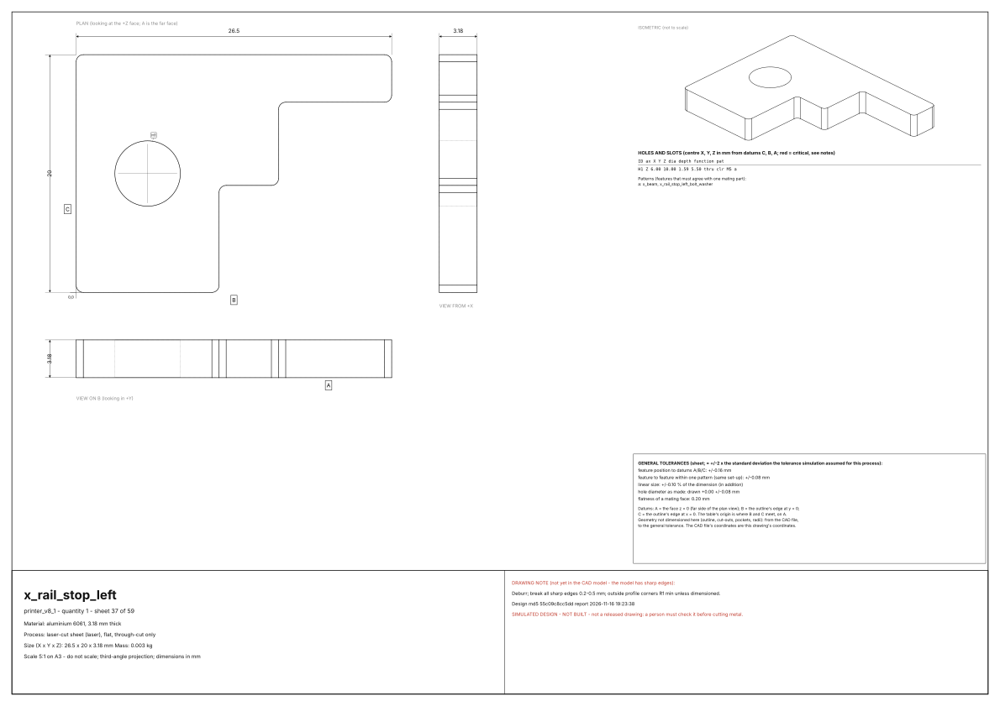

- Quantity 1. aluminium 6061; sheet; 26.5 x 20 x 3.18 mm; 0.003 kg. Same size, volume and hole list as x_rail_stop_right (same or mirror-image part: compare before sharing a file).
- Sheet not specified mm, None cut, flat (no bends), through-cut only. Flat size None mm, cut length None mm, None pierces (report). DXF written here: {'LINE': 8, 'ARC': 8, 'CIRCLE': 1}, cut length 108.2 mm, extent (26.5, 20.0).
- Threads: none. Inserts and clinch nuts: none. Reaming: none.
- Drawing note, not yet in the model: Deburr; break all sharp edges 0.2-0.5 mm; outside profile corners R1 min unless dimensioned.

| ID | Kind | Axis | X | Y | Z | Dia / width | Slot length | Depth | Counterbore (dia x depth, from) | Function | Screws | On its axis | Pattern | Critical |
|---|---|---|---|---|---|---|---|---|---|---|---|---|---|---|
| H1 | hole | Z | 6 | 10 | 1.59 | 5.5 | - | through | - | clearance M5 | x_rail_stop_left_bolt (SHCS-M5x10) | - | a: x_beam, x_rail_stop_left_bolt_washer | - |

### x_rail_stop_right

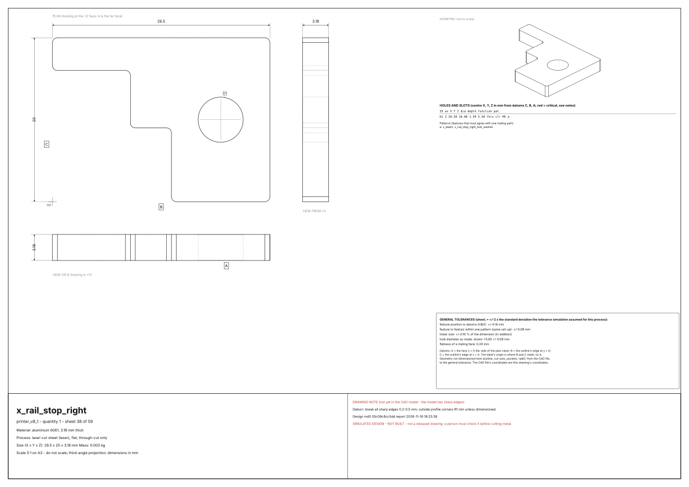

- Quantity 1. aluminium 6061; sheet; 26.5 x 20 x 3.18 mm; 0.003 kg. Same size, volume and hole list as x_rail_stop_left (same or mirror-image part: compare before sharing a file).
- Sheet not specified mm, None cut, flat (no bends), through-cut only. Flat size None mm, cut length None mm, None pierces (report). DXF written here: {'LINE': 8, 'ARC': 8, 'CIRCLE': 1}, cut length 108.2 mm, extent (26.5, 20.0).
- Threads: none. Inserts and clinch nuts: none. Reaming: none.
- Drawing note, not yet in the model: Deburr; break all sharp edges 0.2-0.5 mm; outside profile corners R1 min unless dimensioned.

| ID | Kind | Axis | X | Y | Z | Dia / width | Slot length | Depth | Counterbore (dia x depth, from) | Function | Screws | On its axis | Pattern | Critical |
|---|---|---|---|---|---|---|---|---|---|---|---|---|---|---|
| H1 | hole | Z | 20.5 | 10 | 1.59 | 5.5 | - | through | - | clearance M5 | x_rail_stop_right_bolt (SHCS-M5x10) | - | a: x_beam, x_rail_stop_right_bolt_washer | - |

### tool_plate

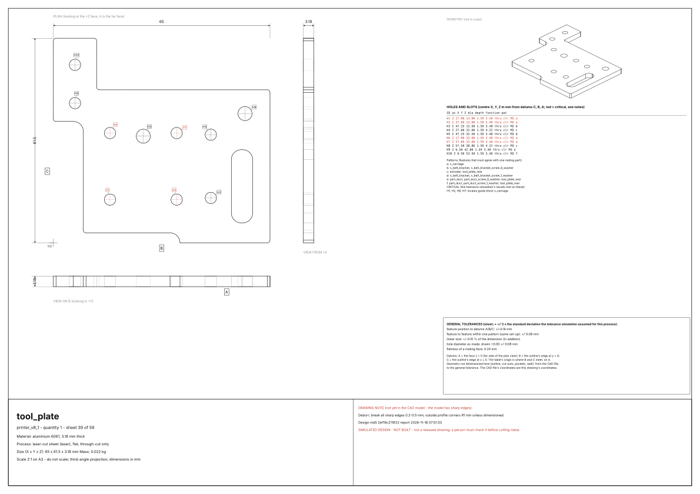

- Quantity 1. aluminium 6061; sheet; 65 x 61.5 x 3.18 mm; 0.022 kg.
- Sheet not specified mm, None cut, flat (no bends), through-cut only. Flat size None mm, cut length None mm, None pierces (report). DXF written here: {'LINE': 13, 'ARC': 13, 'CIRCLE': 10}, cut length 411.6 mm, extent (65.0, 61.5).
- Threads: none. Inserts and clinch nuts: none. Reaming: none.
- Drawing note, not yet in the model: Deburr; break all sharp edges 0.2-0.5 mm; outside profile corners R1 min unless dimensioned.
- **Needs more than the general tolerance, or rests on an assumption:**
  - **Patterns a** (guide block / motor): hole to hole +/-0.08 mm is the figure the screw-pattern check used (tighter than the +/-0.16 mm position tolerance); radial clearance on the screws 0.20 mm. Cut all holes of a pattern in one set-up.
  - Report, manufacture `holes_too_close`: 2 pair(s) of holes or cut-outs with too little material between them (least 6.23 mm at [9.53, 0.22, 402.0], wanted 6.35 mm = 2 x thickness).

| ID | Kind | Axis | X | Y | Z | Dia / width | Slot length | Depth | Counterbore (dia x depth, from) | Function | Screws | On its axis | Pattern | Critical |
|---|---|---|---|---|---|---|---|---|---|---|---|---|---|---|
| H1 | hole | Z | 17 | 13 | 1.59 | 3.4 | - | through | - | clearance M3 | tool_screw_0 (SHCS-M3x6) | - | a: x_carriage | locates guide block x_carriage |
| H2 | hole | Z | 37 | 13 | 1.59 | 3.4 | - | through | - | clearance M3 | tool_screw_2 (SHCS-M3x6) | - | a: x_carriage | locates guide block x_carriage |
| H3 | hole | Z | 47.25 | 13.5 | 1.59 | 3.4 | - | through | - | clearance M3 | x_belt_bracket_screw_0 (SHCS-M3x10) | - | b: x_belt_bracket, x_belt_bracket_screw_0_washer | - |
| H4 | hole | Z | 27 | 32.06 | 1.59 | 4.22 | - | through | - | clearance M3 | extruder_screw_0 (SHCS-M3x50) | - | c: extruder, extruder_screw_0_washer, tool_plate_rear | - |
| H5 | hole | Z | 47.25 | 32.5 | 1.59 | 3.4 | - | through | - | clearance M3 | x_belt_bracket_screw_1 (SHCS-M3x10) | - | d: x_belt_bracket, x_belt_bracket_screw_1_washer | - |
| H6 | hole | Z | 17 | 33 | 1.59 | 3.4 | - | through | - | clearance M3 | tool_screw_1 (SHCS-M3x6) | - | a: x_carriage | locates guide block x_carriage |
| H7 | hole | Z | 37 | 33 | 1.59 | 3.4 | - | through | - | clearance M3 | tool_screw_3 (SHCS-M3x6) | - | a: x_carriage | locates guide block x_carriage |
| H8 | hole | Z | 57.5 | 38.86 | 1.59 | 4.22 | - | through | - | clearance M3 | extruder_screw_1 (SHCS-M3x50) | - | e: extruder, extruder_screw_1_washer, tool_plate_rear | - |
| H9 | hole | Z | 6.5 | 42 | 1.59 | 3.4 | - | through | - | clearance M3 | part_duct_screw_0 (SHCS-M3x16) | - | f: part_duct, part_duct_screw_0_nwasher, part_duct_screw_0_washer, tool_plate_rear | - |
| H10 | hole | Z | 6.5 | 53.5 | 1.59 | 3.4 | - | through | - | clearance M3 | part_duct_screw_1 (SHCS-M3x16) | - | g: part_duct, part_duct_screw_1_nwasher, part_duct_screw_1_washer, tool_plate_rear | - |

### tool_plate_rear

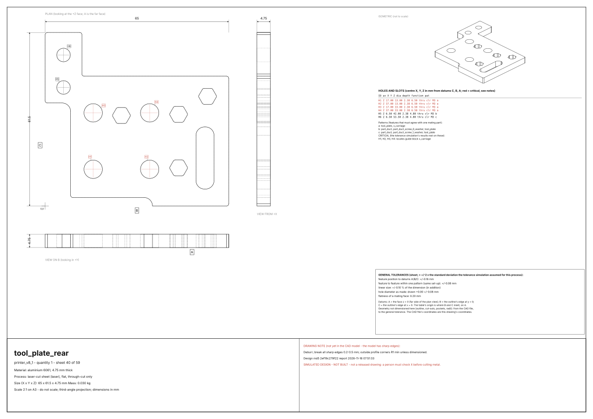

- Quantity 1. aluminium 6061; sheet; 65 x 61.5 x 4.75 mm; 0.030 kg.
- Sheet not specified mm, None cut, flat (no bends), through-cut only. Flat size None mm, cut length None mm, None pierces (report). DXF written here: {'LINE': 37, 'ARC': 37, 'CIRCLE': 6}, cut length 487.7 mm, extent (65.0, 61.5).
- Threads: none. Inserts and clinch nuts: none. Reaming: none.
- Drawing note, not yet in the model: Deburr; break all sharp edges 0.2-0.5 mm; outside profile corners R1 min unless dimensioned.
- **Needs more than the general tolerance, or rests on an assumption:**
  - **Patterns a** (guide block / motor): hole to hole +/-0.08 mm is the figure the screw-pattern check used (tighter than the +/-0.16 mm position tolerance); radial clearance on the screws 1.75 mm. Cut all holes of a pattern in one set-up.
  - Report, manufacture `hole_too_close_to_edge`: 3 hole(s) with less than 4.75 mm of material to the edge (least 3.11 mm at [19.0, 4.19, 386.5]): the web overheats and distorts, and tears if the part is bent or loaded.
  - Report, manufacture `holes_too_close`: 7 pair(s) of holes or cut-outs with too little material between them (least 3.01 mm at [-7.75, 4.19, 431.93], wanted 4.75 mm = 1 x thickness).

| ID | Kind | Axis | X | Y | Z | Dia / width | Slot length | Depth | Counterbore (dia x depth, from) | Function | Screws | On its axis | Pattern | Critical |
|---|---|---|---|---|---|---|---|---|---|---|---|---|---|---|
| H1 | hole | Z | 17 | 13 | 2.38 | 6.5 | - | through | - | clearance M3 | tool_screw_0 (SHCS-M3x6) | - | a: tool_plate, x_carriage | locates guide block x_carriage |
| H2 | hole | Z | 37 | 13 | 2.38 | 6.5 | - | through | - | clearance M3 | tool_screw_2 (SHCS-M3x6) | - | a: tool_plate, x_carriage | locates guide block x_carriage |
| H3 | hole | Z | 17 | 33 | 2.38 | 6.5 | - | through | - | clearance M3 | tool_screw_1 (SHCS-M3x6) | - | a: tool_plate, x_carriage | locates guide block x_carriage |
| H4 | hole | Z | 37 | 33 | 2.38 | 6.5 | - | through | - | clearance M3 | tool_screw_3 (SHCS-M3x6) | - | a: tool_plate, x_carriage | locates guide block x_carriage |
| H5 | hole | Z | 6.5 | 42 | 2.38 | 4.8 | - | through | - | clearance M3 | part_duct_screw_0 (SHCS-M3x16) | - | b: part_duct, part_duct_screw_0_nwasher, part_duct_screw_0_washer, tool_plate | - |
| H6 | hole | Z | 6.5 | 53.5 | 2.38 | 4.8 | - | through | - | clearance M3 | part_duct_screw_1 (SHCS-M3x16) | - | c: part_duct, part_duct_screw_1_nwasher, part_duct_screw_1_washer, tool_plate | - |

### probe_mount

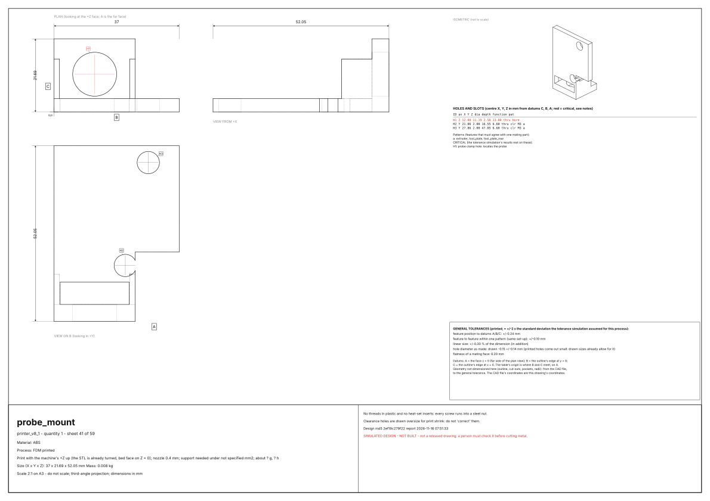

- Quantity 1. ABS; printed; 37 x 21.69 x 52.05 mm; 0.007 kg.
- Print with the machine's **+Z** direction up (STL already turned). Support needed under None mm2; longest bridge None mm; bed contact None; thinnest wall None mm; None g, None h (estimate). Holes opening on the bed face: 0 (first-layer squash makes them tight).
- Threads: none. Inserts and clinch nuts: none. Reaming: none.

| ID | Kind | Axis | X | Y | Z | Dia / width | Slot length | Depth | Counterbore (dia x depth, from) | Function | Screws | On its axis | Pattern | Critical |
|---|---|---|---|---|---|---|---|---|---|---|---|---|---|---|
| H1 | hole | Z | 12 | 11.19 | 2.5 | 13 | - | through | - | bore / opening | - | bed_probe (PROBE-OMRON-E2E-X5ME1) | - | probe clamp hole: locates the probe |
| H2 | hole | Y | 21.06 | 1.7 | 16.55 | 6.6 | - | through | - | clearance M3 | extruder_screw_0 (SHCS-M3x50) | - | a: extruder, extruder_screw_0_washer, tool_plate, tool_plate_rear | - |
| H3 | hole | Y | 27.86 | 1.7 | 47.05 | 6.6 | - | through | - | clearance M3 | extruder_screw_1 (SHCS-M3x50) | - | b: extruder, extruder_screw_1_washer, tool_plate, tool_plate_rear | - |

### part_duct

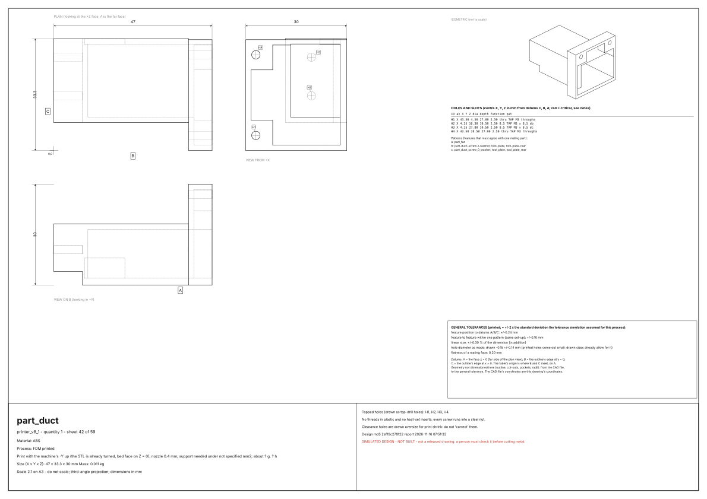

- Quantity 1. ABS; printed; 47 x 33.3 x 30 mm; 0.010 kg.
- Print with the machine's **-Y** direction up (STL already turned). Support needed under None mm2; longest bridge None mm; bed contact None; thinnest wall None mm; None g, None h (estimate). Holes opening on the bed face: 0 (first-layer squash makes them tight).
- Threads: none. Inserts and clinch nuts: none. Reaming: none.

| ID | Kind | Axis | X | Y | Z | Dia / width | Slot length | Depth | Counterbore (dia x depth, from) | Function | Screws | On its axis | Pattern | Critical |
|---|---|---|---|---|---|---|---|---|---|---|---|---|---|---|
| H1 | hole | X | 46 | 4.5 | 27 | 3.6 | - | through | - | clearance M3 | part_fan_screw_1 (SHCS-M3x18) | - | a: part_fan, part_fan_screw_1_nwasher, part_fan_screw_1_washer | - |
| H2 | hole | X | 1 | 16.3 | 10.5 | 3.6 | - | 2 | - | clearance M3 | part_duct_screw_1 (SHCS-M3x16) | - | b: part_duct_screw_1_nwasher, part_duct_screw_1_washer, tool_plate, tool_plate_rear | - |
| H3 | hole | X | 7.65 | 16.3 | 10.5 | 3.6 | - | 1.7 | - | clearance M3 | part_duct_screw_1 (SHCS-M3x16) | - | b: part_duct_screw_1_nwasher, part_duct_screw_1_washer, tool_plate, tool_plate_rear | - |
| H4 | hole | X | 1 | 27.8 | 10.5 | 3.6 | - | 2 | - | clearance M3 | part_duct_screw_0 (SHCS-M3x16) | - | c: part_duct_screw_0_nwasher, part_duct_screw_0_washer, tool_plate, tool_plate_rear | - |
| H5 | hole | X | 7.65 | 27.8 | 10.5 | 3.6 | - | 1.7 | - | clearance M3 | part_duct_screw_0 (SHCS-M3x16) | - | c: part_duct_screw_0_nwasher, part_duct_screw_0_washer, tool_plate, tool_plate_rear | - |
| H6 | hole | X | 46 | 28.5 | 27 | 3.6 | - | through | - | clearance M3 | part_fan_screw_0 (SHCS-M3x18) | - | d: part_fan, part_fan_screw_0_nwasher, part_fan_screw_0_washer | - |

### x_belt_bracket

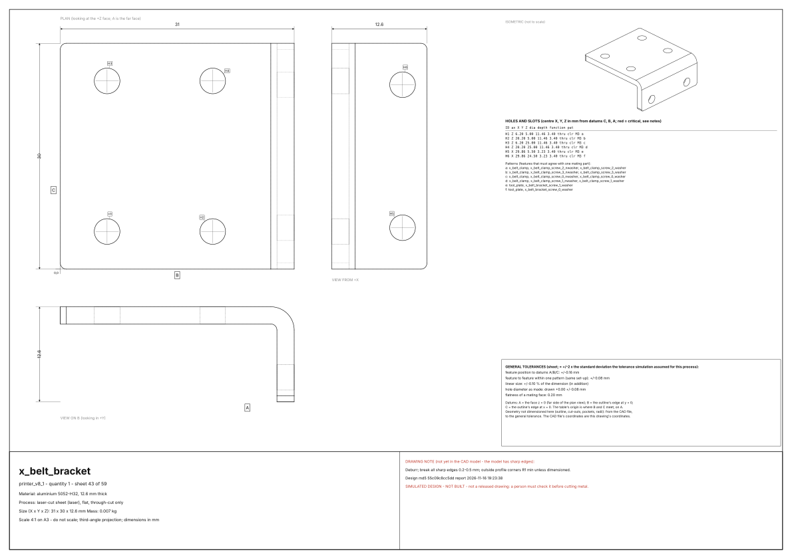

- Quantity 1. aluminium 5052-H32; sheet; 31 x 30 x 12.6 mm; 0.007 kg.
- Sheet not specified mm, None cut, flat (no bends), through-cut only. Flat size None mm, cut length None mm, None pierces (report). DXF written here: {'LINE': 4, 'ARC': 2, 'CIRCLE': 4}, cut length 157.8 mm, extent (27.9, 30.0).
- Threads: none. Inserts and clinch nuts: none. Reaming: none.
- Drawing note, not yet in the model: Deburr; break all sharp edges 0.2-0.5 mm; outside profile corners R1 min unless dimensioned.

| ID | Kind | Axis | X | Y | Z | Dia / width | Slot length | Depth | Counterbore (dia x depth, from) | Function | Screws | On its axis | Pattern | Critical |
|---|---|---|---|---|---|---|---|---|---|---|---|---|---|---|
| H1 | hole | Z | 6.2 | 5 | 11.46 | 3.4 | - | through | - | clearance M3 | x_belt_clamp_screw_2 (SHCS-M3x10) | - | a: x_belt_clamp, x_belt_clamp_screw_2_nwasher, x_belt_clamp_screw_2_washer | - |
| H2 | hole | Z | 20.2 | 5 | 11.46 | 3.4 | - | through | - | clearance M3 | x_belt_clamp_screw_3 (SHCS-M3x10) | - | b: x_belt_clamp, x_belt_clamp_screw_3_nwasher, x_belt_clamp_screw_3_washer | - |
| H3 | hole | Z | 6.2 | 25 | 11.46 | 3.4 | - | through | - | clearance M3 | x_belt_clamp_screw_0 (SHCS-M3x10) | - | c: x_belt_clamp, x_belt_clamp_screw_0_nwasher, x_belt_clamp_screw_0_washer | - |
| H4 | hole | Z | 20.2 | 25 | 11.46 | 3.4 | - | through | - | clearance M3 | x_belt_clamp_screw_1 (SHCS-M3x10) | - | d: x_belt_clamp, x_belt_clamp_screw_1_nwasher, x_belt_clamp_screw_1_washer | - |
| H5 | hole | X | 29.86 | 5.5 | 3.23 | 3.4 | - | through | - | clearance M3 | x_belt_bracket_screw_1 (SHCS-M3x10) | - | e: tool_plate, x_belt_bracket_screw_1_washer | - |
| H6 | hole | X | 29.86 | 24.5 | 3.23 | 3.4 | - | through | - | clearance M3 | x_belt_bracket_screw_0 (SHCS-M3x10) | - | f: tool_plate, x_belt_bracket_screw_0_washer | - |

### x_belt_clamp

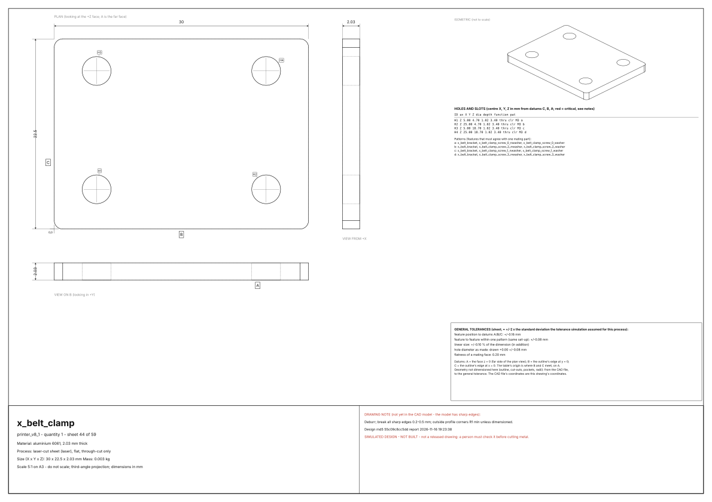

- Quantity 1. aluminium 6061; sheet; 30 x 22.5 x 2.03 mm; 0.003 kg.
- Sheet not specified mm, None cut, flat (no bends), through-cut only. Flat size None mm, cut length None mm, None pierces (report). DXF written here: {'LINE': 4, 'ARC': 4, 'CIRCLE': 4}, cut length 146.0 mm, extent (30.0, 22.5).
- Threads: none. Inserts and clinch nuts: none. Reaming: none.
- Drawing note, not yet in the model: Deburr; break all sharp edges 0.2-0.5 mm; outside profile corners R1 min unless dimensioned.

| ID | Kind | Axis | X | Y | Z | Dia / width | Slot length | Depth | Counterbore (dia x depth, from) | Function | Screws | On its axis | Pattern | Critical |
|---|---|---|---|---|---|---|---|---|---|---|---|---|---|---|
| H1 | hole | Z | 5 | 4.7 | 1.02 | 3.4 | - | through | - | clearance M3 | x_belt_clamp_screw_0 (SHCS-M3x10) | - | a: x_belt_bracket, x_belt_clamp_screw_0_nwasher, x_belt_clamp_screw_0_washer | - |
| H2 | hole | Z | 25 | 4.7 | 1.02 | 3.4 | - | through | - | clearance M3 | x_belt_clamp_screw_2 (SHCS-M3x10) | - | b: x_belt_bracket, x_belt_clamp_screw_2_nwasher, x_belt_clamp_screw_2_washer | - |
| H3 | hole | Z | 5 | 18.7 | 1.02 | 3.4 | - | through | - | clearance M3 | x_belt_clamp_screw_1 (SHCS-M3x10) | - | c: x_belt_bracket, x_belt_clamp_screw_1_nwasher, x_belt_clamp_screw_1_washer | - |
| H4 | hole | Z | 25 | 18.7 | 1.02 | 3.4 | - | through | - | clearance M3 | x_belt_clamp_screw_3 (SHCS-M3x10) | - | d: x_belt_bracket, x_belt_clamp_screw_3_nwasher, x_belt_clamp_screw_3_washer | - |

### x_motor_mount

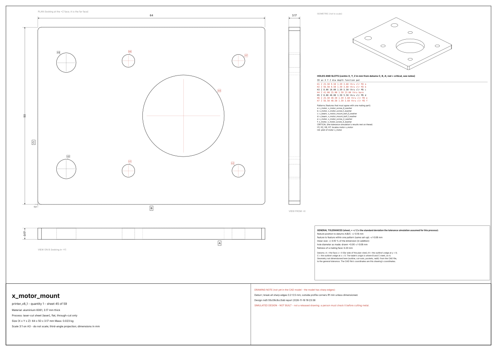

- Quantity 1. aluminium 6061; sheet; 64 x 50 x 3.17 mm; 0.023 kg.
- Sheet not specified mm, None cut, flat (no bends), through-cut only. Flat size None mm, cut length None mm, None pierces (report). DXF written here: {'LINE': 4, 'ARC': 4, 'CIRCLE': 7}, cut length 378.3 mm, extent (64.0, 50.0).
- Threads: none. Inserts and clinch nuts: none. Reaming: none.
- Drawing note, not yet in the model: Deburr; break all sharp edges 0.2-0.5 mm; outside profile corners R1 min unless dimensioned.
- **Needs more than the general tolerance, or rests on an assumption:**
  - **Patterns a, b, e, f** (guide block / motor): hole to hole +/-0.08 mm is the figure the screw-pattern check used (tighter than the +/-0.16 mm position tolerance); radial clearance on the screws 0.30 mm. Cut all holes of a pattern in one set-up.
  - This part places a pulley or idler: its thickness and flatness are in the belt-plane result (x_belt: 97.5% of builds within 1 mm, +/-0.29%; y_belt: 98.9% of builds within 1 mm, +/-0.19%; y_belt_l: 98.5% of builds within 1 mm, +/-0.22%).

| ID | Kind | Axis | X | Y | Z | Dia / width | Slot length | Depth | Counterbore (dia x depth, from) | Function | Screws | On its axis | Pattern | Critical |
|---|---|---|---|---|---|---|---|---|---|---|---|---|---|---|
| H1 | hole | Z | 25.5 | 9.5 | 1.59 | 3.6 | - | through | - | clearance M3 | x_motor_screw_0 (SHCS-M3x8) | - | a: x_motor, x_motor_screw_0_washer | locates motor x_motor |
| H2 | hole | Z | 56.5 | 9.5 | 1.59 | 3.6 | - | through | - | clearance M3 | x_motor_screw_1 (SHCS-M3x8) | - | b: x_motor, x_motor_screw_1_washer | locates motor x_motor |
| H3 | hole | Z | 8 | 10 | 1.59 | 5.5 | - | through | - | clearance M5 | x_motor_mount_bolt_0 (SHCS-M5x10) | - | c: x_beam, x_motor_mount_bolt_0_washer | - |
| H4 | hole | Z | 41 | 25 | 1.59 | 23 | - | through | - | bore / opening | - | x_motor (NEMA17-34) | - | pilot of motor x_motor |
| H5 | hole | Z | 8 | 40 | 1.59 | 5.5 | - | through | - | clearance M5 | x_motor_mount_bolt_1 (SHCS-M5x10) | - | d: x_beam, x_motor_mount_bolt_1_washer | - |
| H6 | hole | Z | 25.5 | 40.5 | 1.59 | 3.6 | - | through | - | clearance M3 | x_motor_screw_2 (SHCS-M3x8) | - | e: x_motor, x_motor_screw_2_washer | locates motor x_motor |
| H7 | hole | Z | 56.5 | 40.5 | 1.59 | 3.6 | - | through | - | clearance M3 | x_motor_screw_3 (SHCS-M3x8) | - | f: x_motor, x_motor_screw_3_washer | locates motor x_motor |

### x_idler_mount

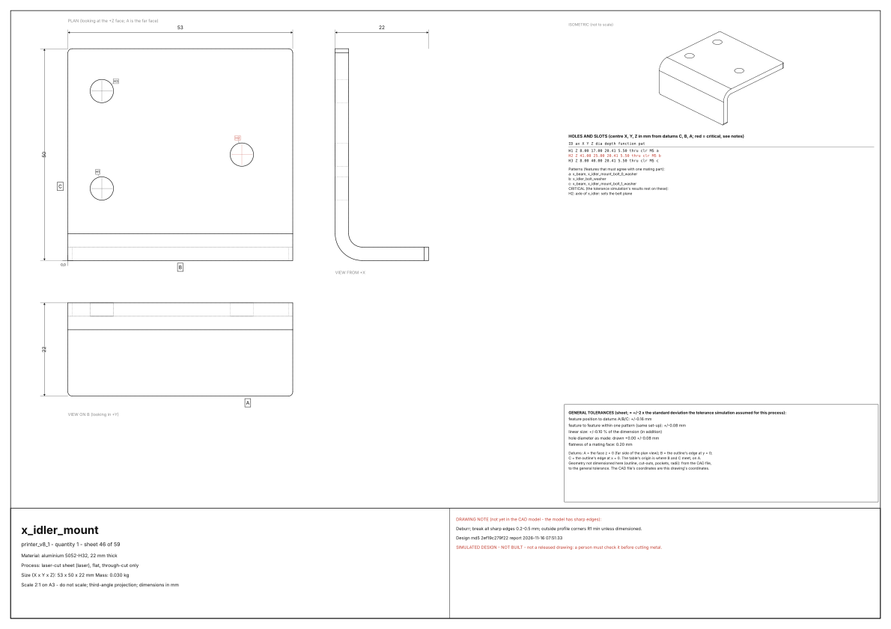

- Quantity 1. aluminium 5052-H32; sheet; 53 x 50 x 22 mm; 0.030 kg.
- Sheet not specified mm, None cut, flat (no bends), through-cut only. Flat size None mm, cut length None mm, None pierces (report). DXF written here: {'LINE': 4, 'ARC': 2, 'CIRCLE': 3}, cut length 244.3 mm, extent (53.0, 43.64).
- Threads: none. Inserts and clinch nuts: none. Reaming: none.
- Drawing note, not yet in the model: Deburr; break all sharp edges 0.2-0.5 mm; outside profile corners R1 min unless dimensioned.
- **Needs more than the general tolerance, or rests on an assumption:**
  - This part places a pulley or idler: its thickness and flatness are in the belt-plane result (x_belt: 97.5% of builds within 1 mm, +/-0.29%; y_belt: 98.9% of builds within 1 mm, +/-0.19%; y_belt_l: 98.5% of builds within 1 mm, +/-0.22%).

| ID | Kind | Axis | X | Y | Z | Dia / width | Slot length | Depth | Counterbore (dia x depth, from) | Function | Screws | On its axis | Pattern | Critical |
|---|---|---|---|---|---|---|---|---|---|---|---|---|---|---|
| H1 | hole | Z | 8 | 17 | 20.41 | 5.5 | - | through | - | clearance M5 | x_idler_mount_bolt_0 (SHCS-M5x10) | - | a: x_beam, x_idler_mount_bolt_0_washer | - |
| H2 | hole | Z | 41 | 25 | 20.41 | 5.5 | - | through | - | clearance M5 | x_idler_bolt (SHCS-M5x35) | - | b: x_idler_bolt_washer | axle of x_idler: sets the belt plane |
| H3 | hole | Z | 8 | 40 | 20.41 | 5.5 | - | through | - | clearance M5 | x_idler_mount_bolt_1 (SHCS-M5x10) | - | c: x_beam, x_idler_mount_bolt_1_washer | - |

### x_tension_anchor

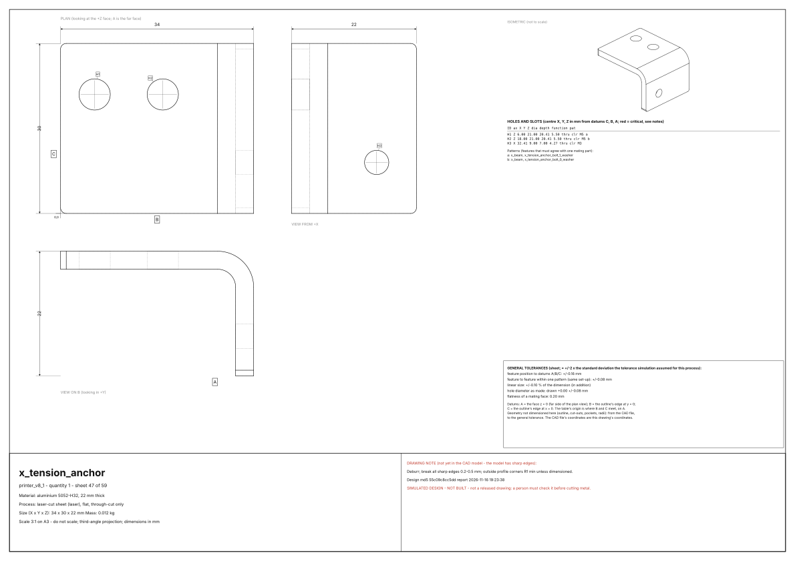

- Quantity 1. aluminium 5052-H32; sheet; 34 x 30 x 22 mm; 0.012 kg.
- Sheet not specified mm, None cut, flat (no bends), through-cut only. Flat size None mm, cut length None mm, None pierces (report). DXF written here: {'LINE': 4, 'ARC': 2, 'CIRCLE': 2}, cut length 149.0 mm, extent (27.64, 30.0).
- Threads: none. Inserts and clinch nuts: none. Reaming: none.
- Drawing note, not yet in the model: Deburr; break all sharp edges 0.2-0.5 mm; outside profile corners R1 min unless dimensioned.

| ID | Kind | Axis | X | Y | Z | Dia / width | Slot length | Depth | Counterbore (dia x depth, from) | Function | Screws | On its axis | Pattern | Critical |
|---|---|---|---|---|---|---|---|---|---|---|---|---|---|---|
| H1 | hole | Z | 6 | 21 | 20.41 | 5.5 | - | through | - | clearance M5 | x_tension_anchor_bolt_1 (SHCS-M5x10) | - | a: x_beam, x_tension_anchor_bolt_1_washer | - |
| H2 | hole | Z | 18 | 21 | 20.41 | 5.5 | - | through | - | clearance M5 | x_tension_anchor_bolt_0 (SHCS-M5x10) | - | b: x_beam, x_tension_anchor_bolt_0_washer | - |
| H3 | hole | X | 32.41 | 9 | 7 | 4.27 | - | through | - | clearance M3 | x_tension_screw (SHCS-M3x16) | - | - | - |

### y_motor_mount

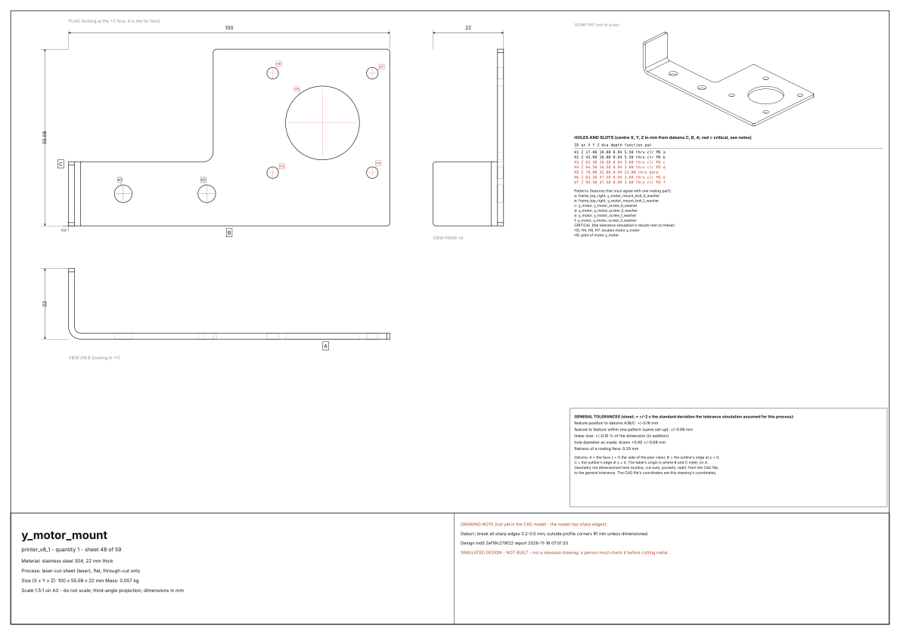

- Quantity 1. stainless steel 304; sheet; 100 x 55.08 x 22 mm; 0.057 kg. Same size, volume and hole list as y_motor_mount_l (same or mirror-image part: compare before sharing a file).
- Sheet not specified mm, None cut, flat (no bends), through-cut only. Flat size None mm, cut length None mm, None pierces (report). DXF written here: {'LINE': 4}, cut length 39.8 mm, extent (1.88, 18.0).
- Threads: none. Inserts and clinch nuts: none. Reaming: none.
- Drawing note, not yet in the model: Deburr; break all sharp edges 0.2-0.5 mm; outside profile corners R1 min unless dimensioned.
- **Needs more than the general tolerance, or rests on an assumption:**
  - **Patterns c, d, e, f** (guide block / motor): hole to hole +/-0.08 mm is the figure the screw-pattern check used (tighter than the +/-0.16 mm position tolerance); radial clearance on the screws 0.30 mm. Cut all holes of a pattern in one set-up.
  - This part places a pulley or idler: its thickness and flatness are in the belt-plane result (x_belt: 97.5% of builds within 1 mm, +/-0.29%; y_belt: 98.9% of builds within 1 mm, +/-0.19%; y_belt_l: 98.5% of builds within 1 mm, +/-0.22%).

| ID | Kind | Axis | X | Y | Z | Dia / width | Slot length | Depth | Counterbore (dia x depth, from) | Function | Screws | On its axis | Pattern | Critical |
|---|---|---|---|---|---|---|---|---|---|---|---|---|---|---|
| H1 | hole | Z | 17 | 10 | 0.94 | 5.5 | - | through | - | clearance M5 | y_motor_mount_bolt_0 (SHCS-M5x10) | - | a: frame_top_right, y_motor_mount_bolt_0_washer | - |
| H2 | hole | Z | 43 | 10 | 0.94 | 5.5 | - | through | - | clearance M5 | y_motor_mount_bolt_1 (SHCS-M5x10) | - | b: frame_top_right, y_motor_mount_bolt_1_washer | - |
| H3 | hole | Z | 63.5 | 16.58 | 0.94 | 3.6 | - | through | - | clearance M3 | y_motor_screw_0 (SHCS-M3x6) | - | c: y_motor, y_motor_screw_0_washer | locates motor y_motor |
| H4 | hole | Z | 94.5 | 16.58 | 0.94 | 3.6 | - | through | - | clearance M3 | y_motor_screw_2 (SHCS-M3x6) | - | d: y_motor, y_motor_screw_2_washer | locates motor y_motor |
| H5 | hole | Z | 79 | 32.08 | 0.94 | 23 | - | through | - | bore / opening | - | y_motor (NEMA17-48) | - | pilot of motor y_motor |
| H6 | hole | Z | 63.5 | 47.58 | 0.94 | 3.6 | - | through | - | clearance M3 | y_motor_screw_1 (SHCS-M3x6) | - | e: y_motor, y_motor_screw_1_washer | locates motor y_motor |
| H7 | hole | Z | 94.5 | 47.58 | 0.94 | 3.6 | - | through | - | clearance M3 | y_motor_screw_3 (SHCS-M3x6) | - | f: y_motor, y_motor_screw_3_washer | locates motor y_motor |

### y_tension_anchor

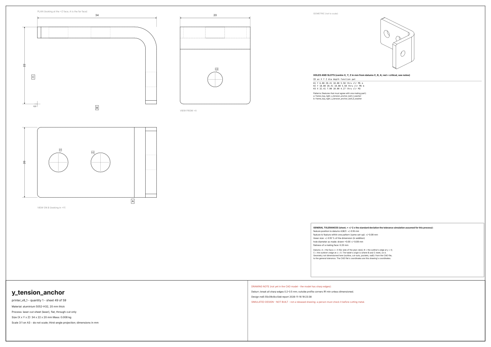

- Quantity 1. aluminium 5052-H32; sheet; 34 x 22 x 20 mm; 0.008 kg. Same size, volume and hole list as y_tension_anchor_l (same or mirror-image part: compare before sharing a file).
- Sheet not specified mm, None cut, flat (no bends), through-cut only. Flat size None mm, cut length None mm, None pierces (report). DXF written here: {'LINE': 6, 'ARC': 2}, cut length 103.9 mm, extent (33.0, 21.0).
- Threads: none. Inserts and clinch nuts: none. Reaming: none.
- Drawing note, not yet in the model: Deburr; break all sharp edges 0.2-0.5 mm; outside profile corners R1 min unless dimensioned.

| ID | Kind | Axis | X | Y | Z | Dia / width | Slot length | Depth | Counterbore (dia x depth, from) | Function | Screws | On its axis | Pattern | Critical |
|---|---|---|---|---|---|---|---|---|---|---|---|---|---|---|
| H1 | hole | Y | 6 | 20.41 | 10 | 5.5 | - | through | - | clearance M5 | y_tension_anchor_bolt_1 (SHCS-M5x10) | - | a: frame_top_right, y_tension_anchor_bolt_1_washer | - |
| H2 | hole | Y | 18 | 20.41 | 10 | 5.5 | - | through | - | clearance M5 | y_tension_anchor_bolt_0 (SHCS-M5x10) | - | b: frame_top_right, y_tension_anchor_bolt_0_washer | - |
| H3 | hole | X | 32.41 | 7 | 10 | 4.27 | - | through | - | clearance M3 | y_tension_screw (SHCS-M3x16) | - | - | - |

### y_idler_mount

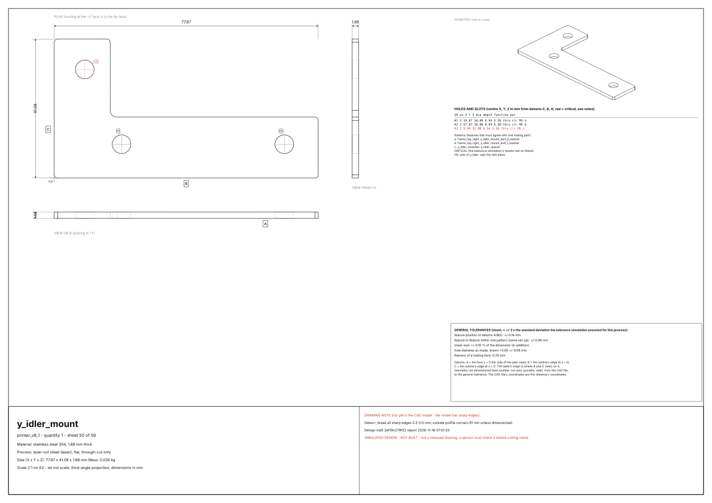

- Quantity 1. stainless steel 304; sheet; 77.87 x 41.08 x 1.88 mm; 0.026 kg. Same size, volume and hole list as y_idler_mount_l (same or mirror-image part: compare before sharing a file).
- Sheet not specified mm, None cut, flat (no bends), through-cut only. Flat size None mm, cut length None mm, None pierces (report). DXF written here: {'LINE': 6, 'ARC': 6, 'CIRCLE': 3}, cut length 286.7 mm, extent (77.87, 41.08).
- Threads: none. Inserts and clinch nuts: none. Reaming: none.
- Drawing note, not yet in the model: Deburr; break all sharp edges 0.2-0.5 mm; outside profile corners R1 min unless dimensioned.
- **Needs more than the general tolerance, or rests on an assumption:**
  - This part places a pulley or idler: its thickness and flatness are in the belt-plane result (x_belt: 97.5% of builds within 1 mm, +/-0.29%; y_belt: 98.9% of builds within 1 mm, +/-0.19%; y_belt_l: 98.5% of builds within 1 mm, +/-0.22%).

| ID | Kind | Axis | X | Y | Z | Dia / width | Slot length | Depth | Counterbore (dia x depth, from) | Function | Screws | On its axis | Pattern | Critical |
|---|---|---|---|---|---|---|---|---|---|---|---|---|---|---|
| H1 | hole | Z | 19.87 | 10 | 0.94 | 5.5 | - | through | - | clearance M5 | y_idler_mount_bolt_0 (SHCS-M5x10) | - | a: frame_top_right, y_idler_mount_bolt_0_washer | - |
| H2 | hole | Z | 67.87 | 10 | 0.94 | 5.5 | - | through | - | clearance M5 | y_idler_mount_bolt_1 (SHCS-M5x10) | - | b: frame_top_right, y_idler_mount_bolt_1_washer | - |
| H3 | hole | Z | 9 | 32.08 | 0.94 | 5.5 | - | through | - | clearance M5 | y_idler_bolt (SHCS-M5x30) | - | c: y_idler_nwasher, y_idler_spacer | axle of y_idler: sets the belt plane |

### y_motor_mount_l

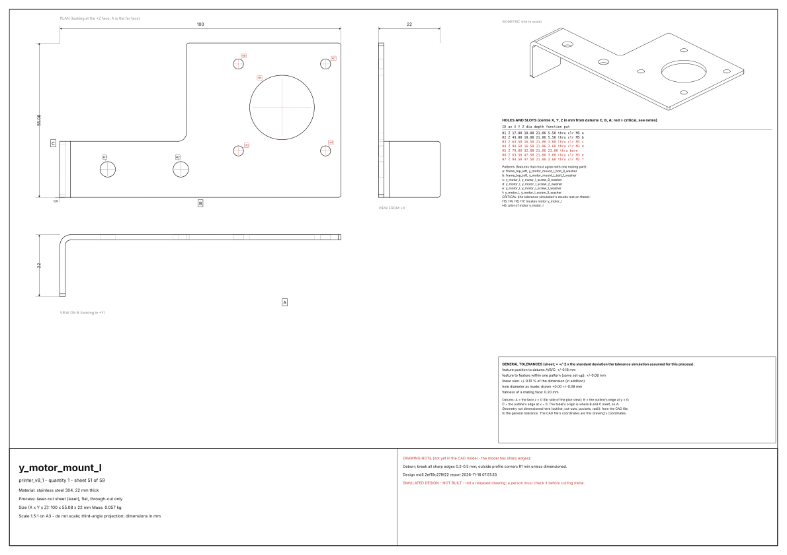

- Quantity 1. stainless steel 304; sheet; 100 x 55.08 x 22 mm; 0.057 kg. Same size, volume and hole list as y_motor_mount (same or mirror-image part: compare before sharing a file).
- Sheet not specified mm, None cut, flat (no bends), through-cut only. Flat size None mm, cut length None mm, None pierces (report). DXF written here: {'LINE': 6, 'ARC': 4, 'CIRCLE': 7}, cut length 452.1 mm, extent (96.22, 55.08).
- Threads: none. Inserts and clinch nuts: none. Reaming: none.
- Drawing note, not yet in the model: Deburr; break all sharp edges 0.2-0.5 mm; outside profile corners R1 min unless dimensioned.
- **Needs more than the general tolerance, or rests on an assumption:**
  - **Patterns c, d, e, f** (guide block / motor): hole to hole +/-0.08 mm is the figure the screw-pattern check used (tighter than the +/-0.16 mm position tolerance); radial clearance on the screws 0.30 mm. Cut all holes of a pattern in one set-up.
  - This part places a pulley or idler: its thickness and flatness are in the belt-plane result (x_belt: 97.5% of builds within 1 mm, +/-0.29%; y_belt: 98.9% of builds within 1 mm, +/-0.19%; y_belt_l: 98.5% of builds within 1 mm, +/-0.22%).

| ID | Kind | Axis | X | Y | Z | Dia / width | Slot length | Depth | Counterbore (dia x depth, from) | Function | Screws | On its axis | Pattern | Critical |
|---|---|---|---|---|---|---|---|---|---|---|---|---|---|---|
| H1 | hole | Z | 17 | 10 | 21.06 | 5.5 | - | through | - | clearance M5 | y_motor_mount_l_bolt_0 (SHCS-M5x10) | - | a: frame_top_left, y_motor_mount_l_bolt_0_washer | - |
| H2 | hole | Z | 43 | 10 | 21.06 | 5.5 | - | through | - | clearance M5 | y_motor_mount_l_bolt_1 (SHCS-M5x10) | - | b: frame_top_left, y_motor_mount_l_bolt_1_washer | - |
| H3 | hole | Z | 63.5 | 16.58 | 21.06 | 3.6 | - | through | - | clearance M3 | y_motor_l_screw_0 (SHCS-M3x6) | - | c: y_motor_l, y_motor_l_screw_0_washer | locates motor y_motor_l |
| H4 | hole | Z | 94.5 | 16.58 | 21.06 | 3.6 | - | through | - | clearance M3 | y_motor_l_screw_2 (SHCS-M3x6) | - | d: y_motor_l, y_motor_l_screw_2_washer | locates motor y_motor_l |
| H5 | hole | Z | 79 | 32.08 | 21.06 | 23 | - | through | - | bore / opening | - | y_motor_l (NEMA17-48) | - | pilot of motor y_motor_l |
| H6 | hole | Z | 63.5 | 47.58 | 21.06 | 3.6 | - | through | - | clearance M3 | y_motor_l_screw_1 (SHCS-M3x6) | - | e: y_motor_l, y_motor_l_screw_1_washer | locates motor y_motor_l |
| H7 | hole | Z | 94.5 | 47.58 | 21.06 | 3.6 | - | through | - | clearance M3 | y_motor_l_screw_3 (SHCS-M3x6) | - | f: y_motor_l, y_motor_l_screw_3_washer | locates motor y_motor_l |

### y_tension_anchor_l

- Quantity 1. aluminium 5052-H32; sheet; 34 x 22 x 20 mm; 0.008 kg. Same size, volume and hole list as y_tension_anchor (same or mirror-image part: compare before sharing a file).
- Sheet not specified mm, None cut, flat (no bends), through-cut only. Flat size None mm, cut length None mm, None pierces (report). DXF written here: {'LINE': 6, 'ARC': 2}, cut length 103.9 mm, extent (33.0, 21.0).
- Threads: none. Inserts and clinch nuts: none. Reaming: none.
- Drawing note, not yet in the model: Deburr; break all sharp edges 0.2-0.5 mm; outside profile corners R1 min unless dimensioned.

| ID | Kind | Axis | X | Y | Z | Dia / width | Slot length | Depth | Counterbore (dia x depth, from) | Function | Screws | On its axis | Pattern | Critical |
|---|---|---|---|---|---|---|---|---|---|---|---|---|---|---|
| H1 | hole | Y | 6 | 1.59 | 10 | 5.5 | - | through | - | clearance M5 | y_tension_anchor_l_bolt_1 (SHCS-M5x10) | - | a: frame_top_left, y_tension_anchor_l_bolt_1_washer | - |
| H2 | hole | Y | 18 | 1.59 | 10 | 5.5 | - | through | - | clearance M5 | y_tension_anchor_l_bolt_0 (SHCS-M5x10) | - | b: frame_top_left, y_tension_anchor_l_bolt_0_washer | - |
| H3 | hole | X | 32.41 | 15 | 10 | 4.27 | - | through | - | clearance M3 | y_tension_screw_l (SHCS-M3x16) | - | - | - |

### y_idler_mount_l

- Quantity 1. stainless steel 304; sheet; 77.87 x 41.08 x 1.88 mm; 0.026 kg. Same size, volume and hole list as y_idler_mount (same or mirror-image part: compare before sharing a file).
- Sheet not specified mm, None cut, flat (no bends), through-cut only. Flat size None mm, cut length None mm, None pierces (report). DXF written here: {'LINE': 6, 'ARC': 6, 'CIRCLE': 3}, cut length 286.7 mm, extent (77.87, 41.08).
- Threads: none. Inserts and clinch nuts: none. Reaming: none.
- Drawing note, not yet in the model: Deburr; break all sharp edges 0.2-0.5 mm; outside profile corners R1 min unless dimensioned.
- **Needs more than the general tolerance, or rests on an assumption:**
  - This part places a pulley or idler: its thickness and flatness are in the belt-plane result (x_belt: 97.5% of builds within 1 mm, +/-0.29%; y_belt: 98.9% of builds within 1 mm, +/-0.19%; y_belt_l: 98.5% of builds within 1 mm, +/-0.22%).

| ID | Kind | Axis | X | Y | Z | Dia / width | Slot length | Depth | Counterbore (dia x depth, from) | Function | Screws | On its axis | Pattern | Critical |
|---|---|---|---|---|---|---|---|---|---|---|---|---|---|---|
| H1 | hole | Z | 19.87 | 10 | 0.94 | 5.5 | - | through | - | clearance M5 | y_idler_mount_l_bolt_0 (SHCS-M5x10) | - | a: frame_top_left, y_idler_mount_l_bolt_0_washer | - |
| H2 | hole | Z | 67.87 | 10 | 0.94 | 5.5 | - | through | - | clearance M5 | y_idler_mount_l_bolt_1 (SHCS-M5x10) | - | b: frame_top_left, y_idler_mount_l_bolt_1_washer | - |
| H3 | hole | Z | 9 | 32.08 | 0.94 | 5.5 | - | through | - | clearance M5 | y_idler_l_bolt (SHCS-M5x30) | - | c: y_idler_l_nwasher, y_idler_l_spacer | axle of y_idler_l: sets the belt plane |

### y_endstop_mount

- Quantity 1. aluminium 6061; sheet; 54.5 x 25 x 3.18 mm; 0.007 kg.
- Sheet not specified mm, None cut, flat (no bends), through-cut only. Flat size None mm, cut length None mm, None pierces (report). DXF written here: {'LINE': 8, 'ARC': 8, 'CIRCLE': 4}, cut length 212.7 mm, extent (54.5, 25.0).
- Threads: none. Inserts and clinch nuts: none. Reaming: none.
- Drawing note, not yet in the model: Deburr; break all sharp edges 0.2-0.5 mm; outside profile corners R1 min unless dimensioned.

| ID | Kind | Axis | X | Y | Z | Dia / width | Slot length | Depth | Counterbore (dia x depth, from) | Function | Screws | On its axis | Pattern | Critical |
|---|---|---|---|---|---|---|---|---|---|---|---|---|---|---|
| H1 | hole | Z | 8 | 6.5 | 1.59 | 5.5 | - | through | - | clearance M5 | y_endstop_mount_bolt_1 (SHCS-M5x10) | - | a: frame_top_right, y_endstop_mount_bolt_1_washer | - |
| H2 | hole | Z | 34.5 | 9.86 | 1.59 | 3.6 | - | through | - | clearance M3 | y_endstop_screw_0 (SHCS-M3x12) | - | b: y_endstop, y_endstop_screw_0_washer | carries endstop y_endstop (set at assembly) |
| H3 | hole | Z | 49.5 | 9.86 | 1.59 | 3.6 | - | through | - | clearance M3 | y_endstop_screw_1 (SHCS-M3x12) | - | c: y_endstop, y_endstop_screw_1_washer | carries endstop y_endstop (set at assembly) |
| H4 | hole | Z | 8 | 18.5 | 1.59 | 5.5 | - | through | - | clearance M5 | y_endstop_mount_bolt_0 (SHCS-M5x10) | - | d: frame_top_right, y_endstop_mount_bolt_0_washer | - |

### mains_cover_relay

- Quantity 1. PETG; printed; 42 x 33 x 29.4 mm; 0.009 kg.
- Print with the machine's **-Z** direction up (STL already turned). Support needed under None mm2; longest bridge None mm; bed contact None; thinnest wall None mm; None g, None h (estimate). Holes opening on the bed face: 0 (first-layer squash makes them tight).
- Threads: none. Inserts and clinch nuts: none. Reaming: none.

| ID | Kind | Axis | X | Y | Z | Dia / width | Slot length | Depth | Counterbore (dia x depth, from) | Function | Screws | On its axis | Pattern | Critical |
|---|---|---|---|---|---|---|---|---|---|---|---|---|---|---|
| H1 | hole | Z | 4 | 29 | 14.7 | 3.6 | - | through | - | clearance M3 | mains_cover_relay_screw_0 (SHCS-M3x40) | - | a: electronics_tray, mains_cover_relay_screw_0_nwasher, mains_cover_relay_screw_0_washer | - |
| H2 | hole | Z | 38 | 29 | 14.7 | 3.6 | - | through | - | clearance M3 | mains_cover_relay_screw_1 (SHCS-M3x40) | - | b: electronics_tray, mains_cover_relay_screw_1_nwasher, mains_cover_relay_screw_1_washer | - |

### mains_cover_psu

- Quantity 1. PETG; printed; 139 x 17 x 32.87 mm; 0.011 kg.
- Print with the machine's **-Z** direction up (STL already turned). Support needed under None mm2; longest bridge None mm; bed contact None; thinnest wall None mm; None g, None h (estimate). Holes opening on the bed face: 0 (first-layer squash makes them tight).
- Threads: none. Inserts and clinch nuts: none. Reaming: none.

| ID | Kind | Axis | X | Y | Z | Dia / width | Slot length | Depth | Counterbore (dia x depth, from) | Function | Screws | On its axis | Pattern | Critical |
|---|---|---|---|---|---|---|---|---|---|---|---|---|---|---|
| H1 | hole | Z | 4 | 4 | 16.43 | 3.6 | - | through | - | clearance M3 | mains_cover_psu_screw_0 (SHCS-M3x45) | - | a: electronics_tray, mains_cover_psu_screw_0_nwasher, mains_cover_psu_screw_0_washer | - |
| H2 | hole | Z | 135 | 4 | 16.43 | 3.6 | - | through | - | clearance M3 | mains_cover_psu_screw_1 (SHCS-M3x45) | - | b: electronics_tray, mains_cover_psu_screw_1_nwasher, mains_cover_psu_screw_1_washer | - |

### electronics_tray

- Quantity 1. aluminium 6061; sheet; 340 x 223 x 3.18 mm; 0.645 kg.
- Sheet not specified mm, None cut, flat (no bends), through-cut only. Flat size None mm, cut length None mm, None pierces (report). DXF written here: {'LINE': 4, 'ARC': 4, 'CIRCLE': 29}, cut length 1556.3 mm, extent (340.0, 223.0).
- Threads: none. Inserts and clinch nuts: none. Reaming: none.
- Drawing note, not yet in the model: Deburr; break all sharp edges 0.2-0.5 mm; outside profile corners R1 min unless dimensioned.

| ID | Kind | Axis | X | Y | Z | Dia / width | Slot length | Depth | Counterbore (dia x depth, from) | Function | Screws | On its axis | Pattern | Critical |
|---|---|---|---|---|---|---|---|---|---|---|---|---|---|---|
| H1 | hole | Z | 222.44 | 6.66 | 1.59 | 3.4 | - | through | - | clearance M3 | control_board_screw_4 (SHCS-M3x16) | - | a: control_board, control_board_washer_4 | - |
| H2 | hole | Z | 10 | 11 | 1.59 | 5.5 | - | through | - | clearance M5 | z_fl_rail_bolt_0 (SHCS-M5x20) | - | b: frame_bot_left, z_fl_h1, z_fl_r1, z_fl_rail_bolt_0_washer | - |
| H3 | hole | Z | 330 | 11 | 1.59 | 5.5 | - | through | - | clearance M5 | z_fr_rail_bolt_0 (SHCS-M5x20) | - | c: frame_bot_right, z_fr_h1, z_fr_r1, z_fr_rail_bolt_0_washer | - |
| H4 | hole | Z | 287.11 | 22.33 | 1.59 | 3.4 | - | through | - | clearance M3 | control_board_screw_1 (SHCS-M3x16) | - | d: control_board, control_board_washer_1 | - |
| H5 | hole | Z | 117 | 33 | 1.59 | 4.5 | - | through | - | clearance M4 | psu_screw_2 (SHCS-M4x6) | - | e: psu | - |
| H6 | hole | Z | 167 | 33 | 1.59 | 4.5 | - | through | - | clearance M4 | psu_screw_3 (SHCS-M4x6) | - | e: psu | - |
| H7 | hole | Z | 34.94 | 38.74 | 1.59 | 8 | - | through | - | clearance M5 | z_fl_post_0 (SHCS-M5x65) | - | f: z_fl_h1, z_fl_h2a, z_fl_h2b, z_fl_post_0_washer, z_fl_r3, z_fl_r4 | - |
| H8 | hole | Z | 305.06 | 38.74 | 1.59 | 8 | - | through | - | clearance M5 | z_fr_post_0 (SHCS-M5x65) | - | g: z_fr_h1, z_fr_h2a, z_fr_h2b, z_fr_post_0_washer, z_fr_r3, z_fr_r4 | - |
| H9 | hole | Z | 29.15 | 53.07 | 1.59 | 8 | - | through | - | clearance M5 | z_fl_post_1 (SHCS-M5x65) | - | h: z_fl_h1, z_fl_h2a, z_fl_h2b, z_fl_post_1_washer, z_fl_r3, z_fl_r4 | - |
| H10 | hole | Z | 310.85 | 53.07 | 1.59 | 8 | - | through | - | clearance M5 | z_fr_post_1 (SHCS-M5x65) | - | i: z_fr_h1, z_fr_h2a, z_fr_h2b, z_fr_post_1_washer, z_fr_r3, z_fr_r4 | - |
| H11 | hole | Z | 10 | 63 | 1.59 | 5.5 | - | through | - | clearance M5 | z_fl_rail_bolt_1 (SHCS-M5x20) | - | j: frame_bot_left, z_fl_h1, z_fl_r1, z_fl_rail_bolt_1_washer | - |
| H12 | hole | Z | 330 | 63 | 1.59 | 5.5 | - | through | - | clearance M5 | z_fr_rail_bolt_1 (SHCS-M5x20) | - | k: frame_bot_right, z_fr_h1, z_fr_r1, z_fr_rail_bolt_1_washer | - |
| H13 | hole | Z | 40.4 | 64.92 | 1.59 | 3.4 | - | through | - | clearance M3 | psu_relay_screw_1 (SHCS-M3x16) | - | l: psu_relay, psu_relay_washer_1 | - |
| H14 | hole | Z | 69.61 | 64.92 | 1.59 | 3.4 | - | through | - | clearance M3 | psu_relay_screw_0 (SHCS-M3x16) | - | m: psu_relay, psu_relay_washer_0 | - |
| H15 | hole | Z | 10 | 80 | 1.59 | 5.5 | - | through | - | clearance M5 | tray_bolt_0 (SHCS-M5x10) | - | n: frame_bot_left, tray_bolt_0_washer | - |
| H16 | hole | Z | 330 | 80 | 1.59 | 5.5 | - | through | - | clearance M5 | tray_bolt_2 (SHCS-M5x10) | - | o: frame_bot_right, tray_bolt_2_washer | - |
| H17 | hole | Z | 286.9 | 84.48 | 1.59 | 3.4 | - | through | - | clearance M3 | control_board_screw_0 (SHCS-M3x16) | - | p: control_board, control_board_washer_0 | - |
| H18 | hole | Z | 251.93 | 102.34 | 1.59 | 3.4 | - | through | - | clearance M3 | control_board_screw_2 (SHCS-M3x16) | - | q: control_board, control_board_washer_2 | - |
| H19 | hole | Z | 266.5 | 131 | 1.59 | 3.2 | - | through | - | clearance M2.5 | host_screw_0 (SHCS-M2.5x12) | host_washer_0 (WASHER-M2.5) | r: host, host_washer_0 | - |
| H20 | hole | Z | 69.61 | 139.09 | 1.59 | 3.4 | - | through | - | clearance M3 | psu_relay_screw_2 (SHCS-M3x16) | - | s: psu_relay, psu_relay_washer_2 | - |
| H21 | hole | Z | 38 | 149 | 1.59 | 3.6 | - | through | - | clearance M3 | mains_cover_relay_screw_0 (SHCS-M3x40) | - | t: mains_cover_relay, mains_cover_relay_screw_0_nwasher, mains_cover_relay_screw_0_washer | - |
| H22 | hole | Z | 72 | 149 | 1.59 | 3.6 | - | through | - | clearance M3 | mains_cover_relay_screw_1 (SHCS-M3x40) | - | u: mains_cover_relay, mains_cover_relay_screw_1_nwasher, mains_cover_relay_screw_1_washer | - |
| H23 | hole | Z | 117 | 183 | 1.59 | 4.5 | - | through | - | clearance M4 | psu_screw_0 (SHCS-M4x6) | - | e: psu | - |
| H24 | hole | Z | 167 | 183 | 1.59 | 4.5 | - | through | - | clearance M4 | psu_screw_1 (SHCS-M4x6) | - | e: psu | - |
| H25 | hole | Z | 243.5 | 189 | 1.59 | 3.2 | - | through | - | clearance M2.5 | host_screw_3 (SHCS-M2.5x12) | host_washer_3 (WASHER-M2.5) | v: host, host_washer_3 | - |
| H26 | hole | Z | 76.5 | 202 | 1.59 | 3.6 | - | through | - | clearance M3 | mains_cover_psu_screw_0 (SHCS-M3x45) | - | w: mains_cover_psu, mains_cover_psu_screw_0_nwasher, mains_cover_psu_screw_0_washer | - |
| H27 | hole | Z | 207.5 | 202 | 1.59 | 3.6 | - | through | - | clearance M3 | mains_cover_psu_screw_1 (SHCS-M3x45) | - | x: mains_cover_psu, mains_cover_psu_screw_1_nwasher, mains_cover_psu_screw_1_washer | - |
| H28 | hole | Z | 10 | 210 | 1.59 | 5.5 | - | through | - | clearance M5 | tray_bolt_1 (SHCS-M5x10) | - | y: frame_bot_left, tray_bolt_1_washer | - |
| H29 | hole | Z | 330 | 210 | 1.59 | 5.5 | - | through | - | clearance M5 | tray_bolt_3 (SHCS-M5x10) | - | z: frame_bot_right, tray_bolt_3_washer | - |

### inlet_panel

- Quantity 1. aluminium 6061; sheet; 94 x 80 x 2.54 mm; 0.042 kg.
- Sheet not specified mm, None cut, flat (no bends), through-cut only. Flat size None mm, cut length None mm, None pierces (report). DXF written here: {'LINE': 8, 'ARC': 8, 'CIRCLE': 6}, cut length 570.5 mm, extent (94.0, 80.0).
- Threads: none. Inserts and clinch nuts: none. Reaming: none.
- Drawing note, not yet in the model: Deburr; break all sharp edges 0.2-0.5 mm; outside profile corners R1 min unless dimensioned.

| ID | Kind | Axis | X | Y | Z | Dia / width | Slot length | Depth | Counterbore (dia x depth, from) | Function | Screws | On its axis | Pattern | Critical |
|---|---|---|---|---|---|---|---|---|---|---|---|---|---|---|
| H1 | hole | Z | 8 | 10 | 1.27 | 5.5 | - | through | - | clearance M5 | inlet_panel_bolt_1 (SHCS-M5x10) | - | a: frame_bot_left, inlet_panel_bolt_1_washer | - |
| H2 | hole | Z | 78 | 17 | 1.27 | 3.4 | - | through | - | clearance M3 | mains_cover_inlet_screw_1 (SHCS-M3x20) | - | b: mains_cover_inlet, mains_cover_inlet_screw_1_nwasher, mains_cover_inlet_screw_1_washer | - |
| H3 | hole | Z | 30 | 40 | 1.27 | 3.4 | - | through | - | clearance M3 | inlet_screw_1 (SHCS-M3x10) | - | c: inlet, inlet_washer_1 | - |
| H4 | hole | Z | 86 | 40 | 1.27 | 3.4 | - | through | - | clearance M3 | inlet_screw_0 (SHCS-M3x10) | - | d: inlet, inlet_washer_0 | - |
| H5 | hole | Z | 78 | 63 | 1.27 | 3.4 | - | through | - | clearance M3 | mains_cover_inlet_screw_0 (SHCS-M3x20) | - | e: mains_cover_inlet, mains_cover_inlet_screw_0_nwasher, mains_cover_inlet_screw_0_washer | - |
| H6 | hole | Z | 8 | 70 | 1.27 | 5.5 | - | through | - | clearance M5 | inlet_panel_bolt_0 (SHCS-M5x10) | - | f: frame_bot_left, inlet_panel_bolt_0_washer | - |

### mains_cover_inlet

- Quantity 1. PETG; printed; 54 x 32 x 70 mm; 0.017 kg.
- Print with the machine's **-X** direction up (STL already turned). Support needed under None mm2; longest bridge None mm; bed contact None; thinnest wall None mm; None g, None h (estimate). Holes opening on the bed face: 0 (first-layer squash makes them tight).
- Threads: none. Inserts and clinch nuts: none. Reaming: none.

| ID | Kind | Axis | X | Y | Z | Dia / width | Slot length | Depth | Counterbore (dia x depth, from) | Function | Screws | On its axis | Pattern | Critical |
|---|---|---|---|---|---|---|---|---|---|---|---|---|---|---|
| H1 | hole | Y | 4 | 27.5 | 54 | 3.6 | - | through | - | clearance M3 | mains_cover_inlet_screw_0 (SHCS-M3x20) | - | a: inlet_panel, mains_cover_inlet_screw_0_nwasher, mains_cover_inlet_screw_0_washer | - |
| H2 | hole | Y | 50 | 27.5 | 54 | 3.6 | - | through | - | clearance M3 | mains_cover_inlet_screw_1 (SHCS-M3x20) | - | b: inlet_panel, mains_cover_inlet_screw_1_nwasher, mains_cover_inlet_screw_1_washer | - |
