# Assembly guide: printer_v8_2

Generated by `tools/build_package.py` from `designs/printer_v8_2.py` (md5 `b9b30ccc71ea5d677a3fcc640bf599c4`) and `out/printer_v8_2/report.json` (written 2026-11-16 23:39:06, md5 `2b09cd97db92`). Do not edit: change the design, re-run verify, re-run the generator.

> **Simulated design. Nothing has been built.** See [OPEN_ITEMS.md](OPEN_ITEMS.md) before spending money.

584 parts, 187 drawn screws (21 types), tools: 2 mm hex key, 2.5 mm hex key, 3 mm hex key, 4 mm hex key. The simulation's time allowance is 138.2 min: a figure for comparing designs. It does not contain the operations listed under 'Not in the simulation' below, which are a large part of the real work.

## Read this first: what this guide is and is not

- **Bench units** below follow the assembly simulation step for step (it found an order with a way in for every part and driver access for every screw).
- **The main assembly does NOT follow the simulation's order.** That order is valid for access but is not one a person can build: 43 of its steps place a unit before anything supports it (it fits the bed carrier at step ? and the frame's posts at steps 374 to 376, the corner brackets last), it turns the machine over 17 times and does 41 operations from below. The cause is in the model: corner brackets on T-slots have no drawn screws, so nothing 'holds' the frame until the end. The stages below re-group the simulation's units into the order a builder uses (frame first). **That stage order has not been run through the access checker.** Each screw's driving direction is given in machine axes so access can be judged before a part is fitted over it. The simulation's own sequence is in `data/assembly_plan.json` and `data/assembly_simulated_order.md`.
- Torque: neither the parts catalogue nor the joint model holds a tightening torque for any screw. Every 'snug' below is the builder's judgement. Printed parts and circuit boards: do not crush.
- Washers: the model has none. See OPEN_ITEMS.md (washer audit) and decide before you start; a washer under a head changes how far the screw reaches (thread engagement was checked without them).
- Directions: front is -Y (the side the bed plate overhangs), right is +X, up is +Z.

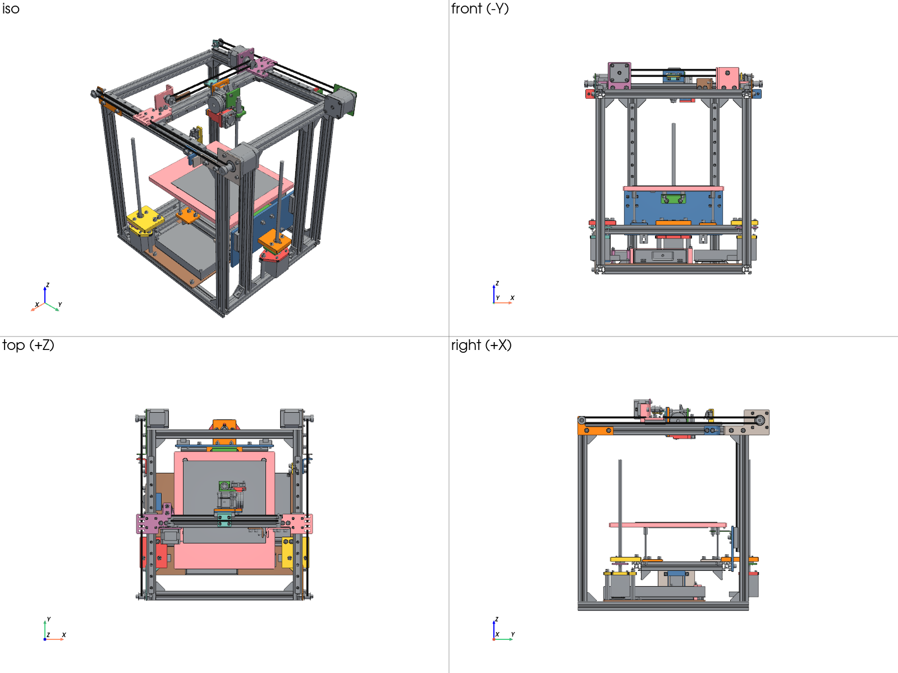

## Not in the simulation (do these; they are not in the step lists or the time)

- 120 M5 and 27 M3 T-nuts: one under every screw marked 'into T-nut' and under every corner-bracket leg on a slot.
- 64 M5 x 8 corner-bracket screws on T-slots (32 brackets): counted in the BOM, not drawn, so not in any step.
- Tapping M5 in the extrusion ends listed in BOM.md (cut lengths, end work).
- Pulley set screws (all pulleys), the nyloc nut under each lead-screw nut's pin (leave 0.2 mm slack so the nut can float), the star washer under the earth stud.
- Bonding the heater pad, the thermal cut-off and the magnetic sheet to the plate. Fit the four bed posts and their jam nuts BEFORE the magnetic sheet: it covers their heads.
- Belts: X and Y (thread, fold back in the anchors, tie); the closed Z belt must be laid round the three screw pulleys, the idler and the motor pulley BEFORE the bed carrier is lowered onto the lead-screw nuts (afterwards the carrier is in the way).
- All wiring (WIRING.md), looms, cable ties, the BAT85 diode in the probe lead.
- Deburring every cut and machined part (the model has sharp edges everywhere).

## Bench units

### Bench unit: bed_unit

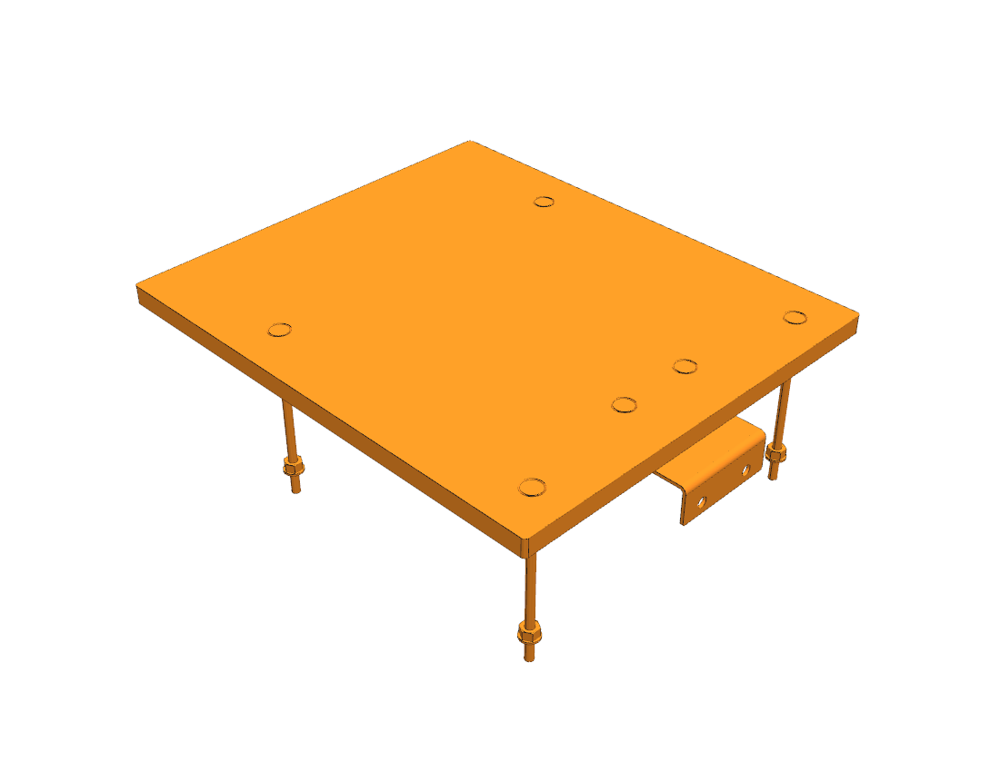

Parts: bed_plate, bed_heater, bed_tco, bed_tie, bed_post_0, bed_post_0_coupling, bed_post_0_washer_top, bed_post_0_washer_arm, bed_post_0_nut_arm, bed_post_1, bed_post_1_coupling, bed_post_1_washer_top, bed_post_1_washer_arm, bed_post_1_nut_arm, bed_post_2, bed_post_2_coupling, bed_post_2_washer_top, bed_post_2_washer_arm, bed_post_2_nut_arm, bed_post_3, bed_post_3_coupling, bed_post_3_washer_top, bed_post_3_washer_arm, bed_post_3_nut_arm, bed_tie_spacer_0, bed_tie_screw_0_nwasher, bed_tie_screw_0_nut, bed_tie_spacer_1, bed_tie_screw_1_nwasher, bed_tie_screw_1_nut. Screws: 6. Held by hand at 5 steps; turned 0 times. Goes into stage: Bed: tabs, posts, plate, tie, heater, magnet, sheet.

1. Start with **bed_plate** on the bench, upside down.
2. Fit **bed_tie_spacer_1** (SPACER-AL-M5-10x5.1x8) onto bed_plate, from the side. Check: seated flat on bed_plate with no gap; all its screws started before any is tightened.
3. Fit **bed_tie** onto bed_tie_spacer_1, from the side. Hold it until fastened (it would tip or slide off (centre of mass is 26 mm outside what it rests on)). Check: seated flat on bed_tie_spacer_1 with no gap; all its screws started before any is tightened.
4. Fit **bed_tie_screw_1_nut** (NUT-M5-NYLOC) onto bed_tie, from the side. Hold it until fastened (nothing stops it falling). Check: seated flat on bed_tie with no gap; all its screws started before any is tightened.
5. Fit **bed_tie_screw_1_nwasher** (WASHER-M5) onto bed_tie, bed_tie_screw_1_nut, from the side. Hold it until fastened (it rests only on parts that are themselves still loose). Check: seated flat on bed_tie, bed_tie_screw_1_nut with no gap; all its screws started before any is tightened.
6. Drive 1 x FHCS-M5x30 from below with the 3 mm hex key: bed_tie_screw_1. Snug; no torque figure in the model.
7. Fit **bed_tie_spacer_0** (SPACER-AL-M5-10x5.1x8) onto bed_plate, bed_tie, from the side. Check: seated flat on bed_plate, bed_tie with no gap; all its screws started before any is tightened.
8. Fit **bed_tie_screw_0_nut** (NUT-M5-NYLOC) onto bed_tie, from the side. Hold it until fastened (nothing stops it falling). Check: seated flat on bed_tie with no gap; all its screws started before any is tightened.
9. Fit **bed_tie_screw_0_nwasher** (WASHER-M5) onto bed_tie, bed_tie_screw_0_nut, from the side. Hold it until fastened (it rests only on parts that are themselves still loose). Check: seated flat on bed_tie, bed_tie_screw_0_nut with no gap; all its screws started before any is tightened.
10. Drive 1 x FHCS-M5x30 from below with the 3 mm hex key: bed_tie_screw_0. Snug; no torque figure in the model.
11. Fit **bed_post_3_washer_top** (WASHER-M5) onto bed_plate, from the side. Check: seated flat on bed_plate with no gap; all its screws started before any is tightened.
12. Fit **bed_post_3_coupling** (COUPLING-NUT-M5x15-A2) onto bed_post_3_washer_top, from the side. Check: seated flat on bed_post_3_washer_top with no gap; all its screws started before any is tightened.
13. Drive 1 x FHCS-M5x16 from below with the 3 mm hex key: bed_post_3_screw. Snug; no torque figure in the model.
14. Fit **bed_post_2_washer_top** (WASHER-M5) onto bed_plate, from the side. Check: seated flat on bed_plate with no gap; all its screws started before any is tightened.
15. Fit **bed_post_2_coupling** (COUPLING-NUT-M5x15-A2) onto bed_post_2_washer_top, from the side. Check: seated flat on bed_post_2_washer_top with no gap; all its screws started before any is tightened.
16. Drive 1 x FHCS-M5x16 from below with the 3 mm hex key: bed_post_2_screw. Snug; no torque figure in the model.
17. Fit **bed_post_1_washer_top** (WASHER-M5) onto bed_plate, from the side. Check: seated flat on bed_plate with no gap; all its screws started before any is tightened.
18. Fit **bed_post_1_coupling** (COUPLING-NUT-M5x15-A2) onto bed_post_1_washer_top, from the side. Check: seated flat on bed_post_1_washer_top with no gap; all its screws started before any is tightened.
19. Drive 1 x FHCS-M5x16 from below with the 3 mm hex key: bed_post_1_screw. Snug; no torque figure in the model.
20. Fit **bed_post_0_washer_top** (WASHER-M5) onto bed_plate, from the side. Check: seated flat on bed_plate with no gap; all its screws started before any is tightened.
21. Fit **bed_post_0_coupling** (COUPLING-NUT-M5x15-A2) onto bed_post_0_washer_top, from the side. Check: seated flat on bed_post_0_washer_top with no gap; all its screws started before any is tightened.
22. Drive 1 x FHCS-M5x16 from below with the 3 mm hex key: bed_post_0_screw. Snug; no torque figure in the model.
23. Fit **bed_heater** (HEATER-SIL-200x130-24V-180W) onto bed_plate, from the side. Check: seated flat on bed_plate with no gap; all its screws started before any is tightened.
24. Fit **bed_post_3** (ROD-M5-DIN976-A2-76.9) onto bed_post_3_coupling, from the side. Check: seated flat on bed_post_3_coupling with no gap; all its screws started before any is tightened.
25. Fit **bed_post_2** (ROD-M5-DIN976-A2-76.9) onto bed_post_2_coupling, from the side. Check: seated flat on bed_post_2_coupling with no gap; all its screws started before any is tightened.
26. Fit **bed_post_1** (ROD-M5-DIN976-A2-76.9) onto bed_post_1_coupling, from the side. Check: seated flat on bed_post_1_coupling with no gap; all its screws started before any is tightened.
27. Fit **bed_post_0** (ROD-M5-DIN976-A2-76.9) onto bed_post_0_coupling, from the side. Check: seated flat on bed_post_0_coupling with no gap; all its screws started before any is tightened.
28. Fit **bed_post_3_nut_arm** (NUT-M5) onto bed_post_3, from the side. Check: seated flat on bed_post_3 with no gap; all its screws started before any is tightened.
29. Fit **bed_post_2_nut_arm** (NUT-M5) onto bed_post_2, from the side. Check: seated flat on bed_post_2 with no gap; all its screws started before any is tightened.
30. Fit **bed_post_1_nut_arm** (NUT-M5) onto bed_post_1, from the side. Check: seated flat on bed_post_1 with no gap; all its screws started before any is tightened.
31. Fit **bed_post_0_nut_arm** (NUT-M5) onto bed_post_0, from the side. Check: seated flat on bed_post_0 with no gap; all its screws started before any is tightened.
32. Fit **bed_tco** (TCO-133C-15A) onto bed_plate, from the side. Check: seated flat on bed_plate with no gap; all its screws started before any is tightened.
33. Fit **bed_post_3_washer_arm** (WASHER-M5) onto bed_post_3, bed_post_3_nut_arm, from above. Check: seated flat on bed_post_3, bed_post_3_nut_arm with no gap; all its screws started before any is tightened.
34. Fit **bed_post_2_washer_arm** (WASHER-M5) onto bed_post_2, bed_post_2_nut_arm, from above. Check: seated flat on bed_post_2, bed_post_2_nut_arm with no gap; all its screws started before any is tightened.
35. Fit **bed_post_1_washer_arm** (WASHER-M5) onto bed_post_1, bed_post_1_nut_arm, from above. Check: seated flat on bed_post_1, bed_post_1_nut_arm with no gap; all its screws started before any is tightened.
36. Fit **bed_post_0_washer_arm** (WASHER-M5) onto bed_post_0, bed_post_0_nut_arm, from above. Check: seated flat on bed_post_0, bed_post_0_nut_arm with no gap; all its screws started before any is tightened.

Before moving on: every screw of the unit is in (6); nothing rocks on a flat surface; moving parts (shaft, idler) turn freely.

### Bench unit: z_drive_rear

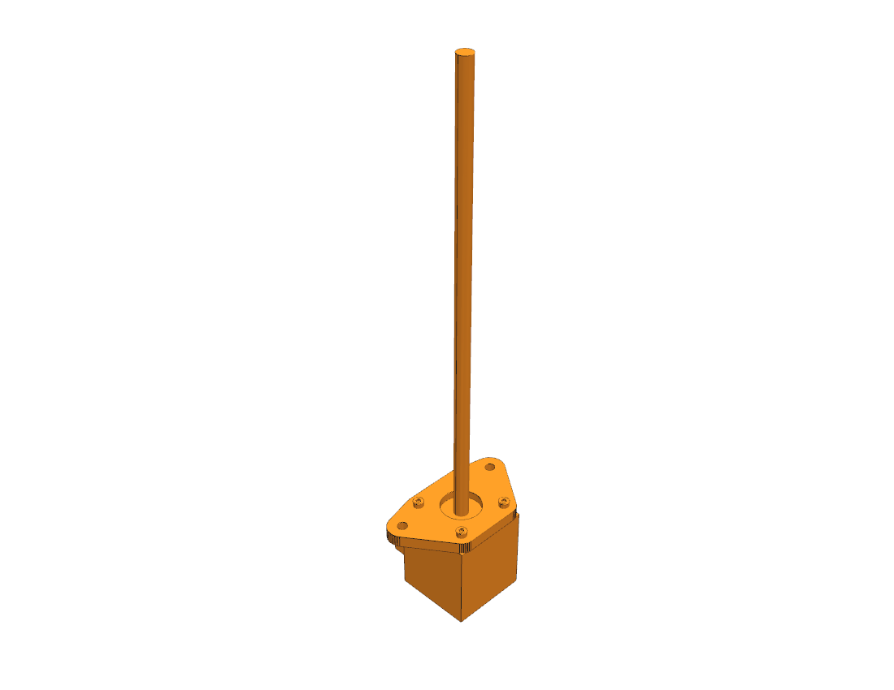

Parts: z_motor_plate, z_motor, leadscrew. Screws: 4. Held by hand at 0 steps; turned 0 times. Goes into stage: Z drive: screws and motors (with their supports, pulleys and belt where the design has them).

1. Start with **z_motor** on the bench.
2. Fit **z_motor_plate** onto z_motor, from above. Check: seated flat on z_motor with no gap; all its screws started before any is tightened.
3. Drive 4 x M3x10 from above with the 2.5 mm hex key: z_motor_screw_3, z_motor_screw_2, z_motor_screw_1, z_motor_screw_0. Snug; no torque figure in the model.
4. Fit **leadscrew** (TR8x2-INTEGRAL-17E19S1684AB4-330RA-CUT252) onto z_motor, from above. Check: seated flat on z_motor with no gap; all its screws started before any is tightened.

Before moving on: every screw of the unit is in (4); nothing rocks on a flat surface; moving parts (shaft, idler) turn freely.

### Bench unit: electronics

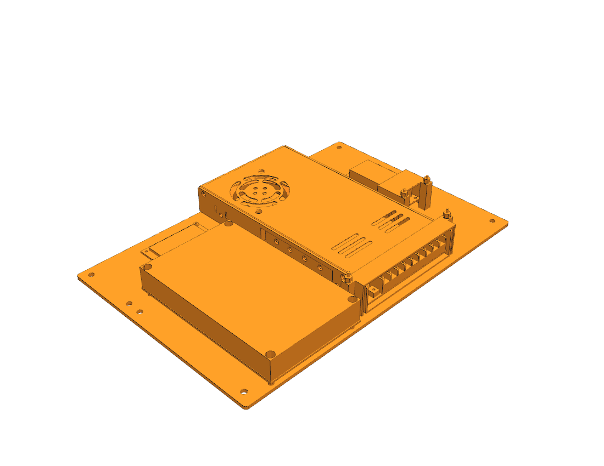

Parts: electronics_tray, mains_cover_relay, mains_cover_relay_screw_0_washer, mains_cover_relay_screw_0_nwasher, mains_cover_relay_screw_0_nut, mains_cover_relay_screw_1_washer, mains_cover_relay_screw_1_nwasher, mains_cover_relay_screw_1_nut, mains_cover_psu, mains_cover_psu_screw_0_washer, mains_cover_psu_screw_0_nwasher, mains_cover_psu_screw_0_nut, mains_cover_psu_screw_1_washer, mains_cover_psu_screw_1_nwasher, mains_cover_psu_screw_1_nut, psu, control_board, control_board_spacer_0, control_board_washer_0, control_board_nut_0, control_board_spacer_1, control_board_washer_1, control_board_nut_1, control_board_spacer_2, control_board_washer_2, control_board_nut_2, control_board_spacer_3, control_board_washer_3, control_board_nut_3, host, host_spacer_0, host_washer_0, host_nut_0, host_spacer_3, host_washer_3, host_nut_3, psu_relay, psu_relay_spacer_0, psu_relay_washer_0, psu_relay_nut_0, psu_relay_spacer_1, psu_relay_washer_1, psu_relay_nut_1, psu_relay_spacer_2, psu_relay_washer_2, psu_relay_nut_2. Screws: 17. Held by hand at 29 steps; turned 0 times. Goes into stage: Electronics tray, mains inlet, earth.

1. Start with **psu** on the bench.
2. Fit **electronics_tray** onto psu, from the side. Hold it until fastened (nothing stops it falling). Check: seated flat on psu with no gap; all its screws started before any is tightened.
3. Fit **mains_cover_psu** onto electronics_tray, from above. Hold it until fastened (it rests only on parts that are themselves still loose). Check: seated flat on electronics_tray with no gap; all its screws started before any is tightened.
4. Fit **mains_cover_psu_screw_1_nut** (NUT-M3-NYLOC) onto mains_cover_psu, from above. Hold it until fastened (it would tip or slide off (no surface underneath it)). Check: seated flat on mains_cover_psu with no gap; all its screws started before any is tightened.
5. Fit **mains_cover_psu_screw_1_washer** (WASHER-M3) onto electronics_tray, from the side. Hold it until fastened (it rests only on parts that are themselves still loose). Check: seated flat on electronics_tray with no gap; all its screws started before any is tightened.
6. Fit **mains_cover_psu_screw_1_nwasher** (WASHER-M3) onto mains_cover_psu, mains_cover_psu_screw_1_nut, from the side. Hold it until fastened (it rests only on parts that are themselves still loose). Check: seated flat on mains_cover_psu, mains_cover_psu_screw_1_nut with no gap; all its screws started before any is tightened.
7. Drive 1 x M3x45 from below with the 2.5 mm hex key: mains_cover_psu_screw_1. Snug; no torque figure in the model.
8. Fit **mains_cover_psu_screw_0_nut** (NUT-M3-NYLOC) onto mains_cover_psu, from above. Hold it until fastened (it would tip or slide off (no surface underneath it)). Check: seated flat on mains_cover_psu with no gap; all its screws started before any is tightened.
9. Fit **mains_cover_psu_screw_0_washer** (WASHER-M3) onto electronics_tray, from the side. Hold it until fastened (nothing stops it falling). Check: seated flat on electronics_tray with no gap; all its screws started before any is tightened.
10. Fit **mains_cover_psu_screw_0_nwasher** (WASHER-M3) onto mains_cover_psu, mains_cover_psu_screw_0_nut, from the side. Hold it until fastened (it rests only on parts that are themselves still loose). Check: seated flat on mains_cover_psu, mains_cover_psu_screw_0_nut with no gap; all its screws started before any is tightened.
11. Drive 1 x M3x45 from below with the 2.5 mm hex key: mains_cover_psu_screw_0. Snug; no torque figure in the model.
12. Fit **psu_relay_spacer_2** (SPACER-NYLON-M3-5x3.3x6) onto electronics_tray, from above. Hold it until fastened (it rests only on parts that are themselves still loose). Check: seated flat on electronics_tray with no gap; all its screws started before any is tightened.
13. Fit **psu_relay** (RELAY-BTT-V1.2) onto psu_relay_spacer_2, from above. Hold it until fastened (it would tip or slide off (centre of mass is 34 mm outside what it rests on)). Check: seated flat on psu_relay_spacer_2 with no gap; all its screws started before any is tightened.
14. Fit **psu_relay_nut_2** (NUT-M3) onto electronics_tray, from the side. Hold it until fastened (it rests only on parts that are themselves still loose). Check: seated flat on electronics_tray with no gap; all its screws started before any is tightened.
15. Fit **psu_relay_washer_2** (WASHER-M3) onto electronics_tray, psu_relay_nut_2, from the side. Hold it until fastened (it rests only on parts that are themselves still loose). Check: seated flat on electronics_tray, psu_relay_nut_2 with no gap; all its screws started before any is tightened.
16. Drive 1 x M3x16 from above with the 2.5 mm hex key: psu_relay_screw_2. Snug; no torque figure in the model.
17. Fit **mains_cover_relay** onto electronics_tray, from above. Hold it until fastened (it rests only on parts that are themselves still loose). Check: seated flat on electronics_tray with no gap; all its screws started before any is tightened.
18. Fit **mains_cover_relay_screw_1_nut** (NUT-M3-NYLOC) onto mains_cover_relay, from above. Hold it until fastened (it would tip or slide off (no surface underneath it)). Check: seated flat on mains_cover_relay with no gap; all its screws started before any is tightened.
19. Fit **mains_cover_relay_screw_1_washer** (WASHER-M3) onto electronics_tray, from the side. Hold it until fastened (nothing stops it falling). Check: seated flat on electronics_tray with no gap; all its screws started before any is tightened.
20. Fit **mains_cover_relay_screw_1_nwasher** (WASHER-M3) onto mains_cover_relay, mains_cover_relay_screw_1_nut, from the side. Hold it until fastened (it rests only on parts that are themselves still loose). Check: seated flat on mains_cover_relay, mains_cover_relay_screw_1_nut with no gap; all its screws started before any is tightened.
21. Drive 1 x M3x40 from below with the 2.5 mm hex key: mains_cover_relay_screw_1. Snug; no torque figure in the model.
22. Fit **mains_cover_relay_screw_0_nut** (NUT-M3-NYLOC) onto mains_cover_relay, from above. Hold it until fastened (it would tip or slide off (no surface underneath it)). Check: seated flat on mains_cover_relay with no gap; all its screws started before any is tightened.
23. Fit **mains_cover_relay_screw_0_washer** (WASHER-M3) onto electronics_tray, from the side. Hold it until fastened (nothing stops it falling). Check: seated flat on electronics_tray with no gap; all its screws started before any is tightened.
24. Fit **mains_cover_relay_screw_0_nwasher** (WASHER-M3) onto mains_cover_relay, mains_cover_relay_screw_0_nut, from the side. Hold it until fastened (it rests only on parts that are themselves still loose). Check: seated flat on mains_cover_relay, mains_cover_relay_screw_0_nut with no gap; all its screws started before any is tightened.
25. Drive 1 x M3x40 from below with the 2.5 mm hex key: mains_cover_relay_screw_0. Snug; no torque figure in the model.
26. Drive 4 x M4x6 from below with the 3 mm hex key: psu_screw_3, psu_screw_2, psu_screw_1, psu_screw_0. Snug; no torque figure in the model.
27. Fit **psu_relay_spacer_1** (SPACER-NYLON-M3-5x3.3x6) onto electronics_tray, psu_relay, from the side. Check: seated flat on electronics_tray, psu_relay with no gap; all its screws started before any is tightened.
28. Fit **psu_relay_nut_1** (NUT-M3) onto electronics_tray, from the side. Hold it until fastened (nothing stops it falling). Check: seated flat on electronics_tray with no gap; all its screws started before any is tightened.
29. Fit **psu_relay_washer_1** (WASHER-M3) onto electronics_tray, psu_relay_nut_1, from the side. Check: seated flat on electronics_tray, psu_relay_nut_1 with no gap; all its screws started before any is tightened.
30. Drive 1 x M3x16 from above with the 2.5 mm hex key: psu_relay_screw_1. Snug; no torque figure in the model.
31. Fit **psu_relay_spacer_0** (SPACER-NYLON-M3-5x3.3x6) onto electronics_tray, psu_relay, from the side. Check: seated flat on electronics_tray, psu_relay with no gap; all its screws started before any is tightened.
32. Fit **psu_relay_nut_0** (NUT-M3) onto electronics_tray, from the side. Hold it until fastened (nothing stops it falling). Check: seated flat on electronics_tray with no gap; all its screws started before any is tightened.
33. Fit **psu_relay_washer_0** (WASHER-M3) onto electronics_tray, psu_relay_nut_0, from the side. Check: seated flat on electronics_tray, psu_relay_nut_0 with no gap; all its screws started before any is tightened.
34. Drive 1 x M3x16 from above with the 2.5 mm hex key: psu_relay_screw_0. Snug; no torque figure in the model.
35. Fit **control_board_spacer_3** (SPACER-NYLON-M3-5x3.3x6) onto electronics_tray, from above. Check: seated flat on electronics_tray with no gap; all its screws started before any is tightened.
36. Fit **control_board** (CTRL-OCTOPUS-V1.1) onto control_board_spacer_3, from above. Hold it until fastened (it would tip or slide off (centre of mass is 85 mm outside what it rests on)). Check: seated flat on control_board_spacer_3 with no gap; all its screws started before any is tightened.
37. Fit **control_board_nut_3** (NUT-M3) onto electronics_tray, from the side. Hold it until fastened (nothing stops it falling). Check: seated flat on electronics_tray with no gap; all its screws started before any is tightened.
38. Fit **control_board_washer_3** (WASHER-M3) onto control_board_nut_3, electronics_tray, from the side. Check: seated flat on control_board_nut_3, electronics_tray with no gap; all its screws started before any is tightened.
39. Drive 1 x M3x16 from above with the 2.5 mm hex key: control_board_screw_3. Snug; no torque figure in the model.
40. Fit **control_board_spacer_2** (SPACER-NYLON-M3-5x3.3x6) onto control_board, electronics_tray, from the side. Check: seated flat on control_board, electronics_tray with no gap; all its screws started before any is tightened.
41. Fit **control_board_nut_2** (NUT-M3) onto electronics_tray, from the side. Hold it until fastened (nothing stops it falling). Check: seated flat on electronics_tray with no gap; all its screws started before any is tightened.
42. Fit **control_board_washer_2** (WASHER-M3) onto control_board_nut_2, electronics_tray, from the side. Check: seated flat on control_board_nut_2, electronics_tray with no gap; all its screws started before any is tightened.
43. Drive 1 x M3x16 from above with the 2.5 mm hex key: control_board_screw_2. Snug; no torque figure in the model.
44. Fit **control_board_spacer_1** (SPACER-NYLON-M3-5x3.3x6) onto control_board, electronics_tray, from the side. Check: seated flat on control_board, electronics_tray with no gap; all its screws started before any is tightened.
45. Fit **control_board_nut_1** (NUT-M3) onto electronics_tray, from the side. Hold it until fastened (nothing stops it falling). Check: seated flat on electronics_tray with no gap; all its screws started before any is tightened.
46. Fit **control_board_washer_1** (WASHER-M3) onto control_board_nut_1, electronics_tray, from the side. Check: seated flat on control_board_nut_1, electronics_tray with no gap; all its screws started before any is tightened.
47. Drive 1 x M3x16 from above with the 2.5 mm hex key: control_board_screw_1. Snug; no torque figure in the model.
48. Fit **control_board_spacer_0** (SPACER-NYLON-M3-5x3.3x6) onto control_board, electronics_tray, from the side. Check: seated flat on control_board, electronics_tray with no gap; all its screws started before any is tightened.
49. Fit **control_board_nut_0** (NUT-M3) onto electronics_tray, from the side. Hold it until fastened (nothing stops it falling). Check: seated flat on electronics_tray with no gap; all its screws started before any is tightened.
50. Fit **control_board_washer_0** (WASHER-M3) onto control_board_nut_0, electronics_tray, from the side. Check: seated flat on control_board_nut_0, electronics_tray with no gap; all its screws started before any is tightened.
51. Drive 1 x M3x16 from above with the 2.5 mm hex key: control_board_screw_0. Snug; no torque figure in the model.
52. Fit **host_spacer_3** (SPACER-NYLON-M2.5-4x2.7x4) onto electronics_tray, from above. Check: seated flat on electronics_tray with no gap; all its screws started before any is tightened.
53. Fit **host** (HOST-RPI-ZERO-2W) onto host_spacer_3, from above. Hold it until fastened (it would tip or slide off (centre of mass is 30 mm outside what it rests on)). Check: seated flat on host_spacer_3 with no gap; all its screws started before any is tightened.
54. Fit **host_nut_3** (NUT-M2.5) onto electronics_tray, from the side. Hold it until fastened (nothing stops it falling). Check: seated flat on electronics_tray with no gap; all its screws started before any is tightened.
55. Fit **host_washer_3** (WASHER-M2.5) onto electronics_tray, host_nut_3, from the side. Check: seated flat on electronics_tray, host_nut_3 with no gap; all its screws started before any is tightened.
56. Drive 1 x M2.5x12 from above with the 2 mm hex key: host_screw_3. Snug; no torque figure in the model.
57. Fit **host_nut_0** (NUT-M2.5) onto electronics_tray, from the side. Hold it until fastened (nothing stops it falling). Check: seated flat on electronics_tray with no gap; all its screws started before any is tightened.
58. Fit **host_spacer_0** (SPACER-NYLON-M2.5-4x2.7x4) onto electronics_tray, host, from the side. Check: seated flat on electronics_tray, host with no gap; all its screws started before any is tightened.
59. Fit **host_washer_0** (WASHER-M2.5) onto electronics_tray, host_nut_0, from the side. Check: seated flat on electronics_tray, host_nut_0 with no gap; all its screws started before any is tightened.
60. Drive 1 x M2.5x12 from above with the 2 mm hex key: host_screw_0. Snug; no torque figure in the model.

Before moving on: every screw of the unit is in (17); nothing rocks on a flat surface; moving parts (shaft, idler) turn freely.

### Bench unit: z_drive_fr

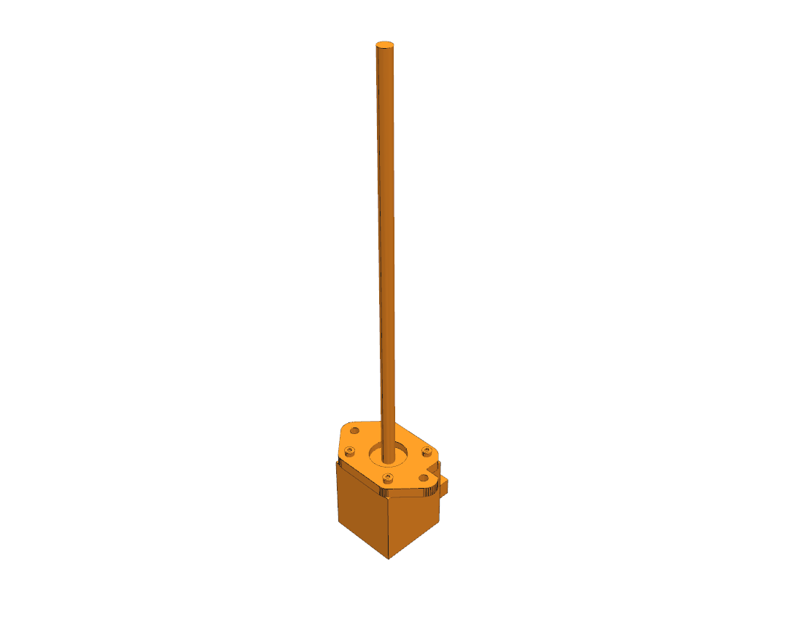

Parts: z_motor_plate_fr, z_motor_fr, leadscrew_fr. Screws: 4. Held by hand at 0 steps; turned 0 times. Goes into stage: Z drive: screws and motors (with their supports, pulleys and belt where the design has them).

1. Start with **z_motor_fr** on the bench.
2. Fit **z_motor_plate_fr** onto z_motor_fr, from above. Check: seated flat on z_motor_fr with no gap; all its screws started before any is tightened.
3. Drive 4 x M3x10 from above with the 2.5 mm hex key: z_motor_fr_screw_3, z_motor_fr_screw_2, z_motor_fr_screw_1, z_motor_fr_screw_0. Snug; no torque figure in the model.
4. Fit **leadscrew_fr** (TR8x2-INTEGRAL-17E19S1684AB4-330RA-CUT252) onto z_motor_fr, from above. Check: seated flat on z_motor_fr with no gap; all its screws started before any is tightened.

Before moving on: every screw of the unit is in (4); nothing rocks on a flat surface; moving parts (shaft, idler) turn freely.

### Bench unit: z_drive_fl

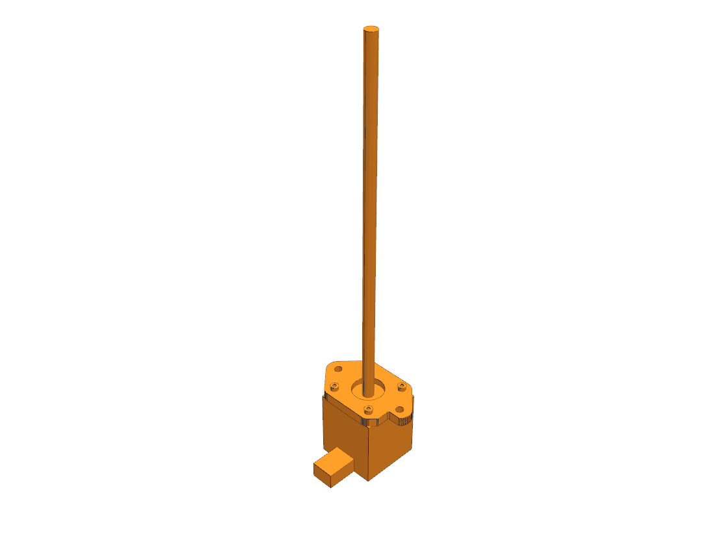

Parts: z_motor_plate_fl, z_motor_fl, leadscrew_fl. Screws: 4. Held by hand at 0 steps; turned 0 times. Goes into stage: Z drive: screws and motors (with their supports, pulleys and belt where the design has them).

1. Start with **z_motor_fl** on the bench.
2. Fit **z_motor_plate_fl** onto z_motor_fl, from above. Check: seated flat on z_motor_fl with no gap; all its screws started before any is tightened.
3. Drive 4 x M3x10 from above with the 2.5 mm hex key: z_motor_fl_screw_3, z_motor_fl_screw_2, z_motor_fl_screw_1, z_motor_fl_screw_0. Snug; no torque figure in the model.
4. Fit **leadscrew_fl** (TR8x2-INTEGRAL-17E19S1684AB4-330RA-CUT252) onto z_motor_fl, from above. Check: seated flat on z_motor_fl with no gap; all its screws started before any is tightened.

Before moving on: every screw of the unit is in (4); nothing rocks on a flat surface; moving parts (shaft, idler) turn freely.

### Bench unit: y_drive_l

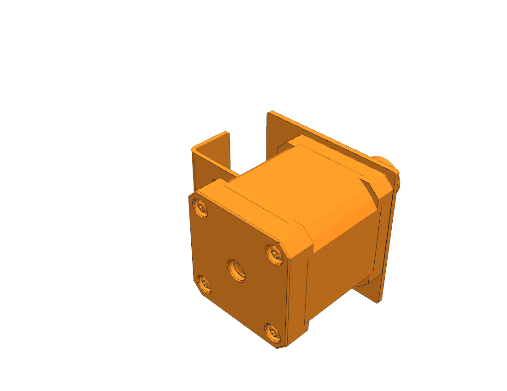

Parts: y_motor_mount_l, y_motor_l, y_pulley_l, y_motor_l_screw_0_washer, y_motor_l_screw_1_washer, y_motor_l_screw_2_washer, y_motor_l_screw_3_washer. Screws: 4. Held by hand at 1 steps; turned 0 times. Goes into stage: Y drives, idlers, tensioners, Y endstop.

1. Start with **y_motor_l** on the bench, on its right side (left side up).
2. Fit **y_motor_mount_l** onto y_motor_l, from above. Check: seated flat on y_motor_l with no gap; all its screws started before any is tightened.
3. Fit **y_motor_l_screw_3_washer** (WASHER-M3) onto y_motor_mount_l, from the side. Check: seated flat on y_motor_mount_l with no gap; all its screws started before any is tightened.
4. Drive 1 x M3x6 from above with the 2.5 mm hex key: y_motor_l_screw_3. Snug; no torque figure in the model.
5. Fit **y_motor_l_screw_2_washer** (WASHER-M3) onto y_motor_mount_l, from above. Check: seated flat on y_motor_mount_l with no gap; all its screws started before any is tightened.
6. Drive 1 x M3x6 from above with the 2.5 mm hex key: y_motor_l_screw_2. Snug; no torque figure in the model.
7. Fit **y_motor_l_screw_1_washer** (WASHER-M3) onto y_motor_mount_l, from the side. Check: seated flat on y_motor_mount_l with no gap; all its screws started before any is tightened.
8. Drive 1 x M3x6 from above with the 2.5 mm hex key: y_motor_l_screw_1. Snug; no torque figure in the model.
9. Fit **y_motor_l_screw_0_washer** (WASHER-M3) onto y_motor_mount_l, from above. Check: seated flat on y_motor_mount_l with no gap; all its screws started before any is tightened.
10. Drive 1 x M3x6 from above with the 2.5 mm hex key: y_motor_l_screw_0. Snug; no torque figure in the model.
11. Fit **y_pulley_l** (GT2-20T-B5) onto y_motor_l, from above. Hold it until fastened (nothing stops it falling). Check: set screws tight on the shaft; on a lead screw the hub rests on the upper bearing's INNER ring and does not touch the outer ring.

Before moving on: every screw of the unit is in (4); nothing rocks on a flat surface; moving parts (shaft, idler) turn freely.

### Bench unit: y_drive

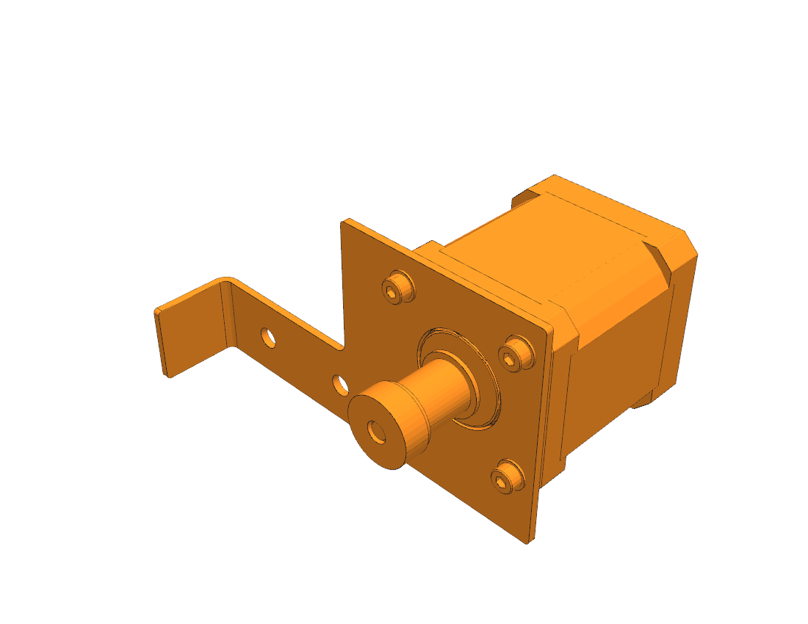

Parts: y_motor_mount, y_motor, y_pulley, y_motor_screw_0_washer, y_motor_screw_1_washer, y_motor_screw_2_washer, y_motor_screw_3_washer. Screws: 4. Held by hand at 1 steps; turned 0 times. Goes into stage: Y drives, idlers, tensioners, Y endstop.

1. Start with **y_motor** on the bench, on its left side (right side up).
2. Fit **y_motor_mount** onto y_motor, from above. Check: seated flat on y_motor with no gap; all its screws started before any is tightened.
3. Fit **y_motor_screw_3_washer** (WASHER-M3) onto y_motor_mount, from the side. Check: seated flat on y_motor_mount with no gap; all its screws started before any is tightened.
4. Drive 1 x M3x6 from above with the 2.5 mm hex key: y_motor_screw_3. Snug; no torque figure in the model.
5. Fit **y_motor_screw_2_washer** (WASHER-M3) onto y_motor_mount, from above. Check: seated flat on y_motor_mount with no gap; all its screws started before any is tightened.
6. Drive 1 x M3x6 from above with the 2.5 mm hex key: y_motor_screw_2. Snug; no torque figure in the model.
7. Fit **y_motor_screw_1_washer** (WASHER-M3) onto y_motor_mount, from the side. Check: seated flat on y_motor_mount with no gap; all its screws started before any is tightened.
8. Drive 1 x M3x6 from above with the 2.5 mm hex key: y_motor_screw_1. Snug; no torque figure in the model.
9. Fit **y_motor_screw_0_washer** (WASHER-M3) onto y_motor_mount, from above. Check: seated flat on y_motor_mount with no gap; all its screws started before any is tightened.
10. Drive 1 x M3x6 from above with the 2.5 mm hex key: y_motor_screw_0. Snug; no torque figure in the model.
11. Fit **y_pulley** (GT2-20T-B5) onto y_motor, from above. Hold it until fastened (nothing stops it falling). Check: set screws tight on the shaft; on a lead screw the hub rests on the upper bearing's INNER ring and does not touch the outer ring.

Before moving on: every screw of the unit is in (4); nothing rocks on a flat surface; moving parts (shaft, idler) turn freely.

### Bench unit: x_drive

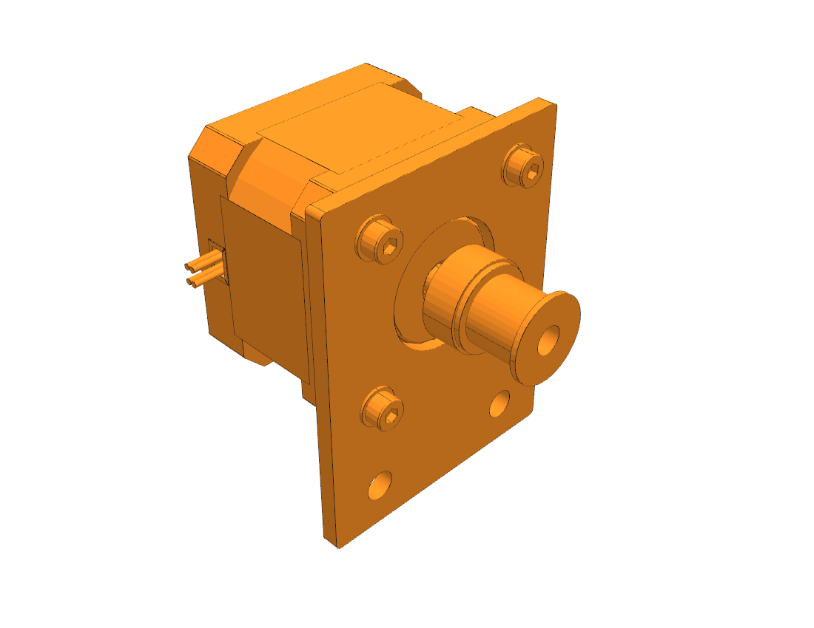

Parts: x_motor_mount, x_motor, x_pulley, x_motor_screw_0_washer, x_motor_screw_1_washer, x_motor_screw_2_washer, x_motor_screw_3_washer. Screws: 4. Held by hand at 1 steps; turned 0 times. Goes into stage: Gantry: Y plates, X beam, X rail, X drive.

1. Start with **x_motor** on the bench, on its front (back face up).
2. Fit **x_motor_mount** onto x_motor, from above. Check: seated flat on x_motor with no gap; all its screws started before any is tightened.
3. Fit **x_motor_screw_3_washer** (WASHER-M3) onto x_motor_mount, from the side. Check: seated flat on x_motor_mount with no gap; all its screws started before any is tightened.
4. Drive 1 x M3x8 from above with the 2.5 mm hex key: x_motor_screw_3. Snug; no torque figure in the model.
5. Fit **x_motor_screw_2_washer** (WASHER-M3) onto x_motor_mount, from the side. Check: seated flat on x_motor_mount with no gap; all its screws started before any is tightened.
6. Drive 1 x M3x8 from above with the 2.5 mm hex key: x_motor_screw_2. Snug; no torque figure in the model.
7. Fit **x_motor_screw_1_washer** (WASHER-M3) onto x_motor_mount, from the side. Check: seated flat on x_motor_mount with no gap; all its screws started before any is tightened.
8. Drive 1 x M3x8 from above with the 2.5 mm hex key: x_motor_screw_1. Snug; no torque figure in the model.
9. Fit **x_motor_screw_0_washer** (WASHER-M3) onto x_motor_mount, from the side. Check: seated flat on x_motor_mount with no gap; all its screws started before any is tightened.
10. Drive 1 x M3x8 from above with the 2.5 mm hex key: x_motor_screw_0. Snug; no torque figure in the model.
11. Fit **x_pulley** (GT2-20T-B5-W9) onto x_motor, from above. Hold it until fastened (nothing stops it falling). Check: set screws tight on the shaft; on a lead screw the hub rests on the upper bearing's INNER ring and does not touch the outer ring.

Before moving on: every screw of the unit is in (4); nothing rocks on a flat surface; moving parts (shaft, idler) turn freely.

### Bench unit: x_idler_unit

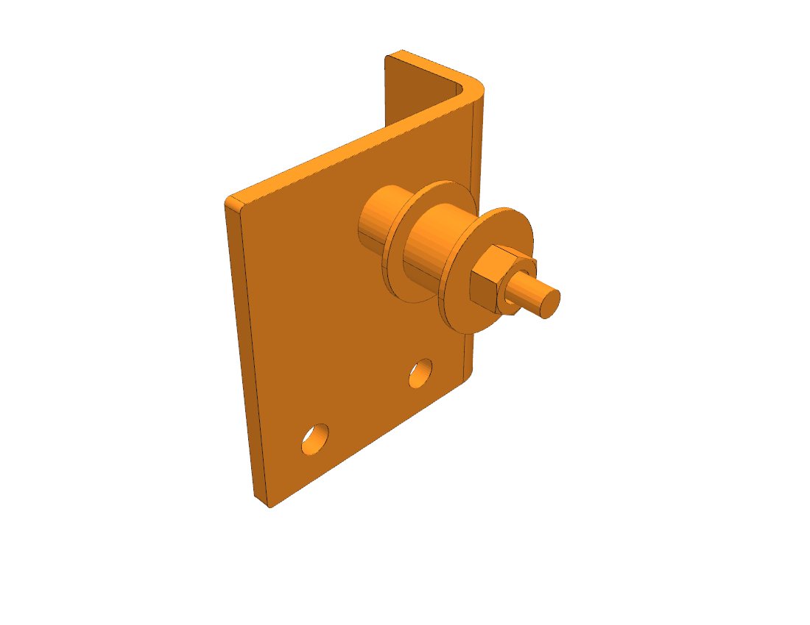

Parts: x_idler_mount, x_idler_spacer, x_idler, x_idler_bolt_washer, x_idler_nut. Screws: 1. Held by hand at 1 steps; turned 0 times. Goes into stage: Gantry: Y plates, X beam, X rail, X drive.

1. Start with **x_idler_mount** on the bench, on its front (back face up).
2. Fit **x_idler_spacer** (SPACER-AL-M5-10x5.1x9) onto x_idler_mount, from the side. Check: seated flat on x_idler_mount with no gap; all its screws started before any is tightened.
3. Fit **x_idler** (GT2-IDLER-20T-B5-W9) onto x_idler_spacer, from the side. Check: seated flat on x_idler_spacer with no gap; all its screws started before any is tightened.
4. Fit **x_idler_nut** (NUT-M5) onto x_idler, from the side. Check: seated flat on x_idler with no gap; all its screws started before any is tightened.
5. Fit **x_idler_bolt_washer** (WASHER-M5) onto x_idler_mount, from the side. Hold it until fastened (nothing stops it falling). Check: seated flat on x_idler_mount with no gap; all its screws started before any is tightened.
6. Drive 1 x M5x35 from below with the 4 mm hex key: x_idler_bolt. Snug; no torque figure in the model.

Before moving on: every screw of the unit is in (1); nothing rocks on a flat surface; moving parts (shaft, idler) turn freely.

### Bench unit: part_cooling

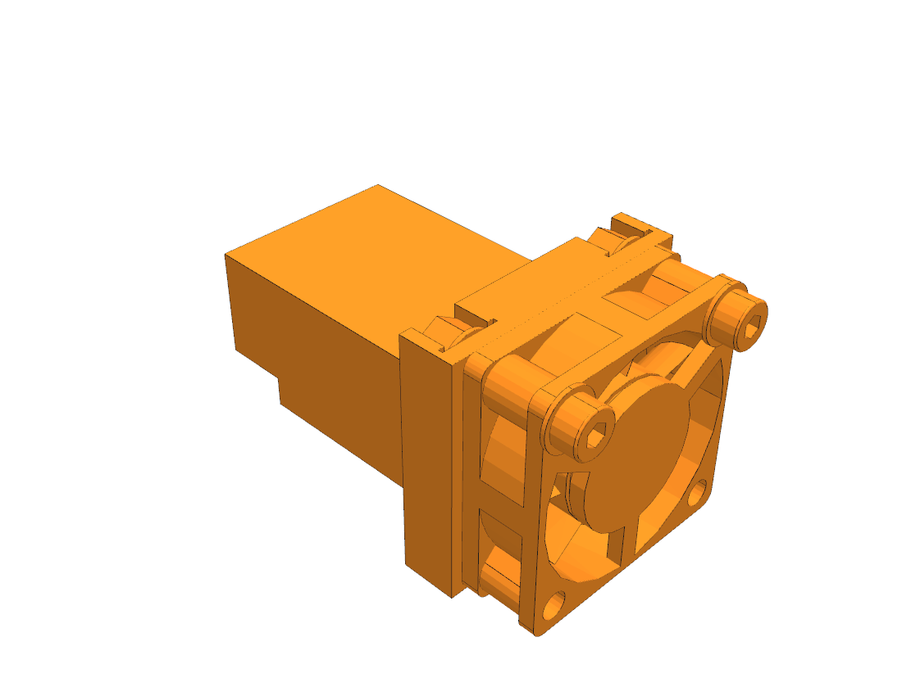

Parts: part_duct, part_fan, part_fan_screw_0_washer, part_fan_screw_0_nwasher, part_fan_screw_0_nut, part_fan_screw_1_washer, part_fan_screw_1_nwasher, part_fan_screw_1_nut. Screws: 2. Held by hand at 2 steps; turned 0 times. Goes into stage: Toolhead: plate, extruder, hotend, probe, part cooling.

1. Start with **part_duct** on the bench, on its front (back face up).
2. Fit **part_fan** (FAN-3010-CG3010U24) onto part_duct, from the side. Check: seated flat on part_duct with no gap; all its screws started before any is tightened.
3. Fit **part_fan_screw_1_nut** (NUT-M3-NYLOC) onto part_duct, from the side. Hold it until fastened (nothing stops it falling). Check: seated flat on part_duct with no gap; all its screws started before any is tightened.
4. Fit **part_fan_screw_1_washer** (WASHER-M3) onto part_fan, from the side. Check: seated flat on part_fan with no gap; all its screws started before any is tightened.
5. Fit **part_fan_screw_1_nwasher** (WASHER-M3) onto part_duct, part_fan_screw_1_nut, from the side. Check: seated flat on part_duct, part_fan_screw_1_nut with no gap; all its screws started before any is tightened.
6. Drive 1 x M3x18 from above with the 2.5 mm hex key: part_fan_screw_1. Snug; no torque figure in the model.
7. Fit **part_fan_screw_0_nut** (NUT-M3-NYLOC) onto part_duct, from the side. Hold it until fastened (nothing stops it falling). Check: seated flat on part_duct with no gap; all its screws started before any is tightened.
8. Fit **part_fan_screw_0_washer** (WASHER-M3) onto part_fan, from the side. Check: seated flat on part_fan with no gap; all its screws started before any is tightened.
9. Fit **part_fan_screw_0_nwasher** (WASHER-M3) onto part_duct, part_fan_screw_0_nut, from the side. Check: seated flat on part_duct, part_fan_screw_0_nut with no gap; all its screws started before any is tightened.
10. Drive 1 x M3x18 from above with the 2.5 mm hex key: part_fan_screw_0. Snug; no torque figure in the model.

Before moving on: every screw of the unit is in (2); nothing rocks on a flat surface; moving parts (shaft, idler) turn freely.

## Main assembly, by stage

### Stage: Frame

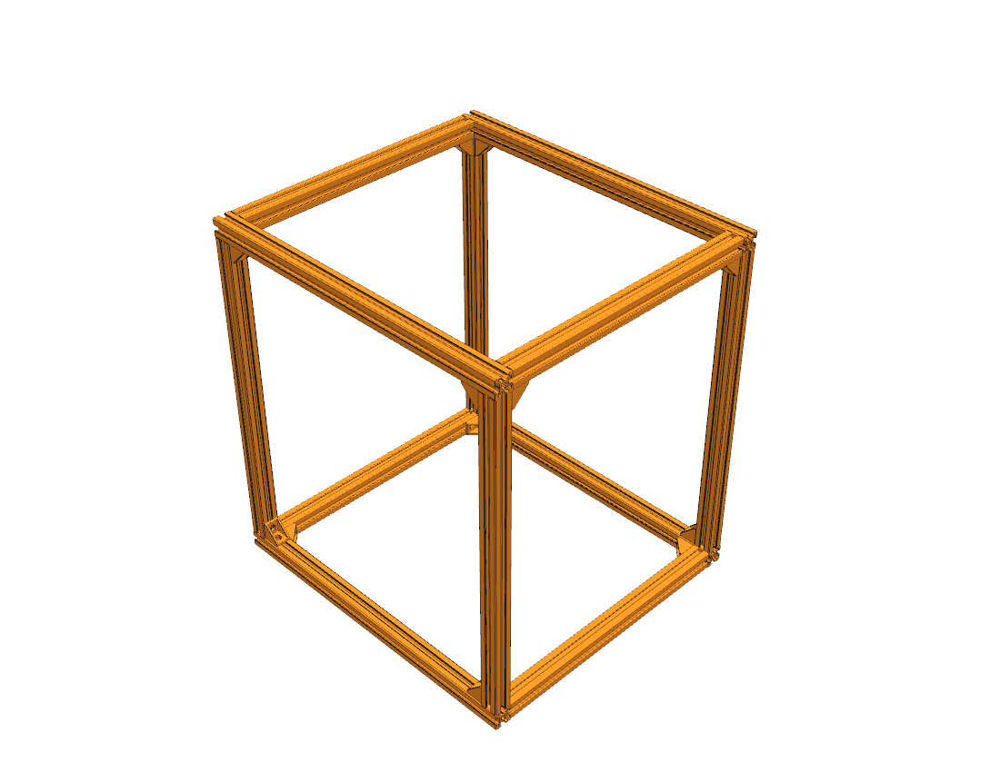

Orange: fitted in this stage. Grey: already there.

| # | Fit | Touches (simulation) | Screws that hold it (count x size, key, direction) | Check before moving on | Sim. step |
|---|---|---|---|---|---|
| 1 | **frame_bot_back** (EXT2020-300) | frame_bot_left, frame_bot_right, upright_left | - | ends flush and square to the neighbouring members (set square on two faces) | 37 |
| 2 | **frame_bot_front** (EXT2020-300) | frame_bot_left, frame_bot_right, post_lf | - | ends flush and square to the neighbouring members (set square on two faces) | 379 |
| 3 | **frame_bot_left** (EXT2020-373) | - | - | ends flush and square to the neighbouring members (set square on two faces) | 0 |
| 4 | **frame_bot_right** (EXT2020-373) | - | - | ends flush and square to the neighbouring members (set square on two faces) | 35 |
| 5 | **post_lb** (EXT2020-364) | frame_bot_back, frame_bot_left, frame_top_left | - | ends flush and square to the neighbouring members (set square on two faces) | 376 |
| 6 | **post_lf** (EXT2020-364) | frame_bot_left, frame_top_left, y_idler_mount_l | - | ends flush and square to the neighbouring members (set square on two faces) | 375 |
| 7 | **post_rb** (EXT2020-364) | frame_bot_back, frame_bot_right, frame_top_right | - | ends flush and square to the neighbouring members (set square on two faces) | 374 |
| 8 | **post_rf** (EXT2020-364) | frame_bot_right, frame_top_right | - | ends flush and square to the neighbouring members (set square on two faces) | 36 |
| 9 | **frame_top_back** (EXT2020-300) | frame_top_left, frame_top_right, post_lb | - | ends flush and square to the neighbouring members (set square on two faces) | 378 |
| 10 | **frame_top_front** (EXT2020-300) | frame_top_left, frame_top_right, post_lf | - | ends flush and square to the neighbouring members (set square on two faces) | 377 |
| 11 | **frame_top_left** (EXT2020-373) | - | - | ends flush and square to the neighbouring members (set square on two faces) | 27 |
| 12 | **frame_top_right** (EXT2020-373) | - | - | ends flush and square to the neighbouring members (set square on two faces) | 24 |
| 13 | **bracket_11** (BRKT-2020) | frame_bot_front, frame_bot_right | M5 x 8 cap screw and T-nut in each leg that lies on a T-slot, 4 mm key (BOM only: not drawn, access not checked) | both legs flat on their members; T-nuts turned across the slot before tightening | 404 |
| 14 | **bracket_15** (BRKT-2020) | frame_bot_back, frame_bot_right | M5 x 8 cap screw and T-nut in each leg that lies on a T-slot, 4 mm key (BOM only: not drawn, access not checked) | both legs flat on their members; T-nuts turned across the slot before tightening | 400 |
| 15 | **bracket_3** (BRKT-2020) | frame_bot_front, frame_bot_left | M5 x 8 cap screw and T-nut in each leg that lies on a T-slot, 4 mm key (BOM only: not drawn, access not checked) | both legs flat on their members; T-nuts turned across the slot before tightening | 398 |
| 16 | **bracket_7** (BRKT-2020) | frame_bot_back, frame_bot_left | M5 x 8 cap screw and T-nut in each leg that lies on a T-slot, 4 mm key (BOM only: not drawn, access not checked) | both legs flat on their members; T-nuts turned across the slot before tightening | 394 |
| 17 | **bracket_10** (BRKT-2020) | frame_bot_right, post_rf | M5 x 8 cap screw and T-nut in each leg that lies on a T-slot, 4 mm key (BOM only: not drawn, access not checked) | both legs flat on their members; T-nuts turned across the slot before tightening | 405 |
| 18 | **bracket_14** (BRKT-2020) | frame_bot_right, post_rb | M5 x 8 cap screw and T-nut in each leg that lies on a T-slot, 4 mm key (BOM only: not drawn, access not checked) | both legs flat on their members; T-nuts turned across the slot before tightening | 401 |
| 19 | **bracket_2** (BRKT-2020) | frame_bot_left, post_lf | M5 x 8 cap screw and T-nut in each leg that lies on a T-slot, 4 mm key (BOM only: not drawn, access not checked) | both legs flat on their members; T-nuts turned across the slot before tightening | 399 |
| 20 | **bracket_6** (BRKT-2020) | frame_bot_left, post_lb | M5 x 8 cap screw and T-nut in each leg that lies on a T-slot, 4 mm key (BOM only: not drawn, access not checked) | both legs flat on their members; T-nuts turned across the slot before tightening | 395 |
| 21 | **bracket_0** (BRKT-2020) | frame_top_left, post_lf | M5 x 8 cap screw and T-nut in each leg that lies on a T-slot, 4 mm key (BOM only: not drawn, access not checked) | both legs flat on their members; T-nuts turned across the slot before tightening | 407 |
| 22 | **bracket_1** (BRKT-2020) | frame_top_front, frame_top_left, post_lf | M5 x 8 cap screw and T-nut in each leg that lies on a T-slot, 4 mm key (BOM only: not drawn, access not checked) | both legs flat on their members; T-nuts turned across the slot before tightening | 406 |
| 23 | **bracket_12** (BRKT-2020) | frame_top_right, post_rb | M5 x 8 cap screw and T-nut in each leg that lies on a T-slot, 4 mm key (BOM only: not drawn, access not checked) | both legs flat on their members; T-nuts turned across the slot before tightening | 403 |
| 24 | **bracket_13** (BRKT-2020) | frame_top_back, frame_top_right, post_rb | M5 x 8 cap screw and T-nut in each leg that lies on a T-slot, 4 mm key (BOM only: not drawn, access not checked) | both legs flat on their members; T-nuts turned across the slot before tightening | 402 |
| 25 | **bracket_4** (BRKT-2020) | frame_top_left, post_lb | M5 x 8 cap screw and T-nut in each leg that lies on a T-slot, 4 mm key (BOM only: not drawn, access not checked) | both legs flat on their members; T-nuts turned across the slot before tightening | 397 |
| 26 | **bracket_5** (BRKT-2020) | frame_top_back, frame_top_left, post_lb | M5 x 8 cap screw and T-nut in each leg that lies on a T-slot, 4 mm key (BOM only: not drawn, access not checked) | both legs flat on their members; T-nuts turned across the slot before tightening | 396 |
| 27 | **bracket_8** (BRKT-2020) | frame_top_right, post_rf | M5 x 8 cap screw and T-nut in each leg that lies on a T-slot, 4 mm key (BOM only: not drawn, access not checked) | both legs flat on their members; T-nuts turned across the slot before tightening | 393 |
| 28 | **bracket_9** (BRKT-2020) | frame_top_front, frame_top_right, post_rf | M5 x 8 cap screw and T-nut in each leg that lies on a T-slot, 4 mm key (BOM only: not drawn, access not checked) | both legs flat on their members; T-nuts turned across the slot before tightening | 392 |

Build the bottom rectangle flat on a surface plate or a known-flat table, then the four posts, then the top; all four top rails are flush (v8.2). The side rails are 373 mm, the front and back rails 300 mm. Check: diagonals of the bottom and top rectangles equal within 0.5 mm; the frame does not rock.

### Stage: Z uprights, rails and blocks

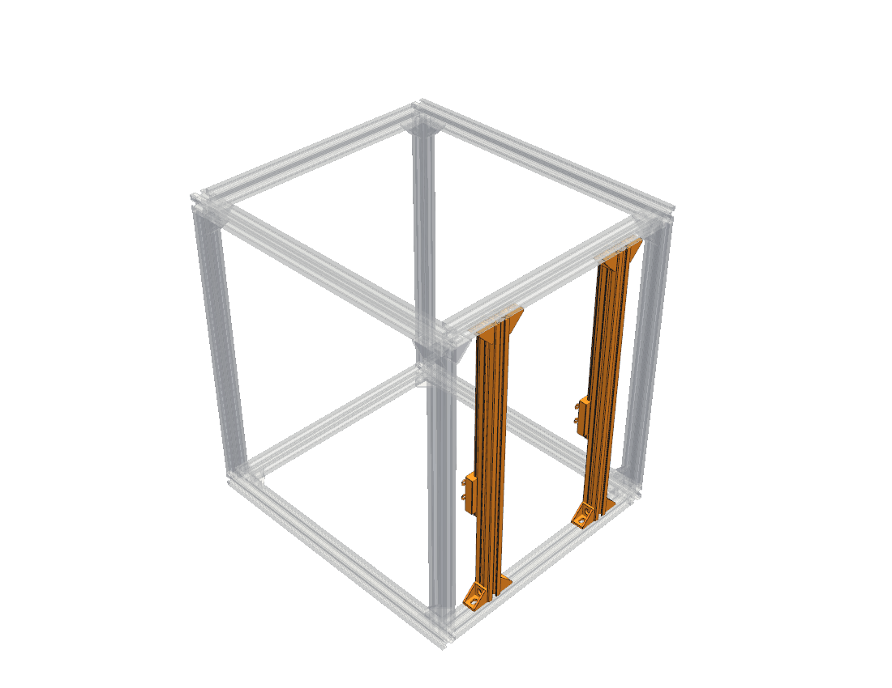

Orange: fitted in this stage. Grey: already there.

| # | Fit | Touches (simulation) | Screws that hold it (count x size, key, direction) | Check before moving on | Sim. step |
|---|---|---|---|---|---|
| 1 | **upright_right** (EXT2020-364) | - | - | ends flush and square to the neighbouring members (set square on two faces) | 1 |
| 2 | **z_rail_right** (MGN12-R-245) | upright_right | 5 x M3x8 cap screw, 2.5 mm key, from the front, pointing back (+Y), into T-nut (z_rail_right_screw_0, z_rail_right_screw_1, z_rail_right_screw_4, z_rail_right_screw_3, z_rail_right_screw_2) | rail lies flat in the slot's faces; leave its screws just nipped until the rail-alignment step for this axis | 2 |
| 3 | **upright_left** (EXT2020-364) | - | - | ends flush and square to the neighbouring members (set square on two faces) | 4 |
| 4 | **z_rail_left** (MGN12-R-245) | upright_left | 5 x M3x8 cap screw, 2.5 mm key, from the front, pointing back (+Y), into T-nut (z_rail_left_screw_0, z_rail_left_screw_1, z_rail_left_screw_4, z_rail_left_screw_3, z_rail_left_screw_2) | rail lies flat in the slot's faces; leave its screws just nipped until the rail-alignment step for this axis | 5 |
| 5 | **z_carriage_right** (MGN12H) | back_plate, z_rail_right | - | the block is slid on without losing balls (keep it on its plastic keeper until the rail is under it); it runs the whole rail by hand with even drag | 18 |
| 6 | **z_carriage_right_screw_3_washer** (WASHER-M3) | back_plate | - | seated flat on back_plate with no gap; all its screws started before any is tightened | 19 |
| 7 | **z_carriage_left** (MGN12H) | back_plate, z_rail_left | - | the block is slid on without losing balls (keep it on its plastic keeper until the rail is under it); it runs the whole rail by hand with even drag | 21 |
| 8 | **z_carriage_left_screw_2_washer** (WASHER-M3) | back_plate | - | seated flat on back_plate with no gap; all its screws started before any is tightened | 22 |
| 9 | **z_carriage_right_screw_2_washer** (WASHER-M3) | back_plate | - | seated flat on back_plate with no gap; all its screws started before any is tightened | 342 |
| 10 | **z_carriage_right_screw_1_washer** (WASHER-M3) | back_plate | - | seated flat on back_plate with no gap; all its screws started before any is tightened | 344 |
| 11 | **z_carriage_right_screw_0_washer** (WASHER-M3) | back_plate | - | seated flat on back_plate with no gap; all its screws started before any is tightened | 346 |
| 12 | **z_carriage_left_screw_3_washer** (WASHER-M3) | back_plate | - | seated flat on back_plate with no gap; all its screws started before any is tightened | 348 |
| 13 | **z_carriage_left_screw_1_washer** (WASHER-M3) | back_plate | - | seated flat on back_plate with no gap; all its screws started before any is tightened | 350 |
| 14 | **z_carriage_left_screw_0_washer** (WASHER-M3) | back_plate | - | seated flat on back_plate with no gap; all its screws started before any is tightened | 352 |
| 15 | **brkt_up_top_out_right** (BRKT-2020) | frame_top_back, upright_right | M5 x 8 cap screw and T-nut in each leg that lies on a T-slot, 4 mm key (BOM only: not drawn, access not checked) | both legs flat on their members; T-nuts turned across the slot before tightening | 384 |
| 16 | **brkt_up_top_out_left** (BRKT-2020) | frame_top_back, upright_left | M5 x 8 cap screw and T-nut in each leg that lies on a T-slot, 4 mm key (BOM only: not drawn, access not checked) | both legs flat on their members; T-nuts turned across the slot before tightening | 385 |
| 17 | **brkt_up_top_in_right** (BRKT-2020) | frame_top_back, upright_right | M5 x 8 cap screw and T-nut in each leg that lies on a T-slot, 4 mm key (BOM only: not drawn, access not checked) | both legs flat on their members; T-nuts turned across the slot before tightening | 386 |
| 18 | **brkt_up_top_in_left** (BRKT-2020) | frame_top_back, upright_left | M5 x 8 cap screw and T-nut in each leg that lies on a T-slot, 4 mm key (BOM only: not drawn, access not checked) | both legs flat on their members; T-nuts turned across the slot before tightening | 387 |
| 19 | **brkt_up_bot_out_right** (BRKT-2020) | frame_bot_back, upright_right | M5 x 8 cap screw and T-nut in each leg that lies on a T-slot, 4 mm key (BOM only: not drawn, access not checked) | both legs flat on their members; T-nuts turned across the slot before tightening | 388 |
| 20 | **brkt_up_bot_out_left** (BRKT-2020) | frame_bot_back, upright_left | M5 x 8 cap screw and T-nut in each leg that lies on a T-slot, 4 mm key (BOM only: not drawn, access not checked) | both legs flat on their members; T-nuts turned across the slot before tightening | 389 |
| 21 | **brkt_up_bot_in_right** (BRKT-2020) | frame_bot_back, upright_right | M5 x 8 cap screw and T-nut in each leg that lies on a T-slot, 4 mm key (BOM only: not drawn, access not checked) | both legs flat on their members; T-nuts turned across the slot before tightening | 390 |
| 22 | **brkt_up_bot_in_left** (BRKT-2020) | frame_bot_back, upright_left | M5 x 8 cap screw and T-nut in each leg that lies on a T-slot, 4 mm key (BOM only: not drawn, access not checked) | both legs flat on their members; T-nuts turned across the slot before tightening | 391 |

Slide each block onto its rail before the rail's far end is closed off by the top back rail. Rail alignment: see 'rail_align (z)' below.
Use clearance-class (ZF) blocks on Z: the three screws hold the carrier's tilt, the blocks only locate it.

### Stage: Y rails and blocks

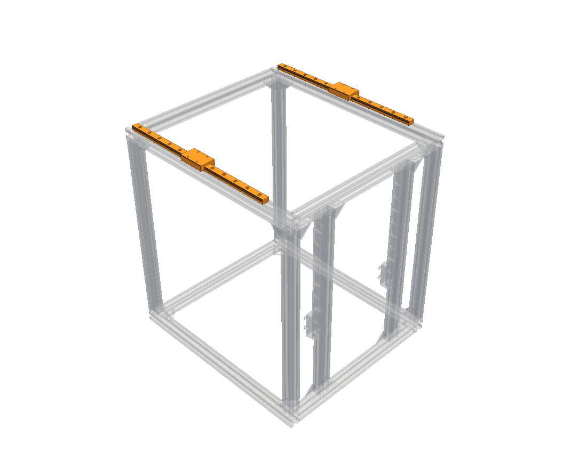

Orange: fitted in this stage. Grey: already there.

| # | Fit | Touches (simulation) | Screws that hold it (count x size, key, direction) | Check before moving on | Sim. step |
|---|---|---|---|---|---|
| 1 | **y_rail_right** (MGN12-R-300) | frame_top_right | 6 x M3x8 cap screw, 2.5 mm key, from above, pointing down (-Z), into T-nut (y_rail_right_screw_3, y_rail_right_screw_5, y_rail_right_screw_4, y_rail_right_screw_2, y_rail_right_screw_1, y_rail_right_screw_0) | rail lies flat in the slot's faces; leave its screws just nipped until the rail-alignment step for this axis | 25 |
| 2 | **y_rail_left** (MGN12-R-300) | frame_top_left | 6 x M3x8 cap screw, 2.5 mm key, from above, pointing down (-Z), into T-nut (y_rail_left_screw_3, y_rail_left_screw_5, y_rail_left_screw_4, y_rail_left_screw_2, y_rail_left_screw_1, y_rail_left_screw_0) | rail lies flat in the slot's faces; leave its screws just nipped until the rail-alignment step for this axis | 28 |
| 3 | **y_carriage_right** (MGN12H) | y_plate_right, y_rail_right | - | the block is slid on without losing balls (keep it on its plastic keeper until the rail is under it); it runs the whole rail by hand with even drag | 41 |
| 4 | **y_carriage_left** (MGN12H) | y_plate_left, y_rail_left | - | the block is slid on without losing balls (keep it on its plastic keeper until the rail is under it); it runs the whole rail by hand with even drag | 42 |

### Stage: Electronics tray, mains inlet, earth

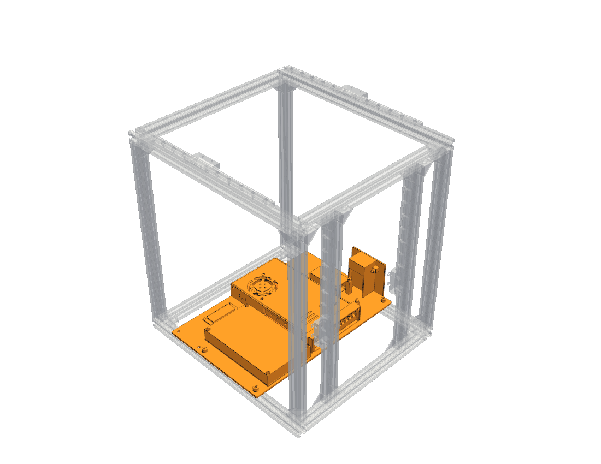

Orange: fitted in this stage. Grey: already there.

| # | Fit | Touches (simulation) | Screws that hold it (count x size, key, direction) | Check before moving on | Sim. step |
|---|---|---|---|---|---|
| 1 | bench unit **electronics** | frame_bot_left, frame_bot_right | - | the bench unit is complete (its own table above); it sits flat on what it bolts to before any screw is tightened | 43 |
| 2 | **tray_bolt_3_washer** (WASHER-M5) | electronics_tray | 1 x M5x10 cap screw, 4 mm key, from above, pointing down (-Z), into T-nut (tray_bolt_3) | seated flat on electronics_tray with no gap; all its screws started before any is tightened | 159 |
| 3 | **tray_bolt_2_washer** (WASHER-M5) | electronics_tray | 1 x M5x10 cap screw, 4 mm key, from above, pointing down (-Z), into T-nut (tray_bolt_2) | seated flat on electronics_tray with no gap; all its screws started before any is tightened | 161 |
| 4 | **tray_bolt_1_washer** (WASHER-M5) | electronics_tray | 1 x M5x10 cap screw, 4 mm key, from above, pointing down (-Z), into T-nut (tray_bolt_1) | seated flat on electronics_tray with no gap; all its screws started before any is tightened | 163 |
| 5 | **tray_bolt_0_washer** (WASHER-M5) | electronics_tray | 1 x M5x10 cap screw, 4 mm key, from above, pointing down (-Z), into T-nut (tray_bolt_0) | seated flat on electronics_tray with no gap; all its screws started before any is tightened | 165 |
| 6 | **inlet_panel** (custom) | electronics_tray, frame_bot_left | - | seated flat on electronics_tray, frame_bot_left with no gap; all its screws started before any is tightened | 171 |
| 7 | **inlet_panel_bolt_1_washer** (WASHER-M5) | inlet_panel | 1 x M5x10 cap screw, 4 mm key, from the left, pointing right (+X), into T-nut (inlet_panel_bolt_1) | seated flat on inlet_panel with no gap; all its screws started before any is tightened | 172 |
| 8 | **inlet_panel_bolt_0_washer** (WASHER-M5) | inlet_panel | 1 x M5x10 cap screw, 4 mm key, from the left, pointing right (+X), into T-nut (inlet_panel_bolt_0) | seated flat on inlet_panel with no gap; all its screws started before any is tightened | 174 |
| 9 | **mains_cover_inlet** (custom) | inlet_panel | - | seated flat on inlet_panel with no gap; all its screws started before any is tightened | 255 |
| 10 | **mains_cover_inlet_screw_1_nut** (NUT-M3-NYLOC) | mains_cover_inlet | - | seated flat on mains_cover_inlet with no gap; all its screws started before any is tightened | 256 |
| 11 | **mains_cover_inlet_screw_1_washer** (WASHER-M3) | inlet_panel | - | seated flat on inlet_panel with no gap; all its screws started before any is tightened | 257 |
| 12 | **mains_cover_inlet_screw_1_nwasher** (WASHER-M3) | mains_cover_inlet, mains_cover_inlet_screw_1_nut | 1 x M3x20 cap screw, 2.5 mm key, from the left, pointing right (+X) (mains_cover_inlet_screw_1) | seated flat on mains_cover_inlet, mains_cover_inlet_screw_1_nut with no gap; all its screws started before any is tightened | 258 |
| 13 | **mains_cover_inlet_screw_0_nut** (NUT-M3-NYLOC) | mains_cover_inlet | - | seated flat on mains_cover_inlet with no gap; all its screws started before any is tightened | 260 |
| 14 | **mains_cover_inlet_screw_0_washer** (WASHER-M3) | inlet_panel | - | seated flat on inlet_panel with no gap; all its screws started before any is tightened | 261 |
| 15 | **mains_cover_inlet_screw_0_nwasher** (WASHER-M3) | mains_cover_inlet, mains_cover_inlet_screw_0_nut | 1 x M3x20 cap screw, 2.5 mm key, from the left, pointing right (+X) (mains_cover_inlet_screw_0) | seated flat on mains_cover_inlet, mains_cover_inlet_screw_0_nut with no gap; all its screws started before any is tightened | 262 |
| 16 | **inlet** (INLET-C14-SW-FUSE-T8A) | inlet_panel | - | seated flat on inlet_panel with no gap; all its screws started before any is tightened | 320 |
| 17 | **inlet_washer_1** (WASHER-M3) | inlet_panel | - | seated flat on inlet_panel with no gap; all its screws started before any is tightened | 321 |
| 18 | **inlet_nut_1** (NUT-M3) | inlet_panel, inlet_washer_1 | 1 x M3x10 cap screw, 2.5 mm key, from the left, pointing right (+X) (inlet_screw_1) | seated flat on inlet_panel, inlet_washer_1 with no gap; all its screws started before any is tightened | 322 |
| 19 | **inlet_washer_0** (WASHER-M3) | inlet_panel | - | seated flat on inlet_panel with no gap; all its screws started before any is tightened | 324 |
| 20 | **inlet_nut_0** (NUT-M3) | inlet_panel, inlet_washer_0 | 1 x M3x10 cap screw, 2.5 mm key, from the left, pointing right (+X) (inlet_screw_0) | seated flat on inlet_panel, inlet_washer_0 with no gap; all its screws started before any is tightened | 325 |

Also in this stage, into parts fitted earlier: 1 x M5x10 cap screw, 4 mm key, from the left, pointing right (+X), into T-nut (earth_stud).

### Stage: Z drive: screws and motors (with their supports, pulleys and belt where the design has them)

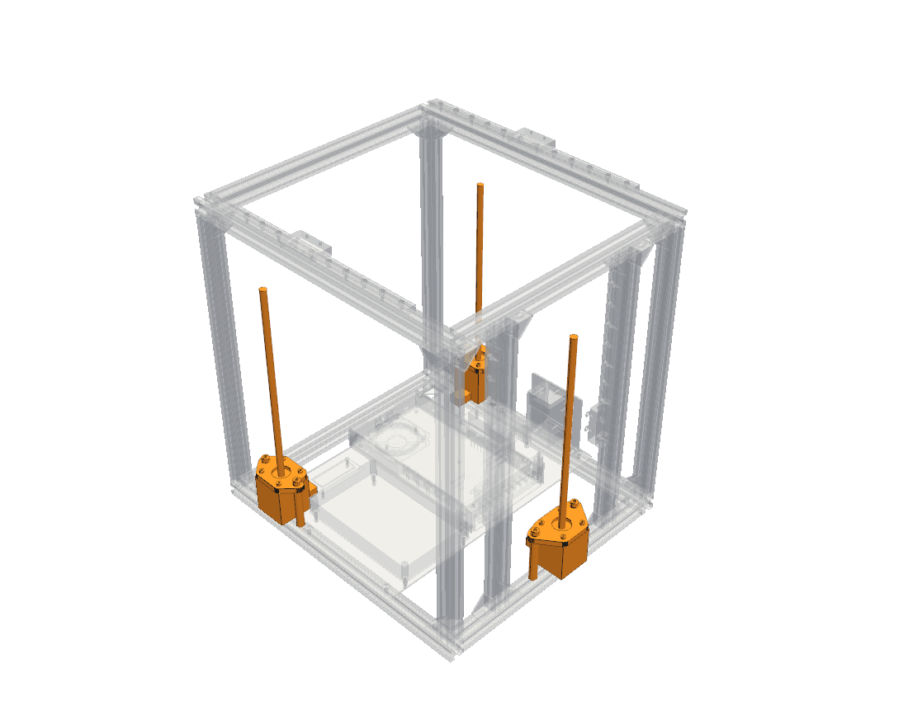

Orange: fitted in this stage. Grey: already there.

| # | Fit | Touches (simulation) | Screws that hold it (count x size, key, direction) | Check before moving on | Sim. step |
|---|---|---|---|---|---|
| 1 | bench unit **z_drive_rear** | z_nut | - | the bench unit is complete (its own table above); it sits flat on what it bolts to before any screw is tightened | 34 |
| 2 | **z_mount_fr_spacer_1** (SPACER-AL-M5-10x5.1x54.825) | electronics_tray | - | seated flat on electronics_tray with no gap; all its screws started before any is tightened | 44 |
| 3 | bench unit **z_drive_fr** | z_mount_fr_spacer_1 | - | the bench unit is complete (its own table above); it sits flat on what it bolts to before any screw is tightened | 45 |
| 4 | **z_mount_fl_spacer_1** (SPACER-AL-M5-10x5.1x54.825) | electronics_tray | - | seated flat on electronics_tray with no gap; all its screws started before any is tightened | 48 |
| 5 | bench unit **z_drive_fl** | z_mount_fl_spacer_1 | - | the bench unit is complete (its own table above); it sits flat on what it bolts to before any screw is tightened | 49 |
| 6 | **z_mount_rear_spacer_1** (SPACER-AL-M5-10x5.1x58) | frame_bot_back, z_motor_plate | - | seated flat on frame_bot_back, z_motor_plate with no gap; all its screws started before any is tightened | 52 |
| 7 | **z_mount_rear_bolt_1_washer** (WASHER-M5) | z_motor_plate | 1 x M5x70 cap screw, 4 mm key, from above, pointing down (-Z), into T-nut (z_mount_rear_bolt_1) | seated flat on z_motor_plate with no gap; all its screws started before any is tightened | 53 |
| 8 | **z_mount_rear_spacer_0** (SPACER-AL-M5-10x5.1x58) | frame_bot_back, z_motor_plate | - | seated flat on frame_bot_back, z_motor_plate with no gap; all its screws started before any is tightened | 55 |
| 9 | **z_mount_rear_bolt_0_washer** (WASHER-M5) | z_motor_plate | 1 x M5x70 cap screw, 4 mm key, from above, pointing down (-Z), into T-nut (z_mount_rear_bolt_0) | seated flat on z_motor_plate with no gap; all its screws started before any is tightened | 56 |
| 10 | **z_mount_fr_bolt_1_washer** (WASHER-M5) | z_motor_plate_fr | 1 x M5x70 cap screw, 4 mm key, from above, pointing down (-Z), into T-nut (z_mount_fr_bolt_1) | seated flat on z_motor_plate_fr with no gap; all its screws started before any is tightened | 58 |
| 11 | **z_mount_fr_spacer_0** (SPACER-AL-M5-10x5.1x54.825) | electronics_tray, z_motor_plate_fr | - | seated flat on electronics_tray, z_motor_plate_fr with no gap; all its screws started before any is tightened | 60 |
| 12 | **z_mount_fr_bolt_0_washer** (WASHER-M5) | z_motor_plate_fr | 1 x M5x70 cap screw, 4 mm key, from above, pointing down (-Z), into T-nut (z_mount_fr_bolt_0) | seated flat on z_motor_plate_fr with no gap; all its screws started before any is tightened | 61 |
| 13 | **z_mount_fl_bolt_1_washer** (WASHER-M5) | z_motor_plate_fl | 1 x M5x70 cap screw, 4 mm key, from above, pointing down (-Z), into T-nut (z_mount_fl_bolt_1) | seated flat on z_motor_plate_fl with no gap; all its screws started before any is tightened | 63 |
| 14 | **z_mount_fl_spacer_0** (SPACER-AL-M5-10x5.1x54.825) | electronics_tray, z_motor_plate_fl | - | seated flat on electronics_tray, z_motor_plate_fl with no gap; all its screws started before any is tightened | 65 |
| 15 | **z_mount_fl_bolt_0_washer** (WASHER-M5) | z_motor_plate_fl | 1 x M5x70 cap screw, 4 mm key, from above, pointing down (-Z), into T-nut (z_mount_fl_bolt_0) | seated flat on z_motor_plate_fl with no gap; all its screws started before any is tightened | 66 |

Cut each lead-screw motor's screw to 252 mm above the motor face (hacksaw, file a 0.5 mm chamfer, run the nut over the cut end) before fitting. Each motor is a bench unit: motor under its plate, pilot in the plate's 22.3 mm hole, four M3 x 10 from above with medium thread locker (they reach 3.65 mm into the motor's 4.5 mm threads: do not substitute longer screws). Stand the two spacers on the rail (rear) or the tray over the rail (front), the unit on them, the M5 x 70 post bolts with washers into the T-nuts, thread locker. The screw must turn freely by hand, and its top end is free: no bearing.

### Stage: Bed carrier onto its blocks and nuts

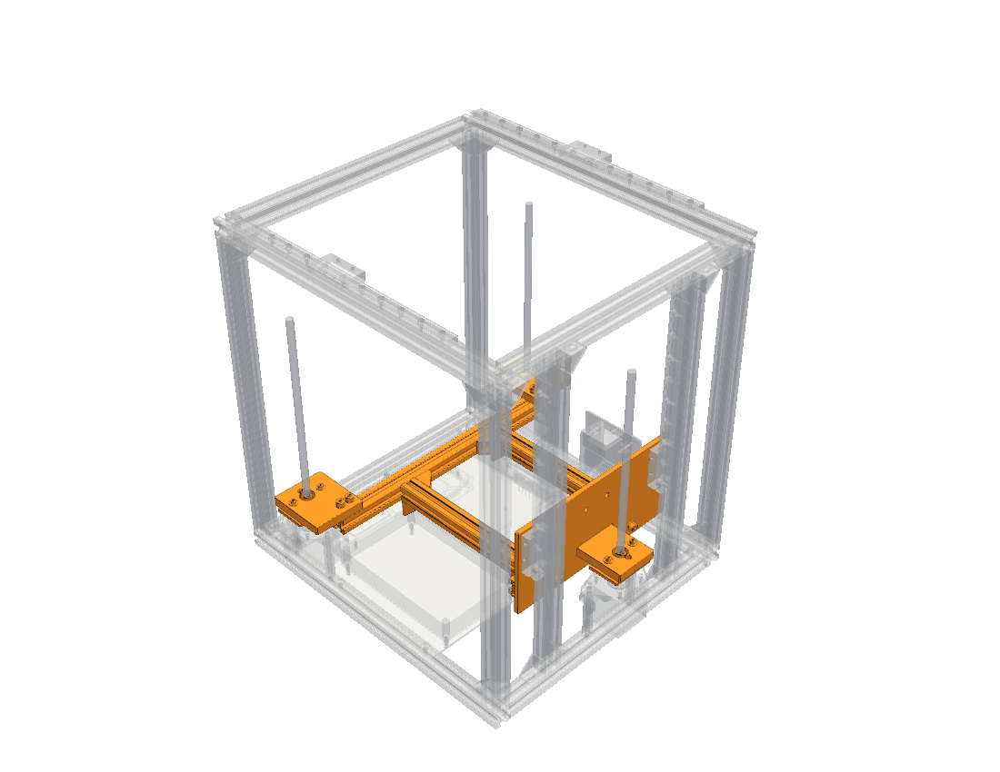

Orange: fitted in this stage. Grey: already there.

| # | Fit | Touches (simulation) | Screws that hold it (count x size, key, direction) | Check before moving on | Sim. step |
|---|---|---|---|---|---|
| 1 | **back_plate** (custom) | - | 8 x M3x8 cap screw, 2.5 mm key, from the front, pointing back (+Y) (z_carriage_right_screw_3, z_carriage_left_screw_2, z_carriage_right_screw_2, z_carriage_right_screw_1, z_carriage_right_screw_0, z_carriage_left_screw_3 ...) | seated flat on its seat with no gap; all its screws started before any is tightened | 7 |
| 2 | **rear_beam** (EXT2020-190) | back_plate | - | ends flush and square to the neighbouring members (set square on two faces) | 8 |
| 3 | **nut_plate** (custom) | back_plate, rear_beam | - | seated flat on back_plate, rear_beam with no gap; all its screws started before any is tightened | 9 |
| 4 | **nut_plate_bolt_1_washer** (WASHER-M5) | nut_plate | 1 x M5x16 cap screw, 4 mm key, from above, pointing down (-Z), into T-nut (nut_plate_bolt_1) | seated flat on nut_plate with no gap; all its screws started before any is tightened | 10 |
| 5 | **nut_plate_bolt_0_washer** (WASHER-M5) | nut_plate | 1 x M5x16 cap screw, 4 mm key, from above, pointing down (-Z), into T-nut (nut_plate_bolt_0) | seated flat on nut_plate with no gap; all its screws started before any is tightened | 12 |
| 6 | **rear_beam_bolt_1_washer** (WASHER-M5) | back_plate | 1 x M5x10 cap screw, 4 mm key, from the back, pointing forward (-Y), into T-nut (rear_beam_bolt_1) | seated flat on back_plate with no gap; all its screws started before any is tightened | 14 |
| 7 | **z_nut** (T8-NUT) | nut_plate | - | seated flat on nut_plate with no gap; all its screws started before any is tightened | 32 |
| 8 | **nut_keeper** (custom) | z_nut | - | seated flat on z_nut with no gap; all its screws started before any is tightened | 33 |
| 9 | **nut_keeper_fr** (custom) | - | - | seated flat on its seat with no gap; all its screws started before any is tightened | 46 |
| 10 | **z_nut_fr** (T8-NUT) | leadscrew_fr, nut_keeper_fr | - | seated flat on leadscrew_fr, nut_keeper_fr with no gap; all its screws started before any is tightened | 47 |
| 11 | **nut_keeper_fl** (custom) | - | - | seated flat on its seat with no gap; all its screws started before any is tightened | 50 |
| 12 | **z_nut_fl** (T8-NUT) | leadscrew_fl, nut_keeper_fl | - | seated flat on leadscrew_fl, nut_keeper_fl with no gap; all its screws started before any is tightened | 51 |
| 13 | **nut_plate_fr** (custom) | z_nut_fr | - | seated flat on z_nut_fr with no gap; all its screws started before any is tightened | 82 |
| 14 | **front_beam** (EXT2020-304) | nut_plate_fr | - | ends flush and square to the neighbouring members (set square on two faces) | 83 |
| 15 | **nut_plate_fr_bolt_1_washer** (WASHER-M5) | nut_plate_fr | 1 x M5x16 cap screw, 4 mm key, from above, pointing down (-Z), into T-nut (nut_plate_fr_bolt_1) | seated flat on nut_plate_fr with no gap; all its screws started before any is tightened | 84 |
| 16 | **nut_plate_fr_bolt_0_washer** (WASHER-M5) | nut_plate_fr | 1 x M5x16 cap screw, 4 mm key, from above, pointing down (-Z), into T-nut (nut_plate_fr_bolt_0) | seated flat on nut_plate_fr with no gap; all its screws started before any is tightened | 86 |
| 17 | **nut_plate_fl** (custom) | front_beam, z_nut_fl | - | seated flat on front_beam, z_nut_fl with no gap; all its screws started before any is tightened | 88 |
| 18 | **nut_plate_fl_bolt_1_washer** (WASHER-M5) | nut_plate_fl | 1 x M5x16 cap screw, 4 mm key, from above, pointing down (-Z), into T-nut (nut_plate_fl_bolt_1) | seated flat on nut_plate_fl with no gap; all its screws started before any is tightened | 89 |
| 19 | **nut_plate_fl_bolt_0_washer** (WASHER-M5) | nut_plate_fl | 1 x M5x16 cap screw, 4 mm key, from above, pointing down (-Z), into T-nut (nut_plate_fl_bolt_0) | seated flat on nut_plate_fl with no gap; all its screws started before any is tightened | 91 |
| 20 | **rear_beam_bolt_2_washer** (WASHER-M5) | back_plate | 1 x M5x10 cap screw, 4 mm key, from the back, pointing forward (-Y), into T-nut (rear_beam_bolt_2) | seated flat on back_plate with no gap; all its screws started before any is tightened | 167 |
| 21 | **rear_beam_bolt_0_washer** (WASHER-M5) | back_plate | 1 x M5x10 cap screw, 4 mm key, from the back, pointing forward (-Y), into T-nut (rear_beam_bolt_0) | seated flat on back_plate with no gap; all its screws started before any is tightened | 169 |
| 22 | **bed_arm_right** (EXT2020-177) | bed_post_tab_1, bed_post_tab_3, front_beam | - | ends flush and square to the neighbouring members (set square on two faces) | 179 |
| 23 | **bed_arm_left** (EXT2020-177) | bed_post_tab_0, bed_post_tab_2, front_beam | - | ends flush and square to the neighbouring members (set square on two faces) | 186 |
| 24 | **nut_keeper_fr_spacer_1** (SPACER-AL-M3-6x3.2x3.6) | nut_keeper_fr, nut_plate_fr | - | seated flat on nut_keeper_fr, nut_plate_fr with no gap; all its screws started before any is tightened | 225 |
| 25 | **nut_keeper_fr_bolt_1_nut** (NUT-M3) | nut_keeper_fr | - | seated flat on nut_keeper_fr with no gap; all its screws started before any is tightened | 226 |
| 26 | **nut_keeper_fr_bolt_1_washer** (WASHER-M3-LARGE) | nut_plate_fr | - | seated flat on nut_plate_fr with no gap; all its screws started before any is tightened | 227 |
| 27 | **nut_keeper_fr_bolt_1_nwasher** (WASHER-M3-LARGE) | nut_keeper_fr, nut_keeper_fr_bolt_1_nut | 1 x M3x25 cap screw, 2.5 mm key, from above, pointing down (-Z) (nut_keeper_fr_bolt_1) | seated flat on nut_keeper_fr, nut_keeper_fr_bolt_1_nut with no gap; all its screws started before any is tightened | 228 |
| 28 | **nut_keeper_fr_spacer_0** (SPACER-AL-M3-6x3.2x3.6) | nut_keeper_fr, nut_plate_fr | - | seated flat on nut_keeper_fr, nut_plate_fr with no gap; all its screws started before any is tightened | 230 |
| 29 | **nut_keeper_fr_bolt_0_nut** (NUT-M3) | nut_keeper_fr | - | seated flat on nut_keeper_fr with no gap; all its screws started before any is tightened | 231 |
| 30 | **nut_keeper_fr_bolt_0_washer** (WASHER-M3-LARGE) | nut_plate_fr | - | seated flat on nut_plate_fr with no gap; all its screws started before any is tightened | 232 |
| 31 | **nut_keeper_fr_bolt_0_nwasher** (WASHER-M3-LARGE) | nut_keeper_fr, nut_keeper_fr_bolt_0_nut | 1 x M3x25 cap screw, 2.5 mm key, from above, pointing down (-Z) (nut_keeper_fr_bolt_0) | seated flat on nut_keeper_fr, nut_keeper_fr_bolt_0_nut with no gap; all its screws started before any is tightened | 233 |
| 32 | **nut_keeper_fl_spacer_1** (SPACER-AL-M3-6x3.2x3.6) | nut_keeper_fl, nut_plate_fl | - | seated flat on nut_keeper_fl, nut_plate_fl with no gap; all its screws started before any is tightened | 235 |
| 33 | **nut_keeper_fl_bolt_1_nut** (NUT-M3) | nut_keeper_fl | - | seated flat on nut_keeper_fl with no gap; all its screws started before any is tightened | 236 |
| 34 | **nut_keeper_fl_bolt_1_washer** (WASHER-M3-LARGE) | nut_plate_fl | - | seated flat on nut_plate_fl with no gap; all its screws started before any is tightened | 237 |
| 35 | **nut_keeper_fl_bolt_1_nwasher** (WASHER-M3-LARGE) | nut_keeper_fl, nut_keeper_fl_bolt_1_nut | 1 x M3x25 cap screw, 2.5 mm key, from above, pointing down (-Z) (nut_keeper_fl_bolt_1) | seated flat on nut_keeper_fl, nut_keeper_fl_bolt_1_nut with no gap; all its screws started before any is tightened | 238 |
| 36 | **nut_keeper_fl_spacer_0** (SPACER-AL-M3-6x3.2x3.6) | nut_keeper_fl, nut_plate_fl | - | seated flat on nut_keeper_fl, nut_plate_fl with no gap; all its screws started before any is tightened | 240 |
| 37 | **nut_keeper_fl_bolt_0_nut** (NUT-M3) | nut_keeper_fl | - | seated flat on nut_keeper_fl with no gap; all its screws started before any is tightened | 241 |
| 38 | **nut_keeper_fl_bolt_0_washer** (WASHER-M3-LARGE) | nut_plate_fl | - | seated flat on nut_plate_fl with no gap; all its screws started before any is tightened | 242 |
| 39 | **nut_keeper_fl_bolt_0_nwasher** (WASHER-M3-LARGE) | nut_keeper_fl, nut_keeper_fl_bolt_0_nut | 1 x M3x25 cap screw, 2.5 mm key, from above, pointing down (-Z) (nut_keeper_fl_bolt_0) | seated flat on nut_keeper_fl, nut_keeper_fl_bolt_0_nut with no gap; all its screws started before any is tightened | 243 |
| 40 | **nut_keeper_spacer_1** (SPACER-AL-M3-6x3.2x3.6) | nut_keeper, nut_plate | - | seated flat on nut_keeper, nut_plate with no gap; all its screws started before any is tightened | 245 |
| 41 | **nut_keeper_bolt_1_nut** (NUT-M3) | nut_keeper | - | seated flat on nut_keeper with no gap; all its screws started before any is tightened | 246 |
| 42 | **nut_keeper_bolt_1_washer** (WASHER-M3-LARGE) | nut_plate | - | seated flat on nut_plate with no gap; all its screws started before any is tightened | 247 |
| 43 | **nut_keeper_bolt_1_nwasher** (WASHER-M3-LARGE) | nut_keeper, nut_keeper_bolt_1_nut | 1 x M3x25 cap screw, 2.5 mm key, from above, pointing down (-Z) (nut_keeper_bolt_1) | seated flat on nut_keeper, nut_keeper_bolt_1_nut with no gap; all its screws started before any is tightened | 248 |
| 44 | **nut_keeper_spacer_0** (SPACER-AL-M3-6x3.2x3.6) | nut_keeper, nut_plate | - | seated flat on nut_keeper, nut_plate with no gap; all its screws started before any is tightened | 250 |
| 45 | **nut_keeper_bolt_0_nut** (NUT-M3) | nut_keeper | - | seated flat on nut_keeper with no gap; all its screws started before any is tightened | 251 |
| 46 | **nut_keeper_bolt_0_washer** (WASHER-M3-LARGE) | nut_plate | - | seated flat on nut_plate with no gap; all its screws started before any is tightened | 252 |
| 47 | **nut_keeper_bolt_0_nwasher** (WASHER-M3-LARGE) | nut_keeper, nut_keeper_bolt_0_nut | 1 x M3x25 cap screw, 2.5 mm key, from above, pointing down (-Z) (nut_keeper_bolt_0) | seated flat on nut_keeper, nut_keeper_bolt_0_nut with no gap; all its screws started before any is tightened | 253 |
| 48 | **nut_pin_fr_sleeve** (SPACER-AL-M2.5-5x2.7x9.725) | z_nut_fr | - | seated flat on z_nut_fr with no gap; all its screws started before any is tightened | 327 |
| 49 | **nut_pin_fr_nut** (NUT-M2.5) | z_nut_fr | 1 x M2.5x18 cap screw, 2 mm key, from above, pointing down (-Z) (nut_pin_fr) | seated flat on z_nut_fr with no gap; all its screws started before any is tightened | 328 |
| 50 | **nut_pin_fl_sleeve** (SPACER-AL-M2.5-5x2.7x9.725) | z_nut_fl | - | seated flat on z_nut_fl with no gap; all its screws started before any is tightened | 330 |
| 51 | **nut_pin_fl_nut** (NUT-M2.5) | z_nut_fl | 1 x M2.5x18 cap screw, 2 mm key, from above, pointing down (-Z) (nut_pin_fl) | seated flat on z_nut_fl with no gap; all its screws started before any is tightened | 331 |
| 52 | **nut_pin_sleeve** (SPACER-AL-M2.5-5x2.7x9.725) | z_nut | - | seated flat on z_nut with no gap; all its screws started before any is tightened | 333 |
| 53 | **nut_pin_nut** (NUT-M2.5) | z_nut | 1 x M2.5x18 cap screw, 2 mm key, from above, pointing down (-Z) (nut_pin) | seated flat on z_nut with no gap; all its screws started before any is tightened | 334 |
| 54 | **bed_arm_right_rbracket_u** (BRKT-2020) | bed_arm_right, rear_beam | M5 x 8 cap screw and T-nut in each leg that lies on a T-slot, 4 mm key (BOM only: not drawn, access not checked) | both legs flat on their members; T-nuts turned across the slot before tightening | 408 |
| 55 | **bed_arm_right_rbracket_i** (BRKT-2020) | bed_arm_right, rear_beam | M5 x 8 cap screw and T-nut in each leg that lies on a T-slot, 4 mm key (BOM only: not drawn, access not checked) | both legs flat on their members; T-nuts turned across the slot before tightening | 409 |
| 56 | **bed_arm_right_fbracket_u** (BRKT-2020) | bed_arm_right, front_beam | M5 x 8 cap screw and T-nut in each leg that lies on a T-slot, 4 mm key (BOM only: not drawn, access not checked) | both legs flat on their members; T-nuts turned across the slot before tightening | 410 |
| 57 | **bed_arm_right_fbracket_i** (BRKT-2020) | bed_arm_right, front_beam | M5 x 8 cap screw and T-nut in each leg that lies on a T-slot, 4 mm key (BOM only: not drawn, access not checked) | both legs flat on their members; T-nuts turned across the slot before tightening | 411 |
| 58 | **bed_arm_left_rbracket_u** (BRKT-2020) | bed_arm_left, rear_beam | M5 x 8 cap screw and T-nut in each leg that lies on a T-slot, 4 mm key (BOM only: not drawn, access not checked) | both legs flat on their members; T-nuts turned across the slot before tightening | 412 |
| 59 | **bed_arm_left_rbracket_i** (BRKT-2020) | bed_arm_left, rear_beam | M5 x 8 cap screw and T-nut in each leg that lies on a T-slot, 4 mm key (BOM only: not drawn, access not checked) | both legs flat on their members; T-nuts turned across the slot before tightening | 413 |
| 60 | **bed_arm_left_fbracket_u** (BRKT-2020) | bed_arm_left, front_beam | M5 x 8 cap screw and T-nut in each leg that lies on a T-slot, 4 mm key (BOM only: not drawn, access not checked) | both legs flat on their members; T-nuts turned across the slot before tightening | 414 |
| 61 | **bed_arm_left_fbracket_i** (BRKT-2020) | bed_arm_left, front_beam | M5 x 8 cap screw and T-nut in each leg that lies on a T-slot, 4 mm key (BOM only: not drawn, access not checked) | both legs flat on their members; T-nuts turned across the slot before tightening | 415 |

Build the 2020 rectangle on a flat table: cast brackets on T-nuts in both legs, inboard corner and under each arm. Bolt the three nut plates on the beams' top slots. Each T8 nut: flange under its plate, barrel up through the float hole, pin (M2.5 through the 5 mm sleeve, nylon-insert nut), then the keeper under the flange on its two M3 bolts and 3.6 mm spacers (0.1 mm play: the nut must slide sideways by hand). Turn the three motors by hand (or drive them together) until the nuts sit at the same height, lower the carrier onto the screws, bolt the back plate to the two Z blocks. Check: the carrier runs the full travel without binding; then Z_TILT_ADJUST.

### Stage: Bed: tabs, posts, plate, tie, heater, magnet, sheet

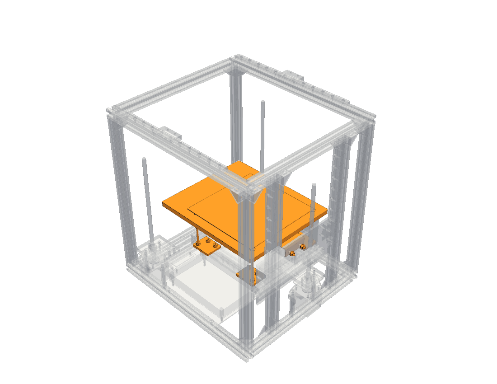

Orange: fitted in this stage. Grey: already there.

| # | Fit | Touches (simulation) | Screws that hold it (count x size, key, direction) | Check before moving on | Sim. step |
|---|---|---|---|---|---|
| 1 | **bed_magnet** (BED-MAGNET-PEI180-BASE-STANDIN) | - | - | seated flat on its seat with no gap; all its screws started before any is tightened | 30 |
| 2 | bench unit **bed_unit** | back_plate, bed_magnet | - | the bench unit is complete (its own table above); it sits flat on what it bolts to before any screw is tightened | 31 |
| 3 | **bed_tie_bolt_1_nut** (NUT-M5) | back_plate | - | seated flat on back_plate with no gap; all its screws started before any is tightened | 93 |
| 4 | **bed_tie_bolt_1_washer** (WASHER-M5) | bed_tie | - | seated flat on bed_tie with no gap; all its screws started before any is tightened | 94 |
| 5 | **bed_tie_bolt_1_nwasher** (WASHER-M5) | back_plate, bed_tie_bolt_1_nut | 1 x M5x16 cap screw, 4 mm key, from the front, pointing back (+Y) (bed_tie_bolt_1) | seated flat on back_plate, bed_tie_bolt_1_nut with no gap; all its screws started before any is tightened | 95 |
| 6 | **bed_tie_bolt_0_nut** (NUT-M5) | back_plate | - | seated flat on back_plate with no gap; all its screws started before any is tightened | 97 |
| 7 | **bed_tie_bolt_0_washer** (WASHER-M5) | bed_tie | - | seated flat on bed_tie with no gap; all its screws started before any is tightened | 98 |
| 8 | **bed_tie_bolt_0_nwasher** (WASHER-M5) | back_plate, bed_tie_bolt_0_nut | 1 x M5x16 cap screw, 4 mm key, from the front, pointing back (+Y) (bed_tie_bolt_0) | seated flat on back_plate, bed_tie_bolt_0_nut with no gap; all its screws started before any is tightened | 99 |
| 9 | **bed_post_tab_3** (custom) | bed_plate, bed_post_3_washer_arm | - | seated flat on bed_plate, bed_post_3_washer_arm with no gap; all its screws started before any is tightened | 177 |
| 10 | **bed_post_tab_1** (custom) | bed_plate, bed_post_1_washer_arm | - | seated flat on bed_plate, bed_post_1_washer_arm with no gap; all its screws started before any is tightened | 178 |
| 11 | **bed_post_tab_3_bolt_1_washer** (WASHER-M5) | bed_post_tab_3 | 1 x M5x10 cap screw, 4 mm key, from above, pointing down (-Z), into T-nut (bed_post_tab_3_bolt_1) | seated flat on bed_post_tab_3 with no gap; all its screws started before any is tightened | 180 |
| 12 | **bed_post_tab_3_bolt_0_washer** (WASHER-M5) | bed_post_tab_3 | 1 x M5x10 cap screw, 4 mm key, from above, pointing down (-Z), into T-nut (bed_post_tab_3_bolt_0) | seated flat on bed_post_tab_3 with no gap; all its screws started before any is tightened | 182 |
| 13 | **bed_post_tab_2** (custom) | bed_plate, bed_post_2_washer_arm | - | seated flat on bed_plate, bed_post_2_washer_arm with no gap; all its screws started before any is tightened | 184 |
| 14 | **bed_post_tab_0** (custom) | bed_plate, bed_post_0_washer_arm | - | seated flat on bed_plate, bed_post_0_washer_arm with no gap; all its screws started before any is tightened | 185 |
| 15 | **bed_post_tab_2_bolt_1_washer** (WASHER-M5) | bed_post_tab_2 | 1 x M5x10 cap screw, 4 mm key, from above, pointing down (-Z), into T-nut (bed_post_tab_2_bolt_1) | seated flat on bed_post_tab_2 with no gap; all its screws started before any is tightened | 187 |
| 16 | **bed_post_tab_2_bolt_0_washer** (WASHER-M5) | bed_post_tab_2 | 1 x M5x10 cap screw, 4 mm key, from above, pointing down (-Z), into T-nut (bed_post_tab_2_bolt_0) | seated flat on bed_post_tab_2 with no gap; all its screws started before any is tightened | 189 |
| 17 | **bed_post_tab_1_bolt_1_washer** (WASHER-M5) | bed_post_tab_1 | 1 x M5x10 cap screw, 4 mm key, from above, pointing down (-Z), into T-nut (bed_post_tab_1_bolt_1) | seated flat on bed_post_tab_1 with no gap; all its screws started before any is tightened | 191 |
| 18 | **bed_post_tab_1_bolt_0_washer** (WASHER-M5) | bed_post_tab_1 | 1 x M5x10 cap screw, 4 mm key, from above, pointing down (-Z), into T-nut (bed_post_tab_1_bolt_0) | seated flat on bed_post_tab_1 with no gap; all its screws started before any is tightened | 193 |
| 19 | **bed_post_tab_0_bolt_1_washer** (WASHER-M5) | bed_post_tab_0 | 1 x M5x10 cap screw, 4 mm key, from above, pointing down (-Z), into T-nut (bed_post_tab_0_bolt_1) | seated flat on bed_post_tab_0 with no gap; all its screws started before any is tightened | 195 |
| 20 | **bed_post_tab_0_bolt_0_washer** (WASHER-M5) | bed_post_tab_0 | 1 x M5x10 cap screw, 4 mm key, from above, pointing down (-Z), into T-nut (bed_post_tab_0_bolt_0) | seated flat on bed_post_tab_0 with no gap; all its screws started before any is tightened | 197 |
| 21 | **bed** (SHEET-PEI-TRONXY-180) | bed_magnet | - | seated flat on bed_magnet with no gap; all its screws started before any is tightened | 380 |
| 22 | **bed_post_3_washer_low** (WASHER-M5) | bed_post_3, bed_post_tab_3 | - | seated flat on bed_post_3, bed_post_tab_3 with no gap; all its screws started before any is tightened | 417 |
| 23 | **bed_post_3_nut_low** (NUT-M5) | bed_post_3, bed_post_3_washer_low | - | seated flat on bed_post_3, bed_post_3_washer_low with no gap; all its screws started before any is tightened | 418 |
| 24 | **bed_post_2_washer_low** (WASHER-M5) | bed_post_2, bed_post_tab_2 | - | seated flat on bed_post_2, bed_post_tab_2 with no gap; all its screws started before any is tightened | 419 |
| 25 | **bed_post_2_nut_low** (NUT-M5) | bed_post_2, bed_post_2_washer_low | - | seated flat on bed_post_2, bed_post_2_washer_low with no gap; all its screws started before any is tightened | 420 |
| 26 | **bed_post_1_washer_low** (WASHER-M5) | bed_post_1, bed_post_tab_1 | - | seated flat on bed_post_1, bed_post_tab_1 with no gap; all its screws started before any is tightened | 421 |
| 27 | **bed_post_1_nut_low** (NUT-M5) | bed_post_1, bed_post_1_washer_low | - | seated flat on bed_post_1, bed_post_1_washer_low with no gap; all its screws started before any is tightened | 422 |
| 28 | **bed_post_0_washer_low** (WASHER-M5) | bed_post_0, bed_post_tab_0 | - | seated flat on bed_post_0, bed_post_tab_0 with no gap; all its screws started before any is tightened | 423 |
| 29 | **bed_post_0_nut_low** (NUT-M5) | bed_post_0, bed_post_0_washer_low | - | seated flat on bed_post_0, bed_post_0_washer_low with no gap; all its screws started before any is tightened | 424 |

No tapping in the bed plate (v8.2). Countersink the six holes from the top face if SendCutSend did not (90 degrees to 11.2 mm). Then: each post's coupling nut on its rod (9 mm of thread), the M5 x 16 countersunk screw from the top through plate and washer into the coupling nut with medium thread locker; heater pad and thermal cut-off under the plate; plate onto the tabs; tie (two M5 x 30 countersunk screws through plate, spacers and tie into washers and nyloc nuts); tram (adjustment section); THEN the PEI180's magnetic base and the sheet.

### Stage: Gantry: Y plates, X beam, X rail, X drive

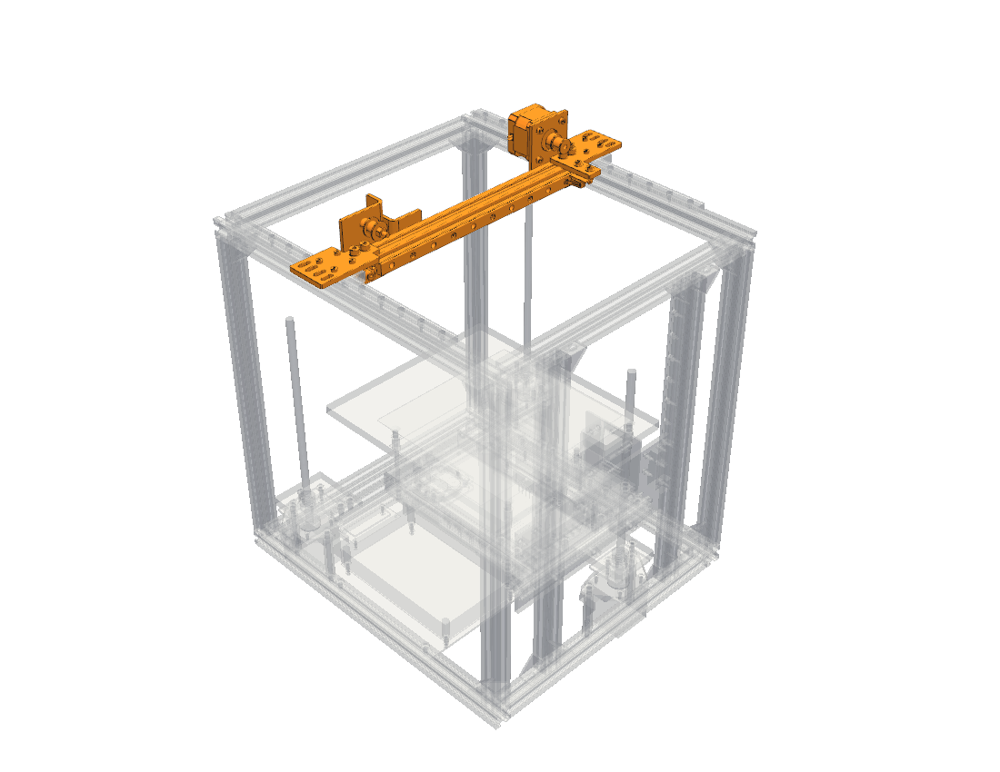

Orange: fitted in this stage. Grey: already there.

| # | Fit | Touches (simulation) | Screws that hold it (count x size, key, direction) | Check before moving on | Sim. step |
|---|---|---|---|---|---|
| 1 | **x_beam** (EXT2020-288) | - | - | ends flush and square to the neighbouring members (set square on two faces) | 38 |
| 2 | **y_plate_left** (custom) | x_beam | 4 x M3x8 cap screw, 2.5 mm key, from above, pointing down (-Z) (y_plate_left_screw_3, y_plate_left_screw_2, y_plate_left_screw_1, y_plate_left_screw_0) | seated flat on x_beam with no gap; all its screws started before any is tightened | 39 |
| 3 | **y_plate_right** (custom) | x_beam | 4 x M3x8 cap screw, 2.5 mm key, from above, pointing down (-Z) (y_plate_right_screw_3, y_plate_right_screw_2, y_plate_right_screw_1, y_plate_right_screw_0) | seated flat on x_beam with no gap; all its screws started before any is tightened | 40 |
| 4 | **x_tension_anchor** (custom) | x_beam | - | seated flat on x_beam with no gap; all its screws started before any is tightened | 134 |
| 5 | **x_tension_anchor_bolt_1_washer** (WASHER-M5) | x_tension_anchor | 1 x M5x10 cap screw, 4 mm key, from the front, pointing back (+Y), into T-nut (x_tension_anchor_bolt_1) | seated flat on x_tension_anchor with no gap; all its screws started before any is tightened | 135 |
| 6 | **x_tension_anchor_bolt_0_washer** (WASHER-M5) | x_tension_anchor | 1 x M5x10 cap screw, 4 mm key, from the front, pointing back (+Y), into T-nut (x_tension_anchor_bolt_0) | seated flat on x_tension_anchor with no gap; all its screws started before any is tightened | 137 |
| 7 | **x_rail_stop_right** (custom) | x_beam, y_plate_right | - | seated flat on x_beam, y_plate_right with no gap; all its screws started before any is tightened | 139 |
| 8 | **x_rail_stop_right_bolt_washer** (WASHER-M5) | x_rail_stop_right | 1 x M5x10 cap screw, 4 mm key, from the back, pointing forward (-Y), into T-nut (x_rail_stop_right_bolt) | seated flat on x_rail_stop_right with no gap; all its screws started before any is tightened | 140 |
| 9 | **x_rail_stop_left** (custom) | x_beam, y_plate_left | - | seated flat on x_beam, y_plate_left with no gap; all its screws started before any is tightened | 142 |
| 10 | **x_rail_stop_left_bolt_washer** (WASHER-M5) | x_rail_stop_left | 1 x M5x10 cap screw, 4 mm key, from the back, pointing forward (-Y), into T-nut (x_rail_stop_left_bolt) | seated flat on x_rail_stop_left with no gap; all its screws started before any is tightened | 143 |
| 11 | **beam_bolt_left_washer** (WASHER-M5) | y_plate_left | 1 x M5x10 cap screw, 4 mm key, from above, pointing down (-Z), into T-nut (beam_bolt_left) | seated flat on y_plate_left with no gap; all its screws started before any is tightened | 145 |
| 12 | bench unit **x_drive** | x_beam, y_plate_left | - | the bench unit is complete (its own table above); it sits flat on what it bolts to before any screw is tightened | 147 |
| 13 | **x_motor_mount_bolt_1_washer** (WASHER-M5) | x_motor_mount | 1 x M5x10 cap screw, 4 mm key, from the front, pointing back (+Y), into T-nut (x_motor_mount_bolt_1) | seated flat on x_motor_mount with no gap; all its screws started before any is tightened | 148 |
| 14 | **x_motor_mount_bolt_0_washer** (WASHER-M5) | x_motor_mount | 1 x M5x10 cap screw, 4 mm key, from the front, pointing back (+Y), into T-nut (x_motor_mount_bolt_0) | seated flat on x_motor_mount with no gap; all its screws started before any is tightened | 150 |
| 15 | **beam_bolt_right_washer** (WASHER-M5) | y_plate_right | 1 x M5x10 cap screw, 4 mm key, from above, pointing down (-Z), into T-nut (beam_bolt_right) | seated flat on y_plate_right with no gap; all its screws started before any is tightened | 152 |
| 16 | bench unit **x_idler_unit** | x_beam | - | the bench unit is complete (its own table above); it sits flat on what it bolts to before any screw is tightened | 154 |
| 17 | **x_idler_mount_bolt_1_washer** (WASHER-M5) | x_idler_mount | 1 x M5x10 cap screw, 4 mm key, from the front, pointing back (+Y), into T-nut (x_idler_mount_bolt_1) | seated flat on x_idler_mount with no gap; all its screws started before any is tightened | 155 |
| 18 | **x_idler_mount_bolt_0_washer** (WASHER-M5) | x_idler_mount | 1 x M5x10 cap screw, 4 mm key, from the front, pointing back (+Y), into T-nut (x_idler_mount_bolt_0) | seated flat on x_idler_mount with no gap; all its screws started before any is tightened | 157 |
| 19 | **beam_bolt_right_1_washer** (WASHER-M5) | y_plate_right | 1 x M5x10 cap screw, 4 mm key, from above, pointing down (-Z), into T-nut (beam_bolt_right_1) | seated flat on y_plate_right with no gap; all its screws started before any is tightened | 199 |
| 20 | **beam_bolt_left_1_washer** (WASHER-M5) | y_plate_left | 1 x M5x10 cap screw, 4 mm key, from above, pointing down (-Z), into T-nut (beam_bolt_left_1) | seated flat on y_plate_left with no gap; all its screws started before any is tightened | 201 |
| 21 | **x_rail** (MGN12-R-250) | x_beam, x_rail_stop_left, x_rail_stop_right | 5 x M3x8 cap screw, 2.5 mm key, from the back, pointing forward (-Y), into T-nut (x_rail_screw_3, x_rail_screw_2, x_rail_screw_0, x_rail_screw_4, x_rail_screw_1) | rail lies flat in the slot's faces; leave its screws just nipped until the rail-alignment step for this axis | 203 |
| 22 | **x_tension_nut** (NUT-M3) | x_tension_anchor | 1 x M3x16 cap screw, 2.5 mm key, from the left, pointing right (+X) (x_tension_screw) | seated flat on x_tension_anchor with no gap; all its screws started before any is tightened | 268 |
| 23 | **x_endstop_spacer_1** (SPACER-NYLON-M3-5x3.3x4) | y_plate_left | - | seated flat on y_plate_left with no gap; all its screws started before any is tightened | 271 |
| 24 | **x_endstop** (ENDSTOP-MICRO) | x_endstop_spacer_1 | - | lever moves freely; leave the screws nipped: the switch is set in the adjustment section | 272 |
| 25 | **x_endstop_nut_1** (NUT-M3) | x_endstop | - | seated flat on x_endstop with no gap; all its screws started before any is tightened | 273 |
| 26 | **x_endstop_screw_1_washer** (WASHER-M3-LARGE) | y_plate_left | 1 x M3x16 cap screw, 2.5 mm key, from above, pointing down (-Z) (x_endstop_screw_1) | seated flat on y_plate_left with no gap; all its screws started before any is tightened | 274 |
| 27 | **x_endstop_nut_0** (NUT-M3) | x_endstop | - | seated flat on x_endstop with no gap; all its screws started before any is tightened | 276 |
| 28 | **x_endstop_screw_0_washer** (WASHER-M3-LARGE) | y_plate_left | - | seated flat on y_plate_left with no gap; all its screws started before any is tightened | 277 |
| 29 | **x_endstop_spacer_0** (SPACER-NYLON-M3-5x3.3x4) | x_endstop, y_plate_left | 1 x M3x16 cap screw, 2.5 mm key, from above, pointing down (-Z) (x_endstop_screw_0) | seated flat on x_endstop, y_plate_left with no gap; all its screws started before any is tightened | 278 |

Leave the beam bolts in the Y plates' slots nipped until both Y rails are aligned: the slots let the gantry take up the frame's width error.

### Stage: Y drives, idlers, tensioners, Y endstop

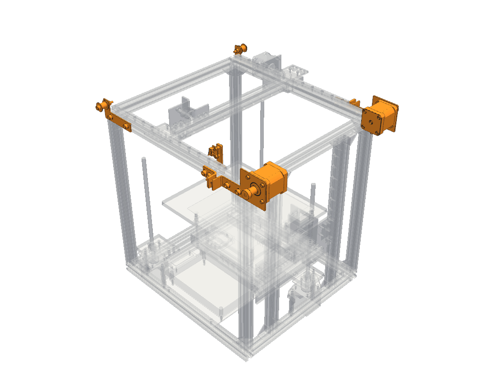

Orange: fitted in this stage. Grey: already there.

| # | Fit | Touches (simulation) | Screws that hold it (count x size, key, direction) | Check before moving on | Sim. step |
|---|---|---|---|---|---|
| 1 | **y_idler_mount_l** (custom) | frame_top_left | - | seated flat on frame_top_left with no gap; all its screws started before any is tightened | 68 |
| 2 | **y_idler_l_spacer** (WASHER-M5) | y_idler_mount_l | - | seated flat on y_idler_mount_l with no gap; all its screws started before any is tightened | 69 |
| 3 | **y_idler_l_spacer_b** (WASHER-M5) | y_idler_l_spacer | - | seated flat on y_idler_l_spacer with no gap; all its screws started before any is tightened | 70 |
| 4 | **y_idler_l** (GT2-IDLER-20T-B5) | y_idler_l_spacer_b | - | seated flat on y_idler_l_spacer_b with no gap; all its screws started before any is tightened | 71 |
| 5 | **y_idler_l_nut** (NUT-M5) | y_idler_mount_l | - | seated flat on y_idler_mount_l with no gap; all its screws started before any is tightened | 72 |
| 6 | **y_idler_l_nwasher** (WASHER-M5) | y_idler_l_nut, y_idler_mount_l | 1 x M5x30 cap screw, 4 mm key, from the left, pointing right (+X) (y_idler_l_bolt) | seated flat on y_idler_l_nut, y_idler_mount_l with no gap; all its screws started before any is tightened | 73 |
| 7 | **y_idler_mount** (custom) | frame_top_right, post_rf | - | seated flat on frame_top_right, post_rf with no gap; all its screws started before any is tightened | 75 |
| 8 | **y_idler_spacer** (WASHER-M5) | y_idler_mount | - | seated flat on y_idler_mount with no gap; all its screws started before any is tightened | 76 |
| 9 | **y_idler_spacer_b** (WASHER-M5) | y_idler_spacer | - | seated flat on y_idler_spacer with no gap; all its screws started before any is tightened | 77 |
| 10 | **y_idler** (GT2-IDLER-20T-B5) | y_idler_spacer_b | - | seated flat on y_idler_spacer_b with no gap; all its screws started before any is tightened | 78 |
| 11 | **y_idler_nut** (NUT-M5) | y_idler_mount | - | seated flat on y_idler_mount with no gap; all its screws started before any is tightened | 79 |
| 12 | **y_idler_nwasher** (WASHER-M5) | y_idler_mount, y_idler_nut | 1 x M5x30 cap screw, 4 mm key, from the right, pointing left (-X) (y_idler_bolt) | seated flat on y_idler_mount, y_idler_nut with no gap; all its screws started before any is tightened | 80 |
| 13 | **y_tension_anchor_l** (custom) | frame_top_left | - | seated flat on frame_top_left with no gap; all its screws started before any is tightened | 101 |
| 14 | **y_tension_anchor_l_bolt_1_washer** (WASHER-M5) | y_tension_anchor_l | 1 x M5x10 cap screw, 4 mm key, from the left, pointing right (+X), into T-nut (y_tension_anchor_l_bolt_1) | seated flat on y_tension_anchor_l with no gap; all its screws started before any is tightened | 102 |
| 15 | **y_tension_anchor_l_bolt_0_washer** (WASHER-M5) | y_tension_anchor_l | 1 x M5x10 cap screw, 4 mm key, from the left, pointing right (+X), into T-nut (y_tension_anchor_l_bolt_0) | seated flat on y_tension_anchor_l with no gap; all its screws started before any is tightened | 104 |
| 16 | **y_tension_anchor** (custom) | frame_top_right | - | seated flat on frame_top_right with no gap; all its screws started before any is tightened | 106 |
| 17 | **y_tension_anchor_bolt_1_washer** (WASHER-M5) | y_tension_anchor | 1 x M5x10 cap screw, 4 mm key, from the right, pointing left (-X), into T-nut (y_tension_anchor_bolt_1) | seated flat on y_tension_anchor with no gap; all its screws started before any is tightened | 107 |
| 18 | **y_tension_anchor_bolt_0_washer** (WASHER-M5) | y_tension_anchor | 1 x M5x10 cap screw, 4 mm key, from the right, pointing left (-X), into T-nut (y_tension_anchor_bolt_0) | seated flat on y_tension_anchor with no gap; all its screws started before any is tightened | 109 |
| 19 | bench unit **y_drive_l** | frame_top_left | - | the bench unit is complete (its own table above); it sits flat on what it bolts to before any screw is tightened | 111 |
| 20 | **y_motor_mount_l_bolt_1_washer** (WASHER-M5) | y_motor_mount_l | 1 x M5x10 cap screw, 4 mm key, from the left, pointing right (+X), into T-nut (y_motor_mount_l_bolt_1) | seated flat on y_motor_mount_l with no gap; all its screws started before any is tightened | 112 |
| 21 | **y_motor_mount_l_bolt_0_washer** (WASHER-M5) | y_motor_mount_l | 1 x M5x10 cap screw, 4 mm key, from the left, pointing right (+X), into T-nut (y_motor_mount_l_bolt_0) | seated flat on y_motor_mount_l with no gap; all its screws started before any is tightened | 114 |
| 22 | bench unit **y_drive** | frame_top_right | - | the bench unit is complete (its own table above); it sits flat on what it bolts to before any screw is tightened | 116 |
| 23 | **y_motor_mount_bolt_1_washer** (WASHER-M5) | y_motor_mount | 1 x M5x10 cap screw, 4 mm key, from the right, pointing left (-X), into T-nut (y_motor_mount_bolt_1) | seated flat on y_motor_mount with no gap; all its screws started before any is tightened | 117 |
| 24 | **y_motor_mount_bolt_0_washer** (WASHER-M5) | y_motor_mount | 1 x M5x10 cap screw, 4 mm key, from the right, pointing left (-X), into T-nut (y_motor_mount_bolt_0) | seated flat on y_motor_mount with no gap; all its screws started before any is tightened | 119 |
| 25 | **y_idler_mount_l_bolt_1_washer** (WASHER-M5) | y_idler_mount_l | 1 x M5x10 cap screw, 4 mm key, from the left, pointing right (+X), into T-nut (y_idler_mount_l_bolt_1) | seated flat on y_idler_mount_l with no gap; all its screws started before any is tightened | 121 |
| 26 | **y_idler_mount_l_bolt_0_washer** (WASHER-M5) | y_idler_mount_l | 1 x M5x10 cap screw, 4 mm key, from the left, pointing right (+X), into T-nut (y_idler_mount_l_bolt_0) | seated flat on y_idler_mount_l with no gap; all its screws started before any is tightened | 123 |
| 27 | **y_idler_mount_bolt_1_washer** (WASHER-M5) | y_idler_mount | 1 x M5x10 cap screw, 4 mm key, from the right, pointing left (-X), into T-nut (y_idler_mount_bolt_1) | seated flat on y_idler_mount with no gap; all its screws started before any is tightened | 125 |
| 28 | **y_idler_mount_bolt_0_washer** (WASHER-M5) | y_idler_mount | 1 x M5x10 cap screw, 4 mm key, from the right, pointing left (-X), into T-nut (y_idler_mount_bolt_0) | seated flat on y_idler_mount with no gap; all its screws started before any is tightened | 127 |
| 29 | **y_endstop_mount** (custom) | frame_top_right | - | seated flat on frame_top_right with no gap; all its screws started before any is tightened | 129 |
| 30 | **y_endstop_mount_bolt_1_washer** (WASHER-M5) | y_endstop_mount | 1 x M5x10 cap screw, 4 mm key, from the left, pointing right (+X), into T-nut (y_endstop_mount_bolt_1) | seated flat on y_endstop_mount with no gap; all its screws started before any is tightened | 130 |
| 31 | **y_endstop_mount_bolt_0_washer** (WASHER-M5) | y_endstop_mount | 1 x M5x10 cap screw, 4 mm key, from the left, pointing right (+X), into T-nut (y_endstop_mount_bolt_0) | seated flat on y_endstop_mount with no gap; all its screws started before any is tightened | 132 |
| 32 | **y_tension_nut_l** (NUT-M3) | y_tension_anchor_l | 1 x M3x16 cap screw, 2.5 mm key, from the front, pointing back (+Y) (y_tension_screw_l) | seated flat on y_tension_anchor_l with no gap; all its screws started before any is tightened | 264 |
| 33 | **y_tension_nut** (NUT-M3) | y_tension_anchor | 1 x M3x16 cap screw, 2.5 mm key, from the front, pointing back (+Y) (y_tension_screw) | seated flat on y_tension_anchor with no gap; all its screws started before any is tightened | 266 |
| 34 | **y_endstop_spacer_1** (SPACER-NYLON-M3-5x3.3x4) | y_endstop_mount | - | seated flat on y_endstop_mount with no gap; all its screws started before any is tightened | 289 |
| 35 | **y_endstop** (ENDSTOP-MICRO) | y_endstop_spacer_1 | - | lever moves freely; leave the screws nipped: the switch is set in the adjustment section | 290 |
| 36 | **y_endstop_nut_1** (NUT-M3) | y_endstop | - | seated flat on y_endstop with no gap; all its screws started before any is tightened | 291 |
| 37 | **y_endstop_screw_1_washer** (WASHER-M3) | y_endstop_mount | 1 x M3x12 cap screw, 2.5 mm key, from the left, pointing right (+X) (y_endstop_screw_1) | seated flat on y_endstop_mount with no gap; all its screws started before any is tightened | 292 |
| 38 | **y_endstop_nut_0** (NUT-M3) | y_endstop | - | seated flat on y_endstop with no gap; all its screws started before any is tightened | 294 |
| 39 | **y_endstop_spacer_0** (SPACER-NYLON-M3-5x3.3x4) | y_endstop, y_endstop_mount | - | seated flat on y_endstop, y_endstop_mount with no gap; all its screws started before any is tightened | 295 |
| 40 | **y_endstop_screw_0_washer** (WASHER-M3) | y_endstop_mount | 1 x M3x12 cap screw, 2.5 mm key, from the left, pointing right (+X) (y_endstop_screw_0) | seated flat on y_endstop_mount with no gap; all its screws started before any is tightened | 296 |

### Stage: Toolhead: plate, extruder, hotend, probe, part cooling

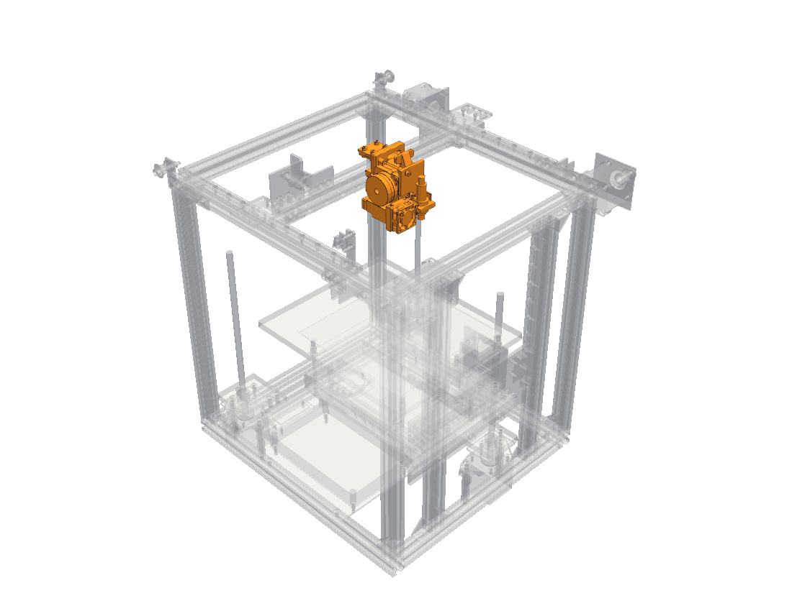

Orange: fitted in this stage. Grey: already there.

| # | Fit | Touches (simulation) | Screws that hold it (count x size, key, direction) | Check before moving on | Sim. step |
|---|---|---|---|---|---|
| 1 | **x_carriage** (MGN12H) | x_rail | - | the block is slid on without losing balls (keep it on its plastic keeper until the rail is under it); it runs the whole rail by hand with even drag | 206 |
| 2 | **tool_plate** (custom) | x_carriage | 4 x M3x6 cap screw, 2.5 mm key, from the back, pointing forward (-Y) (tool_screw_3, tool_screw_2, tool_screw_1, tool_screw_0) | seated flat on x_carriage with no gap; all its screws started before any is tightened | 207 |
| 3 | **tool_plate_rear** (custom) | tool_plate | - | seated flat on tool_plate with no gap; all its screws started before any is tightened | 212 |
| 4 | **x_belt_bracket_nut_1** (NUT-M3) | tool_plate, tool_plate_rear | - | seated flat on tool_plate, tool_plate_rear with no gap; all its screws started before any is tightened | 213 |
| 5 | **x_belt_bracket_nut_0** (NUT-M3) | tool_plate, tool_plate_rear | - | seated flat on tool_plate, tool_plate_rear with no gap; all its screws started before any is tightened | 214 |
| 6 | **extruder_nut_1** (NUT-M3) | tool_plate, tool_plate_rear | - | seated flat on tool_plate, tool_plate_rear with no gap; all its screws started before any is tightened | 215 |
| 7 | **extruder_nut_0** (NUT-M3) | tool_plate, tool_plate_rear | - | seated flat on tool_plate, tool_plate_rear with no gap; all its screws started before any is tightened | 216 |
| 8 | **extruder** (EXTRUDER-E3D-ROTO) | tool_plate_rear | - | seated flat on tool_plate_rear with no gap; all its screws started before any is tightened | 217 |
| 9 | **probe_mount** (custom) | extruder | - | seated flat on extruder with no gap; all its screws started before any is tightened | 218 |
| 10 | **probe_mount_sleeve_1** (SPACER-AL-M3-6x3.2x4) | extruder, probe_mount | - | seated flat on extruder, probe_mount with no gap; all its screws started before any is tightened | 219 |
| 11 | **extruder_screw_1_washer** (WASHER-M3) | probe_mount_sleeve_1 | 1 x M3x50 cap screw, 2.5 mm key, from the back, pointing forward (-Y) (extruder_screw_1) | seated flat on probe_mount_sleeve_1 with no gap; all its screws started before any is tightened | 220 |
| 12 | **probe_mount_sleeve_0** (SPACER-AL-M3-6x3.2x4) | extruder, probe_mount | - | seated flat on extruder, probe_mount with no gap; all its screws started before any is tightened | 222 |
| 13 | **extruder_screw_0_washer** (WASHER-M3) | probe_mount_sleeve_0 | 1 x M3x50 cap screw, 2.5 mm key, from the back, pointing forward (-Y) (extruder_screw_0) | seated flat on probe_mount_sleeve_0 with no gap; all its screws started before any is tightened | 223 |
| 14 | bench unit **part_cooling** | tool_plate_rear | - | the bench unit is complete (its own table above); it sits flat on what it bolts to before any screw is tightened | 280 |
| 15 | **part_duct_screw_1_nut** (NUT-M3-NYLOC) | part_duct | - | seated flat on part_duct with no gap; all its screws started before any is tightened | 281 |
| 16 | **part_duct_screw_1_washer** (WASHER-M3) | tool_plate | - | seated flat on tool_plate with no gap; all its screws started before any is tightened | 282 |
| 17 | **part_duct_screw_1_nwasher** (WASHER-M3) | part_duct, part_duct_screw_1_nut | 1 x M3x16 cap screw, 2.5 mm key, from the front, pointing back (+Y) (part_duct_screw_1) | seated flat on part_duct, part_duct_screw_1_nut with no gap; all its screws started before any is tightened | 283 |
| 18 | **part_duct_screw_0_nut** (NUT-M3-NYLOC) | part_duct | - | seated flat on part_duct with no gap; all its screws started before any is tightened | 285 |
| 19 | **part_duct_screw_0_washer** (WASHER-M3) | tool_plate | - | seated flat on tool_plate with no gap; all its screws started before any is tightened | 286 |
| 20 | **part_duct_screw_0_nwasher** (WASHER-M3) | part_duct, part_duct_screw_0_nut | 1 x M3x16 cap screw, 2.5 mm key, from the front, pointing back (+Y) (part_duct_screw_0) | seated flat on part_duct, part_duct_screw_0_nut with no gap; all its screws started before any is tightened | 287 |
| 21 | **x_belt_bracket** (custom) | tool_plate | - | seated flat on tool_plate with no gap; all its screws started before any is tightened | 298 |
| 22 | **x_belt_bracket_screw_1_washer** (WASHER-M3) | x_belt_bracket | 1 x M3x10 cap screw, 2.5 mm key, from the front, pointing back (+Y) (x_belt_bracket_screw_1) | seated flat on x_belt_bracket with no gap; all its screws started before any is tightened | 299 |
| 23 | **x_belt_clamp** (custom) | x_belt_bracket | - | seated flat on x_belt_bracket with no gap; all its screws started before any is tightened | 301 |
| 24 | **x_belt_clamp_screw_3_nut** (NUT-M3) | x_belt_clamp | - | seated flat on x_belt_clamp with no gap; all its screws started before any is tightened | 302 |
| 25 | **x_belt_clamp_screw_3_washer** (WASHER-M3) | x_belt_bracket | - | seated flat on x_belt_bracket with no gap; all its screws started before any is tightened | 303 |
| 26 | **x_belt_clamp_screw_3_nwasher** (WASHER-M3) | x_belt_clamp, x_belt_clamp_screw_3_nut | 1 x M3x10 cap screw, 2.5 mm key, from above, pointing down (-Z) (x_belt_clamp_screw_3) | seated flat on x_belt_clamp, x_belt_clamp_screw_3_nut with no gap; all its screws started before any is tightened | 304 |
| 27 | **x_belt_clamp_screw_2_nut** (NUT-M3) | x_belt_clamp | - | seated flat on x_belt_clamp with no gap; all its screws started before any is tightened | 306 |
| 28 | **x_belt_clamp_screw_2_washer** (WASHER-M3) | x_belt_bracket | - | seated flat on x_belt_bracket with no gap; all its screws started before any is tightened | 307 |
| 29 | **x_belt_clamp_screw_2_nwasher** (WASHER-M3) | x_belt_clamp, x_belt_clamp_screw_2_nut | 1 x M3x10 cap screw, 2.5 mm key, from above, pointing down (-Z) (x_belt_clamp_screw_2) | seated flat on x_belt_clamp, x_belt_clamp_screw_2_nut with no gap; all its screws started before any is tightened | 308 |
| 30 | **x_belt_bracket_screw_0_washer** (WASHER-M3) | x_belt_bracket | 1 x M3x10 cap screw, 2.5 mm key, from the front, pointing back (+Y) (x_belt_bracket_screw_0) | seated flat on x_belt_bracket with no gap; all its screws started before any is tightened | 310 |
| 31 | **x_belt_clamp_screw_1_nut** (NUT-M3) | x_belt_clamp | - | seated flat on x_belt_clamp with no gap; all its screws started before any is tightened | 312 |
| 32 | **x_belt_clamp_screw_1_washer** (WASHER-M3) | x_belt_bracket | - | seated flat on x_belt_bracket with no gap; all its screws started before any is tightened | 313 |
| 33 | **x_belt_clamp_screw_1_nwasher** (WASHER-M3) | x_belt_clamp, x_belt_clamp_screw_1_nut | 1 x M3x10 cap screw, 2.5 mm key, from above, pointing down (-Z) (x_belt_clamp_screw_1) | seated flat on x_belt_clamp, x_belt_clamp_screw_1_nut with no gap; all its screws started before any is tightened | 314 |
| 34 | **x_belt_clamp_screw_0_nut** (NUT-M3) | x_belt_clamp | - | seated flat on x_belt_clamp with no gap; all its screws started before any is tightened | 316 |
| 35 | **x_belt_clamp_screw_0_washer** (WASHER-M3) | x_belt_bracket | - | seated flat on x_belt_bracket with no gap; all its screws started before any is tightened | 317 |
| 36 | **x_belt_clamp_screw_0_nwasher** (WASHER-M3) | x_belt_clamp, x_belt_clamp_screw_0_nut | 1 x M3x10 cap screw, 2.5 mm key, from above, pointing down (-Z) (x_belt_clamp_screw_0) | seated flat on x_belt_clamp, x_belt_clamp_screw_0_nut with no gap; all its screws started before any is tightened | 318 |
| 37 | **bed_probe_nut_rear** (NUT-OMRON-E2E-M12-W) | probe_mount | - | seated flat on probe_mount with no gap; all its screws started before any is tightened | 381 |
| 38 | **bed_probe** (PROBE-OMRON-E2E-X5ME1) | bed_probe_nut_rear, probe_mount | - | leave its nuts finger-tight: the height is set in the adjustment section | 382 |
| 39 | **hotend** (HOTEND-REVO-24V-40W) | extruder | - | seated flat on extruder with no gap; all its screws started before any is tightened | 383 |
| 40 | **bed_probe_nut_front** (NUT-OMRON-E2E-M12) | bed_probe, probe_mount | - | seated flat on bed_probe, probe_mount with no gap; all its screws started before any is tightened | 416 |

## Alignment and adjustment

Every `Adjustment` the design declares, with what the tolerance simulation says it must absorb (99th percentile of the simulated builds) against what the design provides.

### z_offset: probe z_offset in the firmware

- Needed 1.12 mm (99 %); provided 1.65 mm of Z over-travel past the nominal nozzle plane.
- **Probe height (on its two nuts):** sensing face 2.0 mm above the nozzle tip as drawn. It must stay inside the face window **[0.626, 3.374] mm** above the tip (lower: the face could meet the bed before the nozzle, margin 0.626 mm; upper: the weakest sensor would not switch in time). Set it with a 2.0 mm gauge block (or stacked feeler gauges) under the face while the cold nozzle rests on the bare print sheet; tighten both nuts; re-measure.
- Then `PROBE_CALIBRATE`: predicted z_offset 3.0 mm, anywhere in [2.0, 4.0] mm over sensor spread and temperature ([2.5, 3.5] mm over unit spread alone). These figures assume the sensor reads the thin spring-steel sheet like OMRON's iron target: UNVERIFIED, see COMMISSIONING.md step B1.
- Check: PROBE_ACCURACY passes the configured `samples_tolerance`; the nozzle touches paper at Z = 0 with the bed at working temperature.

### bed_level: the two nuts at the tab of each of the four bed posts (set once at assembly)

- Needed 0.72 mm (99 %); provided +/-4 mm of thread at each post. As built, before tramming, the bed is up to 1.43 mm out of level (99 %).
- How: at each of the four posts the plate's height is set by the nut above the tab and locked by the nut below it. Home X and Y, bring the nozzle over each post position in turn, and set each corner to the same feeler-gauge gap under the cold nozzle (or zero a dial indicator clamped to the toolhead). Go round twice. Lock each lower nut while holding the upper one with a second spanner.
- Check: all four corners within 0.1 mm of each other (half a 0.2 mm layer, the report's own criterion) after locking; re-check after the first heat cycle to working temperature. The posts' jam nuts under the plate must be tight before the magnetic sheet goes on.

### endstop (x): x switch: its screws run in slots in the Y plate's land

- Switch x_endstop, struck by x_carriage, at the min end. Working end of travel -90.0 mm, mechanical end -91.5 mm (joint coordinates).
- Needed: 0.65 mm (99 %); provided: +/-2 mm. As drawn, without setting, 42% of builds miss the window ([-0.1, 0.23] mm wide around the drawn position).
- How: with the switch's screws nipped, move the axis by hand to its mechanical end (against whatever stops it). Slide the switch towards the striker until it has clicked and the lever is still clear of the switch body, then back it off so the click happens between 0 and 3.0 mm before the end. Tighten.
- Check: the click is heard before the end of travel from a slow hand approach, three times; at the mechanical end the lever is not crushed on the case (the maker guarantees only 0.55 mm of lever travel past the click; case contact is 0.25 mm past the latest operating position). The axis must be stopped by the signal, never by the switch.

### endstop (y): y switch: its mount slides along the rail on two T-nuts

- Switch y_endstop, struck by y_plate_right, at the max end. Working end of travel 90.0 mm, mechanical end 91.5 mm (joint coordinates).
- Needed: 1.52 mm (99 %); provided: +/-5 mm. As drawn, without setting, 76% of builds miss the window ([-0.1, 0.23] mm wide around the drawn position).
- How: with the switch's screws nipped, move the axis by hand to its mechanical end (against whatever stops it). Slide the switch towards the striker until it has clicked and the lever is still clear of the switch body, then back it off so the click happens between 0 and 3.0 mm before the end. Tighten.
- Check: the click is heard before the end of travel from a slow hand approach, three times; at the mechanical end the lever is not crushed on the case (the maker guarantees only 0.55 mm of lever travel past the click; case contact is 0.25 mm past the latest operating position). The axis must be stopped by the signal, never by the switch.

### rail_align (y): y rails on sliding T-nuts

Design note: an M3 in the 6.2 mm slot slides +/-1.6 mm: left rail to a straight edge, right rail tightened while the gantry runs.

- Rails: y_rail_left, y_rail_right. As built, before alignment: out of parallel by up to 1.295 mm over the travel (99 %). Allowed by the maker: 0.009 mm (Hiwin MG catalogue Table 3.88 (p.104): MG_12, preload Z0). Share of builds inside that without alignment: 0.0. Adjustment provided: +/-1.6 mm (T-nuts sliding across the slot). **The machine depends on this step.**
- How: tighten the first rail against a straight edge (Y) or a square off the bottom rail (Z). Leave the second rail's screws nipped. Fit what joins the two blocks (the gantry beam; the bed carrier's back plate), run it to one end, tighten the second rail's screws nearest the block, run to the other end, tighten there, then the screws between, moving the block to each screw.
- Check: by hand the axis moves over its whole travel with the same light drag everywhere and no tight end. The maker's 0.009 mm cannot be measured with shop tools; drag is the test. The simulation's un-aligned case would add 97.1 N of drag.

### rail_align (z): z rails on sliding T-nuts

Design note: left rail to a square, right rail tightened while the carrier is run up and down.

- Rails: z_rail_left, z_rail_right. As built, before alignment: out of parallel by up to 1.072 mm over the travel (99 %). Allowed by the maker: 0.009 mm (Hiwin MG catalogue Table 3.88 (p.104): MG_12, preload ZF). Share of builds inside that without alignment: 0.001. Adjustment provided: +/-1.6 mm (T-nuts sliding across the slot). **The machine depends on this step.**
- How: tighten the first rail against a straight edge (Y) or a square off the bottom rail (Z). Leave the second rail's screws nipped. Fit what joins the two blocks (the gantry beam; the bed carrier's back plate), run it to one end, tighten the second rail's screws nearest the block, run to the other end, tighten there, then the screws between, moving the block to each screw.
- Check: by hand the axis moves over its whole travel with the same light drag everywhere and no tight end. The maker's 0.009 mm cannot be measured with shop tools; drag is the test. The simulation's un-aligned case would add 80.4 N of drag.

### float (z): floating lead screw nut

- Each lead-screw nut hangs under its printed block with +/-2.6 mm of radial room; a pin in a slot stops it turning. Needed: up to 3.38 mm (99 %, worst screw: leadscrew 2.57, leadscrew_fl 3.31, leadscrew_fr 3.38). Margin -0.78 mm.
- How: nothing to set, but it must be true: the nyloc nut under each pin is left 0.2 mm slack; the nut's flange is not clamped.
- Check: with the bed at the bottom, the middle and the top of its travel, each nut can still be pushed sideways a little in its pocket in every direction. A nut hard against one side of its pocket at either end of the travel has used all its float: re-seat that screw's pedestal or mount.

### belt_tension (x): x belt: idler plate slides on its T-nuts, pushed by an M3 jack screw in a PEM nut

- x_belt (9 mm): **14.2 N per span** is what the motor shaft-load check used (Gates' minimum installation tension for the width; Gates' 'general' figure is 75.6 N). Tensioner travel +/-3 mm.
  - Measure by plucking a free span at the home position and reading the pitch (phone tuner app): 104.0 mm span: about 189 Hz; 236.0 mm span: about 83 Hz; 104.0 mm span: about 189 Hz. From f = sqrt(T / mu) / 2L with mu = 9.2 g/m, a figure the catalogue DERIVES from Gates' constants (not printed by Gates): treat +/-10 %.
  - Spans at home: [104.0, 236.0, 104.0] mm.
- Check: after 20 full strokes the pitch has not dropped.

### belt_tension (y): y belts: motor mounts slide on their T-nuts, pushed by M3 jack screws in PEM nuts

- y_belt (12 mm): **18.7 N per span** is what the motor shaft-load check used (Gates' minimum installation tension for the width; Gates' 'general' figure is 106.8 N). Tensioner travel +/-3 mm.
  - Measure by plucking a free span at the home position and reading the pitch (phone tuner app): 141.3 mm span: about 139 Hz; 388.9 mm span: about 51 Hz; 212.2 mm span: about 93 Hz. From f = sqrt(T / mu) / 2L with mu = 12.1 g/m, a figure the catalogue DERIVES from Gates' constants (not printed by Gates): treat +/-10 %.
  - Spans at home: [141.3, 388.9, 212.2] mm.
- y_belt_l (12 mm): **18.7 N per span** is what the motor shaft-load check used (Gates' minimum installation tension for the width; Gates' 'general' figure is 106.8 N). Tensioner travel +/-3 mm.
  - Measure by plucking a free span at the home position and reading the pitch (phone tuner app): 141.3 mm span: about 139 Hz; 388.9 mm span: about 51 Hz; 212.2 mm span: about 93 Hz. From f = sqrt(T / mu) / 2L with mu = 12.1 g/m, a figure the catalogue DERIVES from Gates' constants (not printed by Gates): treat +/-10 %.
  - Spans at home: [141.3, 388.9, 212.2] mm.
- Check: both Y belts read the same pitch on the same span (the gantry must not rack); after 20 full strokes the pitch has not dropped.
