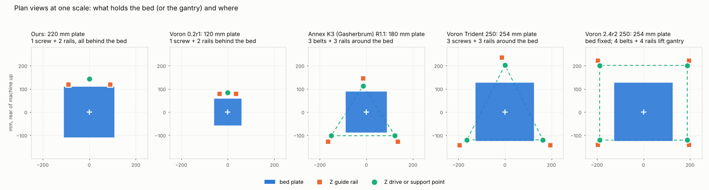
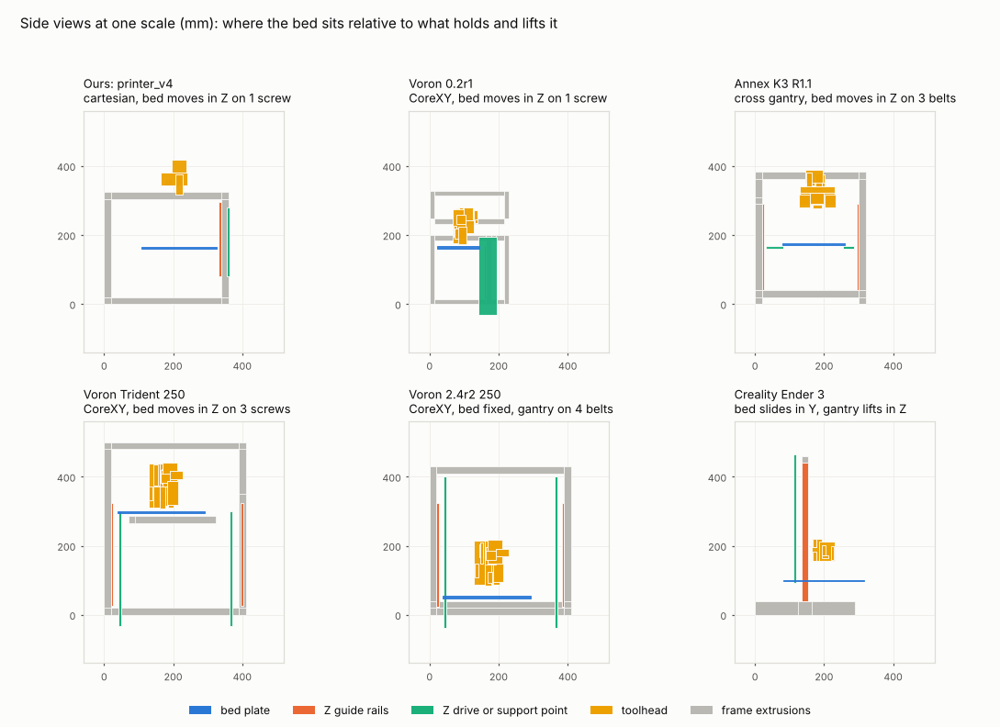

# Printer trade study: our printer_v4 against eleven reference machines

Compiled 2026-11-14. Our design is `mech-ai/designs/printer_v4.py`. Nothing here has been built; every number
for our machine comes from the mechloop verifiers and digital twin (`mech-ai/viewer/data.json`).
Reference numbers are tagged with how they were obtained:

- **CAD**: measured from the machine's published STEP, STL or DXF files, opened with OpenCASCADE, trimesh or ezdxf.
- **CAD-est**: a CAD volume multiplied by an assumed density, or a belt length solved from a belt solid.
- **BOM**: read from a bill of materials, drawing or README in the machine's repository.
- **config**: read from a published firmware configuration.
- **docs**: read from docs.vorondesign.com.
- **recalled**: a published specification recalled from memory that could not be re-fetched from this network.

Every measured value, with its source file, is in `research_notes/trade_study/measurements.json`; repositories,
commits and licences are in `research_notes/trade_study/SOURCES.md`.

## Summary

**Why does our bed move in Z? Because for a machine this size that is what almost every reference design does,
and the one design that keeps the bed still pays heavily for it.** Of the eleven reference machines (nine with files opened, two from recalled specifications):

- The bed **moves in Z** on six: Voron 0.2, Voron Trident, Rat Rig V-Core 3.1, Annex K3, Bambu X1/P1 and Prusa CORE One.
- The bed **slides in Y** on four, with the X beam lifting in Z: Creality Ender 3, Prusa MK3S+, Prusa MINI+ and Rat Rig V-Minion.
- The bed **stays still** on one: Voron 2.4, where the whole XY gantry rides up and down on four belts.

Keeping the bed still means lifting the gantry instead. In the Voron 2.4 CAD that takes 4 Z motors, 4 belt
reductions, 4 Z belts of about 0.9 m, 4 guide rails and 7 motor drivers, and it lifts about 3.1 kg (CAD-est).
The Voron Trident has the same build volume and the same XY system but moves the bed on 3 lead screws.
Voron's own documentation prices the Trident at $1,000 to $1,300 and the 2.4 at $1,500 to $1,900, and calls the
2.4 "a much more complex build". A Z move is 0.2 mm once per layer, so the weight of the bed costs nothing in print time.
Sliding the bed in Y is cheapest in parts, but it shakes the print at every Y move and needs about twice the bench depth.

So the bed moving in Z is the right call for a 180 mm machine. **What the evidence does question is how our
bed is held.** Ours hangs a 220 mm plate off the back on one guide block per rail, with the front edge 229 mm
from the rails. The only reference that does the same is the Voron 0.2, with a 120 mm plate and a 137 mm
overhang, and Voron's documentation says of it: "The bed is also cantilevered, which restricts scaling further."
Every open design at our size or larger that moves the bed in Z (Annex K3 at exactly our 180 mm build volume and
on the same 2020 frame, V-Core 3.1 at 200 mm, Trident at 250 mm) holds it at three points.

Top recommendations, in order of benefit for cost (details and evidence in section 7):

1. **Stop machining everything.** Print the brackets, buy the spacers, and build the bed carrier from two extrusions.
   The references print 640 to 1,250 cm³ of parts (CAD), roughly $10 to $25 of filament at 0.7 g/cm³ effective. Our 35 machined parts are
   estimated at $2,376 by our own manufacture verifier, four times the $598 bill of materials.
2. **Put a second guide block on each Z rail** (two more MGN12H and 250 mm rails, about $25). Estimated
   to raise the bed's tilt stiffness about 16 times. This rests on an assumed block stiffness; see section 5.1.
3. **Add belt tensioners and a bed probe.** Every reference assembly opened has belt tensioning parts; ours has none.
4. **Lighten the toolhead** from 0.60 kg towards the 0.25 to 0.47 kg of the references (CAD-est). Expected X resonance 63 to about 77 Hz.
5. **Specify cast tooling plate for the bed**, as six of the references do, in place of 6061 plate.
6. Move to a **three-point bed** only if the bed grows or recommendation 2 proves insufficient. It costs two more
   Z drives and a bigger control board, and mechloop cannot verify parallel lead screws today.

Not recommended: a fixed bed, a CoreXY conversion, or a mains-voltage bed. Reasons are in sections 4 and 7.

One finding matters for the twin rather than the printer. The Voron 2.4 and Trident CAD both show **6 mm** A/B
belts (the motor pulleys are named "GT2 20T 6mm" and the belt solids are 6.0 mm wide). The earlier note
`research_notes/Voron reference data for twin validation.md` took them as 9 mm.

## 1. Terms

- **Cartesian**: one motor moves one axis. On ours the X motor rides on the beam that moves in Y.
- **CoreXY**: two long belts and two motors, both fixed to the frame, move the toolhead in X and Y together. No motor rides on the moving beam.
- **Bed-slinger**: the bed slides back and forth in Y under a toolhead that moves in X and Z.
- **Cantilevered bed**: the bed is held from one side only, like a shelf on brackets.
- **Kinematic (three-point) bed**: the bed rests on exactly three supports, which define a plane without bending the plate. With three independent Z motors and a probe the firmware can level it automatically.
- **Blind joint**: a screw through a hole across one extrusion into the tapped end of the next, with no bracket.
- **Input shaping**: firmware filtering that cancels a known resonance, allowing much higher acceleration than the bare structure permits.
- **MGN7 / MGN9 / MGN12 / MGN15**: miniature linear guide rails, 7 to 15 mm wide. The carriage that slides on one is called a block here.

## 2. What was opened

| Machine | What was opened and measured | What came from documents |
|---|---|---|
| Voron 0.2r1 | Full assembly STEP, 179 MB, 1,683 solids | Stock Klipper config, cost from Voron docs |
| Voron Trident 250 | Full assembly STEP, 185 MB, 1,414 solids | Stock config, cost |
| Voron 2.4r2 250 | Full assembly STEP, 242 MB, 1,428 solids | Stock config, cost, measured resonances from the earlier note |
| Creality Ender 3 | Full assembly STEP, 45 MB, 300 solids | Klipper example config |
| Annex K3 R1.1 | Full assembly STEP, 403 MB, 1,789 solids (16 minutes to load). Its product structure was also read at text level for part names and counts. Panel DXFs. | README, bed and heater drawings. No firmware config reachable. |
| Prusa MINI+ | 35 part STEP files | BOM, rod and extrusion drawings, Klipper config |
| Prusa MK3S+ | 45 printed-part STLs, frame DXF | Firmware limits. No rods, bed or assembly in the repository. |
| Rat Rig V-Core 3.1 (200) | 27 printed-part STEP files | Full BOM, RatOS config. No assembly CAD in the repository. |
| Rat Rig V-Minion | 31 printed-part STEP files | Full BOM, Klipper config |
| Bambu X1/P1, Prusa CORE One | Nothing: no open CAD | Two recalled lines each, marked as such |

Belt lengths were solved from the belt solids' surface area and volume. The method was checked on a part of known
length: the Voron 2.4's "GT2 188mm Belt Loop" solved to 186 mm.

## 3. Comparison tables

### 3.1 Architecture, size and frame

| | Ours | Voron 0.2 | Annex K3 | V-Core 3.1 200 | Trident 250 | Voron 2.4 250 | Ender 3 | Prusa MINI+ | Prusa MK3S+ | V-Minion |
|---|---|---|---|---|---|---|---|---|---|---|
| XY motion | cartesian, X motor rides the Y beam | CoreXY | cross gantry, 4 motors on the frame (CAD) | CoreXY | CoreXY | CoreXY | X on beam, bed in Y | X on a one-sided arm, bed in Y | X on beam, bed in Y | X on a one-sided arm, bed in Y |
| What moves in Z | bed | bed | bed | bed | bed | gantry | X beam | X arm | X beam | X arm |
| Build volume, mm | 180 x 180 x 150 | 120³ (config) | about 180³ (BOM) | 200³ (BOM) | 250³ (config) | 250 x 250 x 230 (config, Z recalled) | 220 x 220 x 250 (config) | 180³ (config) | 250 x 210 x 210 (config) | 180³ (config) |
| Frame section | 2020 | 1515 (CAD) | 2020 (BOM) | 3030 (BOM) | 2020 (CAD) | 2020 (CAD) | 4040 base, 2040 uprights (CAD) | 30 mm custom profile (BOM) | 6 mm plate + 3030 (CAD, BOM) | 3060 spine (BOM) |
| Frame outer, mm | 340 x 360 x 324 | 230 x 230 x 248 (CAD) | 320 x 320 x 383 (CAD) | 18 pieces, 320 to 410 long (BOM) | 410 x 410 x 500 (CAD) | 410 x 410 x 430 (CAD) | 330 x 290 x 460 (CAD) | Y 262, Z 289 extrusions (BOM) | plate 370 x 370 (CAD) | 345 column, 270 base (BOM) |
| Frame pieces | 15 extrusions, 4.7 m | 23, 4.1 m (CAD) | 15, 4.6 m (CAD) | 18 + 2020 X beam (BOM) | 15, 5.9 m (CAD) | 14, 5.4 m (CAD) | 6, 2.0 m (CAD) | 3 (BOM) | 4 + plate (BOM) | 4 (BOM) |
| Frame joints | 24 corner brackets, 65 M5 screws | blind joints, no brackets in CAD | not determined from part names | 20 joining plates + 12 cast brackets, 176 M6 screws (BOM) | blind joints: tapped and counterbored extrusions, no brackets in CAD | same as Trident | 14 M5x45 through-bolts into tapped ends, no brackets (CAD) | screws into tapped ends (BOM drawing) | screws into tapped ends (BOM) | 5 brackets + 3 plates (BOM) |
| Build volume / frame volume | 12% | 13% | 15% | not derivable | 19% | 20% | 27% of the static frame, 17% of the space the bed sweeps | not derivable | not derivable | not derivable |

Our frame is about as space-efficient as the Voron 0.2 and a little behind the K3, and well below the two larger Vorons.
That is expected: fixed overheads (motors, toolhead, rails) take a larger share of a small machine.
The K3 is the closest relative in the set: the same build volume, the same 2020 section and almost the same
amount of extrusion (15 pieces and 4.6 m against our 15 pieces and 4.7 m).

### 3.2 Guides, Z drive and bed

| | Ours | Voron 0.2 | Annex K3 | V-Core 3.1 200 | Trident 250 | Voron 2.4 250 | Ender 3 | Prusa MINI+ |
|---|---|---|---|---|---|---|---|---|
| X guide | MGN12 250 on a 2020 beam | MGN7 150, the rail is the beam (CAD) | MGN9 300 cross rail, the rail is the beam (CAD) | MGN12 on a 2020 beam (BOM) | MGN12 300 on a 2020 beam (CAD) | MGN12 300 on a 2020 beam (CAD) | wheels on a 2020 beam (CAD) | 2 x 8 mm rods, 279 mm (BOM) |
| Y guides | 2 x MGN12 300 | 2 x MGN7 150 (CAD) | MGN9 300 cross rail on 2 x MGN9 250; 9 rails in the machine (CAD) | 6 MGN12 in total: 4 x 300, 2 x 250 (BOM) | 2 x MGN9 300 (CAD) | 2 x MGN9 300 (CAD) | wheels on a 2040 beam (CAD) | 2 x 8 mm rods, 3 bearings (BOM) |
| Z guides | 2 x MGN12 215, **1 block each** | 2 x MGN7 150, **1 block each** (CAD) | 3 x MGN9 250 (CAD) | 3 (BOM, inferred from the 6 rails) | 3 x MGN9 300, 1 block each (CAD) | 4 x MGN9 300, 1 block each (CAD) | wheels on two 2040 uprights (CAD) | 2 x 10 mm rods, 341 mm (BOM) |
| Z drives | 1 motor, coupler, T8x2 screw | 1 motor with integrated T8x8 screw (CAD, config) | 3 motors, each with a 200 mm closed belt and 80-tooth pulley reduction to an open belt (CAD structure) | 3 motors, 3 TR8x4 screws (BOM) | 3 motors with integrated screws (CAD) | 4 motors, each 16:80 reduction to a 9 mm belt about 900 mm long (CAD, config) | 1 motor, 1 T8 screw on the left side only (CAD) | 1 motor with screw (BOM) |
| How the bed (or gantry) is constrained | cantilever: front edge 229 mm from the rail plane, rails 180 mm apart | cantilever: front edge 137 mm from the rail plane, rails 69 mm apart (CAD) | three points: Maxwell coupling on 3 rods at a 273 mm wide, 215 mm deep triangle around the plate (CAD) | three points: 3 balls on 6 dowel pins with 3 magnets (BOM) | three points: screws at a 326 mm wide, 322 mm deep triangle around the plate (CAD) | four corners of a 376 x 322 mm rectangle (CAD) | bed on 4 sprung screws on a sliding plate (CAD) | bed on a sliding 180 x 180 x 5 mm plate (CAD) |
| Bed plate, mm | 220 x 220 x 6, 6061 | 120 x 120 x 6.1 cast MIC6 (CAD) | 180 x 180 x 6 in the CAD; drawing says 6.35 cast MIC6 or ATP5 (CAD, BOM) | 229 x 229 x 5 cast (BOM) | 254 x 254 x 6.3 MIC6 (CAD) | 254 x 254 x 7.8 MIC6 (CAD) | 235 x 235 x 3 (CAD) | steel sheet 190 x 200 x 1.4 on a PCB heater (CAD, BOM) |
| Bed heater | 24 V, 200 W, 0.41 W/cm² | 24 V, 60 W, 0.42 W/cm² (config, recalled) | mains, 300 W, 0.93 W/cm² (BOM drawing) | mains through an SSR (config) | mains through an SSR; 200 x 202 mm pad (config, CAD) | mains through an SSR; 200 x 235 mm pad (config, CAD) | 24 V, about 220 W, 0.40 W/cm² (recalled) | 24 V PCB (BOM) |
| Bed levelling | 4 nuts on silicone columns, by hand; jack screw for Z offset | 3 thumb nuts on springs, by hand (CAD) | probe plus 3 independent Z (CAD) | probe plus 3 independent Z (BOM) | probe plus 3 independent Z, `z_tilt` (config) | probe plus 4 independent Z, `quad_gantry_level` (config) | 4 hand nuts on springs (CAD) | probe and mesh (BOM) |

SSR: solid-state relay, the switch used for a mains-voltage heater.

### 3.3 Motion, mass and published limits

| | Ours | Voron 0.2 | Trident 250 | Voron 2.4 250 | Ender 3 | Others |
|---|---|---|---|---|---|---|
| XY motors | 3 (1 X, 2 Y on one driver) | 2 | 2 | 2 | 2 | K3: 4. V-Core: 2 |
| Belt width | 12 mm | 6 mm (CAD) | 6 mm (CAD) | 6 mm A/B, 9 mm Z (CAD) | 6 mm (CAD) | K3: 9 mm (BOM). V-Core: 9 mm (BOM). V-Minion: 6 mm X, 9 mm Y (BOM). MINI: 6 mm (BOM) |
| Belt length per loop | X 674 mm, Y 676 and 738 mm | about 1.0 m, range 0.91 to 1.10 (CAD-est) | 1.5 to 1.8 m (CAD-est) | 1.55 m (CAD-est) | X 0.83 m, Y 0.80 m (CAD-est) | K3: about 0.62 m, two loops per axis (CAD-est). MINI: X 561 mm, Y 496 mm (BOM). V-Minion: 650 and 700 mm (BOM) |
| Toolhead mass | 0.60 kg (all that moves in X) | 0.25 kg (CAD-est; Voron quote under 0.26) | 0.39 kg (CAD-est) | 0.47 kg (CAD-est; one user weighed 0.43) | 0.27 kg, Bowden so no extruder on it (CAD-est) | K3: 0.30 kg (CAD-est) |
| Mass moved in Y | 1.49 kg | 0.43 kg (CAD-est) | 1.15 kg (CAD-est) | 1.22 kg (CAD-est) | 0.97 kg: the bed, without glass (CAD-est) | K3: 0.41 kg per axis, toolhead plus one cross rail (CAD-est) |
| Mass moved in Z | 2.47 kg bed stage | 0.72 kg bed stage (CAD-est) | 2.9 kg bed stage (CAD-est) | 3.1 kg gantry with both XY motors (CAD-est) | 1.5 kg X beam with 2 motors (CAD-est) | K3: 1.0 kg bed stage (CAD-est) |
| Nozzle below / beside the X rail | 51 / 33 mm | 51 / 24 mm (CAD) | 51 / 37 mm (CAD) | 51 / 37 mm (CAD) | 34 / 27 mm (CAD) | K3: 60 / 28 mm (CAD) |
| Toolhead envelope, mm | about 64 x 93 x 102 | 58 x 81 x 105 (CAD) | 76 x 99 x 132 (CAD) | 76 x 99 x 132 (CAD) | 74 x 72 x 66 (CAD) | K3: 59 x 107 x 113 (CAD) |
| Stock acceleration, mm/s² | design 4,000; twin clean to 6,000 without input shaping | 2,000 (config) | 3,000, comment "Max 4000" (config) | 3,000, comment "Max 4000" (config) | 3,000 in the Klipper example (config) | MINI 1,250. MK3S 1,250, limit 2,500. V-Core 1,500 "safeguard". V-Minion 20,000 (all config). Bambu 20,000 (recalled) |
| Stock top speed, mm/s | design 250 | 200 (config) | 300 (config) | 300 (config) | 300 (config) | MINI 180. MK3S 200. V-Core 300. V-Minion 500 (config) |
| Lowest resonance, X / Y | 63 / 53 Hz (twin) | not obtained | 57 Hz X on a 300 (one forum report, earlier note) | 54 to 62 / 39 to 50 Hz on 350 mm machines (earlier note) | not obtained | |

Our X axis carries more than twice the mass of a Voron 0.2 toolhead and a third more than a Stealthburner.
Our Y axis carries more than a Voron 2.4 that is 70 mm bigger in each direction, and 3.6 times what the K3
moves on either axis at the same build volume. The K3 buys that with four XY motors, nine rails and about six times our part count.

### 3.4 Parts, fasteners, electronics and cost

| | Ours | Voron 0.2 | Trident 250 | Voron 2.4 250 | Ender 3 | V-Core 3.1 200 | Prusa MINI+ | Annex K3 |
|---|---|---|---|---|---|---|---|---|
| Part instances | 292 | 916 (CAD; circuit-board internals excluded) | 1,388 (CAD) | 1,374 (CAD) | 292 (CAD) | 1,211 items in the mechanical kit (BOM) | not totalled | 1,789 (CAD) |
| Fasteners / distinct types | 173 screws and nuts / 15 screw types | 634 / 25 (CAD) | 831 / 35 (CAD) | 862 / 36 (CAD) | 146 / 30 (CAD) | 1,083 / 32 including T-nuts and washers (BOM) | 185 / 17 (BOM) | 463 screws and nuts by name / 50 types (CAD); about 770 with washers and heat-set inserts (CAD structure) |
| Custom parts and how they are made | 35 machined, 2 sheet, 0 printed | printed: 134 STL files in the repository; 123 printed solids of 783 cm³ in the CAD | printed: 145 STL files; 1,241 cm³ identified in the CAD | printed: 155 STL files | sheet-metal brackets and moulded parts, none printed (CAD) | 31 printed core parts of 845 cm³ (CAD), 13 toolhead parts, 6 laser-cut plates (BOM) | 32 printed of 682 cm³ (BOM, CAD), 1 steel plate | printed: 492 STL files across all options |
| Control board | SKR Mini E3 V3, 4 drivers for 5 motors | SKR Mini E3 V3 is one of the stock configs (config) | Octopus, 8 drivers (config) | Octopus, 7 drivers used (config) | Creality 8-bit, 4 drivers (recalled) | Octopus, 6 drivers needed (BOM) | Prusa Buddy (recalled) | Fysetc Spider, 8 drivers (CAD structure) |
| Belt tensioners | **none** | 2 with knobs (CAD) | front idler carriers on M3x40 screws (CAD; function inferred) | 4 "Z Tensioner" and 4 "Belt Tensioner" parts (CAD) | X and Y adjustment blocks (CAD) | not identified by name | Y belt tensioner part (CAD) | 7 "Belt Tensioner" parts (CAD structure) |
| Cost to self-source | $598 parts + $2,376 machining estimate | $400 to $600 (docs) | $1,000 to $1,300 (docs) | $1,500 to $1,900 (docs) | about $170 to $200 retail (recalled) | not obtained | not obtained | not obtained |

Voron and K3 counts include enclosure panels, skirts, cable chains, displays and their screws, none of which
our design has. The Ender 3 is the fairest like-for-like on count: an open-frame machine with the same 292 parts.

## 4. The owner's question: which way should the bed move?

| Approach | Machines | Z hardware counted from CAD or BOM | What it costs | What it buys |
|---|---|---|---|---|
| Bed moves in Z, cantilever | Ours, Voron 0.2 | 1 motor, 1 screw, 2 rails, 2 blocks, 1 driver | Least. The bed's tilt depends on two small guide blocks. | Fewest parts. Open front. |
| Bed moves in Z, three points | Trident, V-Core 3.1, K3 (and Bambu, recalled) | 3 motors, 3 screws or belts, 3 rails, 3 drivers. K3 uses belts in place of screws, each with a reduction. V-Core adds 3 balls, 6 pins, 3 magnets, 3 decouplers, 3 thrust bearings. | 2 more Z drives, a board with 6 to 8 drivers, a probe. | Stiff, self-levelling bed with no plate bending. |
| Bed fixed, gantry moves in Z | Voron 2.4 | 4 motors, 4 reductions (16 and 80-tooth pulleys, 188 mm closed belt, shaft, 3 bearings each), 4 belts of 0.9 m, 4 rails, 4 tensioners, 7 drivers in all | Most. About $500 more than the Trident at the same size (docs). Lifts 3.1 kg including both XY motors. Needs four-corner levelling of the gantry every print. | The bed, its mains cable and the print never move. Useful when the bed is large and heavy. |
| Bed slides in Y, beam lifts in Z | Ender 3, MK3S+, MINI+, V-Minion | Ender: 1 motor, 1 screw, wheels. MINI: 1 screw, 2 rods. MK3S+: 2 screws (recalled). | Least hardware of all. The print is accelerated in Y at every move. Depth needed is bed plus travel: 455 mm for the Ender's 235 mm bed (CAD). | Cheap, open, easy to reach. |

What this means at our size:

1. **A fixed bed is not worth it.** It would add three Z motors and three drivers to a board that already runs
   five motors on four drivers, to avoid moving a 2.5 kg stage 0.2 mm per layer.
2. **A sliding bed would work** and is what the two commercial 180 mm machines here do (MINI+, V-Minion). It gives
   up the closed cube frame, and it puts the bed, at about 1.9 kg with its heater on ours, on the fast axis.
3. **Moving the bed in Z is the mainstream choice** for an enclosed-frame machine. The open question is one support or three.

## 5. Engineering estimates

These use closed-form formulas with stated assumptions (`research_notes/trade_study/estimates.py`, results in
`estimates.json`). They compare architectures; they do not predict any one machine.

### 5.1 Bed sag and tilt: cantilever against three points

Load: 1 kg at the bed centre, our design payload.

| Case | Deflection | Basis |
|---|---|---|
| Ours as designed: one MGN12H block per rail, load 119 mm and front edge 229 mm from the rails | 0.04 mm at the front edge from block tilt, range 0.02 to 0.08. Plus 0.011 mm of carrier bending (our FEA: 0.0325 mm at 3 kg). Plus up to 0.035 mm of rock if the blocks have 5 µm of play. | One block resists tilt only over its own 32 mm loaded length: tilt stiffness k·L²/12 per block. k = 40 N/µm is **assumed** (no vendor rigidity table could be fetched); the range is half to double that. |
| Ours with two blocks per rail, 50 mm apart (what fits on a 250 mm rail with 150 mm of travel) | 0.002 mm, range 0.001 to 0.005 | Tilt stiffness k·p²/2 per rail: about 7,000 rises to about 114,000 N·m/rad |
| Ours with the carrier replaced by two 2020 extrusion arms | 0.013 mm of arm bending | Cantilever beam, I = 7,419 mm⁴ per arm |
| Three-point bed, our 220 x 220 x 6 mm plate | 0.004 mm at the centre | Simply supported circular plate of the same radius |
| Three-point bed, 229 x 229 x 5 mm plate (V-Core 3.1 200) | 0.008 mm | Same formula |
| Voron 0.2 with 1 kg, for scale | 0.10 mm, range 0.06 to 0.19 | Same cantilever formula with MGN7H blocks. Its real prints weigh tens of grams. |

Reading this honestly:

- The static sag of our cantilever is about ten times that of a three-point bed, but it is still a quarter of a
  0.2 mm layer under the full 1 kg, and the weight arrives slowly over hours. Static sag alone does not condemn the design.
- The same low tilt stiffness gives a **bed nodding frequency of roughly 60 Hz** (2.47 kg stage, estimate), which sits
  on top of our X and Y resonances of 63 and 53 Hz. With two blocks per rail the estimate moves to about 250 Hz.
  This is the stronger reason to act, and it is a judgement from an assumed stiffness, not a verified result.
- Our FEA cannot see any of this: the load case `payload_x3_on_bed` clamps the carrier at the guide blocks, so
  block compliance is outside the model.

### 5.2 Gantry beam bending

| Beam | Stiffness at mid-span | First bending frequency with the toolhead |
|---|---|---|
| Ours: 2020, 320 mm span, 0.60 kg toolhead | 750 N/mm | 156 Hz |
| Voron 2.4 and Trident 250: 2020, 390 mm span (CAD), 0.47 and 0.39 kg | 414 N/mm | 124 and 131 Hz |

Formula: simply supported beam with a central mass, k = 48EI/L³. The rail's own stiffness is ignored. In every
case the beam is far stiffer than the belts below, so beam section is not what limits these machines.

### 5.3 Belt stiffness against length and width

Stiffness at the carriage is 4·EA/L, using the twin's own assumption of EA = 15 kN for a 6 mm belt, proportional to width.

| Belt | Stiffness | Belt-only resonance with its toolhead |
|---|---|---|
| Ours X: 12 mm x 674 mm, 0.60 kg | 178 N/mm | 87 Hz (the twin reports 63 Hz once frame flex and motor inertia are added) |
| Ours X if 9 mm | 134 N/mm | 75 Hz |
| Ours X if 6 mm | 89 N/mm | 62 Hz |
| Voron 0.2: 6 mm x 1.0 m, 0.25 kg | 60 N/mm | 78 Hz |
| Ender 3 X: 6 mm x 0.83 m, 0.27 kg | 72 N/mm | 83 Hz |
| Annex K3: two 9 mm x 0.62 m loops per axis, 0.41 kg | 289 N/mm | 134 Hz |
| Voron 2.4 250: 6 mm x 1.55 m, 0.47 kg | 39 N/mm | 46 Hz |

Three things follow. First, our belts are three times stiffer than a Voron 0.2's, and our toolhead mass throws that
advantage away: the belt-only frequencies come out about the same. Second, the K3 shows what the same frame can do
when belts are short and moving mass is low: about 1.5 times our belt-only frequency in X and more in Y. Third, the 46 Hz for a Voron 2.4 250 is
below the 54 to 62 Hz that owners measure on the larger 350 mm machines. The twin's belt stiffness assumption is
therefore probably too soft by a factor of 1.5 to 2, and our own 63 and 53 Hz are likely pessimistic by a similar margin.

### 5.4 The motor that rides on our Y beam

Our X motor and pulley add 0.25 kg to the 1.49 kg that moves in Y. Taking them off would raise the Y resonance
from 53 to about 58 Hz and the acceleration available from the same belt force by 20%. A CoreXY layout does that,
but its belts would run about 1.4 m around our frame, against 0.67 m now. At the same width that halves belt
stiffness, which more than cancels the gain.

## 6. Contrast by subsystem

**Frame.** The Vorons and the Ender use blind joints with no brackets in their CAD. Rat Rig goes the other way,
with 32 plates and brackets and 176 M6 screws on 3030. Ours sits between: 2020 with 24 brackets. Our frame is
not unusual in section or size.

**XY motion.** Ours is the only design here with 12 mm belts and one of two with a second Y motor (K3 has two per
axis). The references spend their effort on low moving mass; ours spends it on stiff belts and stiff plates
(`y_plate_left`, `y_plate_right` and `tool_plate` are 6 mm aluminium where the Vorons use printed joints).
Our all-MGN12 guides are a size up from the MGN7 and MGN9 of the Vorons and K3: stiffer and heavier.

**Z and bed.** Covered above. Two smaller differences: the Vorons use motors with the lead screw built in, which
removes our `z_coupler` and one alignment; and six references specify cast tooling plate (MIC6 or ATP5) for the bed,
which stays flat when heated, where ours is drawn as 6061. In our favour, the floating `z_nut`, the jack-screw
Z offset and the slotted bed mounts for thermal growth are more carefully reasoned than anything visible in the reference CAD.

**Toolhead.** The Voron toolheads are printed shells around a 36 mm round "pancake" extruder motor of about 0.1 kg
(CAD-est). Ours is a 0.13 kg machined `tool_plate` carrying a 0.24 kg extruder and a 0.12 kg hotend proxy.
Nozzle position relative to the X rail is almost identical to the Vorons (51 mm below, 33 against 24 to 37 mm beside).

**Electronics and wiring.** Ours is the most thoroughly specified: fuse, relay, thermal cut-off, earth, wire
gauges, and a 24 V bed that keeps mains out of the moving parts. The references that use mains beds accept an SSR
and a mains cable to the bed. Running five motors on a four-driver board is a compromise none of the references
with three Z motors could make. The Voron 0.2 runs on the same board as ours.

**Adjustment.** Ours declares Z offset, bed level, rail alignment and nut float, and verifies the ranges against
3,000 simulated builds. It has **no belt tensioner** and **no bed probe**. Every reference assembly opened has named tensioner or
adjuster parts, and all but the Voron 0.2 and Ender 3 have a probe.

**How parts are made.** This is the largest difference. The references are printed (Voron, K3, Rat Rig, Prusa)
or pressed and moulded (Ender). Ours is machined throughout, including 20 spacers that are catalogue standoffs
elsewhere. The 10 manufacture warnings on our design (`mostly_chips`, `many_setups`, `thin_wall`,
`blind_tap_runout`, `angled_faces` and others) are all consequences of machining shapes that the references print.

## 7. Recommendations

Ranked by expected benefit over cost. "Support" says whether the case rests on CAD evidence or on judgement.

| # | Change | Demonstrated by | Expected effect and basis | Cost | Confirm with | Risk | Support |
|---|---|---|---|---|---|---|---|
| 1 | Print the low-load custom parts (motor and idler mounts, belt clamps, endstop bracket, `z_motor_mount`), buy the 20 spacers as standoffs, keep `y_plate_*` and `tool_plate` as flat cut plate, and replace the `carrier` block with two 2020 arms and brackets | Voron 0.2 bed frame: three 1515 x 100 mm extrusions and four printed parts (CAD). Trident: two 2020 bed extrusions, 370 and 232 mm (CAD). V-Core: 6 laser-cut plates, the rest printed (BOM). Printed volume 640 to 1,250 cm³ per machine (CAD). | Machining estimate $2,376 falls by most of the `carrier` (95% chips, 4 set-ups), `tool_plate` (4 set-ups) and `z_motor_mount` (77% chips) share; judged at 70 to 90%. Arms add 0.013 mm of sag per kg, close to the carrier's 0.011 mm. Should clear about 6 of the 10 manufacture warnings. | A printer capable of ABS or ASA, heat-set inserts, about 1 kg of filament | `manufacture` (its FDM rules), `fea` nozzle stiffness, `tolerance`, twin resonance | Printed parts creep near a hot bed; printed tolerances are looser than machined | CAD evidence strong; the size of the saving is judgement |
| 2 | Second MGN12H block on each Z rail, about 50 mm apart, on 250 mm rails (our uprights are 284 mm long) | Voron's statement that the cantilever "restricts scaling further"; our overhang is 229 mm against the Voron 0.2's 137 mm on the same one-block arrangement (CAD) | Tilt stiffness about 7,000 to about 114,000 N·m/rad; front-edge sag 0.04 to 0.002 mm per kg; bed nodding from about 60 Hz to about 250 Hz (section 5.1) | 2 blocks ($18), longer rails (about $7), 8 screws | `tolerance` (binding of four blocks on two rails), a new FEA load case that includes block stiffness | More over-constraint; needs rail alignment at assembly, which we already declare | Geometry from CAD; the stiffness numbers rest on an assumed block stiffness |
| 3 | Add X and Y belt tensioners | Voron 0.2 "A/B Drive Tensioner" with knobs, Ender "X/Y Adjustment Block", K3 7 x "Belt Tensioner", MINI "y-belt-tensioner" (all CAD) | No number: belt tension is not modelled. Without it the machine cannot be set up or maintained. | 2 to 3 small parts and screws | A new `Adjustment` kind; `subsystems` | Low | CAD evidence strong |
| 4 | Add a bed probe and Klipper bed mesh | Trident, 2.4, K3, V-Core, MINI (config, BOM, CAD) | Removes hand levelling of up to 0.58 mm (our 99th percentile); compensates plate bow | $5 to $25, one input pin, one cable in the X loom | `electrical`, `tolerance` (levelling needed against provided) | Low | Evidence strong |
| 5 | Lighter toolhead: pancake-motor extruder and a printed or thinner tool mount, aiming at 0.40 kg | Voron Mini Stealthburner 0.25 kg, Stealthburner 0.39 to 0.47 kg (CAD-est) | X resonance 63 to about 77 Hz (scales with 1/√mass); Y moving mass 1.49 to 1.29 kg, 53 to about 57 Hz | Extruder of similar price; redesign of `tool_plate` | twin score: resonance, highest clean acceleration | Less stiff tool mount could lower nozzle stiffness (1,932 N/mm now) | Masses from CAD-est; the gain is a scaling estimate |
| 6 | Cast tooling plate for the bed | Voron 0.2, Trident, 2.4, K3, V-Core, V-Minion all specify cast plate (CAD names, BOM) | Flatter when hot. Not quantified: our thermal case models uniform material. | About the same as 6061 | Thermal FEA only partly; mainly a purchasing note | Low | Evidence strong |
| 7 | Blind frame joints in place of the 24 corner brackets | Voron CAD: tapped and counterbored extrusions, zero brackets. Ender: 14 through-bolts. | About 24 brackets and 48 screws and nuts fewer: parts 292 to about 220, a few dollars, some minutes of the 59 minute assembly estimate | Tapped ends and cross-drilled holes from the extrusion supplier | `assemblability`, `tolerance` (frame squareness now depends on saw-cut ends), `fea` frame stiffness | Less racking stiffness with no panels on our frame; Rat Rig chose brackets | Mixed evidence; judgement |
| 8 | 9 mm belts in place of 12 mm | No reference uses 12 mm. 6 mm on five machines, 9 mm on four (CAD, BOM) | 25% less belt stiffness: belt-only X resonance 87 to 75 Hz. Standard pulleys and idlers; less overhung load on the motor shaft. | None, or a small saving | twin score; `ratings` once pulleys carry a belt width | Lower resonance | Judgement. Keep 12 mm if the 12 mm pulleys and idlers can really be bought |
| 9 | Three-point bed: three screws, either three motors or one motor and a closed belt | Trident (CAD), V-Core 3.1 (BOM), K3 at our build volume and frame section (CAD) | Sag 0.004 mm per kg; automatic levelling with three motors; removes the `carrier` | About $100 for two more drives and rails; a 6 to 8 driver board; about 40 more parts | Not possible today: mechloop has no closed kinematic loops or parallel lead screws | Largest redesign; binding of three screws | Evidence strong that it works; whether we need it is judgement |
| 10 | Keep the 24 V bed | 24 V on the Ender, MINI, MK3S, Voron 0.2. Mains on Trident, 2.4, V-Core, K3. Our 0.41 W/cm² matches the Voron 0.2 (0.42) and Ender (0.40). | A mains pad at the K3's 0.93 W/cm² would heat about twice as fast and allow a 150 W supply in place of 350 W | Mains would add an SSR and a mains cable on a moving bed | `electrical` would need mains-on-a-moving-part checks | Mains on a moving, cantilevered stage | Judgement: no change |
| 11 | Keep moving-motor cartesian; do not convert to CoreXY | Voron 0.2 CoreXY belts about 1.0 m at 6 mm: 60 N/mm against our 178 N/mm | CoreXY would save 0.25 kg in Y (53 to 58 Hz) and lose about half the belt stiffness (section 5.4) | Full gantry redesign; mechloop cannot model CoreXY belts | Not possible today | | Judgement: no change |
| 12 | Keep the bed moving in Z; do not fix the bed | Voron 2.4 against Trident (section 4) | A fixed bed adds 3 Z drives and about $500 at 250 mm | | | | Evidence strong: no change |

Recommendations 1 and 2 can be combined: two 2020 arms on a back plate with four guide blocks is close to the
Trident's bed frame turned into a cantilever.

## 8. Limits

- **Size.** Only the K3, MINI+ and V-Minion match our 180 mm build. The two Voron CAD files with full geometry at
  larger size are 250 mm machines, and the published Voron resonance measurements are from 350 mm machines.
- **Input shaping.** The stock accelerations in section 3.3 are set by vendors for machines that run input shaping
  and pressure advance. Our twin models neither. Our "6,000 mm/s² clean" and a vendor's "20,000" are not the same kind of number.
- **Stock configs are conservative or arbitrary.** RatOS calls its 1,500 mm/s² "only safeguards for first time
  users"; the V-Minion's 20,000 is a ceiling, not a tested print setting.
- **Community CAD is not the shipped machine.** The Voron and K3 files are the designers' own, but kits substitute
  parts. The Ender 3 STEP is Creality's 2018 release.
- **Annex K3.** Its belt solids were extracted without surface area, so belt length is taken from the loop's bounding
  box (±10%). Its printed parts could not be told from purchased ones by name, so no printed volume is given, and its
  masses assume unnamed solids are printed. Its fastener count depends on what is counted (463 to about 770).
  No K3 firmware configuration or sourcing guide was reachable, so there is no stock acceleration or cost.
- **No assembly CAD** exists in the Rat Rig and Prusa repositories. Their rows come from BOMs and single-part files.
  Assigning three of the V-Core's six rails to Z is an inference.
- **Masses are estimates.** They are CAD solid volumes times assumed densities (printed ABS at 0.70 g/cm³
  effective, motors at 4.6 g/cm³, and so on, listed in `asm.py`). Parts were classed as printed, steel or
  aluminium by name. The Voron CAD carries alternative probes and cable covers in the same file, so its toolhead
  masses are slightly high. Expect ±20%.
- **Counts depend on what the CAD includes.** Voron counts include enclosures; printed-part counts taken from STL
  file listings include optional variants. The V2.4 CAD names few parts as printed, so its printed volume was not totalled.
- **The cantilever numbers rest on an assumed guide-block stiffness** of 40 N/µm for MGN12H. Hiwin's rigidity data
  could not be fetched. The comparison between one block and two blocks is robust to this; the absolute values are not.
- **Belt estimates use the twin's own stiffness assumption**, which section 5.3 suggests is soft by 1.5 to 2 times.
- **Bambu and Prusa CORE One** lines are recalled specifications with no CAD behind them.
- **Not found:** Voron and K3 sourcing spreadsheets, Rat Rig V-Core 4, Prusa MK4, any measured resonance for the
  Voron 0.2, K3, Ender 3 or the Prusa machines.
- Nothing in `mech-ai/` was changed and no verifier was re-run for this study; our numbers are those in
  `viewer/data.json` dated 2026-11-14.

## 9. Sources

Repository paths are relative to the repositories listed in `research_notes/trade_study/SOURCES.md`.

- Voron 0.2: `VoronDesign/Voron-0` `CAD/V0.2R1_Master_Assembly_STEP.zip`, `Firmware/bigtreetech-skr-mini-e3-v3.0.cfg`, `README.md`
- Voron Trident: `VoronDesign/Voron-Trident` `CAD/trident_assembly.step.zip`, `Firmware/Octopus/Trident_Octopus_Config.cfg`
- Voron 2.4: `VoronDesign/Voron-2` `CAD/Voron_2.4r2_Assembly_STEP.zip`, `firmware/klipper_configurations/Octopus/Voron2_Octopus_Config.cfg`
- Voron costs and the cantilever remark: https://docs.vorondesign.com/hardware.html
- Annex K3: `Annex-Engineering/Gasherbrum-K3` `Release_1_1/CAD/K3 - R1.1 - 2022-11-24 - STEP.rar`, `Release_1_1/DXFs/`, `Release_1_1/PDFs/`, `README.md`
- Ender 3: `Creality3DPrinting/Ender-3` `Ender-3 Mechanical/STP/01 MAIN ASM Ender_3.STEP`
- Prusa MINI+: `prusa3d/Original-Prusa-MINI` `STEP/`, `BOM/`, `DOCUMENTATION/MECHANICAL PARTS/`
- Prusa MK3S+: `prusa3d/Original-Prusa-i3` (branch MK3S) `Printed-Parts/STL/`, `Frame/`; https://raw.githubusercontent.com/prusa3d/Prusa-Firmware/MK3/Firmware/variants/MK3S.h
- Rat Rig V-Core 3.1: `Rat-Rig/V-Core-3` `docs/src/bom/vcore31_bom.csv`, `cad/printed_parts/step/core/`; https://raw.githubusercontent.com/Rat-OS/RatOS-configuration/v2.1.x/printers/v-core-3/v-core-3.cfg
- Rat Rig V-Minion: `Rat-Rig/V-Minion` `docs/src/bom/vminion_20042023_1212.csv`, `cad/printed_parts/machine/step/`
- Klipper example configs: https://github.com/Klipper3d/klipper/tree/master/config (`printer-creality-ender3-2018.cfg`, `printer-prusa-mini-plus-2020.cfg`, `printer-ratrig-v-minion-2021.cfg`)
- Measured Voron resonances: `research_notes/Voron reference data for twin validation.md`
- Ours: `mech-ai/designs/printer_v4.py`, `mech-ai/viewer/data.json`, `mech-ai/docs/BUILDABILITY.md`, `DFM.md`, `ELECTRICAL.md`, `EVALUATION.md`
